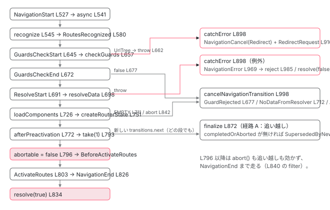

[目次](../README.md) › [Router の内側](README.md) › 第 8 回 / 全 21 回

# setupNavigations の全段：パイプラインの順番と中断のしくみ

> navigation\_transition.ts の switchMap の中を上から下へ。各段で出るイベント、takeUntil と abortController、take(1)、catchError が NavigationCancel / NavigationError / RedirectRequest に振り分ける条件、finalize と rollbackState。以降の章の地図。

angular/angular · 読了 約 15 分 · 中核 · [サイトで読む（デモが動きます）](https://angular-deep-dive-cyan.vercel.app/chapter/router-pipeline)

---

Router のナビゲーションは `navigation_transition.ts` の `setupNavigations` にある 1 本の RxJS パイプラインです。[概観](01-router.md)で「なぜ `switchMap` か」を、[boot 13 章](../boot/13-boot-spa-navigation.md)で主要な段の順番を見ました。この章はその精密版です。**447 行目から 1012 行目までを上から下へ、すべての段を 1 つの表に並べ**、各段で `events` に何が流れ、どの章で詳しく読むかを示します。後半は「途中で止まるとどこへ飛ぶか」です。新しいナビゲーションに追い越されたとき、`abort()` されたとき、ガードが拒否したとき、例外が投げられたとき、それぞれ `NavigationCancel` / `NavigationError` / `RedirectRequest` のどれになるかを、`finalize` と `catchError` の行で確かめます。

読む対象は `packages/router/src/navigation_transition.ts`、`packages/router/src/operators/switch_tap.ts`、`packages/router/src/utils/abort_signal_to_observable.ts`、`packages/router/src/navigation_canceling_error.ts`、`packages/router/src/router.ts` です。

1. 1 本の RxJS パイプライン
2. URL → UrlTree
3. routerLink の配列 → UrlTree
4. Route 設定の検証と正規化
5. provideRouter の中身
6. 最初のナビゲーション
7. navigateByUrl → NavigationTransition
8. **setupNavigations の全段**（この章）
9. Recognizer と match
10. redirectTo
11. loadChildren と loadComponent
12. ガードの実行順
13. resolve と data と title
14. ActivatedRoute と Snapshot
15. RouterOutlet への配置
16. ブラウザの URL と履歴
17. Router.events の全種類
18. RouterLink と RouterLinkActive
19. withViewTransitions
20. withRouterResources
21. Navigation API

## 1. 骨格：2 重の switchMap と 3 つのローカル変数

📄 `angular/packages/router/src/router.ts` L179–190 （▶ の行: 182）

```ts
179 │   constructor() {
180 │     this.resetConfig(this.config);
181 │ 
182 ▶     this.navigationTransitions.setupNavigations(this).subscribe({
183 │       error: (e) => {
184 │         // Note: This subscription is not unsubscribed when the `Router` is destroyed.
185 │         // This is intentional as the `Router` is generally never destroyed.
186 │         // If it is destroyed, the `events` subject is completed, which cleans up this subscription.
187 │       },
188 │     });
189 │     this.subscribeToNavigationEvents();
190 │   }
```

📄 `angular/packages/router/src/navigation_transition.ts` L447–460 （▶ の行: 448, 450, 453–458）

```ts
447 │   setupNavigations(router: Router): Observable<NavigationTransition> {
448 ▶     this.transitions = new BehaviorSubject<NavigationTransition | null>(null);
449 │     return this.transitions.pipe(
450 ▶       filter((t): t is NavigationTransition => t !== null),
451 │ 
452 │       // Using switchMap so we cancel executing navigations when a new one comes in
453 ▶       switchMap((overallTransitionState) => {
454 ▶         let abortable = true;
455 ▶         let completedOrAborted = false;
456 ▶         const abortController = new AbortController();
457 ▶         const shouldContinueNavigation = () => {
458 ▶           return !completedOrAborted && this.currentTransition?.id === overallTransitionState.id;
459 │         };
460 │         return of(overallTransitionState).pipe(
```

182 行目、`Router` のコンストラクタが 1 回だけ `setupNavigations(this).subscribe(...)` します。448 行目で `BehaviorSubject` を作り（初期値 `null`）、450 行目の `filter` で `null` を落とし、453 行目の `switchMap` に入ります。**この `switchMap` のコールバックが「1 回のナビゲーション」の全体**です。中で 3 つのローカル変数が作られます。

1. **454 行目：abortable = true**

   `Navigation.abort()` が効く区間を表します。796 行目（`BeforeActivateRoutes` の直前）で `false` になります。
2. **455 行目：completedOrAborted = false**

   「もう結果が出た」の印。`NavigationEnd`（820 行目）、`catchError`（899 行目）、内側 Observable の complete（853 行目）で `true`。`finalize` がこれを見て「結果が出ていないまま終わった」場合に `NavigationCancel` を補います（4 節）。
3. **456 行目：AbortController**

   `signal` は `recognize`（552 行目）や `setupAndRunResources`（771 行目）に渡され、`abort()` は `Navigation.abort`（497 行目、下の引用）と `finalize`（873 行目）から呼ばれます。
4. **457〜459 行目：shouldContinueNavigation()**

   「まだ結果が出ておらず、かつ自分が `currentTransition` である」。副作用を起こす直前（673・692・814 行目）にこれを確認し、追い越されていたら `EMPTY` を返して黙って終わります。

📄 `angular/packages/router/src/navigation_transition.ts` L461–477 （▶ の行: 461, 466, 476）

```ts
461 ▶           switchMap((t) => {
462 │             // It is possible that `switchMap` fails to cancel previous navigations if a new one happens synchronously while the operator
463 │             // is processing the `next` notification of that previous navigation. This can happen when a new navigation (say 2) cancels a
464 │             // previous one (1) and yet another navigation (3) happens synchronously in response to the `NavigationCancel` event for (1).
465 │             // https://github.com/ReactiveX/rxjs/issues/7455
466 ▶             if (this.navigationId > overallTransitionState.id) {
467 │               const cancellationReason =
468 │                 typeof ngDevMode === 'undefined' || ngDevMode
469 │                   ? `Navigation ID ${overallTransitionState.id} is not equal to the current navigation id ${this.navigationId}`
470 │                   : '';
471 │               this.cancelNavigationTransition(
472 │                 overallTransitionState,
473 │                 cancellationReason,
474 │                 NavigationCancellationCode.SupersededByNewNavigation,
475 │               );
476 ▶               return EMPTY;
477 │             }
```

461 行目、内側の `switchMap`。`of(overallTransitionState).pipe(...)` で 1 回だけ流し、その中に全段が並びます。466 行目の id 比較と、その先の同一 URL 判定・`UrlHandlingStrategy` 分岐は[前章](07-router-navigation-request.md)で読みました。2 節の表の根拠として、同じ範囲を説明なしで置いておきます。497 行目の `abort` と、3 つの分岐の終わり方（`return EMPTY` / `of(...)`）だけ目に入れてください。

📄 `angular/packages/router/src/navigation_transition.ts` L478–501 （▶ の行: 478, 481, 497）

```ts
478 ▶             this.currentTransition = overallTransitionState;
479 │             const lastSuccessfulNavigation = this.lastSuccessfulNavigation();
480 │             // Store the Navigation object
481 ▶             this.currentNavigation.set({
482 │               id: t.id,
483 │               initialUrl: t.rawUrl,
484 │               extractedUrl: t.extractedUrl,
485 │               targetBrowserUrl:
486 │                 typeof t.extras.browserUrl === 'string'
487 │                   ? this.urlSerializer.parse(t.extras.browserUrl)
488 │                   : t.extras.browserUrl,
489 │               trigger: t.source,
490 │               extras: t.extras,
491 │               previousNavigation: !lastSuccessfulNavigation
492 │                 ? null
493 │                 : {
494 │                     ...lastSuccessfulNavigation,
495 │                     previousNavigation: null,
496 │                   },
497 ▶               abort: () => abortController.abort(),
498 │ 
499 │               routesRecognizeHandler: t.routesRecognizeHandler,
500 │               beforeActivateHandler: t.beforeActivateHandler,
501 │             });
```

📄 `angular/packages/router/src/navigation_transition.ts` L502–521 （▶ の行: 506, 512, 519–520）

```ts
502 │             const urlTransition =
503 │               !router.navigated || this.isUpdatingInternalState() || this.isUpdatedBrowserUrl();
504 │ 
505 │             const onSameUrlNavigation = t.extras.onSameUrlNavigation ?? router.onSameUrlNavigation;
506 ▶             if (!urlTransition && onSameUrlNavigation !== 'reload') {
507 │               const reason =
508 │                 typeof ngDevMode === 'undefined' || ngDevMode
509 │                   ? `Navigation to ${t.rawUrl} was ignored because it is the same as the current Router URL.`
510 │                   : '';
511 │               this.events.next(
512 ▶                 new NavigationSkipped(
513 │                   t.id,
514 │                   this.urlSerializer.serialize(t.rawUrl),
515 │                   reason,
516 │                   NavigationSkippedCode.IgnoredSameUrlNavigation,
517 │                 ),
518 │               );
519 ▶               t.resolve(false);
520 ▶               return EMPTY;
521 │             }
```

📄 `angular/packages/router/src/navigation_transition.ts` L583–613 （▶ の行: 583, 591, 598, 613）

```ts
583 ▶             } else if (
584 │               urlTransition &&
585 │               this.urlHandlingStrategy.shouldProcessUrl(t.currentRawUrl)
586 │             ) {
587 │               /* When the current URL shouldn't be processed, but the previous one
588 │                * was, we handle this "error condition" by navigating to the
589 │                * previously successful URL, but leaving the URL intact.*/
590 │               const {id, extractedUrl, source, restoredState, extras} = t;
591 ▶               const navStart = new NavigationStart(
592 │                 id,
593 │                 this.urlSerializer.serialize(extractedUrl),
594 │                 source,
595 │                 restoredState,
596 │               );
597 │               this.events.next(navStart);
598 ▶               const targetSnapshot = createEmptyState(
599 │                 this.rootComponentType,
600 │                 this.environmentInjector,
601 │               ).snapshot;
602 │ 
603 │               this.currentTransition = overallTransitionState = {
604 │                 ...t,
605 │                 targetSnapshot,
606 │                 urlAfterRedirects: extractedUrl,
607 │                 extras: {...extras, skipLocationChange: false, replaceUrl: false},
608 │               };
609 │               this.currentNavigation.update((nav) => {
610 │                 nav!.finalUrl = extractedUrl;
611 │                 return nav;
612 │               });
613 ▶               return of(overallTransitionState);
```

📄 `angular/packages/router/src/navigation_transition.ts` L614–635 （▶ の行: 626, 633–634）

```ts
614 │             } else {
615 │               /* When neither the current or previous URL can be processed, do
616 │                * nothing other than update router's internal reference to the
617 │                * current "settled" URL. This way the next navigation will be coming
618 │                * from the current URL in the browser.
619 │                */
620 │               const reason =
621 │                 typeof ngDevMode === 'undefined' || ngDevMode
622 │                   ? `Navigation was ignored because the UrlHandlingStrategy` +
623 │                     ` indicated neither the current URL ${t.currentRawUrl} nor target URL ${t.rawUrl} should be processed.`
624 │                   : '';
625 │               this.events.next(
626 ▶                 new NavigationSkipped(
627 │                   t.id,
628 │                   this.urlSerializer.serialize(t.extractedUrl),
629 │                   reason,
630 │                   NavigationSkippedCode.IgnoredByUrlHandlingStrategy,
631 │                 ),
632 │               );
633 ▶               t.resolve(false);
634 ▶               return EMPTY;
635 │             }
```

この章は `NavigationStart` を出した後、637 行目から先を扱います。

## 2. 全段の表

上から下へ、演算子 1 つを 1 行にしました。「イベント」列は `this.events.next(...)` で流れるもので、括弧付きは `Router.events` には出ない内部イベントです（router.ts 254 行目 `isPublicRouterEvent` で除かれる。6 節）。

| 行 | 演算子 / 処理 | イベント | 詳しくは |
| --- | --- | --- | --- |
| 450 | `filter`：null を落とす |   | この章 |
| 453 | 外側 `switchMap`：1 ナビゲーション。新しい値で前を unsubscribe |   | [概観](01-router.md) |
| 461〜477 | 内側 `switchMap` 先頭：id が古ければ cancel | `NavigationCancel`(SupersededByNewNavigation) | [第 7 回](07-router-navigation-request.md) |
| 478〜501 | `currentTransition` / `currentNavigation` を設定 |   | [第 7 回](07-router-navigation-request.md) |
| 502〜521 | 同じ URL なら skip | `NavigationSkipped`(IgnoredSameUrlNavigation) | [第 7 回](07-router-navigation-request.md) |
| 523〜542 | `shouldProcessUrl` → `NavigationStart` → `Promise.resolve` で非同期化 | `NavigationStart` | [第 7 回](07-router-navigation-request.md) |
| 545〜553 | `recognize`：URL と Route の照合、redirectTo、loadChildren | `RouteConfigLoadStart` / `RouteConfigLoadEnd`（遅延ロード時） | [第 9 回](09-router-recognize.md)・[第 10 回](10-router-redirects.md)・[第 11 回](11-router-lazy-loading.md) |
| 556〜564 | `tap`：`targetSnapshot` / `urlAfterRedirects` / `finalUrl` を記録 | (`BeforeRoutesRecognized`) | この章 |
| 566〜570 | `routesRecognizeHandler.deferredHandle` を待つ |   | [第 21 回](21-router-platform-navigation.md) |
| 572〜581 | `tap`：RoutesRecognized（`'eager'` ならここで URL 更新） | `RoutesRecognized` | [第 16 回](16-router-browser-url.md) |
| 583〜635 | `UrlHandlingStrategy` の 2 分岐 | `NavigationStart` / `NavigationSkipped`(IgnoredByUrlHandlingStrategy) | [第 7 回](07-router-navigation-request.md) |
| 638〜655 | `map`：GuardsCheckStart、`getAllRouteGuards` で検査対象を集める | `GuardsCheckStart` | [第 12 回](12-router-guards.md) |
| 657 | `checkGuards`：canDeactivate → canActivateChild → canActivate | `ChildActivationStart` / `ActivationStart` | [第 12 回](12-router-guards.md) |
| 659〜679 | `switchMap`：UrlTree なら throw、GuardsCheckEnd、false なら cancel | `GuardsCheckEnd` / `NavigationCancel`(GuardRejected) | [第 12 回](12-router-guards.md) |
| 681〜694 | canActivateChecks が 0 なら resolve を飛ばす。ResolveStart | `ResolveStart` | [第 13 回](13-router-resolvers.md) |
| 697〜722 | `resolveData`、ResolveEnd、値が無ければ cancel | `ResolveEnd` / `NavigationCancel`(NoDataFromResolver) | [第 13 回](13-router-resolvers.md) |
| 726〜748 | `switchTap`：loadComponent を全部待つ |   | [第 11 回](11-router-lazy-loading.md) |
| 750〜769 | `switchMap`：`createRouterState`（ActivatedRoute の木） |   | [第 14 回](14-router-router-state.md) |
| 771 | `setupAndRunResources`（feature があるとき） |   | [第 20 回](20-router-resources.md) |
| 772 | `switchTap(afterPreactivation)`：enabledBlocking の待ち合わせ |   | [第 6 回](06-router-initial-navigation.md) |
| 774〜788 | `createViewTransition`（feature があるとき） |   | [第 19 回](19-router-view-transitions.md) |
| 793 | `take(1)`：安全弁 |   | この章 |
| 795〜800 | `switchMap`：abortable = false、BeforeActivateRoutes（URL 更新はここ）、deferredHandle | (`BeforeActivateRoutes`) | [第 16 回](16-router-browser-url.md) |
| 802〜835 | `tap`：`ActivateRoutes.activate`、NavigationEnd、updateTitle、resolve(true) | `ChildActivationEnd` / `ActivationEnd` / `NavigationEnd` | [第 15 回](15-router-activate-routes.md) |
| 837〜849 | `takeUntil(abort)` | `NavigationCancel`(Aborted) | この章 4 節 |
| 851〜855 | `tap(complete)`：completedOrAborted = true |   | この章 |
| 864〜870 | `takeUntil(transitionAbortWithErrorSubject)`：外からの例外 | → catchError へ | この章 4 節 |
| 872〜897 | `finalize`：abort、取りこぼした cancel の補完、currentNavigation を null | `NavigationCancel`(SupersededByNewNavigation) | この章 4 節 |
| 898〜991 | `catchError`：Redirect / Cancel / Error の振り分け | `NavigationCancel` / (`RedirectRequest`) / `NavigationError` | この章 5 節 |

> [!TIP]
> **新卒エンジニアへ**
>
> 17 種類の公開イベント（[第 17 回](17-router-events.md)）のうち、この表に出てこないのは `Scroll` だけです。`Scroll` は `RouterScroller` が `NavigationEnd` を受けて自分で流します。

## 3. 各段の行を順に確認する

表の根拠になる行を上から見ていきます。各段の中身は担当の章に任せ、ここでは「何を受け取り、何を `overallTransitionState` に書き、何を流すか」だけを指します。

📄 `angular/packages/router/src/navigation_transition.ts` L523–553 （▶ の行: 527, 541, 545, 552）

```ts
523 │             if (this.urlHandlingStrategy.shouldProcessUrl(t.rawUrl)) {
524 │               return of(t).pipe(
525 │                 // Fire NavigationStart event
526 │                 switchMap((t) => {
527 ▶                   this.events.next(
528 │                     new NavigationStart(
529 │                       t.id,
530 │                       this.urlSerializer.serialize(t.extractedUrl),
531 │                       t.source,
532 │                       t.restoredState,
533 │                     ),
534 │                   );
535 │                   if (t.id !== this.navigationId) {
536 │                     return EMPTY;
537 │                   }
538 │ 
539 │                   // This delay is required to match old behavior that forced
540 │                   // navigation to always be async
541 ▶                   return Promise.resolve(t);
542 │                 }),
543 │ 
544 │                 // Recognize
545 ▶                 recognize(
546 │                   this.environmentInjector,
547 │                   this.configLoader,
548 │                   this.rootComponentType,
549 │                   router.config,
550 │                   this.urlSerializer,
551 │                   this.paramsInheritanceStrategy,
552 ▶                   abortController.signal,
553 │                 ),
```

527 行目 `NavigationStart`、541 行目で非同期化、545〜553 行目 `recognize`。**552 行目で `abortController.signal` を渡している**ので、照合中に `abort()` されれば `recognize` の中で例外になります。

📄 `angular/packages/router/src/navigation_transition.ts` L555–582 （▶ の行: 557–558, 560, 563, 568, 574, 580）

```ts
555 │                 // Update URL if in `eager` update mode
556 │                 tap((t) => {
557 ▶                   overallTransitionState.targetSnapshot = t.targetSnapshot;
558 ▶                   overallTransitionState.urlAfterRedirects = t.urlAfterRedirects;
559 │                   this.currentNavigation.update((nav) => {
560 ▶                     nav!.finalUrl = t.urlAfterRedirects;
561 │                     return nav;
562 │                   });
563 ▶                   this.events.next(new BeforeRoutesRecognized());
564 │                 }),
565 │ 
566 │                 switchMap((value) =>
567 │                   from(
568 ▶                     overallTransitionState.routesRecognizeHandler.deferredHandle ?? of(void 0),
569 │                   ).pipe(map(() => value)),
570 │                 ),
571 │ 
572 │                 tap(() => {
573 │                   // Fire RoutesRecognized
574 ▶                   const routesRecognized = new RoutesRecognized(
575 │                     t.id,
576 │                     this.urlSerializer.serialize(t.extractedUrl),
577 │                     this.urlSerializer.serialize(t.urlAfterRedirects!),
578 │                     t.targetSnapshot!,
579 │                   );
580 ▶                   this.events.next(routesRecognized);
581 │                 }),
582 │               );
```

557〜558 行目、`recognize` の結果（`targetSnapshot` と `urlAfterRedirects`）を `overallTransitionState` に書き戻します。`t` は各演算子が `{...t}` で作る新しいオブジェクトなので、外側の変数に書き戻さないと `finalize` や `catchError` から見えません。560 行目で `Navigation.finalUrl` が埋まり、563 行目で内部イベント `BeforeRoutesRecognized`。568 行目、`routesRecognizeHandler.deferredHandle` があれば待ちます（Navigation API 連携、[第 21 回](21-router-platform-navigation.md)）。574〜580 行目 `RoutesRecognized`。`urlUpdateStrategy: 'eager'` のとき URL バーが変わるのはこのイベントを受けた `HistoryStateManager` です。

📄 `angular/packages/router/src/navigation_transition.ts` L638–657 （▶ の行: 639, 645, 650, 652, 657）

```ts
638 │           map((t) => {
639 ▶             const guardsStart = new GuardsCheckStart(
640 │               t.id,
641 │               this.urlSerializer.serialize(t.extractedUrl),
642 │               this.urlSerializer.serialize(t.urlAfterRedirects!),
643 │               t.targetSnapshot!,
644 │             );
645 ▶             this.events.next(guardsStart);
646 │             // Note we don't have to check shouldContinueNavigation here because we don't do anything
647 │             // in the remainder of this operator that has side effects. If `checkGuards` is combined into
648 │             // this operators, we would need to ensure we check shouldContinueNavigation before running the guards.
649 │ 
650 ▶             this.currentTransition = overallTransitionState = {
651 │               ...t,
652 ▶               guards: getAllRouteGuards(t.targetSnapshot!, t.currentSnapshot, this.rootContexts),
653 │             };
654 │             return overallTransitionState;
655 │           }),
656 │ 
657 ▶           checkGuards((evt: Event) => this.events.next(evt)),
```

📄 `angular/packages/router/src/navigation_transition.ts` L659–683 （▶ の行: 660–662, 665, 672–673, 676–677, 681–682）

```ts
659 │           switchMap((t) => {
660 ▶             overallTransitionState.guardsResult = t.guardsResult;
661 ▶             if (t.guardsResult && typeof t.guardsResult !== 'boolean') {
662 ▶               throw redirectingNavigationError(this.urlSerializer, t.guardsResult);
663 │             }
664 │ 
665 ▶             const guardsEnd = new GuardsCheckEnd(
666 │               t.id,
667 │               this.urlSerializer.serialize(t.extractedUrl),
668 │               this.urlSerializer.serialize(t.urlAfterRedirects!),
669 │               t.targetSnapshot!,
670 │               !!t.guardsResult,
671 │             );
672 ▶             this.events.next(guardsEnd);
673 ▶             if (!shouldContinueNavigation()) {
674 │               return EMPTY;
675 │             }
676 ▶             if (!t.guardsResult) {
677 ▶               this.cancelNavigationTransition(t, '', NavigationCancellationCode.GuardRejected);
678 │               return EMPTY;
679 │             }
680 │ 
681 ▶             if (t.guards.canActivateChecks.length === 0) {
682 ▶               return of(t);
683 │             }
```

1. **639〜645 行目：GuardsCheckStart、652 行目：getAllRouteGuards**

   現在の木と目標の木を比べて、どの `ActivatedRouteSnapshot` に `canDeactivate` / `canActivate` を走らせるかのリストを作ります （[第 12 回](12-router-guards.md)）。646〜648 行目のコメント、「ここは副作用が無いので `shouldContinueNavigation` を見なくてよい」。
2. **657 行目：checkGuards**

   実行結果を `guardsResult`（`boolean` か `UrlTree`）に入れて返します。
3. **661〜662 行目：UrlTree なら throw**

   `redirectingNavigationError`（5 節）を投げます。**ガードのリダイレクトは例外として `catchError` に飛ぶ**設計です。`GuardsCheckEnd` は出ません。
4. **665〜672 行目：GuardsCheckEnd、673〜675 行目：追い越し確認、676〜678 行目：false なら cancel**

   `GuardsCheckEnd` は `shouldActivate: false` でも出ます。その後 677 行目 `cancelNavigationTransition(GuardRejected)` → `EMPTY`。
5. **681〜683 行目：canActivateChecks が 0 なら resolve 段を丸ごと飛ばす**

   活性化される Route が 1 つも無ければ（同じ Route でパラメータだけ変わるなど、再利用されるとき）`ResolveStart` も `ResolveEnd` も出ません。

📄 `angular/packages/router/src/navigation_transition.ts` L685–723 （▶ の行: 685, 691–692, 696, 698, 701–702, 710–712, 717）

```ts
685 ▶             const resolveStart = new ResolveStart(
686 │               t.id,
687 │               this.urlSerializer.serialize(t.extractedUrl),
688 │               this.urlSerializer.serialize(t.urlAfterRedirects!),
689 │               t.targetSnapshot!,
690 │             );
691 ▶             this.events.next(resolveStart);
692 ▶             if (!shouldContinueNavigation()) {
693 │               return EMPTY;
694 │             }
695 │ 
696 ▶             let dataResolved = false;
697 │             return of(t).pipe(
698 ▶               resolveData(this.paramsInheritanceStrategy),
699 │               tap({
700 │                 next: () => {
701 ▶                   dataResolved = true;
702 ▶                   const resolveEnd = new ResolveEnd(
703 │                     t.id,
704 │                     this.urlSerializer.serialize(t.extractedUrl),
705 │                     this.urlSerializer.serialize(t.urlAfterRedirects!),
706 │                     t.targetSnapshot!,
707 │                   );
708 │                   this.events.next(resolveEnd);
709 │                 },
710 ▶                 complete: () => {
711 ▶                   if (!dataResolved) {
712 ▶                     this.cancelNavigationTransition(
713 │                       t,
714 │                       typeof ngDevMode === 'undefined' || ngDevMode
715 │                         ? `At least one route resolver didn't emit any value.`
716 │                         : '',
717 ▶                       NavigationCancellationCode.NoDataFromResolver,
718 │                     );
719 │                   }
720 │                 },
721 │               }),
722 │             );
723 │           }),
```

685〜691 行目 `ResolveStart`、692〜694 行目で再び追い越し確認、698 行目 `resolveData`。701 行目、値が 1 つでも来たら `dataResolved = true` にして 702〜708 行目 `ResolveEnd`。**710〜719 行目、値が来ずに complete したら `NoDataFromResolver` で cancel**。resolver が `EMPTY` を返したり、`Observable` が値を出す前に complete すると、ここでナビゲーションは失敗します（[第 13 回](13-router-resolvers.md)）。

📄 `angular/packages/router/src/navigation_transition.ts` L725–748 （▶ の行: 726, 729–731, 734, 746–747）

```ts
725 │           // --- LOAD COMPONENTS ---
726 ▶           switchTap((t: NavigationTransition) => {
727 │             const loadComponents = (route: ActivatedRouteSnapshot): Array<Promise<void>> => {
728 │               const loaders: Array<Promise<void>> = [];
729 ▶               if (route.routeConfig?._loadedComponent) {
730 ▶                 route.component = route.routeConfig?._loadedComponent;
731 ▶               } else if (route.routeConfig?.loadComponent) {
732 │                 const injector = route._environmentInjector;
733 │                 loaders.push(
734 ▶                   this.configLoader
735 │                     .loadComponent(injector, route.routeConfig)
736 │                     .then((loadedComponent) => {
737 │                       route.component = loadedComponent;
738 │                     }),
739 │                 );
740 │               }
741 │               for (const child of route.children) {
742 │                 loaders.push(...loadComponents(child));
743 │               }
744 │               return loaders;
745 │             };
746 ▶             const loaders = loadComponents(t.targetSnapshot!.root);
747 ▶             return loaders.length === 0 ? of(t) : from(Promise.all(loaders).then(() => t));
748 │           }),
```

📄 `angular/packages/router/src/operators/switch_tap.ts` L12–28 （▶ の行: 21–24, 26）

```ts
12 │ /**
13 │  * Perform a side effect through a switchMap for every emission on the source Observable,
14 │  * but return an Observable that is identical to the source. It's essentially the same as
15 │  * the `tap` operator, but if the side effectful `next` function returns an ObservableInput,
16 │  * it will wait before continuing with the original value.
17 │  */
18 │ export function switchTap<T>(
19 │   next: (x: T) => void | ObservableInput<any>,
20 │ ): MonoTypeOperatorFunction<T> {
21 ▶   return switchMap((v) => {
22 ▶     const nextResult = next(v);
23 ▶     if (nextResult) {
24 ▶       return from(nextResult).pipe(map(() => v));
25 │     }
26 ▶     return of(v);
27 │   });
28 │ }
```

726 行目 `switchTap`。実装は switch\_tap.ts 21〜27 行目、`switchMap` の中で副作用を呼び、戻り値が Observable 相当なら 24 行目でそれを待ってから **元の値 `v` を流す**、無ければ 26 行目でそのまま流す演算子です。「待つが、値は変えない `tap`」です。729〜730 行目、既にロード済みなら即代入。731〜738 行目、`loadComponent` があれば `import()` を Promise に積み、746〜747 行目で `Promise.all`。**ガードを通過した後**なので、入れないページの JS はダウンロードされません。

📄 `angular/packages/router/src/navigation_transition.ts` L750–769 （▶ の行: 751, 761–762, 765）

```ts
750 │           switchMap((t: NavigationTransition) => {
751 ▶             const {newlyCreatedRoutes, state} = createRouterState(
752 │               router.routeReuseStrategy,
753 │               t.targetSnapshot!,
754 │               t.currentRouterState,
755 │             );
756 │             this.currentTransition =
757 │               overallTransitionState =
758 │               t =
759 │                 {
760 │                   ...t,
761 ▶                   targetRouterState: state,
762 ▶                   newlyCreatedRoutes,
763 │                 };
764 │             this.currentNavigation.update((nav) => {
765 ▶               nav!.targetRouterState = state;
766 │               return nav;
767 │             });
768 │             return of(t);
769 │           }),
```

751 行目 `createRouterState`。`RouteReuseStrategy` を見ながら `ActivatedRouteSnapshot` の木から `ActivatedRoute`（`Observable` 付き）の木を作ります（[第 14 回](14-router-router-state.md)）。761〜762 行目で `targetRouterState` と `newlyCreatedRoutes`（新しく作った Route の集合。失敗時の片付けに使う。7 節）を記録、765 行目で `Navigation` にも書きます。

📄 `angular/packages/router/src/navigation_transition.ts` L771–793 （▶ の行: 771–772, 776, 785–786, 793）

```ts
771 ▶           this.routerResourcesFeature?.setupAndRunResources(abortController.signal) ?? ((t) => t),
772 ▶           switchTap(() => this.afterPreactivation()),
773 │ 
774 │           switchMap(() => {
775 │             const {currentSnapshot, targetSnapshot} = overallTransitionState;
776 ▶             const viewTransitionStarted = this.createViewTransition?.(
777 │               this.environmentInjector,
778 │               currentSnapshot.root,
779 │               targetSnapshot!.root,
780 │               overallTransitionState.hasUAVisualTransition,
781 │             );
782 │ 
783 │             // If view transitions are enabled, block the navigation until the view
784 │             // transition callback starts. Otherwise, continue immediately.
785 ▶             return viewTransitionStarted
786 ▶               ? from(viewTransitionStarted).pipe(map(() => overallTransitionState))
787 │               : of(overallTransitionState);
788 │           }),
789 │ 
790 │           // Ensure that if some observable used to drive the transition doesn't
791 │           // complete, the navigation still finalizes This should never happen, but
792 │           // this is done as a safety measure to avoid surfacing this error (#49567).
793 ▶           take(1),
```

1. **771 行目：setupAndRunResources**

   `withRouterResources` が無ければ `(t) => t`、つまり何もしない演算子に置き換わります（[第 20 回](20-router-resources.md)）。
2. **772 行目：afterPreactivation**

   既定は `of(void 0)` を返す関数で即通過。`enabledBlocking` が `bootstrapDone` を返す関数に差し替えます（[第 6 回](06-router-initial-navigation.md)）。
3. **776〜787 行目：createViewTransition**

   `withViewTransitions` が無ければ `undefined` なので 787 行目で即通過。あれば 785〜786 行目、`document.startViewTransition` のコールバックが呼ばれるまで待ちます（[第 19 回](19-router-view-transitions.md)）。
4. **793 行目：take(1)**

   790〜792 行目のコメント。「遷移を動かす Observable のどれかが complete しなくても、ナビゲーションが finalize するように。起きないはずだが、issue #49567 を表に出さないための安全策」。この後の演算子は 1 回しか走りません。

📄 `angular/packages/router/src/navigation_transition.ts` L795–835 （▶ の行: 796–798, 803, 809, 812, 814, 818, 820, 822, 825–826, 833–834）

```ts
795 │           switchMap((t: NavigationTransition) => {
796 ▶             abortable = false;
797 ▶             this.events.next(new BeforeActivateRoutes());
798 ▶             const deferred = overallTransitionState.beforeActivateHandler.deferredHandle;
799 │             return deferred ? from(deferred.then(() => t)) : of(t);
800 │           }),
801 │ 
802 │           tap((t: NavigationTransition) => {
803 ▶             new ActivateRoutes(
804 │               router.routeReuseStrategy,
805 │               overallTransitionState.targetRouterState!,
806 │               overallTransitionState.currentRouterState,
807 │               (evt: Event) => this.events.next(evt),
808 │               this.inputBindingEnabled,
809 ▶             ).activate(this.rootContexts);
810 │ 
811 │             // Prevent any cleanup of newly created routes once activated.
812 ▶             t.newlyCreatedRoutes?.clear();
813 │ 
814 ▶             if (!shouldContinueNavigation()) {
815 │               return;
816 │             }
817 │ 
818 ▶             resetPendingRoutes(t.targetRouterState);
819 │ 
820 ▶             completedOrAborted = true;
821 │             this.currentNavigation.update((nav) => {
822 ▶               (nav as Writable<Navigation>).abort = noop;
823 │               return nav;
824 │             });
825 ▶             this.lastSuccessfulNavigation.set(untracked(this.currentNavigation));
826 ▶             this.events.next(
827 │               new NavigationEnd(
828 │                 t.id,
829 │                 this.urlSerializer.serialize(t.extractedUrl),
830 │                 this.urlSerializer.serialize(t.urlAfterRedirects!),
831 │               ),
832 │             );
833 ▶             this.titleStrategy?.updateTitle(t.targetRouterState!.snapshot);
834 ▶             t.resolve(true);
835 │           }),
```

1. **796 行目：abortable = false**

   ここから先、`Navigation.abort()` は何もしません（4 節 840 行目）。URL と DOM を変え始めるので、途中で止めると矛盾した状態になるからです。
2. **797〜799 行目：BeforeActivateRoutes**

   内部イベント。`HistoryStateManager` がこれを受けて `history.pushState`（[第 16 回](16-router-browser-url.md)）。798〜799 行目、`beforeActivateHandler.deferredHandle` があれば待ちます。
3. **803〜809 行目：ActivateRoutes.activate**

   `RouterOutlet` への配置（[第 15 回](15-router-activate-routes.md)）。812 行目、無事に置けたので `newlyCreatedRoutes` を空にし、失敗時の片付け対象から外します。
4. **814〜816 行目：最後の追い越し確認、818 行目：pending を下ろす**

   `resetPendingRoutes`（7 節）で各 `ActivatedRoute.pending` signal を `false` に。
5. **820〜834 行目：完了**

   820 行目 `completedOrAborted = true`、822 行目 `abort` を noop に差し替え、825 行目 `lastSuccessfulNavigation` を更新、826〜832 行目 `NavigationEnd`、**833 行目 `titleStrategy.updateTitle`**（`document.title` が変わるのは `NavigationEnd` の後、[第 13 回](13-router-resolvers.md)）、834 行目 `resolve(true)`。

## 4. 中断：止める経路は 3 つ、気づく場所は finalize

📄 `angular/packages/router/src/navigation_transition.ts` L837–870 （▶ の行: 837–838, 840, 842, 845, 853, 864–865, 867）

```ts
837 ▶           takeUntil(
838 ▶             abortSignalToObservable(abortController.signal).pipe(
839 │               // Ignore aborts if we are already completed, canceled, or the transition has entered the non-abortable activation stage
840 ▶               filter(() => !completedOrAborted && abortable),
841 │               tap(() => {
842 ▶                 this.cancelNavigationTransition(
843 │                   overallTransitionState,
844 │                   abortController.signal.reason + '',
845 ▶                   NavigationCancellationCode.Aborted,
846 │                 );
847 │               }),
848 │             ),
849 │           ),
850 │ 
851 │           tap({
852 │             complete: () => {
853 ▶               completedOrAborted = true;
854 │             },
855 │           }),
856 │ 
857 │           // There used to be a lot more logic happening directly within the
858 │           // transition Observable. Some of this logic has been refactored out to
859 │           // other places but there may still be errors that happen there. This gives
860 │           // us a way to cancel the transition from the outside. This may also be
861 │           // required in the future to support something like the abort signal of the
862 │           // Navigation API where the navigation gets aborted from outside the
863 │           // transition.
864 ▶           takeUntil(
865 ▶             this.transitionAbortWithErrorSubject.pipe(
866 │               tap((err) => {
867 ▶                 throw err;
868 │               }),
869 │             ),
870 │           ),
```

📄 `angular/packages/router/src/utils/abort_signal_to_observable.ts` L12–29 （▶ の行: 18–19, 22–24, 26）

```ts
12 │ /**
13 │  * Converts an AbortSignal to an Observable<void>.
14 │  * Emits and completes when the signal is aborted.
15 │  * If the signal is already aborted, it emits and completes immediately.
16 │  */
17 │ export function abortSignalToObservable(signal: AbortSignal): Observable<void> {
18 ▶   if (signal.aborted) {
19 ▶     return of(undefined).pipe(take(1)); // Emit and complete immediately
20 │   }
21 │   return new Observable<void>((subscriber) => {
22 ▶     const handler = () => {
23 ▶       subscriber.next();
24 ▶       subscriber.complete();
25 │     };
26 ▶     signal.addEventListener('abort', handler);
27 │     return () => signal.removeEventListener('abort', handler);
28 │   });
29 │ }
```

1. **経路 A：外側の switchMap（453 行目）による unsubscribe**

   新しい `NavigationTransition` が `transitions.next` されると、RxJS の `switchMap` が前の内側 Observable を unsubscribe します。**イベントは何も流れず、872 行目の `finalize` だけが走ります**。走っていたガードや resolver の Observable は購読を切られます。
2. **経路 B：837〜849 行目 takeUntil(abort)**

   `abortSignalToObservable`（abort\_signal\_to\_observable.ts 18〜28 行目）は `AbortSignal` の `'abort'` イベントを 1 回だけ流す Observable です。840 行目の `filter` が肝で、**`completedOrAborted` が立っているか `abortable` が下りていれば無視**。通過したら 842〜846 行目で `cancelNavigationTransition(Aborted)`、そして `takeUntil` が内側を complete させます。`finalize` も 873 行目で `abort()` を呼びますが、そのときは既に `completedOrAborted` なので 840 行目で止まります。
3. **経路 C：864〜870 行目 takeUntil(transitionAbortWithErrorSubject)**

   `Router.subscribeToNavigationEvents`（6 節）がイベント処理中に例外を捕まえると、この Subject に流します。867 行目で `throw err` するので、`takeUntil` の通知ではなく**エラー**として 898 行目の `catchError` に入ります。857〜863 行目のコメント、「以前はもっと多くのロジックが Observable の中にあった。外に出した処理で起きた例外を、外から遷移に伝える手段」。
4. **853 行目：complete で completedOrAborted = true**

   内側が正常に complete した（`EMPTY` を返した cancel 系も含む）ときに立ちます。これにより `finalize` で二重に `NavigationCancel` が出ることを防ぎます。

📄 `angular/packages/router/src/navigation_transition.ts` L872–897 （▶ の行: 872–873, 880, 885, 888, 893–895）

```ts
872 ▶           finalize(() => {
873 ▶             abortController.abort();
874 │             /* When the navigation stream finishes either through error or success,
875 │              * we set the `completed` or `errored` flag. However, there are some
876 │              * situations where we could get here without either of those being set.
877 │              * For instance, a redirect during NavigationStart. Therefore, this is a
878 │              * catch-all to make sure the NavigationCancel event is fired when a
879 │              * navigation gets cancelled but not caught by other means. */
880 ▶             if (!completedOrAborted) {
881 │               const cancelationReason =
882 │                 typeof ngDevMode === 'undefined' || ngDevMode
883 │                   ? `Navigation ID ${overallTransitionState.id} is not equal to the current navigation id ${this.navigationId}`
884 │                   : '';
885 ▶               this.cancelNavigationTransition(
886 │                 overallTransitionState,
887 │                 cancelationReason,
888 ▶                 NavigationCancellationCode.SupersededByNewNavigation,
889 │               );
890 │             }
891 │             // Only clear current navigation if it is still set to the one that
892 │             // finalized.
893 ▶             if (this.currentTransition?.id === overallTransitionState.id) {
894 ▶               this.currentNavigation.set(null);
895 ▶               this.currentTransition = null;
896 │             }
897 │           }),
```

872 行目 `finalize` は、成功・エラー・unsubscribe のどれでも必ず走ります。873 行目で `abortController.abort()`。走りかけの `recognize` や resolver に「もう要らない」を伝えます。**880〜890 行目、`completedOrAborted` が立っていなければ `SupersededByNewNavigation` で cancel**。経路 A で unsubscribe されたナビゲーションはここで初めて `NavigationCancel` を流し、`resolve(false)` されます。874〜879 行目のコメント、「`NavigationStart` 中のリダイレクトのように、どちらのフラグも立たずにここへ来る場合がある。取りこぼしを防ぐ catch-all」。893〜896 行目、`currentTransition` が自分のままなら `null` に戻します。追い越された側は、既に新しい方が `currentTransition` なので触りません。

## 5. catchError：3 種類の出口

📄 `angular/packages/router/src/navigation_transition.ts` L898–932 （▶ の行: 898–900, 904–905, 909–910, 915–916, 927–928, 930）

```ts
898 ▶           catchError((e) => {
899 ▶             completedOrAborted = true;
900 ▶             rollbackState(overallTransitionState);
901 │             // If the application is already destroyed, the catch block should not
902 │             // execute anything in practice because other resources have already
903 │             // been released and destroyed.
904 ▶             if (this.destroyed) {
905 ▶               overallTransitionState.resolve(false);
906 │               return EMPTY;
907 │             }
908 │ 
909 ▶             if (e instanceof RedirectCommand) {
910 ▶               e = redirectingNavigationError(this.urlSerializer, e);
911 │             }
912 │ 
913 │             /* This error type is issued during Redirect, and is handled as a
914 │              * cancellation rather than an error. */
915 ▶             if (isNavigationCancelingError(e)) {
916 ▶               this.events.next(
917 │                 new NavigationCancel(
918 │                   overallTransitionState.id,
919 │                   this.urlSerializer.serialize(overallTransitionState.extractedUrl),
920 │                   e.message,
921 │                   e.cancellationCode,
922 │                 ),
923 │               );
924 │ 
925 │               // When redirecting, we need to delay resolving the navigation
926 │               // promise and push it to the redirect navigation
927 ▶               if (!isRedirectingNavigationCancelingError(e)) {
928 ▶                 overallTransitionState.resolve(false);
929 │               } else {
930 ▶                 this.events.next(new RedirectRequest(e.url, e.navigationBehaviorOptions));
931 │               }
932 │ 
```

📄 `angular/packages/router/src/navigation_canceling_error.ts` L25–49 （▶ の行: 25, 32, 34, 36–37, 45–47）

```ts
25 ▶ export function redirectingNavigationError(
26 │   urlSerializer: UrlSerializer,
27 │   redirect: UrlTree | RedirectCommand,
28 │ ): RedirectingNavigationCancelingError {
29 │   const {redirectTo, navigationBehaviorOptions} = isUrlTree(redirect)
30 │     ? {redirectTo: redirect, navigationBehaviorOptions: undefined}
31 │     : redirect;
32 ▶   const error = navigationCancelingError(
33 │     ngDevMode && `Redirecting to "${urlSerializer.serialize(redirectTo)}"`,
34 ▶     NavigationCancellationCode.Redirect,
35 │   ) as RedirectingNavigationCancelingError;
36 ▶   error.url = redirectTo;
37 ▶   error.navigationBehaviorOptions = navigationBehaviorOptions;
38 │   return error;
39 │ }
40 │ 
41 │ export function navigationCancelingError(
42 │   message: string | null | false,
43 │   code: NavigationCancellationCode,
44 │ ) {
45 ▶   const error = new Error(`NavigationCancelingError: ${message || ''}`) as NavigationCancelingError;
46 ▶   error[NAVIGATION_CANCELING_ERROR] = true;
47 ▶   error.cancellationCode = code;
48 │   return error;
49 │ }
```

1. **899〜900 行目：フラグを立て、rollbackState**

   どの出口でも共通です。`rollbackState` は 7 節。
2. **904〜907 行目：アプリ破棄後は resolve(false) のみ**
3. **909〜911 行目：RedirectCommand を NavigationCancelingError に変換**

   ガードが `RedirectCommand` を throw した場合です。`redirectingNavigationError`（navigation\_canceling\_error.ts 25〜39 行目）は 45〜47 行目の `navigationCancelingError` で `Error` に印と `cancellationCode: Redirect` を付け、36〜37 行目で `url` と `navigationBehaviorOptions` を足したものです。3 節 662 行目で `UrlTree` から作ったのも同じ型です。
4. **915〜923 行目：NavigationCancelingError なら NavigationCancel**

   code は例外に付いていたもの（`Redirect`、あるいは `canLoad` が `false` を返したときの `GuardRejected`）。
5. **927〜931 行目：url 付きなら RedirectRequest、無ければ resolve(false)**

   **リダイレクトのときは Promise を resolve しません**。925〜926 行目のコメント、「リダイレクト先のナビゲーションに Promise を引き渡す」。内部イベント `RedirectRequest` を流し、受け手は 6 節の `Router` です。

📄 `angular/packages/router/src/navigation_transition.ts` L933–971 （▶ の行: 936, 940, 944, 946, 949, 954, 962, 969–970）

```ts
933 │               /* All other errors should reset to the router's internal URL reference
934 │                * to the pre-error state. */
935 │             } else {
936 ▶               const navigationError = new NavigationError(
937 │                 overallTransitionState.id,
938 │                 this.urlSerializer.serialize(overallTransitionState.extractedUrl),
939 │                 e,
940 ▶                 overallTransitionState.targetSnapshot ?? undefined,
941 │               );
942 │ 
943 │               try {
944 ▶                 const navigationErrorHandlerResult = runInInjectionContext(
945 │                   this.environmentInjector,
946 ▶                   () => this.navigationErrorHandler?.(navigationError),
947 │                 );
948 │ 
949 ▶                 if (navigationErrorHandlerResult instanceof RedirectCommand) {
950 │                   const {message, cancellationCode} = redirectingNavigationError(
951 │                     this.urlSerializer,
952 │                     navigationErrorHandlerResult,
953 │                   );
954 ▶                   this.events.next(
955 │                     new NavigationCancel(
956 │                       overallTransitionState.id,
957 │                       this.urlSerializer.serialize(overallTransitionState.extractedUrl),
958 │                       message,
959 │                       cancellationCode,
960 │                     ),
961 │                   );
962 ▶                   this.events.next(
963 │                     new RedirectRequest(
964 │                       navigationErrorHandlerResult.redirectTo,
965 │                       navigationErrorHandlerResult.navigationBehaviorOptions,
966 │                     ),
967 │                   );
968 │                 } else {
969 ▶                   this.events.next(navigationError);
970 ▶                   throw e;
971 │                 }
```

📄 `angular/packages/router/src/navigation_transition.ts` L972–996 （▶ の行: 982–983, 985, 990）

```ts
972 │               } catch (ee) {
973 │                 // TODO(atscott): consider flipping the default behavior of
974 │                 // resolveNavigationPromiseOnError to be `resolve(false)` when
975 │                 // undefined. This is the most sane thing to do given that
976 │                 // applications very rarely handle the promise rejection and, as a
977 │                 // result, would get "unhandled promise rejection" console logs.
978 │                 // The vast majority of applications would not be affected by this
979 │                 // change so omitting a migration seems reasonable. Instead,
980 │                 // applications that rely on rejection can specifically opt-in to the
981 │                 // old behavior.
982 ▶                 if (this.options.resolveNavigationPromiseOnError) {
983 ▶                   overallTransitionState.resolve(false);
984 │                 } else {
985 ▶                   overallTransitionState.reject(ee);
986 │                 }
987 │               }
988 │             }
989 │ 
990 ▶             return EMPTY;
991 │           }),
992 │         );
993 │         // casting because `pipe` returns observable({}) when called with 8+ arguments
994 │       }),
995 │     ) as Observable<NavigationTransition>;
996 │   }
```

1. **936〜941 行目：NavigationError を作る**

   940 行目、`recognize` を通過していれば `targetSnapshot` も添えます。
2. **944〜947 行目：navigationErrorHandler を呼ぶ**

   `withNavigationErrorHandler(fn)` で登録した関数です。無ければ `undefined`。`runInInjectionContext` の中なので、ハンドラの中で `inject()` が使えます。
3. **949〜967 行目：戻り値が RedirectCommand ならリダイレクトに変換**

   `NavigationCancel`（code: `Redirect`）と `RedirectRequest` を流します。**この場合 `NavigationError` は `events` に流れません**。「エラーページへ飛ばす」を実装する正規の経路です。
4. **969〜970 行目：それ以外は NavigationError を流して再 throw**

   `throw e` は 943 行目の `try` の中なので、972 行目の `catch (ee)` に入ります。982〜986 行目、`resolveNavigationPromiseOnError` なら `resolve(false)`、既定は **`reject(ee)`**。990 行目 `EMPTY` を返すので、パイプライン自体は死なず、次のナビゲーションを受け付けます。

📄 `angular/packages/router/src/navigation_transition.ts` L998–1012 （▶ の行: 998, 1003–1004, 1010–1011）

```ts
 998 ▶   private cancelNavigationTransition(
 999 │     t: NavigationTransition,
1000 │     reason: string,
1001 │     code: NavigationCancellationCode,
1002 │   ) {
1003 ▶     rollbackState(t);
1004 ▶     const navCancel = new NavigationCancel(
1005 │       t.id,
1006 │       this.urlSerializer.serialize(t.extractedUrl),
1007 │       reason,
1008 │       code,
1009 │     );
1010 ▶     this.events.next(navCancel);
1011 ▶     t.resolve(false);
1012 │   }
```

📄 `angular/packages/router/src/events.ts` L179–202 （▶ の行: 183, 187, 191, 195, 201）

```ts
179 │ export enum NavigationCancellationCode {
180 │   /**
181 │    * A navigation failed because a guard returned a `UrlTree` to redirect.
182 │    */
183 ▶   Redirect,
184 │   /**
185 │    * A navigation failed because a more recent navigation started.
186 │    */
187 ▶   SupersededByNewNavigation,
188 │   /**
189 │    * A navigation failed because one of the resolvers completed without emitting a value.
190 │    */
191 ▶   NoDataFromResolver,
192 │   /**
193 │    * A navigation failed because a guard returned `false`.
194 │    */
195 ▶   GuardRejected,
196 │   /**
197 │    * A navigation was aborted by the `Navigation.abort` function.
198 │    *
199 │    * @see {@link Navigation}
200 │    */
201 ▶   Aborted,
202 │ }
```

`cancelNavigationTransition`（998〜1012 行目）は、`catchError` を通らない cancel の共通出口です。1003 行目 `rollbackState`、1004〜1010 行目 `NavigationCancel`、1011 行目 `resolve(false)`。呼び出し元と code の対応は、466 行目と 885 行目が `SupersededByNewNavigation`（187 行目）、677 行目が `GuardRejected`（195 行目）、712 行目が `NoDataFromResolver`（191 行目）、842 行目が `Aborted`（201 行目）。`Redirect`（183 行目）だけは `catchError` 経由です。



*setupNavigations の段と出口。左の太い流れが成功経路。追い越し（A）は finalize、abort（B）は takeUntil、ガード拒否・resolver 空は cancelNavigationTransition、throw は catchError へ。*

## 6. RedirectRequest の受け手：Router.subscribeToNavigationEvents

📄 `angular/packages/router/src/router.ts` L213–248 （▶ の行: 213, 215, 219, 228–231, 236, 238, 243–245）

```ts
213 ▶           } else if (e instanceof RedirectRequest) {
214 │             const opts = e.navigationBehaviorOptions;
215 ▶             const mergedTree = this.urlHandlingStrategy.merge(
216 │               e.url,
217 │               currentTransition.currentRawUrl,
218 │             );
219 ▶             const extras = {
220 │               scroll: currentTransition.extras.scroll,
221 │               browserUrl: currentTransition.extras.browserUrl,
222 │               info: currentTransition.extras.info,
223 │               skipLocationChange: currentTransition.extras.skipLocationChange,
224 │               // The URL is already updated at this point if we have 'eager' URL
225 │               // updates or if the navigation was triggered by the browser (back
226 │               // button, URL bar, etc). We want to replace that item in history
227 │               // if the navigation is rejected.
228 ▶               replaceUrl:
229 ▶                 currentTransition.extras.replaceUrl ||
230 ▶                 this.urlUpdateStrategy === 'eager' ||
231 ▶                 isBrowserTriggeredNavigation(currentTransition.source),
232 │               // allow developer to override default options with RedirectCommand
233 │               ...opts,
234 │             };
235 │ 
236 ▶             this.scheduleNavigation(
237 │               mergedTree,
238 ▶               IMPERATIVE_NAVIGATION,
239 │               null,
240 │               extras,
241 │               currentTransition.hasUAVisualTransition,
242 │               {
243 ▶                 resolve: currentTransition.resolve,
244 ▶                 reject: currentTransition.reject,
245 ▶                 promise: currentTransition.promise,
246 │               },
247 │             );
248 │           }
```

📄 `angular/packages/router/src/router.ts` L251–260 （▶ の行: 254–255, 257–258）

```ts
251 │         // Note that it's important to have the Router process the events _before_ the event is
252 │         // pushed through the public observable. This ensures the correct router state is in place
253 │         // before applications observe the events.
254 ▶         if (isPublicRouterEvent(e)) {
255 ▶           this._events.next(e);
256 │         }
257 ▶       } catch (e: unknown) {
258 ▶         this.navigationTransitions.transitionAbortWithErrorSubject.next(e as Error);
259 │       }
260 │     });
```

5 節で流れた `RedirectRequest` は、213 行目でここに届きます。215〜218 行目で `UrlHandlingStrategy.merge`、219〜234 行目で元の `extras` から `scroll` / `browserUrl` / `info` / `skipLocationChange` を引き継ぎ、**228〜231 行目、`'eager'` かブラウザ起点（戻るボタン）なら URL が既に変わっているので `replaceUrl: true`**（履歴を増やさず上書き）、233 行目で `RedirectCommand` のオプションが最後に上書き。236〜247 行目で `scheduleNavigation` をやり直し、**243〜245 行目で元の `resolve` / `reject` / `promise` を渡す**ので、最初に `navigate` を呼んだ人の Promise はリダイレクト先の結果で決まります（[前章](07-router-navigation-request.md) 3 節）。

254〜255 行目、内部処理が終わってから `isPublicRouterEvent` で公開 `Router.events` に流します。`BeforeActivateRoutes` / `BeforeRoutesRecognized` / `RedirectRequest` はここで除かれます。257〜258 行目、この購読の中で例外が起きたら `transitionAbortWithErrorSubject` へ。4 節の経路 C です。アプリが `router.events` の購読で例外を投げても、それはこの `try` の**外**（`_events.next` の先）なので、ここには来ません。

## 7. rollbackState と resetPendingRoutes

📄 `angular/packages/router/src/navigation_transition.ts` L1053–1074 （▶ の行: 1057–1060, 1062, 1065, 1070）

```ts
1053 │ export function isBrowserTriggeredNavigation(source: NavigationTrigger) {
1054 │   return source !== IMPERATIVE_NAVIGATION;
1055 │ }
1056 │ 
1057 ▶ function rollbackState(t: NavigationTransition): void {
1058 ▶   for (const r of t.newlyCreatedRoutes ?? []) {
1059 ▶     r._localInjector?.destroy();
1060 ▶     r._localInjector = undefined;
1061 │   }
1062 ▶   resetPendingRoutes(t.targetRouterState);
1063 │ }
1064 │ 
1065 ▶ function resetPendingRoutes(targetRouterState?: RouterState | null): void {
1066 │   if (!targetRouterState) {
1067 │     return;
1068 │   }
1069 │   const traverse = (node: TreeNode<ActivatedRoute>) => {
1070 ▶     node.value.pending?.set(false);
1071 │     node.children.forEach(traverse);
1072 │   };
1073 │   traverse(targetRouterState._root);
1074 │ }
```

1057〜1063 行目 `rollbackState`。失敗したナビゲーションが `createRouterState`（3 節 751 行目）で新しく作った `ActivatedRoute` の `_localInjector`（Route の `providers` 用のインジェクタ）を 1059 行目で破棄し、1062 行目で `pending` を下ろします。成功時は 812 行目で `newlyCreatedRoutes.clear()` しているので、ここでは何も壊しません。1065〜1074 行目 `resetPendingRoutes`、目標の木を全部たどって `ActivatedRoute.pending` signal を `false` に。成功時（818 行目）と失敗時の両方で呼ばれます。

> **🧪 DEMO — 第 N 段で何かが起きたら、何が流れて Promise はどうなるか**
>
> navigation\_transition.ts L447-1012 を読んで並べた結果です。左線付きが Router.events に出る公開イベント、括弧付きは内部イベントです。
>
> ▶ [このデモはサイトで動かせます](https://angular-deep-dive-cyan.vercel.app/chapter/router-pipeline)

## ここまでの呼び出し（演算子の並び）

- `transitions.pipe(filter, switchMap(1 ナビゲーション))` — navigation\_transition.ts L449-453
  - `of(t).pipe(` — L460 — *abortable / completedOrAborted / abortController はこのスコープ*
    - `switchMap`：id 確認 → Navigation 公開 → 同一 URL 判定 → shouldProcessUrl → NavigationStart → Promise.resolve → recognize → RoutesRecognized — L461-636
    - `map`：GuardsCheckStart、getAllRouteGuards — L638-655
    - `checkGuards` — L657
    - `switchMap`：UrlTree なら throw / GuardsCheckEnd / false なら cancel / ResolveStart → resolveData → ResolveEnd — L659-723
    - `switchTap`：loadComponents — L726-748
    - `switchMap`：createRouterState — L750-769
    - `setupAndRunResources` / `switchTap(afterPreactivation)` / `switchMap(createViewTransition)` — L771-788
    - `take(1)` — L793
    - `switchMap`：abortable = false、BeforeActivateRoutes — L795-800
    - `tap`：ActivateRoutes.activate → NavigationEnd → updateTitle → resolve(true) — L802-835
    - `takeUntil(abortSignal)` → cancel(Aborted) — L837-849
    - `tap({complete})` — L851-855
    - `takeUntil(transitionAbortWithErrorSubject → throw)` — L864-870
    - `finalize`：abort() → 未完なら cancel(Superseded) → currentNavigation = null — L872-897
    - `catchError`：rollbackState → Redirect / Cancel / Error → EMPTY — L898-991
  - `)` — L992

## 聞かれそうな質問

**Q. ガードの中で別の navigate を呼ぶと、前のナビゲーションはどうなりますか？NavigationCancel の code は？**

新しい `transitions.next` が 453 行目の外側 `switchMap` に届き、前の内側 Observable が unsubscribe されます。イベントは何も流れずに 872 行目の `finalize` が走り、873 行目で `abortController.abort()`（走っていたガードの `AbortSignal` が発火）、880〜889 行目で `completedOrAborted` が立っていないので `cancelNavigationTransition`、code は 888 行目 `NavigationCancellationCode.SupersededByNewNavigation`（events.ts 187 行目）。1011 行目で前の Promise は `false` に resolve されます。ガード自身の戻り値は、unsubscribe 済みなので誰も読みません。

**Q. ナビゲーション中に例外が投げられたら Router.events には何が流れますか？Promise は？**

898 行目の `catchError` に入り、`NavigationCancelingError` でなければ 936 行目で `NavigationError` を作ります。`navigationErrorHandler`（944〜947 行目）が `RedirectCommand` を返さなければ 969 行目で `NavigationError` が流れ、970 行目の再 throw を 972 行目で受けて、既定では 985 行目 `reject(ee)`。`withRouterConfig({resolveNavigationPromiseOnError: true})` なら 983 行目 `resolve(false)`。ハンドラが `RedirectCommand` を返すと 954〜967 行目で `NavigationCancel`（Redirect）と `RedirectRequest` になり、`NavigationError` は流れません。990 行目で `EMPTY` を返すので、パイプラインは生きていて次の `navigate` を受け付けます。

**Q. Navigation.abort() はいつでも効きますか？**

796 行目で `abortable = false` になる前（`BeforeActivateRoutes` より前）だけです。840 行目の `filter(() => !completedOrAborted && abortable)` が後からの `abort()` を無視します。効いた場合は 842〜846 行目で code `Aborted`（events.ts 201 行目）の `NavigationCancel`、Promise は `false`。821〜823 行目、`NavigationEnd` の直前で `Navigation.abort` 自体も noop に差し替えられます。

**Q. take(1) は何のためにありますか？**

790〜792 行目のコメントどおり、「遷移を動かす Observable のどれかが complete しなくても、ナビゲーションが finalize するように」入れた安全策です （issue #49567）。`switchTap` や `switchMap` に渡した Observable が値を 1 つ流した後も生き続ける場合、`take(1)` が無いと内側の Observable が complete せず、853 行目の `completedOrAborted = true` や 872 行目の `finalize` が走りません。

**Q. RoutesRecognized と GuardsCheckStart の間にイベントはありますか？ResolveStart が出ないことはありますか？**

公開イベントはありません（563 行目の `BeforeRoutesRecognized` は内部専用で、router.ts 254 行目で除かれます）。`ResolveStart` は 681〜683 行目、`canActivateChecks.length === 0` のとき出ません。たとえば `/team/1` から `/team/2` へ移って同じ `Route` が再利用される場合、activate される Route が無いので `GuardsCheckEnd` の直後に `loadComponents` へ進みます。

**Q. finalize で NavigationCancel が出るのはどんなときですか？**

880 行目、`completedOrAborted` が `false` のまま Observable が終わったときです。正常完了（820 行目）、`catchError`（899 行目）、内側の complete（853 行目）のどれも通らずに終わる、つまり **外側の `switchMap` による unsubscribe**がこれに当たります。874〜879 行目のコメントは「`NavigationStart` 中のリダイレクト」を例に挙げています。それ以外の経路では既にフラグが立っているので、二重には出ません。

## 読み終えて

- 1 ナビゲーション = 453 行目の外側 `switchMap` の 1 回。中に `abortable` / `completedOrAborted` / `abortController` の 3 変数
- 段の順は NavigationStart → recognize → RoutesRecognized → GuardsCheckStart → checkGuards → GuardsCheckEnd → ResolveStart → resolveData → ResolveEnd → loadComponents → createRouterState → resources → afterPreactivation → viewTransition → take(1) → BeforeActivateRoutes → activate → NavigationEnd → updateTitle → resolve(true)
- 止まる経路は 3 つ。追い越し（unsubscribe → 872 行目 finalize → Superseded）、`abort()`（837 行目 takeUntil → Aborted、796 行目以降は無効）、外からの例外（864 行目 takeUntil → throw → catchError）
- `catchError`（898 行目）は `NavigationCancelingError` なら `NavigationCancel`（url 付きなら + `RedirectRequest`、Promise は持ち越し）、それ以外は `NavigationError` → 既定 reject。`navigationErrorHandler` が `RedirectCommand` を返せばリダイレクトに変わる
- `RedirectRequest` は router.ts 213 行目で `Router` が受け、元の Promise を引き継いで `scheduleNavigation` をやり直す

---

← 前: [navigateByUrl から NavigationTransition が生まれるまで](07-router-navigation-request.md)  
次: [URL と Route を照合する：Recognizer と match の規則](09-router-recognize.md) →
