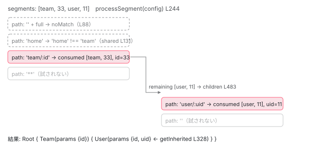

[目次](../README.md) › [Router の内側](README.md) › 第 9 回 / 全 21 回

# URL と Route を照合する：Recognizer と match の規則

> Recognizer.match → processSegmentGroup → processChildren → processSegment → processSegmentAgainstRoute。config\_matching.ts の match が path / \*\* / 空パス / pathMatch: 'full' / matcher をどう判定するか。結果が ActivatedRouteSnapshot の木になるところ。

angular/angular · 読了 約 15 分 · 中核 · [サイトで読む（デモが動きます）](https://angular-deep-dive-cyan.vercel.app/chapter/router-recognize)

---

URL `/team/33/user/11` と Route 配列から、「`TeamComponent` の中に `UserComponent`、`id` は 33、`uid` は 11」という木を作るのが `recognize` です。[前章](08-router-pipeline.md)の表では 545 行目の 1 行でした。この章ではその中身、`Recognizer` クラスが **Route 配列を上から順に試し、合わなければ次へ、合えば子へ降りる**手順を関数ごとに追います。「`path: ''` はどの順で試されるか」「`pathMatch: 'full'` が無いと何が起きるか」「`'**'` を先に書くとどうなるか」に、行番号で答えられるようになります。`redirectTo`（[第 10 回](10-router-redirects.md)）、`loadChildren`（[第 11 回](11-router-lazy-loading.md)）、`canMatch`（[第 12 回](12-router-guards.md)）は呼び出し位置だけ確認し、中身は各章に任せます。

読む対象は `packages/router/src/recognize.ts`、`packages/router/src/utils/config_matching.ts`、`packages/router/src/shared.ts`（`defaultUrlMatcher`）、`packages/router/src/utils/tree.ts` です。

1. 1 本の RxJS パイプライン
2. URL → UrlTree
3. routerLink の配列 → UrlTree
4. Route 設定の検証と正規化
5. provideRouter の中身
6. 最初のナビゲーション
7. navigateByUrl → NavigationTransition
8. setupNavigations の全段
9. **Recognizer と match**（この章）
10. redirectTo
11. loadChildren と loadComponent
12. ガードの実行順
13. resolve と data と title
14. ActivatedRoute と Snapshot
15. RouterOutlet への配置
16. ブラウザの URL と履歴
17. Router.events の全種類
18. RouterLink と RouterLinkActive
19. withViewTransitions
20. withRouterResources
21. Navigation API

## 1. 入口：演算子 → 関数 → Recognizer

📄 `angular/packages/router/src/operators/recognize.ts` L19–41 （▶ の行: 28–29, 34, 39）

```ts
19 │ export function recognize(
20 │   injector: EnvironmentInjector,
21 │   configLoader: RouterConfigLoader,
22 │   rootComponentType: Type<any> | null,
23 │   config: Route[],
24 │   serializer: UrlSerializer,
25 │   paramsInheritanceStrategy: 'emptyOnly' | 'always',
26 │   abortSignal: AbortSignal,
27 │ ): MonoTypeOperatorFunction<NavigationTransition> {
28 ▶   return mergeMap(async (t) => {
29 ▶     const {state: targetSnapshot, tree: urlAfterRedirects} = await recognizeFn(
30 │       injector,
31 │       configLoader,
32 │       rootComponentType,
33 │       config,
34 ▶       t.extractedUrl,
35 │       serializer,
36 │       paramsInheritanceStrategy,
37 │       abortSignal,
38 │     );
39 ▶     return {...t, targetSnapshot, urlAfterRedirects};
40 │   });
41 │ }
```

📄 `angular/packages/router/src/recognize.ts` L44–68 （▶ の行: 44, 46, 56, 65, 68）

```ts
44 ▶ class NoLeftoversInUrl {}
45 │ 
46 ▶ export async function recognize(
47 │   injector: EnvironmentInjector,
48 │   configLoader: RouterConfigLoader,
49 │   rootComponentType: Type<any> | null,
50 │   config: Routes,
51 │   urlTree: UrlTree,
52 │   urlSerializer: UrlSerializer,
53 │   paramsInheritanceStrategy: ParamsInheritanceStrategy,
54 │   abortSignal: AbortSignal,
55 │ ): Promise<{state: RouterStateSnapshot; tree: UrlTree}> {
56 ▶   return new Recognizer(
57 │     injector,
58 │     configLoader,
59 │     rootComponentType,
60 │     config,
61 │     urlTree,
62 │     paramsInheritanceStrategy,
63 │     urlSerializer,
64 │     abortSignal,
65 ▶   ).recognize();
66 │ }
67 │ 
68 ▶ const MAX_ALLOWED_REDIRECTS = 31;
```

operators/recognize.ts 28 行目、`mergeMap(async (t) => ...)`。29 行目で `recognizeFn`（recognize.ts 46 行目）を `await` し、34 行目のとおり照合する URL は `t.extractedUrl`（[第 7 回](07-router-navigation-request.md)）です。39 行目、結果の `state` を `targetSnapshot`、`tree` を `urlAfterRedirects` として `NavigationTransition` に足します。recognize.ts 56〜65 行目、関数は `Recognizer` を new して `recognize()` を呼ぶだけです。44 行目の `NoLeftoversInUrl` は 4 節で、68 行目の `MAX_ALLOWED_REDIRECTS`（31 回）は[第 10 回](10-router-redirects.md)で使います。

📄 `angular/packages/router/src/recognize.ts` L97–115 （▶ の行: 98, 100–103, 112–113）

```ts
 97 │   async recognize(): Promise<{state: RouterStateSnapshot; tree: UrlTree}> {
 98 ▶     const rootSegmentGroup = split(this.urlTree.root, [], [], this.config).segmentGroup;
 99 │ 
100 ▶     const {children, rootSnapshot} = await this.match(rootSegmentGroup);
101 ▶     const rootNode = new TreeNode(rootSnapshot, children);
102 ▶     const routeState = new RouterStateSnapshot('', rootNode);
103 ▶     const tree = createUrlTreeFromSnapshot(
104 │       rootSnapshot,
105 │       [],
106 │       this.urlTree.queryParams,
107 │       this.urlTree.fragment,
108 │     );
109 │     // Creating the tree stringifies the query params
110 │     // We don't want to do this here to preserve pre-existing behavior
111 │     // so reassign them to the original.
112 ▶     tree.queryParams = this.urlTree.queryParams;
113 ▶     routeState.url = this.urlSerializer.serialize(tree);
114 │     return {state: routeState, tree};
115 │   }
```

1. **98 行目：ルートの UrlSegmentGroup を split**

   `split`（8 節）は空パス Route のためにセグメント木を整形する関数です。ルートに対しては「消費済みセグメント無し、残り無し」で呼びます。
2. **100 行目：match → 子の TreeNode 配列と root の Snapshot**

   本体です。2 節で読みます。
3. **101〜102 行目：TreeNode と RouterStateSnapshot**

   `new TreeNode(rootSnapshot, children)` を根にして `RouterStateSnapshot` を作ります（9 節）。第 1 引数の `url` は 113 行目で後から入れます。
4. **103〜113 行目：Snapshot から UrlTree を作り直す**

   `createUrlTreeFromSnapshot` で、リダイレクト適用後の木から URL を再構成します。これが `urlAfterRedirects`（`Navigation.finalUrl`）です。109〜112 行目のコメント、「木を作ると queryParams が文字列化されるので元に戻す」。

## 2. match：root の Snapshot を作り、NoMatch をエラーに変える

📄 `angular/packages/router/src/recognize.ts` L117–155 （▶ の行: 123, 125–126, 130, 136, 140, 145–147, 149–150）

```ts
117 │   private async match(rootSegmentGroup: UrlSegmentGroup): Promise<{
118 │     children: TreeNode<ActivatedRouteSnapshot>[];
119 │     rootSnapshot: ActivatedRouteSnapshot;
120 │   }> {
121 │     // Use Object.freeze to prevent readers of the Router state from modifying it outside
122 │     // of a navigation, resulting in the router being out of sync with the browser.
123 ▶     const rootSnapshot = new ActivatedRouteSnapshot(
124 │       [],
125 ▶       Object.freeze({}),
126 ▶       Object.freeze({...this.urlTree.queryParams}),
127 │       this.urlTree.fragment,
128 │       Object.freeze({}),
129 │       PRIMARY_OUTLET,
130 ▶       this.rootComponentType,
131 │       null,
132 │       {},
133 │       this.injector,
134 │     );
135 │     try {
136 ▶       const children = await this.processSegmentGroup(
137 │         this.injector,
138 │         this.config,
139 │         rootSegmentGroup,
140 ▶         PRIMARY_OUTLET,
141 │         rootSnapshot,
142 │       );
143 │       return {children, rootSnapshot};
144 │     } catch (e: any) {
145 ▶       if (e instanceof AbsoluteRedirect) {
146 ▶         this.urlTree = e.urlTree;
147 ▶         return this.match(e.urlTree.root);
148 │       }
149 ▶       if (e instanceof NoMatch) {
150 ▶         throw this.noMatchError(e);
151 │       }
152 │ 
153 │       throw e;
154 │     }
155 │   }
```

📄 `angular/packages/router/src/recognize.ts` L88–95 （▶ の行: 89–90, 92）

```ts
88 │   private noMatchError(e: NoMatch): RuntimeError<RuntimeErrorCode.NO_MATCH> {
89 ▶     return new RuntimeError(
90 ▶       RuntimeErrorCode.NO_MATCH,
91 │       typeof ngDevMode === 'undefined' || ngDevMode
92 ▶         ? `Cannot match any routes. URL Segment: '${e.segmentGroup}'`
93 │         : `'${e.segmentGroup}'`,
94 │     );
95 │   }
```

1. **123〜134 行目：root の ActivatedRouteSnapshot**

   URL セグメントは空、`params` は 125 行目 `Object.freeze({})`、`queryParams` は 126 行目で URL 全体のもの、`outlet` は `PRIMARY_OUTLET`（`'primary'`）、`component` は 130 行目 `rootComponentType` （`AppComponent`。[第 6 回](06-router-initial-navigation.md)の `resetRootComponentType` が入れた値）、`routeConfig` は `null`。121〜122 行目のコメント、「ナビゲーションの外から state を書き換えられないように freeze する」。
2. **136〜142 行目：processSegmentGroup（3 節）**

   最上位の Route 配列 `this.config` と、ルートのセグメントグループ、outlet 名 `'primary'`、親として root Snapshot を渡します。
3. **145〜148 行目：AbsoluteRedirect ならやり直し**

   `/` で始まる `redirectTo` は例外 `AbsoluteRedirect` として最上位まで上がり、146 行目で `urlTree` を差し替えて 147 行目で `match` を最初から。（[第 10 回](10-router-redirects.md)）
4. **149〜150 行目：NoMatch なら RuntimeError NO\_MATCH**

   88〜95 行目、「Cannot match any routes. URL Segment: '...'」。**どの Route にも合わない URL は、この行で例外になり、前章の `catchError` で `NavigationError` になります**。`'**'` の Route を最後に置いておけば必ず何かに合うので、ここには来ません。

## 3. processSegmentGroup と processChildren：outlet ごとに分ける

📄 `angular/packages/router/src/url_tree.ts` L322–343 （▶ の行: 328, 330, 336–337）

```ts
322 │ export class UrlSegmentGroup {
323 │   /** The parent node in the url tree */
324 │   parent: UrlSegmentGroup | null = null;
325 │ 
326 │   constructor(
327 │     /** The URL segments of this group. See `UrlSegment` for more information */
328 ▶     public segments: UrlSegment[],
329 │     /** The list of children of this group */
330 ▶     public children: {[key: string]: UrlSegmentGroup},
331 │   ) {
332 │     Object.values(children).forEach((v) => (v.parent = this));
333 │   }
334 │ 
335 │   /** Whether the segment has child segments */
336 ▶   hasChildren(): boolean {
337 ▶     return this.numberOfChildren > 0;
338 │   }
339 │ 
340 │   /** Number of child segments */
341 │   get numberOfChildren(): number {
342 │     return Object.keys(this.children).length;
343 │   }
```

照合の対象は `UrlSegmentGroup`（[第 2 回](02-router-url-tree.md)）です。328 行目 `segments` がこのノードのパス片、330 行目 `children` が outlet 名をキーにした子。336〜337 行目 `hasChildren()` は子が 1 つ以上あるか。`/team/33/user/11` なら root の `segments` は `[team, 33, user, 11]` で `children` は空、`/team/33/(user/11//aux:help)` なら `segments` は `[team, 33]`、`children` は `{primary, aux}` です。

📄 `angular/packages/router/src/recognize.ts` L157–178 （▶ の行: 164–165, 168, 172, 174, 177）

```ts
157 │   async processSegmentGroup(
158 │     injector: EnvironmentInjector,
159 │     config: Route[],
160 │     segmentGroup: UrlSegmentGroup,
161 │     outlet: string,
162 │     parentRoute: ActivatedRouteSnapshot,
163 │   ): Promise<TreeNode<ActivatedRouteSnapshot>[]> {
164 ▶     if (segmentGroup.segments.length === 0 && segmentGroup.hasChildren()) {
165 ▶       return this.processChildren(injector, config, segmentGroup, parentRoute);
166 │     }
167 │ 
168 ▶     const child = await this.processSegment(
169 │       injector,
170 │       config,
171 │       segmentGroup,
172 ▶       segmentGroup.segments,
173 │       outlet,
174 ▶       true,
175 │       parentRoute,
176 │     );
177 ▶     return child instanceof TreeNode ? [child] : [];
178 │   }
```

164〜165 行目、**セグメントが無く子だけある**グループなら `processChildren`（outlet ごとに分けて処理）。それ以外は 168〜176 行目 `processSegment`（4 節）。172 行目でセグメント配列、174 行目で `allowRedirects = true` を渡します。177 行目、結果が `TreeNode` なら 1 要素の配列、`NoLeftoversInUrl` なら空配列です。

📄 `angular/packages/router/src/recognize.ts` L188–233 （▶ の行: 196, 198–199, 201, 206, 211–212, 225, 229, 231）

```ts
188 │   async processChildren(
189 │     injector: EnvironmentInjector,
190 │     config: Route[],
191 │     segmentGroup: UrlSegmentGroup,
192 │     parentRoute: ActivatedRouteSnapshot,
193 │   ): Promise<TreeNode<ActivatedRouteSnapshot>[]> {
194 │     // Expand outlets one at a time, starting with the primary outlet. We need to do it this way
195 │     // because an absolute redirect from the primary outlet takes precedence.
196 ▶     const childOutlets: string[] = [];
197 │     for (const child of Object.keys(segmentGroup.children)) {
198 ▶       if (child === 'primary') {
199 ▶         childOutlets.unshift(child);
200 │       } else {
201 ▶         childOutlets.push(child);
202 │       }
203 │     }
204 │ 
205 │     let children: TreeNode<ActivatedRouteSnapshot>[] = [];
206 ▶     for (const childOutlet of childOutlets) {
207 │       const child = segmentGroup.children[childOutlet];
208 │       // Sort the config so that routes with outlets that match the one being activated
209 │       // appear first, followed by routes for other outlets, which might match if they have
210 │       // an empty path.
211 ▶       const sortedConfig = sortByMatchingOutlets(config, childOutlet);
212 ▶       const outletChildren = await this.processSegmentGroup(
213 │         injector,
214 │         sortedConfig,
215 │         child,
216 │         childOutlet,
217 │         parentRoute,
218 │       );
219 │       children.push(...outletChildren);
220 │     }
221 │ 
222 │     // Because we may have matched two outlets to the same empty path segment, we can have
223 │     // multiple activated results for the same outlet. We should merge the children of
224 │     // these results so the final return value is only one `TreeNode` per outlet.
225 ▶     const mergedChildren = mergeEmptyPathMatches(children);
226 │     if (typeof ngDevMode === 'undefined' || ngDevMode) {
227 │       // This should really never happen - we are only taking the first match for each
228 │       // outlet and merge the empty path matches.
229 ▶       checkOutletNameUniqueness(mergedChildren);
230 │     }
231 ▶     sortActivatedRouteSnapshots(mergedChildren);
232 │     return mergedChildren;
233 │   }
```

📄 `angular/packages/router/src/utils/config.ts` L229–241 （▶ の行: 230, 238–239）

```ts
229 │ export function getOutlet(route: Route): string {
230 ▶   return route.outlet || PRIMARY_OUTLET;
231 │ }
232 │ 
233 │ /**
234 │  * Sorts the `routes` such that the ones with an outlet matching `outletName` come first.
235 │  * The order of the configs is otherwise preserved.
236 │  */
237 │ export function sortByMatchingOutlets(routes: Routes, outletName: string): Routes {
238 ▶   const sortedConfig = routes.filter((r) => getOutlet(r) === outletName);
239 ▶   sortedConfig.push(...routes.filter((r) => getOutlet(r) !== outletName));
240 │   return sortedConfig;
241 │ }
```

1. **196〜203 行目：primary を先頭に**

   198〜199 行目、`'primary'` だけ `unshift`。194〜195 行目のコメント、「primary outlet からの絶対リダイレクトが優先されるため、1 つずつ順に処理する」。
2. **206〜220 行目：outlet ごとに processSegmentGroup**

   211 行目 `sortByMatchingOutlets`（utils/config.ts 238〜239 行目）で、**その outlet 名の Route を前に、他の outlet の Route を後ろに**並べ替えます。`getOutlet`（230 行目）は `route.outlet || 'primary'`。208〜210 行目のコメント、「他 outlet の Route も空パスなら合うかもしれないので残す」。
3. **225 行目：mergeEmptyPathMatches、229 行目：checkOutletNameUniqueness、231 行目：sortActivatedRouteSnapshots**

   8 節と 9 節で読みます。同じ空パス Route に複数の outlet が合った場合の統合、同名 outlet の検出、primary を先頭にした並び替えです。

## 4. processSegment：Route を上から順に試す

📄 `angular/packages/router/src/recognize.ts` L235–268 （▶ の行: 244, 246–247, 257–258, 260, 264–265, 267）

```ts
235 │   async processSegment(
236 │     injector: EnvironmentInjector,
237 │     routes: Route[],
238 │     segmentGroup: UrlSegmentGroup,
239 │     segments: UrlSegment[],
240 │     outlet: string,
241 │     allowRedirects: boolean,
242 │     parentRoute: ActivatedRouteSnapshot,
243 │   ): Promise<TreeNode<ActivatedRouteSnapshot> | NoLeftoversInUrl> {
244 ▶     for (const r of routes) {
245 │       try {
246 ▶         return await this.processSegmentAgainstRoute(
247 ▶           r._injector ?? injector,
248 │           routes,
249 │           r,
250 │           segmentGroup,
251 │           segments,
252 │           outlet,
253 │           allowRedirects,
254 │           parentRoute,
255 │         );
256 │       } catch (e: any) {
257 ▶         if (e instanceof NoMatch || isEmptyError(e)) {
258 ▶           continue;
259 │         }
260 ▶         throw e;
261 │       }
262 │     }
263 │ 
264 ▶     if (noLeftoversInUrl(segmentGroup, segments, outlet)) {
265 ▶       return new NoLeftoversInUrl();
266 │     }
267 ▶     throw new NoMatch(segmentGroup);
268 │   }
```

📄 `angular/packages/router/src/utils/config_matching.ts` L239–245 （▶ の行: 244）

```ts
239 │ export function noLeftoversInUrl(
240 │   segmentGroup: UrlSegmentGroup,
241 │   segments: UrlSegment[],
242 │   outlet: string,
243 │ ): boolean {
244 ▶   return segments.length === 0 && !segmentGroup.children[outlet];
245 │ }
```

この関数が「Route 配列の順番が意味を持つ」理由そのものです。

1. **244 行目：for (const r of routes)**

   **配列の先頭から順に**試します。`sortByMatchingOutlets` で並べ替えられている場合を除き、あなたが書いた順です。
2. **246〜255 行目：processSegmentAgainstRoute を await して return**

   **合った瞬間に `return`**。後ろの Route は見ません。247 行目、Route に `providers` があれば作られた `_injector` を使います。
3. **257〜258 行目：NoMatch なら continue**

   `NoMatch`（または空の Observable による `EmptyError`）だけを飲み込んで次の Route へ。260 行目、それ以外の例外（`AbsoluteRedirect`、`canLoad` 拒否、本物のバグ）はそのまま上へ投げます。**子の照合で `NoMatch` になった場合も、ここで捕まえて親の次の Route を試します**（5 節の 483 行目から投げられる）。
4. **264〜265 行目：全部外れたが残りも無い → NoLeftoversInUrl**

   config\_matching.ts 244 行目、`segments.length === 0 && !segmentGroup.children[outlet]`。「URL は使い切った。合う子 Route は無いが、それは失敗ではない」という印です。たとえば `{path: 'team/:id', component, children: [{path: 'user/:uid'}]}` に `/team/33` を当てたとき、子の照合はここに来て、`TeamComponent` だけの木になります。
5. **267 行目：残りがあるのに合わない → throw NoMatch**

   これが親の `processSegment` の 257 行目に捕まるか、最上位なら 2 節 149 行目で `NO_MATCH` エラーになります。

> [!WARNING]
> **ハマりどころ**
>
> `'**'` を最後に書く理由はこの 244〜255 行目です。`'**'` はどんなセグメント列にも合う（7 節）ので、先頭に書くと **最初の反復で `return` し、後ろの Route は一度も試されません**。エラーにはならず、すべての URL が `'**'` のコンポーネントになります。

## 5. processSegmentAgainstRoute と matchSegmentAgainstRoute：1 つの Route と照合する

📄 `angular/packages/router/src/recognize.ts` L280–322 （▶ の行: 282, 289, 291–293, 295, 298–299, 309–310, 321）

```ts
280 │     // We allow matches to empty paths when the outlets differ so we can match a url like `/(b:b)` to
281 │     // a config like
282 ▶     // * `{path: '', children: [{path: 'b', outlet: 'b'}]}`
283 │     // or even
284 │     // * `{path: '', outlet: 'a', children: [{path: 'b', outlet: 'b'}]`
285 │     //
286 │     // The exception here is when the segment outlet is for the primary outlet. This would
287 │     // result in a match inside the named outlet because all children there are written as primary
288 │     // outlets. So we need to prevent child named outlet matches in a url like `/b` in a config like
289 ▶     // * `{path: '', outlet: 'x' children: [{path: 'b'}]}`
290 │     // This should only match if the url is `/(x:b)`.
291 ▶     if (
292 ▶       getOutlet(route) !== outlet &&
293 ▶       (outlet === PRIMARY_OUTLET || !emptyPathMatch(rawSegment, segments, route))
294 │     ) {
295 ▶       throw new NoMatch(rawSegment);
296 │     }
297 │ 
298 ▶     if (route.redirectTo === undefined) {
299 ▶       return this.matchSegmentAgainstRoute(
300 │         injector,
301 │         rawSegment,
302 │         route,
303 │         segments,
304 │         outlet,
305 │         parentRoute,
306 │       );
307 │     }
308 │ 
309 ▶     if (this.allowRedirects && allowRedirects) {
310 ▶       return this.expandSegmentAgainstRouteUsingRedirect(
311 │         injector,
312 │         rawSegment,
313 │         routes,
314 │         route,
315 │         segments,
316 │         outlet,
317 │         parentRoute,
318 │       );
319 │     }
320 │ 
321 ▶     throw new NoMatch(rawSegment);
322 │   }
```

1. **291〜296 行目：outlet 名が違えば NoMatch**

   `getOutlet(route) !== outlet` のとき、primary を処理中か、空パスでも合わないなら `NoMatch`。280〜290 行目のコメントが例を挙げています。`/(b:b)` を `{path: '', children: [{path: 'b', outlet: 'b'}]}` に合わせたい一方で、`/b` を `{path: '', outlet: 'x', children: [{path: 'b'}]}` に合わせてはいけない、という境界です。
2. **298〜307 行目：redirectTo が無ければ matchSegmentAgainstRoute**

   この章の本流です。下で読みます。
3. **309〜319 行目：redirectTo があり、許されていれば expandSegmentAgainstRouteUsingRedirect**

   `this.allowRedirects`（無限リダイレクト検出で `false` になる）と引数の `allowRedirects`（リダイレクト直後の再照合では `false`）の両方が必要です。321 行目、どちらかが `false` なら `redirectTo` 付き Route は `NoMatch`。中身は[第 10 回](10-router-redirects.md)。

📄 `angular/packages/router/src/recognize.ts` L402–437 （▶ の行: 410–411, 414, 416–417, 427, 432, 435–436）

```ts
402 │   async matchSegmentAgainstRoute(
403 │     injector: EnvironmentInjector,
404 │     rawSegment: UrlSegmentGroup,
405 │     route: Route,
406 │     segments: UrlSegment[],
407 │     outlet: string,
408 │     parentRoute: ActivatedRouteSnapshot,
409 │   ): Promise<TreeNode<ActivatedRouteSnapshot>> {
410 ▶     if (this.abortSignal.aborted) {
411 ▶       throw new Error(this.abortSignal.reason);
412 │     }
413 │ 
414 ▶     const createSnapshot = (result: MatchResult) =>
415 │       this.createSnapshot(injector, route, result.consumedSegments, result.parameters, parentRoute);
416 ▶     const result = await firstValueFrom(
417 ▶       matchWithChecks(
418 │         rawSegment,
419 │         route,
420 │         segments,
421 │         injector,
422 │         this.urlSerializer,
423 │         createSnapshot,
424 │         this.abortSignal,
425 │       ),
426 │     );
427 ▶     if (route.path === '**') {
428 │       // Prior versions of the route matching algorithm would stop matching at the wildcard route.
429 │       // We should investigate a better strategy for any existing children. Otherwise, these
430 │       // child segments are silently dropped from the navigation.
431 │       // https://github.com/angular/angular/issues/40089
432 ▶       rawSegment.children = {};
433 │     }
434 │ 
435 ▶     if (!result?.matched) {
436 ▶       throw new NoMatch(rawSegment);
437 │     }
```

📄 `angular/packages/router/src/utils/config_matching.ts` L54–80 （▶ の行: 63–65, 68, 71–72, 79）

```ts
54 │ export function matchWithChecks(
55 │   segmentGroup: UrlSegmentGroup,
56 │   route: Route,
57 │   segments: UrlSegment[],
58 │   injector: EnvironmentInjector,
59 │   urlSerializer: UrlSerializer,
60 │   createSnapshot: (result: MatchResult) => ActivatedRouteSnapshot,
61 │   abortSignal: AbortSignal,
62 │ ): Observable<MatchResult> {
63 ▶   const result = match(segmentGroup, route, segments);
64 ▶   if (!result.matched) {
65 ▶     return of(result);
66 │   }
67 │ 
68 ▶   const currentSnapshot = createPreMatchRouteSnapshot(createSnapshot(result));
69 │   // Only create the Route's `EnvironmentInjector` if it matches the attempted
70 │   // navigation
71 ▶   injector = getOrCreateRouteInjectorIfNeeded(route, injector);
72 ▶   return runCanMatchGuards(
73 │     injector,
74 │     route,
75 │     segments,
76 │     urlSerializer,
77 │     currentSnapshot,
78 │     abortSignal,
79 ▶   ).pipe(map((v) => (v === true ? result : {...noMatch})));
80 │ }
```

1. **410〜412 行目：abort 済みなら例外**

   前章の `AbortController.signal` です。追い越されたナビゲーションの照合をここで打ち切ります。
2. **416〜426 行目：matchWithChecks**

   config\_matching.ts 63 行目で `match`（6 節）。64〜65 行目、合わなければそのまま返す。合えば 68 行目で仮の Snapshot を作り、71 行目で Route の `providers` 用インジェクタを**合ったときだけ**作り（69〜70 行目のコメント）、72〜79 行目 `runCanMatchGuards`。`canMatch` が `true` 以外を返せば 79 行目で `noMatch` に差し替わります。つまり **`canMatch` は「この Route を照合の候補から外す」ガード**で、`NoMatch` として次の Route へ進みます（[第 12 回](12-router-guards.md)）。
3. **427〜433 行目：'\*\*' なら子を捨てる**

   428〜431 行目のコメント、「以前の照合アルゴリズムはワイルドカードで止まっていた。既存の子セグメントは黙って落とす（issue #40089）」。
4. **435〜437 行目：合わなければ NoMatch**

📄 `angular/packages/router/src/recognize.ts` L438–493 （▶ の行: 439–441, 444, 452, 460–461, 467, 470–471, 474, 483, 487–488, 492）

```ts
438 │     // If the route has an injector created from providers, we should start using that.
439 ▶     injector = route._injector ?? injector;
440 ▶     const {routes: childConfig} = await this.getChildConfig(injector, route, segments);
441 ▶     const childInjector = route._loadedInjector ?? injector;
442 │ 
443 │     const {parameters, consumedSegments, remainingSegments} = result;
444 ▶     const snapshot = this.createSnapshot(
445 │       injector,
446 │       route,
447 │       consumedSegments,
448 │       parameters,
449 │       parentRoute,
450 │     );
451 │ 
452 ▶     const {segmentGroup, slicedSegments} = split(
453 │       rawSegment,
454 │       consumedSegments,
455 │       remainingSegments,
456 │       childConfig,
457 │       outlet,
458 │     );
459 │ 
460 ▶     if (slicedSegments.length === 0 && segmentGroup.hasChildren()) {
461 ▶       const children = await this.processChildren(
462 │         childInjector,
463 │         childConfig,
464 │         segmentGroup,
465 │         snapshot,
466 │       );
467 ▶       return new TreeNode(snapshot, children);
468 │     }
469 │ 
470 ▶     if (childConfig.length === 0 && slicedSegments.length === 0) {
471 ▶       return new TreeNode(snapshot, []);
472 │     }
473 │ 
474 ▶     const matchedOnOutlet = getOutlet(route) === outlet;
475 │     // If we matched a config due to empty path match on a different outlet, we need to
476 │     // continue passing the current outlet for the segment rather than switch to PRIMARY.
477 │     // Note that we switch to primary when we have a match because outlet configs look like
478 │     // this: {path: 'a', outlet: 'a', children: [
479 │     //  {path: 'b', component: B},
480 │     //  {path: 'c', component: C},
481 │     // ]}
482 │     // Notice that the children of the named outlet are configured with the primary outlet
483 ▶     const child = await this.processSegment(
484 │       childInjector,
485 │       childConfig,
486 │       segmentGroup,
487 ▶       slicedSegments,
488 ▶       matchedOnOutlet ? PRIMARY_OUTLET : outlet,
489 │       true,
490 │       snapshot,
491 │     );
492 ▶     return new TreeNode(snapshot, child instanceof TreeNode ? [child] : []);
493 │   }
```

1. **439〜441 行目：インジェクタと子の Route 配列**

   440 行目 `getChildConfig`（下）。`children` ならそのまま、`loadChildren` ならここで `import()` を待ちます。441 行目、遅延ロードされたモジュールのインジェクタがあれば子はそれを使います。
2. **444〜450 行目：この Route の ActivatedRouteSnapshot**

   消費したセグメントとパラメータから作ります（`createSnapshot`、9 節）。
3. **452〜458 行目：split**

   残りのセグメントと子の Route 配列を見て、空パスの子 Route のためにセグメントグループを整形します（8 節）。
4. **460〜468 行目：残り無し・子グループあり → processChildren**

   名前付き outlet を含む URL（`/team/33/(user/11//aux:help)`）はここで outlet ごとに分かれます。
5. **470〜472 行目：子 Route 無し・残り無し → 葉**

   `new TreeNode(snapshot, [])`。`{path: 'home', component}` に `/home` が合ったときはここです。
6. **474〜492 行目：残りを子 Route 配列で processSegment**

   **再帰です**。483 行目で 4 節の関数を子の配列と残りセグメントで呼びます。488 行目、自分の outlet で合っていれば子は `'primary'` として処理 （475〜482 行目のコメント、名前付き outlet の子は primary として書かれるため）。492 行目、子が `NoLeftoversInUrl` なら子無しの `TreeNode`。子が `NoMatch` を投げたら、この関数も投げて親の 257 行目へ。

📄 `angular/packages/router/src/recognize.ts` L494–531 （▶ の行: 499, 501, 504, 506, 511, 517, 520–521, 527, 530）

```ts
494 │   private async getChildConfig(
495 │     injector: EnvironmentInjector,
496 │     route: Route,
497 │     segments: UrlSegment[],
498 │   ): Promise<LoadedRouterConfig> {
499 ▶     if (route.children) {
500 │       // The children belong to the same module
501 ▶       return {routes: route.children, injector};
502 │     }
503 │ 
504 ▶     if (route.loadChildren) {
505 │       // lazy children belong to the loaded module
506 ▶       if (route._loadedRoutes !== undefined) {
507 │         const ngModuleFactory = route._loadedNgModuleFactory;
508 │         if (ngModuleFactory && !route._loadedInjector) {
509 │           route._loadedInjector = ngModuleFactory.create(injector).injector;
510 │         }
511 ▶         return {routes: route._loadedRoutes, injector: route._loadedInjector};
512 │       }
513 │ 
514 │       if (this.abortSignal.aborted) {
515 │         throw new Error(this.abortSignal.reason);
516 │       }
517 ▶       const shouldLoadResult = await firstValueFrom(
518 │         runCanLoadGuards(injector, route, segments, this.urlSerializer, this.abortSignal),
519 │       );
520 ▶       if (shouldLoadResult) {
521 ▶         const cfg = await this.configLoader.loadChildren(injector, route);
522 │         route._loadedRoutes = cfg.routes;
523 │         route._loadedInjector = cfg.injector;
524 │         route._loadedNgModuleFactory = cfg.factory;
525 │         return cfg;
526 │       }
527 ▶       throw canLoadFails(route);
528 │     }
529 │ 
530 ▶     return {routes: [], injector};
531 │   }
```

499〜502 行目、`children` があればそれと今のインジェクタ。504 行目 `loadChildren` なら、506〜512 行目で既にロード済みか確認し、517〜519 行目 `canLoad` を実行、520〜525 行目で `configLoader.loadChildren`（`import()`）して Route に結果をキャッシュ、527 行目、`canLoad` が拒否なら `canLoadFails`（`GuardRejected` の `NavigationCancelingError`。`NoMatch` ではないので 4 節 260 行目で上へ投げられ、前章の `catchError` で `NavigationCancel`）。530 行目、どちらも無ければ空配列。詳細は[第 11 回](11-router-lazy-loading.md)。

## 6. match：path の規則

📄 `angular/packages/router/src/utils/config_matching.ts` L82–122 （▶ の行: 87–89, 92, 94–95, 101–103, 106–107, 109–111, 116–117）

```ts
 82 │ export function match(
 83 │   segmentGroup: UrlSegmentGroup,
 84 │   route: Route,
 85 │   segments: UrlSegment[],
 86 │ ): MatchResult {
 87 ▶   if (route.path === '') {
 88 ▶     if (route.pathMatch === 'full' && (segmentGroup.hasChildren() || segments.length > 0)) {
 89 ▶       return {...noMatch};
 90 │     }
 91 │ 
 92 ▶     return {
 93 │       matched: true,
 94 ▶       consumedSegments: [],
 95 ▶       remainingSegments: segments,
 96 │       parameters: {},
 97 │       positionalParamSegments: {},
 98 │     };
 99 │   }
100 │ 
101 ▶   const matcher = route.matcher || defaultUrlMatcher;
102 ▶   const res = matcher(segments, segmentGroup, route);
103 ▶   if (!res) return {...noMatch};
104 │ 
105 │   const posParams: {[n: string]: string} = {};
106 ▶   Object.entries(res.posParams ?? {}).forEach(([k, v]) => {
107 ▶     posParams[k] = v.path;
108 │   });
109 ▶   const parameters =
110 ▶     res.consumed.length > 0
111 ▶       ? {...posParams, ...res.consumed[res.consumed.length - 1].parameters}
112 │       : posParams;
113 │ 
114 │   return {
115 │     matched: true,
116 ▶     consumedSegments: res.consumed,
117 ▶     remainingSegments: segments.slice(res.consumed.length),
118 │     // TODO(atscott): investigate combining parameters and positionalParamSegments
119 │     parameters,
120 │     positionalParamSegments: res.posParams ?? {},
121 │   };
122 │ }
```

1. **87〜99 行目：path: ''**

   88〜89 行目、**`pathMatch: 'full'` で、かつ子グループか残りセグメントがあれば `noMatch`**。それ以外（`pathMatch` 無し、または残りが無い）は 92〜98 行目で**必ず合う**。消費は 0 個、残りは全部そのまま。`{path: '', redirectTo: 'home'}` に `pathMatch: 'full'` が無いと、`/team/33` にも合ってしまい、残り `[team, 33]` を付けて `home/team/33` へリダイレクトされます。これが「空パスには `pathMatch: 'full'`」と言われる理由です。
2. **101〜103 行目：matcher**

   Route に `matcher` 関数があればそれ、無ければ `defaultUrlMatcher`（7 節）。`null` なら `noMatch`。
3. **105〜112 行目：parameters**

   106〜107 行目で `:id` 形式の位置パラメータを `{id: '33'}` に。109〜112 行目、**消費した最後のセグメントの matrix パラメータ**（`/team/33;sort=name` の `sort`）を合成します。途中のセグメントの matrix パラメータは、その Route の `params` には入りません。
4. **116〜117 行目：consumed と remaining**

   `res.consumed` の長さぶんを切り取った残りが `remainingSegments`。5 節の 483 行目で子へ渡される配列です。

## 7. defaultUrlMatcher：片数を比べ、':' を取り出す

📄 `angular/packages/router/src/shared.ts` L153–181 （▶ の行: 158–159, 162, 164, 167–169, 172, 176–177, 180）

```ts
153 │ export function defaultUrlMatcher(
154 │   segments: UrlSegment[],
155 │   segmentGroup: UrlSegmentGroup,
156 │   route: Route,
157 │ ): UrlMatchResult | null {
158 ▶   const parts = route.path!.split('/');
159 ▶   const wildcardIndex = parts.indexOf('**');
160 │   if (wildcardIndex === -1) {
161 │     // No wildcard, use original logic
162 ▶     if (parts.length > segments.length) {
163 │       // The actual URL is shorter than the config, no match
164 ▶       return null;
165 │     }
166 │ 
167 ▶     if (
168 ▶       route.pathMatch === 'full' &&
169 ▶       (segmentGroup.hasChildren() || parts.length < segments.length)
170 │     ) {
171 │       // The config is longer than the actual URL but we are looking for a full match, return null
172 ▶       return null;
173 │     }
174 │ 
175 │     const posParams: {[key: string]: UrlSegment} = {};
176 ▶     const consumed = segments.slice(0, parts.length);
177 ▶     if (!matchParts(parts, consumed, posParams)) {
178 │       return null;
179 │     }
180 ▶     return {consumed, posParams};
181 │   }
```

📄 `angular/packages/router/src/shared.ts` L120–136 （▶ の行: 128–132）

```ts
120 │ function matchParts(
121 │   routeParts: string[],
122 │   urlSegments: UrlSegment[],
123 │   posParams: {[key: string]: UrlSegment},
124 │ ): boolean {
125 │   for (let i = 0; i < routeParts.length; i++) {
126 │     const part = routeParts[i];
127 │     const segment = urlSegments[i];
128 ▶     const isParameter = part[0] === ':';
129 ▶     if (isParameter) {
130 ▶       posParams[part.substring(1)] = segment;
131 ▶     } else if (part !== segment.path) {
132 ▶       return false;
133 │     }
134 │   }
135 │   return true;
136 │ }
```

1. **158 行目：path を '/' で割る**

   `'team/:id'` → `['team', ':id']`。159 行目で `'**'` の位置を探し、無ければ 160〜181 行目。
2. **162〜164 行目：path のほうが長ければ null**

   `'team/:id'`（2 片）に `[team]`（1 片）は合いません。
3. **167〜173 行目：pathMatch: 'full' なら長さが一致し、子グループも無いこと**

   既定の `'prefix'` では、URL のほうが長くても**先頭が合えば合う**。残りは子 Route へ回されます。
4. **176〜180 行目：先頭 parts.length 個を取り出して matchParts**

   128〜130 行目、`':'` で始まる片は `posParams` に取り込む（`:id` ← `33`）。131〜132 行目、それ以外は **`part !== segment.path` で完全一致**。大文字小文字は区別され、部分一致はありません。

📄 `angular/packages/router/src/shared.ts` L183–218 （▶ の行: 184, 186, 189–190, 192, 194, 197, 205, 209, 217）

```ts
183 │   // Path has a wildcard.
184 ▶   if (wildcardIndex !== parts.lastIndexOf('**')) {
185 │     // We do not support more than one wildcard segment in the path
186 ▶     return null;
187 │   }
188 │ 
189 ▶   const pre = parts.slice(0, wildcardIndex);
190 ▶   const post = parts.slice(wildcardIndex + 1);
191 │ 
192 ▶   if (pre.length + post.length > segments.length) {
193 │     // The actual URL is shorter than the config, no match
194 ▶     return null;
195 │   }
196 │ 
197 ▶   if (route.pathMatch === 'full' && segmentGroup.hasChildren() && route.path !== '**') {
198 │     // The config is longer than the actual URL but we are looking for a full match, return null
199 │     return null;
200 │   }
201 │ 
202 │   const posParams: {[key: string]: UrlSegment} = {};
203 │ 
204 │   // Match the segments before the wildcard
205 ▶   if (!matchParts(pre, segments.slice(0, pre.length), posParams)) {
206 │     return null;
207 │   }
208 │   // Match the segments after the wildcard
209 ▶   if (!matchParts(post, segments.slice(segments.length - post.length), posParams)) {
210 │     return null;
211 │   }
212 │ 
213 │   // TODO(atscott): put the wildcard segments into a _splat param.
214 │   // this would require a breaking change to the UrlMatchResult to allow UrlSegment[]
215 │   // since the splat could be multiple segments.
216 │ 
217 ▶   return {consumed: segments, posParams};
218 │ }
```

183 行目から `'**'` を含む場合。184〜187 行目、`'**'` は 1 つだけ。189〜190 行目で前後に分け、192〜195 行目、前後の片数の合計より URL が短ければ `null`。`path: '**'` だけなら前後とも 0 片なので、**空の URL を含めどんな URL にも合います**。205〜211 行目で前後を `matchParts`、**217 行目、消費は `segments` 全部**。残りは常に空です。197 行目、`path: 'files/**'` のような形で `pathMatch: 'full'` があれば子グループが無いことも要求します。

## 8. 空パスのための split と emptyPathMatch

📄 `angular/packages/router/src/utils/config_matching.ts` L227–237 （▶ の行: 232–233, 236）

```ts
227 │ export function emptyPathMatch(
228 │   segmentGroup: UrlSegmentGroup,
229 │   slicedSegments: UrlSegment[],
230 │   r: Route,
231 │ ): boolean {
232 ▶   if ((segmentGroup.hasChildren() || slicedSegments.length > 0) && r.pathMatch === 'full') {
233 ▶     return false;
234 │   }
235 │ 
236 ▶   return r.path === '';
237 │ }
```

📄 `angular/packages/router/src/utils/config_matching.ts` L124–161 （▶ の行: 134–136, 138, 145, 148–150, 152, 154, 159–160）

```ts
124 │ export function split(
125 │   segmentGroup: UrlSegmentGroup,
126 │   consumedSegments: UrlSegment[],
127 │   slicedSegments: UrlSegment[],
128 │   config: Route[],
129 │   outlet?: string,
130 │ ): {
131 │   segmentGroup: UrlSegmentGroup;
132 │   slicedSegments: UrlSegment[];
133 │ } {
134 ▶   if (
135 ▶     slicedSegments.length > 0 &&
136 ▶     containsEmptyPathMatchesWithNamedOutlets(segmentGroup, slicedSegments, config, outlet)
137 │   ) {
138 ▶     const s = new UrlSegmentGroup(
139 │       consumedSegments,
140 │       createChildrenForEmptyPaths(
141 │         config,
142 │         new UrlSegmentGroup(slicedSegments, segmentGroup.children),
143 │       ),
144 │     );
145 ▶     return {segmentGroup: s, slicedSegments: []};
146 │   }
147 │ 
148 ▶   if (
149 ▶     slicedSegments.length === 0 &&
150 ▶     containsEmptyPathMatches(segmentGroup, slicedSegments, config)
151 │   ) {
152 ▶     const s = new UrlSegmentGroup(
153 │       segmentGroup.segments,
154 ▶       addEmptyPathsToChildrenIfNeeded(segmentGroup, slicedSegments, config, segmentGroup.children),
155 │     );
156 │     return {segmentGroup: s, slicedSegments};
157 │   }
158 │ 
159 ▶   const s = new UrlSegmentGroup(segmentGroup.segments, segmentGroup.children);
160 ▶   return {segmentGroup: s, slicedSegments};
161 │ }
```

227〜237 行目 `emptyPathMatch`。`path === ''` で、`pathMatch: 'full'` なら残りも子グループも無いこと。6 節 87〜89 行目と同じ判定を Route 配列の走査用に切り出したものです。

1. **134〜146 行目：残りがあり、名前付き outlet の空パス Route がある**

   `{path: 'team/:id', children: [{path: 'user/:uid'}, {path: '', outlet: 'aux', component}]}` に `/team/33/user/11` を当てると、残り `[user, 11]` を `primary` の子グループに移し、`aux` に空のグループを足した新しい `UrlSegmentGroup` を作ります（138〜144 行目）。145 行目、残りは空になるので、5 節 460 行目の `processChildren` に入り、`aux` outlet の空パス Route も activate されます。URL に書かれていない名前付き outlet が表示されるのはこの経路です。
2. **148〜157 行目：残りが無く、空パス Route がある**

   子グループに無い outlet のぶんだけ空のグループを足します（154 行目 `addEmptyPathsToChildrenIfNeeded`）。`{path: 'team/:id', children: [{path: '', component: TeamHome}]}` に `/team/33` を当てたとき、`primary` の空グループが足され、`TeamHome` が子として照合されます。
3. **159〜160 行目：どちらでもなければそのまま**

📄 `angular/packages/router/src/recognize.ts` L552–584 （▶ の行: 559–560, 565–566, 568–569, 579–581, 583）

```ts
552 │ function mergeEmptyPathMatches(
553 │   nodes: Array<TreeNode<ActivatedRouteSnapshot>>,
554 │ ): Array<TreeNode<ActivatedRouteSnapshot>> {
555 │   const result: Array<TreeNode<ActivatedRouteSnapshot>> = [];
556 │   // The set of nodes which contain children that were merged from two duplicate empty path nodes.
557 │   const mergedNodes: Set<TreeNode<ActivatedRouteSnapshot>> = new Set();
558 │ 
559 ▶   for (const node of nodes) {
560 ▶     if (!hasEmptyPathConfig(node)) {
561 │       result.push(node);
562 │       continue;
563 │     }
564 │ 
565 ▶     const duplicateEmptyPathNode = result.find(
566 ▶       (resultNode) => node.value.routeConfig === resultNode.value.routeConfig,
567 │     );
568 ▶     if (duplicateEmptyPathNode !== undefined) {
569 ▶       duplicateEmptyPathNode.children.push(...node.children);
570 │       mergedNodes.add(duplicateEmptyPathNode);
571 │     } else {
572 │       result.push(node);
573 │     }
574 │   }
575 │   // For each node which has children from multiple sources, we need to recompute a new `TreeNode`
576 │   // by also merging those children. This is necessary when there are multiple empty path configs
577 │   // in a row. Put another way: whenever we combine children of two nodes, we need to also check
578 │   // if any of those children can be combined into a single node as well.
579 ▶   for (const mergedNode of mergedNodes) {
580 ▶     const mergedChildren = mergeEmptyPathMatches(mergedNode.children);
581 ▶     result.push(new TreeNode(mergedNode.value, mergedChildren));
582 │   }
583 ▶   return result.filter((n) => !mergedNodes.has(n));
584 │ }
```

3 節 225 行目の `mergeEmptyPathMatches`。`processChildren` は outlet ごとに別々に照合するので、**同じ空パス Route（`routeConfig` が同一）に複数の outlet が合うと、同じ Route の `TreeNode` が複数できます**。565〜570 行目で `routeConfig` が同じものを見つけたら子をまとめ、579〜582 行目で再帰的に統合して 1 つの `TreeNode` にします。空パス Route が連続していると、その子もまた統合対象になるためです（575〜578 行目のコメント）。

## 9. 結果：ActivatedRouteSnapshot の木

📄 `angular/packages/router/src/recognize.ts` L377–400 （▶ の行: 384–386, 389–393, 396–398）

```ts
377 │   private createSnapshot(
378 │     injector: EnvironmentInjector,
379 │     route: Route,
380 │     segments: UrlSegment[],
381 │     parameters: Params,
382 │     parentRoute: ActivatedRouteSnapshot,
383 │   ): ActivatedRouteSnapshot {
384 ▶     const snapshot = new ActivatedRouteSnapshot(
385 ▶       segments,
386 ▶       parameters,
387 │       Object.freeze({...this.urlTree.queryParams}),
388 │       this.urlTree.fragment,
389 ▶       getData(route),
390 ▶       getOutlet(route),
391 ▶       route.component ?? route._loadedComponent ?? null,
392 ▶       route,
393 ▶       getResolve(route),
394 │       injector,
395 │     );
396 ▶     const inherited = getInherited(snapshot, parentRoute, this.paramsInheritanceStrategy);
397 ▶     snapshot.params = Object.freeze(inherited.params);
398 ▶     snapshot.data = Object.freeze(inherited.data);
399 │     return snapshot;
400 │   }
```

📄 `angular/packages/router/src/router_state.ts` L312–329 （▶ の行: 319–321, 323, 325, 328–329）

```ts
312 │ export function getInherited(
313 │   route: ActivatedRouteSnapshot,
314 │   parent: ActivatedRouteSnapshot | null,
315 │   paramsInheritanceStrategy: ParamsInheritanceStrategy,
316 │ ): Inherited {
317 │   let inherited: Inherited;
318 │   const {routeConfig} = route;
319 ▶   if (
320 ▶     parent !== null &&
321 ▶     (paramsInheritanceStrategy === 'always' ||
322 │       // inherit parent data if route is empty path
323 ▶       routeConfig?.path === '' ||
324 │       // inherit parent data if parent was componentless
325 ▶       (!parent.component && !parent.routeConfig?.loadComponent))
326 │   ) {
327 │     inherited = {
328 ▶       params: {...parent.params, ...route.params},
329 ▶       data: {...parent.data, ...route.data},
```

384〜395 行目、Route 1 つぶんの `ActivatedRouteSnapshot`。385 行目 消費したセグメント、386 行目 パラメータ（6 節の `parameters`）、389 行目 `route.data`、390 行目 outlet 名、391 行目 `component`（`loadComponent` 済みなら `_loadedComponent`）、392 行目 Route 自身、393 行目 `resolve`。396〜398 行目、`getInherited` で親から `params` と `data` を継承して `freeze`。319〜326 行目、継承の条件は「`paramsInheritanceStrategy` が `'always'`（外部向けの既定。[第 14 回](14-router-router-state.md)）、または自分が空パス、または親がコンポーネント無し」。328〜329 行目、親の値の上に自分の値を重ねるので、同名なら子が勝ちます。`/team/33/user/11` で `UserComponent` の `params` が `{id: '33', uid: '11'}` になるのはこの行です。

📄 `angular/packages/router/src/utils/tree.ts` L91–100 （▶ の行: 91, 93–94）

```ts
 91 ▶ export class TreeNode<T> {
 92 │   constructor(
 93 ▶     public value: T,
 94 ▶     public children: TreeNode<T>[],
 95 │   ) {}
 96 │ 
 97 │   toString(): string {
 98 │     return `TreeNode(${this.value})`;
 99 │   }
100 │ }
```

📄 `angular/packages/router/src/utils/tree.ts` L9–19 （▶ の行: 9, 11, 17–18）

```ts
 9 ▶ export class Tree<T> {
10 │   /** @internal */
11 ▶   _root: TreeNode<T>;
12 │ 
13 │   constructor(root: TreeNode<T>) {
14 │     this._root = root;
15 │   }
16 │ 
17 ▶   get root(): T {
18 ▶     return this._root.value;
19 │   }
```

📄 `angular/packages/router/src/router_state.ts` L525–544 （▶ の行: 525, 529, 532–533, 541–543）

```ts
525 ▶ export class RouterStateSnapshot extends Tree<ActivatedRouteSnapshot> {
526 │   /** @internal */
527 │   constructor(
528 │     /** The url from which this snapshot was created */
529 ▶     public url: string,
530 │     root: TreeNode<ActivatedRouteSnapshot>,
531 │   ) {
532 ▶     super(root);
533 ▶     setRouterState(<RouterStateSnapshot>this, root);
534 │   }
535 │ 
536 │   override toString(): string {
537 │     return serializeNode(this._root);
538 │   }
539 │ }
540 │ 
541 ▶ function setRouterState<U, T extends {_routerState: U}>(state: U, node: TreeNode<T>): void {
542 ▶   node.value._routerState = state;
543 ▶   node.children.forEach((c) => setRouterState(state, c));
544 │ }
```

📄 `angular/packages/router/src/recognize.ts` L534–545 （▶ の行: 536–538）

```ts
534 │ function sortActivatedRouteSnapshots(nodes: TreeNode<ActivatedRouteSnapshot>[]): void {
535 │   nodes.sort((a, b) => {
536 ▶     if (a.value.outlet === PRIMARY_OUTLET) return -1;
537 ▶     if (b.value.outlet === PRIMARY_OUTLET) return 1;
538 ▶     return a.value.outlet.localeCompare(b.value.outlet);
539 │   });
540 │ }
541 │ 
542 │ function hasEmptyPathConfig(node: TreeNode<ActivatedRouteSnapshot>) {
543 │   const config = node.value.routeConfig;
544 │   return config && config.path === '';
545 │ }
```

📄 `angular/packages/router/src/recognize.ts` L586–601 （▶ の行: 589–590, 593, 599）

```ts
586 │ function checkOutletNameUniqueness(nodes: TreeNode<ActivatedRouteSnapshot>[]): void {
587 │   const names: {[k: string]: ActivatedRouteSnapshot} = {};
588 │   nodes.forEach((n) => {
589 ▶     const routeWithSameOutletName = names[n.value.outlet];
590 ▶     if (routeWithSameOutletName) {
591 │       const p = routeWithSameOutletName.url.map((s) => s.toString()).join('/');
592 │       const c = n.value.url.map((s) => s.toString()).join('/');
593 ▶       throw new RuntimeError(
594 │         RuntimeErrorCode.TWO_SEGMENTS_WITH_SAME_OUTLET,
595 │         (typeof ngDevMode === 'undefined' || ngDevMode) &&
596 │           `Two segments cannot have the same outlet name: '${p}' and '${c}'.`,
597 │       );
598 │     }
599 ▶     names[n.value.outlet] = n.value;
600 │   });
601 │ }
```

1. **tree.ts 91〜95 行目：TreeNode は value と children だけ**

   9〜19 行目 `Tree` はその根を持ち、`root` getter で値を返します。`parent` / `children` / `pathFromRoot` は深さ優先探索で毎回たどります。
2. **router\_state.ts 525〜534 行目：RouterStateSnapshot**

   `Tree<ActivatedRouteSnapshot>` を継承し、533 行目 `setRouterState`（541〜544 行目）で**全ノードの `_routerState` に自分を書き込みます**。`snapshot.root` から木全体へ、`snapshot` から `_routerState` で木全体へ、双方向にたどれます。
3. **recognize.ts 534〜540 行目：primary を先頭に並べる**

   536〜538 行目、`'primary'` が最初、残りは outlet 名の辞書順。`RouterOutlet` の activate 順がこれで決まります。
4. **586〜601 行目：同名 outlet の検出**

   開発モードのみ。589〜593 行目、同じ outlet 名の兄弟があれば `TWO_SEGMENTS_WITH_SAME_OUTLET`。226〜228 行目のコメントどおり「起きないはず」の防御です。

## 10. 例：/team/33/user/11

次の Route 配列で手順をなぞります。

📄 `src/app/app.routes.ts（例）`

```
export const routes: Routes = [
  { path: '', redirectTo: 'home', pathMatch: 'full' },
  { path: 'home', component: HomeComponent },
  { path: 'team/:id', component: TeamComponent, children: [
    { path: 'user/:uid', component: UserComponent },
    { path: '', component: TeamHomeComponent },
  ] },
  { path: '**', component: NotFoundComponent },
];
```

1. **recognize L98：root を split、L100 match → L136 processSegmentGroup**

   root の `segments` は `[team, 33, user, 11]`、子グループ無し。L164 の条件に合わないので L168 `processSegment(config, [team, 33, user, 11], 'primary')`。
2. **L244 1 周目：`{path: '', redirectTo: 'home', pathMatch: 'full'}`**

   L291 outlet は primary で一致。L298 `redirectTo` があるので L309 へ。その中の `match`（config\_matching L87〜89）で `pathMatch: 'full'` かつ残り 4 個 → `noMatch` → `NoMatch`。L257 で捕まえて次へ。
3. **2 周目：`{path: 'home'}`**

   L402 `matchSegmentAgainstRoute` → config\_matching L101 → shared L158 `['home']`、L176 `consumed = [team]`、L131 `'home' !== 'team'` → `null` → L435 `NoMatch`。次へ。
4. **3 周目：`{path: 'team/:id', children: [...]}`**

   shared L158 `['team', ':id']`、L162 2 ≤ 4、L176 `consumed = [team, 33]`、L128〜130 `posParams.id = 33`、`'team' === 'team'` → 合う。config\_matching L116〜117 `consumed = [team, 33]`、`remaining = [user, 11]`、`parameters = {id: '33'}`。L72 `canMatch` は無いので通過。
5. **recognize L440 getChildConfig → L444 createSnapshot → L452 split**

   `children` があるので L499〜502。`TeamComponent` の Snapshot（`url = [team, 33]`、`params = {id: '33'}`）。`split`：残り `[user, 11]` があり、children に名前付き outlet の空パスは無いので L159〜160 そのまま。
6. **L483：子の processSegment(children, \[user, 11\], 'primary')**

   1 周目 `{path: 'user/:uid'}`：shared L158 `['user', ':uid']`、`consumed = [user, 11]`、`posParams.uid = 11` → 合う。残り `[]`。L440 子 Route 無し（L530 空配列）。L444 `UserComponent` の Snapshot、L396 `getInherited` で `params = {id: '33', uid: '11'}`。L470〜472 残り無し・子 Route 無し → `TreeNode(User, [])`。L246 で `return`。`{path: ''}` は試されません。
7. **L492：`TreeNode(Team, [TreeNode(User, [])])` を返す → L246 return**

   `'**'` は試されません。
8. **L101〜102：root の TreeNode と RouterStateSnapshot**

   `Root(AppComponent) { Team(team/33) { User(user/11) } }`。L113 `url = '/team/33/user/11'`。これが `targetSnapshot` として[前章](08-router-pipeline.md)の `recognize` 直後の `tap` で `NavigationTransition` に書かれ、`RoutesRecognized` イベントに乗ります。



*/team/33/user/11 の照合。Route 配列を上から試し、合ったら子配列へ降りる。合わなかった Route（薄い枠）は飛ばされ、後ろの '\*\*' は試されない。*

> **🧪 DEMO — Route 配列と URL を入れると、どの Route がどの順で試されるか**
>
> recognize.ts の processSegment（L244-267）/ matchSegmentAgainstRoute（L402-493）と config\_matching.ts の match（L82-122）、shared.ts の defaultUrlMatcher（L153-218）を骨格だけ再現しています。matrix パラメータ・クエリ・名前付き outlet・canMatch・loadChildren・絶対 redirectTo は扱いません。
>
> ▶ [このデモはサイトで動かせます](https://angular-deep-dive-cyan.vercel.app/chapter/router-recognize)

## ここまでの呼び出し

- `recognize(injector, configLoader, rootComponentType, config, serializer, strategy, signal)` — router/src/operators/recognize.ts L19 — *前章 L545 から*
  - `recognizeFn(..., t.extractedUrl, ...)` — router/src/recognize.ts L46
    - `new Recognizer(...).recognize()` — recognize.ts L56 → L97
      - `split(urlTree.root, [], [], config)` — recognize.ts L98 → utils/config\_matching.ts L124
      - `this.match(rootSegmentGroup)` — recognize.ts L100 → L117 — *root の ActivatedRouteSnapshot を作る*
        - `processSegmentGroup(injector, config, group, 'primary', rootSnapshot)` — recognize.ts L136 → L157
          - `processSegment(injector, routes, group, segments, outlet, true, parent)` — recognize.ts L168 → L235 — *for (const r of routes)*
            - `processSegmentAgainstRoute(..., r, ...)` — recognize.ts L246 → L270 — *outlet 確認、redirectTo の有無*
              - `matchSegmentAgainstRoute(...)` — recognize.ts L299 → L402
                - `matchWithChecks(group, route, segments, injector, serializer, createSnapshot, signal)` — recognize.ts L417 → config\_matching.ts L54
                  - `match(group, route, segments)` — config\_matching.ts L63 → L82 — *path '' / matcher*
                    - `defaultUrlMatcher(segments, group, route)` → `matchParts` — shared.ts L153 → L120 — *片数比較、':param'、'\*\*'*
                  - `runCanMatchGuards(...)` — config\_matching.ts L72 — *第 12 回*
                - `getChildConfig(injector, route, segments)` — recognize.ts L440 → L494 — *children / loadChildren（第 11 回）*
                - `createSnapshot(...)` → `getInherited` — recognize.ts L444 → L377 → router\_state.ts L312
                - `split(rawSegment, consumed, remaining, childConfig, outlet)` — recognize.ts L452 → config\_matching.ts L124
                - `processChildren` or `processSegment(childConfig, slicedSegments, ...)` — recognize.ts L461 / L483 — *再帰*
              - `return new TreeNode(snapshot, children)` — recognize.ts L467 / L471 / L492
      - `new RouterStateSnapshot('', new TreeNode(rootSnapshot, children))` — recognize.ts L101-102
      - `createUrlTreeFromSnapshot(...)` → `routeState.url = serialize(tree)` — recognize.ts L103-113 — *urlAfterRedirects*

## 聞かれそうな質問

**Q. path: '' の Route はどの順で試されますか？pathMatch: 'full' が無いと何が起きますか？**

配列に書いた順です。recognize.ts 244 行目の `for` は Route 配列を先頭から試し、246 行目で合った瞬間に `return` します。`path: ''` の判定は config\_matching.ts 87〜99 行目で、`pathMatch: 'full'` が無ければ 92〜98 行目で**残りセグメントが何個あっても合い**、消費 0 個・残り全部を返します。`{path: '', redirectTo: 'home'}` を先頭に置いて `'full'` を忘れると、`/team/33` もこれに合い、残り `[team, 33]` を付けて `home/team/33` へリダイレクトされ、それがどの Route にも合わなければ `'**'` か `NO_MATCH` エラー（149〜150 行目）になります。88〜89 行目の `'full'` 判定が「残りがあれば合わない」に変えます。

**Q. '\*\*' はなぜ最後に書くのですか？先に書いたらどうなりますか？**

shared.ts 183〜217 行目、`'**'` は前後 0 片なので 192 行目の長さ判定を常に通り、217 行目で `segments` 全部を消費して合います。recognize.ts 244〜255 行目の走査は合った Route で `return` するので、先頭に書くと**すべての URL が 1 周目で `'**'` に合い、後ろの Route は一度も試されません**。エラーや警告は出ません。427〜433 行目で子グループも捨てられます。

**Q. どの Route にも合わないとき、どこで何が起きますか？**

recognize.ts 267 行目で `processSegment` が `NoMatch` を投げ、親の 257 行目で捕まって親の次の Route を試します。最上位まで合わなければ 149〜150 行目、`noMatchError`（88〜95 行目）が `RuntimeError NO_MATCH`「Cannot match any routes. URL Segment: '...'」を投げます。これは前章の `catchError` で `NavigationError` になり、既定では `navigate` の Promise が reject されます。264〜265 行目、残りセグメントが無いだけなら `NoLeftoversInUrl` で、失敗ではなく「子無し」です。

**Q. canMatch が false を返した Route はどう扱われますか？NavigationCancel になりますか？**

なりません。config\_matching.ts 72〜79 行目、`runCanMatchGuards` の結果が `true` でなければ 79 行目で `noMatch` に差し替わり、recognize.ts 435〜437 行目で `NoMatch` として投げられ、257〜258 行目で次の Route へ進みます。`canMatch` は「この Route は候補から外す」であって、ナビゲーションを止めるガードではありません。同じ `path` の Route を 2 つ並べ、`canMatch` で片方を選ぶ使い方ができるのはこのためです。

**Q. 子 Route の params に親の :id が入っているのはなぜですか？**

recognize.ts 396〜398 行目、`createSnapshot` が `getInherited(snapshot, parentRoute, paramsInheritanceStrategy)` を呼び、router\_state.ts 319〜329 行目で `'always'`（外部向けの既定）なら `{...parent.params, ...route.params}` を `params` にするからです。`'emptyOnly'` に変えると、空パスの Route か親がコンポーネント無しのときだけ継承されます。

**Q. /team/33 で children の中の path: '' が選ばれるのはどの行ですか？**

recognize.ts 452〜458 行目の `split`。残りが無く（`slicedSegments.length === 0`）、子配列に空パス Route があるので config\_matching.ts 148〜157 行目で `primary` の空グループが足され、recognize.ts 460〜467 行目の `processChildren` に入ります。その中の `processSegment` で `{path: 'user/:uid'}` は shared.ts 162〜164 行目（2 片 &gt; 0 片）で外れ、`{path: ''}` が config\_matching.ts 92〜98 行目で合います。

## 読み終えて

- `recognize` は `Recognizer.recognize` → `match` → `processSegmentGroup` → `processSegment` → `processSegmentAgainstRoute` → `matchSegmentAgainstRoute` の再帰。結果は `TreeNode<ActivatedRouteSnapshot>` の木を包んだ `RouterStateSnapshot`
- `processSegment`（244 行目）は Route 配列を**上から順に**試し、合えば即 `return`、`NoMatch` なら次へ。全部外れたら残り無しなら `NoLeftoversInUrl`、残りがあれば `NoMatch`
- `match`（config\_matching.ts 82 行目）：`path: ''` は `pathMatch: 'full'` が無ければ常に合う。それ以外は `defaultUrlMatcher` で片数比較と完全一致、`':x'` はパラメータ、`'**'` は全部消費
- `canMatch` は `matchWithChecks` の中で `noMatch` に変換される。候補から外すだけで、cancel ではない
- `createSnapshot` → `getInherited` で親の `params` / `data` を継承（既定 `'always'`）。`RouterStateSnapshot` は全ノードに `_routerState` を書き込む

---

← 前: [setupNavigations の全段：パイプラインの順番と中断のしくみ](08-router-pipeline.md)  
次: [redirectTo はいつ・どこで解決されるか：ApplyRedirects と 31 回の上限](10-router-redirects.md) →
