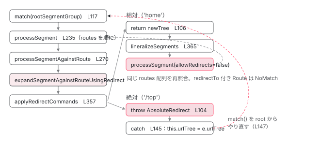

[目次](../README.md) › [Router の内側](README.md) › 第 10 回 / 全 21 回

# redirectTo はいつ・どこで解決されるか：ApplyRedirects と 31 回の上限

> Recognizer の中で redirectTo を見つけたときの流れ。相対リダイレクトの lineralizeSegments、絶対リダイレクトが AbsoluteRedirect 例外で match を最初からやり直す仕組み、MAX\_ALLOWED\_REDIRECTS、関数形式の redirectTo、canMatch の位置。

angular/angular · 読了 約 12 分 · 中核 · [サイトで読む（デモが動きます）](https://angular-deep-dive-cyan.vercel.app/chapter/router-redirects)

---

`redirectTo` は「別の URL に飛ばす設定」ですが、Router の中では**別のナビゲーションを起こしているわけではありません**。URL と Route 設定を照合する `Recognizer` の中で、照合中の segments を書き換えて照合を続けるだけです。この章では、相対リダイレクト（`'home'`）が `lineralizeSegments` で segments の列になる手順、絶対リダイレクト（`'/home'`）が `AbsoluteRedirect` という例外で照合を root からやり直す仕組み、その回数を 31 で止める `MAX_ALLOWED_REDIRECTS`、関数形式の `redirectTo`、そして `canMatch` が照合のどこで動くかを、行番号で追います。

読む対象は `packages/router/src/recognize.ts`、`packages/router/src/apply_redirects.ts`、`packages/router/src/utils/config_matching.ts`、`packages/router/src/operators/check_guards.ts` です。`Recognizer` の全体（`processSegmentGroup` → `processSegment` → `matchSegmentAgainstRoute`）は [前章](09-router-recognize.md)で読みました。ここでは `redirectTo` がある Route に入ったときの分岐だけを掘ります。

1. 1 本の RxJS パイプライン
2. URL → UrlTree
3. routerLink の配列 → UrlTree
4. Route 設定の検証と正規化
5. provideRouter の中身
6. 最初のナビゲーション
7. navigateByUrl → NavigationTransition
8. setupNavigations の全段
9. Recognizer と match
10. **redirectTo**（この章）
11. loadChildren と loadComponent
12. ガードの実行順
13. resolve と data と title
14. ActivatedRoute と Snapshot
15. RouterOutlet への配置
16. ブラウザの URL と履歴
17. Router.events の全種類
18. RouterLink と RouterLinkActive
19. withViewTransitions
20. withRouterResources
21. Navigation API

## 1. redirectTo は recognize の中で解決される

📄 `angular/packages/router/src/models.ts` L667–680 （▶ の行: 670–671, 673, 680）

```ts
667 │   /**
668 │    * A URL or function that returns a URL to redirect to when the path matches.
669 │    *
670 ▶    * Absolute if the URL begins with a slash (/) or the function returns a `UrlTree`, otherwise
671 ▶    * relative to the path URL.
672 │    *
673 ▶    * The `RedirectFunction` is run in an injection context so it can call `inject` to get any
674 │    * required dependencies.
675 │    *
676 │    * When not present, router does not redirect.
677 │    *
678 │    * @see [Conditional redirects](guide/routing/redirecting-routes#conditional-redirects)
679 │    */
680 ▶   redirectTo?: string | RedirectFunction;
```

`Route.redirectTo` の定義です。680 行目、型は `string | RedirectFunction`。670〜671 行目のコメントが規則の全部です。**文字列が `/` で始まる、または関数が `UrlTree` を返したら絶対**。それ以外は「照合中のパスからの相対」です。この 2 系統が、以降の処理でまったく別の経路を通ります。

📄 `angular/packages/router/src/operators/recognize.ts` L19–41 （▶ の行: 28–29, 39）

```ts
19 │ export function recognize(
20 │   injector: EnvironmentInjector,
21 │   configLoader: RouterConfigLoader,
22 │   rootComponentType: Type<any> | null,
23 │   config: Route[],
24 │   serializer: UrlSerializer,
25 │   paramsInheritanceStrategy: 'emptyOnly' | 'always',
26 │   abortSignal: AbortSignal,
27 │ ): MonoTypeOperatorFunction<NavigationTransition> {
28 ▶   return mergeMap(async (t) => {
29 ▶     const {state: targetSnapshot, tree: urlAfterRedirects} = await recognizeFn(
30 │       injector,
31 │       configLoader,
32 │       rootComponentType,
33 │       config,
34 │       t.extractedUrl,
35 │       serializer,
36 │       paramsInheritanceStrategy,
37 │       abortSignal,
38 │     );
39 ▶     return {...t, targetSnapshot, urlAfterRedirects};
40 │   });
41 │ }
```

📄 `angular/packages/router/src/recognize.ts` L46–66 （▶ の行: 56, 65）

```ts
46 │ export async function recognize(
47 │   injector: EnvironmentInjector,
48 │   configLoader: RouterConfigLoader,
49 │   rootComponentType: Type<any> | null,
50 │   config: Routes,
51 │   urlTree: UrlTree,
52 │   urlSerializer: UrlSerializer,
53 │   paramsInheritanceStrategy: ParamsInheritanceStrategy,
54 │   abortSignal: AbortSignal,
55 │ ): Promise<{state: RouterStateSnapshot; tree: UrlTree}> {
56 ▶   return new Recognizer(
57 │     injector,
58 │     configLoader,
59 │     rootComponentType,
60 │     config,
61 │     urlTree,
62 │     paramsInheritanceStrategy,
63 │     urlSerializer,
64 │     abortSignal,
65 ▶   ).recognize();
66 │ }
```

[パイプライン](08-router-pipeline.md)の `recognize` 段（navigation\_transition.ts 545 行目）が呼ぶのは operators/recognize.ts の演算子です。28〜29 行目で recognize.ts の `recognize` 関数を `await` し、39 行目で結果の `tree` を **`urlAfterRedirects`** として transition に載せます。`RoutesRecognized` 以降のイベントが持つ `urlAfterRedirects` は、ここで決まった値です。56 行目、**`Recognizer` はナビゲーションごとに new されます**。リダイレクトの回数を数えるカウンタがインスタンスのフィールドなので、「31 回」はナビゲーション 1 回あたりの上限です（3 節）。

📄 `angular/packages/router/src/recognize.ts` L97–115 （▶ の行: 100, 103, 112–113）

```ts
 97 │   async recognize(): Promise<{state: RouterStateSnapshot; tree: UrlTree}> {
 98 │     const rootSegmentGroup = split(this.urlTree.root, [], [], this.config).segmentGroup;
 99 │ 
100 ▶     const {children, rootSnapshot} = await this.match(rootSegmentGroup);
101 │     const rootNode = new TreeNode(rootSnapshot, children);
102 │     const routeState = new RouterStateSnapshot('', rootNode);
103 ▶     const tree = createUrlTreeFromSnapshot(
104 │       rootSnapshot,
105 │       [],
106 │       this.urlTree.queryParams,
107 │       this.urlTree.fragment,
108 │     );
109 │     // Creating the tree stringifies the query params
110 │     // We don't want to do this here to preserve pre-existing behavior
111 │     // so reassign them to the original.
112 ▶     tree.queryParams = this.urlTree.queryParams;
113 ▶     routeState.url = this.urlSerializer.serialize(tree);
114 │     return {state: routeState, tree};
115 │   }
```

100 行目で照合（`match`）、103 行目で**照合結果の snapshot 木から URL を組み直します**。リダイレクトで segments が書き換わっていれば、ここで作られる `tree` は入力の URL と違うものになります。112 行目で `queryParams` だけは `this.urlTree` のものに戻し、113 行目でそれを文字列化したものが `RouterStateSnapshot.url` です。`this.urlTree` が「入力の URL」のままか、差し替わっているかが、相対と絶対の違いになります（4 節）。

## 2. Recognizer の 3 つの状態

📄 `angular/packages/router/src/recognize.ts` L68–86 （▶ の行: 68, 72–73, 85）

```ts
68 ▶ const MAX_ALLOWED_REDIRECTS = 31;
69 │ 
70 │ export class Recognizer {
71 │   private applyRedirects: ApplyRedirects;
72 ▶   private absoluteRedirectCount = 0;
73 ▶   allowRedirects = true;
74 │ 
75 │   constructor(
76 │     private injector: EnvironmentInjector,
77 │     private configLoader: RouterConfigLoader,
78 │     private rootComponentType: Type<any> | null,
79 │     private config: Routes,
80 │     private urlTree: UrlTree,
81 │     private paramsInheritanceStrategy: ParamsInheritanceStrategy,
82 │     private readonly urlSerializer: UrlSerializer,
83 │     private readonly abortSignal: AbortSignal,
84 │   ) {
85 ▶     this.applyRedirects = new ApplyRedirects(this.urlSerializer, this.urlTree);
86 │   }
```

68 行目、`MAX_ALLOWED_REDIRECTS = 31`。72 行目の `absoluteRedirectCount` が絶対リダイレクトの回数、73 行目の `allowRedirects` が「これ以上リダイレクトを許すか」のスイッチです。85 行目で `ApplyRedirects`（apply\_redirects.ts）を作ります。引数の `this.urlTree` は**入力の URL**で、クエリパラメータを引き継ぐときに使われます（4 節）。

## 3. 分岐点：processSegmentAgainstRoute

📄 `angular/packages/router/src/recognize.ts` L235–268 （▶ の行: 244, 246, 253, 257–258, 260, 267）

```ts
235 │   async processSegment(
236 │     injector: EnvironmentInjector,
237 │     routes: Route[],
238 │     segmentGroup: UrlSegmentGroup,
239 │     segments: UrlSegment[],
240 │     outlet: string,
241 │     allowRedirects: boolean,
242 │     parentRoute: ActivatedRouteSnapshot,
243 │   ): Promise<TreeNode<ActivatedRouteSnapshot> | NoLeftoversInUrl> {
244 ▶     for (const r of routes) {
245 │       try {
246 ▶         return await this.processSegmentAgainstRoute(
247 │           r._injector ?? injector,
248 │           routes,
249 │           r,
250 │           segmentGroup,
251 │           segments,
252 │           outlet,
253 ▶           allowRedirects,
254 │           parentRoute,
255 │         );
256 │       } catch (e: any) {
257 ▶         if (e instanceof NoMatch || isEmptyError(e)) {
258 ▶           continue;
259 │         }
260 ▶         throw e;
261 │       }
262 │     }
263 │ 
264 │     if (noLeftoversInUrl(segmentGroup, segments, outlet)) {
265 │       return new NoLeftoversInUrl();
266 │     }
267 ▶     throw new NoMatch(segmentGroup);
268 │   }
```

📄 `angular/packages/router/src/recognize.ts` L298–322 （▶ の行: 298–299, 309–310, 321）

```ts
298 ▶     if (route.redirectTo === undefined) {
299 ▶       return this.matchSegmentAgainstRoute(
300 │         injector,
301 │         rawSegment,
302 │         route,
303 │         segments,
304 │         outlet,
305 │         parentRoute,
306 │       );
307 │     }
308 │ 
309 ▶     if (this.allowRedirects && allowRedirects) {
310 ▶       return this.expandSegmentAgainstRouteUsingRedirect(
311 │         injector,
312 │         rawSegment,
313 │         routes,
314 │         route,
315 │         segments,
316 │         outlet,
317 │         parentRoute,
318 │       );
319 │     }
320 │ 
321 ▶     throw new NoMatch(rawSegment);
322 │   }
```

1. **244〜246 行目：Route を上から順に試す**

   `processSegment` は `routes` 配列を `for` で回し、1 つずつ `processSegmentAgainstRoute` に渡します。257〜258 行目、`NoMatch`（または RxJS の `EmptyError`）なら `continue` で次の Route。**260 行目、それ以外の例外はそのまま投げ直します**。4 節の `AbsoluteRedirect` はこの 260 行目を通って上へ抜けます。267 行目、全部外れたら `NoMatch`。
2. **298〜299 行目：redirectTo が無ければ普通の照合**

   `matchSegmentAgainstRoute`（[前章](09-router-recognize.md)）へ。`canMatch` が動くのはこちらの経路だけです（6 節）。
3. **309〜310 行目：2 つのフラグが両方 true のときだけリダイレクト**

   `this.allowRedirects` は Recognizer 全体のスイッチ（2 節 73 行目）、引数の `allowRedirects` は**この呼び出しに限った許可**です。`processSegmentGroup` からの最初の呼び出しは `true`（下の引用 174 行目）、相対リダイレクト後の再照合は `false` で呼ばれます（4 節 372 行目）。

   📄 `angular/packages/router/src/recognize.ts` L157–178 （▶ の行: 164–165, 168, 174）

   ```ts
   157 │   async processSegmentGroup(
   158 │     injector: EnvironmentInjector,
   159 │     config: Route[],
   160 │     segmentGroup: UrlSegmentGroup,
   161 │     outlet: string,
   162 │     parentRoute: ActivatedRouteSnapshot,
   163 │   ): Promise<TreeNode<ActivatedRouteSnapshot>[]> {
   164 ▶     if (segmentGroup.segments.length === 0 && segmentGroup.hasChildren()) {
   165 ▶       return this.processChildren(injector, config, segmentGroup, parentRoute);
   166 │     }
   167 │ 
   168 ▶     const child = await this.processSegment(
   169 │       injector,
   170 │       config,
   171 │       segmentGroup,
   172 │       segmentGroup.segments,
   173 │       outlet,
   174 ▶       true,
   175 │       parentRoute,
   176 │     );
   177 │     return child instanceof TreeNode ? [child] : [];
   178 │   }
   ```

   164〜165 行目、segments が無く子（名前付き outlet）だけなら `processChildren`。それ以外は 168 行目で `processSegment`、174 行目の `true` が `allowRedirects` です。
4. **321 行目：どちらかが false なら NoMatch**

   `redirectTo` を持つ Route なのに許可が無いときは、**その Route は存在しないものとして**次の Route へ進みます。エラーにはなりません。

## 4. expandSegmentAgainstRouteUsingRedirect：相対と絶対の分かれ道

📄 `angular/packages/router/src/recognize.ts` L324–352 （▶ の行: 333–335, 339–341, 343, 350）

```ts
324 │   private async expandSegmentAgainstRouteUsingRedirect(
325 │     injector: EnvironmentInjector,
326 │     segmentGroup: UrlSegmentGroup,
327 │     routes: Route[],
328 │     route: Route,
329 │     segments: UrlSegment[],
330 │     outlet: string,
331 │     parentRoute: ActivatedRouteSnapshot,
332 │   ): Promise<TreeNode<ActivatedRouteSnapshot> | NoLeftoversInUrl> {
333 ▶     const {matched, parameters, consumedSegments, positionalParamSegments, remainingSegments} =
334 ▶       match(segmentGroup, route, segments);
335 ▶     if (!matched) throw new NoMatch(segmentGroup);
336 │ 
337 │     // TODO(atscott): Move all of this under an if(ngDevMode) as a breaking change and allow stack
338 │     // size exceeded in production
339 ▶     if (typeof route.redirectTo === 'string' && route.redirectTo[0] === '/') {
340 ▶       this.absoluteRedirectCount++;
341 ▶       if (this.absoluteRedirectCount > MAX_ALLOWED_REDIRECTS) {
342 │         if (ngDevMode) {
343 ▶           throw new RuntimeError(
344 │             RuntimeErrorCode.INFINITE_REDIRECT,
345 │             `Detected possible infinite redirect when redirecting from '${this.urlTree}' to '${route.redirectTo}'.\n` +
346 │               `This is currently a dev mode only error but will become a` +
347 │               ` call stack size exceeded error in production in a future major version.`,
348 │           );
349 │         }
350 ▶         this.allowRedirects = false;
351 │       }
352 │     }
```

📄 `angular/packages/router/src/utils/config_matching.ts` L82–122 （▶ の行: 87–88, 95, 101, 106–107, 116–117, 120）

```ts
 82 │ export function match(
 83 │   segmentGroup: UrlSegmentGroup,
 84 │   route: Route,
 85 │   segments: UrlSegment[],
 86 │ ): MatchResult {
 87 ▶   if (route.path === '') {
 88 ▶     if (route.pathMatch === 'full' && (segmentGroup.hasChildren() || segments.length > 0)) {
 89 │       return {...noMatch};
 90 │     }
 91 │ 
 92 │     return {
 93 │       matched: true,
 94 │       consumedSegments: [],
 95 ▶       remainingSegments: segments,
 96 │       parameters: {},
 97 │       positionalParamSegments: {},
 98 │     };
 99 │   }
100 │ 
101 ▶   const matcher = route.matcher || defaultUrlMatcher;
102 │   const res = matcher(segments, segmentGroup, route);
103 │   if (!res) return {...noMatch};
104 │ 
105 │   const posParams: {[n: string]: string} = {};
106 ▶   Object.entries(res.posParams ?? {}).forEach(([k, v]) => {
107 ▶     posParams[k] = v.path;
108 │   });
109 │   const parameters =
110 │     res.consumed.length > 0
111 │       ? {...posParams, ...res.consumed[res.consumed.length - 1].parameters}
112 │       : posParams;
113 │ 
114 │   return {
115 │     matched: true,
116 ▶     consumedSegments: res.consumed,
117 ▶     remainingSegments: segments.slice(res.consumed.length),
118 │     // TODO(atscott): investigate combining parameters and positionalParamSegments
119 │     parameters,
120 ▶     positionalParamSegments: res.posParams ?? {},
121 │   };
122 │ }
```

333〜334 行目、まず `match`（config\_matching.ts 82 行目）で Route の `path` と URL を照合します。`matchWithChecks` ではなく `match` なので、`canMatch` は呼ばれません（6 節）。`path: ''` なら 87〜98 行目、消費する segment は無く（95 行目で `remainingSegments` に全部残す）、88 行目で `pathMatch: 'full'` かつ URL に残りがあれば不一致です。それ以外は 101 行目の `defaultUrlMatcher` が `:id` のような部分を `posParams` に集め、106〜107 行目で文字列に、120 行目で **`positionalParamSegments`（`UrlSegment` のまま）**にします。リダイレクトで使うのは後者です。116〜117 行目、消費した segments と残りの segments も返します。

335 行目、一致しなければ `NoMatch`。339 行目、**文字列で `/` 始まりのときだけ** 340 行目でカウンタを進め、341 行目で 31 を超えていたら、343 行目（開発モード）`NG04016` を throw、本番では 350 行目で `allowRedirects = false` にします（5 節）。

📄 `angular/packages/router/src/recognize.ts` L353–375 （▶ の行: 353, 357–361, 365–366, 370, 372）

```ts
353 ▶     const currentSnapshot = this.createSnapshot(injector, route, segments, parameters, parentRoute);
354 │     if (this.abortSignal.aborted) {
355 │       throw new Error(this.abortSignal.reason);
356 │     }
357 ▶     const newTree = await this.applyRedirects.applyRedirectCommands(
358 ▶       consumedSegments,
359 ▶       route.redirectTo!,
360 ▶       positionalParamSegments,
361 ▶       createPreMatchRouteSnapshot(currentSnapshot),
362 │       injector,
363 │     );
364 │ 
365 ▶     const newSegments = await this.applyRedirects.lineralizeSegments(route, newTree);
366 ▶     return this.processSegment(
367 │       injector,
368 │       routes,
369 │       segmentGroup,
370 ▶       newSegments.concat(remainingSegments),
371 │       outlet,
372 ▶       false,
373 │       parentRoute,
374 │     );
375 │   }
```

353 行目で `ActivatedRouteSnapshot` を作り、361 行目で `createPreMatchRouteSnapshot` に通します。これが関数形式 `redirectTo` に渡される `PartialMatchRouteSnapshot` です（4-3）。357〜363 行目、`applyRedirectCommands` に**消費した segments**（358 行目）、`redirectTo`、`positionalParamSegments`（360 行目）を渡して新しい `UrlTree` をもらいます。ここで絶対リダイレクトなら例外が飛び、365 行目以降には来ません。相対なら 365 行目で `UrlTree` を segments の列に戻し、366〜374 行目、**その列 + 残りの segments（370 行目）**で、**同じ `routes` 配列**を **`allowRedirects = false`（372 行目）**で照合し直します。

### 4-1. applyRedirectCommands：文字列から UrlTree へ

📄 `angular/packages/router/src/apply_redirects.ts` L84–107 （▶ の行: 91–93, 96, 98, 103–104, 106）

```ts
 84 │   async applyRedirectCommands(
 85 │     segments: UrlSegment[],
 86 │     redirectTo: string | RedirectFunction,
 87 │     posParams: {[k: string]: UrlSegment},
 88 │     currentSnapshot: PartialMatchRouteSnapshot,
 89 │     injector: Injector,
 90 │   ): Promise<UrlTree> {
 91 ▶     const redirect = await getRedirectResult(redirectTo, currentSnapshot, injector);
 92 ▶     if (redirect instanceof UrlTree) {
 93 ▶       throw new AbsoluteRedirect(redirect);
 94 │     }
 95 │ 
 96 ▶     const newTree = this.applyRedirectCreateUrlTree(
 97 │       redirect,
 98 ▶       this.urlSerializer.parse(redirect),
 99 │       segments,
100 │       posParams,
101 │     );
102 │ 
103 ▶     if (redirect[0] === '/') {
104 ▶       throw new AbsoluteRedirect(newTree);
105 │     }
106 ▶     return newTree;
107 │   }
```

📄 `angular/packages/router/src/apply_redirects.ts` L195–207 （▶ の行: 200–201, 204–205）

```ts
195 │ function getRedirectResult(
196 │   redirectTo: string | RedirectFunction,
197 │   currentSnapshot: PartialMatchRouteSnapshot,
198 │   injector: Injector,
199 │ ): Promise<string | UrlTree> {
200 ▶   if (typeof redirectTo === 'string') {
201 ▶     return Promise.resolve(redirectTo);
202 │   }
203 │   const redirectToFn = redirectTo;
204 ▶   return firstValueFrom(
205 ▶     wrapIntoObservable(runInInjectionContext(injector, () => redirectToFn(currentSnapshot))),
206 │   );
207 │ }
```

1. **91 行目：getRedirectResult**

   200〜201 行目、文字列ならそのまま。204〜205 行目、関数なら `runInInjectionContext(injector, ...)` で呼び （だから中で `inject()` が使えます）、`wrapIntoObservable` → `firstValueFrom` で 同期値・Promise・Observable のどれでも**最初の 1 値**に揃えます。
2. **92〜93 行目：UrlTree が返ったら即 AbsoluteRedirect**

   関数が `UrlTree` を返した場合は、文字列の解析をせず、その木をそのまま絶対リダイレクトとして投げます。
3. **96〜101 行目：文字列を parse して木を作り直す**

   98 行目、`urlSerializer.parse(redirect)` で `redirectTo` の文字列を `UrlTree` に。それと消費済み segments・`posParams` から `applyRedirectCreateUrlTree` で新しい木を作ります（4-2）。
4. **103〜106 行目：先頭が `/` なら throw、それ以外は return**

   **ここが相対と絶対の分岐そのもの**です。絶対なら `AbsoluteRedirect(newTree)` を throw（4-4）。相対なら `newTree` を返し、呼び元の 365 行目へ戻ります。

### 4-2. createSegmentGroup / createSegments：`:id` の置き換え

📄 `angular/packages/router/src/apply_redirects.ts` L109–135 （▶ の行: 115–116, 118–119, 126–129, 131）

```ts
109 │   applyRedirectCreateUrlTree(
110 │     redirectTo: string,
111 │     urlTree: UrlTree,
112 │     segments: UrlSegment[],
113 │     posParams: {[k: string]: UrlSegment},
114 │   ): UrlTree {
115 ▶     const newRoot = this.createSegmentGroup(redirectTo, urlTree.root, segments, posParams);
116 ▶     return new UrlTree(
117 │       newRoot,
118 ▶       this.createQueryParams(urlTree.queryParams, this.urlTree.queryParams),
119 ▶       urlTree.fragment,
120 │     );
121 │   }
122 │ 
123 │   createQueryParams(redirectToParams: Params, actualParams: Params): Params {
124 │     const res: Params = {};
125 │     Object.entries(redirectToParams).forEach(([k, v]) => {
126 ▶       const copySourceValue = typeof v === 'string' && v[0] === ':';
127 ▶       if (copySourceValue) {
128 ▶         const sourceName = v.substring(1);
129 ▶         res[k] = actualParams[sourceName];
130 │       } else {
131 ▶         res[k] = v;
132 │       }
133 │     });
134 │     return res;
135 │   }
```

📄 `angular/packages/router/src/apply_redirects.ts` L137–165 （▶ の行: 143, 147–148, 151, 160–163）

```ts
137 │   createSegmentGroup(
138 │     redirectTo: string,
139 │     group: UrlSegmentGroup,
140 │     segments: UrlSegment[],
141 │     posParams: {[k: string]: UrlSegment},
142 │   ): UrlSegmentGroup {
143 ▶     const updatedSegments = this.createSegments(redirectTo, group.segments, segments, posParams);
144 │ 
145 │     // Keyed by outlet name, which can be `__proto__`, so use a null-prototype map.
146 │     let children: {[n: string]: UrlSegmentGroup} = Object.create(null);
147 ▶     Object.entries(group.children).forEach(([name, child]) => {
148 ▶       children[name] = this.createSegmentGroup(redirectTo, child, segments, posParams);
149 │     });
150 │ 
151 ▶     return new UrlSegmentGroup(updatedSegments, children);
152 │   }
153 │ 
154 │   createSegments(
155 │     redirectTo: string,
156 │     redirectToSegments: UrlSegment[],
157 │     actualSegments: UrlSegment[],
158 │     posParams: {[k: string]: UrlSegment},
159 │   ): UrlSegment[] {
160 ▶     return redirectToSegments.map((s) =>
161 ▶       s.path[0] === ':'
162 ▶         ? this.findPosParam(redirectTo, s, posParams)
163 ▶         : this.findOrReturn(s, actualSegments),
164 │     );
165 │   }
```

📄 `angular/packages/router/src/apply_redirects.ts` L167–192 （▶ の行: 172–174, 179, 185–187, 191）

```ts
167 │   findPosParam(
168 │     redirectTo: string,
169 │     redirectToUrlSegment: UrlSegment,
170 │     posParams: {[k: string]: UrlSegment},
171 │   ): UrlSegment {
172 ▶     const pos = posParams[redirectToUrlSegment.path.substring(1)];
173 ▶     if (!pos)
174 ▶       throw new RuntimeError(
175 │         RuntimeErrorCode.MISSING_REDIRECT,
176 │         (typeof ngDevMode === 'undefined' || ngDevMode) &&
177 │           `Cannot redirect to '${redirectTo}'. Cannot find '${redirectToUrlSegment.path}'.`,
178 │       );
179 ▶     return pos;
180 │   }
181 │ 
182 │   findOrReturn(redirectToUrlSegment: UrlSegment, actualSegments: UrlSegment[]): UrlSegment {
183 │     let idx = 0;
184 │     for (const s of actualSegments) {
185 ▶       if (s.path === redirectToUrlSegment.path) {
186 ▶         actualSegments.splice(idx);
187 ▶         return s;
188 │       }
189 │       idx++;
190 │     }
191 ▶     return redirectToUrlSegment;
192 │   }
```

115 行目、`redirectTo` を parse した木の root から `createSegmentGroup`。143 行目で segments を変換し、147〜148 行目で子（名前付き outlet）も再帰的に変換します。160〜164 行目、**segment ごとに 2 通り**です。

1. **161〜162 行目：`:` 始まりなら findPosParam**

   172 行目、`posParams[':id' の id]` を引きます。`match` が返した `positionalParamSegments`（4 節 120 行目）なので、値は**文字列ではなく `UrlSegment`**です。URL の `42;sort=asc` の matrix params もそのまま付いてきます。173〜178 行目、無ければ `NG04001`「Cannot redirect to 'new/:id'. Cannot find ':id'.」。`redirectTo` に書いたパラメータ名が `path` に無いときのエラーです。
2. **163 行目：それ以外は findOrReturn**

   185〜187 行目、**消費済み segments に同じ `path` があれば URL 側の `UrlSegment` を返します**（matrix params を保つため）。186 行目の `splice(idx)` は見つけた位置から後ろを配列から消すので、同じ名前が 2 回出ても 2 回目は 191 行目の `redirectTo` 側の segment になります。見つからなければ 191 行目、`redirectTo` に書かれた文字列のままです。
3. **116〜120 行目：クエリパラメータは redirectTo 側が基準**

   118 行目、`createQueryParams(redirectTo の queryParams, 入力 URL の queryParams)`。126〜129 行目、`redirectTo: '/top?from=:id'` のように値が `:` 始まりなら入力 URL の同名パラメータをコピーし、131 行目、それ以外はそのまま。**`redirectTo` 文字列に書かれていないクエリは新しい木に入りません**。ただし相対リダイレクトではこの木から segments しか使わない（4-3）ので、効くのは絶対リダイレクトのときだけです。

### 4-3. lineralizeSegments：木を 1 列に戻す（相対のとき）

📄 `angular/packages/router/src/apply_redirects.ts` L67–82 （▶ の行: 71–73, 76–77, 80）

```ts
67 │   async lineralizeSegments(route: Route, urlTree: UrlTree): Promise<UrlSegment[]> {
68 │     let res: UrlSegment[] = [];
69 │     let c = urlTree.root;
70 │     while (true) {
71 ▶       res = res.concat(c.segments);
72 ▶       if (c.numberOfChildren === 0) {
73 ▶         return res;
74 │       }
75 │ 
76 ▶       if (c.numberOfChildren > 1 || !c.children[PRIMARY_OUTLET]) {
77 ▶         throw namedOutletsRedirect(`${route.redirectTo!}`);
78 │       }
79 │ 
80 ▶       c = c.children[PRIMARY_OUTLET];
81 │     }
82 │   }
```

📄 `angular/packages/router/src/apply_redirects.ts` L45–51 （▶ の行: 45, 49）

```ts
45 ▶ export function namedOutletsRedirect(redirectTo: string): never {
46 │   throw new RuntimeError(
47 │     RuntimeErrorCode.NAMED_OUTLET_REDIRECT,
48 │     (typeof ngDevMode === 'undefined' || ngDevMode) &&
49 ▶       `Only absolute redirects can have named outlets. redirectTo: '${redirectTo}'`,
50 │   );
51 │ }
```

71 行目で各階層の segments をつなぎ、80 行目で primary の子へ降り、72〜73 行目、子が無くなったら返します。76〜77 行目、**子が 2 つ以上、または primary 以外しか無いなら `NG04000`** 「Only absolute redirects can have named outlets」。相対リダイレクトは `UrlSegment[]` という 1 本の列にしか戻せないので、`(aux:foo)` のような枝分かれを表せないのです。クエリパラメータとフラグメントもこの時点で捨てられ、1 節 112 行目のとおり入力 URL のものが残ります。

📄 `angular/packages/router/src/models.ts` L331–344 （▶ の行: 334–336, 342–344）

```ts
331 │ /**
332 │  * The type for the function that can be used to handle redirects when the path matches a `Route` config.
333 │  *
334 ▶  * The `RedirectFunction` does not have access to the full
335 ▶  * `ActivatedRouteSnapshot` interface because Route matching has not
336 ▶  * yet completed when the function is called. See {@link PartialMatchRouteSnapshot}
337 │  * for more information.
338 │  *
339 │  * @see {@link Route#redirectTo}
340 │  * @publicApi
341 │  */
342 ▶ export type RedirectFunction = (
343 ▶   redirectData: PartialMatchRouteSnapshot,
344 ▶ ) => MaybeAsync<string | UrlTree>;
```

📄 `angular/packages/router/src/models.ts` L1245–1257 （▶ の行: 1245, 1247, 1249, 1252）

```ts
1245 ▶ export type PartialMatchRouteSnapshot = Pick<
1246 │   ActivatedRouteSnapshot,
1247 ▶   | 'routeConfig'
1248 │   | 'url'
1249 ▶   | 'params'
1250 │   | 'queryParams'
1251 │   | 'fragment'
1252 ▶   | 'data'
1253 │   | 'outlet'
1254 │   | 'title'
1255 │   | 'paramMap'
1256 │   | 'queryParamMap'
1257 │ >;
```

関数形式の引数は 1245〜1257 行目の `PartialMatchRouteSnapshot`。`ActivatedRouteSnapshot` から `routeConfig`・`url`・`params`・`data` など 10 個だけを `Pick` したものです。334〜336 行目のコメントどおり、**照合がまだ終わっていない**ので `parent`・`children`・`firstChild` はありません。[resolve](13-router-resolvers.md) もまだ走っていないので `data` は静的な `Route.data`（と親からの継承分）だけです。

### 4-4. AbsoluteRedirect：例外で match を root からやり直す

📄 `angular/packages/router/src/apply_redirects.ts` L20–43 （▶ の行: 20, 34–35）

```ts
20 ▶ export class NoMatch extends Error {
21 │   public segmentGroup: UrlSegmentGroup | null;
22 │ 
23 │   constructor(segmentGroup?: UrlSegmentGroup) {
24 │     super();
25 │     this.segmentGroup = segmentGroup || null;
26 │ 
27 │     // Extending `Error` ends up breaking some internal tests. This appears to be a known issue
28 │     // when extending errors in TS and the workaround is to explicitly set the prototype.
29 │     // https://stackoverflow.com/questions/41102060/typescript-extending-error-class
30 │     Object.setPrototypeOf(this, NoMatch.prototype);
31 │   }
32 │ }
33 │ 
34 ▶ export class AbsoluteRedirect extends Error {
35 ▶   constructor(public urlTree: UrlTree) {
36 │     super();
37 │ 
38 │     // Extending `Error` ends up breaking some internal tests. This appears to be a known issue
39 │     // when extending errors in TS and the workaround is to explicitly set the prototype.
40 │     // https://stackoverflow.com/questions/41102060/typescript-extending-error-class
41 │     Object.setPrototypeOf(this, AbsoluteRedirect.prototype);
42 │   }
43 │ }
```

📄 `angular/packages/router/src/recognize.ts` L117–155 （▶ の行: 123, 136, 144–147, 149–150, 153）

```ts
117 │   private async match(rootSegmentGroup: UrlSegmentGroup): Promise<{
118 │     children: TreeNode<ActivatedRouteSnapshot>[];
119 │     rootSnapshot: ActivatedRouteSnapshot;
120 │   }> {
121 │     // Use Object.freeze to prevent readers of the Router state from modifying it outside
122 │     // of a navigation, resulting in the router being out of sync with the browser.
123 ▶     const rootSnapshot = new ActivatedRouteSnapshot(
124 │       [],
125 │       Object.freeze({}),
126 │       Object.freeze({...this.urlTree.queryParams}),
127 │       this.urlTree.fragment,
128 │       Object.freeze({}),
129 │       PRIMARY_OUTLET,
130 │       this.rootComponentType,
131 │       null,
132 │       {},
133 │       this.injector,
134 │     );
135 │     try {
136 ▶       const children = await this.processSegmentGroup(
137 │         this.injector,
138 │         this.config,
139 │         rootSegmentGroup,
140 │         PRIMARY_OUTLET,
141 │         rootSnapshot,
142 │       );
143 │       return {children, rootSnapshot};
144 ▶     } catch (e: any) {
145 ▶       if (e instanceof AbsoluteRedirect) {
146 ▶         this.urlTree = e.urlTree;
147 ▶         return this.match(e.urlTree.root);
148 │       }
149 ▶       if (e instanceof NoMatch) {
150 ▶         throw this.noMatchError(e);
151 │       }
152 │ 
153 ▶       throw e;
154 │     }
155 │   }
```

34〜35 行目、`AbsoluteRedirect` は `Error` を継承し、新しい `UrlTree` を 1 つ持つだけのクラスです。4-1 の 93 行目・104 行目で throw されたこれは、`processSegment` の 260 行目（3 節）で素通りし、`processSegmentGroup` も素通りして、**136 行目を呼んだ `match` の 144 行目の `catch`** に届きます。

1. **146 行目：this.urlTree を差し替える**

   `Recognizer` が「いま照合している URL」として持つ木を、リダイレクト先の木に置き換えます。1 節 112 行目の `queryParams` も、4-1 で `ApplyRedirects` に渡した `this.urlTree`（2 節 85 行目）も、この後は新しい木を指します。ただし `ApplyRedirects` のインスタンスは作り直されないので、4-2 118 行目の「入力 URL の queryParams」は**最初の URL**のままです。
2. **147 行目：match を root から再実行**

   123 行目で root の snapshot を作り直し、136 行目で `processSegmentGroup` を **`this.config`（最上位の routes）**から始めます。どこの階層で `redirectTo: '/top'` に当たっても、やり直しは常に root からです。4 節 372 行目の `allowRedirects = false` も効いていません（`processSegmentGroup` は 174 行目で `true` を渡す）。**絶対リダイレクトは別の絶対リダイレクトに連鎖できます**。だから回数制限が要ります（5 節）。
3. **149〜150 行目：NoMatch は NG04002 に**

   全 Route を試しても一致しなかった `NoMatch` は、ここで `RuntimeError`「Cannot match any routes. URL Segment: '...'」になり、[パイプライン](08-router-pipeline.md)の `catchError` で `NavigationError` として流れます。



*相対 redirectTo は segments を置き換えて同じ階層の routes を allowRedirects=false で再照合する。絶対 redirectTo は AbsoluteRedirect を throw して match() を root からやり直す。*

### 4-5. 3 つの書き方を 1 ステップずつ

よく書く 3 パターンで、上の関数がどう動くかを並べます。URL はいずれも 1 回のナビゲーションの入力です。

| Route | URL | 通る行 | 結果 |
| --- | --- | --- | --- |
| `{path: '', redirectTo: 'home', pathMatch: 'full'}` | `/` | L334 match → config\_matching L87-98（segments 空、children 無しなので一致、consumed \[\]）→ L339 は `'h'` なので偽 → L357 applyRedirectCommands → apply\_redirects L98 parse('home') → L163 findOrReturn（consumed が空なので L191、`home` のまま）→ L106 return → L365 lineralize → `[home]` → L366 processSegment(`[home]`, allowRedirects=false) | `{path: 'home'}` に一致。`urlAfterRedirects` は `/home`。URL が `/x` なら L88 で不一致 → NoMatch → 次の Route |
| `{path: 'old/:id', redirectTo: 'new/:id'}` | `/old/42;sort=asc` | L334 match → defaultUrlMatcher が `consumed [old, 42]`、`positionalParamSegments {id: UrlSegment('42', {sort:'asc'})}` → L357 → L98 parse('new/:id') → L161-162 `:id` は findPosParam → L172 で UrlSegment を取得 → L163 `new` は findOrReturn → L191 → L106 return → L365 → `[new, 42;sort=asc]` → L366 | `{path: 'new/:id'}` に一致。matrix params `sort=asc` は `UrlSegment` ごと移る。`redirectTo: 'new/:name'` なら L174 で NG04001 |
| `{path: 'legacy', redirectTo: '/top'}` | `/legacy/extra?q=1` | L334 match → `consumed [legacy]`、`remaining [extra]` → L339 真 → L340 count = 1 → L341 偽 → L357 → L98 parse('/top') → L118 createQueryParams（'/top' にクエリ無しなので `{}`）→ L103-104 **throw AbsoluteRedirect** → recognize L260 素通り → L145 catch → L146 `this.urlTree = /top` → L147 match(root) | root から `/top` を照合。`extra` も `?q=1` も引き継がれない（引き継ぐなら `'/top?q=:q'` と書く。L126-129） |

> **🧪 DEMO — redirectTo と URL から、置き換え後の segments を求める**
>
> apply\_redirects.ts L84-192 の規則（findPosParam / findOrReturn / lineralizeSegments）を同じ順で再現しています。省略: pathMatch 'full'、'\*\*'、カスタム matcher、クエリパラメータ、名前付き outlet。segment に `;k=v` を付けると matrix params として扱います。
>
> ▶ [このデモはサイトで動かせます](https://angular-deep-dive-cyan.vercel.app/chapter/router-redirects)

## 5. 31 回で止まる：MAX\_ALLOWED\_REDIRECTS

4-4 で見たとおり、絶対リダイレクトは root から照合をやり直すので、`{path: 'a', redirectTo: '/b'}` と `{path: 'b', redirectTo: '/a'}` を書くと終わりません。それを止めるのが 4 節 339〜352 行目です。カウンタ（2 節 72 行目）は `Recognizer` のフィールドなので、**ナビゲーション 1 回の中で**数えます。

| 絶対リダイレクトの回数 | L340 後の count | L341 `count > 31` | 動作 |
| --- | --- | --- | --- |
| 1 回目 | 1 | 偽 | L357 へ → AbsoluteRedirect → L147 で match をやり直す |
| … | … | 偽 | 同じ |
| 31 回目 | 31 | 偽 | 同じ（31 回目までは許される） |
| 32 回目 | 32 | **真** | 開発モード：L343 で `NG04016`「Detected possible infinite redirect when redirecting from '/a' to '/b'.」を throw → `NavigationError`。<br> 本番：L350 で `allowRedirects = false`。この 32 回目の AbsoluteRedirect 自体は投げられて match をやり直すが、以後 L309 が偽になるので `redirectTo` 付き Route はすべて L321 NoMatch → 最終的に L150 で `NG04002`「Cannot match any routes」 |

📄 `angular/packages/router/src/errors.ts` L12–32 （▶ の行: 13–15, 29）

```ts
12 │ export const enum RuntimeErrorCode {
13 ▶   NAMED_OUTLET_REDIRECT = 4000,
14 ▶   MISSING_REDIRECT = 4001,
15 ▶   NO_MATCH = 4002,
16 │   ROOT_SEGMENT_MATRIX_PARAMS = 4003,
17 │   MISPLACED_OUTLETS_COMMAND = 4004,
18 │   INVALID_DOUBLE_DOTS = 4005,
19 │   TWO_SEGMENTS_WITH_SAME_OUTLET = 4006,
20 │   FOR_ROOT_CALLED_TWICE = 4007,
21 │   NULLISH_COMMAND = 4008,
22 │   EMPTY_PATH_WITH_PARAMS = 4009,
23 │   UNPARSABLE_URL = 4010,
24 │   UNEXPECTED_VALUE_IN_URL = 4011,
25 │   OUTLET_NOT_ACTIVATED = 4012,
26 │   OUTLET_ALREADY_ACTIVATED = 4013,
27 │   INVALID_ROUTE_CONFIG = 4014,
28 │   INVALID_ROOT_URL_SEGMENT = 4015,
29 ▶   INFINITE_REDIRECT = 4016,
30 │   INVALID_ROUTER_LINK_INPUTS = 4017,
31 │   ERROR_PARSING_URL = 4018,
32 │ }
```

この章で出たエラーコードは 4 つです。13 行目 `NG04000`（相対リダイレクトに名前付き outlet）、14 行目 `NG04001`（`:id` が見つからない）、15 行目 `NG04002`（どの Route にも一致しない）、29 行目 `NG04016`（無限リダイレクトの疑い）。4 節 345〜347 行目のメッセージにあるとおり、`NG04016` は開発モード限定で、本番で同じ状況になると上の表の「本番」の経路を通ります。

> [!WARNING]
> **ハマりどころ**
>
> 相対リダイレクトは**同じ階層では連鎖しません**。`{path: 'a', redirectTo: 'b'}, {path: 'b', redirectTo: 'c'}` で `/a` に来ると、`a → b` の後の再照合は 4 節 372 行目の `allowRedirects = false` で行われるので、`b` の Route は 3 節 309 行目が偽 → 321 行目 NoMatch になり、`/b` に一致する Route が他に無ければ `NG04002` です。連鎖させたいなら `'/b'` と絶対で書きます（そのときは 31 回の上限が効きます）。子階層は別です。再照合で一致した Route の `children` を照合するときは下の 489 行目で `true` を渡し直すので、子の `redirectTo` は動きます。

📄 `angular/packages/router/src/recognize.ts` L474–492 （▶ の行: 483, 485, 488–489）

```ts
474 │     const matchedOnOutlet = getOutlet(route) === outlet;
475 │     // If we matched a config due to empty path match on a different outlet, we need to
476 │     // continue passing the current outlet for the segment rather than switch to PRIMARY.
477 │     // Note that we switch to primary when we have a match because outlet configs look like
478 │     // this: {path: 'a', outlet: 'a', children: [
479 │     //  {path: 'b', component: B},
480 │     //  {path: 'c', component: C},
481 │     // ]}
482 │     // Notice that the children of the named outlet are configured with the primary outlet
483 ▶     const child = await this.processSegment(
484 │       childInjector,
485 ▶       childConfig,
486 │       segmentGroup,
487 │       slicedSegments,
488 ▶       matchedOnOutlet ? PRIMARY_OUTLET : outlet,
489 ▶       true,
490 │       snapshot,
491 │     );
492 │     return new TreeNode(snapshot, child instanceof TreeNode ? [child] : []);
```

483〜491 行目、一致した Route の子設定（485 行目 `childConfig`）で残りの segments を照合するときの呼び出しです。489 行目が `allowRedirects` で、常に `true`。488 行目、子は primary outlet として照合されます（名前付き outlet の子設定は primary で書かれるため）。

## 6. canMatch は「照合の一部」として動く

📄 `angular/packages/router/src/utils/config_matching.ts` L54–80 （▶ の行: 63–65, 68, 71–72, 79）

```ts
54 │ export function matchWithChecks(
55 │   segmentGroup: UrlSegmentGroup,
56 │   route: Route,
57 │   segments: UrlSegment[],
58 │   injector: EnvironmentInjector,
59 │   urlSerializer: UrlSerializer,
60 │   createSnapshot: (result: MatchResult) => ActivatedRouteSnapshot,
61 │   abortSignal: AbortSignal,
62 │ ): Observable<MatchResult> {
63 ▶   const result = match(segmentGroup, route, segments);
64 ▶   if (!result.matched) {
65 ▶     return of(result);
66 │   }
67 │ 
68 ▶   const currentSnapshot = createPreMatchRouteSnapshot(createSnapshot(result));
69 │   // Only create the Route's `EnvironmentInjector` if it matches the attempted
70 │   // navigation
71 ▶   injector = getOrCreateRouteInjectorIfNeeded(route, injector);
72 ▶   return runCanMatchGuards(
73 │     injector,
74 │     route,
75 │     segments,
76 │     urlSerializer,
77 │     currentSnapshot,
78 │     abortSignal,
79 ▶   ).pipe(map((v) => (v === true ? result : {...noMatch})));
80 │ }
```

📄 `angular/packages/router/src/operators/check_guards.ts` L265–287 （▶ の行: 274, 277–281, 283, 286）

```ts
265 │ export function runCanMatchGuards(
266 │   injector: EnvironmentInjector,
267 │   route: Route,
268 │   segments: UrlSegment[],
269 │   urlSerializer: UrlSerializer,
270 │   currentSnapshot: PartialMatchRouteSnapshot,
271 │   abortSignal: AbortSignal,
272 │ ): Observable<GuardResult> {
273 │   const canMatch = route.canMatch;
274 ▶   if (!canMatch || canMatch.length === 0) return of(true);
275 │ 
276 │   const canMatchObservables = canMatch.map((injectionToken) => {
277 ▶     const guard = getTokenOrFunctionIdentity(injectionToken as ProviderToken<any>, injector);
278 ▶     const guardVal = isCanMatch(guard)
279 ▶       ? guard.canMatch(route, segments, currentSnapshot)
280 ▶       : runInInjectionContext(injector, () =>
281 ▶           (guard as CanMatchFn)(route, segments, currentSnapshot),
282 │         );
283 ▶     return wrapIntoObservable(guardVal).pipe(takeUntilAbort(abortSignal));
284 │   });
285 │ 
286 ▶   return of(canMatchObservables).pipe(prioritizedGuardValue(), redirectIfUrlTree(urlSerializer));
287 │ }
```

📄 `angular/packages/router/src/operators/check_guards.ts` L254–263 （▶ の行: 257, 259, 261）

```ts
254 │ function redirectIfUrlTree(urlSerializer: UrlSerializer): OperatorFunction<GuardResult, boolean> {
255 │   return pipe(
256 │     tap((result: GuardResult) => {
257 ▶       if (typeof result === 'boolean') return;
258 │ 
259 ▶       throw redirectingNavigationError(urlSerializer, result);
260 │     }),
261 ▶     map((result) => result === true),
262 │   );
263 │ }
```

📄 `angular/packages/router/src/recognize.ts` L402–426 （▶ の行: 402, 414–417, 423）

```ts
402 ▶   async matchSegmentAgainstRoute(
403 │     injector: EnvironmentInjector,
404 │     rawSegment: UrlSegmentGroup,
405 │     route: Route,
406 │     segments: UrlSegment[],
407 │     outlet: string,
408 │     parentRoute: ActivatedRouteSnapshot,
409 │   ): Promise<TreeNode<ActivatedRouteSnapshot>> {
410 │     if (this.abortSignal.aborted) {
411 │       throw new Error(this.abortSignal.reason);
412 │     }
413 │ 
414 ▶     const createSnapshot = (result: MatchResult) =>
415 ▶       this.createSnapshot(injector, route, result.consumedSegments, result.parameters, parentRoute);
416 ▶     const result = await firstValueFrom(
417 ▶       matchWithChecks(
418 │         rawSegment,
419 │         route,
420 │         segments,
421 │         injector,
422 │         this.urlSerializer,
423 ▶         createSnapshot,
424 │         this.abortSignal,
425 │       ),
426 │     );
```

3 節 299 行目の `matchSegmentAgainstRoute`（402 行目）が 416〜417 行目で呼ぶのは `match` ではなく `matchWithChecks` です。414〜415 行目、423 行目、照合結果から snapshot を作る関数を渡しています（`canMatch` に `PartialMatchRouteSnapshot` を渡すため）。63 行目でまず `match`、64〜65 行目、パスが合わなければ `canMatch` は呼ばれません。合ったら 68 行目で `PartialMatchRouteSnapshot`（4-3 と同じ型）を作り、71 行目で Route の `providers` から `EnvironmentInjector` を必要なら作り、72 行目で `runCanMatchGuards`。79 行目、**ガードが `true` なら照合結果、それ以外なら `noMatch`** にすり替えます。

274 行目、`canMatch` が無ければ即 `of(true)`。277 行目で `getTokenOrFunctionIdentity`（クラスなら inject、関数ならそのまま）、278〜282 行目でクラス形式 `canMatch()` か関数形式を `runInInjectionContext` で呼び、283 行目で Observable に揃えます。286 行目、複数ガードは `prioritizedGuardValue` で配列順の優先度で 1 つに畳み（[次々章](12-router-guards.md)で読みます）、`redirectIfUrlTree` へ。257 行目、boolean ならそのまま。**259 行目、`UrlTree` か `RedirectCommand` なら `redirectingNavigationError` を throw** します。これは `NoMatch` ではないので 3 節 260 行目で投げ直され、照合そのものが中断して [パイプライン](08-router-pipeline.md)の `catchError` で `NavigationCancel(Redirect)` → `RedirectRequest` になります。つまり `canMatch` の `UrlTree` は `redirectTo` の相対・絶対とは別経路の、**新しいナビゲーション**です。

> [!NOTE]
> **ポイント**
>
> `redirectTo` を持つ Route の照合は 4 節 334 行目の `match` で行われ、`matchWithChecks` は呼ばれません。`runCanMatchGuards` の呼び出し元は config\_matching.ts 72 行目の 1 か所だけで、そこに来るのは recognize.ts 417 行目の `matchSegmentAgainstRoute` 経由だけです。「`canMatch` で条件分岐して `redirectTo` 先を変える」なら、`canMatch` 付きの Route を複数並べる（上から順に試される）か、関数形式の `redirectTo` の中で `inject()` して判定します。

## ここまでの呼び出し

- `recognize(...)`（演算子） — router/src/navigation\_transition.ts L545 → operators/recognize.ts L28 — *結果の tree が urlAfterRedirects*
  - `new Recognizer(...).recognize()` — router/src/recognize.ts L56, L97 — *absoluteRedirectCount = 0 / allowRedirects = true*
    - `match(rootSegmentGroup)` — recognize.ts L117 — *try / catch AbsoluteRedirect*
      - `processSegmentGroup` → `processSegment(..., allowRedirects = true)` — recognize.ts L157 → L235 — *routes を順に*
        - `processSegmentAgainstRoute` — recognize.ts L270 — *L298 redirectTo 無し → matchSegmentAgainstRoute（canMatch はこちら）*
          - `expandSegmentAgainstRouteUsingRedirect` — recognize.ts L324 — *L334 match / L339-352 絶対なら count++*
            - `applyRedirects.applyRedirectCommands(consumed, redirectTo, posParams, partialSnapshot, injector)` — router/src/apply\_redirects.ts L84
              - `getRedirectResult` — apply\_redirects.ts L195 — *関数なら runInInjectionContext。UrlTree なら L93 で AbsoluteRedirect*
              - `applyRedirectCreateUrlTree` → `createSegmentGroup` → `createSegments` — apply\_redirects.ts L109 → L137 → L154 — *':' は findPosParam、他は findOrReturn*
              - `throw new AbsoluteRedirect(newTree)`（絶対） — apply\_redirects.ts L104 — *── L260 を素通りして L145 の catch へ ──*
      - `this.urlTree = e.urlTree; return this.match(e.urlTree.root)`（絶対） — recognize.ts L146-147 — *root からやり直し*
        - `lineralizeSegments(route, newTree)`（相対） — apply\_redirects.ts L67 — *枝分かれがあれば NG04000*
          - `processSegment(..., newSegments.concat(remaining), outlet, false, parentRoute)`（相対） — recognize.ts L366 — *同じ routes を allowRedirects = false で*
  - `createUrlTreeFromSnapshot(rootSnapshot, ...)` — recognize.ts L103 — *照合結果から URL を組み直す = urlAfterRedirects*

## 聞かれそうな質問

**Q. redirectTo: 'home' と redirectTo: '/home' は何が違いますか？**

通る経路が違います。どちらも apply\_redirects.ts 84 行目の `applyRedirectCommands` までは同じですが、`'/home'` は 103〜104 行目で `AbsoluteRedirect` を throw し、recognize.ts 145〜147 行目の `catch` で `this.urlTree` を差し替えて **root から**照合をやり直します。`'home'` は 106 行目で木を返し、recognize.ts 365 行目で segments の列に戻して、**同じ階層の routes** を 366〜374 行目で再照合します（残りの segments は後ろに付く、372 行目で `allowRedirects = false`）。絶対のときは残りの segments と入力 URL のクエリは引き継がれません（クエリは 118 行目で `redirectTo` 側が基準）。

**Q. 無限リダイレクトはどう止まりますか？何回で、どんなエラーですか？**

recognize.ts 68 行目 `MAX_ALLOWED_REDIRECTS = 31`。絶対リダイレクトのたびに 340 行目でカウンタが増え、341 行目で 31 を超えた 32 回目に、開発モードなら 343〜348 行目で `NG04016` 「Detected possible infinite redirect when redirecting from '...' to '...'.」が throw されて `NavigationError` になります。本番では 350 行目で `allowRedirects = false` になり、以後 309 行目が偽 → 321 行目で `redirectTo` 付き Route は全部 `NoMatch`、最終的に 150 行目の `NG04002`「Cannot match any routes」です。カウンタは `Recognizer` のフィールド（72 行目）で、`Recognizer` はナビゲーションごとに new される（56 行目）ので、「ナビゲーション 1 回につき 31 回」です。相対リダイレクトはカウントされませんが、372 行目の `allowRedirects = false` により同じ階層では連鎖しないので、そもそもループしません。

**Q. redirectTo: 'new/:id' の :id はどこから来ますか？URL の ;sort=asc は残りますか？**

config\_matching.ts 120 行目、`match` が `defaultUrlMatcher` の `posParams` を `positionalParamSegments` として返します。値は `UrlSegment` です。apply\_redirects.ts 161〜162 行目で `:` 始まりの segment は `findPosParam`、172 行目でその `UrlSegment` をそのまま新しい木に入れるので、matrix params（`;sort=asc`）も付いたまま移ります。`path` に無い名前を書くと 173〜178 行目で `NG04001` です。

**Q. 関数形式の redirectTo では何が使えますか？**

apply\_redirects.ts 204〜205 行目、`runInInjectionContext(injector, ...)` で呼ばれるので `inject()` が使えます。引数は models.ts 1245〜1257 行目の `PartialMatchRouteSnapshot`（`routeConfig`・`url`・`params`・`queryParams`・ `fragment`・`data`・`outlet`・`title`・`paramMap`・`queryParamMap`）で、親子や resolve 済みデータはありません。返せるのは `string | UrlTree` とその Promise / Observable（205 行目 `wrapIntoObservable` → `firstValueFrom` で最初の 1 値）。`UrlTree` を返すと 92〜93 行目で即 `AbsoluteRedirect`、文字列なら `/` 始まりかどうかで分かれます。

**Q. canMatch はいつ呼ばれますか？redirectTo の Route に書いたら効きますか？**

config\_matching.ts 63〜72 行目、`match` でパスが合った**後**に `runCanMatchGuards` が呼ばれ、79 行目で `true` 以外なら `noMatch` に置き換えられます。つまり「この Route は無かったこと」になり、次の Route が試されます。`matchWithChecks` を呼ぶのは recognize.ts 417 行目の `matchSegmentAgainstRoute` だけで、`redirectTo` を持つ Route は 334 行目で `match` を直接呼ぶ経路（`expandSegmentAgainstRouteUsingRedirect`）に入ります。`canMatch` が `UrlTree` を返すと check\_guards.ts 259 行目で `redirectingNavigationError` が throw され、照合ごと中断して `NavigationCancel(Redirect)` → 新しいナビゲーションになります。

**Q. RoutesRecognized の urlAfterRedirects はどこで作られますか？**

recognize.ts 103 行目、照合結果の `ActivatedRouteSnapshot` 木から `createUrlTreeFromSnapshot` で組み直した木です。112 行目で `queryParams` を `this.urlTree` のものに戻し、operators/recognize.ts 39 行目で `urlAfterRedirects` として transition に載ります。絶対リダイレクトがあれば `this.urlTree` は 146 行目で差し替わった木なので、クエリも `redirectTo` 側のものです。

## 読み終えて

- `redirectTo` は新しいナビゲーションではなく、`Recognizer` の照合中に segments を書き換える処理。入口は recognize.ts 309〜310 行目
- 相対：`applyRedirectCommands`（L106）→ `lineralizeSegments`（L365）→ 同じ routes を `allowRedirects = false` で再照合（L366-374）。同じ階層では連鎖しない
- 絶対：`AbsoluteRedirect` を throw（apply\_redirects L104）→ `match` の catch（recognize L145-147）で `this.urlTree` を差し替え root からやり直し。連鎖するので 31 回で止める（L68, L339-352）
- `:id` は `positionalParamSegments` の `UrlSegment` ごと移る（apply\_redirects L161-162, L172）。無ければ NG04001
- `canMatch` は `matchWithChecks`（config\_matching L72）で照合の一部として動き、false は「その Route が無い」扱い。`redirectTo` 付き Route は `match` 直呼び（recognize L334）

---

← 前: [URL と Route を照合する：Recognizer と match の規則](09-router-recognize.md)  
次: [loadChildren と loadComponent：RouterConfigLoader が import() を呼ぶ瞬間](11-router-lazy-loading.md) →
