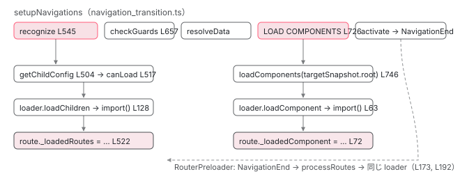

[目次](../README.md) › [Router の内側](README.md) › 第 11 回 / 全 21 回

# loadChildren と loadComponent：RouterConfigLoader が import() を呼ぶ瞬間

> Recognizer が loadChildren を見つけてから RouterConfigLoader.loadChildren が動き、\_loadedRoutes と \_loadedInjector が Route に書き込まれるまで。canLoad の位置、WeakMap キャッシュ、LOAD COMPONENTS 段、RouterPreloader と PreloadAllModules が同じ loader を使うこと。

angular/angular · 読了 約 14 分 · 中核 · [サイトで読む（デモが動きます）](https://angular-deep-dive-cyan.vercel.app/chapter/router-lazy-loading)

---

`loadChildren: () => import('./admin.routes')` と書くと、そのファイルは別チャンクになり、**必要になるまでダウンロードされません**。では「必要になる」のは正確にはどの関数のどの行で、2 回目の訪問ではなぜ `import()` が呼ばれないのか。この章では、`Recognizer` が `loadChildren` を見つけてから `RouterConfigLoader.loadChildren` が動き、結果が `Route` オブジェクト自身の `_loadedRoutes` / `_loadedInjector` に書き込まれるまでを追います。`loadComponent` が**別の段**（ガードと resolve の後）で読まれること、`canLoad` の位置、`RouterPreloader` が同じ loader を先回りで呼ぶことも確認します。

読む対象は `packages/router/src/recognize.ts`、`packages/router/src/router_config_loader.ts`、`packages/router/src/navigation_transition.ts` の LOAD COMPONENTS 段、`packages/router/src/router_preloader.ts` です。`import()` がビルド時にチャンクへ分かれる仕組みは [application builder の章](../boot/04-boot-application-build.md)に委ねます。

1. 1 本の RxJS パイプライン
2. URL → UrlTree
3. routerLink の配列 → UrlTree
4. Route 設定の検証と正規化
5. provideRouter の中身
6. 最初のナビゲーション
7. navigateByUrl → NavigationTransition
8. setupNavigations の全段
9. Recognizer と match
10. redirectTo
11. **loadChildren と loadComponent**（この章）
12. ガードの実行順
13. resolve と data と title
14. ActivatedRoute と Snapshot
15. RouterOutlet への配置
16. ブラウザの URL と履歴
17. Router.events の全種類
18. RouterLink と RouterLinkActive
19. withViewTransitions
20. withRouterResources
21. Navigation API

## 1. Route に隠れている 4 つの内部フィールド

📄 `angular/packages/router/src/models.ts` L651–665 （▶ の行: 657–660, 665）

```ts
651 │   /**
652 │    * An object specifying a lazy-loaded component.
653 │    *
654 │    * @see [Injection context lazy loading](guide/routing/loading-strategies)
655 │    *
656 │    */
657 ▶   loadComponent?: () =>
658 ▶     | Type<unknown>
659 ▶     | Observable<Type<unknown> | DefaultExport<Type<unknown>>>
660 ▶     | Promise<Type<unknown> | DefaultExport<Type<unknown>>>;
661 │   /**
662 │    * Filled for routes `loadComponent` once the component is loaded.
663 │    * @internal
664 │    */
665 ▶   _loadedComponent?: Type<unknown>;
```

📄 `angular/packages/router/src/models.ts` L815–831 （▶ の行: 819, 825, 830）

```ts
815 │   /**
816 │    * Filled for routes with `loadChildren` once the routes are loaded.
817 │    * @internal
818 │    */
819 ▶   _loadedRoutes?: Route[];
820 │ 
821 │   /**
822 │    * Filled for routes with `loadChildren` once the routes are loaded
823 │    * @internal
824 │    */
825 ▶   _loadedInjector?: EnvironmentInjector;
826 │   /**
827 │    * Filled if loadChildren retruns a module factory
828 │    * @internal
829 │    */
830 ▶   _loadedNgModuleFactory?: NgModuleFactory<any>;
831 │ }
```

657〜660 行目、`loadComponent` は「コンポーネントのクラス、またはそれを含む Promise / Observable、または `default` export を持つモジュール」を返す関数です。読み込み結果は 665 行目の `_loadedComponent` に入ります。`loadChildren` の結果は 819 行目 `_loadedRoutes`（子 Route 配列）、825 行目 `_loadedInjector`（NgModule を読んだときのインジェクタ）、830 行目 `_loadedNgModuleFactory` に入ります。**キャッシュの置き場所は `Route` オブジェクトそのもの**です。`provideRouter(routes)` に渡した配列の要素が、あとから書き換えられます。`@internal` なので型定義には出ませんが、`routes[1]['_loadedRoutes']` を DevTools で見れば入っています。

## 2. Recognizer が loadChildren を見つける瞬間：getChildConfig

📄 `angular/packages/router/src/recognize.ts` L435–450 （▶ の行: 439–441, 444）

```ts
435 │     if (!result?.matched) {
436 │       throw new NoMatch(rawSegment);
437 │     }
438 │     // If the route has an injector created from providers, we should start using that.
439 ▶     injector = route._injector ?? injector;
440 ▶     const {routes: childConfig} = await this.getChildConfig(injector, route, segments);
441 ▶     const childInjector = route._loadedInjector ?? injector;
442 │ 
443 │     const {parameters, consumedSegments, remainingSegments} = result;
444 ▶     const snapshot = this.createSnapshot(
445 │       injector,
446 │       route,
447 │       consumedSegments,
448 │       parameters,
449 │       parentRoute,
450 │     );
```

[Recognizer の章](09-router-recognize.md)で読んだ `matchSegmentAgainstRoute` の途中です。Route の `path` が URL に一致した**直後**、440 行目で `getChildConfig` を `await` します。子 Route の配列が無いと残りの URL を照合できないので、**`import()` の待ち時間はここ、recognize 段の中**に発生します。441 行目、子の照合に使うインジェクタは `_loadedInjector` があればそれ（NgModule を読んだ場合）、無ければ親のものです。

📄 `angular/packages/router/src/recognize.ts` L494–531 （▶ の行: 499, 501, 504, 506–509, 511, 517–518, 520–524, 527, 530）

```ts
494 │   private async getChildConfig(
495 │     injector: EnvironmentInjector,
496 │     route: Route,
497 │     segments: UrlSegment[],
498 │   ): Promise<LoadedRouterConfig> {
499 ▶     if (route.children) {
500 │       // The children belong to the same module
501 ▶       return {routes: route.children, injector};
502 │     }
503 │ 
504 ▶     if (route.loadChildren) {
505 │       // lazy children belong to the loaded module
506 ▶       if (route._loadedRoutes !== undefined) {
507 ▶         const ngModuleFactory = route._loadedNgModuleFactory;
508 ▶         if (ngModuleFactory && !route._loadedInjector) {
509 ▶           route._loadedInjector = ngModuleFactory.create(injector).injector;
510 │         }
511 ▶         return {routes: route._loadedRoutes, injector: route._loadedInjector};
512 │       }
513 │ 
514 │       if (this.abortSignal.aborted) {
515 │         throw new Error(this.abortSignal.reason);
516 │       }
517 ▶       const shouldLoadResult = await firstValueFrom(
518 ▶         runCanLoadGuards(injector, route, segments, this.urlSerializer, this.abortSignal),
519 │       );
520 ▶       if (shouldLoadResult) {
521 ▶         const cfg = await this.configLoader.loadChildren(injector, route);
522 ▶         route._loadedRoutes = cfg.routes;
523 ▶         route._loadedInjector = cfg.injector;
524 ▶         route._loadedNgModuleFactory = cfg.factory;
525 │         return cfg;
526 │       }
527 ▶       throw canLoadFails(route);
528 │     }
529 │ 
530 ▶     return {routes: [], injector};
531 │   }
```

1. **499〜501 行目：children があればそれ**

   静的な `children` は読み込み不要。インジェクタも親のまま返します。
2. **504〜511 行目：loadChildren があり、既に読み込み済みなら即返す**

   506 行目、`_loadedRoutes !== undefined` なら `import()` には行きません。**これが「2 回目は読まない」の正体**です。507〜509 行目は NgModule の場合の補修で、`_loadedNgModuleFactory` はあるのに `_loadedInjector` が無いとき、ファクトリからインジェクタを作り直します。`_loadedInjector` が消える場面は 1 つ、`withAutoCleanupInjectors`（[provideRouter の章](05-router-provide-router.md)）が 使われなくなった Route のインジェクタを destroy したときです。

   📄 `angular/packages/router/src/route_injector_cleanup.ts` L88–97 （▶ の行: 93–95）

   ```ts
   88 │     if (shouldDestroyCurrentRoute) {
   89 │       if (route._injector) {
   90 │         route._injector.destroy();
   91 │         route._injector = undefined;
   92 │       }
   93 ▶       if (route._loadedInjector) {
   94 ▶         route._loadedInjector.destroy();
   95 ▶         route._loadedInjector = undefined;
   96 │       }
   97 │     }
   ```

   93〜95 行目、`_loadedInjector` を destroy して `undefined` に戻します。`_loadedRoutes` と `_loadedNgModuleFactory` は残るので、次に来たときは 507〜509 行目で**インジェクタだけ**作り直され、`import()` は走りません。
3. **517〜519 行目：初回だけ canLoad を実行**

   `runCanLoadGuards`（3 節）を `firstValueFrom` で待ちます。**`canLoad` はキャッシュが無いときしか呼ばれません**。一度 `true` で読み込めば、以降のナビゲーションでは 506 行目で返ってしまい、`canLoad` は二度と評価されません。`false` だったときは何もキャッシュされないので、次のナビゲーションでまた呼ばれます。
4. **520〜525 行目：読み込んで Route に書き込む**

   521 行目 `configLoader.loadChildren(injector, route)`（4 節）を `await` し、522〜524 行目で 1 節の 3 フィールドに代入します。`RouterConfigLoader.loadChildren` の中（4 節 100〜102 行目）でも同じ代入をしているので二重ですが、どちらも同じ値です。
5. **527 行目：canLoad が false なら canLoadFails**

   `NoMatch` ではなく `navigationCancelingError` を throw します（3 節）。次の Route を試すのではなく、ナビゲーション全体が `NavigationCancel` になります。

## 3. canLoad：recognize の中で動く唯一の「読み込み前」ガード

📄 `angular/packages/router/src/operators/check_guards.ts` L230–252 （▶ の行: 238–239, 243–246, 248, 251）

```ts
230 │ export function runCanLoadGuards(
231 │   injector: EnvironmentInjector,
232 │   route: Route,
233 │   segments: UrlSegment[],
234 │   urlSerializer: UrlSerializer,
235 │   abortSignal?: AbortSignal,
236 │ ): Observable<boolean> {
237 │   const canLoad = route.canLoad;
238 ▶   if (canLoad === undefined || canLoad.length === 0) {
239 ▶     return of(true);
240 │   }
241 │ 
242 │   const canLoadObservables = canLoad.map((injectionToken: any) => {
243 ▶     const guard = getTokenOrFunctionIdentity<any>(injectionToken, injector);
244 ▶     const guardVal = isCanLoad(guard)
245 ▶       ? guard.canLoad(route, segments)
246 ▶       : runInInjectionContext(injector, () => (guard as CanLoadFn)(route, segments));
247 │     const obs$ = wrapIntoObservable(guardVal);
248 ▶     return abortSignal ? obs$.pipe(takeUntilAbort(abortSignal)) : obs$;
249 │   });
250 │ 
251 ▶   return of(canLoadObservables).pipe(prioritizedGuardValue(), redirectIfUrlTree(urlSerializer));
252 │ }
```

📄 `angular/packages/router/src/apply_redirects.ts` L53–59 （▶ の行: 54, 57）

```ts
53 │ export function canLoadFails(route: Route): never {
54 ▶   throw navigationCancelingError(
55 │     (typeof ngDevMode === 'undefined' || ngDevMode) &&
56 │       `Cannot load children because the guard of the route "path: '${route.path}'" returned false`,
57 ▶     NavigationCancellationCode.GuardRejected,
58 │   );
59 │ }
```

238〜239 行目、`canLoad` が無ければ `of(true)`。243〜246 行目、トークンなら inject、関数なら `runInInjectionContext` で `(route, segments)` を渡して呼びます。`ActivatedRouteSnapshot` はまだ無い（照合中）ので、引数は `Route` と `UrlSegment[]` だけです。248 行目、ナビゲーションが中断されたら `takeUntilAbort` で打ち切り。251 行目、複数ガードを `prioritizedGuardValue` で 1 つにし、`UrlTree` / `RedirectCommand` なら `redirectIfUrlTree` がリダイレクトとして throw します（[前章 6 節](10-router-redirects.md)と同じ演算子）。`false` なら 2 節 527 行目 → 54 行目、`cancellationCode` は 57 行目 `GuardRejected` です。

> [!TIP]
> **新卒エンジニアへ**
>
> `canLoad` は models.ts で `@deprecated Use canMatch instead` と印が付いています。`canMatch` は照合のたびに呼ばれる（[前章](10-router-redirects.md)）ので「一度通したら二度と聞かれない」という `canLoad` の癖がなく、`false` のときは次の Route を試せます。`canLoad` の `false` はナビゲーション全体のキャンセルです。

## 4. RouterConfigLoader.loadChildren：import() を呼ぶ本体

📄 `angular/packages/router/src/router_config_loader.ts` L38–48 （▶ の行: 38, 42, 44–48）

```ts
38 ▶ export const ROUTES = new InjectionToken<Route[][]>(
39 │   typeof ngDevMode !== 'undefined' && ngDevMode ? 'ROUTES' : '',
40 │ );
41 │ 
42 ▶ @Service()
43 │ export class RouterConfigLoader {
44 ▶   private componentLoaders = new WeakMap<Route, Promise<Type<unknown>>>();
45 ▶   private childrenLoaders = new WeakMap<Route, Promise<LoadedRouterConfig>>();
46 ▶   onLoadStartListener?: (r: Route) => void;
47 ▶   onLoadEndListener?: (r: Route) => void;
48 ▶   private readonly compiler = inject(Compiler);
```

42 行目 `@Service()`、アプリに 1 つのサービスです。44〜45 行目の 2 つの `WeakMap` は**実行中の Promise**を Route ごとに持ちます （結果のキャッシュは 1 節のとおり Route 自身）。46〜47 行目のリスナーは `NavigationTransitions` のコンストラクタが差し込みます（後述）。48 行目の `Compiler` は NgModule を JIT で読むときだけ使います。38 行目の `ROUTES` トークンは、読み込んだ NgModule から `RouterModule.forChild(routes)` の設定を取り出すためのものです。

📄 `angular/packages/router/src/router_config_loader.ts` L82–110 （▶ の行: 83–86, 89–90, 94, 100–102, 105, 108）

```ts
 82 │   loadChildren(parentInjector: Injector, route: Route): Promise<LoadedRouterConfig> {
 83 ▶     if (this.childrenLoaders.get(route)) {
 84 ▶       return this.childrenLoaders.get(route)!;
 85 ▶     } else if (route._loadedRoutes) {
 86 ▶       return Promise.resolve({routes: route._loadedRoutes, injector: route._loadedInjector});
 87 │     }
 88 │ 
 89 ▶     if (this.onLoadStartListener) {
 90 ▶       this.onLoadStartListener(route);
 91 │     }
 92 │     const loader = (async () => {
 93 │       try {
 94 ▶         const result = await loadChildren(
 95 │           route,
 96 │           this.compiler,
 97 │           parentInjector,
 98 │           this.onLoadEndListener,
 99 │         );
100 ▶         route._loadedRoutes = result.routes;
101 ▶         route._loadedInjector = result.injector;
102 ▶         route._loadedNgModuleFactory = result.factory;
103 │         return result;
104 │       } finally {
105 ▶         this.childrenLoaders.delete(route);
106 │       }
107 │     })();
108 ▶     this.childrenLoaders.set(route, loader);
109 │     return loader;
110 │   }
```

1. **83〜84 行目：同じ Route の読み込みが進行中なら、その Promise を返す**

   ナビゲーション中に別のナビゲーションが始まっても（`switchMap` で前のは捨てられますが `import()` 自体は止まりません）、`import()` は 1 回だけです。
2. **85〜86 行目：既に \_loadedRoutes があれば resolved Promise**

   2 節 506 行目と同じ判定が、loader 側にもあります。`RouterPreloader`（6 節）がここを直接呼ぶためです。
3. **89〜91 行目：RouteConfigLoadStart**

   `onLoadStartListener(route)`。これが `Router.events` に `RouteConfigLoadStart` として流れます。ローディング表示を出すならこのイベントです。
4. **94〜102 行目：読み込んで Route に書き込む**

   94 行目のモジュール関数 `loadChildren`（次の引用）が実際の `import()`。100〜102 行目で 3 フィールドに代入。
5. **105 行目と 108 行目：WeakMap に入れ、終わったら消す**

   108 行目で Promise を登録し、`finally`（105 行目）で削除。成功なら Route 側のキャッシュが残り、失敗（ネットワークエラーで `import()` が reject）なら何も残らないので、次のナビゲーションで再試行されます。

📄 `angular/packages/router/src/router_config_loader.ts` L121–141 （▶ の行: 127–130, 133–134, 136, 139–140）

```ts
121 │ export async function loadChildren(
122 │   route: Route,
123 │   compiler: Compiler,
124 │   parentInjector: Injector,
125 │   onLoadEndListener?: (r: Route) => void,
126 │ ): Promise<LoadedRouterConfig> {
127 ▶   const loaded = await wrapIntoPromise(
128 ▶     runInInjectionContext(parentInjector, () => route.loadChildren!()),
129 ▶   );
130 ▶   const t = await maybeResolveResources(maybeUnwrapDefaultExport(loaded));
131 │ 
132 │   let factoryOrRoutes: NgModuleFactory<any> | Routes;
133 ▶   if (t instanceof NgModuleFactory || Array.isArray(t)) {
134 ▶     factoryOrRoutes = t;
135 │   } else {
136 ▶     factoryOrRoutes = await compiler.compileModuleAsync(t);
137 │   }
138 │ 
139 ▶   if (onLoadEndListener) {
140 ▶     onLoadEndListener(route);
141 │   }
```

📄 `angular/packages/core/src/util/default_export.ts` L26–37 （▶ の行: 29, 36）

```ts
26 │ export function maybeUnwrapDefaultExport<T>(input: T | DefaultExport<T>): T {
27 │   // As per `isWrappedDefaultExport`, the `default` key here is generated by the browser and not
28 │   // subject to property renaming, so we reference it with bracket access.
29 ▶   return isWrappedDefaultExport(input) ? input['default'] : input;
30 │ }
31 │ 
32 │ function isWrappedDefaultExport<T>(value: T | DefaultExport<T>): value is DefaultExport<T> {
33 │   // We use `in` here with a string key `'default'`, because we expect `DefaultExport` objects to be
34 │   // dynamically imported ES modules with a spec-mandated `default` key. Thus we don't expect that
35 │   // `default` will be a renamed property.
36 ▶   return value && typeof value === 'object' && 'default' in value;
37 │ }
```

📄 `angular/packages/router/src/router_config_loader.ts` L142–164 （▶ の行: 148–150, 152–153, 158, 160–163）

```ts
142 │   // This injector comes from the `NgModuleRef` when lazy loading an `NgModule`. There is
143 │   // no injector associated with lazy loading a `Route` array.
144 │   let injector: EnvironmentInjector | undefined;
145 │   let rawRoutes: Route[];
146 │   let requireStandaloneComponents = false;
147 │   let factory: NgModuleFactory<unknown> | undefined = undefined;
148 ▶   if (Array.isArray(factoryOrRoutes)) {
149 ▶     rawRoutes = factoryOrRoutes;
150 ▶     requireStandaloneComponents = true;
151 │   } else {
152 ▶     injector = factoryOrRoutes.create(parentInjector).injector;
153 ▶     factory = factoryOrRoutes;
154 │     // When loading a module that doesn't provide `RouterModule.forChild()` preloader
155 │     // will get stuck in an infinite loop. The child module's Injector will look to
156 │     // its parent `Injector` when it doesn't find any ROUTES so it will return routes
157 │     // for it's parent module instead.
158 ▶     rawRoutes = injector.get(ROUTES, [], {optional: true, self: true}).flat();
159 │   }
160 ▶   const routes = rawRoutes.map(standardizeConfig);
161 ▶   (typeof ngDevMode === 'undefined' || ngDevMode) &&
162 ▶     validateConfig(routes, route.path, requireStandaloneComponents);
163 ▶   return {routes, injector, factory};
164 │ }
```

1. **127〜129 行目：あなたの関数が呼ばれる**

   `runInInjectionContext(parentInjector, () => route.loadChildren!())`。**この行で `import('./admin.routes')` が始まります**。`inject()` が使えるのは injection context の中で呼ばれているからです。`wrapIntoPromise` で Promise でも Observable でも揃えます。
2. **130 行目：default export を剥がす**

   core の `maybeUnwrapDefaultExport`（36 行目、オブジェクトで `'default' in value` なら 29 行目で `input['default']`）。だから `loadChildren: () => import('./admin.routes')` と `.then(m => m.ROUTES)` を書かずに済みます。`export default [...]` になっている必要があります。
3. **133〜137 行目：配列か NgModule か**

   `Routes` の配列か `NgModuleFactory` ならそのまま。それ以外（NgModule クラス）は 136 行目で `compiler.compileModuleAsync`。AOT ビルドではこの関数はファクトリをそのまま返す薄い処理です。
4. **139〜141 行目：RouteConfigLoadEnd**

   読み込み完了のイベント。**`_loadedRoutes` への代入より前**（4 節 100 行目）に流れます。
5. **148〜158 行目：インジェクタと子 Route の取り出し**

   配列なら 149〜150 行目、子はそのまま、`requireStandaloneComponents = true`（162 行目の検証で NgModule のコンポーネントを弾く）。インジェクタは `undefined` です。NgModule なら 152 行目で `factoryOrRoutes.create(parentInjector).injector`、**ここで子 Route 用の `EnvironmentInjector` が作られます**。158 行目、そのインジェクタから `ROUTES` を `self: true` で取り出します（`RouterModule.forChild` が multi provider で登録したもの）。`self: true` がないと、子モジュールが `forChild` を忘れたときに親の `ROUTES` が返ってきて無限ループになる、と 154〜157 行目のコメントが説明しています。
6. **160〜163 行目：正規化と検証**

   `standardizeConfig`（名前付き outlet の componentless Route に `EmptyOutletComponent` を補う）と、開発モードの `validateConfig`。[Route 設定の章](04-router-route-config.md)で読んだ `provideRouter` 時の処理と同じ関数です。遅延読み込みされた設定も同じ検証を通ります。

📄 `angular/packages/router/src/navigation_transition.ts` L395–403 （▶ の行: 396–399）

```ts
395 │   constructor() {
396 ▶     const onLoadStart = (r: Route) => this.events.next(new RouteConfigLoadStart(r));
397 ▶     const onLoadEnd = (r: Route) => this.events.next(new RouteConfigLoadEnd(r));
398 ▶     this.configLoader.onLoadEndListener = onLoadEnd;
399 ▶     this.configLoader.onLoadStartListener = onLoadStart;
400 │     this.destroyRef.onDestroy(() => {
401 │       this.destroyed = true;
402 │     });
403 │   }
```

📄 `angular/packages/router/src/events.ts` L494–506 （▶ の行: 494, 499）

```ts
494 ▶ export class RouteConfigLoadStart {
495 │   readonly type = EventType.RouteConfigLoadStart;
496 │ 
497 │   constructor(
498 │     /** @docsNotRequired */
499 ▶     public route: Route,
500 │   ) {}
501 │ 
502 │   /** @docs-private */
503 │   toString(): string {
504 │     return `RouteConfigLoadStart(path: ${this.route.path})`;
505 │   }
506 │ }
```

396〜399 行目、`NavigationTransitions` のコンストラクタが loader のリスナーを差し込み、`RouteConfigLoadStart` / `RouteConfigLoadEnd` を `events` に流します。499 行目、イベントが持つのは `Route` オブジェクトだけです（`id` を持つ `RouterEvent` ではありません）。どのナビゲーションに属するかは、前後の `NavigationStart` から読み取ります。

## 5. loadComponent は別の段で読まれる

📄 `angular/packages/router/src/navigation_transition.ts` L725–748 （▶ の行: 726–727, 729–732, 734–735, 737, 741–742, 746–747）

```ts
725 │           // --- LOAD COMPONENTS ---
726 ▶           switchTap((t: NavigationTransition) => {
727 ▶             const loadComponents = (route: ActivatedRouteSnapshot): Array<Promise<void>> => {
728 │               const loaders: Array<Promise<void>> = [];
729 ▶               if (route.routeConfig?._loadedComponent) {
730 ▶                 route.component = route.routeConfig?._loadedComponent;
731 ▶               } else if (route.routeConfig?.loadComponent) {
732 ▶                 const injector = route._environmentInjector;
733 │                 loaders.push(
734 ▶                   this.configLoader
735 ▶                     .loadComponent(injector, route.routeConfig)
736 │                     .then((loadedComponent) => {
737 ▶                       route.component = loadedComponent;
738 │                     }),
739 │                 );
740 │               }
741 ▶               for (const child of route.children) {
742 ▶                 loaders.push(...loadComponents(child));
743 │               }
744 │               return loaders;
745 │             };
746 ▶             const loaders = loadComponents(t.targetSnapshot!.root);
747 ▶             return loaders.length === 0 ? of(t) : from(Promise.all(loaders).then(() => t));
748 │           }),
```

[パイプライン](08-router-pipeline.md)の中で、`checkGuards` と `resolveData` の**後**、`createRouterState` の**前**です。727 行目の `loadComponents` は `targetSnapshot` の木を再帰（741〜742 行目）して、Route ごとに Promise を集めます。729〜730 行目、`_loadedComponent` があれば snapshot の `component` に代入して終わり。731〜739 行目、`loadComponent` があって未読なら `configLoader.loadComponent`、完了時に 737 行目で `route.component` へ。747 行目、**全部を `Promise.all`** で待ちます。親子のコンポーネントが両方 `loadComponent` なら並列です。

📄 `angular/packages/router/src/navigation_transition.ts` L657–679 （▶ の行: 657, 676–678）

```ts
657 ▶           checkGuards((evt: Event) => this.events.next(evt)),
658 │ 
659 │           switchMap((t) => {
660 │             overallTransitionState.guardsResult = t.guardsResult;
661 │             if (t.guardsResult && typeof t.guardsResult !== 'boolean') {
662 │               throw redirectingNavigationError(this.urlSerializer, t.guardsResult);
663 │             }
664 │ 
665 │             const guardsEnd = new GuardsCheckEnd(
666 │               t.id,
667 │               this.urlSerializer.serialize(t.extractedUrl),
668 │               this.urlSerializer.serialize(t.urlAfterRedirects!),
669 │               t.targetSnapshot!,
670 │               !!t.guardsResult,
671 │             );
672 │             this.events.next(guardsEnd);
673 │             if (!shouldContinueNavigation()) {
674 │               return EMPTY;
675 │             }
676 ▶             if (!t.guardsResult) {
677 ▶               this.cancelNavigationTransition(t, '', NavigationCancellationCode.GuardRejected);
678 ▶               return EMPTY;
679 │             }
```

657 行目の `checkGuards` でガードが `false` を返すと、676〜678 行目で `NavigationCancel` になり `EMPTY` が返るので、726 行目の LOAD COMPONENTS 段には来ません。

> [!NOTE]
> **ポイント**
>
> **`loadChildren` は recognize 段（ガードの前）、`loadComponent` は resolve の後**。[概観](01-router.md)で「アクセスできない画面の JS はダウンロードすらされない」と書いたのは `loadComponent` の話です。`loadChildren` のチャンクは、子の照合に必要なので `canActivate` が `false` を返す前にダウンロードされます。それを止めたいときの道具が `canLoad`（3 節）または `canMatch` でした。

📄 `angular/packages/router/src/router_config_loader.ts` L50–80 （▶ の行: 51–54, 57, 62–63, 65, 67, 70–72, 75, 78）

```ts
50 │   async loadComponent(injector: EnvironmentInjector, route: Route): Promise<Type<unknown>> {
51 ▶     if (this.componentLoaders.get(route)) {
52 ▶       return this.componentLoaders.get(route)!;
53 ▶     } else if (route._loadedComponent) {
54 ▶       return Promise.resolve(route._loadedComponent);
55 │     }
56 │ 
57 ▶     if (this.onLoadStartListener) {
58 │       this.onLoadStartListener(route);
59 │     }
60 │     const loader = (async () => {
61 │       try {
62 ▶         const loaded = await wrapIntoPromise(
63 ▶           runInInjectionContext(injector, () => route.loadComponent!()),
64 │         );
65 ▶         const component = await maybeResolveResources(maybeUnwrapDefaultExport(loaded));
66 │ 
67 ▶         if (this.onLoadEndListener) {
68 │           this.onLoadEndListener(route);
69 │         }
70 ▶         (typeof ngDevMode === 'undefined' || ngDevMode) &&
71 ▶           assertStandalone(route.path ?? '', component);
72 ▶         route._loadedComponent = component;
73 │         return component;
74 │       } finally {
75 ▶         this.componentLoaders.delete(route);
76 │       }
77 │     })();
78 ▶     this.componentLoaders.set(route, loader);
79 │     return loader;
80 │   }
```

構造は `loadChildren` と同じです。51〜52 行目で進行中の Promise、53〜54 行目で `_loadedComponent`、57 行目で `RouteConfigLoadStart`、62〜63 行目で `runInInjectionContext` の中であなたの `loadComponent()`（ここで `import()`）、65 行目で default export を剥がし、67 行目で `RouteConfigLoadEnd`、70〜71 行目で「standalone であること」を検証（NgModule のコンポーネントなら `NG04014`）、72 行目で `_loadedComponent` に代入、75 行目と 78 行目で WeakMap の出し入れ。

📄 `angular/packages/router/src/utils/config.ts` L45–54 （▶ の行: 45, 49, 52）

```ts
45 ▶ export function getLoadedRoutes(route: Route): Route[] | undefined {
46 │   return route._loadedRoutes;
47 │ }
48 │ 
49 ▶ export function getLoadedInjector(route: Route): EnvironmentInjector | undefined {
50 │   return route._loadedInjector;
51 │ }
52 ▶ export function getLoadedComponent(route: Route): Type<unknown> | undefined {
53 │   return route._loadedComponent;
54 │ }
```

45〜54 行目、内部フィールドを読むだけの小さな関数です。`Route` に `_` 付きで直接触らず、これらを通して読むのが router パッケージ内の作法になっています。

## 6. RouterPreloader：同じ loader を先回りで呼ぶ

📄 `angular/packages/router/src/router_preloader.ts` L61–84 （▶ の行: 62–64, 80–82）

```ts
61 │ @Service()
62 ▶ export class PreloadAllModules implements PreloadingStrategy {
63 ▶   preload(route: Route, fn: () => Observable<any>): Observable<any> {
64 ▶     return fn().pipe(catchError(() => of(null)));
65 │   }
66 │ }
67 │ 
68 │ /**
69 │  * @description
70 │  *
71 │  * Provides a preloading strategy that does not preload any modules.
72 │  *
73 │  * This strategy is enabled by default.
74 │  *
75 │  * @see [Preloading strategy](guide/routing/customizing-route-behavior#preloading-strategy)
76 │  *
77 │  * @publicApi
78 │  */
79 │ @Service()
80 ▶ export class NoPreloading implements PreloadingStrategy {
81 ▶   preload(route: Route, fn: () => Observable<any>): Observable<any> {
82 ▶     return of(null);
83 │   }
84 │ }
```

📄 `angular/packages/router/src/provide_router.ts` L576–589 （▶ の行: 583, 585–586）

```ts
576 │  *     should be used.
577 │  * @returns A set of providers for use with `provideRouter`.
578 │  *
579 │  * @see [Preloading strategy](guide/routing/customizing-route-behavior#preloading-strategy)
580 │  *
581 │  * @publicApi
582 │  */
583 ▶ export function withPreloading(preloadingStrategy: Type<PreloadingStrategy>): PreloadingFeature {
584 │   const providers = [
585 ▶     {provide: ROUTER_PRELOADER, useExisting: RouterPreloader},
586 ▶     {provide: PreloadingStrategy, useExisting: preloadingStrategy},
587 │   ];
588 │   return routerFeature(RouterFeatureKind.PreloadingFeature, providers);
589 │ }
```

📄 `angular/packages/router/src/provide_router.ts` L283–292 （▶ の行: 290）

```ts
283 │     const router = injector.get(Router);
284 │     const bootstrapDone = injector.get(BOOTSTRAP_DONE);
285 │ 
286 │     if (injector.get(INITIAL_NAVIGATION) === InitialNavigation.EnabledNonBlocking) {
287 │       router.initialNavigation();
288 │     }
289 │ 
290 ▶     injector.get(ROUTER_PRELOADER, null, {optional: true})?.setUpPreloading();
291 │     injector.get(ROUTER_SCROLLER, null, {optional: true})?.init();
292 │     router.resetRootComponentType(ref.componentTypes[0]);
```

`PreloadingStrategy` の実装は 2 つ。63〜64 行目 `PreloadAllModules` は渡された関数をすぐ呼び、エラーは `null` に握りつぶします。80〜82 行目 `NoPreloading` は関数を呼ばず `of(null)`。585〜586 行目、`withPreloading(X)` は `ROUTER_PRELOADER` と `PreloadingStrategy` の 2 つを provide します。290 行目、`APP_BOOTSTRAP_LISTENER`（[boot シリーズ](../boot/13-boot-spa-navigation.md)で読んだもの）が `ROUTER_PRELOADER` を `optional` で取り、あれば `setUpPreloading()`。**`withPreloading` を書かなければ `RouterPreloader` は作られもしません**。

📄 `angular/packages/router/src/router_preloader.ts` L98–120 （▶ の行: 106, 110, 112–113, 119）

```ts
 98 │ @Injectable({providedIn: 'root'})
 99 │ export class RouterPreloader implements OnDestroy {
100 │   private subscription?: Subscription;
101 │ 
102 │   constructor(
103 │     private router: Router,
104 │     private injector: EnvironmentInjector,
105 │     private preloadingStrategy: PreloadingStrategy,
106 ▶     private loader: RouterConfigLoader,
107 │   ) {}
108 │ 
109 │   setUpPreloading(): void {
110 ▶     this.subscription = this.router.events
111 │       .pipe(
112 ▶         filter((e: Event) => e instanceof NavigationEnd),
113 ▶         concatMap(() => this.preload()),
114 │       )
115 │       .subscribe(() => {});
116 │   }
117 │ 
118 │   preload(): Observable<any> {
119 ▶     return this.processRoutes(this.injector, this.router.config);
120 │   }
```

106 行目、**inject しているのは 4 節と同じ `RouterConfigLoader`** です。110〜115 行目、`router.events` を購読し、112 行目で `NavigationEnd` だけ通し、113 行目で `preload()` を `concatMap`（前の preload が終わるまで次を待つ）。119 行目、`router.config`（最上位の routes）から `processRoutes` を始めます。

📄 `angular/packages/router/src/router_preloader.ts` L127–164 （▶ の行: 130–131, 139–140, 143, 153–155, 157, 159–160, 163）

```ts
127 │   private processRoutes(injector: EnvironmentInjector, routes: Routes): Observable<void> {
128 │     const res: Observable<void>[] = [];
129 │     for (const route of routes) {
130 ▶       if (route.providers && !route._injector) {
131 ▶         route._injector = createEnvironmentInjector(
132 │           route.providers,
133 │           injector,
134 │           typeof ngDevMode === 'undefined' || ngDevMode ? `Route: ${route.path}` : '',
135 │         );
136 │       }
137 │ 
138 │       const injectorForCurrentRoute = route._injector ?? injector;
139 ▶       if (route._loadedNgModuleFactory && !route._loadedInjector) {
140 ▶         route._loadedInjector =
141 │           route._loadedNgModuleFactory.create(injectorForCurrentRoute).injector;
142 │       }
143 ▶       const injectorForChildren = route._loadedInjector ?? injectorForCurrentRoute;
144 │ 
145 │       // Note that `canLoad` is only checked as a condition that prevents `loadChildren` and not
146 │       // `loadComponent`. `canLoad` guards only block loading of child routes by design. This
147 │       // happens as a consequence of needing to descend into children for route matching immediately
148 │       // while component loading is deferred until route activation. Because `canLoad` guards can
149 │       // have side effects, we cannot execute them here so we instead skip preloading altogether
150 │       // when present. Lastly, it remains to be decided whether `canLoad` should behave this way
151 │       // at all. Code splitting and lazy loading is separate from client-side authorization checks
152 │       // and should not be used as a security measure to prevent loading of code.
153 ▶       if (
154 ▶         (route.loadChildren && !route._loadedRoutes && route.canLoad === undefined) ||
155 ▶         (route.loadComponent && !route._loadedComponent)
156 │       ) {
157 ▶         res.push(this.preloadConfig(injectorForCurrentRoute, route));
158 │       }
159 ▶       if (route.children || route._loadedRoutes) {
160 ▶         res.push(this.processRoutes(injectorForChildren, (route.children ?? route._loadedRoutes)!));
161 │       }
162 │     }
163 ▶     return from(res).pipe(mergeAll());
164 │   }
```

📄 `angular/packages/router/src/router_preloader.ts` L166–198 （▶ の行: 167, 172–173, 183–185, 188, 191–193）

```ts
166 │   private preloadConfig(injector: EnvironmentInjector, route: Route): Observable<void> {
167 ▶     return this.preloadingStrategy.preload(route, () => {
168 │       if (injector.destroyed) {
169 │         return of(null);
170 │       }
171 │       let loadedChildren$: Observable<LoadedRouterConfig | null>;
172 ▶       if (route.loadChildren && route.canLoad === undefined) {
173 ▶         loadedChildren$ = from(this.loader.loadChildren(injector, route));
174 │       } else {
175 │         loadedChildren$ = of(null);
176 │       }
177 │ 
178 │       const recursiveLoadChildren$ = loadedChildren$.pipe(
179 │         mergeMap((config: LoadedRouterConfig | null) => {
180 │           if (config === null) {
181 │             return of(void 0);
182 │           }
183 ▶           route._loadedRoutes = config.routes;
184 ▶           route._loadedInjector = config.injector;
185 ▶           route._loadedNgModuleFactory = config.factory;
186 │           // If the loaded config was a module, use that as the module/module injector going
187 │           // forward. Otherwise, continue using the current module/module injector.
188 ▶           return this.processRoutes(config.injector ?? injector, config.routes);
189 │         }),
190 │       );
191 ▶       if (route.loadComponent && !route._loadedComponent) {
192 ▶         const loadComponent$ = this.loader.loadComponent(injector, route);
193 ▶         return from([recursiveLoadChildren$, loadComponent$]).pipe(mergeAll());
194 │       } else {
195 │         return recursiveLoadChildren$;
196 │       }
197 │     });
198 │   }
```

1. **130〜143 行目：インジェクタを揃える**

   `providers` があれば Route 用のインジェクタを作り（130〜136 行目。recognize 側の `getOrCreateRouteInjectorIfNeeded` と同じこと）、139〜142 行目で NgModule のファクトリからインジェクタを補い、143 行目で子に渡すインジェクタを決めます。
2. **153〜158 行目：読むべき Route の条件**

   154 行目、`loadChildren` があり、`_loadedRoutes` が無く、**`canLoad === undefined`**。155 行目、`loadComponent` があり `_loadedComponent` が無い。145〜152 行目のコメントが理由です。`canLoad` には副作用があり得るので preloader は実行せず、**その Route は preload しない**。`canLoad` を付けた Route は「初めてアクセスした人がその場でダウンロードする」ままです。
3. **167 行目：strategy.preload(route, fn)**

   `PreloadAllModules` なら即 `fn()`。独自戦略なら、ここで `route.data['preload']` を見たり `timer` を挟んだりできます。
4. **172〜173 行目、191〜193 行目：loader を呼ぶ**

   `this.loader.loadChildren(injector, route)` と `this.loader.loadComponent(injector, route)`。4〜5 節と同じメソッドなので、`RouteConfigLoadStart` / `End` が流れ、結果は Route 自身に書かれます。183〜185 行目の代入も同じ 3 フィールドです。**その後ユーザーがその URL へ行くと、2 節 506 行目のキャッシュ判定に当たって `import()` は走りません**。
5. **188 行目、159〜161 行目：読み込んだ子へ再帰**

   `processRoutes(config.injector ?? injector, config.routes)`。読み込んだ子の中の `loadChildren` / `loadComponent` も対象になるので、`PreloadAllModules` は**到達可能な遅延チャンクを全部**読みます（`canLoad` 付きを除く）。163 行目、`mergeAll` なので並列です。

> **🧪 DEMO — どの時点で import() が呼ばれるか**
>
> Route 木は固定です（下の表）。URL を順に押すと、recognize 段の getChildConfig（recognize.ts L494-531）、LOAD COMPONENTS 段（navigation\_transition.ts L725-748）、RouterPreloader（router\_preloader.ts L109-198）の分岐を同じ順で辿った結果を出します。
>
> ▶ [このデモはサイトで動かせます](https://angular-deep-dive-cyan.vercel.app/chapter/router-lazy-loading)



*1 回のナビゲーションの中で import() が走る 2 つの位置。loadChildren は recognize 段の getChildConfig、loadComponent は resolve 後の LOAD COMPONENTS 段。RouterPreloader は NavigationEnd 後に同じ RouterConfigLoader を呼び、Route 自身のフィールドにキャッシュを残す。*

## ここまでの呼び出し

- `recognize(...)` 段 — router/src/navigation\_transition.ts L545
  - `Recognizer.matchSegmentAgainstRoute` — router/src/recognize.ts L402 — *path が一致した直後*
    - `getChildConfig(injector, route, segments)` — recognize.ts L494 — *L506 \_loadedRoutes があれば即 return*
      - `runCanLoadGuards(injector, route, segments, ...)` — router/src/operators/check\_guards.ts L230 — *初回のみ。false なら canLoadFails → NavigationCancel(GuardRejected)*
      - `configLoader.loadChildren(injector, route)` — router/src/router\_config\_loader.ts L82 — *L83 進行中の Promise / L85 キャッシュ*
        - `onLoadStartListener(route)` → `events.next(new RouteConfigLoadStart(route))` — router\_config\_loader.ts L90 → navigation\_transition.ts L396
        - `loadChildren(route, compiler, parentInjector, onLoadEnd)` — router\_config\_loader.ts L121
          - 👤 `runInInjectionContext(parentInjector, () => route.loadChildren())` — router\_config\_loader.ts L128 — *あなたの import() が走る*
          - `maybeUnwrapDefaultExport` → `compileModuleAsync`（NgModule のみ） — L130, L136
          - `onLoadEndListener(route)` → `RouteConfigLoadEnd` — L140
          - `factory.create(parentInjector).injector` → `injector.get(ROUTES, [], {self: true})`（NgModule のみ） — L152, L158
          - `standardizeConfig` / `validateConfig` — L160-162
        - `route._loadedRoutes = …; route._loadedInjector = …; route._loadedNgModuleFactory = …` — router\_config\_loader.ts L100-102（recognize.ts L522-524 でも）
    - `processChildren / processSegment(childInjector, childConfig, ...)` — recognize.ts L461, L483 — *読み込んだ子 Route で残りの URL を照合*
- `checkGuards` → `resolveData` — navigation\_transition.ts L657, L698
- `switchTap(loadComponents)` — navigation\_transition.ts L726
  - `configLoader.loadComponent(injector, route.routeConfig)` — router\_config\_loader.ts L50 — *L53 \_loadedComponent があれば即*
    - 👤 `runInInjectionContext(injector, () => route.loadComponent())` — router\_config\_loader.ts L63 — *あなたの import() が走る*
    - `assertStandalone` → `route._loadedComponent = component` — L71-72
  - `Promise.all(loaders)` → `route.component = loadedComponent` — navigation\_transition.ts L747, L737
- `NavigationEnd` → `RouterPreloader.preload()`（withPreloading 時のみ） — router/src/router\_preloader.ts L112-113 — *同じ loader の loadChildren / loadComponent を呼ぶ*

## 聞かれそうな質問

**Q. loadChildren は 2 回目の訪問でも import() を呼びますか？キャッシュはどこにありますか？**

呼びません。キャッシュは `Route` オブジェクト自身の `_loadedRoutes`（models.ts 819 行目）です。recognize.ts 506 行目で `route._loadedRoutes !== undefined` なら 511 行目で即返し、`RouterConfigLoader.loadChildren` にすら行きません。loader 側にも同じ判定（router\_config\_loader.ts 85〜86 行目）があり、進行中の読み込みは `childrenLoaders` WeakMap（44〜45 行目、83〜84 行目）で 1 回にまとめられます。ページをリロードすれば `Route` オブジェクトが作り直されるので、また読みます。

**Q. canLoad と canMatch と canActivate は、それぞれどの段で動きますか？1 回のナビゲーションで何回呼ばれますか？**

`canMatch` と `canLoad` は recognize 段（navigation\_transition.ts 545 行目）の中、`canActivate` はその後の `checkGuards`（657 行目）です。`canMatch` は config\_matching.ts 72 行目、`path` が一致した Route ごとに毎回呼ばれます（複数の候補 Route があれば複数回）。`canLoad` は recognize.ts 517 行目、**`_loadedRoutes` がまだ無いときだけ**なので、同じ Route では初回のナビゲーションの 1 回だけです（`false` を返した場合はキャッシュされず次回また呼ばれます）。`canActivate` は 1 回のナビゲーションで、対象 Route ごとに 1 回です（[次章](12-router-guards.md)）。

**Q. canActivate が false なら遅延チャンクはダウンロードされない、は正しいですか？**

`loadComponent` なら正しいです。LOAD COMPONENTS 段（navigation\_transition.ts 726 行目）は `checkGuards`（657 行目）より後なので、ガードが `false` を返せば 676〜677 行目で `NavigationCancel` になり 726 行目に来ません。`loadChildren` は違います。子 Route を照合するために recognize.ts 440 行目 → 521 行目で**ガードより前**に読みます。`loadChildren` のチャンクをガードで止めたいなら `canLoad`（517 行目）か `canMatch` を使います。

**Q. loadChildren: () =&gt; import('./x.routes') は .then を書かなくていいのはなぜですか？**

router\_config\_loader.ts 130 行目で `maybeUnwrapDefaultExport`（core/src/util/default\_export.ts 26 行目）を通すからです。36 行目、オブジェクトで `'default' in value` なら 29 行目で `value['default']` を返します。`./x.routes.ts` が `export default [...]` になっていることが条件で、名前付き export だけなら `.then(m => m.ROUTES)` が必要です。`loadComponent` も 65 行目で同じ関数を通します。

**Q. NgModule を loadChildren したとき、子の providers はどこに作られますか？**

router\_config\_loader.ts 152 行目 `factoryOrRoutes.create(parentInjector).injector` です。`parentInjector` は recognize.ts 521 行目で渡した、その Route までのインジェクタ（`route._injector ?? injector`、439 行目）。作られたものは `_loadedInjector`（recognize.ts 523 行目）に入り、441 行目で子 Route の照合・ガード・コンポーネント生成のインジェクタになります。`Routes` 配列を返した場合は 149〜150 行目、インジェクタは作られず（`undefined`）親のものを使い続けます。Route 単位で providers が欲しいなら `Route.providers` です。

**Q. withPreloading(PreloadAllModules) を付けると、いつ・何が読まれますか？**

provide\_router.ts 290 行目で `setUpPreloading`、router\_preloader.ts 112〜113 行目で**各 `NavigationEnd` の後**に `processRoutes(router.config)`。154〜155 行目の条件（`loadChildren` で未読かつ `canLoad` 無し、または `loadComponent` で未読）に合う Route を 173 行目・192 行目で **recognize と同じ `RouterConfigLoader`**（106 行目）に読ませ、188 行目で読み込んだ子にも再帰します。結果は 183〜185 行目で Route 自身に書かれるので、その後のナビゲーションは recognize.ts 506 行目のキャッシュに当たります。`canLoad` 付きの Route だけは 154 行目で除外されます（145〜152 行目のコメント）。

## 読み終えて

- `loadChildren` の `import()` は recognize 段、`matchSegmentAgainstRoute` → `getChildConfig`（recognize.ts L440 → L521）→ `RouterConfigLoader.loadChildren` → `runInInjectionContext(() => route.loadChildren())`（router\_config\_loader.ts L128）
- 結果は `Route` 自身の `_loadedRoutes` / `_loadedInjector` / `_loadedNgModuleFactory` に書かれ（L522-524）、2 回目は L506 で即返す。進行中の Promise は WeakMap（L44-45）
- `canLoad` は L517、キャッシュが無い初回だけ。`false` は `canLoadFails` → `NavigationCancel(GuardRejected)`。preloader も `canLoad` 付きは読まない（router\_preloader.ts L154）
- `loadComponent` は別の段。ガードと resolve の後、LOAD COMPONENTS（navigation\_transition.ts L726-748）で `Promise.all`。「アクセス不可の画面の JS は落ちない」はこちらだけ
- `RouterPreloader` は `NavigationEnd` ごとに同じ `RouterConfigLoader` を呼ぶ（L106, L173, L192）。`withPreloading` を書かなければ作られない（provide\_router.ts L290）

---

← 前: [redirectTo はいつ・どこで解決されるか：ApplyRedirects と 31 回の上限](10-router-redirects.md)  
次: [ガードの実行順：checkGuards が canDeactivate を先に走らせる理由](12-router-guards.md) →
