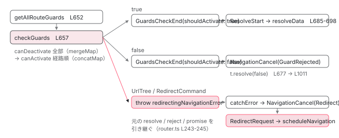

[目次](../README.md) › [Router の内側](README.md) › 第 12 回 / 全 21 回

# ガードの実行順：checkGuards が canDeactivate を先に走らせる理由

> getAllRouteGuards が「離れる経路」と「入る経路」を分け、runCanDeactivateChecks → runCanActivateChecks の順で動く。関数ガードの runInInjectionContext、prioritizedGuardValue、UrlTree / RedirectCommand を返したときの redirectIfUrlTree、runGuardsAndResolvers の既定。

angular/angular · 読了 約 14 分 · 中核 · [サイトで読む（デモが動きます）](https://angular-deep-dive-cyan.vercel.app/chapter/router-guards)

---

ガードは「`canActivate` に関数を書くと遷移を止められる」で終わりがちですが、同僚に「`canDeactivate` と `canActivate` はどちらが先？親と子は？`UrlTree` を返したら `navigate()` の Promise は何になる？」と聞かれると答えに詰まります。この章では、`getAllRouteGuards` が現在の木と遷移先の木を比べて「離れる経路」と「入る経路」の 2 つの配列を作る手順、`checkGuards` が `canDeactivate` を先に全部走らせてから `canActivate` を経路順に走らせる仕組み、複数ガードの結果を 1 つにする `prioritizedGuardValue`、`UrlTree` / `RedirectCommand` が例外に変わって新しいナビゲーションになる経路を、行番号で追います。

読む対象は `packages/router/src/utils/preactivation.ts`、`packages/router/src/operators/check_guards.ts`、`packages/router/src/operators/prioritized_guard_value.ts`、`packages/router/src/navigation_transition.ts` の 638〜683 行目と 898〜931 行目、`packages/router/src/navigation_canceling_error.ts` です。

1. 1 本の RxJS パイプライン
2. URL → UrlTree
3. routerLink の配列 → UrlTree
4. Route 設定の検証と正規化
5. provideRouter の中身
6. 最初のナビゲーション
7. navigateByUrl → NavigationTransition
8. setupNavigations の全段
9. Recognizer と match
10. redirectTo
11. loadChildren と loadComponent
12. **ガードの実行順**（この章）
13. resolve と data と title
14. ActivatedRoute と Snapshot
15. RouterOutlet への配置
16. ブラウザの URL と履歴
17. Router.events の全種類
18. RouterLink と RouterLinkActive
19. withViewTransitions
20. withRouterResources
21. Navigation API

## 1. ガードが返せるもの

📄 `angular/packages/router/src/models.ts` L129–129 （▶ の行: 129）

```ts
129 ▶ export type GuardResult = boolean | UrlTree | RedirectCommand;
```

📄 `angular/packages/router/src/models.ts` L160–170 （▶ の行: 162, 164–165）

```ts
160 │  * @publicApi
161 │  */
162 ▶ export class RedirectCommand extends Error {
163 │   constructor(
164 ▶     readonly redirectTo: UrlTree,
165 ▶     readonly navigationBehaviorOptions?: NavigationBehaviorOptions,
166 │   ) {
167 │     super();
168 │     Object.setPrototypeOf(this, RedirectCommand.prototype);
169 │   }
170 │ }
```

129 行目、`GuardResult` は `boolean | UrlTree | RedirectCommand` の 3 種類。162 行目、`RedirectCommand` は `Error` を継承し、164 行目で行き先の `UrlTree`、165 行目で `skipLocationChange` などの `NavigationBehaviorOptions` を持ちます。`Error` である理由は 6 節で分かります（ガードの中から `throw` しても同じ扱いになる）。ここに `string` は含まれません。文字列を返すと `prioritizedGuardValue`（5 節）で「無効な値」として読み飛ばされ、`true` と同じ扱いになります。

## 2. パイプラインの中の位置：GuardsCheckStart から GuardsCheckEnd まで

📄 `angular/packages/router/src/navigation_transition.ts` L638–657 （▶ の行: 639, 645, 650, 652, 657）

```ts
638 │           map((t) => {
639 ▶             const guardsStart = new GuardsCheckStart(
640 │               t.id,
641 │               this.urlSerializer.serialize(t.extractedUrl),
642 │               this.urlSerializer.serialize(t.urlAfterRedirects!),
643 │               t.targetSnapshot!,
644 │             );
645 ▶             this.events.next(guardsStart);
646 │             // Note we don't have to check shouldContinueNavigation here because we don't do anything
647 │             // in the remainder of this operator that has side effects. If `checkGuards` is combined into
648 │             // this operators, we would need to ensure we check shouldContinueNavigation before running the guards.
649 │ 
650 ▶             this.currentTransition = overallTransitionState = {
651 │               ...t,
652 ▶               guards: getAllRouteGuards(t.targetSnapshot!, t.currentSnapshot, this.rootContexts),
653 │             };
654 │             return overallTransitionState;
655 │           }),
656 │ 
657 ▶           checkGuards((evt: Event) => this.events.next(evt)),
```

📄 `angular/packages/router/src/navigation_transition.ts` L659–683 （▶ の行: 660–662, 665, 670, 672, 676–677, 681–682）

```ts
659 │           switchMap((t) => {
660 ▶             overallTransitionState.guardsResult = t.guardsResult;
661 ▶             if (t.guardsResult && typeof t.guardsResult !== 'boolean') {
662 ▶               throw redirectingNavigationError(this.urlSerializer, t.guardsResult);
663 │             }
664 │ 
665 ▶             const guardsEnd = new GuardsCheckEnd(
666 │               t.id,
667 │               this.urlSerializer.serialize(t.extractedUrl),
668 │               this.urlSerializer.serialize(t.urlAfterRedirects!),
669 │               t.targetSnapshot!,
670 ▶               !!t.guardsResult,
671 │             );
672 ▶             this.events.next(guardsEnd);
673 │             if (!shouldContinueNavigation()) {
674 │               return EMPTY;
675 │             }
676 ▶             if (!t.guardsResult) {
677 ▶               this.cancelNavigationTransition(t, '', NavigationCancellationCode.GuardRejected);
678 │               return EMPTY;
679 │             }
680 │ 
681 ▶             if (t.guards.canActivateChecks.length === 0) {
682 ▶               return of(t);
683 │             }
```

1. **639〜645 行目：GuardsCheckStart**

   `recognize`（[9 章](09-router-recognize.md)）が終わり `targetSnapshot` ができた直後にイベントを流します。
2. **650〜653 行目：getAllRouteGuards で「何を走らせるか」の一覧を作る**

   `targetSnapshot`（遷移先の木）と `currentSnapshot`（現在の木）と `rootContexts`（outlet の木）から、`canActivateChecks` と `canDeactivateChecks` の 2 配列を作ります（3 節）。**ここまでは同期で、ガードはまだ 1 つも呼ばれていません**。
3. **657 行目：checkGuards で実行**

   4 節。引数の `(evt) => this.events.next(evt)` で、途中の `ActivationStart` / `ChildActivationStart` がイベントとして流れます。
4. **661〜663 行目：boolean 以外なら redirectingNavigationError を throw**

   `UrlTree` か `RedirectCommand` です。`throw` なので、この後の `GuardsCheckEnd` は流れず、6 節の `catchError` に飛びます。
5. **665〜672 行目：GuardsCheckEnd**

   670 行目、`shouldActivate = !!guardsResult`。`false` のときもこのイベントは流れます。
6. **676〜678 行目：false なら NavigationCancel(GuardRejected)**

   `cancelNavigationTransition` が `NavigationCancel` を流して `t.resolve(false)`（下の引用）。`EMPTY` を返すので、resolve 以降の段には進みません。
7. **681〜682 行目：canActivateChecks が空なら resolve を飛ばす**

   「入る経路」が 1 つも無い（同じ URL への再ナビゲーションで `runGuardsAndResolvers` が走らない等）なら、`ResolveStart` / `ResolveEnd` も出ません。[次章](13-router-resolvers.md)の resolver は `canActivateChecks` を単位に動きます。

📄 `angular/packages/router/src/navigation_transition.ts` L998–1012 （▶ の行: 1003–1004, 1010–1011）

```ts
 998 │   private cancelNavigationTransition(
 999 │     t: NavigationTransition,
1000 │     reason: string,
1001 │     code: NavigationCancellationCode,
1002 │   ) {
1003 ▶     rollbackState(t);
1004 ▶     const navCancel = new NavigationCancel(
1005 │       t.id,
1006 │       this.urlSerializer.serialize(t.extractedUrl),
1007 │       reason,
1008 │       code,
1009 │     );
1010 ▶     this.events.next(navCancel);
1011 ▶     t.resolve(false);
1012 │   }
```

1003 行目で Router 内部の状態を戻し、1004〜1010 行目で `NavigationCancel`（`code` 付き）を流し、**1011 行目で `navigate()` が返した Promise を `false` で resolve** します。reject ではありません。

## 3. getAllRouteGuards：2 本の木を比べて 2 つの配列を作る

📄 `angular/packages/router/src/utils/preactivation.ts` L28–45 （▶ の行: 28, 30–31, 35, 37–38, 43–44）

```ts
28 ▶ export class CanActivate {
29 │   readonly route: ActivatedRouteSnapshot;
30 ▶   constructor(public path: ActivatedRouteSnapshot[]) {
31 ▶     this.route = this.path[this.path.length - 1];
32 │   }
33 │ }
34 │ 
35 ▶ export class CanDeactivate {
36 │   constructor(
37 ▶     public component: Object | null,
38 ▶     public route: ActivatedRouteSnapshot,
39 │   ) {}
40 │ }
41 │ 
42 │ export declare type Checks = {
43 ▶   canDeactivateChecks: CanDeactivate[];
44 ▶   canActivateChecks: CanActivate[];
45 │ };
```

28〜33 行目、`CanActivate` は **`path`（root からその Route までの `ActivatedRouteSnapshot` の列）**を持ち、31 行目で末尾を `route` とします。`path` を持つのは、祖先の `canActivateChild` を見つけるためです（4 節）。35〜40 行目、`CanDeactivate` は **いま表示されているコンポーネントのインスタンス**と、離れる側の snapshot を持ちます。`canDeactivate` の第 1 引数にコンポーネントが渡ってくるのはこの `component` です。

📄 `angular/packages/router/src/utils/preactivation.ts` L47–56 （▶ の行: 52–53, 55）

```ts
47 │ export function getAllRouteGuards(
48 │   future: RouterStateSnapshot,
49 │   curr: RouterStateSnapshot,
50 │   parentContexts: ChildrenOutletContexts,
51 │ ): Checks {
52 ▶   const futureRoot = future._root;
53 ▶   const currRoot = curr ? curr._root : null;
54 │ 
55 ▶   return getChildRouteGuards(futureRoot, currRoot, parentContexts, [futureRoot.value]);
56 │ }
```

📄 `angular/packages/router/src/utils/preactivation.ts` L84–108 （▶ の行: 94, 97–99, 103–104）

```ts
 84 │ function getChildRouteGuards(
 85 │   futureNode: TreeNode<ActivatedRouteSnapshot>,
 86 │   currNode: TreeNode<ActivatedRouteSnapshot> | null,
 87 │   contexts: ChildrenOutletContexts | null,
 88 │   futurePath: ActivatedRouteSnapshot[],
 89 │   checks: Checks = {
 90 │     canDeactivateChecks: [],
 91 │     canActivateChecks: [],
 92 │   },
 93 │ ): Checks {
 94 ▶   const prevChildren = nodeChildrenAsMap(currNode);
 95 │ 
 96 │   // Process the children of the future route
 97 ▶   futureNode.children.forEach((c) => {
 98 ▶     getRouteGuards(c, prevChildren[c.value.outlet], contexts, futurePath.concat([c.value]), checks);
 99 ▶     delete prevChildren[c.value.outlet];
100 │   });
101 │ 
102 │   // Process any children left from the current route (not active for the future route)
103 ▶   Object.entries(prevChildren).forEach(([k, v]: [string, TreeNode<ActivatedRouteSnapshot>]) =>
104 ▶     deactivateRouteAndItsChildren(v, contexts!.getContext(k), contexts, checks),
105 │   );
106 │ 
107 │   return checks;
108 │ }
```

55 行目、root 同士から `getChildRouteGuards` を始めます。`futurePath` の初期値は `[futureRoot.value]`。94 行目、現在の木の子を outlet 名で引けるようにし、97〜100 行目、**遷移先の子を 1 つずつ**、同じ outlet 名の現在の子と組にして `getRouteGuards` へ。組にした現在の子は 99 行目で消します。103〜105 行目、**残った現在の子は遷移先に無い**ので `deactivateRouteAndItsChildren`。この「遷移先を主役に歩き、余った現在側を離れる側へ」が木の比較の基本形です。

📄 `angular/packages/router/src/utils/preactivation.ts` L110–137 （▶ の行: 120–122, 125–126, 129, 131–132, 135–136）

```ts
110 │ function getRouteGuards(
111 │   futureNode: TreeNode<ActivatedRouteSnapshot>,
112 │   currNode: TreeNode<ActivatedRouteSnapshot>,
113 │   parentContexts: ChildrenOutletContexts | null,
114 │   futurePath: ActivatedRouteSnapshot[],
115 │   checks: Checks = {
116 │     canDeactivateChecks: [],
117 │     canActivateChecks: [],
118 │   },
119 │ ): Checks {
120 ▶   const future = futureNode.value;
121 ▶   const curr = currNode ? currNode.value : null;
122 ▶   const context = parentContexts ? parentContexts.getContext(futureNode.value.outlet) : null;
123 │ 
124 │   // reusing the node
125 ▶   if (curr && future.routeConfig === curr.routeConfig) {
126 ▶     const shouldRun = shouldRunGuardsAndResolvers(
127 │       curr,
128 │       future,
129 ▶       future.routeConfig!.runGuardsAndResolvers,
130 │     );
131 ▶     if (shouldRun) {
132 ▶       checks.canActivateChecks.push(new CanActivate(futurePath));
133 │     } else {
134 │       // we need to set the data
135 ▶       future.data = curr.data;
136 ▶       future._resolvedData = curr._resolvedData;
137 │     }
```

📄 `angular/packages/router/src/utils/preactivation.ts` L138–174 （▶ の行: 140–141, 151, 154–155, 158–159, 162, 165, 169）

```ts
138 │ 
139 │     // If we have a component, we need to go through an outlet.
140 ▶     if (future.component) {
141 ▶       getChildRouteGuards(
142 │         futureNode,
143 │         currNode,
144 │         context ? context.children : null,
145 │         futurePath,
146 │         checks,
147 │       );
148 │ 
149 │       // if we have a componentless route, we recurse but keep the same outlet map.
150 │     } else {
151 ▶       getChildRouteGuards(futureNode, currNode, parentContexts, futurePath, checks);
152 │     }
153 │ 
154 ▶     if (shouldRun && context && context.outlet && context.outlet.isActivated) {
155 ▶       checks.canDeactivateChecks.push(new CanDeactivate(context.outlet.component, curr));
156 │     }
157 │   } else {
158 ▶     if (curr) {
159 ▶       deactivateRouteAndItsChildren(currNode, context, parentContexts, checks);
160 │     }
161 │ 
162 ▶     checks.canActivateChecks.push(new CanActivate(futurePath));
163 │     // If we have a component, we need to go through an outlet.
164 │     if (future.component) {
165 ▶       getChildRouteGuards(futureNode, null, context ? context.children : null, futurePath, checks);
166 │ 
167 │       // if we have a componentless route, we recurse but keep the same outlet map.
168 │     } else {
169 ▶       getChildRouteGuards(futureNode, null, parentContexts, futurePath, checks);
170 │     }
171 │   }
172 │ 
173 │   return checks;
174 │ }
```

`getRouteGuards` は 1 つのノードの組（`future` と `curr`）について、3 つに分かれます。

1. **125 行目：同じ Route 設定（routeConfig が同一オブジェクト）**

   126〜130 行目、`shouldRunGuardsAndResolvers`（下）で「params が変わったか」を見ます。**変わっていれば 132 行目で `CanActivate(futurePath)` を積み**、変わっていなければ 135〜136 行目、`data` と `_resolvedData` を現在の snapshot からコピーします（resolver を走らせないので、前回の値を引き継ぐ）。140〜151 行目で子へ再帰（コンポーネントがある Route なら outlet の中の `context.children` へ、componentless なら同じ `parentContexts` のまま）。**154〜155 行目、子を処理した後で**、走らせるべきかつ outlet にコンポーネントが居れば `CanDeactivate(context.outlet.component, curr)` を積みます。つまり「同じ Route に params 違いで来た」ときは、**同じ Route の `canDeactivate` と `canActivate` が両方走ります**。
2. **158〜159 行目：別の Route 設定で、現在側にノードがある**

   現在側のノードとその子孫を全部 `deactivateRouteAndItsChildren`（下）で離れる側に積んでから、162 行目で遷移先を `CanActivate` に積みます。
3. **158 行目が偽：現在側にノードが無い（新しい枝）**

   162 行目で `CanActivate` を積み、165〜169 行目、子へは `currNode = null` で再帰します。子孫も全部「入る側」です。

📄 `angular/packages/router/src/utils/preactivation.ts` L176–206 （▶ の行: 181–182, 185–186, 193–194, 202–204）

```ts
176 │ function shouldRunGuardsAndResolvers(
177 │   curr: ActivatedRouteSnapshot,
178 │   future: ActivatedRouteSnapshot,
179 │   mode: RunGuardsAndResolvers | undefined,
180 │ ): boolean {
181 ▶   if (typeof mode === 'function') {
182 ▶     return runInInjectionContext(future._environmentInjector, () => mode(curr, future));
183 │   }
184 │   switch (mode) {
185 ▶     case 'pathParamsChange':
186 ▶       return !equalPath(curr.url, future.url);
187 │ 
188 │     case 'pathParamsOrQueryParamsChange':
189 │       return (
190 │         !equalPath(curr.url, future.url) || !shallowEqual(curr.queryParams, future.queryParams)
191 │       );
192 │ 
193 ▶     case 'always':
194 ▶       return true;
195 │ 
196 │     case 'paramsOrQueryParamsChange':
197 │       return (
198 │         !equalParamsAndUrlSegments(curr, future) ||
199 │         !shallowEqual(curr.queryParams, future.queryParams)
200 │       );
201 │ 
202 ▶     case 'paramsChange':
203 ▶     default:
204 ▶       return !equalParamsAndUrlSegments(curr, future);
205 │   }
206 │ }
```

📄 `angular/packages/router/src/models.ts` L346–371 （▶ の行: 349–350, 352–353, 365, 371）

```ts
346 │ /**
347 │  * A policy for when to run guards and resolvers on a route.
348 │  *
349 ▶  * Guards and/or resolvers will always run when a route is activated or deactivated. When a route is
350 ▶  * unchanged, the default behavior is the same as `paramsChange`.
351 │  *
352 ▶  * `paramsChange` : Rerun the guards and resolvers when path or
353 ▶  * path param changes. This does not include query parameters. This option is the default.
354 │  * - `always` : Run on every execution.
355 │  * - `pathParamsChange` : Rerun guards and resolvers when the path params
356 │  * change. This does not compare matrix or query parameters.
357 │  * - `paramsOrQueryParamsChange` : Run when path, matrix, or query parameters change.
358 │  * - `pathParamsOrQueryParamsChange` : Rerun guards and resolvers when the path params
359 │  * change or query params have changed. This does not include matrix parameters.
360 │  *
361 │  * @see {@link Route#runGuardsAndResolvers}
362 │  * @see [Control when guards and resolvers execute](guide/routing/customizing-route-behavior)
363 │  * @publicApi
364 │  */
365 ▶ export type RunGuardsAndResolvers =
366 │   | 'pathParamsChange'
367 │   | 'pathParamsOrQueryParamsChange'
368 │   | 'paramsChange'
369 │   | 'paramsOrQueryParamsChange'
370 │   | 'always'
371 ▶   | ((from: ActivatedRouteSnapshot, to: ActivatedRouteSnapshot) => boolean);
```

**既定は 202〜204 行目、`'paramsChange'`**（`mode` が `undefined` のときは `default` に落ちる）。`equalParamsAndUrlSegments` は params と URL segments が等しく、かつ親も再帰的に等しいかを見ます。349〜350 行目のコメントも「unchanged なら paramsChange と同じ」と言っています。**クエリパラメータだけの変化では走りません**（353 行目）。クエリでも走らせたいなら 196〜200 行目の `'paramsOrQueryParamsChange'`、常に走らせるなら 193〜194 行目の `'always'`、181〜182 行目、関数を渡せば `runInInjectionContext` で `(from, to)` を受けて自分で判定できます。

📄 `angular/packages/router/src/utils/preactivation.ts` L208–247 （▶ の行: 217–218, 222, 229, 240–243, 245）

```ts
208 │ function deactivateRouteAndItsChildren(
209 │   route: TreeNode<ActivatedRouteSnapshot>,
210 │   context: OutletContext | null,
211 │   parentContexts: ChildrenOutletContexts | null,
212 │   checks: Checks,
213 │ ): void {
214 │   const children = nodeChildrenAsMap(route);
215 │   const r = route.value;
216 │ 
217 ▶   Object.entries(children).forEach(([childName, node]) => {
218 ▶     if (!r.component) {
219 │       // For componentless routes, children share the parent's outlet contexts. Look up each
220 │       // child by its outlet name in parentContexts rather than passing the same context
221 │       // (which was derived from the componentless route's own outlet and may be null or wrong).
222 ▶       deactivateRouteAndItsChildren(
223 │         node,
224 │         parentContexts ? parentContexts.getContext(childName) : null,
225 │         parentContexts,
226 │         checks,
227 │       );
228 │     } else if (context) {
229 ▶       deactivateRouteAndItsChildren(
230 │         node,
231 │         context.children.getContext(childName),
232 │         context.children,
233 │         checks,
234 │       );
235 │     } else {
236 │       deactivateRouteAndItsChildren(node, null, null, checks);
237 │     }
238 │   });
239 │ 
240 ▶   if (!r.component) {
241 ▶     checks.canDeactivateChecks.push(new CanDeactivate(null, r));
242 ▶   } else if (context && context.outlet && context.outlet.isActivated) {
243 ▶     checks.canDeactivateChecks.push(new CanDeactivate(context.outlet.component, r));
244 │   } else {
245 ▶     checks.canDeactivateChecks.push(new CanDeactivate(null, r));
246 │   }
247 │ }
```

217〜238 行目、**子を先に**再帰してから、240〜246 行目で自分を積みます。だから `canDeactivateChecks` は**深い方（葉）が先**です。242〜243 行目、outlet にコンポーネントが居ればそれを `component` に、componentless（240〜241 行目）や outlet が無い（245 行目）なら `null` です。

## 4. checkGuards：canDeactivate を全部、それから canActivate を経路順に

📄 `angular/packages/router/src/operators/check_guards.ts` L56–78 （▶ の行: 65–66, 69–73, 75）

```ts
56 │ export function checkGuards(
57 │   forwardEvent?: (evt: Event) => void,
58 │ ): MonoTypeOperatorFunction<NavigationTransition> {
59 │   return mergeMap((t) => {
60 │     const {
61 │       targetSnapshot,
62 │       currentSnapshot,
63 │       guards: {canActivateChecks, canDeactivateChecks},
64 │     } = t;
65 ▶     if (canDeactivateChecks.length === 0 && canActivateChecks.length === 0) {
66 ▶       return of({...t, guardsResult: true});
67 │     }
68 │ 
69 ▶     return runCanDeactivateChecks(canDeactivateChecks, targetSnapshot!, currentSnapshot).pipe(
70 ▶       mergeMap((canDeactivate) => {
71 ▶         return canDeactivate && isBoolean(canDeactivate)
72 ▶           ? runCanActivateChecks(targetSnapshot!, canActivateChecks, forwardEvent)
73 ▶           : of(canDeactivate);
74 │       }),
75 ▶       map((guardsResult) => ({...t, guardsResult})),
76 │     );
77 │   });
78 │ }
```

1. **65〜66 行目：両方空なら即 true**

   ガードは 1 つも呼ばれず、`guardsResult: true`。
2. **69 行目：まず runCanDeactivateChecks**

   離れる側を全部。これが `canDeactivate` が先である、そのままの行です。
3. **70〜73 行目：true のときだけ runCanActivateChecks**

   71 行目、`canDeactivate` の結果が `true`（boolean の `true`）なら 72 行目で入る側を走らせ、`false` や `UrlTree` ならそれをそのまま結果にします。**`canDeactivate` が止めたら `canActivate` は 1 つも呼ばれません**。

📄 `angular/packages/router/src/operators/check_guards.ts` L80–91 （▶ の行: 85–89）

```ts
80 │ function runCanDeactivateChecks(
81 │   checks: CanDeactivate[],
82 │   futureRSS: RouterStateSnapshot,
83 │   currRSS: RouterStateSnapshot,
84 │ ) {
85 ▶   return from(checks).pipe(
86 ▶     mergeMap((check) => runCanDeactivate(check.component, check.route, currRSS, futureRSS)),
87 ▶     first((result) => {
88 ▶       return result !== true;
89 ▶     }, true),
90 │   );
91 │ }
```

📄 `angular/packages/router/src/operators/check_guards.ts` L93–111 （▶ の行: 98–104, 107–109）

```ts
 93 │ function runCanActivateChecks(
 94 │   futureSnapshot: RouterStateSnapshot,
 95 │   checks: CanActivate[],
 96 │   forwardEvent?: (evt: Event) => void,
 97 │ ) {
 98 ▶   return from(checks).pipe(
 99 ▶     concatMap((check: CanActivate) => {
100 ▶       return concat(
101 ▶         fireChildActivationStart(check.route.parent, forwardEvent),
102 ▶         fireActivationStart(check.route, forwardEvent),
103 ▶         runCanActivateChild(futureSnapshot, check.path),
104 ▶         runCanActivate(futureSnapshot, check.route),
105 │       );
106 │     }),
107 ▶     first((result) => {
108 ▶       return result !== true;
109 ▶     }, true),
110 │   );
111 │ }
```

85〜86 行目、`canDeactivateChecks` は **`mergeMap`**。配列順に購読は始まりますが、非同期ガードがあれば完了順は前後します。87〜89 行目、`first(result !== true, true)`：**`true` でない最初の結果**が出た瞬間に打ち切り、全部 `true` なら既定値の `true`。

98〜99 行目、`canActivateChecks` は **`concatMap`**。1 つの `CanActivate` が終わるまで次に進みません。配列は 3 節で「親 → 子」の順に積まれたので、**親の `canActivate` が終わってから子の `canActivate`** です。1 つの `CanActivate` の中（100〜105 行目）も `concat` で 4 つが順番に動きます。

1. **101 行目：ChildActivationStart(check.route.parent)**

   親の snapshot を載せたイベント。
2. **102 行目：ActivationStart(check.route)**

   自分の snapshot を載せたイベント。どちらも `of(true)` を返す（下の引用 128 行目）ので、流れは止まりません。
3. **103 行目：runCanActivateChild(futureSnapshot, check.path)**

   **祖先に書かれた `canActivateChild`** を、この Route を対象に走らせます（下）。
4. **104 行目：runCanActivate(futureSnapshot, check.route)**

   自分の `canActivate`。**祖先の `canActivateChild` の後**です。

📄 `angular/packages/router/src/operators/check_guards.ts` L121–129 （▶ の行: 125–126, 128）

```ts
121 │ function fireActivationStart(
122 │   snapshot: ActivatedRouteSnapshot | null,
123 │   forwardEvent?: (evt: Event) => void,
124 │ ): Observable<boolean> {
125 ▶   if (snapshot !== null && forwardEvent) {
126 ▶     forwardEvent(new ActivationStart(snapshot));
127 │   }
128 ▶   return of(true);
129 │ }
```

### 4-1. runCanActivate：1 つのガードを呼ぶまで

📄 `angular/packages/router/src/operators/check_guards.ts` L149–172 （▶ の行: 153–154, 157–159, 163–166, 168, 171）

```ts
149 │ function runCanActivate(
150 │   futureRSS: RouterStateSnapshot,
151 │   futureARS: ActivatedRouteSnapshot,
152 │ ): Observable<GuardResult> {
153 ▶   const canActivate = futureARS.routeConfig ? futureARS.routeConfig.canActivate : null;
154 ▶   if (!canActivate || canActivate.length === 0) return of(true);
155 │ 
156 │   const canActivateObservables = canActivate.map((canActivate) => {
157 ▶     return defer(() => {
158 ▶       const closestInjector = futureARS._environmentInjector;
159 ▶       const guard = getTokenOrFunctionIdentity<CanActivate>(
160 │         canActivate as ProviderToken<CanActivate>,
161 │         closestInjector,
162 │       );
163 ▶       const guardVal = isCanActivate(guard)
164 ▶         ? guard.canActivate(futureARS, futureRSS)
165 ▶         : runInInjectionContext(closestInjector, () =>
166 ▶             (guard as CanActivateFn)(futureARS, futureRSS),
167 │           );
168 ▶       return wrapIntoObservable(guardVal).pipe(first());
169 │     });
170 │   });
171 ▶   return of(canActivateObservables).pipe(prioritizedGuardValue());
172 │ }
```

📄 `angular/packages/router/src/utils/preactivation.ts` L66–82 （▶ の行: 70–73, 75, 78）

```ts
66 │ export function getTokenOrFunctionIdentity<T>(
67 │   tokenOrFunction: Function | ProviderToken<T>,
68 │   injector: Injector,
69 │ ): Function | T {
70 ▶   const NOT_FOUND = Symbol();
71 ▶   const result = injector.get<T | Symbol>(tokenOrFunction, NOT_FOUND);
72 ▶   if (result === NOT_FOUND) {
73 ▶     if (typeof tokenOrFunction === 'function' && !isInjectable(tokenOrFunction)) {
74 │       // We think the token is just a function so return it as-is
75 ▶       return tokenOrFunction;
76 │     } else {
77 │       // This will throw the not found error
78 ▶       return injector.get<T>(tokenOrFunction);
79 │     }
80 │   }
81 │   return result as T;
82 │ }
```

📄 `angular/packages/router/src/utils/collection.ts` L73–86 （▶ の行: 74, 78, 82, 85）

```ts
73 │ export function wrapIntoObservable<T>(value: T | Promise<T> | Observable<T>): Observable<T> {
74 ▶   if (isObservable(value)) {
75 │     return value;
76 │   }
77 │ 
78 ▶   if (isPromise(value)) {
79 │     // Use `Promise.resolve()` to wrap promise-like instances.
80 │     // Required ie when a Resolver returns a AngularJS `$q` promise to correctly trigger the
81 │     // change detection.
82 ▶     return from(Promise.resolve(value));
83 │   }
84 │ 
85 ▶   return of(value);
86 │ }
```

1. **153〜154 行目：無ければ of(true)**
2. **157 行目：defer で包む**

   購読されるまで中身を実行しません。`prioritizedGuardValue`（5 節）が全部を `combineLatest` で購読した瞬間に、配列の全ガードが並列に始まります。
3. **158〜162 行目：インジェクタとガードの実体**

   158 行目、`futureARS._environmentInjector`、**その Route に一番近い `EnvironmentInjector`**（`Route.providers` や `loadChildren` した NgModule のもの）です。159 行目の `getTokenOrFunctionIdentity`（70〜71 行目で `injector.get`、見つからず 73 行目で「`@Injectable` でない関数」なら 75 行目でその関数自身、それ以外は 78 行目で `get` し直して NullInjectorError）で、クラスガードは inject され、関数ガードはそのまま返ります。
4. **163〜167 行目：呼び方の 2 通り**

   `canActivate` メソッドを持つオブジェクトなら 164 行目で `guard.canActivate(futureARS, futureRSS)`。関数なら 165〜167 行目、**`runInInjectionContext(closestInjector, ...)`** で呼ぶので、関数ガードの中で `inject(AuthService)` が書けます。引数は `(ActivatedRouteSnapshot, RouterStateSnapshot)`。
5. **168 行目：wrapIntoObservable(...).pipe(first())**

   74 行目 Observable はそのまま、78〜82 行目 Promise は `from`、85 行目 同期値は `of`。`first()` で**最初の 1 値**だけ使います。Observable を返すガードが complete しなくても、1 値出れば進みます。**値を出さずに complete すると `EmptyError`** になり、6 節の `catchError` で `NavigationError` です。
6. **171 行目：prioritizedGuardValue**

   複数ガードの配列を 1 つの結果にします（5 節）。

📄 `angular/packages/router/src/utils/functional_guards.ts` L41–56 （▶ の行: 50, 53–54）

```ts
41 │ /**
42 │  * Maps an array of injectable classes with canActivate functions to an array of equivalent
43 │  * `CanActivateFn` for use in a `Route` definition.
44 │  *
45 │  * Usage {@example router/utils/functional_guards.ts region='CanActivate'}
46 │  *
47 │  * @publicApi
48 │  * @see {@link Route}
49 │  */
50 ▶ export function mapToCanActivate(providers: Array<Type<CanActivate>>): CanActivateFn[] {
51 │   return providers.map(
52 │     (provider) =>
53 ▶       (...params) =>
54 ▶         inject(provider).canActivate(...params),
55 │   );
56 │ }
```

50〜55 行目、`mapToCanActivate([AuthGuard])` はクラスを「`inject(AuthGuard).canActivate(...params)` を呼ぶ関数」に変えるだけです。返るのは普通の関数なので 163 行目の `isCanActivate` は偽、165 行目の injection context 経由で呼ばれ、中の `inject` が動きます。

### 4-2. runCanActivateChild：祖先の canActivateChild を集める

📄 `angular/packages/router/src/operators/check_guards.ts` L174–207 （▶ の行: 178, 180–184, 190, 196–197, 203, 206）

```ts
174 │ function runCanActivateChild(
175 │   futureRSS: RouterStateSnapshot,
176 │   path: ActivatedRouteSnapshot[],
177 │ ): Observable<GuardResult> {
178 ▶   const futureARS = path[path.length - 1];
179 │ 
180 ▶   const canActivateChildGuards = path
181 ▶     .slice(0, path.length - 1)
182 ▶     .reverse()
183 ▶     .map((p) => getCanActivateChild(p))
184 ▶     .filter((_) => _ !== null);
185 │ 
186 │   const canActivateChildGuardsMapped = canActivateChildGuards.map((d: any) => {
187 │     return defer(() => {
188 │       const guardsMapped = d.guards.map(
189 │         (canActivateChild: CanActivateChildFn | ProviderToken<unknown>) => {
190 ▶           const closestInjector = d.node._environmentInjector;
191 │           const guard = getTokenOrFunctionIdentity<{canActivateChild: CanActivateChildFn}>(
192 │             canActivateChild,
193 │             closestInjector,
194 │           );
195 │           const guardVal = isCanActivateChild(guard)
196 ▶             ? guard.canActivateChild(futureARS, futureRSS)
197 ▶             : runInInjectionContext(closestInjector, () =>
198 │                 (guard as CanActivateChildFn)(futureARS, futureRSS),
199 │               );
200 │           return wrapIntoObservable(guardVal).pipe(first());
201 │         },
202 │       );
203 ▶       return of(guardsMapped).pipe(prioritizedGuardValue());
204 │     });
205 │   });
206 ▶   return of(canActivateChildGuardsMapped).pipe(prioritizedGuardValue());
207 │ }
```

178 行目、対象は `path` の末尾（入る Route）。180〜184 行目、**`path` から末尾を除き、逆順にして**、`canActivateChild` を持つ祖先だけ残します。逆順なので**近い親から root 方向**です。186〜205 行目、祖先ごとに `defer` で包み、190 行目その祖先のインジェクタで、196〜199 行目 `canActivateChild(futureARS, futureRSS)`（引数は**子の snapshot**）を呼び、203 行目で祖先内の複数ガードを 1 値に、206 行目で祖先同士をさらに 1 値にします。注意点は 3 節とのつながりです。`CanActivate` が積まれるのは**入る側の Route だけ**なので、親 Route が「同じ Route で params 変化なし」なら親自身の `canActivate` は走りませんが、**子が入るときは親の `canActivateChild` は走ります**（`path` に親が含まれるから）。

### 4-3. runCanDeactivate

📄 `angular/packages/router/src/operators/check_guards.ts` L209–228 （▶ の行: 215–216, 218–219, 221–223, 225, 227）

```ts
209 │ function runCanDeactivate(
210 │   component: Object | null,
211 │   currARS: ActivatedRouteSnapshot,
212 │   currRSS: RouterStateSnapshot,
213 │   futureRSS: RouterStateSnapshot,
214 │ ): Observable<GuardResult> {
215 ▶   const canDeactivate = currARS && currARS.routeConfig ? currARS.routeConfig.canDeactivate : null;
216 ▶   if (!canDeactivate || canDeactivate.length === 0) return of(true);
217 │   const canDeactivateObservables = canDeactivate.map((c: any) => {
218 ▶     const closestInjector = currARS._environmentInjector;
219 ▶     const guard = getTokenOrFunctionIdentity<any>(c, closestInjector);
220 │     const guardVal = isCanDeactivate(guard)
221 ▶       ? guard.canDeactivate(component, currARS, currRSS, futureRSS)
222 ▶       : runInInjectionContext(closestInjector, () =>
223 ▶           (guard as CanDeactivateFn<any>)(component, currARS, currRSS, futureRSS),
224 │         );
225 ▶     return wrapIntoObservable(guardVal).pipe(first());
226 │   });
227 ▶   return of(canDeactivateObservables).pipe(prioritizedGuardValue());
228 │ }
```

215 行目、**離れる側の snapshot（`currARS`）の `routeConfig.canDeactivate`** を見ます。218 行目、インジェクタも離れる側のもの。221〜223 行目、引数は `(component, currARS, currRSS, futureRSS)`、3 節の `CanDeactivate.component` が第 1 引数です。フォームの未保存チェックで `component.form.dirty` が読めるのはこのためです。

## 5. prioritizedGuardValue：配列順の優先度で 1 つにする

📄 `angular/packages/router/src/operators/prioritized_guard_value.ts` L18–45 （▶ の行: 20–21, 24–25, 28–29, 31, 35, 39, 41–42）

```ts
18 │ export function prioritizedGuardValue(): OperatorFunction<Observable<GuardResult>[], GuardResult> {
19 │   return switchMap((obs) => {
20 ▶     return combineLatest(
21 ▶       obs.map((o) => o.pipe(take(1), startWith(INITIAL_VALUE as INTERIM_VALUES))),
22 │     ).pipe(
23 │       map((results: INTERIM_VALUES[]) => {
24 ▶         for (const result of results) {
25 ▶           if (result === true) {
26 │             // If result is true, check the next one
27 │             continue;
28 ▶           } else if (result === INITIAL_VALUE) {
29 ▶             // If guard has not finished, we need to stop processing.
30 │             return INITIAL_VALUE;
31 ▶           } else if (result === false || isRedirect(result)) {
32 │             // Result finished and was not true. Return the result.
33 │             // Note that we only allow false/UrlTree/RedirectCommand. Other values are considered invalid and
34 │             // ignored.
35 ▶             return result;
36 │           }
37 │         }
38 │         // Everything resolved to true. Return true.
39 ▶         return true;
40 │       }),
41 ▶       filter((item): item is GuardResult => item !== INITIAL_VALUE),
42 ▶       take(1),
43 │     );
44 │   });
45 │ }
```

1. **20〜21 行目：全部を combineLatest、各々 take(1) と startWith(INITIAL\_VALUE)**

   配列の全ガードが**同時に**購読されます（4-1 の `defer` がここで開く）。まだ結果が無いガードは `INITIAL_VALUE` のまま。
2. **24〜37 行目：配列を先頭から見る**

   25 行目 `true` なら次へ。28〜29 行目 **まだ結果が無ければそこで止めて待つ**（後ろのガードが先に `false` を出していても、前が未決なら採用しない）。31〜35 行目 `false` / `UrlTree` / `RedirectCommand` ならそれを返す。**つまり「配列で前にあるガードの結果が優先」**です。それ以外の値（文字列など）は 33 行目のコメントどおり無効として読み飛ばされ、次のガードへ進みます（結果として `true` と同じ）。
3. **39 行目：全部 true なら true。41〜42 行目：決まった最初の値だけ**

   `INITIAL_VALUE` を `filter` で落とし、`take(1)` で 1 値。

> [!NOTE]
> **ポイント**
>
> 「複数ガードは並列に*走り*、結果は配列順に*読まれる*」。`canActivate: [a, b]` で `b` が同期的に `false`、`a` が 1 秒後に `true` を返す場合、結果は 1 秒後に `false` です。`a` が `UrlTree` なら `b` の `false` は捨てられ、`a` のリダイレクトが採用されます。

## 6. UrlTree / RedirectCommand は例外になり、新しいナビゲーションになる

📄 `angular/packages/router/src/navigation_canceling_error.ts` L25–49 （▶ の行: 29–34, 36–37, 45–47）

```ts
25 │ export function redirectingNavigationError(
26 │   urlSerializer: UrlSerializer,
27 │   redirect: UrlTree | RedirectCommand,
28 │ ): RedirectingNavigationCancelingError {
29 ▶   const {redirectTo, navigationBehaviorOptions} = isUrlTree(redirect)
30 ▶     ? {redirectTo: redirect, navigationBehaviorOptions: undefined}
31 ▶     : redirect;
32 ▶   const error = navigationCancelingError(
33 ▶     ngDevMode && `Redirecting to "${urlSerializer.serialize(redirectTo)}"`,
34 ▶     NavigationCancellationCode.Redirect,
35 │   ) as RedirectingNavigationCancelingError;
36 ▶   error.url = redirectTo;
37 ▶   error.navigationBehaviorOptions = navigationBehaviorOptions;
38 │   return error;
39 │ }
40 │ 
41 │ export function navigationCancelingError(
42 │   message: string | null | false,
43 │   code: NavigationCancellationCode,
44 │ ) {
45 ▶   const error = new Error(`NavigationCancelingError: ${message || ''}`) as NavigationCancelingError;
46 ▶   error[NAVIGATION_CANCELING_ERROR] = true;
47 ▶   error.cancellationCode = code;
48 │   return error;
49 │ }
```

2 節 662 行目の `redirectingNavigationError` です。29〜31 行目、`UrlTree` なら `navigationBehaviorOptions` 無し、`RedirectCommand` ならその 2 プロパティを取り出し、32〜35 行目で `NavigationCancellationCode.Redirect` の `Error` を作り （45 行目 `Error`、46 行目 `ngNavigationCancelingError` の印、47 行目 `code`）、36〜37 行目で行き先とオプションを付けます。

📄 `angular/packages/router/src/navigation_transition.ts` L898–931 （▶ の行: 898, 900, 909–910, 915–917, 921, 927–928, 930）

```ts
898 ▶           catchError((e) => {
899 │             completedOrAborted = true;
900 ▶             rollbackState(overallTransitionState);
901 │             // If the application is already destroyed, the catch block should not
902 │             // execute anything in practice because other resources have already
903 │             // been released and destroyed.
904 │             if (this.destroyed) {
905 │               overallTransitionState.resolve(false);
906 │               return EMPTY;
907 │             }
908 │ 
909 ▶             if (e instanceof RedirectCommand) {
910 ▶               e = redirectingNavigationError(this.urlSerializer, e);
911 │             }
912 │ 
913 │             /* This error type is issued during Redirect, and is handled as a
914 │              * cancellation rather than an error. */
915 ▶             if (isNavigationCancelingError(e)) {
916 ▶               this.events.next(
917 ▶                 new NavigationCancel(
918 │                   overallTransitionState.id,
919 │                   this.urlSerializer.serialize(overallTransitionState.extractedUrl),
920 │                   e.message,
921 ▶                   e.cancellationCode,
922 │                 ),
923 │               );
924 │ 
925 │               // When redirecting, we need to delay resolving the navigation
926 │               // promise and push it to the redirect navigation
927 ▶               if (!isRedirectingNavigationCancelingError(e)) {
928 ▶                 overallTransitionState.resolve(false);
929 │               } else {
930 ▶                 this.events.next(new RedirectRequest(e.url, e.navigationBehaviorOptions));
931 │               }
```

📄 `angular/packages/router/src/events.ts` L179–202 （▶ の行: 183, 195）

```ts
179 │ export enum NavigationCancellationCode {
180 │   /**
181 │    * A navigation failed because a guard returned a `UrlTree` to redirect.
182 │    */
183 ▶   Redirect,
184 │   /**
185 │    * A navigation failed because a more recent navigation started.
186 │    */
187 │   SupersededByNewNavigation,
188 │   /**
189 │    * A navigation failed because one of the resolvers completed without emitting a value.
190 │    */
191 │   NoDataFromResolver,
192 │   /**
193 │    * A navigation failed because a guard returned `false`.
194 │    */
195 ▶   GuardRejected,
196 │   /**
197 │    * A navigation was aborted by the `Navigation.abort` function.
198 │    *
199 │    * @see {@link Navigation}
200 │    */
201 │   Aborted,
202 │ }
```

1. **898〜900 行目：catchError に届き、状態を戻す**

   パイプライン全体の `catchError` です。`rollbackState` で Router 内部の URL を遷移前に戻します。
2. **909〜911 行目：throw された RedirectCommand も同じ扱い**

   ガードの中で `throw new RedirectCommand(...)` しても、ここで `redirectingNavigationError` に変換されます。1 節で `Error` を継承していた理由です。
3. **915〜923 行目：NavigationCancel(Redirect)**

   921 行目、`cancellationCode` は 183 行目の `Redirect`。`false` で止まったときの 195 行目 `GuardRejected` と区別できます。
4. **927〜930 行目：Promise は resolve せず、RedirectRequest を流す**

   リダイレクトでないキャンセルなら 928 行目で `resolve(false)`。リダイレクトなら **resolve せずに** 930 行目で `RedirectRequest(url, options)` を流します。これを受けるのは `Router.subscribeToNavigationEvents` です。

📄 `angular/packages/router/src/router.ts` L213–247 （▶ の行: 213, 215, 219, 228–231, 233, 236, 243–245）

```ts
213 ▶           } else if (e instanceof RedirectRequest) {
214 │             const opts = e.navigationBehaviorOptions;
215 ▶             const mergedTree = this.urlHandlingStrategy.merge(
216 │               e.url,
217 │               currentTransition.currentRawUrl,
218 │             );
219 ▶             const extras = {
220 │               scroll: currentTransition.extras.scroll,
221 │               browserUrl: currentTransition.extras.browserUrl,
222 │               info: currentTransition.extras.info,
223 │               skipLocationChange: currentTransition.extras.skipLocationChange,
224 │               // The URL is already updated at this point if we have 'eager' URL
225 │               // updates or if the navigation was triggered by the browser (back
226 │               // button, URL bar, etc). We want to replace that item in history
227 │               // if the navigation is rejected.
228 ▶               replaceUrl:
229 ▶                 currentTransition.extras.replaceUrl ||
230 ▶                 this.urlUpdateStrategy === 'eager' ||
231 ▶                 isBrowserTriggeredNavigation(currentTransition.source),
232 │               // allow developer to override default options with RedirectCommand
233 ▶               ...opts,
234 │             };
235 │ 
236 ▶             this.scheduleNavigation(
237 │               mergedTree,
238 │               IMPERATIVE_NAVIGATION,
239 │               null,
240 │               extras,
241 │               currentTransition.hasUAVisualTransition,
242 │               {
243 ▶                 resolve: currentTransition.resolve,
244 ▶                 reject: currentTransition.reject,
245 ▶                 promise: currentTransition.promise,
246 │               },
247 │             );
```

213 行目で `RedirectRequest` を受け、215〜218 行目で行き先の木を現在の生 URL と merge（`UrlHandlingStrategy`）、219〜234 行目で元のナビゲーションの `extras` を引き継ぎます。228〜231 行目、`urlUpdateStrategy: 'eager'` か戻るボタン起点なら `replaceUrl: true`（既に変わった URL バーを上書きして履歴を増やさない）。233 行目、`RedirectCommand` のオプションで上書き。236〜247 行目で **`scheduleNavigation` をやり直し**ます。**243〜245 行目、元のナビゲーションの `resolve` / `reject` / `promise` をそのまま渡す**ので、最初の `router.navigate()` が返した Promise は、**リダイレクト先のナビゲーションが終わったときの値**（成功なら `true`）で resolve されます。



*ガードの結果 3 種類がそれぞれどこへ行くか。true は resolve 段へ、false は NavigationCancel(GuardRejected) と resolve(false)、UrlTree / RedirectCommand は例外 → catchError → NavigationCancel(Redirect) → RedirectRequest → 同じ Promise を持った新しいナビゲーション。*

> **🧪 DEMO — 現在と遷移先を選ぶと、どのガードがどの順で走るか**
>
> preactivation.ts の getChildRouteGuards / getRouteGuards / deactivateRouteAndItsChildren と、check\_guards.ts の checkGuards の分岐を同じ順で辿ります。Route 設定は `admin`（canActivate: authGuard / canActivateChild: roleGuard）→ `users/:id`（canActivate: userGuard / canDeactivate: unsavedGuard）、`settings`（canDeactivate: unsavedGuard）、`home`。省略: 名前付き outlet、componentless Route、非同期ガードの完了順。
>
> ▶ [このデモはサイトで動かせます](https://angular-deep-dive-cyan.vercel.app/chapter/router-guards)

## ここまでの呼び出し

- `events.next(new GuardsCheckStart(...))` — router/src/navigation\_transition.ts L639-645
- `getAllRouteGuards(targetSnapshot, currentSnapshot, rootContexts)` — navigation\_transition.ts L652 → utils/preactivation.ts L47 — *同期。配列を 2 つ作るだけ*
  - `getChildRouteGuards(futureRoot, currRoot, contexts, [futureRoot])` — preactivation.ts L84 — *遷移先の子を主役に歩く*
    - `getRouteGuards(future, curr, ...)` — preactivation.ts L110 — *L125 同じ routeConfig → shouldRunGuardsAndResolvers（既定 paramsChange）/ L157 別 → deactivate + CanActivate*
      - `deactivateRouteAndItsChildren` — preactivation.ts L208 — *子を先に、CanDeactivate(component, curr) を積む*
- `checkGuards(forwardEvent)` — navigation\_transition.ts L657 → operators/check\_guards.ts L56
  - `runCanDeactivateChecks(canDeactivateChecks, future, curr)` — check\_guards.ts L80 — *mergeMap + first(result !== true)*
    - 👤 `guard.canDeactivate(component, currARS, currRSS, futureRSS)` または `runInInjectionContext(closestInjector, () => fn(...))` — check\_guards.ts L221-223
    - `wrapIntoObservable(guardVal).pipe(first())` → `prioritizedGuardValue()` — check\_guards.ts L225, L227 → prioritized\_guard\_value.ts L18
  - `runCanActivateChecks(future, canActivateChecks, forwardEvent)`（canDeactivate が true のとき） — check\_guards.ts L72 → L93 — *concatMap。親 → 子*
    - `fireChildActivationStart(parent)` → `fireActivationStart(route)` — check\_guards.ts L101-102 — *ChildActivationStart / ActivationStart イベント*
    - `runCanActivateChild(future, path)` — check\_guards.ts L103 → L174 — *祖先の canActivateChild を近い方から*
    - `runCanActivate(future, route)` — check\_guards.ts L104 → L149
      - 👤 `guard.canActivate(futureARS, futureRSS)` または `runInInjectionContext(closestInjector, () => fn(futureARS, futureRSS))` — check\_guards.ts L164-167
- `guardsResult` が UrlTree / RedirectCommand → `throw redirectingNavigationError(...)` — navigation\_transition.ts L661-662 → navigation\_canceling\_error.ts L25
  - `catchError` → `NavigationCancel(Redirect)` → `RedirectRequest(url, options)` — navigation\_transition.ts L898, L916, L930
    - `Router.scheduleNavigation(mergedTree, 'imperative', null, extras, ..., {resolve, reject, promise})` — router/src/router.ts L236-247 — *元の Promise を引き継ぐ*
- `guardsResult === false` → `cancelNavigationTransition(t, '', GuardRejected)` — navigation\_transition.ts L677 → L998 — *NavigationCancel + resolve(false)*
- `guardsResult === true` → `GuardsCheckEnd` → `ResolveStart` → `resolveData` — navigation\_transition.ts L672, L691, L698 — *次章*

## 聞かれそうな質問

**Q. canDeactivate と canActivate、どちらが先ですか？親と子はどちらが先ですか？**

`canDeactivate` が先です。check\_guards.ts 69 行目で `runCanDeactivateChecks` を走らせ、71〜72 行目、その結果が `true` のときだけ `runCanActivateChecks`。`canDeactivate` 側は 85〜86 行目 `mergeMap` で全部購読され、配列は preactivation.ts 217〜246 行目のとおり子が先に積まれます（完了順は非同期なら前後します）。`canActivate` 側は 98〜99 行目 `concatMap` で 1 つずつ、配列は 132 行目・162 行目で親 → 子の順に積まれるので、**親の `canActivate` が終わってから子**です。さらに 1 つの Route の中では 100〜105 行目の順、`ChildActivationStart` → `ActivationStart` → 祖先の `canActivateChild` → 自分の `canActivate` です。

**Q. ガードが UrlTree を返したとき、Router.events には何が流れますか？navigate() の Promise は？**

navigation\_transition.ts 661〜662 行目で `redirectingNavigationError` が throw され、`GuardsCheckEnd` は流れません。898 行目の `catchError` で 916〜923 行目 `NavigationCancel`（`code` は `NavigationCancellationCode.Redirect`、events.ts 183 行目）、続けて 930 行目 `RedirectRequest`（内部イベント。公開の `Router.events` には出ません）。router.ts 213 行目でそれを受けて 236〜247 行目 `scheduleNavigation` をやり直し、243〜245 行目で**元の `resolve` / `reject` / `promise` を渡す**ので、最初の `navigate()` の Promise はリダイレクト先のナビゲーションの結果（成功なら `true`）で resolve されます。927〜928 行目のとおり、リダイレクトのときは元のナビゲーションで `resolve(false)` されません。

**Q. false を返したときは？**

navigation\_transition.ts 665〜672 行目で `GuardsCheckEnd(shouldActivate: false)` が流れ、676〜677 行目 `cancelNavigationTransition`（998 行目）→ 1010 行目 `NavigationCancel`（`code` は `GuardRejected`、events.ts 195 行目）→ 1011 行目 `t.resolve(false)`。`navigate()` の Promise は `false` で resolve されます（reject ではない）。

**Q. 同じ Route に params 違いで遷移したとき（/users/1 → /users/2）、ガードは走りますか？**

走ります。preactivation.ts 125 行目で同じ `routeConfig` と判定され、126〜130 行目 `shouldRunGuardsAndResolvers` が既定の `'paramsChange'`（202〜204 行目）で `equalParamsAndUrlSegments` を比べて `true` になり、132 行目で `CanActivate`、154〜155 行目で `CanDeactivate` の両方が積まれます。同じコンポーネントの `canDeactivate` と `canActivate` が 1 回のナビゲーションで両方走り、コンポーネントは作り直されません（[activateRoutes の章](15-router-activate-routes.md)）。クエリパラメータだけの変化（`?tab=2`）では 204 行目が `false` になり、何も走りません。走らせたいなら `runGuardsAndResolvers: 'paramsOrQueryParamsChange'` か `'always'`（196〜200 行目、193〜194 行目）です。

**Q. canActivate: \[a, b\] のとき、b が先に false を返したら？**

prioritized\_guard\_value.ts 20〜21 行目で両方同時に購読されますが、24〜37 行目で**配列の先頭から**見ます。`a` が未決（`INITIAL_VALUE`）なら 28〜29 行目で待ち、`a` が `true` になった時点で `b` の `false` が採用されます。`a` が `UrlTree` なら 31〜35 行目で `a` の結果が採用され、`b` の `false` は捨てられます。「前に書いたガードが優先」です。

**Q. 関数ガードの中で inject() が使えるのはなぜですか？どのインジェクタですか？**

check\_guards.ts 165〜167 行目、関数ガードは `runInInjectionContext(closestInjector, ...)` で呼ばれます。`closestInjector` は 158 行目 `futureARS._environmentInjector`、その Route に一番近い `EnvironmentInjector`（`Route.providers` があればそれ、`loadChildren` で NgModule を読んだならその `_loadedInjector`、無ければ親の）です。`canDeactivate` は 218 行目、離れる側の snapshot のインジェクタ、`canActivateChild` は 190 行目、**ガードを書いた祖先**のインジェクタです。クラスガードも 159 行目の `getTokenOrFunctionIdentity` が同じインジェクタから取り出します。

## 読み終えて

- `getAllRouteGuards`（preactivation.ts L47）は 2 本の snapshot 木を比べ、`canDeactivateChecks`（子が先）と `canActivateChecks`（親が先）を作る。ガードはまだ呼ばない
- 同じ `routeConfig` なら `shouldRunGuardsAndResolvers`（既定 `'paramsChange'`、L202-204）。走るなら `canActivate` と `canDeactivate` の両方。クエリだけでは走らない
- `checkGuards`（check\_guards.ts L56）は `canDeactivate` を全部（mergeMap, L85）→ `true` なら `canActivate` を経路順（concatMap, L99）。1 Route の中は ChildActivationStart → ActivationStart → 祖先の canActivateChild → 自分の canActivate（L100-105）
- 関数ガードは `runInInjectionContext(futureARS._environmentInjector)`（L158, L165）。結果は `wrapIntoObservable().pipe(first())` で最初の 1 値、複数は `prioritizedGuardValue`（配列順優先）
- `false` → `NavigationCancel(GuardRejected)` + `resolve(false)`（L677 → L1011）。`UrlTree` / `RedirectCommand` → throw（L662）→ `catchError` → `NavigationCancel(Redirect)` + `RedirectRequest`（L916, L930）→ `Router.scheduleNavigation` が元の Promise を引き継ぐ（router.ts L243-245）

---

← 前: [loadChildren と loadComponent：RouterConfigLoader が import() を呼ぶ瞬間](11-router-lazy-loading.md)  
次: [resolve と data と title：resolveData が ActivatedRouteSnapshot を埋める手順](13-router-resolvers.md) →
