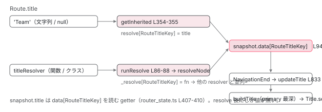

[目次](../README.md) › [Router の内側](README.md) › 第 13 回 / 全 21 回

# resolve と data と title：resolveData が ActivatedRouteSnapshot を埋める手順

> resolveData → runResolve → resolveNode → getResolver。paramsInheritanceStrategy の既定が 'always' である意味と getInherited、resolver が値を出さずに complete したとき NavigationCancel(NoDataFromResolver) になる行、TitleStrategy.updateTitle が呼ばれる場所。

angular/angular · 読了 約 13 分 · 中核 · [サイトで読む（デモが動きます）](https://angular-deep-dive-cyan.vercel.app/chapter/router-resolvers)

---

コンポーネントで `inject(ActivatedRoute).snapshot.data['team']` と書くと resolver の結果が入っている。`snapshot.params['id']` には親 Route の `:id` まで入っている。`document.title` が Route の `title` に変わる。この 3 つは別々の機能に見えますが、Router の中では**同じ 1 つの関数 `getInherited` と、同じ 1 つの段 `resolveData`** が作っています。この章では、`resolveData` → `runResolve` → `resolveNode` → `getResolver` の 4 段、`paramsInheritanceStrategy` の既定が `'always'` であることの意味、resolver が値を出さずに complete したとき `NavigationCancel(NoDataFromResolver)` になる行、`title` が `data` の中の `Symbol` キーとして運ばれ `TitleStrategy.updateTitle` で読まれる場所を追います。

読む対象は `packages/router/src/operators/resolve_data.ts`、`packages/router/src/router_state.ts` の `getInherited`、`packages/router/src/page_title_strategy.ts`、`packages/router/src/navigation_transition.ts` の 681〜723 行目です。

1. 1 本の RxJS パイプライン
2. URL → UrlTree
3. routerLink の配列 → UrlTree
4. Route 設定の検証と正規化
5. provideRouter の中身
6. 最初のナビゲーション
7. navigateByUrl → NavigationTransition
8. setupNavigations の全段
9. Recognizer と match
10. redirectTo
11. loadChildren と loadComponent
12. ガードの実行順
13. **resolve と data と title**（この章）
14. ActivatedRoute と Snapshot
15. RouterOutlet への配置
16. ブラウザの URL と履歴
17. Router.events の全種類
18. RouterLink と RouterLinkActive
19. withViewTransitions
20. withRouterResources
21. Navigation API

## 1. パイプラインの中の位置：ResolveStart から ResolveEnd まで

📄 `angular/packages/router/src/navigation_transition.ts` L681–697 （▶ の行: 681–682, 685, 691, 696–697）

```ts
681 ▶             if (t.guards.canActivateChecks.length === 0) {
682 ▶               return of(t);
683 │             }
684 │ 
685 ▶             const resolveStart = new ResolveStart(
686 │               t.id,
687 │               this.urlSerializer.serialize(t.extractedUrl),
688 │               this.urlSerializer.serialize(t.urlAfterRedirects!),
689 │               t.targetSnapshot!,
690 │             );
691 ▶             this.events.next(resolveStart);
692 │             if (!shouldContinueNavigation()) {
693 │               return EMPTY;
694 │             }
695 │ 
696 ▶             let dataResolved = false;
697 ▶             return of(t).pipe(
```

📄 `angular/packages/router/src/navigation_transition.ts` L698–723 （▶ の行: 698, 700–702, 708, 710–712, 715, 717）

```ts
698 ▶               resolveData(this.paramsInheritanceStrategy),
699 │               tap({
700 ▶                 next: () => {
701 ▶                   dataResolved = true;
702 ▶                   const resolveEnd = new ResolveEnd(
703 │                     t.id,
704 │                     this.urlSerializer.serialize(t.extractedUrl),
705 │                     this.urlSerializer.serialize(t.urlAfterRedirects!),
706 │                     t.targetSnapshot!,
707 │                   );
708 ▶                   this.events.next(resolveEnd);
709 │                 },
710 ▶                 complete: () => {
711 ▶                   if (!dataResolved) {
712 ▶                     this.cancelNavigationTransition(
713 │                       t,
714 │                       typeof ngDevMode === 'undefined' || ngDevMode
715 ▶                         ? `At least one route resolver didn't emit any value.`
716 │                         : '',
717 ▶                       NavigationCancellationCode.NoDataFromResolver,
718 │                     );
719 │                   }
720 │                 },
721 │               }),
722 │             );
723 │           }),
```

1. **681〜682 行目：canActivateChecks が空なら resolve 段ごと飛ばす**

   [前章](12-router-guards.md)で作った「入る側」の配列が空（同じ Route で params も変わらない等）なら、`ResolveStart` も `ResolveEnd` も流れず、resolver は 1 つも呼ばれません。resolver の実行単位は `canActivateChecks` です。
2. **685〜691 行目：ResolveStart**
3. **696〜698 行目：dataResolved フラグと resolveData 演算子**

   `resolveData(this.paramsInheritanceStrategy)`（2 節）。`paramsInheritanceStrategy` の値は 4 節で確認します。
4. **700〜708 行目：値が 1 つ流れたら ResolveEnd**

   701 行目で `dataResolved = true`、702〜708 行目で `ResolveEnd`。
5. **710〜720 行目：値が流れずに complete したら NavigationCancel(NoDataFromResolver)**

   711 行目、`dataResolved` が `false` のまま complete したとき。715 行目のメッセージ「At least one route resolver didn't emit any value.」、717 行目のコード `NoDataFromResolver`。**resolver が値を出さない、はエラーではなくキャンセル**です（3 節で、何が `EMPTY` を作るのかを見ます）。

📄 `angular/packages/router/src/navigation_transition.ts` L998–1012 （▶ の行: 1004, 1008, 1010–1011）

```ts
 998 │   private cancelNavigationTransition(
 999 │     t: NavigationTransition,
1000 │     reason: string,
1001 │     code: NavigationCancellationCode,
1002 │   ) {
1003 │     rollbackState(t);
1004 ▶     const navCancel = new NavigationCancel(
1005 │       t.id,
1006 │       this.urlSerializer.serialize(t.extractedUrl),
1007 │       reason,
1008 ▶       code,
1009 │     );
1010 ▶     this.events.next(navCancel);
1011 ▶     t.resolve(false);
1012 │   }
```

📄 `angular/packages/router/src/events.ts` L179–202 （▶ の行: 191）

```ts
179 │ export enum NavigationCancellationCode {
180 │   /**
181 │    * A navigation failed because a guard returned a `UrlTree` to redirect.
182 │    */
183 │   Redirect,
184 │   /**
185 │    * A navigation failed because a more recent navigation started.
186 │    */
187 │   SupersededByNewNavigation,
188 │   /**
189 │    * A navigation failed because one of the resolvers completed without emitting a value.
190 │    */
191 ▶   NoDataFromResolver,
192 │   /**
193 │    * A navigation failed because a guard returned `false`.
194 │    */
195 │   GuardRejected,
196 │   /**
197 │    * A navigation was aborted by the `Navigation.abort` function.
198 │    *
199 │    * @see {@link Navigation}
200 │    */
201 │   Aborted,
202 │ }
```

1004〜1010 行目で `NavigationCancel`（1008 行目の `code` は 191 行目 `NoDataFromResolver`）を流し、1011 行目で `navigate()` の Promise を `false` で resolve。[前章](12-router-guards.md)のガード `false` と同じ出口で、`code` だけが違います。

## 2. resolveData：どの Route の resolver を、どの順で

📄 `angular/packages/router/src/operators/resolve_data.ts` L28–53 （▶ の行: 31, 37–38, 43–45, 50–51）

```ts
28 │ export function resolveData(
29 │   paramsInheritanceStrategy: 'emptyOnly' | 'always',
30 │ ): MonoTypeOperatorFunction<NavigationTransition> {
31 ▶   return mergeMap((t) => {
32 │     const {
33 │       targetSnapshot,
34 │       guards: {canActivateChecks},
35 │     } = t;
36 │ 
37 ▶     if (!canActivateChecks.length) {
38 ▶       return of(t);
39 │     }
40 │     // Iterating a Set in javascript  happens in insertion order so it is safe to use a `Set` to
41 │     // preserve the correct order that the resolvers should run in.
42 │     // https://developer.mozilla.org/en-US/docs/Web/JavaScript/Reference/Global_Objects/Set#description
43 ▶     const routesWithResolversToRun = new Set(canActivateChecks.map((check) => check.route));
44 ▶     const routesNeedingDataUpdates = new Set<ActivatedRouteSnapshot>();
45 ▶     for (const route of routesWithResolversToRun) {
46 │       if (routesNeedingDataUpdates.has(route)) {
47 │         continue;
48 │       }
49 │       // All children under the route with a resolver to run need to recompute inherited data.
50 ▶       for (const newRoute of flattenRouteTree(route)) {
51 ▶         routesNeedingDataUpdates.add(newRoute);
52 │       }
53 │     }
```

📄 `angular/packages/router/src/operators/resolve_data.ts` L54–77 （▶ の行: 55–58, 60–61, 64–66, 74–76）

```ts
54 │     let routesProcessed = 0;
55 ▶     return from(routesNeedingDataUpdates).pipe(
56 ▶       concatMap((route) => {
57 ▶         if (routesWithResolversToRun.has(route)) {
58 ▶           return runResolve(route, targetSnapshot!, paramsInheritanceStrategy);
59 │         } else {
60 ▶           route.data = getInherited(route, route.parent, paramsInheritanceStrategy).resolve;
61 ▶           return of(void 0);
62 │         }
63 │       }),
64 ▶       tap(() => routesProcessed++),
65 ▶       takeLast(1),
66 ▶       mergeMap((_) => (routesProcessed === routesNeedingDataUpdates.size ? of(t) : EMPTY)),
67 │     );
68 │   });
69 │ }
70 │ 
71 │ /**
72 │  *  Returns the `ActivatedRouteSnapshot` tree as an array, using DFS to traverse the route tree.
73 │  */
74 ▶ function flattenRouteTree(route: ActivatedRouteSnapshot): ActivatedRouteSnapshot[] {
75 ▶   const descendants = route.children.map((child) => flattenRouteTree(child)).flat();
76 ▶   return [route, ...descendants];
77 │ }
```

1. **43 行目：resolver を走らせる Route の集合**

   `canActivateChecks` の各 `route`（入る側の snapshot）。`Set` なので重複が消え、挿入順（親 → 子）が保たれます（40〜42 行目のコメント）。
2. **44〜53 行目：data を再計算すべき Route の集合**

   50 行目 `flattenRouteTree`（74〜76 行目、自分 + 子孫を DFS で配列に）。resolver を走らせる Route の**子孫全部**が `routesNeedingDataUpdates` に入ります。親の resolver が新しい値を出せば、継承している子の `data` も変わるからです。
3. **55〜63 行目：concatMap で 1 つずつ**

   **`concatMap`** なので、親の resolver が全部終わってから子の resolver が始まります。57〜58 行目、resolver を持つ Route なら `runResolve`（3 節）。60〜61 行目、持たない（子孫として入っただけの）Route なら `getInherited(...).resolve`（4 節）で `data` を作り直すだけ。
4. **64〜66 行目：全部の Route が値を出したときだけ t を流す**

   64 行目で Route ごとに 1 つ値が流れるたびに数え、65 行目 `takeLast(1)` で最後まで待ち、66 行目、**数が Route 数と一致したときだけ `of(t)`**、足りなければ `EMPTY`。この `EMPTY` が 1 節 710〜711 行目の「値が流れずに complete」です。どこかの Route の `runResolve` が値を出さずに complete すると、`concatMap` は次の Route へ進む（他の resolver は走る）が、最後に数が合わずキャンセルになります。

## 3. runResolve → resolveNode → getResolver：1 つの Route の中

📄 `angular/packages/router/src/operators/resolve_data.ts` L79–99 （▶ の行: 84–87, 89–91, 93–94）

```ts
79 │ function runResolve(
80 │   futureARS: ActivatedRouteSnapshot,
81 │   futureRSS: RouterStateSnapshot,
82 │   paramsInheritanceStrategy: 'emptyOnly' | 'always',
83 │ ) {
84 ▶   const config = futureARS.routeConfig;
85 ▶   const resolve = futureARS._resolve;
86 ▶   if (config?.title !== undefined && !hasStaticTitle(config)) {
87 ▶     resolve[RouteTitleKey] = config.title;
88 │   }
89 ▶   return defer(() => {
90 ▶     futureARS.data = getInherited(futureARS, futureARS.parent, paramsInheritanceStrategy).resolve;
91 ▶     return resolveNode(resolve, futureARS, futureRSS).pipe(
92 │       map((resolvedData: any) => {
93 ▶         futureARS._resolvedData = resolvedData;
94 ▶         futureARS.data = {...futureARS.data, ...resolvedData};
95 │         return null;
96 │       }),
97 │     );
98 │   });
99 │ }
```

1. **85 行目：\_resolve = Route.resolve のコピー**

   recognize の `createSnapshot`（4 節）で `route.resolve || {}` が入っています。
2. **86〜88 行目：title が静的でなければ、resolver の 1 つとして登録**

   `title: titleResolver`（関数やクラス）なら、`RouteTitleKey` という `Symbol` をキーに `_resolve` に追加します。**title resolver は普通の resolver と完全に同じ経路で走ります**（5 節）。
3. **90 行目：まず継承した data を入れる**

   `getInherited(futureARS, parent, strategy).resolve`。親の resolve 済み data と自分の静的 data を合成したもの（4 節）。
4. **91〜96 行目：resolveNode の結果を \_resolvedData と data に**

   93 行目で `_resolvedData`（自分の resolver の結果だけ）、94 行目で `data = {...継承分, ...結果}`。resolver の値は静的 data を上書きします。

📄 `angular/packages/router/src/operators/resolve_data.ts` L101–127 （▶ の行: 106–108, 111–114, 116–117, 119, 123–125）

```ts
101 │ function resolveNode(
102 │   resolve: ResolveData,
103 │   futureARS: ActivatedRouteSnapshot,
104 │   futureRSS: RouterStateSnapshot,
105 │ ): Observable<any> {
106 ▶   const keys = getDataKeys(resolve);
107 ▶   if (keys.length === 0) {
108 ▶     return of({});
109 │   }
110 │   const data: {[k: string | symbol]: any} = {};
111 ▶   return from(keys).pipe(
112 ▶     mergeMap((key) =>
113 ▶       getResolver(resolve[key], futureARS, futureRSS).pipe(
114 ▶         first(),
115 │         tap((value: any) => {
116 ▶           if (value instanceof RedirectCommand) {
117 ▶             throw redirectingNavigationError(new DefaultUrlSerializer(), value);
118 │           }
119 ▶           data[key] = value;
120 │         }),
121 │       ),
122 │     ),
123 ▶     takeLast(1),
124 ▶     map(() => data),
125 ▶     catchError((e: unknown) => (isEmptyError(e as Error) ? EMPTY : throwError(e))),
126 │   );
127 │ }
```

📄 `angular/packages/router/src/utils/collection.ts` L42–47 （▶ の行: 46）

```ts
42 │ /**
43 │  * Gets the keys of an object, including `symbol` keys.
44 │  */
45 │ export function getDataKeys(obj: Object): Array<string | symbol> {
46 ▶   return [...Object.keys(obj), ...Object.getOwnPropertySymbols(obj)];
47 │ }
```

📄 `angular/packages/router/src/utils/type_guards.ts` L53–55 （▶ の行: 54）

```ts
53 │ export function isEmptyError(e: Error): e is EmptyError {
54 ▶   return e instanceof EmptyError || e?.name === 'EmptyError';
55 │ }
```

1. **106〜108 行目：キーを集める。無ければ of({})**

   46 行目、`Object.keys` と `getOwnPropertySymbols` の両方。3 節 87 行目の `Symbol` キーもここで拾われます。
2. **111〜112 行目：キーごとに mergeMap**

   **1 つの Route の中の複数 resolver は並列**です。2 節の Route 間は `concatMap`（直列）、Route 内は `mergeMap`（並列）。models.ts 251〜253 行目の「resolver の実行順に保証は無い」はこのことです。
3. **113〜114 行目：getResolver → first()**

   最初の 1 値だけ使います。`Observable` が complete しなくても 1 値出れば進みます。**値を 1 つも出さずに complete すると、`first()` が `EmptyError` を throw** します。
4. **116〜118 行目：RedirectCommand なら redirectingNavigationError**

   resolver からもリダイレクトできます。[前章 6 節](12-router-guards.md)と同じ例外になり、`catchError` → `NavigationCancel(Redirect)` → `RedirectRequest`。`UrlTree` はここでは特別扱いされません（`data` の値として入るだけ）。
5. **119 行目、123〜124 行目：data\[key\] に積み、全部終わったら data を 1 回流す**
6. **125 行目：EmptyError なら EMPTY、それ以外は throwError**

   54 行目の判定で `EmptyError` なら **`EMPTY`（値なしで complete）**に変えます。`mergeMap` の中の 1 キーで `EmptyError` が出ると `resolveNode` 全体がエラーになるので、同じ Route の他のキーの値も捨てられます。`EMPTY` は 3 節 91 行目の `map` を通らず、2 節 64 行目のカウンタが進まず、66 行目で `EMPTY`、1 節 711 行目で `NoDataFromResolver`。resolver が `throw` したり reject したりした場合は 125 行目の `throwError` で、こちらは `NavigationError` です。

📄 `angular/packages/router/src/operators/resolve_data.ts` L129–140 （▶ の行: 134–139）

```ts
129 │ function getResolver(
130 │   injectionToken: ProviderToken<any> | Function,
131 │   futureARS: ActivatedRouteSnapshot,
132 │   futureRSS: RouterStateSnapshot,
133 │ ): Observable<any> {
134 ▶   const closestInjector = futureARS._environmentInjector;
135 ▶   const resolver = getTokenOrFunctionIdentity(injectionToken, closestInjector);
136 ▶   const resolverValue = resolver.resolve
137 ▶     ? resolver.resolve(futureARS, futureRSS)
138 ▶     : runInInjectionContext(closestInjector, () => resolver(futureARS, futureRSS));
139 ▶   return wrapIntoObservable(resolverValue);
140 │ }
```

📄 `angular/packages/router/src/utils/functional_guards.ts` L93–104 （▶ の行: 102–103）

```ts
 93 │ /**
 94 │  * Maps an injectable class with a resolve function to an equivalent `ResolveFn`
 95 │  * for use in a `Route` definition.
 96 │  *
 97 │  * Usage {@example router/utils/functional_guards.ts region='Resolve'}
 98 │  *
 99 │  * @publicApi
100 │  * @see {@link Route}
101 │  */
102 ▶ export function mapToResolve<T>(provider: Type<Resolve<T>>): ResolveFn<T> {
103 ▶   return (...params) => inject(provider).resolve(...params);
104 │ }
```

📄 `angular/packages/router/src/models.ts` L246–256 （▶ の行: 250–253）

```ts
246 │ /**
247 │  *
248 │  * Represents the resolved data associated with a particular route.
249 │  *
250 ▶  * Returning a `RedirectCommand` directs the router to cancel the current navigation and redirect to
251 ▶  * the location provided in the `RedirectCommand`. Note that there are no ordering guarantees when
252 ▶  * resolvers execute. If multiple resolvers would return a `RedirectCommand`, only the first one
253 ▶  * returned will be used.
254 │  *
255 │  * @see {@link Route#resolve}
256 │  *
```

134〜135 行目、[前章](12-router-guards.md)のガードと同じ `getTokenOrFunctionIdentity` を、その Route に一番近い `EnvironmentInjector` で。136〜138 行目、`resolve` メソッドを持つクラスなら `resolver.resolve(futureARS, futureRSS)`、関数なら `runInInjectionContext` の中で `(futureARS, futureRSS)` を渡して呼びます。139 行目で Observable に揃えます。102〜103 行目、`mapToResolve(TeamResolver)` はクラスを「`inject(TeamResolver).resolve(...)` を呼ぶ関数」にするだけです。

> [!WARNING]
> **ハマりどころ**
>
> `resolve: { team: () => inject(Http).get(...).pipe(filter(...)) }` のように `filter` で全部落ちると、3 節 114 行目の `first()` が `EmptyError` → 125 行目で `EMPTY` → 1 節 711 行目でナビゲーションが**静かにキャンセル**されます。例外は出ず、`Router.events` に `NavigationCancel`（`code: NoDataFromResolver`）が流れ、`navigate()` は `false` を返すだけです。「resolver を書いたら画面が切り替わらなくなった」はたいていこれです。

## 4. getInherited：params と data が親から降りてくる規則

📄 `angular/packages/router/src/navigation_transition.ts` L367–370 （▶ の行: 368–370）

```ts
367 │   private readonly titleStrategy?: TitleStrategy = inject(TitleStrategy);
368 ▶   private readonly options = inject(ROUTER_CONFIGURATION, {optional: true}) || {};
369 ▶   private readonly paramsInheritanceStrategy =
370 ▶     this.options.paramsInheritanceStrategy || DEFAULT_PARAMS_INHERITANCE_STRATEGY;
```

📄 `angular/packages/router/src/router_state.ts` L294–304 （▶ の行: 294, 296–297）

```ts
294 ▶ export type ParamsInheritanceStrategy = 'emptyOnly' | 'always';
295 │ 
296 ▶ // g3-only export const DEFAULT_PARAMS_INHERITANCE_STRATEGY: ParamsInheritanceStrategy = 'emptyOnly';
297 ▶ export const DEFAULT_PARAMS_INHERITANCE_STRATEGY: ParamsInheritanceStrategy = 'always'; // 3p-only
298 │ 
299 │ /** @internal */
300 │ export type Inherited = {
301 │   params: Params;
302 │   data: Data;
303 │   resolve: Data;
304 │ };
```

369〜370 行目、`withRouterConfig({paramsInheritanceStrategy})` で指定が無ければ `DEFAULT_PARAMS_INHERITANCE_STRATEGY`。**297 行目、既定は `'always'`** です。296 行目の `g3-only` はコメントアウトされた Google 社内向けの行で、公開版（`3p-only`）は 297 行目が有効です。

📄 `angular/packages/router/src/router_state.ts` L312–326 （▶ の行: 319–321, 323, 325）

```ts
312 │ export function getInherited(
313 │   route: ActivatedRouteSnapshot,
314 │   parent: ActivatedRouteSnapshot | null,
315 │   paramsInheritanceStrategy: ParamsInheritanceStrategy,
316 │ ): Inherited {
317 │   let inherited: Inherited;
318 │   const {routeConfig} = route;
319 ▶   if (
320 ▶     parent !== null &&
321 ▶     (paramsInheritanceStrategy === 'always' ||
322 │       // inherit parent data if route is empty path
323 ▶       routeConfig?.path === '' ||
324 │       // inherit parent data if parent was componentless
325 ▶       (!parent.component && !parent.routeConfig?.loadComponent))
326 │   ) {
```

📄 `angular/packages/router/src/router_state.ts` L327–358 （▶ の行: 328–329, 337, 339, 341, 343, 348–350, 354–355）

```ts
327 │     inherited = {
328 ▶       params: {...parent.params, ...route.params},
329 ▶       data: {...parent.data, ...route.data},
330 │       resolve: {
331 │         // Snapshots are created with data inherited from parent and guards (i.e. canActivate) can
332 │         // change data because it's not frozen...
333 │         // This first line could be deleted chose to break/disallow mutating the `data` object in
334 │         // guards.
335 │         // Note that data from parents still override this mutated data so anyone relying on this
336 │         // might be surprised that it doesn't work if parent data is inherited but otherwise does.
337 ▶         ...route.data,
338 │         // Ensure inherited resolved data overrides inherited static data
339 ▶         ...parent.data,
340 │         // static data from the current route overrides any inherited data
341 ▶         ...routeConfig?.data,
342 │         // resolved data from current route overrides everything
343 ▶         ...route._resolvedData,
344 │       },
345 │     };
346 │   } else {
347 │     inherited = {
348 ▶       params: {...route.params},
349 ▶       data: {...route.data},
350 ▶       resolve: {...route.data, ...(route._resolvedData ?? {})},
351 │     };
352 │   }
353 │ 
354 ▶   if (routeConfig && hasStaticTitle(routeConfig)) {
355 ▶     inherited.resolve[RouteTitleKey] = routeConfig.title;
356 │   }
357 │   return inherited;
358 │ }
```

1. **319〜326 行目：継承するかどうかの条件**

   親がいて、かつ次の 3 つのどれか。321 行目 `strategy === 'always'`、323 行目 自分の `path` が `''`、325 行目 親が componentless（`component` も `loadComponent` も無い）。**`'always'` なら常に真**なので、既定ではすべての Route が親の params と data を受け取ります。`'emptyOnly'` にすると、後の 2 条件だけになります。
2. **328〜329 行目：params と data は「親 → 自分」の順で合成**

   同名なら自分が勝ちます。`team/:id` の下に `user/:id` があれば、子の `params.id` は子の値です。
3. **330〜344 行目：resolve（= resolveData が data に入れる値）は 4 層**

   337 行目 自分のいまの `data`（ガードが書き換えた分を残すため、331〜336 行目のコメント）→ 339 行目 **親の `data`（親の resolve 済み値を含む）**→ 341 行目 自分の静的 `Route.data` → 343 行目 自分の `_resolvedData`。後ろが勝つので、**自分の resolver の値 &gt; 自分の静的 data &gt; 親の data** です。
4. **347〜351 行目：継承しないとき**

   自分の分だけ。`resolve` は `data` と `_resolvedData` の合成。
5. **354〜356 行目：静的 title を resolve に入れる**

   `hasStaticTitle`（文字列か `null`）なら `resolve[RouteTitleKey] = title`。5 節で読みます。

📄 `angular/packages/router/src/recognize.ts` L377–400 （▶ の行: 389, 393, 396–398）

```ts
377 │   private createSnapshot(
378 │     injector: EnvironmentInjector,
379 │     route: Route,
380 │     segments: UrlSegment[],
381 │     parameters: Params,
382 │     parentRoute: ActivatedRouteSnapshot,
383 │   ): ActivatedRouteSnapshot {
384 │     const snapshot = new ActivatedRouteSnapshot(
385 │       segments,
386 │       parameters,
387 │       Object.freeze({...this.urlTree.queryParams}),
388 │       this.urlTree.fragment,
389 ▶       getData(route),
390 │       getOutlet(route),
391 │       route.component ?? route._loadedComponent ?? null,
392 │       route,
393 ▶       getResolve(route),
394 │       injector,
395 │     );
396 ▶     const inherited = getInherited(snapshot, parentRoute, this.paramsInheritanceStrategy);
397 ▶     snapshot.params = Object.freeze(inherited.params);
398 ▶     snapshot.data = Object.freeze(inherited.data);
399 │     return snapshot;
400 │   }
```

`getInherited` は**2 回**呼ばれます。1 回目は recognize の `createSnapshot`、396 行目。397〜398 行目で `params` と `data`（`inherited.data`、静的 data の継承だけ）を `Object.freeze` して入れます。389 行目 `getData(route)` は `route.data || {}`、393 行目 `getResolve(route)` は `route.resolve || {}`（3 節 85 行目の `_resolve`）。2 回目は 3 節 90 行目（または 2 節 60 行目）、こちらは `inherited.resolve` を使うので、親の resolve 済み値と title が入ります。[redirectTo](10-router-redirects.md) の関数や `canMatch` が受け取る `PartialMatchRouteSnapshot.data` は 1 回目の値です。

> **🧪 DEMO — paramsInheritanceStrategy を切り替えると params / data / title はどう変わるか**
>
> URL `/team/3/user/7`（末尾に `path: ''` の子）に対し、getInherited（router\_state.ts L312-358）を recognize（createSnapshot L396）と resolveData（runResolve L90, L94）の 2 回、同じ条件・同じスプレッド順で適用した結果です。Route: `team/:teamId`（data: section, resolve: team, title: 'Team'）→ `user/:userId`（data: tab, title: titleResolver）→ `''`（UserHome、設定なし）。
>
> ▶ [このデモはサイトで動かせます](https://angular-deep-dive-cyan.vercel.app/chapter/router-resolvers)

> [!NOTE]
> **ポイント**
>
> デモの `'emptyOnly'` で `user/:userId` から `teamId` が消えるのは、319〜325 行目の 3 条件のどれにも当たらないからです。親 `team/:teamId` を componentless にすると 325 行目が真になり、再び降りてきます。末尾の `path: ''` はどちらの設定でも 323 行目で継承します。

## 5. title は data の中の Symbol キー

📄 `angular/packages/router/src/shared.ts` L19–24 （▶ の行: 20–22, 24）

```ts
19 │ /**
20 ▶  * A private symbol used to store the value of `Route.title` inside the `Route.data` if it is a
21 ▶  * static string or `Route.resolve` if anything else. This allows us to reuse the existing route
22 ▶  * data/resolvers to support the title feature without new instrumentation in the `Router` pipeline.
23 │  */
24 ▶ export const RouteTitleKey: unique symbol = /* @__PURE__ */ Symbol('RouteTitle');
```

📄 `angular/packages/router/src/router_state.ts` L633–635 （▶ の行: 634）

```ts
633 │ export function hasStaticTitle(config: Route) {
634 ▶   return typeof config.title === 'string' || config.title === null;
635 │ }
```

📄 `angular/packages/router/src/router_state.ts` L406–411 （▶ の行: 407–410）

```ts
406 │   /** The resolved route title */
407 ▶   get title(): string | undefined {
408 ▶     // Note: This _must_ be a getter because the data is mutated in the resolvers. Title will not be
409 ▶     // available at the time of class instantiation.
410 ▶     return this.data?.[RouteTitleKey];
411 │   }
```

24 行目、`RouteTitleKey` は `Symbol('RouteTitle')`。20〜22 行目のコメントが設計を言い切っています。**「静的な文字列なら `data`、それ以外なら `resolve` に入れることで、既存の data / resolver の仕組みを再利用し、パイプラインに新しい計装を足さずに title を実現した」**。634 行目、静的 = 文字列か `null`。4 節 354〜355 行目で `resolve[RouteTitleKey]` に、3 節 86〜88 行目で `_resolve[RouteTitleKey]` に入るのがその 2 経路です。407〜410 行目、`snapshot.title` は `data[RouteTitleKey]` を読むだけの getter。408〜409 行目のコメントどおり、**resolver が data を書き換えた後**でないと値がありません。`Symbol` キーなので `Object.keys(snapshot.data)` には出てきません。

📄 `angular/packages/router/src/page_title_strategy.ts` L38–63 （▶ の行: 38, 41, 46, 48–51, 53, 60–61）

```ts
38 ▶ @Service({factory: () => inject(DefaultTitleStrategy)})
39 │ export abstract class TitleStrategy {
40 │   /** Performs the application title update. */
41 ▶   abstract updateTitle(snapshot: RouterStateSnapshot): void;
42 │ 
43 │   /**
44 │    * @returns The `title` of the deepest primary route.
45 │    */
46 ▶   buildTitle(snapshot: RouterStateSnapshot): string | undefined {
47 │     let pageTitle: string | undefined;
48 ▶     let route: ActivatedRouteSnapshot | undefined = snapshot.root;
49 ▶     while (route !== undefined) {
50 ▶       pageTitle = this.getResolvedTitleForRoute(route) ?? pageTitle;
51 ▶       route = route.children.find((child) => child.outlet === PRIMARY_OUTLET);
52 │     }
53 ▶     return pageTitle;
54 │   }
55 │ 
56 │   /**
57 │    * Given an `ActivatedRouteSnapshot`, returns the final value of the
58 │    * `Route.title` property, which can either be a static string or a resolved value.
59 │    */
60 ▶   getResolvedTitleForRoute(snapshot: ActivatedRouteSnapshot): string | undefined {
61 ▶     return snapshot.data[RouteTitleKey];
62 │   }
63 │ }
```

📄 `angular/packages/router/src/page_title_strategy.ts` L68–85 （▶ の行: 68, 70, 79–82）

```ts
68 ▶ @Injectable({providedIn: 'root'})
69 │ export class DefaultTitleStrategy extends TitleStrategy {
70 ▶   constructor(readonly title: Title) {
71 │     super();
72 │   }
73 │ 
74 │   /**
75 │    * Sets the title of the browser to the given value.
76 │    *
77 │    * @param title The `pageTitle` from the deepest primary route.
78 │    */
79 ▶   override updateTitle(snapshot: RouterStateSnapshot): void {
80 ▶     const title = this.buildTitle(snapshot);
81 ▶     if (title !== undefined) {
82 ▶       this.title.setTitle(title);
83 │     }
84 │   }
85 │ }
```

📄 `angular/packages/router/src/navigation_transition.ts` L825–835 （▶ の行: 826, 833–834）

```ts
825 │             this.lastSuccessfulNavigation.set(untracked(this.currentNavigation));
826 ▶             this.events.next(
827 │               new NavigationEnd(
828 │                 t.id,
829 │                 this.urlSerializer.serialize(t.extractedUrl),
830 │                 this.urlSerializer.serialize(t.urlAfterRedirects!),
831 │               ),
832 │             );
833 ▶             this.titleStrategy?.updateTitle(t.targetRouterState!.snapshot);
834 ▶             t.resolve(true);
835 │           }),
```

1. **38 行目：TitleStrategy の既定は DefaultTitleStrategy**

   `@Service({factory: () => inject(DefaultTitleStrategy)})`。自作するなら `{provide: TitleStrategy, useClass: MyStrategy}` で上書きします。
2. **46〜54 行目：buildTitle は primary outlet の最深まで降りる**

   48 行目 root から、51 行目 `outlet === 'primary'` の子だけを辿り、50 行目で `title` があれば上書き。結果は**最も深い primary Route の title**です。名前付き outlet の title は 51 行目で辿られないので使われません（クラスのドキュメントコメントにその例があります）。60〜62 行目、1 つの Route の title は `data[RouteTitleKey]`。4 節の継承で親の title が子の data に降りてきていても、子に自分の title があればそれが勝つ（343 行目 / 355 行目）ので、結果は変わりません。
3. **79〜84 行目：undefined でなければ Title.setTitle**

   どの Route にも `title` が無ければ 81 行目で何もしません（`document.title` は前のまま）。70 行目の `Title` は `@angular/platform-browser` のサービスで、`document.title` に書くだけです。
4. **833 行目：呼ばれるのは NavigationEnd の直後**

   826〜832 行目で `NavigationEnd` を流した**後**、834 行目で Promise を resolve する**前**。`activateRoutes`（[15 章](15-router-activate-routes.md)）でコンポーネントが作られた後なので、`NavigationEnd` を購読して `document.title` を読むとまだ前の値、`await router.navigate()` の後なら新しい値です。



*title が運ばれる 2 経路。静的 title は getInherited が resolve\[RouteTitleKey\] に入れ、関数 title は runResolve が \_resolve\[RouteTitleKey\] に登録して他の resolver と同じ経路で解決される。どちらも snapshot.data に Symbol キーで入り、NavigationEnd 後に TitleStrategy.buildTitle が primary 最深から読む。*

## ここまでの呼び出し

- `recognize` → `Recognizer.createSnapshot` — router/src/recognize.ts L377 — *1 回目の getInherited（L396）。params と静的 data を継承して freeze*
- `GuardsCheckEnd` → `canActivateChecks.length === 0 ? of(t)` — router/src/navigation\_transition.ts L681-683 — *空なら resolve 段を飛ばす*
- `events.next(new ResolveStart(...))` — navigation\_transition.ts L685-691
- `resolveData(paramsInheritanceStrategy)` — navigation\_transition.ts L698 → operators/resolve\_data.ts L28
  - `routesWithResolversToRun` / `routesNeedingDataUpdates`（flattenRouteTree） — resolve\_data.ts L43-53 — *入る側の Route とその子孫*
  - `from(routesNeedingDataUpdates).pipe(concatMap(...))` — resolve\_data.ts L55-56 — *親 → 子で直列*
    - `runResolve(route, targetSnapshot, strategy)` — resolve\_data.ts L58 → L79 — *title が関数なら \_resolve\[RouteTitleKey\] に（L86-88）*
      - `futureARS.data = getInherited(futureARS, parent, strategy).resolve` — resolve\_data.ts L90 → router/src/router\_state.ts L312 — *2 回目。親の resolve 済み data と静的 title を含む*
      - `resolveNode(resolve, futureARS, futureRSS)` — resolve\_data.ts L91 → L101 — *キーごとに mergeMap（並列）*
        - `getResolver(resolve[key], futureARS, futureRSS)` — resolve\_data.ts L113 → L129
          - 👤 `resolver.resolve(futureARS, futureRSS)` または `runInInjectionContext(closestInjector, () => resolver(futureARS, futureRSS))` — resolve\_data.ts L136-138
        - `wrapIntoObservable(...).pipe(first())` → `data[key] = value` — resolve\_data.ts L139, L114, L119 — *RedirectCommand なら throw（L116-117）。EmptyError なら EMPTY（L125）*
      - `futureARS._resolvedData = resolvedData; futureARS.data = {...data, ...resolvedData}` — resolve\_data.ts L93-94
    - `route.data = getInherited(route, route.parent, strategy).resolve`（resolver の無い子孫） — resolve\_data.ts L60
  - `takeLast(1)` → `routesProcessed === size ? of(t) : EMPTY` — resolve\_data.ts L65-66
- `tap({next: ResolveEnd, complete: !dataResolved → cancelNavigationTransition(NoDataFromResolver)})` — navigation\_transition.ts L699-721 → L998
- `… activateRoutes → events.next(new NavigationEnd(...))` — navigation\_transition.ts L826
- `titleStrategy.updateTitle(targetRouterState.snapshot)` — navigation\_transition.ts L833 → router/src/page\_title\_strategy.ts L79
  - `buildTitle(snapshot)` → `snapshot.data[RouteTitleKey]` を primary の最深まで — page\_title\_strategy.ts L46-54, L61
  - `this.title.setTitle(title)` — page\_title\_strategy.ts L82 — *document.title が変わる*
- `t.resolve(true)` — navigation\_transition.ts L834

## 聞かれそうな質問

**Q. resolver が of()（空）を返すとどうなりますか？**

ナビゲーションがキャンセルされます。resolve\_data.ts 114 行目の `first()` が値なしの complete で `EmptyError` を throw し、125 行目の `catchError` が `isEmptyError`（type\_guards.ts 54 行目）で `EMPTY` に変えます。`runResolve` は値を出さずに complete するので 64 行目のカウンタが進まず、66 行目で `routesProcessed !== size` → `EMPTY`。navigation\_transition.ts 710〜711 行目、`dataResolved` が `false` のまま complete したので 712〜718 行目 `cancelNavigationTransition` → `NavigationCancel`（`code: NoDataFromResolver`、events.ts 191 行目、メッセージは 715 行目）→ `navigate()` は `false` で resolve（1011 行目）。例外は出ません。resolver が `throw` / reject した場合は 125 行目で `throwError` なので、そちらは `NavigationError` です。

**Q. 子ルートから親の :id を取れるのはなぜですか？emptyOnly にすると取れなくなる条件は？**

router\_state.ts 297 行目、`paramsInheritanceStrategy` の既定が `'always'` だからです。`getInherited` 321 行目の条件が常に真になり、328 行目で `{...parent.params, ...route.params}`。recognize.ts 396〜397 行目で snapshot 作成時に入ります。`'emptyOnly'` にすると 323 行目（自分の `path` が `''`）か 325 行目（親に `component` も `loadComponent` も無い）のときだけ継承します。つまり**親にコンポーネントがあり、自分の path が空でない**子（`team/:teamId` の下の `user/:userId` など）で取れなくなります。

**Q. 親の resolver の結果は子の data に入りますか？同じキーがあったらどちらが勝ちますか？**

継承条件（319〜326 行目）を満たせば入ります。resolve\_data.ts 90 行目で子の `data` を `getInherited(...).resolve` にし、その中身は router\_state.ts 337〜343 行目の順で 自分の現 data → **親の data** → 自分の静的 `Route.data` → 自分の `_resolvedData`。後ろが勝つので、同じキーなら**子の resolver &gt; 子の静的 data &gt; 親**です。親の resolver が走り直すたびに子も再計算されるよう、2 節 44〜53 行目で子孫全部が `routesNeedingDataUpdates` に入り、resolver の無い子は 60 行目で data だけ作り直されます。

**Q. 複数の resolver はどの順で走りますか？**

Route をまたぐ順は直列、同じ Route の中は並列です。resolve\_data.ts 55〜56 行目 `concatMap` で親 Route の resolver が全部終わってから子 Route へ。1 つの Route の中は 111〜112 行目 `mergeMap` でキーごとに同時に始まり、123 行目 `takeLast(1)` で全部待ってから 124 行目で 1 つのオブジェクトにします。models.ts 251〜253 行目の「順序の保証は無い」は同じ Route 内のことで、複数が `RedirectCommand` を返したら先に届いたものが採用されます（116〜117 行目で最初の throw が勝つ）。

**Q. title はどう document.title になりますか？resolver 形式の title はどこで解決されますか？**

shared.ts 24 行目の `RouteTitleKey`（Symbol）をキーに `data` へ入り、navigation\_transition.ts 833 行目（`NavigationEnd` の直後）で `TitleStrategy.updateTitle` が呼ばれ、page\_title\_strategy.ts 46〜54 行目 `buildTitle` が root から primary の子だけを辿って最深の `data[RouteTitleKey]`（61 行目）を拾い、82 行目 `Title.setTitle`。文字列の title は router\_state.ts 354〜355 行目で `getInherited` が `resolve` に入れます。関数やクラスの title は resolve\_data.ts 86〜88 行目で `_resolve[RouteTitleKey]` に登録され、他の resolver と同じ `resolveNode` で解決されて 94 行目で `data` に入ります。だから `snapshot.title`（router\_state.ts 407〜410 行目の getter）は resolve 前は `undefined` です。

**Q. ガードが走らなかった Route の data はどうなりますか？**

📄 `angular/packages/router/src/utils/preactivation.ts` L124–137 （▶ の行: 125, 131–132, 135–136）

```ts
124 │   // reusing the node
125 ▶   if (curr && future.routeConfig === curr.routeConfig) {
126 │     const shouldRun = shouldRunGuardsAndResolvers(
127 │       curr,
128 │       future,
129 │       future.routeConfig!.runGuardsAndResolvers,
130 │     );
131 ▶     if (shouldRun) {
132 ▶       checks.canActivateChecks.push(new CanActivate(futurePath));
133 │     } else {
134 │       // we need to set the data
135 ▶       future.data = curr.data;
136 ▶       future._resolvedData = curr._resolvedData;
137 │     }
```

[前章](12-router-guards.md)の `getRouteGuards`、125 行目で同じ Route と判定され 131 行目の `shouldRun` が偽なら、135〜136 行目で `future.data = curr.data`、`_resolvedData` もコピーされ、その Route は `canActivateChecks` に入らないので resolve\_data.ts 43 行目の集合に入りません。resolver は走らず、前回の値がそのまま使われます。`canActivateChecks` が 1 つも無ければ navigation\_transition.ts 681〜682 行目で resolve 段ごと飛ばされ、`ResolveStart` も流れません。

## 読み終えて

- resolve 段は `canActivateChecks` が単位。空なら飛ばす（navigation\_transition.ts L681-682）。`resolveData`（resolve\_data.ts L28）は入る側の Route とその子孫を `concatMap` で親 → 子に直列処理
- `runResolve`（L79）→ `resolveNode`（L101、キーごと `mergeMap` で並列、`first()` で 1 値）→ `getResolver`（L129、`runInInjectionContext`）。結果は `_resolvedData` と `data`（L93-94）
- 値を出さずに complete → `EmptyError` → `EMPTY`（L125）→ カウンタ不一致（L66）→ `NavigationCancel(NoDataFromResolver)`（navigation\_transition.ts L711-717）、`navigate()` は `false`
- `getInherited`（router\_state.ts L312）は recognize（L396）と resolve（L90）の 2 回。既定 `paramsInheritanceStrategy = 'always'`（L297）で常に親の params / data を継承。優先順は 自分の resolver &gt; 自分の静的 data &gt; 親（L337-343）
- title は `data[RouteTitleKey]`（Symbol）。静的なら L354-355、関数なら resolve\_data.ts L86-88 で resolver 扱い。`NavigationEnd` 直後の L833 で `TitleStrategy.updateTitle` → `buildTitle` が primary 最深を拾う

---

← 前: [ガードの実行順：checkGuards が canDeactivate を先に走らせる理由](12-router-guards.md)  
次: [ActivatedRoute と ActivatedRouteSnapshot：2 つの木と advanceActivatedRoute](14-router-router-state.md) →
