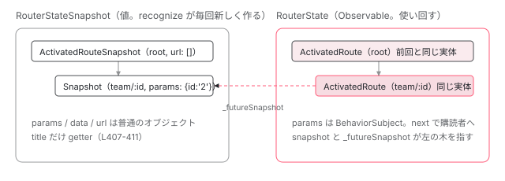

[目次](../README.md) › [Router の内側](README.md) › 第 14 回 / 全 21 回

# ActivatedRoute と ActivatedRouteSnapshot：2 つの木と advanceActivatedRoute

> RouterStateSnapshot と RouterState の違い。createRouterState が RouteReuseStrategy.shouldReuseRoute で ActivatedRoute を使い回す判定、\_futureSnapshot、advanceActivatedRoute が params / data の BehaviorSubject に値を流す条件（変わったときだけ）。

angular/angular · 読了 約 13 分 · 中核 · [サイトで読む（デモが動きます）](https://angular-deep-dive-cyan.vercel.app/chapter/router-router-state)

---

コンポーネントで `inject(ActivatedRoute)` して `route.params` を購読すると、`/team/1` から `/team/2` へ移動したときに**同じコンポーネントのまま**新しい値が届きます。一方で `route.snapshot.params` をコンストラクタで読んだ値は古いままです。この章では、Router が持つ **2 つの木**（値だけの `RouterStateSnapshot` と、Observable を持つ `RouterState`）を分け、`createRouterState` が `ActivatedRoute` を使い回す判定と、`advanceActivatedRoute` が `BehaviorSubject` に値を流す条件を、行番号を指して確認します。

読む対象は `packages/router/src/router_state.ts`、`create_router_state.ts`、`utils/tree.ts` です。

1. 1 本の RxJS パイプライン
2. URL → UrlTree
3. routerLink の配列 → UrlTree
4. Route 設定の検証と正規化
5. provideRouter の中身
6. 最初のナビゲーション
7. navigateByUrl → NavigationTransition
8. setupNavigations の全段
9. Recognizer と match
10. redirectTo
11. loadChildren と loadComponent
12. ガードの実行順
13. resolve と data と title
14. **ActivatedRoute と Snapshot**（この章）
15. RouterOutlet への配置
16. ブラウザの URL と履歴
17. Router.events の全種類
18. RouterLink と RouterLinkActive
19. withViewTransitions
20. withRouterResources
21. Navigation API

## 1. 2 つの木は同じ Tree クラスでできている

`RouterStateSnapshot` も `RouterState` も、`utils/tree.ts` の `Tree<T>` を継承しています。違いはノードの型だけです。前者は `ActivatedRouteSnapshot`（値）、後者は `ActivatedRoute`（Observable）です。

📄 `angular/packages/router/src/utils/tree.ts` L9–35 （▶ の行: 11, 17, 24–25, 32–33）

```ts
 9 │ export class Tree<T> {
10 │   /** @internal */
11 ▶   _root: TreeNode<T>;
12 │ 
13 │   constructor(root: TreeNode<T>) {
14 │     this._root = root;
15 │   }
16 │ 
17 ▶   get root(): T {
18 │     return this._root.value;
19 │   }
20 │ 
21 │   /**
22 │    * @internal
23 │    */
24 ▶   parent(t: T): T | null {
25 ▶     const p = this.pathFromRoot(t);
26 │     return p.length > 1 ? p[p.length - 2] : null;
27 │   }
28 │ 
29 │   /**
30 │    * @internal
31 │    */
32 ▶   children(t: T): T[] {
33 ▶     const n = findNode(t, this._root);
34 │     return n ? n.children.map((t) => t.value) : [];
35 │   }
```

📄 `angular/packages/router/src/utils/tree.ts` L91–115 （▶ の行: 91, 93–94, 103, 111）

```ts
 91 ▶ export class TreeNode<T> {
 92 │   constructor(
 93 ▶     public value: T,
 94 ▶     public children: TreeNode<T>[],
 95 │   ) {}
 96 │ 
 97 │   toString(): string {
 98 │     return `TreeNode(${this.value})`;
 99 │   }
100 │ }
101 │ 
102 │ // Return the list of T indexed by outlet name
103 ▶ export function nodeChildrenAsMap<T extends {outlet: string}>(
104 │   node: TreeNode<T> | null,
105 │ ): {
106 │   [outlet: string]: TreeNode<T>;
107 │ } {
108 │   const map: {[outlet: string]: TreeNode<T>} = {};
109 │ 
110 │   if (node) {
111 ▶     node.children.forEach((child) => (map[child.value.outlet] = child));
112 │   }
113 │ 
114 │   return map;
115 │ }
```

91〜95 行目、`TreeNode` は `value` と `children` の配列を持つだけです。11 行目の `_root` がその先頭です。24〜26 行目の `parent(t)` は、`pathFromRoot(t)`（根からそのノードまでの道）を取って最後から 2 番目を返します。33 行目の `findNode` は `value === node.value` という**同一性**で探します。つまり親子関係は「オブジェクトが木の中のどこにいるか」で決まり、ノード自身は親を知りません。

103〜115 行目の `nodeChildrenAsMap` は、子を `outlet` 名で引けるオブジェクトに変えます。[次章](15-router-activate-routes.md)の `ActivateRoutes` がこれで「同じ outlet の前後」を突き合わせます。

📄 `angular/packages/router/src/router_state.ts` L525–544 （▶ の行: 525, 529, 533, 541–543）

```ts
525 ▶ export class RouterStateSnapshot extends Tree<ActivatedRouteSnapshot> {
526 │   /** @internal */
527 │   constructor(
528 │     /** The url from which this snapshot was created */
529 ▶     public url: string,
530 │     root: TreeNode<ActivatedRouteSnapshot>,
531 │   ) {
532 │     super(root);
533 ▶     setRouterState(<RouterStateSnapshot>this, root);
534 │   }
535 │ 
536 │   override toString(): string {
537 │     return serializeNode(this._root);
538 │   }
539 │ }
540 │ 
541 ▶ function setRouterState<U, T extends {_routerState: U}>(state: U, node: TreeNode<T>): void {
542 ▶   node.value._routerState = state;
543 ▶   node.children.forEach((c) => setRouterState(state, c));
544 │ }
```

📄 `angular/packages/router/src/router_state.ts` L58–72 （▶ の行: 58, 63, 66）

```ts
58 ▶ export class RouterState extends Tree<ActivatedRoute> {
59 │   /** @internal */
60 │   constructor(
61 │     root: TreeNode<ActivatedRoute>,
62 │     /** The current snapshot of the router state */
63 ▶     public snapshot: RouterStateSnapshot,
64 │   ) {
65 │     super(root);
66 ▶     setRouterState(<RouterState>this, root);
67 │   }
68 │ 
69 │   override toString(): string {
70 │     return this.snapshot.toString();
71 │   }
72 │ }
```

525 行目、`RouterStateSnapshot` は `Tree<ActivatedRouteSnapshot>`。529 行目で作成元の `url` 文字列を持ちます。58 行目、`RouterState` は `Tree<ActivatedRoute>` で、63 行目に**自分と対になる `RouterStateSnapshot`** を持ちます。どちらもコンストラクタで `setRouterState`（541〜544 行目）を呼び、全ノードの `_routerState` に木そのものを書き込みます。各ノードの `parent` / `children` getter はこの `_routerState` 経由で `Tree` のメソッドを呼びます（3 節）。



*同じ Tree クラスから 2 本の木。Snapshot の木はナビゲーションごとに作り直され、ActivatedRoute の木は shouldReuseRoute が true のノードを前回から使い回す。*

## 2. ActivatedRouteSnapshot：その瞬間の値

📄 `angular/packages/router/src/router_state.ts` L385–411 （▶ の行: 387, 389, 391, 393, 399, 407–410）

```ts
385 │ export class ActivatedRouteSnapshot {
386 │   /** The configuration used to match this route **/
387 ▶   public readonly routeConfig: Route | null;
388 │   /** @internal */
389 ▶   _resolve: ResolveData;
390 │   /** @internal */
391 ▶   _resolvedData?: Data;
392 │   /** @internal */
393 ▶   _routerState!: RouterStateSnapshot;
394 │   /** @internal */
395 │   _paramMap?: ParamMap;
396 │   /** @internal */
397 │   _queryParamMap?: ParamMap;
398 │   /** @internal */
399 ▶   readonly _environmentInjector: EnvironmentInjector;
400 │   /**
401 │    * The result of running the route's resources function.
402 │    * @developerPreview 22.2
403 │    */
404 │   resources?: ResourceResult;
405 │ 
406 │   /** The resolved route title */
407 ▶   get title(): string | undefined {
408 ▶     // Note: This _must_ be a getter because the data is mutated in the resolvers. Title will not be
409 ▶     // available at the time of class instantiation.
410 ▶     return this.data?.[RouteTitleKey];
411 │   }
```

📄 `angular/packages/router/src/router_state.ts` L436–454 （▶ の行: 436, 438, 440, 442, 444, 446, 451–453）

```ts
436 ▶     public params: Params,
437 │     /** The query parameters shared by all the routes */
438 ▶     public queryParams: Params,
439 │     /** The URL fragment shared by all the routes */
440 ▶     public fragment: string | null,
441 │     /** The static and resolved data of this route */
442 ▶     public data: Data,
443 │     /** The outlet name of the route */
444 ▶     public outlet: string,
445 │     /** The component of the route */
446 ▶     public component: Type<any> | null,
447 │     routeConfig: Route | null,
448 │     resolve: ResolveData,
449 │     environmentInjector: EnvironmentInjector,
450 │   ) {
451 ▶     this.routeConfig = routeConfig;
452 ▶     this._resolve = resolve;
453 ▶     this._environmentInjector = environmentInjector;
454 │   }
```

436〜446 行目、`params` / `queryParams` / `fragment` / `data` / `outlet` / `component` は `public` なコンストラクタ引数で、そのままプロパティになります。すべて普通の値です。451 行目で `routeConfig`（照合に使われた `Route` オブジェクト）、452 行目で `_resolve`（resolver の設定）、453 行目で `_environmentInjector`（ガードや resolver を実行する injector。[11 章](11-router-lazy-loading.md)）を持ちます。

407〜411 行目の `title` だけが getter です。408〜409 行目のコメントが理由を書いています。**`data` は resolver の実行中に書き換えられる**ので、インスタンス生成時には title が無いからです。実際に書き換えている行を見ておきます。

📄 `angular/packages/router/src/operators/resolve_data.ts` L79–99 （▶ の行: 90, 93–94）

```ts
79 │ function runResolve(
80 │   futureARS: ActivatedRouteSnapshot,
81 │   futureRSS: RouterStateSnapshot,
82 │   paramsInheritanceStrategy: 'emptyOnly' | 'always',
83 │ ) {
84 │   const config = futureARS.routeConfig;
85 │   const resolve = futureARS._resolve;
86 │   if (config?.title !== undefined && !hasStaticTitle(config)) {
87 │     resolve[RouteTitleKey] = config.title;
88 │   }
89 │   return defer(() => {
90 ▶     futureARS.data = getInherited(futureARS, futureARS.parent, paramsInheritanceStrategy).resolve;
91 │     return resolveNode(resolve, futureARS, futureRSS).pipe(
92 │       map((resolvedData: any) => {
93 ▶         futureARS._resolvedData = resolvedData;
94 ▶         futureARS.data = {...futureARS.data, ...resolvedData};
95 │         return null;
96 │       }),
97 │     );
98 │   });
99 │ }
```

90 行目で親から継承した `data` を代入し、93〜94 行目で resolver の結果を `_resolvedData` と `data` に書き込みます。`ActivatedRouteSnapshot` は `readonly` ではなく、**パイプラインの途中で埋められていく器**です （resolver の中身は [13 章](13-router-resolvers.md)）。

📄 `angular/packages/router/src/router_state.ts` L481–489 （▶ の行: 482, 487）

```ts
481 │   get paramMap(): ParamMap {
482 ▶     this._paramMap ??= convertToParamMap(this.params);
483 │     return this._paramMap;
484 │   }
485 │ 
486 │   get queryParamMap(): ParamMap {
487 ▶     this._queryParamMap ??= convertToParamMap(this.queryParams);
488 │     return this._queryParamMap;
489 │   }
```

482 行目と 487 行目、`paramMap` / `queryParamMap` は `??=` で初回だけ `convertToParamMap` を呼び、結果を `_paramMap` にキャッシュします。snapshot は値が変わらないので、1 回作れば十分です。

## 3. ActivatedRoute：Observable を持つ側

📄 `angular/packages/router/src/router_state.ts` L129–163 （▶ の行: 129–131, 141, 143, 145, 152, 155, 157, 159, 161, 163）

```ts
129 ▶  * Note: the observables in this class only emit when the current and previous values differ based
130 ▶  * on shallow equality. For example, changing deeply nested properties in resolved `data` will not
131 ▶  * cause the `ActivatedRoute.data` `Observable` to emit a new value.
132 │  *
133 │  * {@example router/activated-route/activated_route_component.ts region="activated-route"}
134 │  *
135 │  * @see [Getting route information](guide/routing/common-router-tasks#getting-route-information)
136 │  *
137 │  * @publicApi
138 │  */
139 │ export class ActivatedRoute {
140 │   /** The current snapshot of this route */
141 ▶   snapshot!: ActivatedRouteSnapshot;
142 │   /** @internal */
143 ▶   _futureSnapshot: ActivatedRouteSnapshot;
144 │   /** @internal */
145 ▶   _routerState!: RouterState;
146 │   /** @internal */
147 │   _paramMap?: Observable<ParamMap>;
148 │   /** @internal */
149 │   _queryParamMap?: Observable<ParamMap>;
150 │ 
151 │   /** An Observable of the resolved route title */
152 ▶   readonly title: Observable<string | undefined>;
153 │ 
154 │   /** An observable of the URL segments matched by this route. */
155 ▶   public url: Observable<UrlSegment[]>;
156 │   /** An observable of the matrix parameters scoped to this route. */
157 ▶   public params: Observable<Params>;
158 │   /** An observable of the query parameters shared by all the routes. */
159 ▶   public queryParams: Observable<Params>;
160 │   /** An observable of the URL fragment shared by all the routes. */
161 ▶   public fragment: Observable<string | null>;
162 │   /** An observable of the static and resolved data of this route. */
163 ▶   public data: Observable<Data>;
```

📄 `angular/packages/router/src/router_state.ts` L204–230 （▶ の行: 207, 209, 215, 217, 219–220, 222–223, 225–226, 229）

```ts
204 │   /** @internal */
205 │   constructor(
206 │     /** @internal */
207 ▶     public urlSubject: BehaviorSubject<UrlSegment[]>,
208 │     /** @internal */
209 ▶     public paramsSubject: BehaviorSubject<Params>,
210 │     /** @internal */
211 │     public queryParamsSubject: BehaviorSubject<Params>,
212 │     /** @internal */
213 │     public fragmentSubject: BehaviorSubject<string | null>,
214 │     /** @internal */
215 ▶     public dataSubject: BehaviorSubject<Data>,
216 │     /** The outlet name of the route, a constant. */
217 ▶     public outlet: string,
218 │     /** The component of the route, a constant. */
219 ▶     public component: Type<any> | null,
220 ▶     futureSnapshot: ActivatedRouteSnapshot,
221 │   ) {
222 ▶     this._futureSnapshot = futureSnapshot;
223 ▶     this.title = this.dataSubject?.pipe(map((d: Data) => d[RouteTitleKey])) ?? of(undefined);
224 │     // TODO(atscott): Verify that these can be changed to `.asObservable()` with TGP.
225 ▶     this.url = urlSubject;
226 ▶     this.params = paramsSubject;
227 │     this.queryParams = queryParamsSubject;
228 │     this.fragment = fragmentSubject;
229 ▶     this.data = dataSubject;
230 │   }
```

1. **141 行目と 143 行目：`snapshot` と `_futureSnapshot`**

   1 つの `ActivatedRoute` が `ActivatedRouteSnapshot` を **2 つ**指します。`snapshot` は「今表示している状態」、`_futureSnapshot` は「次に有効になる状態」です。222 行目、コンストラクタでは `_futureSnapshot` だけが入り、`snapshot` は空です（`!` 付き宣言）。`snapshot` に値が入るのは 5 節の `advanceActivatedRoute` です。
2. **207〜215 行目：5 つの `BehaviorSubject`**

   `urlSubject` / `paramsSubject` / `queryParamsSubject` / `fragmentSubject` / `dataSubject`。225〜229 行目で、公開プロパティ `url` / `params` / `queryParams` / `fragment` / `data` に **同じオブジェクトをそのまま代入**しています（224 行目の TODO が「`asObservable()` にできるか確認中」と書いています）。型は `Observable` ですが、実体は `BehaviorSubject` です。だから購読した瞬間に現在値が 1 回届きます。
3. **223 行目：`title` は `data` から派生**

   `dataSubject.pipe(map(d => d[RouteTitleKey]))`。title 専用の Subject はなく、`data` が流れるたびに `Symbol('RouteTitle')` キーを取り出します。
4. **217 行目と 219 行目：`outlet` と `component` は定数**

   コメントに `a constant` とあるとおり、この 2 つは `ActivatedRoute` の一生で変わりません。変わるなら別の `ActivatedRoute` になります（4 節の判定）。

📄 `angular/packages/router/src/router_state.ts` L232–260 （▶ の行: 233–234, 238–239, 243–244, 258–259）

```ts
232 │   /** The configuration used to match this route. */
233 ▶   get routeConfig(): Route | null {
234 ▶     return this._futureSnapshot.routeConfig;
235 │   }
236 │ 
237 │   /** The root of the router state. */
238 ▶   get root(): ActivatedRoute {
239 ▶     return this._routerState.root;
240 │   }
241 │ 
242 │   /** The parent of this route in the router state tree. */
243 ▶   get parent(): ActivatedRoute | null {
244 ▶     return this._routerState.parent(this);
245 │   }
246 │ 
247 │   /** The first child of this route in the router state tree. */
248 │   get firstChild(): ActivatedRoute | null {
249 │     return this._routerState.firstChild(this);
250 │   }
251 │ 
252 │   /** The children of this route in the router state tree. */
253 │   get children(): ActivatedRoute[] {
254 │     return this._routerState.children(this);
255 │   }
256 │ 
257 │   /** The path from the root of the router state tree to this route. */
258 ▶   get pathFromRoot(): ActivatedRoute[] {
259 ▶     return this._routerState.pathFromRoot(this);
260 │   }
```

233〜234 行目、`routeConfig` は `_futureSnapshot` から読みます。`snapshot` ではありません。238〜259 行目の `root` / `parent` / `firstChild` / `children` / `pathFromRoot` は、1 節で見た `_routerState`（木）に自分を渡して位置を求めています。`ActivatedRoute` 自身は親へのポインタを持たず、**木の中での位置**が親子関係を決めます。

📄 `angular/packages/router/src/router_state.ts` L262–291 （▶ の行: 267–268, 284, 288–290）

```ts
262 │   /**
263 │    * An Observable that contains a map of the required and optional parameters
264 │    * specific to the route.
265 │    * The map supports retrieving single and multiple values from the same parameter.
266 │    */
267 ▶   get paramMap(): Observable<ParamMap> {
268 ▶     this._paramMap ??= this.params.pipe(map((p: Params): ParamMap => convertToParamMap(p)));
269 │     return this._paramMap;
270 │   }
271 │ 
272 │   /**
273 │    * An Observable that contains a map of the query parameters available to all routes.
274 │    * The map supports retrieving single and multiple values from the query parameter.
275 │    */
276 │   get queryParamMap(): Observable<ParamMap> {
277 │     this._queryParamMap ??= this.queryParams.pipe(
278 │       map((p: Params): ParamMap => convertToParamMap(p)),
279 │     );
280 │     return this._queryParamMap;
281 │   }
282 │ 
283 │   toString(): string {
284 ▶     return this.snapshot ? this.snapshot.toString() : `Future(${this._futureSnapshot})`;
285 │   }
286 │ 
287 │   /** @internal */
288 ▶   _setPending(snapshot: ActivatedRouteSnapshot): void {
289 ▶     this._futureSnapshot = snapshot;
290 ▶     this.pending?.set(true);
291 │   }
```

267〜270 行目、`paramMap` は `params.pipe(map(convertToParamMap))` を初回に作ってキャッシュします。snapshot 側（2 節 482 行目）は値をキャッシュしましたが、こちらは**派生 Observable**をキャッシュします。284 行目、`toString()` は `snapshot` が無いあいだ `Future(...)` と表示します。これが「まだ有効になっていない」状態です。

288〜291 行目の `_setPending(snapshot)` が、`_futureSnapshot` を差し替える唯一の入口です。次節の `createNode` から呼ばれます。

## 4. createRouterState：使い回すか、作るか

パイプラインの中で `RouterState` が作られる位置を確認します。resolver が終わり、コンポーネントの読み込みも終わった**後**、activate の**前**です。

📄 `angular/packages/router/src/navigation_transition.ts` L750–769 （▶ の行: 751–754, 761–762）

```ts
750 │           switchMap((t: NavigationTransition) => {
751 ▶             const {newlyCreatedRoutes, state} = createRouterState(
752 ▶               router.routeReuseStrategy,
753 ▶               t.targetSnapshot!,
754 ▶               t.currentRouterState,
755 │             );
756 │             this.currentTransition =
757 │               overallTransitionState =
758 │               t =
759 │                 {
760 │                   ...t,
761 ▶                   targetRouterState: state,
762 ▶                   newlyCreatedRoutes,
763 │                 };
764 │             this.currentNavigation.update((nav) => {
765 │               nav!.targetRouterState = state;
766 │               return nav;
767 │             });
768 │             return of(t);
769 │           }),
```

751〜755 行目、引数は `router.routeReuseStrategy`、今回の `targetSnapshot`（recognize の結果）、そして `t.currentRouterState`（**前回の**`RouterState`）です。761〜762 行目、戻り値の `state` と `newlyCreatedRoutes`（新規に作った `ActivatedRoute` の Set）を transition に載せます。

📄 `angular/packages/router/src/create_router_state.ts` L20–33 （▶ の行: 25–26, 28–29, 32）

```ts
20 │ export function createRouterState(
21 │   routeReuseStrategy: RouteReuseStrategy,
22 │   curr: RouterStateSnapshot,
23 │   prevState: RouterState,
24 │ ): {newlyCreatedRoutes: Set<ActivatedRoute>; state: RouterState} {
25 ▶   const newlyCreatedRoutes = new Set<ActivatedRoute>();
26 ▶   const root = createNode(
27 │     routeReuseStrategy,
28 ▶     curr._root,
29 ▶     prevState ? prevState._root : undefined,
30 │     newlyCreatedRoutes,
31 │   );
32 ▶   return {newlyCreatedRoutes, state: new RouterState(root, curr)};
33 │ }
```

26〜31 行目、根から `createNode` を再帰で呼びます。28 行目が新しい snapshot の根、29 行目が前回の `ActivatedRoute` の根です。32 行目、`new RouterState(root, curr)`。`curr` は `RouterStateSnapshot` なので、1 節 63 行目の `snapshot` プロパティに入ります。

📄 `angular/packages/router/src/create_router_state.ts` L35–69 （▶ の行: 42–46, 48, 50–51, 53, 61–64, 67）

```ts
35 │ function createNode(
36 │   routeReuseStrategy: RouteReuseStrategy,
37 │   curr: TreeNode<ActivatedRouteSnapshot>,
38 │   prevState: TreeNode<ActivatedRoute> | undefined,
39 │   newlyCreatedRoutes: Set<ActivatedRoute>,
40 │ ): TreeNode<ActivatedRoute> {
41 │   // reuse an activated route that is currently displayed on the screen
42 ▶   if (prevState && routeReuseStrategy.shouldReuseRoute(curr.value, prevState.value.snapshot)) {
43 ▶     const value = prevState.value;
44 ▶     value._setPending(curr.value);
45 ▶     const children = createOrReuseChildren(routeReuseStrategy, curr, prevState, newlyCreatedRoutes);
46 ▶     return new TreeNode<ActivatedRoute>(value, children);
47 │   } else {
48 ▶     if (routeReuseStrategy.shouldAttach(curr.value)) {
49 │       // retrieve an activated route that is used to be displayed, but is not currently displayed
50 ▶       const detachedRouteHandle = routeReuseStrategy.retrieve(curr.value);
51 ▶       if (detachedRouteHandle !== null) {
52 │         const tree = (detachedRouteHandle as DetachedRouteHandleInternal).route;
53 ▶         tree.value._setPending(curr.value);
54 │         tree.children = curr.children.map((c) =>
55 │           createNode(routeReuseStrategy, c, undefined, newlyCreatedRoutes),
56 │         );
57 │         return tree;
58 │       }
59 │     }
60 │ 
61 ▶     const value = createActivatedRoute(curr.value);
62 ▶     value._setPending(curr.value);
63 ▶     newlyCreatedRoutes.add(value);
64 ▶     const children = curr.children.map((c) =>
65 │       createNode(routeReuseStrategy, c, undefined, newlyCreatedRoutes),
66 │     );
67 ▶     return new TreeNode<ActivatedRoute>(value, children);
68 │   }
69 │ }
```

1. **42 行目：`shouldReuseRoute(curr.value, prevState.value.snapshot)`**

   前回のノードがあり（`prevState`）、`RouteReuseStrategy.shouldReuseRoute` が `true` なら使い回します。第 1 引数は新しい `ActivatedRouteSnapshot`、第 2 引数は前回の `ActivatedRoute` の `snapshot`（今表示中の値）です。既定の判定はこの直後に見ます。
2. **43〜44 行目：同じ `ActivatedRoute` に `_setPending`**

   `value` は**前回のインスタンスそのもの**です。`_setPending(curr.value)` で `_futureSnapshot` だけを新しい snapshot に差し替えます。`snapshot` と 5 つの `BehaviorSubject` はまだ前の値のままです。
3. **45〜46 行目：子を `createOrReuseChildren` で**

   親を使い回したときだけ、子も前回の子と突き合わせます（下の引用）。
4. **48〜58 行目：`shouldAttach` → `retrieve`**

   使い回せない場合でも、`RouteReuseStrategy` が過去に `store` した部分木を持っていれば （50 行目 `retrieve` が `null` 以外）、その `TreeNode<ActivatedRoute>` を取り出して使います（52〜57 行目）。既定の戦略では `shouldAttach` が常に `false` なので通りません。詳細は[次章](15-router-activate-routes.md)です。
5. **61〜67 行目：新しく作る**

   `createActivatedRoute(curr.value)` で新しい `ActivatedRoute` を作り、62 行目で `_setPending`、63 行目で `newlyCreatedRoutes` に登録します。64〜66 行目、子は `prevState` を `undefined` にして再帰するので、**親が新規なら子孫も全部新規**です。

📄 `angular/packages/router/src/create_router_state.ts` L71–98 （▶ の行: 77–80, 83, 88–90, 93, 96）

```ts
71 │ function createOrReuseChildren(
72 │   routeReuseStrategy: RouteReuseStrategy,
73 │   curr: TreeNode<ActivatedRouteSnapshot>,
74 │   prevState: TreeNode<ActivatedRoute>,
75 │   newlyCreatedRoutes: Set<ActivatedRoute>,
76 │ ) {
77 ▶   return curr.children.map((child) => {
78 ▶     for (const p of prevState.children) {
79 ▶       if (routeReuseStrategy.shouldReuseRoute(child.value, p.value.snapshot)) {
80 ▶         return createNode(routeReuseStrategy, child, p, newlyCreatedRoutes);
81 │       }
82 │     }
83 ▶     return createNode(routeReuseStrategy, child, undefined, newlyCreatedRoutes);
84 │   });
85 │ }
86 │ 
87 │ function createActivatedRoute(c: ActivatedRouteSnapshot) {
88 ▶   return new ActivatedRoute(
89 ▶     new BehaviorSubject(c.url),
90 ▶     new BehaviorSubject(c.params),
91 │     new BehaviorSubject(c.queryParams),
92 │     new BehaviorSubject(c.fragment),
93 ▶     new BehaviorSubject(c.data),
94 │     c.outlet,
95 │     c.component,
96 ▶     c,
97 │   );
98 │ }
```

77〜84 行目、新しい子それぞれについて、**前回の子を全部走査**して `shouldReuseRoute` が `true` になる最初の相手を探します（78〜81 行目）。outlet 名で引くのではなく、戦略に聞いています。見つからなければ 83 行目で新規です。

88〜97 行目、新規の `ActivatedRoute` は snapshot の値を**初期値にした**`BehaviorSubject` を 5 つ持って生まれます。96 行目、第 8 引数が `_futureSnapshot` です。この時点で `snapshot` は空です。

📄 `angular/packages/router/src/route_reuse_strategy.ts` L150–157 （▶ の行: 155–156）

```ts
150 │   /**
151 │    * Determines if a route should be reused.
152 │    * This strategy returns `true` when the future route config and current route config are
153 │    * identical.
154 │    */
155 ▶   shouldReuseRoute(future: ActivatedRouteSnapshot, curr: ActivatedRouteSnapshot): boolean {
156 ▶     return future.routeConfig === curr.routeConfig;
157 │   }
```

既定の `BaseRouteReuseStrategy.shouldReuseRoute`（`DefaultRouteReuseStrategy` はこれを継承するだけ）は 156 行目、**`future.routeConfig === curr.routeConfig`**。`Route` 設定オブジェクトが同一かどうか、それだけです。`params` が違っても、`queryParams` が違っても、同じ `{path: 'team/:id'}` にマッチしていれば使い回します。逆に、別の `Route` が同じコンポーネントを指していても、オブジェクトが違えば新規です。

## 5. advanceActivatedRoute：変わったものだけ next する

`_futureSnapshot` を `snapshot` に昇格させ、`BehaviorSubject` に値を流すのが `advanceActivatedRoute` です。呼び出し元は `ActivateRoutes` の 2 か所です。

📄 `angular/packages/router/src/operators/activate_routes.ts` L25–32 （▶ の行: 29–31）

```ts
25 │   activate(parentContexts: ChildrenOutletContexts): void {
26 │     const futureRoot = this.futureState._root;
27 │     const currRoot = this.currState ? this.currState._root : null;
28 │ 
29 ▶     this.deactivateChildRoutes(futureRoot, currRoot, parentContexts);
30 ▶     advanceActivatedRoute(this.futureState.root);
31 ▶     this.activateChildRoutes(futureRoot, currRoot, parentContexts);
32 │   }
```

📄 `angular/packages/router/src/operators/activate_routes.ts` L169–188 （▶ の行: 174, 177, 180, 183–184）

```ts
169 │   private activateRoutes(
170 │     futureNode: TreeNode<ActivatedRoute>,
171 │     currNode: TreeNode<ActivatedRoute>,
172 │     parentContexts: ChildrenOutletContexts,
173 │   ): void {
174 ▶     const future = futureNode.value;
175 │     const curr = currNode ? currNode.value : null;
176 │ 
177 ▶     advanceActivatedRoute(future);
178 │ 
179 │     // reusing the node
180 ▶     if (future === curr) {
181 │       if (future.component) {
182 │         // If we have a normal route, we need to go through an outlet.
183 ▶         const context = parentContexts.getOrCreateContext(future.outlet);
184 ▶         this.activateChildRoutes(futureNode, currNode, context.children);
185 │       } else {
186 │         // if we have a componentless route, we recurse but keep the same outlet map.
187 │         this.activateChildRoutes(futureNode, currNode, parentContexts);
188 │       }
```

30 行目で根を、177 行目で**子孫の各ノードを**、それぞれ 1 回ずつ。177 行目は `deactivate`（29 行目）が終わった後、かつ `future === curr` の判定（180 行目）や outlet への配置（[次章](15-router-activate-routes.md)）より**前**です。使い回されたノードなら、この行で購読者に新しい `params` が届きます。

📄 `angular/packages/router/src/router_state.ts` L551–582 （▶ の行: 557–562, 564, 567–568, 570, 573, 576–577, 580）

```ts
551 │ /**
552 │  * The expectation is that the activate route is created with the right set of parameters.
553 │  * So we push new values into the observables only when they are not the initial values.
554 │  * And we detect that by checking if the snapshot field is set.
555 │  */
556 │ export function advanceActivatedRoute(route: ActivatedRoute): void {
557 ▶   if (route.snapshot) {
558 ▶     const currentSnapshot = route.snapshot;
559 ▶     const nextSnapshot = route._futureSnapshot;
560 ▶     route.snapshot = nextSnapshot;
561 ▶     if (!shallowEqual(currentSnapshot.queryParams, nextSnapshot.queryParams)) {
562 ▶       route.queryParamsSubject.next(nextSnapshot.queryParams);
563 │     }
564 ▶     if (currentSnapshot.fragment !== nextSnapshot.fragment) {
565 │       route.fragmentSubject.next(nextSnapshot.fragment);
566 │     }
567 ▶     if (!shallowEqual(currentSnapshot.params, nextSnapshot.params)) {
568 ▶       route.paramsSubject.next(nextSnapshot.params);
569 │     }
570 ▶     if (!shallowEqualArrays(currentSnapshot.url, nextSnapshot.url)) {
571 │       route.urlSubject.next(nextSnapshot.url);
572 │     }
573 ▶     if (!shallowEqual(currentSnapshot.data, nextSnapshot.data)) {
574 │       route.dataSubject.next(nextSnapshot.data);
575 │     }
576 ▶   } else {
577 ▶     route.snapshot = route._futureSnapshot;
578 │ 
579 │     // this is for resolved data
580 ▶     route.dataSubject.next(route._futureSnapshot.data);
581 │   }
582 │ }
```

1. **557 行目：`route.snapshot` があるか**

   551〜555 行目のコメントどおり、「`snapshot` が入っているか」で初回かどうかを判定します。4 節で見たとおり、新規の `ActivatedRoute` は `snapshot` が空です。
2. **558〜560 行目：`_futureSnapshot` を `snapshot` に**

   `currentSnapshot`（古い）と `nextSnapshot`（新しい）を両方手元に置いてから、560 行目で差し替えます。**`route.snapshot` というプロパティが新しいオブジェクトを指す**のはこの行です。コンポーネントが以前に `route.snapshot` を変数に取っていたら、その変数は古いオブジェクトを指し続けます。
3. **561〜575 行目：5 つを順に比較して、違うものだけ `next`**

   順番は `queryParams`（561）→ `fragment`（564）→ `params`（567）→ `url`（570）→ `data`（573）。比較は `fragment` だけ `!==`、`url` は `shallowEqualArrays`、残り 3 つは `shallowEqual` です。**等しければ `next` しない**。だから `/team/1` → `/team/2` では `params` と `url` だけが流れ、`queryParams` の購読者には何も届きません。
4. **576〜581 行目：初回**

   `snapshot` を入れて、`dataSubject` だけ 1 回 `next` します（580 行目、コメントは「resolved data のため」）。他の 4 つは 4 節 88〜93 行目で初期値として入っているので流しません。

📄 `angular/packages/router/src/utils/collection.ts` L21–40 （▶ の行: 27–29, 35）

```ts
21 │ export function shallowEqual(
22 │   a: {[key: string | symbol]: any},
23 │   b: {[key: string | symbol]: any},
24 │ ): boolean {
25 │   // While `undefined` should never be possible, it would sometimes be the case in IE 11
26 │   // and pre-chromium Edge. The check below accounts for this edge case.
27 ▶   const k1 = a ? getDataKeys(a) : undefined;
28 ▶   const k2 = b ? getDataKeys(b) : undefined;
29 ▶   if (!k1 || !k2 || k1.length != k2.length) {
30 │     return false;
31 │   }
32 │   let key: string | symbol;
33 │   for (let i = 0; i < k1.length; i++) {
34 │     key = k1[i];
35 ▶     if (!equalArraysOrString(a[key], b[key])) {
36 │       return false;
37 │     }
38 │   }
39 │   return true;
40 │ }
```

27〜29 行目、キーの数（`symbol` キー込み）が違えば `false`。35 行目、各値を `equalArraysOrString` で比べます。配列なら要素をソートして比較、それ以外は `===` です。つまり `data` の中のオブジェクトを 1 段深く変えても、参照が同じなら `true`、参照が違えば `false` です。`ActivatedRoute` のドキュメント（129〜131 行目）が「shallow equality でしか emit しない」と書いているのは、この関数のことです。

> [!WARNING]
> **ハマりどころ**
>
> ガードと resolver を再実行しなかったとき、`data` は前回のオブジェクトがそのまま入ります。下の 135〜136 行目です。この場合 573 行目の `shallowEqual` は `true` になり、`data` は流れません。`runGuardsAndResolvers` の既定は `'paramsChange'` で、params が変われば再実行されます（[12 章](12-router-guards.md)）。

📄 `angular/packages/router/src/utils/preactivation.ts` L120–137 （▶ の行: 125, 131–132, 135–136）

```ts
120 │   const future = futureNode.value;
121 │   const curr = currNode ? currNode.value : null;
122 │   const context = parentContexts ? parentContexts.getContext(futureNode.value.outlet) : null;
123 │ 
124 │   // reusing the node
125 ▶   if (curr && future.routeConfig === curr.routeConfig) {
126 │     const shouldRun = shouldRunGuardsAndResolvers(
127 │       curr,
128 │       future,
129 │       future.routeConfig!.runGuardsAndResolvers,
130 │     );
131 ▶     if (shouldRun) {
132 ▶       checks.canActivateChecks.push(new CanActivate(futurePath));
133 │     } else {
134 │       // we need to set the data
135 ▶       future.data = curr.data;
136 ▶       future._resolvedData = curr._resolvedData;
137 │     }
```

> **🧪 DEMO — /team/1 から移動したとき、何が使い回され、何が流れるか**
>
> Route 設定は `{path: 'team/:id'}` と `{path: 'other'}` の 2 つ。createNode（create\_router\_state.ts L42 / L61）と advanceActivatedRoute（router\_state.ts L561-575）の比較規則をそのまま使っています。data はこのデモでは常に空なので L573 は出ません。
>
> ▶ [このデモはサイトで動かせます](https://angular-deep-dive-cyan.vercel.app/chapter/router-router-state)

## 6. Router.routerState が切り替わる瞬間と、失敗したときの後始末

📄 `angular/packages/router/src/router.ts` L125–130 （▶ の行: 128–129）

```ts
125 │   /**
126 │    * The current state of routing in this NgModule.
127 │    */
128 ▶   get routerState(): RouterState {
129 ▶     return this.stateManager.getRouterState();
130 │   }
```

📄 `angular/packages/router/src/statemanager/state_manager.ts` L103–121 （▶ の行: 103, 107, 110, 116）

```ts
103 ▶   protected commitTransition({targetRouterState, finalUrl, initialUrl}: Navigation): void {
104 │     // If we are committing the transition after having a final URL and target state, we're updating
105 │     // all pieces of the state. Otherwise, we likely skipped the transition (due to URL handling strategy)
106 │     // and only want to update the rawUrlTree, which represents the browser URL (and doesn't necessarily match router state).
107 ▶     if (finalUrl && targetRouterState) {
108 │       this.currentUrlTree = finalUrl;
109 │       this.rawUrlTree = this.urlHandlingStrategy.merge(finalUrl, initialUrl);
110 ▶       this.routerState = targetRouterState;
111 │     } else {
112 │       this.rawUrlTree = initialUrl;
113 │     }
114 │   }
115 │ 
116 ▶   protected routerState = createEmptyState(null, inject(EnvironmentInjector));
117 │ 
118 │   /** Returns the current RouterState. */
119 │   getRouterState(): RouterState {
120 │     return this.routerState;
121 │   }
```

128〜129 行目、`Router.routerState` は `StateManager.getRouterState()` の委譲です。その中身を書き換えるのが 103 行目の `commitTransition` で、110 行目で `targetRouterState`（4 節で作った木）を入れます。呼ばれるのは `BeforeActivateRoutes` イベントのとき（[16 章](16-router-browser-url.md)）、つまり `ActivateRoutes` が走る直前です。したがって**`router.routerState` は新しい木を指しているのに、各 `ActivatedRoute.snapshot` はまだ古い**という短い区間が、`BeforeActivateRoutes` から 5 節 177 行目までの間にあります。116 行目、起動直後の初期値は `createEmptyState(null, injector)` です。

📄 `angular/packages/router/src/router_state.ts` L74–96 （▶ の行: 78–80, 84, 90, 94–95）

```ts
74 │ export function createEmptyState(
75 │   rootComponent: Type<any> | null,
76 │   injector: EnvironmentInjector,
77 │ ): RouterState {
78 ▶   const snapshot = createEmptyStateSnapshot(rootComponent, injector);
79 ▶   const emptyUrl = new BehaviorSubject([new UrlSegment('', {})]);
80 ▶   const emptyParams = new BehaviorSubject({});
81 │   const emptyData = new BehaviorSubject({});
82 │   const emptyQueryParams = new BehaviorSubject({});
83 │   const fragment = new BehaviorSubject<string | null>('');
84 ▶   const activated = new ActivatedRoute(
85 │     emptyUrl,
86 │     emptyParams,
87 │     emptyQueryParams,
88 │     fragment,
89 │     emptyData,
90 ▶     PRIMARY_OUTLET,
91 │     rootComponent,
92 │     snapshot.root,
93 │   );
94 ▶   activated.snapshot = snapshot.root;
95 ▶   return new RouterState(new TreeNode<ActivatedRoute>(activated, []), snapshot);
96 │ }
```

78〜95 行目、空の `RouterState` は root 1 ノードだけで、`url` は `[new UrlSegment('', {})]`、`outlet` は `PRIMARY_OUTLET`（`'primary'`）。94 行目で `snapshot` も入れているので、最初のナビゲーションで root は 557 行目の「`snapshot` あり」側に入り、root の `routeConfig` は `null === null` で使い回されます。root の `ActivatedRoute` はアプリの一生で 1 つです。

📄 `angular/packages/router/src/navigation_transition.ts` L1057–1074 （▶ の行: 1057–1059, 1062, 1065, 1070）

```ts
1057 ▶ function rollbackState(t: NavigationTransition): void {
1058 ▶   for (const r of t.newlyCreatedRoutes ?? []) {
1059 ▶     r._localInjector?.destroy();
1060 │     r._localInjector = undefined;
1061 │   }
1062 ▶   resetPendingRoutes(t.targetRouterState);
1063 │ }
1064 │ 
1065 ▶ function resetPendingRoutes(targetRouterState?: RouterState | null): void {
1066 │   if (!targetRouterState) {
1067 │     return;
1068 │   }
1069 │   const traverse = (node: TreeNode<ActivatedRoute>) => {
1070 ▶     node.value.pending?.set(false);
1071 │     node.children.forEach(traverse);
1072 │   };
1073 │   traverse(targetRouterState._root);
1074 │ }
```

ナビゲーションがキャンセル・失敗したとき（`cancelNavigationTransition` と `catchError` から）、1057 行目の `rollbackState` が呼ばれます。1058〜1061 行目、`newlyCreatedRoutes` に登録された新規 `ActivatedRoute` の `_localInjector` を破棄し、1062 行目で `pending` シグナルを `false` に戻します。使い回された `ActivatedRoute` の `_futureSnapshot` は書き戻されません。`snapshot` は昇格していないので、購読者から見える値は変わっていません。

> [!NOTE]
> **さらに深く**
>
> `ActivatedRoute` には `paramsSignal` などの Signal 版の内部フィールドもあります（3 節の引用の下に並んでいます）。これらを初期化する `initializeActivatedRoute` と、その唯一の呼び出し元を見ておきます。

📄 `angular/packages/router/src/router_state.ts` L584–617 （▶ の行: 585, 589–590, 592–593, 613–615）

```ts
584 │ export function initializeActivatedRoute(route: ActivatedRoute): void {
585 ▶   if (route.paramsSignal !== undefined) {
586 │     return;
587 │   }
588 │   const writableRoute = route as Writable<ActivatedRoute>;
589 ▶   const pendingSignal = signal(false);
590 ▶   writableRoute.pending = pendingSignal;
591 │ 
592 ▶   writableRoute.paramsSignal = computed(() =>
593 ▶     pendingSignal() || !route.snapshot ? route._futureSnapshot.params : route.snapshot.params,
594 │   );
595 │ 
596 │   writableRoute.queryParamsSignal = computed(() =>
597 │     pendingSignal() || !route.snapshot
598 │       ? route._futureSnapshot.queryParams
599 │       : route.snapshot.queryParams,
600 │   );
601 │ 
602 │   writableRoute.paramMapSignal = computed(() => convertToParamMap(route.paramsSignal()));
603 │   writableRoute.queryParamMapSignal = computed(() => convertToParamMap(route.queryParamsSignal()));
604 │ 
605 │   writableRoute.fragmentSignal = computed(() =>
606 │     pendingSignal() || !route.snapshot ? route._futureSnapshot.fragment : route.snapshot.fragment,
607 │   );
608 │ 
609 │   writableRoute.dataSignal = computed(() =>
610 │     pendingSignal() || !route.snapshot ? route._futureSnapshot.data : route.snapshot.data,
611 │   );
612 │ 
613 ▶   writableRoute._setPending = (snapshot: ActivatedRouteSnapshot) => {
614 ▶     route._futureSnapshot = snapshot;
615 ▶     pendingSignal.set(true);
616 │   };
617 │ }
```

📄 `angular/packages/router/src/operators/setup_and_run_resources.ts` L40–50 （▶ の行: 43）

```ts
40 │       const traverse = (stateNode: TreeNode<ActivatedRoute>) => {
41 │         const route = stateNode.value;
42 │         if (route) {
43 ▶           initializeActivatedRoute(route);
44 │           processRoute(
45 │             route,
46 │             newlyCreatedRoutes,
47 │             resourceSetupPromises,
48 │             abortSignal,
49 │             blockingResourcePromises,
50 │           );
```

585 行目、一度初期化したら何もしません。589〜590 行目で `pending` シグナルを作り、592〜594 行目の `computed` は `pending` が `true` なら `_futureSnapshot`、そうでなければ `snapshot` の値を返します。613〜616 行目で `_setPending` を差し替え、`_futureSnapshot` を入れると同時に `pending` を立てるようにします。呼び出し元は `operators/setup_and_run_resources.ts` の 43 行目だけ、つまり **`withRouterResources()` を使ったときにだけ** Signal 版が作られます。[20 章](20-router-resources.md)で扱います。

## ここまでの呼び出し

- `setupNavigations` の switchMap — router/src/navigation\_transition.ts L750 — *resolver・コンポーネント読み込みの後*
  - `createRouterState(routeReuseStrategy, targetSnapshot, currentRouterState)` — create\_router\_state.ts L20
    - `createNode(strategy, curr._root, prev._root, newlyCreatedRoutes)` — create\_router\_state.ts L35
      - `strategy.shouldReuseRoute(curr.value, prev.value.snapshot)` — route\_reuse\_strategy.ts L155 — *routeConfig ===*
      - `value._setPending(curr.value)` — router\_state.ts L288 — *\_futureSnapshot を差し替え*
      - `createOrReuseChildren(...)` → 子ごとに `createNode` — create\_router\_state.ts L71
      - `createActivatedRoute(c)`（使い回せないとき） — create\_router\_state.ts L87 — *5 つの BehaviorSubject を新規に*
    - `new RouterState(root, curr)` — router\_state.ts L60 — *setRouterState で全ノードに木を書く*
- `events.next(new BeforeActivateRoutes())` — navigation\_transition.ts L797
  - `HistoryStateManager.commitTransition` — statemanager/state\_manager.ts L103 — *routerState = targetRouterState（L110）*
- `new ActivateRoutes(...).activate(rootContexts)` — navigation\_transition.ts L803
  - `advanceActivatedRoute(futureState.root)` — operators/activate\_routes.ts L30
  - `activateRoutes(futureNode, currNode, contexts)` → `advanceActivatedRoute(future)` — operators/activate\_routes.ts L177
    - `route.snapshot = nextSnapshot` — router\_state.ts L560
    - `paramsSubject.next(...)`（shallowEqual が false のときだけ） — router\_state.ts L568
      - 👤 `route.params.subscribe(p => ...)` のコールバック — あなたのコンポーネント — *同期的に呼ばれる*

## 聞かれそうな質問

**Q. ActivatedRoute.params を購読していると同じコンポーネントで値が更新されるのはなぜですか？新しいインスタンスにならないのはなぜですか？**

`createNode`（create\_router\_state.ts 42 行目）が `shouldReuseRoute` を呼び、既定の実装（route\_reuse\_strategy.ts 156 行目）は `routeConfig` の同一性だけを見ます。`/team/1` と `/team/2` は同じ `Route` にマッチするので、43〜44 行目で**前回の `ActivatedRoute` インスタンス**が使われ、`_futureSnapshot` だけが差し替わります。その後 `ActivateRoutes.activateRoutes`（activate\_routes.ts 177 行目）が `advanceActivatedRoute` を呼び、router\_state.ts 567〜569 行目で `params` が変わっていれば `paramsSubject.next`。コンポーネントが作り直されないのは、activate\_routes.ts 180 行目で `future === curr` が `true` になり、outlet の `activateWith` を通らないからです（[次章](15-router-activate-routes.md)）。

**Q. snapshot と Observable、どちらを使うべきですか？snapshot が古くなるのはどんなときですか？**

`route.snapshot` というプロパティ自体は、ナビゲーションごとに router\_state.ts 560 行目で新しいオブジェクトに差し替わります。古くなるのは、**コンストラクタや `ngOnInit` で `route.snapshot.params.id` を読んで変数に保存した場合**です。同じコンポーネントが使い回されると（上の質問）、その変数は更新されません。同じ `Route` に params 違いで移動する可能性があるなら Observable（または `paramMap`）を購読します。一度表示されたら params が変わらない画面なら snapshot で足ります。

**Q. data の中のオブジェクトのプロパティだけ変えたのに data が流れません**

router\_state.ts 573 行目の比較は `shallowEqual`（utils/collection.ts 21〜40 行目）です。キーの数が同じで、各値が `===`（配列ならソート後に要素一致）なら等しいと判定し、`next` しません。ネストしたオブジェクトの中身は見ません。`ActivatedRoute` のドキュメント（129〜131 行目）にも明記されています。また preactivation.ts 135 行目のとおり、ガードと resolver を再実行しないときは前回と**同じ `data` オブジェクト**が入ります。

**Q. 同じコンポーネントを 2 つの Route（path 'a' と 'b'）に指定しています。a → b で ActivatedRoute は使い回されますか？**

されません。route\_reuse\_strategy.ts 156 行目は `Route` オブジェクトの同一性を見るので、別の設定オブジェクトなら `false` です。create\_router\_state.ts 61〜63 行目で新しい `ActivatedRoute` が作られ、`newlyCreatedRoutes` に入ります。コンポーネントも destroy して作り直されます。使い回したいなら `RouteReuseStrategy` を provide して `shouldReuseRoute` を上書きします。

**Q. queryParams を変えただけなのに、親ルートの ActivatedRoute でも queryParams が流れます。なぜですか？**

`queryParams` は URL 全体で 1 つですが、各 `ActivatedRouteSnapshot` が自分のプロパティとして持っています（router\_state.ts 438 行目）。`ActivateRoutes` は根（activate\_routes.ts 30 行目）も子孫（177 行目）も 1 回ずつ `advanceActivatedRoute` を呼び、router\_state.ts 561 行目の比較は各ノードで独立に走ります。だから使い回された**全ノード**の `queryParamsSubject` が `next` します。

**Q. Router.routerState と、コンポーネントが持つ ActivatedRoute.snapshot はいつもずれていませんか？**

ナビゲーションの最中だけずれます。`Router.routerState`（router.ts 128〜129 行目）は `StateManager.routerState` で、`BeforeActivateRoutes` イベント時の `commitTransition`（state\_manager.ts 110 行目）で新しい木に切り替わります。各 `ActivatedRoute.snapshot` はその直後の `ActivateRoutes`（activate\_routes.ts 30・177 行目 → router\_state.ts 560 行目）で昇格します。両方とも同じ `tap` の中で同期的に進むので、ナビゲーションが終わった時点では一致しています。

## 読み終えて

- `RouterStateSnapshot`（値）と `RouterState`（Observable）は同じ `Tree` クラスの 2 本の木。`ActivatedRoute` は `snapshot` と `_futureSnapshot` の 2 つで Snapshot 側を指す
- `createRouterState`（create\_router\_state.ts L42）は `shouldReuseRoute`、既定は `routeConfig ===`。true なら前回の `ActivatedRoute` インスタンスに `_setPending` するだけ
- `advanceActivatedRoute`（router\_state.ts L556-582）は `snapshot` を昇格させ、queryParams → fragment → params → url → data の順に `shallowEqual` で比べて、違うものだけ `next`
- 5 つの公開 Observable の実体は `BehaviorSubject` そのもの（L225-229）。購読した瞬間に現在値が届く
- `Router.routerState` は `BeforeActivateRoutes` で切り替わり、各ノードの `snapshot` は直後の `ActivateRoutes` で追いつく

---

← 前: [resolve と data と title：resolveData が ActivatedRouteSnapshot を埋める手順](13-router-resolvers.md)  
次: [RouterOutlet にコンポーネントが置かれる：ActivateRoutes と ChildrenOutletContexts](15-router-activate-routes.md) →
