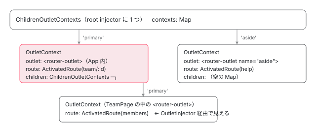

[目次](../README.md) › [Router の内側](README.md) › 第 15 回 / 全 21 回

# RouterOutlet にコンポーネントが置かれる：ActivateRoutes と ChildrenOutletContexts

> ActivateRoutes.activate → deactivateChildRoutes → activateChildRoutes → activateRoutes。ChildrenOutletContexts / OutletContext の木、RouterOutlet.activateWith の OutletInjector、deactivate の destroy、shouldDetach / store / retrieve による detach と attach、ActivationStart / End。

angular/angular · 読了 約 15 分 · 中核 · [サイトで読む（デモが動きます）](https://angular-deep-dive-cyan.vercel.app/chapter/router-activate-routes)

---

`<router-outlet>` は、自分がどのコンポーネントを表示すべきかをどうやって知るのでしょうか。テンプレートに書くのはタグ 1 つで、Route 設定も `ActivatedRoute` も渡していません。この章では、ナビゲーションの最後に走る `ActivateRoutes` が、古い木と新しい木を **outlet 名で突き合わせ**、不要になった枝を `deactivate`（destroy か detach）し、新しい枝を `activate`（create か attach）する手順を追います。その橋渡しをする `ChildrenOutletContexts` / `OutletContext` の木と、`RouteReuseStrategy` の 4 メソッドが主役です。

読む対象は `packages/router/src/operators/activate_routes.ts`、`router_outlet_context.ts`、`directives/router_outlet.ts`、`route_reuse_strategy.ts` です。`ViewContainerRef.createComponent` の中身は [ViewContainer の章](../template/04-view-container.md)と [boot-spa-navigation の 5 節](../boot/13-boot-spa-navigation.md)で読んだので、ここでは繰り返しません。

1. 1 本の RxJS パイプライン
2. URL → UrlTree
3. routerLink の配列 → UrlTree
4. Route 設定の検証と正規化
5. provideRouter の中身
6. 最初のナビゲーション
7. navigateByUrl → NavigationTransition
8. setupNavigations の全段
9. Recognizer と match
10. redirectTo
11. loadChildren と loadComponent
12. ガードの実行順
13. resolve と data と title
14. ActivatedRoute と Snapshot
15. **RouterOutlet への配置**（この章）
16. ブラウザの URL と履歴
17. Router.events の全種類
18. RouterLink と RouterLinkActive
19. withViewTransitions
20. withRouterResources
21. Navigation API

## 1. OutletContext の木：outlet と ActivatedRoute を結ぶ場所

`RouterState`（[前章](14-router-router-state.md)）は `ActivatedRoute` の木でした。それとは別に、**「どの `<router-outlet>` が今どの `ActivatedRoute` を表示しているか」**を記録する木があります。

📄 `angular/packages/router/src/router_outlet_context.ts` L19–39 （▶ の行: 19–25, 29, 36–37）

```ts
19 ▶ export class OutletContext {
20 ▶   outlet: RouterOutletContract | null = null;
21 ▶   route: ActivatedRoute | null = null;
22 ▶   children: ChildrenOutletContexts;
23 ▶   attachRef: ComponentRef<any> | null = null;
24 ▶   get injector(): EnvironmentInjector {
25 ▶     return this.route?.snapshot._environmentInjector ?? this.rootInjector;
26 │   }
27 │ 
28 │   constructor(private readonly rootInjector: EnvironmentInjector) {
29 ▶     this.children = new ChildrenOutletContexts(this.rootInjector);
30 │   }
31 │ 
32 │   /**
33 │    * Replaces `children` with a fresh instance, keeping the same root injector.
34 │    * @internal
35 │    */
36 ▶   resetChildren(): void {
37 ▶     this.children = new ChildrenOutletContexts(this.rootInjector);
38 │   }
39 │ }
```

`OutletContext` は 1 つの outlet 名に対応する箱です。4 つのフィールドを持ちます。

1. **20 行目：`outlet`**

   そこにいる `RouterOutlet` ディレクティブのインスタンス。まだ DOM に無ければ `null` です。
2. **21 行目：`route`**

   その outlet に表示すべき（または表示中の）`ActivatedRoute`。`ActivateRoutes` が書き込みます（5 節）。
3. **22 行目と 29 行目：`children`**

   その outlet に表示されたコンポーネントの**内側**にある outlet 群を管理する `ChildrenOutletContexts`。ここで木が 1 段深くなります。36〜38 行目の `resetChildren` は detach 時に新品に差し替えます（4 節）。
4. **23 行目：`attachRef`**

   `RouteReuseStrategy` で取り出した `ComponentRef` を一時的に置く場所。outlet がまだ無いときに「あとで attach してほしい」と伝えるために使います（2 節 303〜305 行目）。
5. **24〜26 行目：`injector` getter**

   `route.snapshot._environmentInjector`、無ければ root の `EnvironmentInjector`。lazy load した Route なら、その `Route` 用に作られた injector です（[11 章](11-router-lazy-loading.md)）。これが 6 節で `createComponent` の `environmentInjector` に渡ります。

📄 `angular/packages/router/src/router_outlet_context.ts` L46–62 （▶ の行: 46–47, 52, 55, 58–61）

```ts
46 ▶ @Injectable({providedIn: 'root'})
47 ▶ export class ChildrenOutletContexts {
48 │   /**
49 │    * Contexts for child outlets, keyed by outlet name.
50 │    * @internal
51 │    */
52 ▶   contexts = new Map<string, OutletContext>();
53 │ 
54 │   /** @docs-private */
55 ▶   constructor(private rootInjector: EnvironmentInjector) {}
56 │ 
57 │   /** Called when a `RouterOutlet` directive is instantiated */
58 ▶   onChildOutletCreated(childName: string, outlet: RouterOutletContract): void {
59 ▶     const context = this.getOrCreateContext(childName);
60 ▶     context.outlet = outlet;
61 ▶     this.contexts.set(childName, context);
62 │   }
```

46〜47 行目、`ChildrenOutletContexts` は `providedIn: 'root'` です。アプリの root injector に 1 つあり、それが木の**根**（`NavigationTransitions.rootContexts`）です。52 行目、中身は `Map<string, OutletContext>`、キーは **outlet 名**です。58〜62 行目の `onChildOutletCreated(name, outlet)` は、`getOrCreateContext` で箱を用意して `outlet` を入れます。呼び出し元は `RouterOutlet.ngOnInit` です（2 節）。

📄 `angular/packages/router/src/router_outlet_context.ts` L64–89 （▶ の行: 69, 72–73, 81–84, 87–88）

```ts
64 │   /**
65 │    * Called when a `RouterOutlet` directive is destroyed.
66 │    * We need to keep the context as the outlet could be destroyed inside a NgIf and might be
67 │    * re-created later.
68 │    */
69 ▶   onChildOutletDestroyed(childName: string): void {
70 │     const context = this.getContext(childName);
71 │     if (context) {
72 ▶       context.outlet = null;
73 ▶       context.attachRef = null;
74 │     }
75 │   }
76 │ 
77 │   /**
78 │    * Called when the corresponding route is deactivated during navigation.
79 │    * Because the component get destroyed, all children outlet are destroyed.
80 │    */
81 ▶   onOutletDeactivated(): Map<string, OutletContext> {
82 ▶     const contexts = this.contexts;
83 ▶     this.contexts = new Map();
84 ▶     return contexts;
85 │   }
86 │ 
87 ▶   onOutletReAttached(contexts: Map<string, OutletContext>): void {
88 ▶     this.contexts = contexts;
89 │   }
```

📄 `angular/packages/router/src/router_outlet_context.ts` L91–105 （▶ の行: 94–96, 103）

```ts
 91 │   getOrCreateContext(childName: string): OutletContext {
 92 │     let context = this.getContext(childName);
 93 │ 
 94 ▶     if (!context) {
 95 ▶       context = new OutletContext(this.rootInjector);
 96 ▶       this.contexts.set(childName, context);
 97 │     }
 98 │ 
 99 │     return context;
100 │   }
101 │ 
102 │   getContext(childName: string): OutletContext | null {
103 ▶     return this.contexts.get(childName) || null;
104 │   }
105 │ }
```

69〜75 行目、outlet が `ngOnDestroy` されても `OutletContext` は**消しません**。65〜67 行目のコメントどおり、`@if` の中の outlet が再生成されたときに同じ箱へ戻れるようにするためです。`outlet` と `attachRef` だけを `null` にします。81〜85 行目の `onOutletDeactivated` は Map を新品に入れ替え、古い Map を返します。87〜89 行目の `onOutletReAttached` はその逆で、保存していた Map を戻します。この 2 つが detach / attach で部分木を丸ごと退避・復元する仕組みです（4〜5 節）。



*ChildrenOutletContexts（根は providedIn root）→ Map(name → OutletContext) → children で 1 段深く。各 OutletContext が outlet と route を結ぶ。*

## 2. RouterOutlet は ngOnInit で自分を登録する

📄 `angular/packages/router/src/directives/router_outlet.ts` L226–253 （▶ の行: 226, 228–229, 234, 239, 248–251）

```ts
226 ▶   @Input() name = PRIMARY_OUTLET;
227 │ 
228 ▶   @Output('activate') activateEvents = new EventEmitter<any>();
229 ▶   @Output('deactivate') deactivateEvents = new EventEmitter<any>();
230 │   /**
231 │    * Emits an attached component instance when the `RouteReuseStrategy` instructs to re-attach a
232 │    * previously detached subtree.
233 │    **/
234 ▶   @Output('attach') attachEvents = new EventEmitter<unknown>();
235 │   /**
236 │    * Emits a detached component instance when the `RouteReuseStrategy` instructs to detach the
237 │    * subtree.
238 │    */
239 ▶   @Output('detach') detachEvents = new EventEmitter<unknown>();
240 │ 
241 │   /**
242 │    * Data that will be provided to the child injector through the `ROUTER_OUTLET_DATA` token.
243 │    *
244 │    * When unset, the value of the token is `undefined` by default.
245 │    */
246 │   readonly routerOutletData = input<unknown>();
247 │ 
248 ▶   private parentContexts = inject(ChildrenOutletContexts);
249 ▶   private location = inject(ViewContainerRef);
250 ▶   private changeDetector = inject(ChangeDetectorRef);
251 ▶   private inputBinder = inject(INPUT_BINDER, {optional: true});
252 │   /** @docs-private */
253 │   readonly supportsBindingToComponentInputs = true;
```

226 行目、`name` の既定値は `PRIMARY_OUTLET`（文字列 `'primary'`）。`<router-outlet>` と書けば `'primary'`、`name="aside"` と書けば `'aside'` がキーになります。228〜239 行目、`activate` / `deactivate` / `attach` / `detach` の 4 つの `@Output`。6 節の 4 操作と 1 対 1 です。

248 行目、**`parentContexts = inject(ChildrenOutletContexts)`**。App コンポーネント直下の outlet なら root の（1 節 46 行目の）インスタンスが返ります。ルーティングされたコンポーネントの中の outlet なら、6 節で見る `OutletInjector` が**その outlet 用の `children`** を返します。この 1 行で木が繋がります。249 行目の `location` は `<router-outlet>` の位置の `ViewContainerRef`、251 行目の `inputBinder` は `withComponentInputBinding()` を使ったときだけ入ります（8 節）。

📄 `angular/packages/router/src/directives/router_outlet.ts` L288–311 （▶ の行: 289–290, 294–295, 301–303, 305, 308）

```ts
288 │   /** @docs-private */
289 ▶   ngOnInit(): void {
290 ▶     this.initializeOutletWithName();
291 │   }
292 │ 
293 │   private initializeOutletWithName() {
294 ▶     this.parentContexts.onChildOutletCreated(this.name, this);
295 ▶     if (this.activated) {
296 │       return;
297 │     }
298 │ 
299 │     // If the outlet was not instantiated at the time the route got activated we need to populate
300 │     // the outlet when it is initialized (ie inside a NgIf)
301 ▶     const context = this.parentContexts.getContext(this.name);
302 ▶     if (context?.route) {
303 ▶       if (context.attachRef) {
304 │         // `attachRef` is populated when there is an existing component to mount
305 ▶         this.attach(context.attachRef, context.route);
306 │       } else {
307 │         // otherwise the component defined in the configuration is created
308 ▶         this.activateWith(context.route, context.injector);
309 │       }
310 │     }
311 │   }
```

1. **294 行目：`onChildOutletCreated(this.name, this)`**

   1 節 58 行目へ。自分の名前の `OutletContext` に `outlet = this` が入ります。
2. **301〜302 行目：すでに `route` が書かれているか**

   `ActivateRoutes` が先に走って `context.route` を書いていたのに、outlet が `@if` の中などでまだ存在しなかった場合です （299〜300 行目のコメント）。
3. **303〜309 行目：`attach` か `activateWith`**

   `attachRef` があれば退避済みコンポーネントを `attach`、無ければ `activateWith(context.route, context.injector)` で新規作成。5 節で `ActivateRoutes` がやるのと同じ 2 択を、outlet 自身が遅れて実行します。

📄 `angular/packages/router/src/directives/router_outlet.ts` L275–286 （▶ の行: 278–279, 281, 285）

```ts
275 │   /** @docs-private */
276 │   ngOnDestroy(): void {
277 │     // Ensure that the registered outlet is this one before removing it on the context.
278 ▶     if (this.isTrackedInParentContexts(this.name)) {
279 ▶       this.parentContexts.onChildOutletDestroyed(this.name);
280 │     }
281 ▶     this.inputBinder?.unsubscribeFromRouteData(this);
282 │   }
283 │ 
284 │   private isTrackedInParentContexts(outletName: string) {
285 ▶     return this.parentContexts.getContext(outletName)?.outlet === this;
286 │   }
```

278〜280 行目、`ngOnDestroy` では「登録されている outlet が自分か」（285 行目、`=== this`）を確かめてから `onChildOutletDestroyed` を呼びます。同じ名前の outlet が入れ替わるときに、新しい方の登録を消さないためです。

## 3. ActivateRoutes.activate：deactivate してから activate

📄 `angular/packages/router/src/navigation_transition.ts` L802–812 （▶ の行: 803–809）

```ts
802 │           tap((t: NavigationTransition) => {
803 ▶             new ActivateRoutes(
804 ▶               router.routeReuseStrategy,
805 ▶               overallTransitionState.targetRouterState!,
806 ▶               overallTransitionState.currentRouterState,
807 ▶               (evt: Event) => this.events.next(evt),
808 ▶               this.inputBindingEnabled,
809 ▶             ).activate(this.rootContexts);
810 │ 
811 │             // Prevent any cleanup of newly created routes once activated.
812 │             t.newlyCreatedRoutes?.clear();
```

803〜809 行目、ナビゲーションごとに `new ActivateRoutes(...)`。引数は `RouteReuseStrategy`、新しい `RouterState`、現在の `RouterState`、イベント転送関数（[17 章](17-router-events.md)）、input binding の有無。809 行目で **root の `ChildrenOutletContexts`** を渡して `activate` します。

📄 `angular/packages/router/src/operators/activate_routes.ts` L16–32 （▶ の行: 26–27, 29–31）

```ts
16 │ export class ActivateRoutes {
17 │   constructor(
18 │     private routeReuseStrategy: RouteReuseStrategy,
19 │     private futureState: RouterState,
20 │     private currState: RouterState,
21 │     private forwardEvent: (evt: Event) => void,
22 │     private inputBindingEnabled: boolean,
23 │   ) {}
24 │ 
25 │   activate(parentContexts: ChildrenOutletContexts): void {
26 ▶     const futureRoot = this.futureState._root;
27 ▶     const currRoot = this.currState ? this.currState._root : null;
28 │ 
29 ▶     this.deactivateChildRoutes(futureRoot, currRoot, parentContexts);
30 ▶     advanceActivatedRoute(this.futureState.root);
31 ▶     this.activateChildRoutes(futureRoot, currRoot, parentContexts);
32 │   }
```

26〜27 行目、2 本の木の根（`TreeNode<ActivatedRoute>`）を取ります。29 行目 `deactivateChildRoutes`、30 行目 root の `advanceActivatedRoute`（前章）、31 行目 `activateChildRoutes`。**破棄が先、作成が後**。どちらも root の **子**から始めます。root 自身は App コンポーネントで、outlet に入っていないからです。

## 4. deactivate：outlet 名で突き合わせ、残った枝を破棄する

📄 `angular/packages/router/src/operators/activate_routes.ts` L34–53 （▶ の行: 40, 43–46, 50–51）

```ts
34 │   // De-activate the child route that are not re-used for the future state
35 │   private deactivateChildRoutes(
36 │     futureNode: TreeNode<ActivatedRoute>,
37 │     currNode: TreeNode<ActivatedRoute> | null,
38 │     contexts: ChildrenOutletContexts,
39 │   ): void {
40 ▶     const children: {[outletName: string]: TreeNode<ActivatedRoute>} = nodeChildrenAsMap(currNode);
41 │ 
42 │     // Recurse on the routes active in the future state to de-activate deeper children
43 ▶     futureNode.children.forEach((futureChild) => {
44 ▶       const childOutletName = futureChild.value.outlet;
45 ▶       this.deactivateRoutes(futureChild, children[childOutletName], contexts);
46 ▶       delete children[childOutletName];
47 │     });
48 │ 
49 │     // De-activate the routes that will not be re-used
50 ▶     Object.values(children).forEach((v: TreeNode<ActivatedRoute>) => {
51 ▶       this.deactivateRouteAndItsChildren(v, contexts);
52 │     });
53 │   }
```

40 行目、現在の子を `nodeChildrenAsMap` で **outlet 名 → ノード**の辞書にします。43〜47 行目、新しい子それぞれについて、同じ outlet 名の現在の子と組にして `deactivateRoutes` を呼び、辞書から消します。50〜52 行目、辞書に残った（＝新しい木に同じ outlet 名の子がいない）ものは `deactivateRouteAndItsChildren` で丸ごと破棄します。

📄 `angular/packages/router/src/operators/activate_routes.ts` L55–81 （▶ の行: 63, 65, 67–69, 73, 76, 78）

```ts
55 │   private deactivateRoutes(
56 │     futureNode: TreeNode<ActivatedRoute>,
57 │     currNode: TreeNode<ActivatedRoute>,
58 │     parentContext: ChildrenOutletContexts,
59 │   ): void {
60 │     const future = futureNode.value;
61 │     const curr = currNode ? currNode.value : null;
62 │ 
63 ▶     if (future === curr) {
64 │       // Reusing the node, check to see if the children need to be de-activated
65 ▶       if (future.component) {
66 │         // If we have a normal route, we need to go through an outlet.
67 ▶         const context = parentContext.getContext(future.outlet);
68 ▶         if (context) {
69 ▶           this.deactivateChildRoutes(futureNode, currNode, context.children);
70 │         }
71 │       } else {
72 │         // if we have a componentless route, we recurse but keep the same outlet map.
73 ▶         this.deactivateChildRoutes(futureNode, currNode, parentContext);
74 │       }
75 │     } else {
76 ▶       if (curr) {
77 │         // Deactivate the current route which will not be re-used
78 ▶         this.deactivateRouteAndItsChildren(currNode, parentContext);
79 │       }
80 │     }
81 │   }
```

63 行目、**`future === curr`**。前章の `createRouterState` が同じ `ActivatedRoute` を使い回していれば `true` です。その場合はこのノードは破棄せず、子へ降ります。65〜69 行目、コンポーネント付きなら `parentContext.getContext(future.outlet)` で自分の箱を取り、その `children`（1 段深い `ChildrenOutletContexts`）に対して `deactivateChildRoutes`。73 行目、コンポーネント無しの Route（`children` だけの Route）なら**同じ**`parentContext` のまま降ります。outlet を持たないので木が深くならないのです。76〜78 行目、違う `ActivatedRoute` なら現在側を `deactivateRouteAndItsChildren`。

📄 `angular/packages/router/src/operators/activate_routes.ts` L83–94 （▶ の行: 89–90, 92）

```ts
83 │   private deactivateRouteAndItsChildren(
84 │     route: TreeNode<ActivatedRoute>,
85 │     parentContexts: ChildrenOutletContexts,
86 │   ): void {
87 │     // If there is no component, the Route is never attached to an outlet (because there is no
88 │     // component to attach).
89 ▶     if (route.value.component && this.routeReuseStrategy.shouldDetach(route.value.snapshot)) {
90 ▶       this.detachAndStoreRouteSubtree(route, parentContexts);
91 │     } else {
92 ▶       this.deactivateRouteAndOutlet(route, parentContexts);
93 │     }
94 │   }
```

89 行目、**コンポーネントがあり、かつ `shouldDetach(snapshot)` が `true`** なら退避（90 行目）、それ以外は破棄（92 行目）。87〜88 行目のコメントどおり、コンポーネント無しの Route は outlet に入っていないので退避の対象になりません。

📄 `angular/packages/router/src/operators/activate_routes.ts` L119–152 （▶ の行: 123, 126, 129–130, 133–134, 136, 138, 143–144, 151）

```ts
119 │   private deactivateRouteAndOutlet(
120 │     route: TreeNode<ActivatedRoute>,
121 │     parentContexts: ChildrenOutletContexts,
122 │   ): void {
123 ▶     const context = parentContexts.getContext(route.value.outlet);
124 │     // The context could be `null` if we are on a componentless route but there may still be
125 │     // children that need deactivating.
126 ▶     const contexts = context && route.value.component ? context.children : parentContexts;
127 │     const children: {[outletName: string]: TreeNode<ActivatedRoute>} = nodeChildrenAsMap(route);
128 │ 
129 ▶     for (const treeNode of Object.values(children)) {
130 ▶       this.deactivateRouteAndItsChildren(treeNode, contexts);
131 │     }
132 │ 
133 ▶     if (context) {
134 ▶       if (context.outlet) {
135 │         // Destroy the component
136 ▶         context.outlet.deactivate();
137 │         // Destroy the contexts for all the outlets that were in the component
138 ▶         context.children.onOutletDeactivated();
139 │       }
140 │       // Clear the information about the attached component on the context but keep the reference to
141 │       // the outlet. Clear even if outlet was not yet activated to avoid activating later with old
142 │       // info
143 ▶       context.attachRef = null;
144 ▶       context.route = null;
145 │     }
146 │     // Destroy `_localInjector` here when the route is
147 │     // unmounted by the Router. This method (`deactivateRouteAndOutlet`) is
148 │     // skipped when a route is being detached for `RouteReuseStrategy`, preserving
149 │     // its injector. Those preserved injectors are eventually managed and destroyed
150 │     // manually via `destroyDetachedRouteHandle()` or if the route is deactivated later rather than detached.
151 ▶     route.value._localInjector?.destroy();
152 │   }
```

1. **129〜131 行目：子を先に**

   自分のコンポーネントを消す前に、その中の outlet にいる子孫を再帰で破棄します。126 行目、降りる先はコンポーネント付きなら `context.children`、無しなら同じ `parentContexts`。
2. **136 行目：`context.outlet.deactivate()`**

   outlet が DOM にあれば、6 節で見る `deactivate`（`ComponentRef.destroy`）を呼びます。
3. **138 行目：`context.children.onOutletDeactivated()`**

   1 節 81〜85 行目。子 outlet 用の Map を捨てて新品にします。コンポーネントが destroy されれば中の outlet も消えるからです。
4. **143〜144 行目：`attachRef` と `route` を `null`**

   `outlet` への参照は**残します**。140〜142 行目のコメントどおり、outlet がまだ activate されていなくても、古い `route` で後から activate されないように消します。
5. **151 行目：`_localInjector?.destroy()`**

   `withRouterResources` が `ActivatedRoute` に作る injector の破棄です。146〜150 行目のコメントが、detach のときはここを通らないので `destroyDetachedRouteHandle` で手動破棄が必要だと書いています（7 節）。

📄 `angular/packages/router/src/operators/activate_routes.ts` L96–117 （▶ の行: 100, 104–105, 108–109, 113–115）

```ts
 96 │   private detachAndStoreRouteSubtree(
 97 │     route: TreeNode<ActivatedRoute>,
 98 │     parentContexts: ChildrenOutletContexts,
 99 │   ): void {
100 ▶     const context = parentContexts.getContext(route.value.outlet);
101 │     const contexts = context && route.value.component ? context.children : parentContexts;
102 │     const children: {[outletName: string]: TreeNode<ActivatedRoute>} = nodeChildrenAsMap(route);
103 │ 
104 ▶     for (const treeNode of Object.values(children)) {
105 ▶       this.deactivateRouteAndItsChildren(treeNode, contexts);
106 │     }
107 │ 
108 ▶     if (context && context.outlet) {
109 ▶       const componentRef = context.outlet.detach();
110 │       // Reset child contexts so subsequent activations in this outlet do not mutate the detached
111 │       // tree (see #57285). The detached outlets are still alive, so `onOutletDeactivated()` (which
112 │       // the destruction path uses to prune) is intentionally not called here.
113 ▶       const contexts = context.children.contexts;
114 ▶       context.resetChildren();
115 ▶       this.routeReuseStrategy.store(route.value.snapshot, {componentRef, route, contexts});
116 │     }
117 │   }
```

退避側です。104〜106 行目で子孫を先に処理（子孫は子孫で `shouldDetach` を聞かれます）。109 行目 `outlet.detach()` で `ComponentRef` を受け取り、113 行目で子 outlet の Map を手元に取り、114 行目で `resetChildren`（新品に差し替え）、115 行目で `store(snapshot, {componentRef, route, contexts})`。110〜112 行目のコメントが理由を書いています。退避した部分木の outlet はまだ生きているので、`onOutletDeactivated`（破棄用）は**呼ばず**、Map を丸ごと保存して新品を置くのです。

## 5. activate：reuse / attach / create の 3 択

📄 `angular/packages/router/src/operators/activate_routes.ts` L154–167 （▶ の行: 159–162, 164–165）

```ts
154 │   private activateChildRoutes(
155 │     futureNode: TreeNode<ActivatedRoute>,
156 │     currNode: TreeNode<ActivatedRoute> | null,
157 │     contexts: ChildrenOutletContexts,
158 │   ): void {
159 ▶     const children: {[outlet: string]: TreeNode<ActivatedRoute>} = nodeChildrenAsMap(currNode);
160 ▶     futureNode.children.forEach((c) => {
161 ▶       this.activateRoutes(c, children[c.value.outlet], contexts);
162 ▶       this.forwardEvent(new ActivationEnd(c.value.snapshot));
163 │     });
164 ▶     if (futureNode.children.length) {
165 ▶       this.forwardEvent(new ChildActivationEnd(futureNode.value.snapshot));
166 │     }
167 │   }
```

159 行目、ここでも現在の子を outlet 名の辞書にします。160〜163 行目、新しい子ごとに `activateRoutes`（子孫まで再帰）し、**終わってから**`ActivationEnd` を転送。164〜166 行目、子が 1 つ以上あれば親の `ChildActivationEnd`。したがってイベントは**深い方から**出ます（[17 章](17-router-events.md)で順番を表にします）。

📄 `angular/packages/router/src/operators/activate_routes.ts` L169–188 （▶ の行: 177, 180–181, 183–184, 187）

```ts
169 │   private activateRoutes(
170 │     futureNode: TreeNode<ActivatedRoute>,
171 │     currNode: TreeNode<ActivatedRoute>,
172 │     parentContexts: ChildrenOutletContexts,
173 │   ): void {
174 │     const future = futureNode.value;
175 │     const curr = currNode ? currNode.value : null;
176 │ 
177 ▶     advanceActivatedRoute(future);
178 │ 
179 │     // reusing the node
180 ▶     if (future === curr) {
181 ▶       if (future.component) {
182 │         // If we have a normal route, we need to go through an outlet.
183 ▶         const context = parentContexts.getOrCreateContext(future.outlet);
184 ▶         this.activateChildRoutes(futureNode, currNode, context.children);
185 │       } else {
186 │         // if we have a componentless route, we recurse but keep the same outlet map.
187 ▶         this.activateChildRoutes(futureNode, currNode, parentContexts);
188 │       }
```

177 行目、まず `advanceActivatedRoute(future)`（前章 5 節）。180 行目、`future === curr` なら outlet には触らず、183 行目で `getOrCreateContext` して `children` へ降ります。コンポーネント無しなら 187 行目、同じ `parentContexts` のまま。

📄 `angular/packages/router/src/operators/activate_routes.ts` L189–225 （▶ の行: 190, 192, 194, 196, 198–202, 205, 208–209, 211–213, 216, 219, 223）

```ts
189 │     } else {
190 ▶       if (future.component) {
191 │         // if we have a normal route, we need to place the component into the outlet and recurse.
192 ▶         const context = parentContexts.getOrCreateContext(future.outlet);
193 │ 
194 ▶         if (this.routeReuseStrategy.shouldAttach(future.snapshot)) {
195 │           const stored = <DetachedRouteHandleInternal>(
196 ▶             this.routeReuseStrategy.retrieve(future.snapshot)
197 │           );
198 ▶           this.routeReuseStrategy.store(future.snapshot, null);
199 ▶           context.children.onOutletReAttached(stored.contexts);
200 ▶           context.attachRef = stored.componentRef;
201 ▶           context.route = stored.route.value;
202 ▶           if (context.outlet) {
203 │             // Attach right away when the outlet has already been instantiated
204 │             // Otherwise attach from `RouterOutlet.ngOnInit` when it is instantiated
205 ▶             context.outlet.attach(stored.componentRef, stored.route.value);
206 │           }
207 │ 
208 ▶           advanceActivatedRoute(stored.route.value);
209 ▶           this.activateChildRoutes(futureNode, null, context.children);
210 │         } else {
211 ▶           context.attachRef = null;
212 ▶           context.route = future;
213 ▶           if (context.outlet) {
214 │             // Activate the outlet when it has already been instantiated
215 │             // Otherwise it will get activated from its `ngOnInit` when instantiated
216 ▶             context.outlet.activateWith(future, context.injector);
217 │           }
218 │ 
219 ▶           this.activateChildRoutes(futureNode, null, context.children);
220 │         }
221 │       } else {
222 │         // if we have a componentless route, we recurse but keep the same outlet map.
223 ▶         this.activateChildRoutes(futureNode, null, parentContexts);
224 │       }
225 │     }
```

1. **192 行目：`getOrCreateContext(future.outlet)`**

   outlet 名で箱を取ります。**outlet がまだ存在しなくても箱は作られます**（1 節 94〜96 行目）。だから「`route` を書いておけば、あとで来た outlet が `ngOnInit` で拾う」（2 節）が成り立ちます。
2. **194〜209 行目：`shouldAttach` が true → 退避したものを戻す**

   196 行目 `retrieve(snapshot)` で `DetachedRouteHandleInternal` を受け取り、198 行目で `store(snapshot, null)`（戦略側の保存を消す）。199 行目、保存していた子 outlet の Map を `onOutletReAttached` で戻します（1 節 87〜89 行目）。200〜201 行目で `attachRef` と `route` を書き、202〜206 行目、outlet が居れば即 `attach`。居なければ `ngOnInit` に任せます（203〜204 行目のコメント）。208 行目、退避していた `ActivatedRoute` も `advanceActivatedRoute`。209 行目、子は `currNode` を `null` にして activate します。
3. **211〜219 行目：`shouldAttach` が false → 新規作成**

   211〜212 行目、`attachRef = null`、`route = future`。213〜217 行目、outlet が居れば **`activateWith(future, context.injector)`**。第 2 引数は 1 節 24 行目の getter、つまりその Route の `EnvironmentInjector` です。居なければ 2 節 308 行目が後で同じ呼び出しをします。
4. **223 行目：コンポーネント無しの Route**

   outlet に入れるものが無いので、`parentContexts` を変えずに子へ降ります。

> [!WARNING]
> **ハマりどころ**
>
> 195〜199 行目は `retrieve` の戻り値を `null` チェックしていません。`shouldAttach` で `true` を返したら、`retrieve` は必ず `store` で渡された handle を返す実装にしてください。前章の `createNode` は `null` を見て新規作成に落ちますが、こちらは落ちません。

## 6. RouterOutlet の 4 操作

📄 `angular/packages/router/src/directives/router_outlet.ts` L346–382 （▶ の行: 349, 355–357, 359, 366–367, 369–371, 374, 377, 380）

```ts
346 │   /**
347 │    * Called when the `RouteReuseStrategy` instructs to detach the subtree
348 │    */
349 ▶   detach(): ComponentRef<any> {
350 │     if (!this.activated)
351 │       throw new RuntimeError(
352 │         RuntimeErrorCode.OUTLET_NOT_ACTIVATED,
353 │         (typeof ngDevMode === 'undefined' || ngDevMode) && 'Outlet is not activated',
354 │       );
355 ▶     this.location.detach();
356 ▶     const cmp = this.activated;
357 ▶     this.activated = null;
358 │     this._activatedRoute = null;
359 ▶     this.detachEvents.emit(cmp.instance);
360 │     return cmp;
361 │   }
362 │ 
363 │   /**
364 │    * Called when the `RouteReuseStrategy` instructs to re-attach a previously detached subtree
365 │    */
366 ▶   attach(ref: ComponentRef<any>, activatedRoute: ActivatedRoute): void {
367 ▶     this.activated = ref;
368 │     this._activatedRoute = activatedRoute;
369 ▶     this.location.insert(ref.hostView);
370 ▶     this.inputBinder?.bindActivatedRouteToOutletComponent(this, this.location.injector);
371 ▶     this.attachEvents.emit(ref.instance);
372 │   }
373 │ 
374 ▶   deactivate(): void {
375 │     if (this.activated) {
376 │       const c = this.component;
377 ▶       this.activated.destroy();
378 │       this.activated = null;
379 │       this._activatedRoute = null;
380 ▶       this.deactivateEvents.emit(c);
381 │     }
382 │   }
```

`detach`（349〜361 行目）：355 行目 `this.location.detach()` で `ViewContainerRef` からビューを**外すだけ**（destroy しない）。356〜358 行目で自分の参照を空にし、359 行目で `(detach)` を emit、`ComponentRef` を返します。`attach`（366〜372 行目）：367〜368 行目で参照を戻し、369 行目 `this.location.insert(ref.hostView)` でビューを戻します。`deactivate`（374〜382 行目）：377 行目 **`this.activated.destroy()`**。これがコンポーネントの破棄です。

📄 `angular/packages/router/src/directives/router_outlet.ts` L384–414 （▶ の行: 385, 392, 394–400, 404, 406–407, 411–412）

```ts
384 │   activateWith(activatedRoute: ActivatedRoute, environmentInjector: EnvironmentInjector): void {
385 ▶     if (this.isActivated) {
386 │       throw new RuntimeError(
387 │         RuntimeErrorCode.OUTLET_ALREADY_ACTIVATED,
388 │         (typeof ngDevMode === 'undefined' || ngDevMode) &&
389 │           'Cannot activate an already activated outlet',
390 │       );
391 │     }
392 ▶     this._activatedRoute = activatedRoute;
393 │     const location = this.location;
394 ▶     const snapshot = activatedRoute.snapshot;
395 ▶     const component = snapshot.component!;
396 ▶     const childContexts = this.parentContexts.getOrCreateContext(this.name).children;
397 ▶     const injector = new OutletInjector(
398 ▶       activatedRoute,
399 ▶       childContexts,
400 ▶       location.injector,
401 │       this.routerOutletData,
402 │     );
403 │ 
404 ▶     this.activated = location.createComponent(component, {
405 │       index: location.length,
406 ▶       injector,
407 ▶       environmentInjector: environmentInjector,
408 │     });
409 │     // Calling `markForCheck` to make sure we will run the change detection when the
410 │     // `RouterOutlet` is inside a `ChangeDetectionStrategy.OnPush` component.
411 ▶     this.changeDetector.markForCheck();
412 ▶     this.inputBinder?.bindActivatedRouteToOutletComponent(this, this.location.injector);
413 │     this.activateEvents.emit(this.activated.instance);
414 │   }
```

`activateWith` の全体は boot-spa-navigation で読みました。ここでは **396〜402 行目**だけ見ます。396 行目、自分の名前の `OutletContext.children`（1 段深い `ChildrenOutletContexts`）を取り、397〜402 行目で `OutletInjector` を作ります。これが 404〜408 行目の `createComponent` に `injector` として渡されるので、**新しいコンポーネントとその中の要素は、DI の解決でまずこの `OutletInjector` を通ります**。385 行目、すでに activate 済みなら例外です。1 つの outlet に 2 つは置けません。

📄 `angular/packages/router/src/directives/router_outlet.ts` L417–440 （▶ の行: 425–427, 430–431, 434–435, 438）

```ts
417 │ class OutletInjector implements Injector {
418 │   constructor(
419 │     private route: ActivatedRoute,
420 │     private childContexts: ChildrenOutletContexts,
421 │     private parent: Injector,
422 │     private outletData: Signal<unknown>,
423 │   ) {}
424 │ 
425 ▶   get(token: any, notFoundValue?: any): any {
426 ▶     if (token === ActivatedRoute) {
427 ▶       return this.route;
428 │     }
429 │ 
430 ▶     if (token === ChildrenOutletContexts) {
431 ▶       return this.childContexts;
432 │     }
433 │ 
434 ▶     if (token === ROUTER_OUTLET_DATA) {
435 ▶       return this.outletData;
436 │     }
437 │ 
438 ▶     return this.parent.get(token, notFoundValue);
439 │   }
440 │ }
```

`OutletInjector.get` は 3 つのトークンだけを自分で答えます。426〜427 行目 `ActivatedRoute` → この outlet の route。だから遷移先コンポーネントの `inject(ActivatedRoute)` は自分の Route を返します。430〜432 行目 **`ChildrenOutletContexts` → `childContexts`**。遷移先コンポーネントの中にある `<router-outlet>` が 2 節 248 行目で `inject(ChildrenOutletContexts)` すると、root のインスタンスではなく**この outlet 用の `children`** が返ります。これが親子 outlet を結ぶ唯一の仕掛けです。434〜436 行目 `ROUTER_OUTLET_DATA`、438 行目、それ以外は親（outlet の位置の injector）へ。

## 7. RouteReuseStrategy と DetachedRouteHandle

📄 `angular/packages/router/src/route_reuse_strategy.ts` L126–157 （▶ の行: 131–132, 138, 141–142, 146–147, 155–156）

```ts
126 │ export abstract class BaseRouteReuseStrategy implements RouteReuseStrategy {
127 │   /**
128 │    * Whether the given route should detach for later reuse.
129 │    * Always returns false for `BaseRouteReuseStrategy`.
130 │    * */
131 ▶   shouldDetach(route: ActivatedRouteSnapshot): boolean {
132 ▶     return false;
133 │   }
134 │ 
135 │   /**
136 │    * A no-op; the route is never stored since this strategy never detaches routes for later re-use.
137 │    */
138 ▶   store(route: ActivatedRouteSnapshot, detachedTree: DetachedRouteHandle): void {}
139 │ 
140 │   /** Returns `false`, meaning the route (and its subtree) is never reattached */
141 ▶   shouldAttach(route: ActivatedRouteSnapshot): boolean {
142 ▶     return false;
143 │   }
144 │ 
145 │   /** Returns `null` because this strategy does not store routes for later re-use. */
146 ▶   retrieve(route: ActivatedRouteSnapshot): DetachedRouteHandle | null {
147 ▶     return null;
148 │   }
149 │ 
150 │   /**
151 │    * Determines if a route should be reused.
152 │    * This strategy returns `true` when the future route config and current route config are
153 │    * identical.
154 │    */
155 ▶   shouldReuseRoute(future: ActivatedRouteSnapshot, curr: ActivatedRouteSnapshot): boolean {
156 ▶     return future.routeConfig === curr.routeConfig;
157 │   }
```

既定の `BaseRouteReuseStrategy`（`DefaultRouteReuseStrategy` はこれを継承するだけの空クラスです）は、`shouldDetach` が `false`（132 行目）、`store` は何もしない（138 行目）、`shouldAttach` が `false`（142 行目）、`retrieve` は `null`（147 行目）。つまり**退避は一切起きず**、4 節は常に destroy、5 節は常に create です。`shouldReuseRoute`（156 行目）だけが `routeConfig ===` で働き、前章の使い回しを決めます。

📄 `angular/packages/router/src/route_reuse_strategy.ts` L26–33 （▶ の行: 26, 29–32）

```ts
26 ▶ export type DetachedRouteHandle = {};
27 │ 
28 │ /** @internal */
29 ▶ export type DetachedRouteHandleInternal = {
30 ▶   contexts: Map<string, OutletContext>;
31 ▶   componentRef: ComponentRef<any>;
32 ▶   route: TreeNode<ActivatedRoute>;
33 │ };
```

26 行目、公開型 `DetachedRouteHandle` は `{}`（中身を見せない）。実体は 29〜33 行目、4 節 115 行目で `store` に渡したオブジェクトそのもの：子 outlet の Map、`ComponentRef`、`TreeNode<ActivatedRoute>` です。5 節 196〜201 行目はこの 3 つを取り出して元に戻しています。

📄 `angular/packages/router/src/route_reuse_strategy.ts` L48–59 （▶ の行: 48, 50–51, 57）

```ts
48 ▶ export function destroyDetachedRouteHandle(handle: DetachedRouteHandle): void {
49 │   const internalHandle = handle as DetachedRouteHandleInternal;
50 ▶   if (internalHandle && internalHandle.componentRef) {
51 ▶     internalHandle.componentRef.destroy();
52 │     // It is critical to destroy the `_localInjector` here. When a route is detached
53 │     // by the `RouteReuseStrategy`, the `_localInjector` is retained because the
54 │     // ActivatedRoute object is stored and can be attached later.
55 │     // When the developer drops the handle (e.g., deciding not to reuse it),
56 │     // they must manually invoke `destroyDetachedRouteHandle` to prevent a memory leak.
57 ▶     internalHandle.route.value._localInjector?.destroy();
58 │   }
59 │ }
```

退避したまま使わないと決めた handle は、戦略側が `destroyDetachedRouteHandle(handle)`（48 行目）を呼んで捨てます。51 行目で `ComponentRef.destroy()`、57 行目で `_localInjector` も破棄。52〜56 行目のコメントが 「detach 時は `_localInjector` を残しているので、捨てるときは手動で呼ばないとリークする」と明記しています。

> **🧪 DEMO — shouldDetach / shouldAttach の戻り値で、/a → /b → /a の 2 回に何が起きるか**
>
> activate\_routes.ts の判定順をそのまま使っています（出ていく側 L89、入ってくる側 L194）。store / retrieve は「store されたものを同じ routeConfig で返す」最小の実装を仮定。既定の戦略は両方 false です。
>
> ▶ [このデモはサイトで動かせます](https://angular-deep-dive-cyan.vercel.app/chapter/router-activate-routes)

## 8. withComponentInputBinding：ActivatedRoute を input に流す

📄 `angular/packages/router/src/provide_router.ts` L850–862 （▶ の行: 855–857）

```ts
850 │ export function withComponentInputBinding(
851 │   options: ComponentInputBindingOptions = {},
852 │ ): ComponentInputBindingFeature {
853 │   const providers = [
854 │     {
855 ▶       provide: INPUT_BINDER,
856 ▶       useFactory: () =>
857 ▶         new RoutedComponentInputBinder(options, inject(ROUTER_RESOURCES_FEATURE, {optional: true})),
858 │     },
859 │   ];
860 │ 
861 │   return routerFeature(RouterFeatureKind.ComponentInputBindingFeature, providers);
862 │ }
```

855〜857 行目、`INPUT_BINDER` トークンに `RoutedComponentInputBinder` を provide するだけです。2 節 251 行目で outlet がこれを `optional` に inject し、6 節 412 行目（`activateWith`）と 370 行目（`attach`）で `bindActivatedRouteToOutletComponent(this, injector)` を呼びます。

📄 `angular/packages/router/src/directives/router_outlet.ts` L506–531 （▶ の行: 506–509, 512, 515–519, 523–524, 529）

```ts
506 ▶     const dataSubscription = combineLatest([
507 ▶       this.options.queryParams ? activatedRoute.queryParams : of({}),
508 ▶       activatedRoute.params,
509 ▶       activatedRoute.data,
510 │     ])
511 │       .pipe(
512 ▶         switchMap(([queryParams, params, data], index) => {
513 │           // Precedence when keys collide is determined by the spread order:
514 │           // resources > data (including resolvers) > path params > query params
515 ▶           data = {
516 ▶             ...queryParams,
517 ▶             ...params,
518 ▶             ...data,
519 ▶             ...(activatedRoute.resources || {}),
520 │           };
521 │           // Get the first result from the data subscription synchronously so it's available to
522 │           // the component as soon as possible (and doesn't require a second change detection).
523 ▶           if (index === 0) {
524 ▶             return of(data);
525 │           }
526 │           // Promise.resolve is used to avoid synchronously writing the wrong data when
527 │           // two of the Observables in the `combineLatest` stream emit one after
528 │           // another.
529 ▶           return Promise.resolve(data);
530 │         }),
531 │       )
```

506〜510 行目、`queryParams`（オプションで無効化可）・`params`・`data` の 3 つの Observable を `combineLatest`。前章で見たとおり実体は `BehaviorSubject` なので、購読の瞬間に 3 つとも値が来ます。515〜520 行目、1 つのオブジェクトに畳みます。**後ろが勝つ**ので優先順位は resources &gt; data &gt; params &gt; queryParams（513〜514 行目のコメント）。523〜524 行目、初回は同期で流し、529 行目、2 回目以降は `Promise.resolve` を挟みます。526〜528 行目のコメントどおり、`params` と `data` が連続して `next` されたときに中間状態で input を書かないためです。

📄 `angular/packages/router/src/directives/router_outlet.ts` L557–572 （▶ の行: 561, 563, 567–569）

```ts
557 │         for (const key of Object.keys(data)) {
558 │           seenKeys.add(key);
559 │         }
560 │ 
561 ▶         const behavior = this.options.unmatchedInputBehavior ?? 'alwaysUndefined';
562 │ 
563 ▶         for (const {templateName} of currentMirror.inputs) {
564 │           if (keysBoundToBlockingResources.includes(templateName)) {
565 │             continue;
566 │           }
567 ▶           const value = data[templateName];
568 ▶           if (value !== undefined || behavior === 'alwaysUndefined' || seenKeys.has(templateName)) {
569 ▶             outlet.activatedComponentRef.setInput(templateName, value);
570 │           }
571 │         }
572 │       });
```

563 行目、コンポーネントの**全 input**（`reflectComponentType` の `inputs`）を回り、567 行目で同名キーの値を取り、569 行目 `ComponentRef.setInput(templateName, value)`。561 行目、`unmatchedInputBehavior` の既定は `'alwaysUndefined'` なので、568 行目の条件により **キーが無い input にも `undefined` が書かれます**。クエリパラメータが消えたときに前の値が残らないようにするためです。

## 9. NavigationEnd 後の injector 掃除

📄 `angular/packages/router/src/router.ts` L210–213 （▶ の行: 210, 212）

```ts
210 ▶           } else if (e instanceof NavigationEnd) {
211 │             this.navigated = true;
212 ▶             this.injectorCleanup?.(this.routeReuseStrategy, this.routerState, this.config);
213 │           } else if (e instanceof RedirectRequest) {
```

📄 `angular/packages/router/src/provide_router.ts` L760–764 （▶ の行: 762）

```ts
760 │ export function withAutoCleanupInjectors(): AutoCleanupInjectorsFeature {
761 │   return routerFeature(RouterFeatureKind.AutoCleanupInjectorsFeature, [
762 ▶     {provide: ROUTE_INJECTOR_CLEANUP, useValue: routeInjectorCleanup},
763 │   ]);
764 │ }
```

📄 `angular/packages/router/src/route_injector_cleanup.ts` L24–49 （▶ の行: 29, 31–32, 36–37, 40, 42, 48）

```ts
24 │ export function routeInjectorCleanup(
25 │   routeReuseStrategy: RouteReuseStrategy,
26 │   routerState: RouterState,
27 │   config: Routes,
28 │ ) {
29 ▶   const activeRoutes = new Set<Route>();
30 │   // Collect all active routes from the current state tree
31 ▶   if (routerState.snapshot.root) {
32 ▶     collectDescendants(routerState.snapshot.root, activeRoutes);
33 │   }
34 │ 
35 │   // For stored routes, collect them and all their parents by iterating pathFromRoot.
36 ▶   const storedHandles = routeReuseStrategy.retrieveStoredRouteHandles?.() || [];
37 ▶   for (const handle of storedHandles) {
38 │     const internalHandle = handle as DetachedRouteHandleInternal;
39 │     if (internalHandle?.route?.value?.snapshot) {
40 ▶       for (const snapshot of internalHandle.route.value.snapshot.pathFromRoot) {
41 │         if (snapshot.routeConfig) {
42 ▶           activeRoutes.add(snapshot.routeConfig);
43 │         }
44 │       }
45 │     }
46 │   }
47 │ 
48 ▶   destroyUnusedInjectors(config, activeRoutes, routeReuseStrategy, false);
49 │ }
```

`withAutoCleanupInjectors()`（762 行目）を付けると、`Router` が `NavigationEnd` のたびに（router.ts 212 行目）`routeInjectorCleanup` を呼びます。31〜33 行目で今表示中の全 `Route` を集め、36〜46 行目で `RouteReuseStrategy.retrieveStoredRouteHandles()` が返す**退避中の**部分木とその祖先も「使用中」に加えてから、48 行目でそれ以外の lazy injector を破棄します。7 節で handle を `store` する戦略を書くなら、`retrieveStoredRouteHandles` も実装しないと退避中のコンポーネントの injector が消されます。

## ここまでの呼び出し

- `new ActivateRoutes(strategy, future, curr, forwardEvent, inputBinding).activate(rootContexts)` — navigation\_transition.ts L803-809
  - `deactivateChildRoutes(futureRoot, currRoot, rootContexts)` — operators/activate\_routes.ts L29 → L35 — *outlet 名で突き合わせ*
    - `deactivateRoutes(futureChild, currChild, contexts)` — L55 — *future === curr なら子へ降りるだけ*
      - `deactivateRouteAndItsChildren(currNode, contexts)` — L83 — *shouldDetach を聞く（L89）*
        - `deactivateRouteAndOutlet` → `context.outlet.deactivate()` — L119 → L136 → router\_outlet.ts L374 — *ComponentRef.destroy（L377）*
        - `detachAndStoreRouteSubtree` → `context.outlet.detach()` → `store(...)` — L96 → L109 → L115 — *shouldDetach が true のとき*
  - `advanceActivatedRoute(futureState.root)` — L30
  - `activateChildRoutes(futureRoot, currRoot, rootContexts)` — L31 → L154
    - `activateRoutes(futureChild, currChild, contexts)` — L169 — *advanceActivatedRoute（L177）→ 3 択*
      - `parentContexts.getOrCreateContext(future.outlet)` — L192 → router\_outlet\_context.ts L91 — *outlet が無くても箱は作る*
      - `context.route = future; context.outlet.activateWith(future, context.injector)` — L212, L216 → router\_outlet.ts L384
        - `new OutletInjector(route, childContexts, location.injector, data)` — router\_outlet.ts L397 — *ActivatedRoute / ChildrenOutletContexts を答える*
        - `location.createComponent(component, {injector, environmentInjector})` — router\_outlet.ts L404 — *中身は view-container の章*
          - 👤 `inject(ActivatedRoute)` / 子の `<router-outlet>` が `inject(ChildrenOutletContexts)` — あなたのコンポーネント — *OutletInjector.get（L425）が答える*
        - `changeDetector.markForCheck()`; `inputBinder?.bindActivatedRouteToOutletComponent(...)` — router\_outlet.ts L411-412
    - `forwardEvent(new ActivationEnd(snapshot))` — L162 — *子孫が終わってから*
    - `forwardEvent(new ChildActivationEnd(parentSnapshot))` — L165

## 聞かれそうな質問

**Q. RouterOutlet はどうやって自分が表示するコンポーネントを知るのですか？**

outlet は `ngOnInit`（router\_outlet.ts 294 行目）で `parentContexts.onChildOutletCreated(this.name, this)` を呼び、自分の名前の `OutletContext` に自分を登録します。`ActivateRoutes.activateRoutes` が activate\_routes.ts 212 行目で `context.route = future` を書き、216 行目で `context.outlet.activateWith(future, context.injector)` を呼びます。`activateWith` の 395 行目 `snapshot.component` が表示するクラスです。outlet が `@if` の中でまだ無ければ、箱に `route` だけ書かれ、outlet が生まれたときの `ngOnInit`（301〜309 行目）が自分で `activateWith` を呼びます。

**Q. 親子のアウトレットはどう結び付くのですか？**

`activateWith` が router\_outlet.ts 396 行目で `getOrCreateContext(this.name).children`（この outlet 専用の `ChildrenOutletContexts`）を取り、397〜402 行目の `OutletInjector` に入れて `createComponent` の `injector` にします。遷移先コンポーネントの中の `<router-outlet>` が 248 行目で `inject(ChildrenOutletContexts)` すると、`OutletInjector.get`（430〜432 行目）が root ではなく**親 outlet の `children`** を返します。`ActivateRoutes` 側も、コンポーネント付き Route では `context.children` に降りる（activate\_routes.ts 184・209・219 行目）ので、両者が同じ木を歩きます。

**Q. 名前付きアウトレットは何で識別されますか？**

文字列の名前です。`RouterOutlet.name`（router\_outlet.ts 226 行目、既定 `'primary'`）が `ChildrenOutletContexts.contexts` の Map のキー（router\_outlet\_context.ts 52・61 行目）になり、`ActivatedRoute.outlet`（Route 設定の `outlet`、既定 `'primary'`）と `nodeChildrenAsMap`（activate\_routes.ts 40・159 行目）で突き合わされます。同じ階層に同じ名前の outlet を 2 つ置くと、後から `ngOnInit` した方が `context.outlet` を上書きします（router\_outlet\_context.ts 60 行目）。

**Q. @if の中の router-outlet が消えて戻ったとき、コンポーネントはどうなりますか？**

outlet の `ngOnDestroy`（router\_outlet.ts 278〜280 行目）は `onChildOutletDestroyed` を呼びますが、router\_outlet\_context.ts 69〜75 行目は `OutletContext` を消さず `outlet` と `attachRef` を `null` にするだけです。`route` は残ります。outlet 自身が destroy されるとその `ViewContainerRef` 内のコンポーネントも消えます。戻ってきた outlet は `ngOnInit` の 301〜308 行目で `context.route` を見つけ、`activateWith` で**新しいインスタンス**を作ります。

**Q. shouldDetach を true にしたらメモリリークしませんか？**

退避中は `ComponentRef` を destroy しないので、戦略が `store` で受けた handle を持ち続ける限りメモリに残ります。不要になった handle は `destroyDetachedRouteHandle(handle)`（route\_reuse\_strategy.ts 48〜59 行目）で `ComponentRef.destroy()` と `_localInjector.destroy()` を呼んで捨てます。activate\_routes.ts 146〜150 行目のコメントが、detach 経路では 151 行目の injector 破棄を通らないと明記しています。`withAutoCleanupInjectors()` を使うなら `retrieveStoredRouteHandles` も実装します（route\_injector\_cleanup.ts 36〜46 行目）。

**Q. withComponentInputBinding で、URL にないクエリパラメータの input が undefined で上書きされます**

仕様どおりの既定です。router\_outlet.ts 561 行目、`unmatchedInputBehavior` の既定は `'alwaysUndefined'`。568 行目の条件が `behavior === 'alwaysUndefined'` で true になり、569 行目で `setInput(name, undefined)` します。`RoutedComponentInputBinder` のクラスコメントが理由（消えたクエリの値が残らないように）を書いています。`withComponentInputBinding({unmatchedInputBehavior: 'undefinedIfStale'})` にすると、一度でも来たキーだけ `undefined` にします（568 行目の `seenKeys`）。

## 読み終えて

- `ChildrenOutletContexts`（root は providedIn root）→ `Map<outlet 名, OutletContext>` → `children` で 1 段深く。`OutletContext` が `outlet` と `route` を結ぶ
- `ActivateRoutes.activate` は deactivate（L29）→ root の advance（L30）→ activate（L31）。どちらも `nodeChildrenAsMap` で outlet 名を突き合わせ、`future === curr` なら触らずに子へ降りる
- 出ていく側は `shouldDetach`（L89）で destroy か detach+store。入ってくる側は `shouldAttach`（L194）で attach(retrieve) か `activateWith`。既定の戦略では常に destroy / create
- `RouterOutlet.ngOnInit`（L294）が自分を登録し、`activateWith`（L397）の `OutletInjector` が `ActivatedRoute` と子用の `ChildrenOutletContexts` を答えることで、親子 outlet が繋がる
- `withComponentInputBinding` は `INPUT_BINDER` を provide するだけ。outlet が `combineLatest(queryParams, params, data)` を購読して `setInput`

---

← 前: [ActivatedRoute と ActivatedRouteSnapshot：2 つの木と advanceActivatedRoute](14-router-router-state.md)  
次: [ブラウザの URL と履歴：HistoryStateManager と canceledNavigationResolution](16-router-browser-url.md) →
