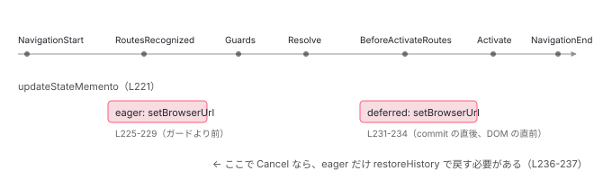

[目次](../README.md) › [Router の内側](README.md) › 第 16 回 / 全 21 回

# ブラウザの URL と履歴：HistoryStateManager と canceledNavigationResolution

> handleRouterEvent が BeforeActivateRoutes で setBrowserUrl を呼ぶ既定（deferred）と eager の違い。ɵrouterPageId を history.state に埋める理由、キャンセル時の restoreHistory が 'replace' と 'computed' でどう戻すか、popstate の registerNonRouterCurrentEntryChangeListener、withHashLocation。

angular/angular · 読了 約 14 分 · 中核 · [サイトで読む（デモが動きます）](https://angular-deep-dive-cyan.vercel.app/chapter/router-browser-url)

---

`routerLink` をクリックすると URL バーが変わり、戻るボタンを押すと前の画面に戻ります。[boot-spa-navigation](../boot/13-boot-spa-navigation.md) では `history.pushState` と `popstate` の経路を 1 本ずつ追いました。この章では「**いつ・どの条件で・何を `history.state` に入れるか**」と「**失敗したら何番目まで戻すか**」に絞ります。主役は `HistoryStateManager` の 1 ファイルで、`urlUpdateStrategy`（`'deferred'` / `'eager'`）と `canceledNavigationResolution`（`'replace'` / `'computed'`）の 2 つの設定が、どの行の分岐を切り替えるかを確認します。

読む対象は `packages/router/src/statemanager/state_manager.ts` と、`packages/common/src/location/` の `location.ts` / `location_strategy.ts` / `platform_location.ts` / `hash_location_strategy.ts` です。

1. 1 本の RxJS パイプライン
2. URL → UrlTree
3. routerLink の配列 → UrlTree
4. Route 設定の検証と正規化
5. provideRouter の中身
6. 最初のナビゲーション
7. navigateByUrl → NavigationTransition
8. setupNavigations の全段
9. Recognizer と match
10. redirectTo
11. loadChildren と loadComponent
12. ガードの実行順
13. resolve と data と title
14. ActivatedRoute と Snapshot
15. RouterOutlet への配置
16. **ブラウザの URL と履歴**（この章）
17. Router.events の全種類
18. RouterLink と RouterLinkActive
19. withViewTransitions
20. withRouterResources
21. Navigation API

## 1. StateManager が持つ 3 つの状態と、既定値の決まる行

📄 `angular/packages/router/src/statemanager/state_manager.ts` L32–42 （▶ の行: 32, 35–38, 40, 42）

```ts
32 ▶ @Service({factory: () => inject(HistoryStateManager)})
33 │ export abstract class StateManager {
34 │   protected readonly urlSerializer = inject(UrlSerializer);
35 ▶   private readonly options = inject(ROUTER_CONFIGURATION, {optional: true}) || {};
36 ▶   protected readonly canceledNavigationResolution =
37 ▶     this.options.canceledNavigationResolution || 'replace';
38 ▶   protected location = inject(Location);
39 │   protected urlHandlingStrategy = inject(UrlHandlingStrategy);
40 ▶   protected urlUpdateStrategy = this.options.urlUpdateStrategy || 'deferred';
41 │ 
42 ▶   protected currentUrlTree = new UrlTree();
```

32 行目、`StateManager` は抽象クラスで、何も provide しなければ `HistoryStateManager` が使われます。35 行目で `ROUTER_CONFIGURATION`（`withRouterConfig(...)` で渡したオブジェクト）を読み、**36〜37 行目で `canceledNavigationResolution` の既定が `'replace'`**、**40 行目で `urlUpdateStrategy` の既定が `'deferred'`** に決まります。38 行目の `Location` が、ブラウザの `history` を叩く唯一の窓口です（3 節）。

📄 `angular/packages/router/src/statemanager/state_manager.ts` L56–70 （▶ の行: 56, 61–62, 65–66, 68–69）

```ts
56 ▶   protected rawUrlTree = this.currentUrlTree;
57 │   /**
58 │    * Returns a `UrlTree` that is represents what the browser is actually showing.
59 │    *
60 │    * In the life of a navigation transition:
61 ▶    * 1. When a navigation begins, the raw `UrlTree` is updated to the full URL that's being
62 ▶    * navigated to.
63 │    * 2. During a navigation, redirects are applied, which might only apply to _part_ of the URL (due
64 │    * to `UrlHandlingStrategy`).
65 ▶    * 3. Just before activation, the raw `UrlTree` is updated to include the redirects on top of the
66 ▶    * original raw URL.
67 │    *
68 ▶    * Note that this is _only_ here to support `UrlHandlingStrategy.extract` and
69 ▶    * `UrlHandlingStrategy.shouldProcessUrl`. Without those APIs, the current `UrlTree` would not
70 │    * deviated from the raw `UrlTree`.
```

42 行目の `currentUrlTree` と 56 行目の `rawUrlTree` の 2 つがあります。68〜70 行目のコメントが本質です。**`UrlHandlingStrategy`（URL の一部だけを Angular が処理する AngularJS 併用向けの仕組み）が無ければ両者は一致します**。`currentUrlTree` は Router が処理した部分、`rawUrlTree` はブラウザが実際に表示している全体です。この章では既定の `UrlHandlingStrategy`（全部処理する）を前提に読みます。

📄 `angular/packages/router/src/statemanager/state_manager.ts` L103–121 （▶ の行: 103, 107–110, 112, 116）

```ts
103 ▶   protected commitTransition({targetRouterState, finalUrl, initialUrl}: Navigation): void {
104 │     // If we are committing the transition after having a final URL and target state, we're updating
105 │     // all pieces of the state. Otherwise, we likely skipped the transition (due to URL handling strategy)
106 │     // and only want to update the rawUrlTree, which represents the browser URL (and doesn't necessarily match router state).
107 ▶     if (finalUrl && targetRouterState) {
108 ▶       this.currentUrlTree = finalUrl;
109 ▶       this.rawUrlTree = this.urlHandlingStrategy.merge(finalUrl, initialUrl);
110 ▶       this.routerState = targetRouterState;
111 │     } else {
112 ▶       this.rawUrlTree = initialUrl;
113 │     }
114 │   }
115 │ 
116 ▶   protected routerState = createEmptyState(null, inject(EnvironmentInjector));
117 │ 
118 │   /** Returns the current RouterState. */
119 │   getRouterState(): RouterState {
120 │     return this.routerState;
121 │   }
```

103 行目の `commitTransition` が、3 つの状態をまとめて新しいナビゲーションの値に切り替える関数です。107〜110 行目、`finalUrl`（リダイレクト適用後の URL）と `targetRouterState`（[前々章](14-router-router-state.md)の木）が両方あるときだけ全部更新。112 行目、無いとき（`NavigationSkipped` のとき）は `rawUrlTree` だけです。呼び出すタイミングは 2 節で見ます。

📄 `angular/packages/router/src/statemanager/state_manager.ts` L123–143 （▶ の行: 123, 128–129, 132, 134–136, 141–142）

```ts
123 ▶   private _stateMemento = this.createStateMemento();
124 │   get stateMemento() {
125 │     return this._stateMemento;
126 │   }
127 │ 
128 ▶   protected updateStateMemento(): void {
129 ▶     this._stateMemento = this.createStateMemento();
130 │   }
131 │ 
132 ▶   private createStateMemento() {
133 │     return {
134 ▶       rawUrlTree: this.rawUrlTree,
135 ▶       currentUrlTree: this.currentUrlTree,
136 ▶       routerState: this.routerState,
137 │     };
138 │   }
139 │ 
140 │   /** Returns the current state stored by the browser for the current history entry. */
141 ▶   restoredState(): RestoredState | null | undefined {
142 ▶     return this.location.getState() as RestoredState | null | undefined;
143 │   }
```

123〜138 行目、`stateMemento` は 3 つの状態の**控え**です。128 行目の `updateStateMemento` で取り直し、4 節の `resetInternalState` が失敗時にここから戻します。141〜143 行目の `restoredState` は `location.getState()`、つまり**今の履歴項目の `history.state`** をそのまま返します。Router が `history.state` に何を入れたかは 3 節です。

## 2. handleRouterEvent：どのイベントで何をするか

`Router` は `NavigationTransitions.events` を購読し、公開の `Router.events` に流す**前**に `stateManager.handleRouterEvent(e, currentNavigation)` を呼びます（[次章](17-router-events.md)）。その中身がこれです。

📄 `angular/packages/router/src/statemanager/state_manager.ts` L220–244 （▶ の行: 221–228, 231–234, 236–242）

```ts
220 │   override handleRouterEvent(e: Event | PrivateRouterEvents, currentTransition: Navigation): void {
221 ▶     if (e instanceof NavigationStart) {
222 ▶       this.updateStateMemento();
223 ▶     } else if (e instanceof NavigationSkipped) {
224 ▶       this.commitTransition(currentTransition);
225 ▶     } else if (e instanceof RoutesRecognized) {
226 ▶       if (this.urlUpdateStrategy === 'eager') {
227 ▶         if (!currentTransition.extras.skipLocationChange) {
228 ▶           this.setBrowserUrl(this.createBrowserPath(currentTransition), currentTransition);
229 │         }
230 │       }
231 ▶     } else if (e instanceof BeforeActivateRoutes) {
232 ▶       this.commitTransition(currentTransition);
233 ▶       if (this.urlUpdateStrategy === 'deferred' && !currentTransition.extras.skipLocationChange) {
234 ▶         this.setBrowserUrl(this.createBrowserPath(currentTransition), currentTransition);
235 │       }
236 ▶     } else if (e instanceof NavigationCancel && !isRedirectingEvent(e)) {
237 ▶       this.restoreHistory(currentTransition);
238 ▶     } else if (e instanceof NavigationError) {
239 ▶       this.restoreHistory(currentTransition, true);
240 ▶     } else if (e instanceof NavigationEnd) {
241 ▶       this.lastSuccessfulId = e.id;
242 ▶       this.currentPageId = this.browserPageId;
243 │     }
244 │   }
```

1. **221〜222 行目：`NavigationStart` → 控えを取る**

   失敗したときに戻る先を、ナビゲーションの最初に保存します。
2. **223〜224 行目：`NavigationSkipped` → `commitTransition`**

   同じ URL への移動が無視されたときも、`rawUrlTree` だけは更新します（1 節 112 行目の分岐）。
3. **225〜230 行目：`RoutesRecognized` → `'eager'` ならここで URL を書く**

   URL の解析が終わった直後、**ガードより前**です。227 行目、`skipLocationChange: true` なら書きません。既定の `'deferred'` ではこのブロックは空振りです。
4. **231〜235 行目：`BeforeActivateRoutes` → `commitTransition`、`'deferred'` ならここで URL を書く**

   232 行目で Router の内部状態を新しい URL に切り替え、233〜234 行目で既定の `'deferred'` なら `setBrowserUrl`。このイベントが出る位置を下で確認します。
5. **236〜239 行目：`NavigationCancel` / `NavigationError` → `restoreHistory`**

   236 行目の `!isRedirectingEvent(e)` に注目してください。コードが `Redirect` か `SupersededByNewNavigation` のキャンセルでは **戻しません**。直後に別のナビゲーションが URL を書くからです。239 行目、エラーのときだけ第 2 引数 `true`（4 節で効きます）。
6. **240〜243 行目：`NavigationEnd` → ページ ID を確定**

   `lastSuccessfulId` と `currentPageId` を更新します。この 2 つは 4 節の「何番目まで戻すか」の計算に使います。

📄 `angular/packages/router/src/navigation_transition.ts` L795–803 （▶ の行: 796–797）

```ts
795 │           switchMap((t: NavigationTransition) => {
796 ▶             abortable = false;
797 ▶             this.events.next(new BeforeActivateRoutes());
798 │             const deferred = overallTransitionState.beforeActivateHandler.deferredHandle;
799 │             return deferred ? from(deferred.then(() => t)) : of(t);
800 │           }),
801 │ 
802 │           tap((t: NavigationTransition) => {
803 │             new ActivateRoutes(
```

797 行目、`BeforeActivateRoutes` はパイプラインの `take(1)` の直後、`ActivateRoutes`（DOM を変える tap）の**直前**で出ます。796 行目で `abortable = false`、ここから先は `Navigation.abort()` でも止まりません。したがって既定の `'deferred'` では、**URL が変わる → 同じ同期区間で DOM が変わる**という順です。URL が変わった後に失敗することは、ガード・resolver がすべて通った後なので、activate 中の例外以外ではありません。

📄 `angular/packages/router/src/router_config.ts` L101–111 （▶ の行: 102–106, 111）

```ts
101 │   /**
102 ▶    * Defines when the router updates the browser URL. By default ('deferred'),
103 ▶    * update after successful navigation.
104 ▶    * Set to 'eager' if prefer to update the URL at the beginning of navigation.
105 ▶    * Updating the URL early allows you to handle a failure of navigation by
106 ▶    * showing an error message with the URL that failed.
107 │    *
108 │    * @see [Decide when the URL updates](guide/routing/customizing-route-behavior#decide-when-the-url-updates)
109 │    *
110 │    */
111 ▶   urlUpdateStrategy?: 'deferred' | 'eager';
```

102〜106 行目、設定のドキュメントです。`'eager'` の用途は「失敗したときに、失敗した URL を表示したまま エラーメッセージを出す」こと。`'eager'` にすると、ガードで拒否されたナビゲーションでも URL バーは一度移動先を指します。それをどう戻すかが 4 節です。



*同じパイプラインの上で、URL を書く位置だけが設定で動く。失敗時に戻す必要があるのは、URL を書いた後に失敗した場合だけ。*

## 3. setBrowserUrl：push か replace か、state に何を入れるか

📄 `angular/packages/router/src/statemanager/state_manager.ts` L246–265 （▶ の行: 247–248, 250, 252–255, 257, 259–261, 263）

```ts
246 │   private setBrowserUrl(path: string, navigation: Navigation) {
247 ▶     const {extras, id} = navigation;
248 ▶     const {replaceUrl, state} = extras;
249 │ 
250 ▶     if (this.location.isCurrentPathEqualTo(path) || !!replaceUrl) {
251 │       // replacements do not update the target page
252 ▶       const currentBrowserPageId = this.browserPageId;
253 ▶       const newState = {
254 ▶         ...state,
255 ▶         ...this.generateNgRouterState(id, currentBrowserPageId, navigation),
256 │       };
257 ▶       this.location.replaceState(path, '', newState);
258 │     } else {
259 ▶       const newState = {
260 ▶         ...state,
261 ▶         ...this.generateNgRouterState(id, this.browserPageId + 1, navigation),
262 │       };
263 ▶       this.location.go(path, '', newState);
264 │     }
265 │   }
```

1. **250 行目：同じ URL か、`replaceUrl: true` か**

   `location.isCurrentPathEqualTo(path)`（ブラウザの今のパスと比較）か `extras.replaceUrl` のどちらかが真なら、257 行目 `replaceState`。履歴は増えません。`popstate` 由来のナビゲーションは `replaceUrl: true` で来るので（5 節）、ブラウザが既に変えた URL を上書きするだけです。
2. **252〜256 行目：置き換えのときはページ ID を増やさない**

   251 行目のコメントどおり、`browserPageId` をそのまま使います。
3. **259〜263 行目：新しい項目を push、ページ ID は +1**

   `location.go(path, '', newState)`。ここで `history.pushState` まで届きます（下の引用）。
4. **253〜256 行目と 259〜262 行目：`state` の作り方**

   `{...state, ...generateNgRouterState(...)}`。先に利用者の `extras.state` を展開し、**後から Router のキーを重ねる**ので、利用者が `navigationId` というキーを渡しても Router の値で上書きされます。

📄 `angular/packages/router/src/statemanager/state_manager.ts` L321–332 （▶ の行: 326–327, 330）

```ts
321 │   private generateNgRouterState(
322 │     navigationId: number,
323 │     routerPageId: number,
324 │     navigation?: Navigation,
325 │   ) {
326 ▶     if (this.canceledNavigationResolution === 'computed') {
327 ▶       return {navigationId, ɵrouterPageId: routerPageId, ...this.routerUrlState(navigation)};
328 │     }
329 │ 
330 ▶     return {navigationId, ...this.routerUrlState(navigation)};
331 │   }
332 │ }
```

📄 `angular/packages/router/src/navigation_transition.ts` L215–225 （▶ の行: 218, 221, 224）

```ts
215 │ export type RestoredState = {
216 │   [k: string]: any;
217 │   // TODO(#27607): Remove `navigationId` and `ɵrouterPageId` and move to `ng` or `ɵ` namespace.
218 ▶   navigationId: number;
219 │   // The `ɵ` prefix is there to reduce the chance of colliding with any existing user properties on
220 │   // the history state.
221 ▶   ɵrouterPageId?: number;
222 │   // When `browserUrl` is used, the actual route URL is stored here so that popstate events
223 │   // can use it for route matching instead of the displayed browser URL.
224 ▶   ɵrouterUrl?: string;
225 │ };
```

`history.state` に入るのは、218 行目 `navigationId`（常に）、221 行目 `ɵrouterPageId`（**`'computed'` のときだけ**、326〜327 行目）、224 行目 `ɵrouterUrl`（`browserUrl` オプションで表示 URL と Router の URL を分けたときだけ）。219〜220 行目のコメントどおり、`ɵ` は利用者の `state` とキーが衝突しないための接頭辞です。`navigationId` は [次章](17-router-events.md)の `RouterScroller` がスクロール位置の復元キーに使います。

📄 `angular/packages/router/src/statemanager/state_manager.ts` L167–190 （▶ の行: 177–178, 185–187, 189）

```ts
167 │ @Service()
168 │ export class HistoryStateManager extends StateManager {
169 │   /**
170 │    * The id of the currently active page in the router.
171 │    * Updated to the transition's target id on a successful navigation.
172 │    *
173 │    * This is used to track what page the router last activated. When an attempted navigation fails,
174 │    * the router can then use this to compute how to restore the state back to the previously active
175 │    * page.
176 │    */
177 ▶   private currentPageId: number = 0;
178 ▶   private lastSuccessfulId: number = -1;
179 │ 
180 │   /**
181 │    * The ɵrouterPageId of whatever page is currently active in the browser history. This is
182 │    * important for computing the target page id for new navigations because we need to ensure each
183 │    * page id in the browser history is 1 more than the previous entry.
184 │    */
185 ▶   private get browserPageId(): number {
186 ▶     if (this.canceledNavigationResolution !== 'computed') {
187 ▶       return this.currentPageId;
188 │     }
189 ▶     return this.restoredState()?.ɵrouterPageId ?? this.currentPageId;
190 │   }
```

177 行目 `currentPageId`（Router が最後に成功させたページの番号）、178 行目 `lastSuccessfulId`（その navigationId）。185〜190 行目の `browserPageId` は、`'computed'` なら **`history.state.ɵrouterPageId`**、つまり「ブラウザが今いる項目の番号」を読み、`'replace'` なら `currentPageId` をそのまま返します。`'replace'` では 243 行目の `currentPageId = this.browserPageId` が自分自身の代入になるので、**ページ番号は一生 0 のまま**です。使わないからです。

📄 `angular/packages/router/src/statemanager/state_manager.ts` L86–101 （▶ の行: 86–90, 97, 100）

```ts
 86 ▶   protected createBrowserPath({finalUrl, initialUrl, targetBrowserUrl}: Navigation): string {
 87 ▶     const rawUrl =
 88 ▶       finalUrl !== undefined ? this.urlHandlingStrategy.merge(finalUrl!, initialUrl) : initialUrl;
 89 ▶     const url = targetBrowserUrl ?? rawUrl;
 90 ▶     const path = url instanceof UrlTree ? this.urlSerializer.serialize(url) : url;
 91 │     return path;
 92 │   }
 93 │ 
 94 │   protected routerUrlState(navigation?: Navigation): {
 95 │     ɵrouterUrl?: string;
 96 │   } {
 97 ▶     if (navigation?.targetBrowserUrl === undefined || navigation?.finalUrl === undefined) {
 98 │       return {};
 99 │     }
100 ▶     return {ɵrouterUrl: this.urlSerializer.serialize(navigation.finalUrl)};
101 │   }
```

86〜92 行目、書き込む文字列は `finalUrl`（リダイレクト適用後）を `initialUrl` と `UrlHandlingStrategy.merge` したもの、ただし 89 行目、`extras.browserUrl` が指定されていればそちらを優先します。97〜100 行目、その場合だけ `ɵrouterUrl` に Router 側の URL を保存し、戻るボタンで復元できるようにします（5 節 331〜334 行目）。

### Location から window.history まで

📄 `angular/packages/common/src/location/location.ts` L171–193 （▶ の行: 171–173, 187–189）

```ts
171 ▶   go(path: string, query: string = '', state: any = null): void {
172 ▶     this._locationStrategy.pushState(state, '', path, query);
173 ▶     this._notifyUrlChangeListeners(
174 │       this.prepareExternalUrl(path + normalizeQueryParams(query)),
175 │       state,
176 │     );
177 │   }
178 │ 
179 │   /**
180 │    * Changes the browser's URL to a normalized version of the given URL, and replaces
181 │    * the top item on the platform's history stack.
182 │    *
183 │    * @param path  URL path to normalize.
184 │    * @param query Query parameters.
185 │    * @param state Location history state.
186 │    */
187 ▶   replaceState(path: string, query: string = '', state: any = null): void {
188 ▶     this._locationStrategy.replaceState(state, '', path, query);
189 ▶     this._notifyUrlChangeListeners(
190 │       this.prepareExternalUrl(path + normalizeQueryParams(query)),
191 │       state,
192 │     );
193 │   }
```

📄 `angular/packages/common/src/location/location_strategy.ts` L163–187 （▶ の行: 163–165, 168, 170, 181–182, 185–186）

```ts
163 ▶   override pushState(state: any, title: string, url: string, queryParams: string) {
164 ▶     const externalUrl = this.prepareExternalUrl(url + normalizeQueryParams(queryParams));
165 ▶     this._platformLocation.pushState(state, title, externalUrl);
166 │   }
167 │ 
168 ▶   override replaceState(state: any, title: string, url: string, queryParams: string) {
169 │     const externalUrl = this.prepareExternalUrl(url + normalizeQueryParams(queryParams));
170 ▶     this._platformLocation.replaceState(state, title, externalUrl);
171 │   }
172 │ 
173 │   override forward(): void {
174 │     this._platformLocation.forward();
175 │   }
176 │ 
177 │   override back(): void {
178 │     this._platformLocation.back();
179 │   }
180 │ 
181 ▶   override getState(): unknown {
182 ▶     return this._platformLocation.getState();
183 │   }
184 │ 
185 ▶   override historyGo(relativePosition: number = 0): void {
186 ▶     this._platformLocation.historyGo?.(relativePosition);
187 │   }
```

📄 `angular/packages/common/src/location/platform_location.ts` L162–184 （▶ の行: 163, 167, 179, 183）

```ts
162 │   override pushState(state: any, title: string, url: string): void {
163 ▶     this._history.pushState(state, title, url);
164 │   }
165 │ 
166 │   override replaceState(state: any, title: string, url: string): void {
167 ▶     this._history.replaceState(state, title, url);
168 │   }
169 │ 
170 │   override forward(): void {
171 │     this._history.forward();
172 │   }
173 │ 
174 │   override back(): void {
175 │     this._history.back();
176 │   }
177 │ 
178 │   override historyGo(relativePosition: number = 0): void {
179 ▶     this._history.go(relativePosition);
180 │   }
181 │ 
182 │   override getState(): unknown {
183 ▶     return this._history.state;
184 │   }
```

`Location.go`（171 行目）→ `PathLocationStrategy.pushState`（163 行目、164 行目で `<base href>` を前置）→ `BrowserPlatformLocation.pushState`（162 行目）→ **163 行目 `window.history.pushState(state, title, url)`**。`replaceState` も同じ 3 段で 187 → 168 → 167 行目です。173〜176 行目と 189〜192 行目、どちらも最後に `_notifyUrlChangeListeners` を呼ぶので、`Location.onUrlChange` の購読者は push と replace を区別なく受け取ります。4 節で使う `historyGo` は 185〜187 → 178〜180 行目で `window.history.go(n)`、1 節 142 行目の `getState` は 181〜183 → 182〜184 行目で `window.history.state` です。

📄 `angular/packages/common/src/location/location.ts` L112–118 （▶ の行: 116–117）

```ts
112 │   /**
113 │    * Reports the current state of the location history.
114 │    * @returns The current value of the `history.state` object.
115 │    */
116 ▶   getState(): unknown {
117 ▶     return this._locationStrategy.getState();
118 │   }
```

## 4. restoreHistory：'replace' と 'computed' の違い

📄 `angular/packages/router/src/router_config.ts` L43–67 （▶ の行: 46–50, 53–55, 58, 62, 67）

```ts
43 │   /**
44 │    * Configures how the Router attempts to restore state when a navigation is cancelled.
45 │    *
46 ▶    * 'replace' - Always uses `location.replaceState` to set the browser state to the state of the
47 ▶    * router before the navigation started. This means that if the URL of the browser is updated
48 ▶    * _before_ the navigation is canceled, the Router will simply replace the item in history rather
49 ▶    * than trying to restore to the previous location in the session history. This happens most
50 ▶    * frequently with `urlUpdateStrategy: 'eager'` and navigations with the browser back/forward
51 │    * buttons.
52 │    *
53 ▶    * 'computed' - Will attempt to return to the same index in the session history that corresponds
54 ▶    * to the Angular route when the navigation gets cancelled. For example, if the browser back
55 ▶    * button is clicked and the navigation is cancelled, the Router will trigger a forward navigation
56 │    * and vice versa.
57 │    *
58 ▶    * Note: the 'computed' option is incompatible with any `UrlHandlingStrategy` which only
59 │    * handles a portion of the URL because the history restoration navigates to the previous place in
60 │    * the browser history rather than simply resetting a portion of the URL.
61 │    *
62 ▶    * The default value is `replace` when not set.
63 │    *
64 │    * @see [Handle canceled navigations](guide/routing/customizing-route-behavior#handle-canceled-navigations)
65 │    *
66 │    */
67 ▶   canceledNavigationResolution?: 'replace' | 'computed';
```

設定のドキュメントが結論を先に書いています。`'replace'`（46〜51 行目）は**常に `replaceState`**、URL が先に変わっていたら「履歴を辿って戻る」のではなく**その項目を書き換える**。`'computed'`（53〜56 行目）は**元の項目と同じ位置まで `history.go` で移動する**。58〜60 行目、`UrlHandlingStrategy` で URL の一部だけ処理する構成とは併用できません。62 行目、既定は `'replace'`。

📄 `angular/packages/router/src/navigation_transition.ts` L998–1012 （▶ の行: 1003–1004, 1010–1011）

```ts
 998 │   private cancelNavigationTransition(
 999 │     t: NavigationTransition,
1000 │     reason: string,
1001 │     code: NavigationCancellationCode,
1002 │   ) {
1003 ▶     rollbackState(t);
1004 ▶     const navCancel = new NavigationCancel(
1005 │       t.id,
1006 │       this.urlSerializer.serialize(t.extractedUrl),
1007 │       reason,
1008 │       code,
1009 │     );
1010 ▶     this.events.next(navCancel);
1011 ▶     t.resolve(false);
1012 │   }
```

キャンセルの入口です。1003 行目で `rollbackState`（前々章の後始末）、1004〜1010 行目で `NavigationCancel` を流し、1011 行目で `navigate()` の Promise を `false` で解決。1010 行目の `events.next` が同期的に 2 節 236〜237 行目へ届き、`restoreHistory` が走ります。

📄 `angular/packages/router/src/statemanager/state_manager.ts` L267–297 （▶ の行: 271–277, 281–282, 287, 292–293, 295）

```ts
267 │   /**
268 │    * Performs the necessary rollback action to restore the browser URL to the
269 │    * state before the transition.
270 │    */
271 ▶   private restoreHistory(navigation: Navigation, restoringFromCaughtError = false) {
272 ▶     if (this.canceledNavigationResolution === 'computed') {
273 ▶       const currentBrowserPageId = this.browserPageId;
274 ▶       const targetPagePosition = this.currentPageId - currentBrowserPageId;
275 ▶       if (targetPagePosition !== 0) {
276 ▶         this.location.historyGo(targetPagePosition);
277 ▶       } else if (this.getCurrentUrlTree() === navigation.finalUrl && targetPagePosition === 0) {
278 │         // We got to the activation stage (where currentUrlTree is set to the navigation's
279 │         // finalUrl), but we weren't moving anywhere in history (skipLocationChange or replaceUrl).
280 │         // We still need to reset the router state back to what it was when the navigation started.
281 ▶         this.resetInternalState(navigation);
282 ▶         this.resetUrlToCurrentUrlTree();
283 │       } else {
284 │         // The browser URL and router state was not updated before the navigation cancelled so
285 │         // there's no restoration needed.
286 │       }
287 ▶     } else if (this.canceledNavigationResolution === 'replace') {
288 │       // TODO(atscott): It seems like we should _always_ reset the state here. It would be a no-op
289 │       // for `deferred` navigations that haven't change the internal state yet because guards
290 │       // reject. For 'eager' navigations, it seems like we also really should reset the state
291 │       // because the navigation was cancelled. Investigate if this can be done by running TGP.
292 ▶       if (restoringFromCaughtError) {
293 ▶         this.resetInternalState(navigation);
294 │       }
295 ▶       this.resetUrlToCurrentUrlTree();
296 │     }
297 │   }
```

1. **272〜276 行目：`'computed'` — 差分を計算して `historyGo`**

   `currentPageId`（Router が最後に成功させた番号）から `browserPageId`（ブラウザが今いる項目の `ɵrouterPageId`）を引きます。`'eager'` で push 済みなら `-1`、戻るボタンでブラウザが 1 つ戻っていれば `+1`。0 でなければ `location.historyGo(差分)`。**ブラウザが移動するので `popstate` が発火し**、5 節のリスナーがもう 1 回ナビゲーションを起こします。その行き先は Router の現在 URL と同じなので `NavigationSkipped` になります。
2. **277〜282 行目：`'computed'` で位置は同じだが commit 済み**

   `currentUrlTree === navigation.finalUrl` は `commitTransition`（2 節 232 行目）を通った印です。`skipLocationChange` / `replaceUrl` で履歴が動いていないのに activate 中に失敗したケースで、内部状態と `state` だけ戻します（278〜280 行目のコメント）。
3. **283〜286 行目：`'computed'` で何も変わっていない**

   既定の `'deferred'` でガードに拒否されたとき（URL も内部状態も未更新）はここです。何もしません。
4. **287〜296 行目：`'replace'`**

   292〜294 行目、`NavigationError` から来たときだけ `resetInternalState`。295 行目、常に `resetUrlToCurrentUrlTree`。288〜291 行目の TODO が「本当は常に内部状態も戻すべきではないか」と書いています。

📄 `angular/packages/router/src/statemanager/state_manager.ts` L299–319 （▶ の行: 299–301, 307, 313–315, 317）

```ts
299 ▶   private resetInternalState({finalUrl}: Navigation): void {
300 ▶     this.routerState = this.stateMemento.routerState;
301 ▶     this.currentUrlTree = this.stateMemento.currentUrlTree;
302 │     // Note here that we use the urlHandlingStrategy to get the reset `rawUrlTree` because it may be
303 │     // configured to handle only part of the navigation URL. This means we would only want to reset
304 │     // the part of the navigation handled by the Angular router rather than the whole URL. In
305 │     // addition, the URLHandlingStrategy may be configured to specifically preserve parts of the URL
306 │     // when merging, such as the query params so they are not lost on a refresh.
307 ▶     this.rawUrlTree = this.urlHandlingStrategy.merge(
308 │       this.currentUrlTree,
309 │       finalUrl ?? this.rawUrlTree,
310 │     );
311 │   }
312 │ 
313 ▶   private resetUrlToCurrentUrlTree(): void {
314 ▶     this.location.replaceState(
315 ▶       this.urlSerializer.serialize(this.getRawUrlTree()),
316 │       '',
317 ▶       this.generateNgRouterState(this.lastSuccessfulId, this.currentPageId),
318 │     );
319 │   }
```

📄 `angular/packages/common/src/location/location.ts` L221–223 （▶ の行: 221–222）

```ts
221 ▶   historyGo(relativePosition: number = 0): void {
222 ▶     this._locationStrategy.historyGo?.(relativePosition);
223 │   }
```

300〜301 行目、`resetInternalState` は 1 節の控え（`stateMemento`）から `routerState` と `currentUrlTree` を戻します。313〜319 行目、`resetUrlToCurrentUrlTree` は **`replaceState` で現在の履歴項目を Router の `rawUrlTree` に書き換え**、`state` は `lastSuccessfulId` と `currentPageId` から作り直します。`'eager'` + `'replace'` でガードに拒否されると、push 済みの項目が元の URL で上書きされるので、**同じ URL の項目が 2 つ並びます**。下のデモで確認できます。

> [!WARNING]
> **ハマりどころ**
>
> `'eager'` を選ぶなら `canceledNavigationResolution` も一緒に考えてください。既定の `'replace'` のままだと、ガードで拒否されたときに 295 行目の `replaceState` が push 済みの項目を元の URL で上書きし、戻るボタンを 1 回押しても同じ URL に留まる履歴ができます。`'computed'` なら 276 行目の `historyGo` で項目ごと戻ります。どちらが正しいかではなく、router\_config.ts 46〜56 行目に書かれた 2 つの挙動のどちらを選ぶかです。

> **🧪 DEMO — 設定とシナリオで、履歴スタックと history.state がどう変わるか**
>
> HistoryStateManager（state\_manager.ts L168-332）の各メソッドを、配列の履歴スタックに対して同じ順・同じ条件で実行しています。最初のナビゲーション（/home、replaceUrl: true）は済んだ状態から始めます。「戻るボタン」のシナリオは /about まで進んだ後に戻ります。
>
> ▶ [このデモはサイトで動かせます](https://angular-deep-dive-cyan.vercel.app/chapter/router-browser-url)

## 5. popstate からのナビゲーションが持ってくるもの

📄 `angular/packages/router/src/statemanager/state_manager.ts` L192–218 （▶ の行: 201–202, 205, 207–209, 211, 213）

```ts
192 │   override registerNonRouterCurrentEntryChangeListener(
193 │     listener: (
194 │       url: string,
195 │       state: RestoredState | null | undefined,
196 │       trigger: NavigationTrigger,
197 │       extras: NavigationExtras,
198 │       hasUAVisualTransition?: boolean,
199 │     ) => void,
200 │   ): SubscriptionLike {
201 ▶     return this.location.subscribe((event) => {
202 ▶       if (event['type'] === 'popstate') {
203 │         // The `setTimeout` was added in #12160 and is likely to support Angular/AngularJS
204 │         // hybrid apps.
205 ▶         setTimeout(() => {
206 │           listener(
207 ▶             event['url']!,
208 ▶             event.state as RestoredState | null | undefined,
209 ▶             'popstate',
210 │             {
211 ▶               replaceUrl: true,
212 │             },
213 ▶             event.hasUAVisualTransition,
214 │           );
215 │         });
216 │       }
217 │     });
218 │   }
```

経路そのものは boot-spa-navigation の 6 節で読みました。ここで見るのは引数です。208 行目、`event.state`（ブラウザが復元した `history.state`）をそのまま渡し、209 行目 trigger は `'popstate'`、**211 行目 `replaceUrl: true`**。ブラウザが既に URL を変えているので、3 節 250 行目で `replaceState` 側に入ります。

📄 `angular/packages/router/src/router.ts` L326–348 （▶ の行: 326, 331–333, 338–344, 348）

```ts
326 ▶     const restoredState = state?.navigationId ? state : null;
327 │ 
328 │     // When `browserUrl` was used during the original navigation, the actual route URL
329 │     // was stored in history state as `ɵrouterUrl`. Use it for route matching and
330 │     // preserve the browser URL as the displayed URL.
331 ▶     const routerUrl = state?.ɵrouterUrl ?? url;
332 ▶     if (state?.ɵrouterUrl) {
333 ▶       extras = {...extras, browserUrl: url};
334 │     }
335 │ 
336 │     // Separate to NavigationStart.restoredState, we must also restore the state to
337 │     // history.state and generate a new navigationId, since it will be overwritten
338 ▶     if (state) {
339 ▶       const stateCopy = {...state} as Partial<RestoredState>;
340 ▶       delete stateCopy.navigationId;
341 ▶       delete stateCopy.ɵrouterPageId;
342 ▶       delete stateCopy.ɵrouterUrl;
343 ▶       if (Object.keys(stateCopy).length !== 0) {
344 ▶         extras.state = stateCopy;
345 │       }
346 │     }
347 │ 
348 ▶     const urlTree = this.parseUrl(routerUrl);
```

1. **326 行目：`navigationId` が無ければ `restoredState` は `null`**

   Router 以外が `pushState` した項目（`state` に `navigationId` が無い）に戻ったときは、`NavigationStart.restoredState` が `null` になります。
2. **331〜334 行目：`ɵrouterUrl` があれば Router はそちらを解析**

   3 節 100 行目で保存したものです。表示 URL は `extras.browserUrl` として維持されます。
3. **338〜346 行目：利用者の `state` を `extras.state` に戻す**

   Router のキー 3 つ（`navigationId` / `ɵrouterPageId` / `ɵrouterUrl`）を**削ったコピー**を `extras.state` に入れます。こうして 3 節 253 行目の `...state` で再び書き込まれ、戻った先の `history.state` に利用者の値が残ります。`navigationId` は新しく振り直されます（336〜337 行目のコメント）。

📄 `angular/packages/router/src/router.ts` L213–234 （▶ の行: 213, 224–231）

```ts
213 ▶           } else if (e instanceof RedirectRequest) {
214 │             const opts = e.navigationBehaviorOptions;
215 │             const mergedTree = this.urlHandlingStrategy.merge(
216 │               e.url,
217 │               currentTransition.currentRawUrl,
218 │             );
219 │             const extras = {
220 │               scroll: currentTransition.extras.scroll,
221 │               browserUrl: currentTransition.extras.browserUrl,
222 │               info: currentTransition.extras.info,
223 │               skipLocationChange: currentTransition.extras.skipLocationChange,
224 ▶               // The URL is already updated at this point if we have 'eager' URL
225 ▶               // updates or if the navigation was triggered by the browser (back
226 ▶               // button, URL bar, etc). We want to replace that item in history
227 ▶               // if the navigation is rejected.
228 ▶               replaceUrl:
229 ▶                 currentTransition.extras.replaceUrl ||
230 ▶                 this.urlUpdateStrategy === 'eager' ||
231 ▶                 isBrowserTriggeredNavigation(currentTransition.source),
232 │               // allow developer to override default options with RedirectCommand
233 │               ...opts,
234 │             };
```

📄 `angular/packages/router/src/navigation_transition.ts` L1053–1055 （▶ の行: 1054）

```ts
1053 │ export function isBrowserTriggeredNavigation(source: NavigationTrigger) {
1054 ▶   return source !== IMPERATIVE_NAVIGATION;
1055 │ }
```

ガードがリダイレクトを返したとき（`RedirectRequest`）、`Router` は 228〜231 行目で `replaceUrl` を決めます。元のナビゲーションが `replaceUrl` だったか、`'eager'` だったか、`popstate` / `hashchange` 由来だったか（1054 行目、`'imperative'` 以外）のいずれかなら `true`。224〜227 行目のコメントどおり、「URL が既に書かれている状況ではリダイレクト先で**その項目を置き換える**」ためです。2 節 236 行目で `Redirect` のキャンセルが `restoreHistory` を呼ばなかったのは、この置き換えに任せるからです。

📄 `angular/packages/router/src/navigation_transition.ts` L502–521 （▶ の行: 502–503, 505–506, 511–512, 516, 519）

```ts
502 ▶             const urlTransition =
503 ▶               !router.navigated || this.isUpdatingInternalState() || this.isUpdatedBrowserUrl();
504 │ 
505 ▶             const onSameUrlNavigation = t.extras.onSameUrlNavigation ?? router.onSameUrlNavigation;
506 ▶             if (!urlTransition && onSameUrlNavigation !== 'reload') {
507 │               const reason =
508 │                 typeof ngDevMode === 'undefined' || ngDevMode
509 │                   ? `Navigation to ${t.rawUrl} was ignored because it is the same as the current Router URL.`
510 │                   : '';
511 ▶               this.events.next(
512 ▶                 new NavigationSkipped(
513 │                   t.id,
514 │                   this.urlSerializer.serialize(t.rawUrl),
515 │                   reason,
516 ▶                   NavigationSkippedCode.IgnoredSameUrlNavigation,
517 │                 ),
518 │               );
519 ▶               t.resolve(false);
520 │               return EMPTY;
521 │             }
```

4 節 276 行目の `historyGo` で発火した `popstate` が起こすナビゲーションの行き先です。502〜503 行目、Router の URL とブラウザの URL のどちらも変わっていなければ `urlTransition` は `false`、505〜506 行目、`onSameUrlNavigation` が既定の `'ignore'` なら 511〜518 行目で `NavigationSkipped`（コード `IgnoredSameUrlNavigation`）を流して 519 行目で `false` 解決。ガードは走りません。

## 6. withHashLocation：# の後ろに同じことをする

📄 `angular/packages/router/src/provide_router.ts` L670–673 （▶ の行: 671）

```ts
670 │ export function withHashLocation(): RouterHashLocationFeature {
671 ▶   const providers = [{provide: LocationStrategy, useClass: HashLocationStrategy}];
672 │   return routerFeature(RouterFeatureKind.RouterHashLocationFeature, providers);
673 │ }
```

📄 `angular/packages/common/src/location/hash_location_strategy.ts` L66–91 （▶ の行: 66, 69, 71, 74–76, 79–81, 83, 86, 90）

```ts
66 ▶   override path(includeHash: boolean = false): string {
67 │     // the hash value is always prefixed with a `#`
68 │     // and if it is empty then it will stay empty
69 ▶     const path = this._platformLocation.hash ?? '#';
70 │ 
71 ▶     return path.length > 0 ? path.substring(1) : path;
72 │   }
73 │ 
74 ▶   override prepareExternalUrl(internal: string): string {
75 ▶     const url = joinWithSlash(this._baseHref, internal);
76 ▶     return url.length > 0 ? '#' + url : url;
77 │   }
78 │ 
79 ▶   override pushState(state: any, title: string, path: string, queryParams: string) {
80 ▶     const url =
81 ▶       this.prepareExternalUrl(path + normalizeQueryParams(queryParams)) ||
82 │       this._platformLocation.pathname;
83 ▶     this._platformLocation.pushState(state, title, url);
84 │   }
85 │ 
86 ▶   override replaceState(state: any, title: string, path: string, queryParams: string) {
87 │     const url =
88 │       this.prepareExternalUrl(path + normalizeQueryParams(queryParams)) ||
89 │       this._platformLocation.pathname;
90 ▶     this._platformLocation.replaceState(state, title, url);
91 │   }
```

671 行目、`LocationStrategy` を `HashLocationStrategy` に差し替えるだけです。`Location` も `HistoryStateManager` も変わりません。違いは 3 つ。69〜71 行目、`path()` は `location.hash` から `#` を外して返す。74〜77 行目、`prepareExternalUrl` は `#` を前置する。79〜84 行目、`pushState` はそれでも **`_platformLocation.pushState`、つまり `history.pushState`** を呼びます（`location.hash = ...` ではありません）。だから `history.state` に `navigationId` を入れる 3 節の仕組みは、ハッシュモードでもそのまま働きます。

## ここまでの呼び出し

- `events.next(new BeforeActivateRoutes())` — navigation\_transition.ts L797 — *take(1) の直後、ActivateRoutes の直前*
  - `Router.subscribeToNavigationEvents` の購読関数 — router.ts L194
    - `stateManager.handleRouterEvent(e, currentNavigation)` — statemanager/state\_manager.ts L220
      - `commitTransition(navigation)` — L232 → L103 — *currentUrlTree / rawUrlTree / routerState を更新*
      - `setBrowserUrl(createBrowserPath(nav), nav)`（'deferred'） — L234 → L246
        - `generateNgRouterState(id, browserPageId + 1, nav)` — L261 → L321 — *navigationId（+ 'computed' なら ɵrouterPageId）*
        - `location.go(path, '', newState)` — L263 → common/src/location/location.ts L171
          - `PathLocationStrategy.pushState(state, '', path, '')` — location\_strategy.ts L163 — *base href を前置*
            - `BrowserPlatformLocation.pushState` → `window.history.pushState(state, title, url)` — platform\_location.ts L162-163
          - `_notifyUrlChangeListeners(url, state)` — location.ts L173 — *Location.onUrlChange の購読者へ*
- `cancelNavigationTransition(t, '', GuardRejected)` — *（ガードで拒否されたとき）* — navigation\_transition.ts L677 → L998
  - `events.next(new NavigationCancel(...))` — L1010
    - `handleRouterEvent` → `restoreHistory(nav)` — state\_manager.ts L236-237 → L271
      - `location.historyGo(currentPageId − browserPageId)`（'computed'） — L276 → location.ts L221 → platform\_location.ts L178 — *popstate が発火 → NavigationSkipped*
      - `resetUrlToCurrentUrlTree()`（'replace'） — L295 → L313 — *location.replaceState(rawUrlTree, '', {navigationId: lastSuccessfulId})*

## 聞かれそうな質問

**Q. URL は DOM が変わる前に変わりますか？後ですか？eager にすると何が変わりますか？**

既定（`'deferred'`）では**前**です。`BeforeActivateRoutes` は navigation\_transition.ts 797 行目、`ActivateRoutes` は 802 行目の tap で、state\_manager.ts 233〜234 行目の `setBrowserUrl` はその間に同期的に走ります。`'eager'` にすると 225〜229 行目、`RoutesRecognized`（ガードより前）に移ります。変わるのは「ガードで拒否されたときに URL が一度移動先を指す」ことと、そのために `NavigationCancel` で `restoreHistory`（236〜237 行目）の戻し処理が実際に効くこと、そしてリダイレクト時に `replaceUrl` が強制されること（router.ts 230 行目）です。

**Q. ガードで拒否されたとき、戻るボタンの履歴はどうなりますか？computed と replace の違いは？**

既定の `'deferred'` + `'replace'` では、URL がまだ書かれていないので state\_manager.ts 295 行目の `resetUrlToCurrentUrlTree` が 現在の項目を同じ URL で `replaceState` するだけで、履歴は変わりません。`'eager'` + `'replace'` では、push 済みの移動先の項目が元の URL に書き換えられ、**同じ URL が 2 つ並びます**（router\_config.ts 46〜51 行目がこの挙動を説明しています）。`'computed'` では 272〜276 行目、`currentPageId − history.state.ɵrouterPageId` の差分だけ `history.go` で**元の位置に移動**し、履歴の長さは保たれます。戻るボタンで来たナビゲーションが拒否された場合は差分が `+1` になり、前に進んで元の画面に戻ります（router\_config.ts 54〜56 行目）。

**Q. history.state には何が入っていますか？自分で渡した state はどうなりますか？**

state\_manager.ts 253〜256 行目、`{...extras.state, ...generateNgRouterState(...)}` です。利用者の `state` の上に、`navigationId`（常に）、`ɵrouterPageId`（`'computed'` のみ、326〜327 行目）、`ɵrouterUrl`（`browserUrl` 使用時のみ、97〜100 行目）が重なります。戻るボタンでその項目に戻ると、router.ts 338〜346 行目が Router のキー 3 つを除いたコピーを `extras.state` に戻すので、利用者の値は保たれます。

**Q. skipLocationChange: true のとき Router の内部状態はどうなりますか？**

state\_manager.ts 227 行目と 233 行目で `setBrowserUrl` だけが飛ばされます。232 行目の `commitTransition` は走るので、`Router.url` / `routerState` は新しい URL を指し、ブラウザの URL バーだけが古いままになります。`'computed'` でこの状態からキャンセルされると 277〜282 行目の分岐（位置は同じだが commit 済み）に入ります。

**Q. withHashLocation でも history.state は使えますか？**

使えます。hash\_location\_strategy.ts 79〜84 行目、`HashLocationStrategy.pushState` は URL を `#...` 形式にしてから `_platformLocation.pushState`（platform\_location.ts 163 行目 `window.history.pushState`）を呼びます。`HistoryStateManager` は `LocationStrategy` を直接見ないので（state\_manager.ts 38 行目は `Location`）、挙動は同じです。

**Q. リダイレクトで NavigationCancel が出たのに restoreHistory が呼ばれないのはなぜですか？**

state\_manager.ts 236 行目の `!isRedirectingEvent(e)` で除外されます（コード `Redirect` と `SupersededByNewNavigation`）。リダイレクト先のナビゲーションが直後に URL を書くからで、router.ts 228〜231 行目がそのナビゲーションの `replaceUrl` を決めています。`'eager'` または `popstate` 由来なら `true` になり、既に書かれた項目を置き換えます。

## 読み終えて

- 既定値は state\_manager.ts L36-37（`canceledNavigationResolution: 'replace'`）と L40（`urlUpdateStrategy: 'deferred'`）
- `handleRouterEvent`（L220-244）が URL を書く位置は、`'eager'` なら `RoutesRecognized`（ガードより前）、`'deferred'` なら `BeforeActivateRoutes`（commit の直後、DOM の直前）
- `setBrowserUrl`（L246-265）は同じ URL か `replaceUrl` なら `replaceState`、それ以外は `go`（push）。`history.state` には `navigationId` と、`'computed'` のときだけ `ɵrouterPageId`
- `restoreHistory`（L271-297）は `'computed'` なら `history.go(差分)` で元の位置へ、`'replace'` なら現在の項目を `replaceState` で上書き。`Redirect` / `Superseded` のキャンセルでは呼ばれない（L236）
- `popstate` 由来のナビゲーションは `replaceUrl: true`（L211）で来て、`history.state` から Router のキーを除いた分を `extras.state` に戻す（router.ts L338-346）

---

← 前: [RouterOutlet にコンポーネントが置かれる：ActivateRoutes と ChildrenOutletContexts](15-router-activate-routes.md)  
次: [Router.events の全種類と出る順番：どの行が何を流すか](17-router-events.md) →
