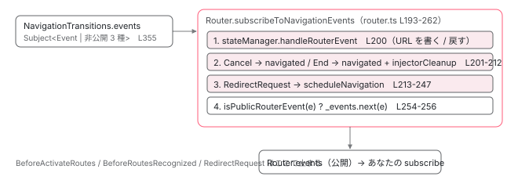

[目次](../README.md) › [Router の内側](README.md) › 第 17 回 / 全 21 回

# Router.events の全種類と出る順番：どの行が何を流すか

> EventType 17 種類を、1 回のナビゲーションで出る順に並べ、送信元の行を表にする。NavigationCancellationCode と NavigationSkippedCode の意味。Router.subscribeToNavigationEvents が公開前に stateManager と RedirectRequest を処理する順序、RouterScroller と withDebugTracing の購読。

angular/angular · 読了 約 13 分 · 中核 · [サイトで読む（デモが動きます）](https://angular-deep-dive-cyan.vercel.app/chapter/router-events)

---

`router.events.subscribe(...)` でローディング表示を出したり、ページビューを計測したりします。そのとき「どのイベントがどの順で来るか」「キャンセルと失敗はどう区別するか」「`Router` 自身の処理より先に受け取れるか」を 答えられる必要があります。この章では `EventType` の 17 種類を 1 回のナビゲーションの順に並べ、**それぞれを `events.next` している行**を表にし、公開前に `Router` が内部処理を済ませる順序を確認します。

読む対象は `packages/router/src/events.ts`、`router.ts` の `subscribeToNavigationEvents`、`navigation_transition.ts` の `events.next` の各行、`router_scroller.ts`、`provide_router.ts` の `withDebugTracing` です。パイプラインの段そのものは [8 章](08-router-pipeline.md)で読んだので、ここでは「どの段のどの行が何を流すか」に絞ります。

1. 1 本の RxJS パイプライン
2. URL → UrlTree
3. routerLink の配列 → UrlTree
4. Route 設定の検証と正規化
5. provideRouter の中身
6. 最初のナビゲーション
7. navigateByUrl → NavigationTransition
8. setupNavigations の全段
9. Recognizer と match
10. redirectTo
11. loadChildren と loadComponent
12. ガードの実行順
13. resolve と data と title
14. ActivatedRoute と Snapshot
15. RouterOutlet への配置
16. ブラウザの URL と履歴
17. **Router.events の全種類**（この章）
18. RouterLink と RouterLinkActive
19. withViewTransitions
20. withRouterResources
21. Navigation API

## 1. 17 種類と、2 つの系統

📄 `angular/packages/router/src/events.ts` L33–51 （▶ の行: 33–38, 43–50）

```ts
33 ▶ export enum EventType {
34 ▶   NavigationStart,
35 ▶   NavigationEnd,
36 ▶   NavigationCancel,
37 ▶   NavigationError,
38 ▶   RoutesRecognized,
39 │   ResolveStart,
40 │   ResolveEnd,
41 │   GuardsCheckStart,
42 │   GuardsCheckEnd,
43 ▶   RouteConfigLoadStart,
44 ▶   RouteConfigLoadEnd,
45 ▶   ChildActivationStart,
46 ▶   ChildActivationEnd,
47 ▶   ActivationStart,
48 ▶   ActivationEnd,
49 ▶   Scroll,
50 ▶   NavigationSkipped,
51 │ }
```

📄 `angular/packages/router/src/events.ts` L699–716 （▶ の行: 699–700, 716）

```ts
699 ▶ export type Event =
700 ▶   | NavigationStart
701 │   | NavigationEnd
702 │   | NavigationCancel
703 │   | NavigationError
704 │   | RoutesRecognized
705 │   | GuardsCheckStart
706 │   | GuardsCheckEnd
707 │   | RouteConfigLoadStart
708 │   | RouteConfigLoadEnd
709 │   | ChildActivationStart
710 │   | ChildActivationEnd
711 │   | ActivationStart
712 │   | ActivationEnd
713 │   | Scroll
714 │   | ResolveStart
715 │   | ResolveEnd
716 ▶   | NavigationSkipped;
```

33〜51 行目、`EventType` は 17 個。699〜716 行目の `Event` 型がその 17 クラスの union です。各クラスは `readonly type = EventType.X` を持つので、`switch (e.type)` で絞り込めます（`instanceof` でも同じ）。クラスは 2 つの系統に分かれます。

📄 `angular/packages/router/src/events.ts` L77–84 （▶ の行: 77, 80, 82）

```ts
77 ▶ export class RouterEvent {
78 │   constructor(
79 │     /** A unique ID that the router assigns to every router navigation. */
80 ▶     public id: number,
81 │     /** The URL that is the destination for this navigation. */
82 ▶     public url: string,
83 │   ) {}
84 │ }
```

1. **`RouterEvent` を継承する 10 個：ナビゲーション 1 回につき 1 回**

   77〜84 行目、`id`（`navigationId`）と `url` を持ちます。`NavigationStart` / `NavigationEnd` / `NavigationCancel` / `NavigationError` / `NavigationSkipped` / `RoutesRecognized` / `GuardsCheckStart` / `GuardsCheckEnd` / `ResolveStart` / `ResolveEnd`。`id` で「同じナビゲーションの Start と End」を対応づけられます。
2. **継承しない 7 つ：Route 1 つ、または 1 回のスクロール**

   `RouteConfigLoadStart` / `RouteConfigLoadEnd`（`route: Route`）、`ChildActivationStart` / `ChildActivationEnd` / `ActivationStart` / `ActivationEnd`（`snapshot: ActivatedRouteSnapshot`）、`Scroll`（`routerEvent` と位置）。ナビゲーション 1 回で**複数回**出ることがあります。`id` を持たないので、`RouterEvent` のドキュメントコメントが示すとおり `instanceof RouterEvent` で前者だけを選別できます。

📄 `angular/packages/router/src/events.ts` L718–727 （▶ の行: 718–719, 721）

```ts
718 ▶ export function stringifyEvent(routerEvent: Event): string {
719 ▶   switch (routerEvent.type) {
720 │     case EventType.ActivationEnd:
721 ▶       return `ActivationEnd(path: '${routerEvent.snapshot.routeConfig?.path || ''}')`;
722 │     case EventType.ActivationStart:
723 │       return `ActivationStart(path: '${routerEvent.snapshot.routeConfig?.path || ''}')`;
724 │     case EventType.ChildActivationEnd:
725 │       return `ChildActivationEnd(path: '${routerEvent.snapshot.routeConfig?.path || ''}')`;
726 │     case EventType.ChildActivationStart:
727 │       return `ChildActivationStart(path: '${routerEvent.snapshot.routeConfig?.path || ''}')`;
```

718 行目の `stringifyEvent` は、17 種類を `type` で分けて 1 行の文字列にします。各クラスの `toString` と同じ出力で、6 節の `withDebugTracing` が使います。

## 2. 2 つの Subject：内部の events と公開の Router.events

📄 `angular/packages/router/src/navigation_transition.ts` L350–359 （▶ の行: 351–353, 355）

```ts
350 │   /**
351 ▶    * These events are used to communicate back to the Router about the state of the transition. The
352 ▶    * Router wants to respond to these events in various ways. Because the `NavigationTransition`
353 ▶    * class is not public, this event subject is not publicly exposed.
354 │    */
355 ▶   readonly events = new Subject<Event | BeforeActivateRoutes | RedirectRequest>();
356 │   /**
357 │    * Used to abort the current transition with an error.
358 │    */
359 │   readonly transitionAbortWithErrorSubject = new Subject<Error>();
```

📄 `angular/packages/router/src/events.ts` L649–664 （▶ の行: 649–651, 653–654, 657–658, 660–662）

```ts
649 ▶ export class BeforeActivateRoutes {}
650 ▶ export class BeforeRoutesRecognized {}
651 ▶ export class RedirectRequest {
652 │   constructor(
653 ▶     readonly url: UrlTree,
654 ▶     readonly navigationBehaviorOptions: NavigationBehaviorOptions | undefined,
655 │   ) {}
656 │ }
657 ▶ export type PrivateRouterEvents = BeforeActivateRoutes | RedirectRequest | BeforeRoutesRecognized;
658 ▶ export function isPublicRouterEvent(e: Event | PrivateRouterEvents): e is Event {
659 │   return (
660 ▶     !(e instanceof BeforeActivateRoutes) &&
661 ▶     !(e instanceof RedirectRequest) &&
662 ▶     !(e instanceof BeforeRoutesRecognized)
663 │   );
664 │ }
```

355 行目、パイプラインが `next` するのは `NavigationTransitions.events` です。型は `Event | BeforeActivateRoutes | RedirectRequest`。351〜353 行目のコメントどおり、これは `Router` に状態を伝えるための Subject で、公開されません。649〜657 行目、公開されない 3 クラス：`BeforeActivateRoutes`（[前章](16-router-browser-url.md)で URL を書く合図）、`BeforeRoutesRecognized`、`RedirectRequest`（653〜654 行目、リダイレクト先の `UrlTree` とオプション）。658〜664 行目の `isPublicRouterEvent` がこの 3 つを弾きます。

📄 `angular/packages/router/src/router.ts` L109–124 （▶ の行: 114, 118, 123）

```ts
109 │   /**
110 │    * The private `Subject` type for the public events exposed in the getter. This is used internally
111 │    * to push events to. The separate field allows us to expose separate types in the public API
112 │    * (i.e., an Observable rather than the Subject).
113 │    */
114 ▶   private _events = new Subject<Event>();
115 │   /**
116 │    * An event stream for routing events.
117 │    */
118 ▶   public get events(): Observable<Event> {
119 │     // TODO(atscott): This _should_ be events.asObservable(). However, this change requires internal
120 │     // cleanup: tests are doing `(route.events as Subject<Event>).next(...)`. This isn't
121 │     // allowed/supported but we still have to fix these or file bugs against the teams before making
122 │     // the change.
123 ▶     return this._events;
124 │   }
```

114 行目、`Router` は別の `Subject<Event>` を持ち、118〜124 行目の getter `events` でそれを返します。119〜122 行目の TODO が「本来 `asObservable()` にしたい」と書いています。2 つの Subject をつなぐのが次節です。

## 3. Router.subscribeToNavigationEvents：公開する前にやること

📄 `angular/packages/router/src/router.ts` L193–212 （▶ の行: 194, 196–197, 199–204, 209–212）

```ts
193 │   private subscribeToNavigationEvents() {
194 ▶     const subscription = this.navigationTransitions.events.subscribe((e) => {
195 │       try {
196 ▶         const currentTransition = this.navigationTransitions.currentTransition;
197 ▶         const currentNavigation = untracked(this.navigationTransitions.currentNavigation);
198 │ 
199 ▶         if (currentTransition !== null && currentNavigation !== null) {
200 ▶           this.stateManager.handleRouterEvent(e, currentNavigation);
201 ▶           if (
202 ▶             e instanceof NavigationCancel &&
203 ▶             e.code !== NavigationCancellationCode.Redirect &&
204 ▶             e.code !== NavigationCancellationCode.SupersededByNewNavigation
205 │           ) {
206 │             // It seems weird that `navigated` is set to `true` when the navigation is rejected,
207 │             // however it's how things were written initially. Investigation would need to be done
208 │             // to determine if this can be removed.
209 ▶             this.navigated = true;
210 ▶           } else if (e instanceof NavigationEnd) {
211 ▶             this.navigated = true;
212 ▶             this.injectorCleanup?.(this.routeReuseStrategy, this.routerState, this.config);
```

1. **194 行目：内部 Subject を購読**

   `Router` のコンストラクタから 1 回だけ呼ばれ、以降すべてのイベントがこの関数を通ります。
2. **200 行目：`stateManager.handleRouterEvent(e, currentNavigation)`**

   **最初に**`HistoryStateManager` です。`BeforeActivateRoutes` なら URL を書き、`NavigationCancel` なら履歴を戻します（前章 2 節）。199 行目、`currentTransition` と `currentNavigation` が揃っているときだけです。
3. **201〜209 行目：`Redirect` / `Superseded` 以外の `NavigationCancel` → `navigated = true`**

   206〜208 行目のコメントが「拒否なのに `navigated` を立てるのは歴史的経緯」と書いています。
4. **210〜212 行目：`NavigationEnd` → `navigated = true`、injector の掃除**

   `withAutoCleanupInjectors()` を付けたときだけ 212 行目が働きます（[15 章](15-router-activate-routes.md)の 9 節）。

📄 `angular/packages/router/src/router.ts` L213–249 （▶ の行: 213–215, 219, 228, 236–238, 240, 243–245）

```ts
213 ▶           } else if (e instanceof RedirectRequest) {
214 ▶             const opts = e.navigationBehaviorOptions;
215 ▶             const mergedTree = this.urlHandlingStrategy.merge(
216 │               e.url,
217 │               currentTransition.currentRawUrl,
218 │             );
219 ▶             const extras = {
220 │               scroll: currentTransition.extras.scroll,
221 │               browserUrl: currentTransition.extras.browserUrl,
222 │               info: currentTransition.extras.info,
223 │               skipLocationChange: currentTransition.extras.skipLocationChange,
224 │               // The URL is already updated at this point if we have 'eager' URL
225 │               // updates or if the navigation was triggered by the browser (back
226 │               // button, URL bar, etc). We want to replace that item in history
227 │               // if the navigation is rejected.
228 ▶               replaceUrl:
229 │                 currentTransition.extras.replaceUrl ||
230 │                 this.urlUpdateStrategy === 'eager' ||
231 │                 isBrowserTriggeredNavigation(currentTransition.source),
232 │               // allow developer to override default options with RedirectCommand
233 │               ...opts,
234 │             };
235 │ 
236 ▶             this.scheduleNavigation(
237 ▶               mergedTree,
238 ▶               IMPERATIVE_NAVIGATION,
239 │               null,
240 ▶               extras,
241 │               currentTransition.hasUAVisualTransition,
242 │               {
243 ▶                 resolve: currentTransition.resolve,
244 ▶                 reject: currentTransition.reject,
245 ▶                 promise: currentTransition.promise,
246 │               },
247 │             );
248 │           }
249 │         }
```

213 行目、`RedirectRequest`（非公開）を受けた `Router` は、215〜218 行目でリダイレクト先を現在の raw URL と `merge` し、219〜234 行目で元のナビゲーションの `extras` を引き継いだオプションを作り（228〜231 行目の `replaceUrl` は前章 5 節）、236 行目で **`scheduleNavigation` を呼び直します**。243〜246 行目、`resolve` / `reject` / `promise` を**元のナビゲーションのものをそのまま渡す**ので、利用者が `await router.navigate(...)` していれば、リダイレクト先のナビゲーションの結果で解決されます。

📄 `angular/packages/router/src/router.ts` L250–262 （▶ の行: 251–255, 258）

```ts
250 │ 
251 ▶         // Note that it's important to have the Router process the events _before_ the event is
252 ▶         // pushed through the public observable. This ensures the correct router state is in place
253 ▶         // before applications observe the events.
254 ▶         if (isPublicRouterEvent(e)) {
255 ▶           this._events.next(e);
256 │         }
257 │       } catch (e: unknown) {
258 ▶         this.navigationTransitions.transitionAbortWithErrorSubject.next(e as Error);
259 │       }
260 │     });
261 │     this.eventsSubscription.add(subscription);
262 │   }
```

254〜256 行目、ここまでの内部処理が**全部終わってから**、`isPublicRouterEvent` なら公開の `_events.next(e)`。251〜253 行目のコメント：「`Router` がイベントを処理した**後**に公開 Observable に流すことが重要。アプリがイベントを見るときには正しい Router の状態が揃っている」。だから `NavigationEnd` を購読して `router.url` を読めば新しい URL が返り、`NavigationCancel` を購読したときには履歴がもう戻っています。258 行目、購読関数の中で例外が出たら `transitionAbortWithErrorSubject` に流してパイプラインを止めます。



*パイプラインは内部の Subject に next する。Router が購読して HistoryStateManager → navigated / cleanup → RedirectRequest の順に処理し、最後に公開イベントだけを Router.events に流す。*

## 4. 送信元の行：1 回のナビゲーションで出る順

成功するナビゲーションで出る順に、`events.next`（または `forwardEvent`）の行を並べます。行番号は `navigation_transition.ts` の `setupNavigations` を上から読んだものです。

| # | イベント | next している行 | 条件 |
| --- | --- | --- | --- |
| — | `NavigationSkipped` | navigation\_transition.ts L511-518 / L625-632 | 同じ URL（onSameUrlNavigation 'ignore'）か UrlHandlingStrategy が両方 false。**このとき NavigationStart は出ない** |
| 1 | `NavigationStart` | L527-534 | 常に |
| 2 | `RouteConfigLoadStart` | router\_config\_loader.ts L89-90 → L396 | recognize 中に loadChildren が必要なとき。Route ごと |
| 3 | `RouteConfigLoadEnd` | router\_config\_loader.ts L139-140 → L397 | 同上 |
| — | *BeforeRoutesRecognized* | L563 | 非公開 |
| 4 | `RoutesRecognized` | L574-580 | 常に。targetSnapshot 付き |
| 5 | `GuardsCheckStart` | L639-645 | 常に |
| 6 | `ChildActivationStart` | operators/check\_guards.ts L144 | canActivate の check ごとに、親の snapshot で |
| 7 | `ActivationStart` | operators/check\_guards.ts L126 | 同じ check で、その直後 |
| 8 | `GuardsCheckEnd` | L665-672 | 結果が boolean のとき（false でも出る）。UrlTree / RedirectCommand なら L662 で throw されて出ない |
| 9 | `ResolveStart` | L685-691 | canActivateChecks が 1 つ以上 |
| 10 | `ResolveEnd` | L702-708 | resolveData が値を出したとき |
| — | *BeforeActivateRoutes* | L797 | 非公開。ここで URL が書かれる（deferred） |
| 11 | `ActivationEnd` | operators/activate\_routes.ts L162 | activate した Route ごと。深い方から |
| 12 | `ChildActivationEnd` | operators/activate\_routes.ts L165 | 子を 1 つ以上 activate した親ごと |
| 13 | `NavigationEnd` | L826-832 | 常に（成功時）。直後に L833 で title 更新 |
| 14 | `Scroll` | router\_scroller.ts L150-157 | withInMemoryScrolling を付けたときだけ。setTimeout + rAF の後 |
| — | `NavigationCancel` | L1004-1010（GuardRejected L677 / NoDataFromResolver L712 / Aborted L842 / Superseded L466-475, L885）、L916-923（Redirect） | キャンセル時。code で理由 |
| — | *RedirectRequest* | L930、L963 | 非公開。Redirect の NavigationCancel の直後 |
| — | `NavigationError` | L936-941 → L969 | 例外時。navigationErrorHandler が RedirectCommand を返すと代わりに NavigationCancel（L955） |

### NavigationStart と NavigationSkipped

📄 `angular/packages/router/src/navigation_transition.ts` L505–521 （▶ の行: 505–506, 511–512, 516, 519–520）

```ts
505 ▶             const onSameUrlNavigation = t.extras.onSameUrlNavigation ?? router.onSameUrlNavigation;
506 ▶             if (!urlTransition && onSameUrlNavigation !== 'reload') {
507 │               const reason =
508 │                 typeof ngDevMode === 'undefined' || ngDevMode
509 │                   ? `Navigation to ${t.rawUrl} was ignored because it is the same as the current Router URL.`
510 │                   : '';
511 ▶               this.events.next(
512 ▶                 new NavigationSkipped(
513 │                   t.id,
514 │                   this.urlSerializer.serialize(t.rawUrl),
515 │                   reason,
516 ▶                   NavigationSkippedCode.IgnoredSameUrlNavigation,
517 │                 ),
518 │               );
519 ▶               t.resolve(false);
520 ▶               return EMPTY;
521 │             }
```

📄 `angular/packages/router/src/navigation_transition.ts` L526–542 （▶ の行: 527–528, 531–532, 535–536, 541）

```ts
526 │                 switchMap((t) => {
527 ▶                   this.events.next(
528 ▶                     new NavigationStart(
529 │                       t.id,
530 │                       this.urlSerializer.serialize(t.extractedUrl),
531 ▶                       t.source,
532 ▶                       t.restoredState,
533 │                     ),
534 │                   );
535 ▶                   if (t.id !== this.navigationId) {
536 ▶                     return EMPTY;
537 │                   }
538 │ 
539 │                   // This delay is required to match old behavior that forced
540 │                   // navigation to always be async
541 ▶                   return Promise.resolve(t);
542 │                 }),
```

505〜521 行目が **527 行目より前**にあります。同じ URL への移動が無視されるとき、`NavigationStart` は出ず `NavigationSkipped` だけです。520 行目の `EMPTY` でこのナビゲーションの内側 Observable は何も出さずに完了します。527〜534 行目、`NavigationStart` には 531 行目の `source`（`'imperative'` / `'popstate'` / `'hashchange'`）と 532 行目の `restoredState`（`popstate` 由来なら `history.state`）が載ります。535〜537 行目、`next` した直後に「購読者が同期的に別のナビゲーションを始めていないか」を `id` で確かめ、始めていれば自分は止まります。

📄 `angular/packages/router/src/navigation_transition.ts` L614–635 （▶ の行: 615, 625–626, 630, 633）

```ts
614 │             } else {
615 ▶               /* When neither the current or previous URL can be processed, do
616 │                * nothing other than update router's internal reference to the
617 │                * current "settled" URL. This way the next navigation will be coming
618 │                * from the current URL in the browser.
619 │                */
620 │               const reason =
621 │                 typeof ngDevMode === 'undefined' || ngDevMode
622 │                   ? `Navigation was ignored because the UrlHandlingStrategy` +
623 │                     ` indicated neither the current URL ${t.currentRawUrl} nor target URL ${t.rawUrl} should be processed.`
624 │                   : '';
625 ▶               this.events.next(
626 ▶                 new NavigationSkipped(
627 │                   t.id,
628 │                   this.urlSerializer.serialize(t.extractedUrl),
629 │                   reason,
630 ▶                   NavigationSkippedCode.IgnoredByUrlHandlingStrategy,
631 │                 ),
632 │               );
633 ▶               t.resolve(false);
634 │               return EMPTY;
635 │             }
```

もう 1 つの `NavigationSkipped` が 625〜632 行目です。`UrlHandlingStrategy` が現在の URL も目標の URL も「処理しない」と答えたとき、コード `IgnoredByUrlHandlingStrategy` で流し、633 行目で `false` 解決。615〜619 行目のコメントどおり、AngularJS 併用時の経路です。

📄 `angular/packages/router/src/events.ts` L121–136 （▶ の行: 121, 129, 131）

```ts
121 ▶   restoredState?: {[k: string]: any; navigationId: number} | null;
122 │ 
123 │   constructor(
124 │     /** @docsNotRequired */
125 │     id: number,
126 │     /** @docsNotRequired */
127 │     url: string,
128 │     /** @docsNotRequired */
129 ▶     navigationTrigger: NavigationTrigger = 'imperative',
130 │     /** @docsNotRequired */
131 ▶     restoredState: {[k: string]: any; navigationId: number} | null = null,
132 │   ) {
133 │     super(id, url);
134 │     this.navigationTrigger = navigationTrigger;
135 │     this.restoredState = restoredState;
136 │   }
```

### RouteConfigLoadStart / End は listener 経由

📄 `angular/packages/router/src/navigation_transition.ts` L395–403 （▶ の行: 396–399）

```ts
395 │   constructor() {
396 ▶     const onLoadStart = (r: Route) => this.events.next(new RouteConfigLoadStart(r));
397 ▶     const onLoadEnd = (r: Route) => this.events.next(new RouteConfigLoadEnd(r));
398 ▶     this.configLoader.onLoadEndListener = onLoadEnd;
399 ▶     this.configLoader.onLoadStartListener = onLoadStart;
400 │     this.destroyRef.onDestroy(() => {
401 │       this.destroyed = true;
402 │     });
403 │   }
```

📄 `angular/packages/router/src/router_config_loader.ts` L82–99 （▶ の行: 83, 85, 89–90, 94, 98）

```ts
82 │   loadChildren(parentInjector: Injector, route: Route): Promise<LoadedRouterConfig> {
83 ▶     if (this.childrenLoaders.get(route)) {
84 │       return this.childrenLoaders.get(route)!;
85 ▶     } else if (route._loadedRoutes) {
86 │       return Promise.resolve({routes: route._loadedRoutes, injector: route._loadedInjector});
87 │     }
88 │ 
89 ▶     if (this.onLoadStartListener) {
90 ▶       this.onLoadStartListener(route);
91 │     }
92 │     const loader = (async () => {
93 │       try {
94 ▶         const result = await loadChildren(
95 │           route,
96 │           this.compiler,
97 │           parentInjector,
98 ▶           this.onLoadEndListener,
99 │         );
```

396〜399 行目、`NavigationTransitions` のコンストラクタが `RouterConfigLoader` に 2 つの関数を渡します。89〜90 行目、`loadChildren` は**実際に読み込みを始めるときだけ**`onLoadStartListener` を呼びます。83〜86 行目、読み込み中（`childrenLoaders` に Promise がある）か読み込み済み（`_loadedRoutes`）なら呼びません。したがって `RouteConfigLoadStart` は**その Route を初めて読み込むナビゲーションでだけ**出ます。98 行目で `onLoadEndListener` を渡し、読み込み関数の中（139〜140 行目）で呼ばれます。

### ガード：Start → ChildActivationStart / ActivationStart → End

📄 `angular/packages/router/src/navigation_transition.ts` L638–657 （▶ の行: 639, 645, 652, 657）

```ts
638 │           map((t) => {
639 ▶             const guardsStart = new GuardsCheckStart(
640 │               t.id,
641 │               this.urlSerializer.serialize(t.extractedUrl),
642 │               this.urlSerializer.serialize(t.urlAfterRedirects!),
643 │               t.targetSnapshot!,
644 │             );
645 ▶             this.events.next(guardsStart);
646 │             // Note we don't have to check shouldContinueNavigation here because we don't do anything
647 │             // in the remainder of this operator that has side effects. If `checkGuards` is combined into
648 │             // this operators, we would need to ensure we check shouldContinueNavigation before running the guards.
649 │ 
650 │             this.currentTransition = overallTransitionState = {
651 │               ...t,
652 ▶               guards: getAllRouteGuards(t.targetSnapshot!, t.currentSnapshot, this.rootContexts),
653 │             };
654 │             return overallTransitionState;
655 │           }),
656 │ 
657 ▶           checkGuards((evt: Event) => this.events.next(evt)),
```

📄 `angular/packages/router/src/operators/check_guards.ts` L93–111 （▶ の行: 98–104, 107–108）

```ts
 93 │ function runCanActivateChecks(
 94 │   futureSnapshot: RouterStateSnapshot,
 95 │   checks: CanActivate[],
 96 │   forwardEvent?: (evt: Event) => void,
 97 │ ) {
 98 ▶   return from(checks).pipe(
 99 ▶     concatMap((check: CanActivate) => {
100 ▶       return concat(
101 ▶         fireChildActivationStart(check.route.parent, forwardEvent),
102 ▶         fireActivationStart(check.route, forwardEvent),
103 ▶         runCanActivateChild(futureSnapshot, check.path),
104 ▶         runCanActivate(futureSnapshot, check.route),
105 │       );
106 │     }),
107 ▶     first((result) => {
108 ▶       return result !== true;
109 │     }, true),
110 │   );
111 │ }
```

📄 `angular/packages/router/src/operators/check_guards.ts` L121–129 （▶ の行: 125–126, 128）

```ts
121 │ function fireActivationStart(
122 │   snapshot: ActivatedRouteSnapshot | null,
123 │   forwardEvent?: (evt: Event) => void,
124 │ ): Observable<boolean> {
125 ▶   if (snapshot !== null && forwardEvent) {
126 ▶     forwardEvent(new ActivationStart(snapshot));
127 │   }
128 ▶   return of(true);
129 │ }
```

645 行目で `GuardsCheckStart`、652 行目で `getAllRouteGuards` が `canActivateChecks` / `canDeactivateChecks` を集め、657 行目で `checkGuards` に `events.next` を渡します。98〜106 行目、`canActivate` の check ごとに `concatMap`（1 つずつ順に）で **`ChildActivationStart(親)` → `ActivationStart(自分)` → `canActivateChild` → `canActivate`** を `concat` します。125〜128 行目、イベントを `forwardEvent` で流して `of(true)` を返すだけなので、ガードの結果には影響しません。107〜109 行目、`true` 以外の結果が出たら残りの check は走らず、残りの `ActivationStart` も出ません。`canDeactivate` はイベントを出しません（[12 章](12-router-guards.md)）。

📄 `angular/packages/router/src/navigation_transition.ts` L659–679 （▶ の行: 661–662, 665, 670, 672–673, 676–677）

```ts
659 │           switchMap((t) => {
660 │             overallTransitionState.guardsResult = t.guardsResult;
661 ▶             if (t.guardsResult && typeof t.guardsResult !== 'boolean') {
662 ▶               throw redirectingNavigationError(this.urlSerializer, t.guardsResult);
663 │             }
664 │ 
665 ▶             const guardsEnd = new GuardsCheckEnd(
666 │               t.id,
667 │               this.urlSerializer.serialize(t.extractedUrl),
668 │               this.urlSerializer.serialize(t.urlAfterRedirects!),
669 │               t.targetSnapshot!,
670 ▶               !!t.guardsResult,
671 │             );
672 ▶             this.events.next(guardsEnd);
673 ▶             if (!shouldContinueNavigation()) {
674 │               return EMPTY;
675 │             }
676 ▶             if (!t.guardsResult) {
677 ▶               this.cancelNavigationTransition(t, '', NavigationCancellationCode.GuardRejected);
678 │               return EMPTY;
679 │             }
```

📄 `angular/packages/router/src/events.ts` L403–419 （▶ の行: 403, 416）

```ts
403 ▶ export class GuardsCheckEnd extends RouterEvent {
404 │   readonly type = EventType.GuardsCheckEnd;
405 │ 
406 │   constructor(
407 │     /** @docsNotRequired */
408 │     id: number,
409 │     /** @docsNotRequired */
410 │     url: string,
411 │     /** @docsNotRequired */
412 │     public urlAfterRedirects: string,
413 │     /** @docsNotRequired */
414 │     public state: RouterStateSnapshot,
415 │     /** @docsNotRequired */
416 ▶     public shouldActivate: boolean,
417 │   ) {
418 │     super(id, url);
419 │   }
```

661〜663 行目、結果が `UrlTree`（または `RedirectCommand`）なら **`GuardsCheckEnd` の前に throw** します。リダイレクト時に `GuardsCheckEnd` は出ません。665〜672 行目、boolean なら `false` でも `GuardsCheckEnd` を出し、670 行目の `shouldActivate`（416 行目のプロパティ）に結果を載せます。676〜678 行目、`false` なら `cancelNavigationTransition`（5 節）。

### Resolve：check が 1 つ以上あるときだけ

📄 `angular/packages/router/src/navigation_transition.ts` L681–694 （▶ の行: 681–682, 685, 691–693）

```ts
681 ▶             if (t.guards.canActivateChecks.length === 0) {
682 ▶               return of(t);
683 │             }
684 │ 
685 ▶             const resolveStart = new ResolveStart(
686 │               t.id,
687 │               this.urlSerializer.serialize(t.extractedUrl),
688 │               this.urlSerializer.serialize(t.urlAfterRedirects!),
689 │               t.targetSnapshot!,
690 │             );
691 ▶             this.events.next(resolveStart);
692 ▶             if (!shouldContinueNavigation()) {
693 ▶               return EMPTY;
694 │             }
```

📄 `angular/packages/router/src/navigation_transition.ts` L699–721 （▶ の行: 700–702, 708, 710–712, 717）

```ts
699 │               tap({
700 ▶                 next: () => {
701 ▶                   dataResolved = true;
702 ▶                   const resolveEnd = new ResolveEnd(
703 │                     t.id,
704 │                     this.urlSerializer.serialize(t.extractedUrl),
705 │                     this.urlSerializer.serialize(t.urlAfterRedirects!),
706 │                     t.targetSnapshot!,
707 │                   );
708 ▶                   this.events.next(resolveEnd);
709 │                 },
710 ▶                 complete: () => {
711 ▶                   if (!dataResolved) {
712 ▶                     this.cancelNavigationTransition(
713 │                       t,
714 │                       typeof ngDevMode === 'undefined' || ngDevMode
715 │                         ? `At least one route resolver didn't emit any value.`
716 │                         : '',
717 ▶                       NavigationCancellationCode.NoDataFromResolver,
718 │                     );
719 │                   }
720 │                 },
721 │               }),
```

681〜683 行目で `canActivateChecks.length === 0` なら resolve 段を丸ごと飛ばすので、`ResolveStart` / `ResolveEnd` は出ません。`canActivateChecks` は「新しく activate される、またはガード再実行が必要な Route」の数なので、resolver が 1 つも無くても check があれば両方出ます。700〜708 行目、`resolveData` が値を出せば `ResolveEnd`。710〜719 行目、値を出さずに完了したら `NoDataFromResolver` でキャンセルです （resolver の Observable が `EMPTY` だった場合。[13 章](13-router-resolvers.md)）。

### Activate：End 系は深い方から、NavigationEnd は title より前

📄 `angular/packages/router/src/navigation_transition.ts` L795–835 （▶ の行: 797, 803, 807, 809, 814, 820, 826–827, 833–834）

```ts
795 │           switchMap((t: NavigationTransition) => {
796 │             abortable = false;
797 ▶             this.events.next(new BeforeActivateRoutes());
798 │             const deferred = overallTransitionState.beforeActivateHandler.deferredHandle;
799 │             return deferred ? from(deferred.then(() => t)) : of(t);
800 │           }),
801 │ 
802 │           tap((t: NavigationTransition) => {
803 ▶             new ActivateRoutes(
804 │               router.routeReuseStrategy,
805 │               overallTransitionState.targetRouterState!,
806 │               overallTransitionState.currentRouterState,
807 ▶               (evt: Event) => this.events.next(evt),
808 │               this.inputBindingEnabled,
809 ▶             ).activate(this.rootContexts);
810 │ 
811 │             // Prevent any cleanup of newly created routes once activated.
812 │             t.newlyCreatedRoutes?.clear();
813 │ 
814 ▶             if (!shouldContinueNavigation()) {
815 │               return;
816 │             }
817 │ 
818 │             resetPendingRoutes(t.targetRouterState);
819 │ 
820 ▶             completedOrAborted = true;
821 │             this.currentNavigation.update((nav) => {
822 │               (nav as Writable<Navigation>).abort = noop;
823 │               return nav;
824 │             });
825 │             this.lastSuccessfulNavigation.set(untracked(this.currentNavigation));
826 ▶             this.events.next(
827 ▶               new NavigationEnd(
828 │                 t.id,
829 │                 this.urlSerializer.serialize(t.extractedUrl),
830 │                 this.urlSerializer.serialize(t.urlAfterRedirects!),
831 │               ),
832 │             );
833 ▶             this.titleStrategy?.updateTitle(t.targetRouterState!.snapshot);
834 ▶             t.resolve(true);
835 │           }),
```

📄 `angular/packages/router/src/operators/activate_routes.ts` L154–167 （▶ の行: 160–162, 164–165）

```ts
154 │   private activateChildRoutes(
155 │     futureNode: TreeNode<ActivatedRoute>,
156 │     currNode: TreeNode<ActivatedRoute> | null,
157 │     contexts: ChildrenOutletContexts,
158 │   ): void {
159 │     const children: {[outlet: string]: TreeNode<ActivatedRoute>} = nodeChildrenAsMap(currNode);
160 ▶     futureNode.children.forEach((c) => {
161 ▶       this.activateRoutes(c, children[c.value.outlet], contexts);
162 ▶       this.forwardEvent(new ActivationEnd(c.value.snapshot));
163 │     });
164 ▶     if (futureNode.children.length) {
165 ▶       this.forwardEvent(new ChildActivationEnd(futureNode.value.snapshot));
166 │     }
167 │   }
```

797 行目 `BeforeActivateRoutes`（非公開）。803〜809 行目、`ActivateRoutes` に 807 行目の `forwardEvent` を渡して `activate`。その中の 160〜166 行目、子ごとに `activateRoutes`（子孫まで再帰）→ `ActivationEnd(子)`、全部の子が終わってから `ChildActivationEnd(親)`。つまり **孫の `ActivationEnd` → 子の `ChildActivationEnd` → 子の `ActivationEnd` → 親の `ChildActivationEnd`** という葉から根への順です。Start 系（check\_guards.ts）が根から葉だったのと逆です。

814 行目、`shouldContinueNavigation()` が `false`（activate 中に別のナビゲーションが始まった）なら `NavigationEnd` は出ません。826〜832 行目 `NavigationEnd`、**833 行目**で `titleStrategy.updateTitle`、834 行目で `navigate()` の Promise を `true` で解決。`NavigationEnd` を購読して `document.title` を読むと、まだ前のタイトルです。

📄 `angular/packages/router/src/events.ts` L153–165 （▶ の行: 153, 162）

```ts
153 ▶ export class NavigationEnd extends RouterEvent {
154 │   readonly type = EventType.NavigationEnd;
155 │ 
156 │   constructor(
157 │     /** @docsNotRequired */
158 │     id: number,
159 │     /** @docsNotRequired */
160 │     url: string,
161 │     /** @docsNotRequired */
162 ▶     public urlAfterRedirects: string,
163 │   ) {
164 │     super(id, url);
165 │   }
```

162 行目、`NavigationEnd.urlAfterRedirects` はリダイレクト適用後の URL です。`url`（`RouterEvent` の）は要求された URL。`redirectTo` を通った場合だけ 2 つが異なります。

> **🧪 DEMO — シナリオごとに流れるイベント列**
>
> 各行の送信元は navigation\_transition.ts / check\_guards.ts / activate\_routes.ts / router\_scroller.ts の events.next（forwardEvent）の行です。「成功」は `admin`（loadChildren）→ `users` の 2 段を初めて開くとき。斜体の行は非公開イベントで、Router.events には出ません。
>
> ▶ [このデモはサイトで動かせます](https://angular-deep-dive-cyan.vercel.app/chapter/router-events)

## 5. キャンセルとエラー：code で理由を読む

📄 `angular/packages/router/src/events.ts` L179–202 （▶ の行: 179, 183, 187, 191, 195, 201）

```ts
179 ▶ export enum NavigationCancellationCode {
180 │   /**
181 │    * A navigation failed because a guard returned a `UrlTree` to redirect.
182 │    */
183 ▶   Redirect,
184 │   /**
185 │    * A navigation failed because a more recent navigation started.
186 │    */
187 ▶   SupersededByNewNavigation,
188 │   /**
189 │    * A navigation failed because one of the resolvers completed without emitting a value.
190 │    */
191 ▶   NoDataFromResolver,
192 │   /**
193 │    * A navigation failed because a guard returned `false`.
194 │    */
195 ▶   GuardRejected,
196 │   /**
197 │    * A navigation was aborted by the `Navigation.abort` function.
198 │    *
199 │    * @see {@link Navigation}
200 │    */
201 ▶   Aborted,
202 │ }
```

📄 `angular/packages/router/src/events.ts` L210–222 （▶ の行: 210, 214, 221）

```ts
210 ▶ export enum NavigationSkippedCode {
211 │   /**
212 │    * A navigation was skipped because the navigation URL was the same as the current Router URL.
213 │    */
214 ▶   IgnoredSameUrlNavigation,
215 │   /**
216 │    * A navigation was skipped because the configured `UrlHandlingStrategy` return `false` for both
217 │    * the current Router URL and the target of the navigation.
218 │    *
219 │    * @see {@link UrlHandlingStrategy}
220 │    */
221 ▶   IgnoredByUrlHandlingStrategy,
222 │ }
```

📄 `angular/packages/router/src/events.ts` L235–256 （▶ の行: 235, 247, 253）

```ts
235 ▶ export class NavigationCancel extends RouterEvent {
236 │   readonly type = EventType.NavigationCancel;
237 │ 
238 │   constructor(
239 │     /** @docsNotRequired */
240 │     id: number,
241 │     /** @docsNotRequired */
242 │     url: string,
243 │     /**
244 │      * A description of why the navigation was cancelled. For debug purposes only. Use `code`
245 │      * instead for a stable cancellation reason that can be used in production.
246 │      */
247 ▶     public reason: string,
248 │     /**
249 │      * A code to indicate why the navigation was canceled. This cancellation code is stable for
250 │      * the reason and can be relied on whereas the `reason` string could change and should not be
251 │      * used in production.
252 │      */
253 ▶     readonly code?: NavigationCancellationCode,
254 │   ) {
255 │     super(id, url);
256 │   }
```

247 行目 `reason` はデバッグ用の文字列で、244〜245 行目のコメントどおり本番では使わず、253 行目の `code` を使います。5 つのコード（179〜202 行目）と、それぞれが作られる行：

| code | 作られる行 | いつ |
| --- | --- | --- |
| `Redirect` | navigation\_transition.ts L916-923（catchError） | ガード / resolver が UrlTree か RedirectCommand を返した。直後に非公開の RedirectRequest |
| `SupersededByNewNavigation` | L466-475、L880-889（finalize） | 新しいナビゲーションが始まり switchMap が前のを捨てた |
| `NoDataFromResolver` | L710-719 | resolver が値を出さず完了した |
| `GuardRejected` | L676-678 | ガードが false |
| `Aborted` | L837-848（takeUntil） | Navigation.abort() が呼ばれ、まだ activate 段に入っていない |

📄 `angular/packages/router/src/navigation_transition.ts` L998–1012 （▶ の行: 998, 1003–1004, 1010–1011）

```ts
 998 ▶   private cancelNavigationTransition(
 999 │     t: NavigationTransition,
1000 │     reason: string,
1001 │     code: NavigationCancellationCode,
1002 │   ) {
1003 ▶     rollbackState(t);
1004 ▶     const navCancel = new NavigationCancel(
1005 │       t.id,
1006 │       this.urlSerializer.serialize(t.extractedUrl),
1007 │       reason,
1008 │       code,
1009 │     );
1010 ▶     this.events.next(navCancel);
1011 ▶     t.resolve(false);
1012 │   }
```

📄 `angular/packages/router/src/navigation_transition.ts` L872–897 （▶ の行: 872–873, 880, 885, 888, 893–894）

```ts
872 ▶           finalize(() => {
873 ▶             abortController.abort();
874 │             /* When the navigation stream finishes either through error or success,
875 │              * we set the `completed` or `errored` flag. However, there are some
876 │              * situations where we could get here without either of those being set.
877 │              * For instance, a redirect during NavigationStart. Therefore, this is a
878 │              * catch-all to make sure the NavigationCancel event is fired when a
879 │              * navigation gets cancelled but not caught by other means. */
880 ▶             if (!completedOrAborted) {
881 │               const cancelationReason =
882 │                 typeof ngDevMode === 'undefined' || ngDevMode
883 │                   ? `Navigation ID ${overallTransitionState.id} is not equal to the current navigation id ${this.navigationId}`
884 │                   : '';
885 ▶               this.cancelNavigationTransition(
886 │                 overallTransitionState,
887 │                 cancelationReason,
888 ▶                 NavigationCancellationCode.SupersededByNewNavigation,
889 │               );
890 │             }
891 │             // Only clear current navigation if it is still set to the one that
892 │             // finalized.
893 ▶             if (this.currentTransition?.id === overallTransitionState.id) {
894 ▶               this.currentNavigation.set(null);
895 │               this.currentTransition = null;
896 │             }
897 │           }),
```

📄 `angular/packages/router/src/navigation_transition.ts` L461–477 （▶ の行: 462–464, 466, 471, 474, 476）

```ts
461 │           switchMap((t) => {
462 ▶             // It is possible that `switchMap` fails to cancel previous navigations if a new one happens synchronously while the operator
463 ▶             // is processing the `next` notification of that previous navigation. This can happen when a new navigation (say 2) cancels a
464 ▶             // previous one (1) and yet another navigation (3) happens synchronously in response to the `NavigationCancel` event for (1).
465 │             // https://github.com/ReactiveX/rxjs/issues/7455
466 ▶             if (this.navigationId > overallTransitionState.id) {
467 │               const cancellationReason =
468 │                 typeof ngDevMode === 'undefined' || ngDevMode
469 │                   ? `Navigation ID ${overallTransitionState.id} is not equal to the current navigation id ${this.navigationId}`
470 │                   : '';
471 ▶               this.cancelNavigationTransition(
472 │                 overallTransitionState,
473 │                 cancellationReason,
474 ▶                 NavigationCancellationCode.SupersededByNewNavigation,
475 │               );
476 ▶               return EMPTY;
477 │             }
```

`Superseded` にはもう 1 つの出口があります。462〜465 行目のコメントが説明する RxJS の既知の挙動（`switchMap` が同期的に始まった 3 つ目のナビゲーションを取りこぼす）への対策で、466 行目で `id` を比べ、古ければ 471〜475 行目で自分から `Superseded` を出して 476 行目の `EMPTY` で終わります（[概観の 5 節](01-router.md)）。

998〜1012 行目、`GuardRejected` / `NoDataFromResolver` / `Aborted` / `Superseded` はすべて `cancelNavigationTransition` を通ります。1003 行目で [14 章](14-router-router-state.md)の後始末、1010 行目で `next`、1011 行目で Promise を `false`。872〜890 行目、`finalize` は内側 Observable が終わるたびに走り、880 行目で「完了も中断も記録されていない」なら `Superseded` と判断します。874〜879 行目のコメントが「他で捕まえられなかったキャンセルの受け皿」と説明しています。

📄 `angular/packages/router/src/navigation_transition.ts` L898–932 （▶ の行: 898, 900, 909–910, 915–917, 921, 927–928, 930）

```ts
898 ▶           catchError((e) => {
899 │             completedOrAborted = true;
900 ▶             rollbackState(overallTransitionState);
901 │             // If the application is already destroyed, the catch block should not
902 │             // execute anything in practice because other resources have already
903 │             // been released and destroyed.
904 │             if (this.destroyed) {
905 │               overallTransitionState.resolve(false);
906 │               return EMPTY;
907 │             }
908 │ 
909 ▶             if (e instanceof RedirectCommand) {
910 ▶               e = redirectingNavigationError(this.urlSerializer, e);
911 │             }
912 │ 
913 │             /* This error type is issued during Redirect, and is handled as a
914 │              * cancellation rather than an error. */
915 ▶             if (isNavigationCancelingError(e)) {
916 ▶               this.events.next(
917 ▶                 new NavigationCancel(
918 │                   overallTransitionState.id,
919 │                   this.urlSerializer.serialize(overallTransitionState.extractedUrl),
920 │                   e.message,
921 ▶                   e.cancellationCode,
922 │                 ),
923 │               );
924 │ 
925 │               // When redirecting, we need to delay resolving the navigation
926 │               // promise and push it to the redirect navigation
927 ▶               if (!isRedirectingNavigationCancelingError(e)) {
928 ▶                 overallTransitionState.resolve(false);
929 │               } else {
930 ▶                 this.events.next(new RedirectRequest(e.url, e.navigationBehaviorOptions));
931 │               }
932 │ 
```

📄 `angular/packages/router/src/events.ts` L264–270 （▶ の行: 264, 266–268）

```ts
264 ▶ export function isRedirectingEvent(event: Event): boolean {
265 │   return (
266 ▶     event instanceof NavigationCancel &&
267 ▶     (event.code === NavigationCancellationCode.Redirect ||
268 ▶       event.code === NavigationCancellationCode.SupersededByNewNavigation)
269 │   );
270 │ }
```

898 行目の `catchError` が例外の受け皿です。909〜910 行目、`RedirectCommand` がそのまま throw されていたらキャンセルエラーに変換。915〜923 行目、`isNavigationCancelingError` なら `NavigationCancel`（921 行目の `cancellationCode` は `Redirect`）。927〜931 行目、リダイレクトなら Promise を解決**せず**、930 行目で `RedirectRequest` を流して 3 節の `Router` に任せます。264〜270 行目の `isRedirectingEvent` は、`Redirect` と `Superseded` の `NavigationCancel` を「直後に別のナビゲーションが続くもの」として扱うための判定で、前章 2 節の `restoreHistory` の除外条件でした。

📄 `angular/packages/router/src/navigation_transition.ts` L935–971 （▶ の行: 936, 940, 944, 946, 949, 955, 963, 969–970）

```ts
935 │             } else {
936 ▶               const navigationError = new NavigationError(
937 │                 overallTransitionState.id,
938 │                 this.urlSerializer.serialize(overallTransitionState.extractedUrl),
939 │                 e,
940 ▶                 overallTransitionState.targetSnapshot ?? undefined,
941 │               );
942 │ 
943 │               try {
944 ▶                 const navigationErrorHandlerResult = runInInjectionContext(
945 │                   this.environmentInjector,
946 ▶                   () => this.navigationErrorHandler?.(navigationError),
947 │                 );
948 │ 
949 ▶                 if (navigationErrorHandlerResult instanceof RedirectCommand) {
950 │                   const {message, cancellationCode} = redirectingNavigationError(
951 │                     this.urlSerializer,
952 │                     navigationErrorHandlerResult,
953 │                   );
954 │                   this.events.next(
955 ▶                     new NavigationCancel(
956 │                       overallTransitionState.id,
957 │                       this.urlSerializer.serialize(overallTransitionState.extractedUrl),
958 │                       message,
959 │                       cancellationCode,
960 │                     ),
961 │                   );
962 │                   this.events.next(
963 ▶                     new RedirectRequest(
964 │                       navigationErrorHandlerResult.redirectTo,
965 │                       navigationErrorHandlerResult.navigationBehaviorOptions,
966 │                     ),
967 │                   );
968 │                 } else {
969 ▶                   this.events.next(navigationError);
970 ▶                   throw e;
971 │                 }
```

📄 `angular/packages/router/src/events.ts` L313–332 （▶ の行: 313, 322, 329）

```ts
313 ▶ export class NavigationError extends RouterEvent {
314 │   readonly type = EventType.NavigationError;
315 │ 
316 │   constructor(
317 │     /** @docsNotRequired */
318 │     id: number,
319 │     /** @docsNotRequired */
320 │     url: string,
321 │     /** @docsNotRequired */
322 ▶     public error: any,
323 │     /**
324 │      * The target of the navigation when the error occurred.
325 │      *
326 │      * Note that this can be `undefined` because an error could have occurred before the
327 │      * `RouterStateSnapshot` was created for the navigation.
328 │      */
329 ▶     readonly target?: RouterStateSnapshot,
330 │   ) {
331 │     super(id, url);
332 │   }
```

936〜941 行目、それ以外の例外は `NavigationError` になります。940 行目、`target`（329 行目）は `targetSnapshot` ができる前の例外では `undefined` です。944〜946 行目、`withNavigationErrorHandler` の関数を呼び、949〜967 行目、`RedirectCommand` が返れば `NavigationError` の**代わりに**`NavigationCancel` と `RedirectRequest` を流します。969 行目、返らなければ `NavigationError` を `next` し、970 行目で rethrow → 外側の `catch` が Promise を `reject`（既定）します。

## 6. NavigationEnd の後に出るもの：Scroll

📄 `angular/packages/router/src/provide_router.ts` L182–192 （▶ の行: 187–188）

```ts
182 │ export function withInMemoryScrolling(
183 │   options: InMemoryScrollingOptions = {},
184 │ ): InMemoryScrollingFeature {
185 │   const providers = [
186 │     {
187 ▶       provide: ROUTER_SCROLLER,
188 ▶       useFactory: () => new RouterScroller(options),
189 │     },
190 │   ];
191 │   return routerFeature(RouterFeatureKind.InMemoryScrollingFeature, providers);
192 │ }
```

📄 `angular/packages/router/src/provide_router.ts` L283–292 （▶ の行: 291）

```ts
283 │     const router = injector.get(Router);
284 │     const bootstrapDone = injector.get(BOOTSTRAP_DONE);
285 │ 
286 │     if (injector.get(INITIAL_NAVIGATION) === InitialNavigation.EnabledNonBlocking) {
287 │       router.initialNavigation();
288 │     }
289 │ 
290 │     injector.get(ROUTER_PRELOADER, null, {optional: true})?.setUpPreloading();
291 ▶     injector.get(ROUTER_SCROLLER, null, {optional: true})?.init();
292 │     router.resetRootComponentType(ref.componentTypes[0]);
```

📄 `angular/packages/router/src/router_scroller.ts` L56–64 （▶ の行: 63–64）

```ts
56 │   constructor(
57 │     private options: {
58 │       scrollPositionRestoration?: 'disabled' | 'enabled' | 'top';
59 │       anchorScrolling?: 'disabled' | 'enabled';
60 │     },
61 │   ) {
62 │     // Default both options to 'disabled'
63 ▶     this.options.scrollPositionRestoration ||= 'disabled';
64 ▶     this.options.anchorScrolling ||= 'disabled';
```

187〜188 行目、`withInMemoryScrolling()` が `ROUTER_SCROLLER` に `RouterScroller` を provide し、291 行目、bootstrap 完了時に `optional` で取って `init()`。**付けなければ `RouterScroller` は存在せず、`Scroll` イベントは 1 つも出ません**。63〜64 行目、付けたときの既定は `scrollPositionRestoration` も `anchorScrolling` も `'disabled'`。ただしイベント自体は設定に関係なく出ます（下の `createScrollEvents` は設定を見ていません）。

📄 `angular/packages/router/src/router_scroller.ts` L85–104 （▶ の行: 86–87, 89, 91–97, 101）

```ts
 85 │   private createScrollEvents() {
 86 ▶     return this.transitions.events.subscribe((e) => {
 87 ▶       if (e instanceof NavigationStart) {
 88 │         // store the scroll position of the current stable navigations.
 89 ▶         this.store[this.lastId] = this.viewportScroller.getScrollPosition();
 90 │         this.lastSource = e.navigationTrigger;
 91 ▶         this.restoredId = e.restoredState ? e.restoredState.navigationId : 0;
 92 ▶       } else if (e instanceof NavigationEnd) {
 93 ▶         this.lastId = e.id;
 94 ▶         this.scheduleScrollEvent(e, this.urlSerializer.parse(e.urlAfterRedirects).fragment);
 95 ▶       } else if (
 96 ▶         e instanceof NavigationSkipped &&
 97 ▶         e.code === NavigationSkippedCode.IgnoredSameUrlNavigation
 98 │       ) {
 99 │         this.lastSource = undefined;
100 │         this.restoredId = 0;
101 ▶         this.scheduleScrollEvent(e, this.urlSerializer.parse(e.url).fragment);
102 │       }
103 │     });
104 │   }
```

📄 `angular/packages/router/src/router_scroller.ts` L128–160 （▶ の行: 132–134, 143–144, 146, 149–151, 153–154）

```ts
128 │   private scheduleScrollEvent(
129 │     routerEvent: NavigationEnd | NavigationSkipped,
130 │     anchor: string | null,
131 │   ): void {
132 ▶     if (this.isHydrating) return;
133 ▶     const scroll = untracked(this.transitions.currentNavigation)?.extras.scroll;
134 ▶     this.zone.runOutsideAngular(async () => {
135 │       // The scroll event needs to be delayed until after change detection. Otherwise, we may
136 │       // attempt to restore the scroll position before the router outlet has fully rendered the
137 │       // component by executing its update block of the template function.
138 │       //
139 │       // #57109 (we need to wait at least a macrotask before scrolling. AfterNextRender resolves in microtask event loop with Zones)
140 │       // We could consider _also_ waiting for a render promise though one should have already happened or been scheduled by this point
141 │       // and should definitely happen before rAF/setTimeout.
142 │       // #53985 (cannot rely solely on setTimeout because a frame may paint before the timeout)
143 ▶       await new Promise((resolve) => {
144 ▶         setTimeout(resolve);
145 │         if (typeof requestAnimationFrame !== 'undefined') {
146 ▶           requestAnimationFrame(resolve);
147 │         }
148 │       });
149 ▶       this.zone.run(() => {
150 ▶         this.transitions.events.next(
151 ▶           new Scroll(
152 │             routerEvent,
153 ▶             this.lastSource === 'popstate' ? this.store[this.restoredId] : null,
154 ▶             anchor,
155 │             scroll,
156 │           ),
157 │         );
158 │       });
159 │     });
160 │   }
```

📄 `angular/packages/router/src/events.ts` L625–647 （▶ の行: 625, 630, 633, 636）

```ts
625 ▶ export class Scroll {
626 │   readonly type = EventType.Scroll;
627 │ 
628 │   constructor(
629 │     /** @docsNotRequired */
630 ▶     readonly routerEvent: NavigationEnd | NavigationSkipped,
631 │ 
632 │     /** @docsNotRequired */
633 ▶     readonly position: [number, number] | null,
634 │ 
635 │     /** @docsNotRequired */
636 ▶     readonly anchor: string | null,
637 │ 
638 │     /** @docsNotRequired */
639 │     readonly scrollBehavior?: 'manual' | 'after-transition',
640 │   ) {}
641 │ 
642 │   /** @docs-private */
643 │   toString(): string {
644 │     const pos = this.position ? `${this.position[0]}, ${this.position[1]}` : null;
645 │     return `Scroll(anchor: '${this.anchor}', position: '${pos}')`;
646 │   }
647 │ }
```

1. **86 行目：`RouterScroller` は内部の Subject を購読する**

   `transitions.events`、つまり 2 節の非公開 Subject です。87〜91 行目、`NavigationStart` で現在のスクロール位置を `store[lastId]`（前回成功した `navigationId` がキー）に保存し、`restoredState.navigationId` を控えます。
2. **92〜94 行目：`NavigationEnd` で予約**

   `urlAfterRedirects` から fragment（`#` の後ろ）を取り出して `scheduleScrollEvent`。95〜101 行目、同じ URL の `NavigationSkipped` でも同じ（anchor へ飛ぶため）。
3. **143〜148 行目：`setTimeout` と `requestAnimationFrame` の**両方**を待つ**

   135〜142 行目のコメントが理由です。変更検知で outlet のコンポーネントが描画される**後**でないと復元位置がずれる。`setTimeout` だけでは先にフレームが描かれることがあり、`rAF` だけでも足りないので、どちらか早い方で進みます。132 行目、hydration 中は出しません。
4. **150〜157 行目：`transitions.events.next(new Scroll(...))`**

   内部 Subject に流すので、3 節の `Router.subscribeToNavigationEvents` を通って公開されます。153 行目、`position` は `popstate` 由来のときだけ `store[restoredId]`（戻った先の `navigationId` で保存していた位置）、それ以外は `null`。630 行目、`routerEvent` には元の `NavigationEnd` か `NavigationSkipped` が入ります。

> [!TIP]
> **新卒エンジニアへ**
>
> `Scroll` は `NavigationEnd` の**同期区間の外**、最短でも次のマクロタスクで出ます。`Router.events` を `NavigationEnd` まで待つつもりで `takeUntil` や `first(e => e instanceof NavigationEnd)` していると、`Scroll` はその後に来ます。「ナビゲーション 1 回の最後のイベント」は `NavigationEnd` ではなく `Scroll`（スクローラーがあるとき）です。

## 7. withDebugTracing：全部 console に出す

📄 `angular/packages/router/src/provide_router.ts` L513–538 （▶ の行: 515, 518, 521, 523, 525–527）

```ts
513 │ export function withDebugTracing(): DebugTracingFeature {
514 │   let providers: Provider[] = [];
515 ▶   if (typeof ngDevMode === 'undefined' || ngDevMode) {
516 │     providers = [
517 │       {
518 ▶         provide: ENVIRONMENT_INITIALIZER,
519 │         multi: true,
520 │         useFactory: () => {
521 ▶           const router = inject(Router);
522 │           return () =>
523 ▶             router.events.subscribe((e: Event) => {
524 │               // tslint:disable:no-console
525 ▶               console.group?.(`Router Event: ${(<any>e.constructor).name}`);
526 ▶               console.log(stringifyEvent(e));
527 ▶               console.log(e);
528 │               console.groupEnd?.();
529 │               // tslint:enable:no-console
530 │             });
531 │         },
532 │       },
533 │     ];
534 │   } else {
535 │     providers = [];
536 │   }
537 │   return routerFeature(RouterFeatureKind.DebugTracingFeature, providers);
538 │ }
```

515 行目、開発モードのときだけ。518〜531 行目、`ENVIRONMENT_INITIALIZER` で `Router` を inject し、**公開の**`router.events` を購読します。525〜527 行目、`console.group` にクラス名、`stringifyEvent`（1 節）の 1 行、イベントオブジェクトそのもの。公開側を購読しているので、非公開の 3 イベントはここにも出ません。

## ここまでの呼び出し

- `this.events.next(new NavigationStart(...))` — navigation\_transition.ts L527 — *内部 Subject（L355）*
  - `Router.subscribeToNavigationEvents` の購読関数 — router.ts L194
    - `stateManager.handleRouterEvent(e, currentNavigation)` — router.ts L200 → state\_manager.ts L220 — *前章*
    - `isPublicRouterEvent(e)` → `this._events.next(e)` — router.ts L254-255
      - 👤 `router.events.subscribe(e => ...)` のコールバック — あなたのサービス — *同期的。Router の状態は更新済み*
      - `RouterScroller.createScrollEvents` の購読関数 — router\_scroller.ts L86 — *こちらは内部 Subject を直接購読*
      - `withDebugTracing` の購読関数 → `console.group` — provide\_router.ts L523-528
- `checkGuards((evt) => this.events.next(evt))` — navigation\_transition.ts L657
  - `forwardEvent(new ChildActivationStart(parent))` → `forwardEvent(new ActivationStart(route))` — operators/check\_guards.ts L144, L126 — *check ごと、根から葉*
- `new ActivateRoutes(..., (evt) => this.events.next(evt), ...).activate(...)` — navigation\_transition.ts L803-809
  - `forwardEvent(new ActivationEnd(c))` → `forwardEvent(new ChildActivationEnd(parent))` — operators/activate\_routes.ts L162, L165 — *葉から根*
- `this.events.next(new NavigationEnd(...))` → `titleStrategy.updateTitle` → `t.resolve(true)` — navigation\_transition.ts L826-834
  - `RouterScroller.scheduleScrollEvent` → `await setTimeout / rAF` — router\_scroller.ts L94 → L143-148
    - `transitions.events.next(new Scroll(routerEvent, position, anchor))` — router\_scroller.ts L150 — *→ 再び Router.subscribeToNavigationEvents → 公開*

## 聞かれそうな質問

**Q. NavigationEnd の後に出るイベントはありますか？**

`Scroll` です（`withInMemoryScrolling()` を付けているとき）。router\_scroller.ts 92〜94 行目で `NavigationEnd` を受けて予約し、143〜148 行目で `setTimeout` と `requestAnimationFrame` を待ってから 150〜157 行目で `next` します。イベントではありませんが、navigation\_transition.ts 833 行目の `titleStrategy.updateTitle` と 834 行目の Promise 解決も `NavigationEnd`（826 行目）の後です。

**Q. Router.events を subscribe したとき、同じイベントを Router 自身より先に受け取れますか？**

受け取れません。router.ts 194 行目で `Router` が購読しているのは内部の `NavigationTransitions.events` で、200 行目の `handleRouterEvent`、201〜249 行目の `navigated` / 掃除 / リダイレクトを済ませてから、254〜255 行目で公開の `_events` に流します。251〜253 行目のコメントがこの順序を意図的なものだと書いています。利用者が受け取るのは常に内部処理の後です。例外は `RouterScroller`（router\_scroller.ts 86 行目）で、内部 Subject を直接購読しています。

**Q. NavigationStart が来ないナビゲーションはありますか？**

あります。同じ URL への移動が `onSameUrlNavigation: 'ignore'`（既定）で無視されるとき、navigation\_transition.ts 511〜518 行目で `NavigationSkipped` だけを流し、520 行目の `EMPTY` で終わります。527 行目の `NavigationStart` には届きません。`UrlHandlingStrategy` が現在 URL も目標 URL も処理しないと答えたときも同様です（625〜632 行目、コード `IgnoredByUrlHandlingStrategy`）。

**Q. ガードが false を返したとき GuardsCheckEnd は出ますか？UrlTree を返したときは？**

`false` なら出ます。navigation\_transition.ts 665〜672 行目は結果を見ずに `GuardsCheckEnd` を作り、670 行目の `shouldActivate` に `false` を載せます。その後 677 行目で `GuardRejected` の `NavigationCancel`。`UrlTree`（`RedirectCommand`）なら 661〜663 行目で `GuardsCheckEnd` の前に throw されるので**出ません**。catchError（898 行目）で `Redirect` の `NavigationCancel`（916〜923 行目）と非公開の `RedirectRequest`（930 行目）になります。

**Q. ガードが UrlTree を返したとき、await router.navigate() はいつ、何で解決されますか？**

navigation\_transition.ts 927〜931 行目、リダイレクトのキャンセルでは Promise を解決せず `RedirectRequest` を流します。`Router` は router.ts 236〜247 行目で `scheduleNavigation` を呼び直し、243〜246 行目で**元の `resolve` / `reject` / `promise` を引き継ぎます**。だから元の `navigate()` の Promise は、リダイレクト先のナビゲーションが `NavigationEnd` に達したとき（834 行目）に `true` で解決されます。

**Q. ResolveStart は resolver を 1 つも書いていなくても出ますか？**

出ます。navigation\_transition.ts 681〜683 行目の条件は `canActivateChecks.length === 0` であり、resolver の有無ではありません。新しく activate される Route が 1 つでもあれば check があるので、685〜691 行目で `ResolveStart`、700〜708 行目で `ResolveEnd` が出ます。逆に、queryParams だけが変わって `runGuardsAndResolvers` の既定で再実行不要と判断されると check が 0 になり、どちらも出ません。

## 読み終えて

- `EventType` は 17 種類（events.ts L33-51）。`RouterEvent` を継承する 10 クラスはナビゲーション 1 回に 1 回、残り 7 クラス（Load / Activation 系と Scroll）は Route ごと・スクロールごとに複数回
- パイプラインは内部の `NavigationTransitions.events`（L355）に流し、`Router.subscribeToNavigationEvents`（router.ts L193-262）が `handleRouterEvent` → `navigated` / cleanup → `RedirectRequest` の順に処理してから、公開 `Router.events` へ。`BeforeActivateRoutes` / `BeforeRoutesRecognized` / `RedirectRequest` は公開されない
- Start 系は check\_guards.ts で根から葉（L144 → L126）、End 系は activate\_routes.ts で葉から根（L162 → L165）。`GuardsCheckEnd` は false でも出るが、UrlTree なら出ない（L661-663）
- `NavigationCancel.code` の 5 つは `cancelNavigationTransition`（L998-1012）と `catchError`（L916-923）で作られる。`Redirect` / `Superseded` は直後に別のナビゲーションが続く
- `Scroll` は `withInMemoryScrolling` があるときだけ、`NavigationEnd` の後に `setTimeout` + `rAF` を待って出る（router\_scroller.ts L143-157）

---

← 前: [ブラウザの URL と履歴：HistoryStateManager と canceledNavigationResolution](16-router-browser-url.md)  
次: [RouterLink の href と RouterLinkActive の判定：isActive と containsTree](18-router-link-active.md) →
