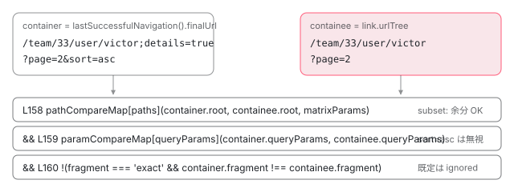

[目次](../README.md) › [Router の内側](README.md) › 第 18 回 / 全 21 回

# RouterLink の href と RouterLinkActive の判定：isActive と containsTree

> RouterLink が href を作り直すタイミング（ngOnChanges / router.events 購読）。RouterLinkActive.update が Router.isActive → containsTree → containsSegmentGroupHelper で 'exact' と 'subset' を比べる手順、exactMatchOptions / subsetMatchOptions の中身、ariaCurrentWhenActive。

angular/angular · 読了 約 12 分 · 中核 · [サイトで読む（デモが動きます）](https://angular-deep-dive-cyan.vercel.app/chapter/router-link-active)

---

`<a routerLink="/team/33">` と書くと `href` が付き、`routerLinkActive="active"` を足すと「いまそのページにいるとき」だけクラスが付きます。この章では、その `href` が**いつ・何から計算されるか**と、「いまそのページにいる」を**どの関数がどう判定しているか**を追います。クリックしたあとの流れは [boot シリーズの最終章](../boot/13-boot-spa-navigation.md)で追ったので、ここでは扱いません。

読む対象は `packages/router/src/directives/router_link.ts`、`directives/router_link_active.ts`、`url_tree.ts` の 3 ファイルです。

1. 1 本の RxJS パイプライン
2. URL → UrlTree
3. routerLink の配列 → UrlTree
4. Route 設定の検証と正規化
5. provideRouter の中身
6. 最初のナビゲーション
7. navigateByUrl → NavigationTransition
8. setupNavigations の全段
9. Recognizer と match
10. redirectTo
11. loadChildren と loadComponent
12. ガードの実行順
13. resolve と data と title
14. ActivatedRoute と Snapshot
15. RouterOutlet への配置
16. ブラウザの URL と履歴
17. Router.events の全種類
18. **RouterLink と RouterLinkActive**（この章）
19. withViewTransitions
20. withRouterResources
21. Navigation API

## 1. href はホストバインディングで、値は linkedSignal

📄 `angular/packages/router/src/directives/router_link.ts` L183–211 （▶ の行: 184, 186–187, 193, 195–196, 198, 206, 210）

```ts
183 │ @Directive({
184 ▶   selector: '[routerLink]',
185 │   host: {
186 ▶     '[attr.href]': 'reactiveHref()',
187 ▶     '[attr.target]': '_target()',
188 │   },
189 │ })
190 │ export class RouterLink implements OnChanges, OnDestroy {
191 │   private hrefAttributeValue = inject(new HostAttributeToken('href'), {optional: true});
192 │   /** @docs-private */
193 ▶   protected readonly reactiveHref = linkedSignal(() => {
194 │     // Never change href for non-anchor elements
195 ▶     if (!this.isAnchorElement) {
196 ▶       return this.hrefAttributeValue;
197 │     }
198 ▶     return this.computeHref(this._urlTree());
199 │   });
200 │   /**
201 │    * Represents an `href` attribute value applied to a host element,
202 │    * when a host element is an `<a>`/`<area>` tag or a compatible custom
203 │    * element. For other tags, the value is `null`.
204 │    */
205 │   get href() {
206 ▶     return untracked(this.reactiveHref);
207 │   }
208 │   /** @deprecated */
209 │   set href(value: string | null) {
210 ▶     this.reactiveHref.set(value);
211 │   }
```

184 行目、セレクタは `[routerLink]` 属性です。186 行目、`href` 属性は `reactiveHref()` の**ホストバインディング**（ディレクティブが自分の付いた要素の属性を書く仕組み）です。`applyAttributeValue` のような手続きで書き込んでいるのではなく、変更検知が走るたびに値を読み直して属性に反映します。

193 行目、`reactiveHref` は `linkedSignal` です。`linkedSignal` は「計算式で値が決まるが、外から `set` で一時的に上書きもできる signal」で、計算式の依存が変わると上書きは捨てられて再計算に戻ります。なぜ `computed` ではないのかは 210 行目にあります。非推奨の `href` セッターが `reactiveHref.set(value)` で手動上書きを許しているからです。

195〜196 行目、`<a>` でも `<area>` でもない要素（たとえば `<button routerLink>`）では、元から付いていた `href` 属性の値（`hrefAttributeValue`、191 行目で読み取り）をそのまま返します。つまり `<button>` に `href` は付きません。198 行目、アンカー要素のときだけ `computeHref(this._urlTree())` で計算します。

📄 `angular/packages/router/src/directives/router_link.ts` L376–400 （▶ の行: 384–387, 398）

```ts
376 │   constructor(
377 │     private router: Router,
378 │     private route: ActivatedRoute,
379 │     @Attribute('tabindex') private readonly tabIndexAttribute: string | null | undefined,
380 │     private readonly renderer: Renderer2,
381 │     private readonly el: ElementRef,
382 │     private locationStrategy?: LocationStrategy,
383 │   ) {
384 ▶     const tagName = el.nativeElement.tagName?.toLowerCase();
385 ▶     this.isAnchorElement =
386 ▶       tagName === 'a' ||
387 ▶       tagName === 'area' ||
388 │       !!(
389 │         // Avoid breaking in an SSR context where customElements might not
390 │         // be defined.
391 │         (
392 │           typeof customElements === 'object' &&
393 │           // observedAttributes is an optional static property/getter on a
394 │           // custom element. The spec states that this must be an array of
395 │           // strings.
396 │           (
397 │             customElements.get(tagName) as {observedAttributes?: string[]} | undefined
398 ▶           )?.observedAttributes?.includes?.('href')
399 │         )
400 │       );
```

384〜400 行目が「アンカー要素かどうか」の判定です。タグ名が `a` か `area`（386〜387 行目）、またはカスタム要素で `observedAttributes` に `'href'` を含むもの（398 行目）です。この値はコンストラクタで 1 回だけ決まります。

## 2. \_urlTree：何を読んで UrlTree を作るか

📄 `angular/packages/router/src/directives/router_link.ts` L537–572 （▶ の行: 538, 541–543, 548–549, 551, 554–558, 560, 564, 571）

```ts
537 │   /** @internal */
538 ▶   _urlTree = computed(
539 │     () => {
540 │       // Track path changes. It's knowing which segments we actually depend on is somewhat difficult
541 ▶       this.reactiveRouterState.path();
542 ▶       if (this._preserveFragment()) {
543 ▶         this.reactiveRouterState.fragment();
544 │       }
545 │       const shouldTrackParams = (handling: QueryParamsHandling | undefined | null) =>
546 │         handling === 'preserve' || handling === 'merge';
547 │       if (
548 ▶         shouldTrackParams(this._queryParamsHandling()) ||
549 ▶         shouldTrackParams(this.options?.defaultQueryParamsHandling)
550 │       ) {
551 ▶         this.reactiveRouterState.queryParams();
552 │       }
553 │ 
554 ▶       const routerLinkInput = this.routerLinkInput();
555 ▶       if (routerLinkInput === null || !this.router.createUrlTree) {
556 ▶         return null;
557 ▶       } else if (isUrlTree(routerLinkInput)) {
558 ▶         return routerLinkInput;
559 │       }
560 ▶       return this.router.createUrlTree(routerLinkInput, {
561 │         // If the `relativeTo` input is not defined, we want to use `this.route`
562 │         // by default.
563 │         // Otherwise, we should use the value provided by the user in the input.
564 ▶         relativeTo: this._relativeTo() !== undefined ? this._relativeTo() : this.route,
565 │         queryParams: this._queryParams(),
566 │         fragment: this._fragment(),
567 │         queryParamsHandling: this._queryParamsHandling(),
568 │         preserveFragment: this._preserveFragment(),
569 │       });
570 │     },
571 ▶     {equal: (a, b) => this.computeHref(a) === this.computeHref(b)},
572 │   );
```

538 行目、`_urlTree` は `computed` です。この中で読んだ signal が「依存」になり、どれかが変わると次に読まれたときに再計算されます。読んでいるものを順に見ます。

1. **541 行目：現在 URL のパス（`reactiveRouterState.path()`）**

   常に読みます。`routerLink="../edit"` のような相対リンクは現在位置で結果が変わるからです。コメントにあるとおり「どのセグメントに依存しているかを厳密に知るのは難しい」ので、パス全体を 1 本の signal として読んでいます。
2. **542〜544 行目：`preserveFragment` のときだけ現在のフラグメント**

   現在の `#...` を引き継ぐ設定のときだけ依存に入れます。
3. **548〜551 行目：`queryParamsHandling` が `'preserve'` か `'merge'` のときだけ現在のクエリ**

   自分の入力だけでなく 549 行目で `ROUTER_CONFIGURATION.defaultQueryParamsHandling`（アプリ全体の既定）も見ます。どちらかが引き継ぎ設定なら、現在 URL のクエリが変わるたびに `href` を作り直します。
4. **554〜558 行目：`routerLink` の入力そのもの**

   `null` なら 556 行目で `null`（リンク無効。`href` も消えます）。入力が `UrlTree` なら 558 行目でそのまま返します。この場合、他の入力は無視されます（開発モードではコンストラクタ内の `effect` が「UrlTree と queryParams は併用できない」エラーを投げます）。
5. **560〜569 行目：`Router.createUrlTree`**

   配列のコマンドをここで `UrlTree` に変換します。564 行目、`relativeTo` を指定していなければ **このディレクティブが inject した `ActivatedRoute`**（`this.route`、377〜378 行目）が基準です。配列から木を作る手順は [第 3 回](03-router-create-url-tree.md)で追っています。

571 行目が見落としやすい点です。`computed` の `equal` に 「**2 つの木を `href` 文字列にして比べる**」関数を渡しています。再計算の結果が別オブジェクトでも文字列が同じなら「変化なし」とみなされ、`reactiveHref` は再計算されません。依存が変わるたびに新しい `UrlTree` が作られても、DOM の `href` は変わらないときに書き換えないための工夫です。

📄 `angular/packages/router/src/directives/router_link.ts` L574–582 （▶ の行: 575, 579–580）

```ts
574 │   get urlTree(): UrlTree | null {
575 ▶     return untracked(this._urlTree);
576 │   }
577 │ 
578 │   private computeHref(urlTree: UrlTree | null): string | null {
579 ▶     return urlTree !== null && this.locationStrategy
580 ▶       ? (this.locationStrategy?.prepareExternalUrl(this.router.serializeUrl(urlTree)) ?? '')
581 │       : null;
582 │   }
```

579〜580 行目、`href` 文字列は `Router.serializeUrl(urlTree)` を `LocationStrategy.prepareExternalUrl` に通したものです。`<base href="/app/">` があれば ここで前置されます（[第 16 回](16-router-browser-url.md)）。575 行目、公開ゲッター `urlTree` は `untracked` で読みます。`untracked` は「この読み取りを依存として記録しない」という意味で、`RouterLinkActive` がテンプレートの外から読んでも誰の依存にもならないようにしています。

### 入力はすべて signal に写される

📄 `angular/packages/router/src/directives/router_link.ts` L454–469 （▶ の行: 455–458, 460–461, 463–464, 467）

```ts
454 │   @Input()
455 ▶   set routerLink(commandsOrUrlTree: readonly any[] | string | UrlTree | null | undefined) {
456 ▶     if (commandsOrUrlTree == null) {
457 ▶       this.routerLinkInput.set(null);
458 ▶       this.setTabIndexIfNotOnNativeEl(null);
459 │     } else {
460 ▶       if (isUrlTree(commandsOrUrlTree)) {
461 ▶         this.routerLinkInput.set(commandsOrUrlTree);
462 │       } else {
463 ▶         this.routerLinkInput.set(
464 ▶           Array.isArray(commandsOrUrlTree) ? commandsOrUrlTree : [commandsOrUrlTree],
465 │         );
466 │       }
467 ▶       this.setTabIndexIfNotOnNativeEl('0');
468 │     }
469 │   }
```

455 行目、`routerLink` 入力はセッターで、受け取った値を 457・461・463 行目で `routerLinkInput` signal に書きます。464 行目、文字列は 1 要素の配列に包まれます（`"/team"` → `['/team']`）。458・467 行目、アンカー以外の要素には `tabindex="0"` を付けてキーボードで到達できるようにし、`null` なら外します。

📄 `angular/packages/router/src/directives/router_link.ts` L237–245 （▶ の行: 237–238, 243–245）

```ts
237 ▶   @Input() set queryParams(value: Params | null | undefined) {
238 ▶     this._queryParams.set(value);
239 │   }
240 │   get queryParams(): Params | null | undefined {
241 │     return untracked(this._queryParams);
242 │   }
243 ▶   // Rather than trying deep equality checks or serialization, just allow urlTree to recompute
244 ▶   // whenever queryParams change (which will be rare).
245 ▶   private _queryParams = signal<Params | null | undefined>(undefined, {equal: () => false});
```

`queryParams` も同じ形です。245 行目、`equal: () => false` なので **同じオブジェクトを再代入しても必ず「変わった」扱い**になります（243〜244 行目のコメント。深い比較をするより再計算した方が安い、という判断です）。`[queryParams]="qp()"` のように signal を束縛していれば、`qp` が変わる → 変更検知で入力が書かれる → 238 行目 → `_urlTree` 再計算 → `reactiveHref` 再計算 → 次の変更検知で `href` 属性更新、という連鎖になります。

## 3. いつ更新されるか：ReactiveRouterState

541 行目で読んでいた `reactiveRouterState.path()` の正体です。同じファイルの先頭にあります。

📄 `angular/packages/router/src/directives/router_link.ts` L45–72 （▶ の行: 45–46, 48, 52–54, 59–61, 67–70）

```ts
45 ▶ // Converts non-reactive router state to reactive state via the NavigationEnd
46 ▶ // event. This isn't the ideal way of doing things, but is necessary to avoid
47 │ // breaking tests which have mocked the Router.
48 ▶ @Service()
49 │ export class ReactiveRouterState {
50 │   private readonly router = inject(Router);
51 │   private readonly stateManager = inject(StateManager);
52 ▶   readonly fragment = signal<string | null>('');
53 ▶   readonly queryParams = signal<Params>({});
54 ▶   readonly path = signal<string>('');
55 │   private readonly serializer = inject(UrlSerializer);
56 │ 
57 │   constructor() {
58 │     this.updateState();
59 ▶     this.router.events?.subscribe((e) => {
60 ▶       if (e instanceof NavigationEnd) {
61 ▶         this.updateState();
62 │       }
63 │     });
64 │   }
65 │ 
66 │   private updateState() {
67 ▶     const {fragment, root, queryParams} = this.stateManager.getCurrentUrlTree();
68 ▶     this.fragment.set(fragment);
69 ▶     this.queryParams.set(queryParams);
70 ▶     this.path.set(this.serializer.serialize(new UrlTree(root)));
71 │   }
72 │ }
```

48 行目、`@Service()`（ルートで 1 つの DI サービス）です。52〜54 行目、`fragment` / `queryParams` / `path` の 3 つの signal を持ちます。59〜63 行目、`Router.events` を購読し、**`NavigationEnd` が来たときだけ** 67〜70 行目で `StateManager.getCurrentUrlTree()` から 3 つを書き直します。45〜47 行目のコメントが正直です。「理想的ではないが、Router をモックしているテストを壊さないために `NavigationEnd` 経由で反応型に変換している」。

70 行目、`path` はルートの `UrlSegmentGroup` だけを直列化した文字列です。`signal` の既定の等価判定は `Object.is` なので、同じパスへ再ナビゲーションしても文字列が同じなら依存先に通知は飛びません。

> [!NOTE]
> **ポイント**
>
> まとめると、`href` が作り直されるのは次の 2 通りだけです。(1) `routerLink` / `queryParams` / `fragment` / `relativeTo` などの入力が変更検知で書かれたとき。(2) `NavigationEnd` のあと `ReactiveRouterState` の `path`（必要なら `fragment`・`queryParams`）が変わったとき。ナビゲーションの途中（`NavigationStart` 〜 `ActivateRoutes`）では変わりません。

📄 `angular/packages/router/src/directives/router_link.ts` L432–441 （▶ の行: 435–438）

```ts
432 │   /** @docs-private */
433 │   // TODO(atscott): Remove changes parameter in major version as a breaking
434 │   // change.
435 ▶   ngOnChanges(changes?: SimpleChanges): void {
436 ▶     // This is subscribed to by `RouterLinkActive` so that it knows to update
437 ▶     // when there are changes to the RouterLinks it's tracking.
438 ▶     this.onChanges.next(this);
439 │   }
440 │ 
441 │   private routerLinkInput = signal<readonly any[] | UrlTree | null>(null);
```

435〜438 行目、`ngOnChanges` は `onChanges` Subject に自分を流すだけです。436〜437 行目のコメントどおり、購読しているのは次節の `RouterLinkActive` です。

## 4. RouterLinkActive は 3 つのきっかけで update する

📄 `angular/packages/router/src/directives/router_link_active.ts` L109–123 （▶ の行: 110–111, 114, 119）

```ts
109 │ @Directive({
110 ▶   selector: '[routerLinkActive]',
111 ▶   exportAs: 'routerLinkActive',
112 │ })
113 │ export class RouterLinkActive implements OnChanges, OnDestroy, AfterContentInit {
114 ▶   @ContentChildren(RouterLink, {descendants: true}) links!: QueryList<RouterLink>;
115 │ 
116 │   private classes: string[] = [];
117 │   private routerEventsSubscription: Subscription;
118 │   private linkInputChangesSubscription?: Subscription;
119 ▶   private _isActive = false;
120 │ 
121 │   get isActive(): boolean {
122 │     return this._isActive;
123 │   }
```

110 行目、セレクタは `[routerLinkActive]`。111 行目、`exportAs` があるので `#rla="routerLinkActive"` でテンプレート変数に取れます。114 行目、`@ContentChildren(RouterLink, {descendants: true})` は 「この要素の**中身**にある `RouterLink` を、深さを問わず集める」クエリです。`<div routerLinkActive>` の下に `<a routerLink>` を複数置く使い方（ナビゲーションメニューの親に付ける）がこれで成立します。119 行目、判定結果は `_isActive` に持ちます。

📄 `angular/packages/router/src/directives/router_link_active.ts` L135–139 （▶ の行: 135, 139）

```ts
135 ▶   @Input() routerLinkActiveOptions:
136 │     | {exact: boolean}
137 │     | Partial<IsActiveMatchOptions>
138 │     | null
139 ▶     | undefined = {exact: false};
```

139 行目、`routerLinkActiveOptions` の既定値は `{exact: false}` です。

📄 `angular/packages/router/src/directives/router_link_active.ts` L168–181 （▶ の行: 168, 176–178）

```ts
168 ▶   private link = inject(RouterLink, {optional: true});
169 │ 
170 │   constructor(
171 │     private router: Router,
172 │     private element: ElementRef,
173 │     private renderer: Renderer2,
174 │     private readonly cdr: ChangeDetectorRef,
175 │   ) {
176 ▶     this.routerEventsSubscription = router.events.subscribe((s: Event) => {
177 ▶       if (s instanceof NavigationEnd) {
178 ▶         this.update();
179 │       }
180 │     });
181 │   }
```

168 行目、`inject(RouterLink, {optional: true})` は**同じ要素に付いている**`RouterLink` です （`<a routerLink routerLinkActive>` の形）。`ContentChildren` は中身しか集めないので、自分自身は別に取ります。176〜180 行目、きっかけその 1。`Router.events` で `NavigationEnd` が来たら `update()`。

📄 `angular/packages/router/src/directives/router_link_active.ts` L184–206 （▶ の行: 186–187, 189–190, 196–199, 201–203）

```ts
184 │   ngAfterContentInit(): void {
185 │     // `of(null)` is used to force subscribe body to execute once immediately (like `startWith`).
186 ▶     of(this.links.changes, of(null))
187 ▶       .pipe(mergeAll())
188 │       .subscribe((_) => {
189 ▶         this.update();
190 ▶         this.subscribeToEachLinkOnChanges();
191 │       });
192 │   }
193 │ 
194 │   private subscribeToEachLinkOnChanges() {
195 │     this.linkInputChangesSubscription?.unsubscribe();
196 ▶     const allLinkChanges = [...this.links.toArray(), this.link]
197 ▶       .filter((link): link is RouterLink => !!link)
198 ▶       .map((link) => link.onChanges);
199 ▶     this.linkInputChangesSubscription = from(allLinkChanges)
200 │       .pipe(mergeAll())
201 ▶       .subscribe((link) => {
202 ▶         if (this._isActive !== this.isLinkActive(this.router)(link)) {
203 ▶           this.update();
204 │         }
205 │       });
206 │   }
```

きっかけその 2。186〜187 行目、`links.changes`（中身の `RouterLink` が増減したとき）と `of(null)`（185 行目のコメント：最初に 1 回すぐ流すため）を `mergeAll` で束ねて購読します。189〜190 行目、`update()` と、リンクの入力変更の購読し直しです。

きっかけその 3。196〜199 行目、中身の全リンクと自分の要素のリンク（`this.link`）の `onChanges`（3 節で見た `RouterLink` の Subject）を集めて購読します。201〜204 行目、どれかのリンクの入力が変わったら、**そのリンクの活性が今の `_isActive` と食い違うときだけ**`update()`。リンク先が変わっただけで無条件に更新するのではなく、結果が変わりうるときだけ走らせています。

📄 `angular/packages/router/src/directives/router_link_active.ts` L208–221 （▶ の行: 209, 214–215, 219–220）

```ts
208 │   @Input()
209 ▶   set routerLinkActive(data: string[] | string | null | undefined) {
210 │     if (data == null) {
211 │       this.classes = [];
212 │       return;
213 │     }
214 ▶     const classes = Array.isArray(data) ? data : data.split(' ');
215 ▶     this.classes = classes.filter((c) => !!c);
216 │   }
217 │ 
218 │   /** @docs-private */
219 ▶   ngOnChanges(changes: SimpleChanges): void {
220 ▶     this.update();
221 │   }
```

209〜216 行目、`routerLinkActive="a b"` は 214 行目で空白区切りに分割され、配列ならそのまま、215 行目で空文字を除いて `classes` に入ります。219〜221 行目、入力が変わるたび（`ngOnChanges`）にも `update()`。これはきっかけ 1〜3 と別に、自分の入力変更に反応する経路です。

## 5. update：queueMicrotask で 1 回遅らせる

📄 `angular/packages/router/src/directives/router_link_active.ts` L228–259 （▶ の行: 229–230, 232–234, 236, 238, 241–242, 248, 252–254, 256）

```ts
228 │   private update(): void {
229 ▶     if (!this.links || !this.router.navigated) return;
230 ▶     if (this.routerLinkActiveOptions === null && !this._isActive) return;
231 │ 
232 ▶     queueMicrotask(() => {
233 ▶       const hasActiveLinks = this.hasActiveLinks();
234 ▶       this.classes.forEach((c) => {
235 │         if (hasActiveLinks) {
236 ▶           this.renderer.addClass(this.element.nativeElement, c);
237 │         } else {
238 ▶           this.renderer.removeClass(this.element.nativeElement, c);
239 │         }
240 │       });
241 ▶       if (hasActiveLinks && this.ariaCurrentWhenActive !== undefined) {
242 ▶         this.renderer.setAttribute(
243 │           this.element.nativeElement,
244 │           'aria-current',
245 │           this.ariaCurrentWhenActive.toString(),
246 │         );
247 │       } else {
248 ▶         this.renderer.removeAttribute(this.element.nativeElement, 'aria-current');
249 │       }
250 │ 
251 │       // Only emit change if the active state changed.
252 ▶       if (this._isActive !== hasActiveLinks) {
253 ▶         this._isActive = hasActiveLinks;
254 ▶         this.cdr.markForCheck();
255 │         // Emit on isActiveChange after classes are updated
256 ▶         this.isActiveChange.emit(hasActiveLinks);
257 │       }
258 │     });
259 │   }
```

1. **229 行目：`links` がまだ無い、または `router.navigated` が false なら何もしない**

   `Router.navigated` は最初のナビゲーションが `NavigationEnd` に到達するまで `false` のフィールドです。最初のナビゲーション前に判定しても意味がないので飛ばします。
2. **230 行目：`routerLinkActiveOptions === null` で、いま非活性なら何もしない**

   `null` は「絶対に活性にしない」という明示の設定です（6 節）。活性だったものを外す必要があるときだけ先に進みます。
3. **232 行目：`queueMicrotask`**

   ここから先はマイクロタスクで実行します。同期で行わない理由はソースのコメントには書かれていませんが、git の履歴に残っています。2017 年の修正 `82417b3`「fix(router): prevent RouterLinkActive from causing an infinite CD loop」で、同期の `cdr.detectChanges()` が `Promise.resolve().then(...)` に置き換えられ、2023 年の `#50485` で `queueMicrotask` に書き直されました。`update()` は `ngOnChanges`（221 行目）、つまり**変更検知の最中**からも呼ばれます。その場で状態を書き換えて `markForCheck` とイベント発火をすると、変更検知が変更検知を呼ぶ形になります。マイクロタスクに逃がせば、いま走っている変更検知が終わってから実行されます。
4. **233〜240 行目：`hasActiveLinks()` を 1 回計算し、クラスを足す／外す**

   `Renderer2.addClass` / `removeClass` で DOM に直接書きます。テンプレートの `[class]` バインディングではありません。だからこの処理に変更検知は要りません。
5. **241〜249 行目：`aria-current`**

   `ariaCurrentWhenActive` 入力が設定されていて活性なら、その値（`'page'` など）を `aria-current` 属性に書き、そうでなければ属性を外します。スクリーンリーダーに「いま開いているページ」を伝えるための属性です。
6. **252〜256 行目：活性状態が変わったときだけ、`_isActive` 更新 → `markForCheck` → `isActiveChange` emit**

   `markForCheck` が必要なのは、テンプレートで `rla.isActive` を読んでいる場合に、OnPush のコンポーネント（既定）でも次の変更検知で読み直してもらうためです。`isActiveChange` はクラスの更新より**後**に emit されます（255 行目のコメント）。

## 6. isLinkActive：オプションを 4 項目に正規化する

📄 `angular/packages/router/src/directives/router_link_active.ts` L261–290 （▶ の行: 269–270, 274–278, 281, 283, 287–288）

```ts
261 │   private isLinkActive(router: Router): (link: RouterLink) => boolean {
262 │     const opts = this.routerLinkActiveOptions;
263 │ 
264 │     // null vs undefined are intentionally treated differently:
265 │     //   undefined — semantically "not set", same as omitting the input entirely,
266 │     //               so the default subset match applies.
267 │     //   null      — an explicit opt-out: the caller wants the link to never be
268 │     //               considered active (e.g. dynamic UI where matching is not desired).
269 ▶     if (opts === null) {
270 ▶       return () => false;
271 │     }
272 │ 
273 │     let options: Partial<IsActiveMatchOptions>;
274 ▶     if (opts === undefined) {
275 ▶       options = {...subsetMatchOptions};
276 ▶     } else if (isActiveMatchOptions(opts)) {
277 ▶       options = opts;
278 ▶     } else if (opts.exact ?? false) {
279 │       // Note: `exact` can still be undefined with non-strict template type-checking,
280 │       // hence the nullish coalesce rather than a plain truthiness check.
281 ▶       options = {...exactMatchOptions};
282 │     } else {
283 ▶       options = {...subsetMatchOptions};
284 │     }
285 │ 
286 │     return (link: RouterLink) => {
287 ▶       const urlTree = link.urlTree;
288 ▶       return urlTree ? untracked(isActive(urlTree, router, options)) : false;
289 │     };
290 │   }
```

269〜270 行目、`null` なら常に `false` を返す関数。264〜268 行目のコメントが `undefined`（未設定＝既定の subset）と `null`（明示的に無効）を区別する理由を書いています。

274〜284 行目で 4 項目の `IsActiveMatchOptions` に揃えます。`undefined` → `subsetMatchOptions`（275 行目）、`paths` などのキーを 1 つでも持つ → そのまま（276〜277 行目。足りない項目は後で `containsTree` が埋めます）、`{exact: true}` → `exactMatchOptions`（281 行目）、それ以外 → `subsetMatchOptions`（283 行目）。

287〜288 行目、リンクの `urlTree`（2 節の 575 行目の `untracked` ゲッター）を取り、`isActive(urlTree, router, options)` を呼びます。この `isActive` は `url_tree.ts` の**関数**で `Signal<boolean>` を返すので、`untracked(...)` で値を 1 回読みます。

📄 `angular/packages/router/src/directives/router_link_active.ts` L292–306 （▶ の行: 294, 301, 305）

```ts
292 │   private hasActiveLinks(): boolean {
293 │     const isActiveCheckFn = this.isLinkActive(this.router);
294 ▶     return (this.link && isActiveCheckFn(this.link)) || this.links.some(isActiveCheckFn);
295 │   }
296 │ }
297 │ 
298 │ /**
299 │  * Use instead of `'paths' in options` to be compatible with property renaming
300 │  */
301 ▶ function isActiveMatchOptions(
302 │   options: {exact: boolean} | Partial<IsActiveMatchOptions>,
303 │ ): options is Partial<IsActiveMatchOptions> {
304 │   const o = options as Partial<IsActiveMatchOptions>;
305 ▶   return !!(o.paths || o.matrixParams || o.queryParams || o.fragment);
306 │ }
```

294 行目、自分の要素のリンクが活性、**または**中身のリンクの**どれか 1 つ**が活性なら活性です。親 `<div>` に付けたときに、子リンクのどれかが現在ページなら親にクラスが付くのはこの `some` です。301〜306 行目、`{exact}` 形式か `IsActiveMatchOptions` 形式かは、4 つのキーのどれかが truthy かで見分けます。

### isActive 関数：何と比べているか

📄 `angular/packages/router/src/url_tree.ts` L119–132 （▶ の行: 124–128）

```ts
119 │ export function isActive(
120 │   url: string | UrlTree,
121 │   router: Router,
122 │   matchOptions?: Partial<IsActiveMatchOptions>,
123 │ ): Signal<boolean> {
124 ▶   const urlTree = url instanceof UrlTree ? url : router.parseUrl(url);
125 ▶   return computed(() =>
126 ▶     containsTree(
127 ▶       router.lastSuccessfulNavigation()?.finalUrl ?? new UrlTree(),
128 ▶       urlTree,
129 │       matchOptions,
130 │     ),
131 │   );
132 │ }
```

124 行目、文字列なら `Router.parseUrl` で木にします。125〜131 行目、`computed` の中で `containsTree(container, containee, options)` を呼びます。**container（外側）は `router.lastSuccessfulNavigation()?.finalUrl`**、つまり最後に成功したナビゲーションの最終 URL （リダイレクト後）です。127 行目、まだ 1 回も成功していなければ空の `UrlTree` と比べます。**containee（内側）がリンクの木**です。「現在 URL がリンク URL を含んでいるか」が判定の向きです。

📄 `angular/packages/router/src/router.ts` L639–654 （▶ の行: 639, 641–644, 646, 649, 653）

```ts
639 ▶   isActive(url: string | UrlTree, matchOptions: boolean | Partial<IsActiveMatchOptions>): boolean {
640 │     let options: IsActiveMatchOptions;
641 ▶     if (matchOptions === true) {
642 ▶       options = {...exactMatchOptions};
643 ▶     } else if (matchOptions === false) {
644 ▶       options = {...subsetMatchOptions};
645 │     } else {
646 ▶       options = {...subsetMatchOptions, ...matchOptions};
647 │     }
648 │     if (isUrlTree(url)) {
649 ▶       return containsTree(this.currentUrlTree, url, options);
650 │     }
651 │ 
652 │     const urlTree = this.parseUrl(url);
653 ▶     return containsTree(this.currentUrlTree, urlTree, options);
654 │   }
```

参考に、非推奨（21.1）の `Router.isActive` メソッドです。641〜647 行目の正規化は同じですが、649・653 行目で比べる相手が `this.currentUrlTree`（`StateManager` の現在木）で、戻り値は `boolean` です。`RouterLinkActive` が使うのは関数版（signal 版）の方です。

## 7. exactMatchOptions と subsetMatchOptions の中身

📄 `angular/packages/router/src/url_tree.ts` L23–62 （▶ の行: 37, 46, 55, 61）

```ts
23 │ export interface IsActiveMatchOptions {
24 │   /**
25 │    * Defines the strategy for comparing the matrix parameters of two `UrlTree`s.
26 │    *
27 │    * The matrix parameter matching is dependent on the strategy for matching the
28 │    * segments. That is, if the `paths` option is set to `'subset'`, only
29 │    * the matrix parameters of the matching segments will be compared.
30 │    *
31 │    * - `'exact'`: Requires that matching segments also have exact matrix parameter
32 │    * matches.
33 │    * - `'subset'`: The matching segments in the router's active `UrlTree` may contain
34 │    * extra matrix parameters, but those that exist in the `UrlTree` in question must match.
35 │    * - `'ignored'`: When comparing `UrlTree`s, matrix params will be ignored.
36 │    */
37 ▶   matrixParams: 'exact' | 'subset' | 'ignored';
38 │   /**
39 │    * Defines the strategy for comparing the query parameters of two `UrlTree`s.
40 │    *
41 │    * - `'exact'`: the query parameters must match exactly.
42 │    * - `'subset'`: the active `UrlTree` may contain extra parameters,
43 │    * but must match the key and value of any that exist in the `UrlTree` in question.
44 │    * - `'ignored'`: When comparing `UrlTree`s, query params will be ignored.
45 │    */
46 ▶   queryParams: 'exact' | 'subset' | 'ignored';
47 │   /**
48 │    * Defines the strategy for comparing the `UrlSegment`s of the `UrlTree`s.
49 │    *
50 │    * - `'exact'`: all segments in each `UrlTree` must match.
51 │    * - `'subset'`: a `UrlTree` will be determined to be active if it
52 │    * is a subtree of the active route. That is, the active route may contain extra
53 │    * segments, but must at least have all the segments of the `UrlTree` in question.
54 │    */
55 ▶   paths: 'exact' | 'subset';
56 │   /**
57 │    * - `'exact'`: indicates that the `UrlTree` fragments must be equal.
58 │    * - `'ignored'`: the fragments will not be compared when determining if a
59 │    * `UrlTree` is active.
60 │    */
61 ▶   fragment: 'exact' | 'ignored';
62 │ }
```

4 項目です。37 行目 `matrixParams`（`;key=value`）、46 行目 `queryParams`（`?key=value`）、55 行目 `paths`（セグメント）、61 行目 `fragment`（`#...`）。`paths` だけは `'ignored'` がありません。

📄 `angular/packages/router/src/url_tree.ts` L83–103 （▶ の行: 87–91, 98–102）

```ts
 83 │ /**
 84 │  * The equivalent `IsActiveMatchOptions` options for `isActive` is called with `true`
 85 │  * (exact = true).
 86 │  */
 87 ▶ export const exactMatchOptions: IsActiveMatchOptions = {
 88 ▶   paths: 'exact',
 89 ▶   fragment: 'ignored',
 90 ▶   matrixParams: 'ignored',
 91 ▶   queryParams: 'exact',
 92 │ };
 93 │ 
 94 │ /**
 95 │  * The equivalent `IsActiveMatchOptions` options for `isActive` is called with `false`
 96 │  * (exact = false).
 97 │  */
 98 ▶ export const subsetMatchOptions: IsActiveMatchOptions = {
 99 ▶   paths: 'subset',
100 ▶   fragment: 'ignored',
101 ▶   matrixParams: 'ignored',
102 ▶   queryParams: 'subset',
103 │ };
```

ここが「exact: true は何を厳密にするのか」の答えです。88〜91 行目、`exact: true` は **`paths` と `queryParams` が `'exact'`**、**`fragment` と `matrixParams` は `'ignored'`** です。「完全一致」と言っても、マトリクスパラメータとフラグメントは見ていません。99〜102 行目、既定の `exact: false` は `paths` と `queryParams` が `'subset'`（現在 URL の方が余分に持っていてよい）です。マトリクスパラメータまで比べたいときは `[routerLinkActiveOptions]="{paths: 'exact', matrixParams: 'exact', queryParams: 'exact', fragment: 'exact'}"` のように 4 項目で渡します。

📄 `angular/packages/router/src/url_tree.ts` L73–81 （▶ の行: 74–75, 78–80）

```ts
73 │ const pathCompareMap: Record<IsActiveMatchOptions['paths'], PathCompareFn> = {
74 ▶   'exact': equalSegmentGroups,
75 ▶   'subset': containsSegmentGroup,
76 │ };
77 │ const paramCompareMap: Record<ParamMatchOptions, ParamCompareFn> = {
78 ▶   'exact': equalParams,
79 ▶   'subset': containsParams,
80 ▶   'ignored': () => true,
81 │ };
```

文字列の設定は 73〜81 行目のテーブルで関数に変わります。`paths`: `'exact'` → `equalSegmentGroups`、`'subset'` → `containsSegmentGroup`。パラメータ: `'exact'` → `equalParams`、`'subset'` → `containsParams`、`'ignored'` → 常に `true`（80 行目）。

## 8. containsTree：3 つの && で決まる

📄 `angular/packages/router/src/url_tree.ts` L147–162 （▶ の行: 152–154, 158–160）

```ts
147 │ export function containsTree(
148 │   container: UrlTree,
149 │   containee: UrlTree,
150 │   options?: Partial<IsActiveMatchOptions>,
151 │ ): boolean {
152 ▶   const matchOptions: IsActiveMatchOptions = {
153 ▶     ...subsetMatchOptions,
154 ▶     ...(options || {}),
155 │   };
156 │ 
157 │   return (
158 ▶     pathCompareMap[matchOptions.paths](container.root, containee.root, matchOptions.matrixParams) &&
159 ▶     paramCompareMap[matchOptions.queryParams](container.queryParams, containee.queryParams) &&
160 ▶     !(matchOptions.fragment === 'exact' && container.fragment !== containee.fragment)
161 │   );
162 │ }
```

152〜155 行目、渡されたオプションを `subsetMatchOptions` の上に重ねます。`Partial` で一部だけ渡しても、残りは subset 側の既定です。判定は 157〜161 行目の 1 つの式です。`&&` なので**左から順に評価し、false になった時点で止まります**。

1. **158 行目：パス**

   `pathCompareMap[paths](container.root, containee.root, matrixParams)`。マトリクスパラメータの比べ方はパス比較の中で使われます（セグメントごとに付くものだからです）。
2. **159 行目：クエリパラメータ**

   `paramCompareMap[queryParams](container.queryParams, containee.queryParams)`。木全体で 1 組です。
3. **160 行目：フラグメント**

   `'exact'` のときだけ `container.fragment !== containee.fragment` なら false。

### paths: 'exact' → equalSegmentGroups

📄 `angular/packages/router/src/url_tree.ts` L164–185 （▶ の行: 166, 174–175, 178–181）

```ts
164 │ function equalParams(container: Params, containee: Params): boolean {
165 │   // TODO: This does not handle array params correctly.
166 ▶   return shallowEqual(container, containee);
167 │ }
168 │ 
169 │ function equalSegmentGroups(
170 │   container: UrlSegmentGroup,
171 │   containee: UrlSegmentGroup,
172 │   matrixParams: ParamMatchOptions,
173 │ ): boolean {
174 ▶   if (!equalPath(container.segments, containee.segments)) return false;
175 ▶   if (!matrixParamsMatch(container.segments, containee.segments, matrixParams)) {
176 │     return false;
177 │   }
178 ▶   if (container.numberOfChildren !== containee.numberOfChildren) return false;
179 ▶   for (const c in containee.children) {
180 ▶     if (!container.children[c]) return false;
181 ▶     if (!equalSegmentGroups(container.children[c], containee.children[c], matrixParams))
182 │       return false;
183 │   }
184 │   return true;
185 │ }
```

174 行目、まず `equalPath`（セグメントの `path` 文字列が同じ長さ・同じ並び。404〜407 行目）。175 行目、`matrixParamsMatch`。178 行目、**子 outlet の数が同じ**。179〜183 行目、containee の子 outlet ごとに container に同名の子があり、再帰で等しいこと。166 行目、`equalParams` は `shallowEqual`（キー数が同じで、すべてのキーの値が等しい）です。

📄 `angular/packages/router/src/url_tree.ts` L404–407 （▶ の行: 405–406）

```ts
404 │ export function equalPath(as: UrlSegment[], bs: UrlSegment[]): boolean {
405 ▶   if (as.length !== bs.length) return false;
406 ▶   return as.every((a, i) => a.path === bs[i].path);
407 │ }
```

### paths: 'subset' → containsSegmentGroupHelper の 3 分岐

📄 `angular/packages/router/src/url_tree.ts` L187–200 （▶ の行: 189–190, 199）

```ts
187 │ function containsParams(container: Params, containee: Params): boolean {
188 │   return (
189 ▶     Object.keys(containee).length <= Object.keys(container).length &&
190 ▶     Object.keys(containee).every((key) => equalArraysOrString(container[key], containee[key]))
191 │   );
192 │ }
193 │ 
194 │ function containsSegmentGroup(
195 │   container: UrlSegmentGroup,
196 │   containee: UrlSegmentGroup,
197 │   matrixParams: ParamMatchOptions,
198 │ ): boolean {
199 ▶   return containsSegmentGroupHelper(container, containee, containee.segments, matrixParams);
200 │ }
```

189〜190 行目、`containsParams` は「containee のキー数が container 以下で、containee の全キーについて値が等しい」です。container（現在 URL）に余分なクエリがあっても通ります。199 行目、`containsSegmentGroup` は containee のセグメント配列を持って helper に入ります。

📄 `angular/packages/router/src/url_tree.ts` L202–237 （▶ の行: 208–212, 214–219, 224–230）

```ts
202 │ function containsSegmentGroupHelper(
203 │   container: UrlSegmentGroup,
204 │   containee: UrlSegmentGroup,
205 │   containeePaths: UrlSegment[],
206 │   matrixParams: ParamMatchOptions,
207 │ ): boolean {
208 ▶   if (container.segments.length > containeePaths.length) {
209 ▶     const current = container.segments.slice(0, containeePaths.length);
210 ▶     if (!equalPath(current, containeePaths)) return false;
211 ▶     if (containee.hasChildren()) return false;
212 ▶     if (!matrixParamsMatch(current, containeePaths, matrixParams)) return false;
213 │     return true;
214 ▶   } else if (container.segments.length === containeePaths.length) {
215 ▶     if (!equalPath(container.segments, containeePaths)) return false;
216 ▶     if (!matrixParamsMatch(container.segments, containeePaths, matrixParams)) return false;
217 ▶     for (const c in containee.children) {
218 ▶       if (!container.children[c]) return false;
219 ▶       if (!containsSegmentGroup(container.children[c], containee.children[c], matrixParams)) {
220 │         return false;
221 │       }
222 │     }
223 │     return true;
224 ▶   } else {
225 ▶     const current = containeePaths.slice(0, container.segments.length);
226 ▶     const next = containeePaths.slice(container.segments.length);
227 ▶     if (!equalPath(container.segments, current)) return false;
228 ▶     if (!matrixParamsMatch(container.segments, current, matrixParams)) return false;
229 ▶     if (!container.children[PRIMARY_OUTLET]) return false;
230 ▶     return containsSegmentGroupHelper(
231 │       container.children[PRIMARY_OUTLET],
232 │       containee,
233 │       next,
234 │       matrixParams,
235 │     );
236 │   }
237 │ }
```

`UrlSegmentGroup` は「セグメントの配列 + 名前付きの子」でした（[第 2 回](02-router-url-tree.md)）。helper は container と containee のセグメント数の大小で 3 つに分かれます。

1. **208〜213 行目：container の方が長い**

   209 行目で container の先頭を containee と同じ長さに切り、210 行目で `equalPath`。211 行目、**containee に子があれば false**（リンク側が子 outlet を指定しているのに現在 URL のこの階層には余りがあるだけ、は不一致）。212 行目でマトリクスパラメータを見て、true。現在 URL `/user/bob`、リンク `/user` が活性になるのはこの分岐です。
2. **214〜223 行目：同じ長さ**

   215〜216 行目で全セグメントとマトリクスを比べ、217〜222 行目で containee の子 outlet ごとに container の同名の子へ再帰します。`equalSegmentGroups` との違いは、**container に余分な子 outlet があっても構わない**ことです（子の数は比べません）。
3. **224〜236 行目：containee の方が長い**

   225〜226 行目で containee を container の長さで前後に分け、227〜228 行目で前半を比べます。229 行目、**container の `primary` 子だけ**を次の階層として、230〜235 行目で後半を持って再帰します。`DefaultUrlSerializer` が `/a/b` を「空のルート + primary 子 \[a, b\]」として解析するので、実際にはほとんどの比較がまずこの分岐（長さ 0 &lt; n）を通ってから primary 子に降ります。

📄 `angular/packages/router/src/url_tree.ts` L239–247 （▶ の行: 244–245）

```ts
239 │ function matrixParamsMatch(
240 │   containerPaths: UrlSegment[],
241 │   containeePaths: UrlSegment[],
242 │   options: ParamMatchOptions,
243 │ ) {
244 ▶   return containeePaths.every((containeeSegment, i) => {
245 ▶     return paramCompareMap[options](containerPaths[i].parameters, containeeSegment.parameters);
246 │   });
247 │ }
```

244〜245 行目、マトリクスパラメータは **containee のセグメントごと**に、同じ位置の container セグメントの `parameters` と `paramCompareMap[options]` で比べます。`'ignored'` なら 80 行目の `() => true` です。

📄 `angular/packages/router/src/utils/collection.ts` L21–40 （▶ の行: 29, 35）

```ts
21 │ export function shallowEqual(
22 │   a: {[key: string | symbol]: any},
23 │   b: {[key: string | symbol]: any},
24 │ ): boolean {
25 │   // While `undefined` should never be possible, it would sometimes be the case in IE 11
26 │   // and pre-chromium Edge. The check below accounts for this edge case.
27 │   const k1 = a ? getDataKeys(a) : undefined;
28 │   const k2 = b ? getDataKeys(b) : undefined;
29 ▶   if (!k1 || !k2 || k1.length != k2.length) {
30 │     return false;
31 │   }
32 │   let key: string | symbol;
33 │   for (let i = 0; i < k1.length; i++) {
34 │     key = k1[i];
35 ▶     if (!equalArraysOrString(a[key], b[key])) {
36 │       return false;
37 │     }
38 │   }
39 │   return true;
40 │ }
```

📄 `angular/packages/router/src/utils/collection.ts` L52–64 （▶ の行: 56, 58–60, 62）

```ts
52 │ export function equalArraysOrString(
53 │   a: string | readonly string[],
54 │   b: string | readonly string[],
55 │ ): boolean {
56 ▶   if (Array.isArray(a) && Array.isArray(b)) {
57 │     if (a.length !== b.length) return false;
58 ▶     const aSorted = [...a].sort();
59 ▶     const bSorted = [...b].sort();
60 ▶     return aSorted.every((val, index) => bSorted[index] === val);
61 │   } else {
62 ▶     return a === b;
63 │   }
64 │ }
```

値の比較は `equalArraysOrString` です。56〜60 行目、両方が配列（`?tag=a&tag=b` のような複数値）なら **並び替えてから**要素ごとに比べます。順序は問いません。62 行目、それ以外は `===` です。



*containsTree の判定の向き。container（現在 URL）が containee（リンク）を「含む」か。paths → queryParams → fragment の順に && で評価する。*

> **🧪 DEMO — containsTree の判定過程**
>
> 現在 URL とリンク URL を入れ、オプションを選ぶと、url\_tree.ts と同じ順・同じ分岐で判定が 1 行ずつ出ます。URL の解析は本物の `DefaultUrlSerializer` です（`(a//aux:b)` の副 outlet 記法も使えます）。比較部分はこのページが同じ規則で再現したものです。
>
> ▶ [このデモはサイトで動かせます](https://angular-deep-dive-cyan.vercel.app/chapter/router-link-active)

## ここまでの呼び出し（NavigationEnd のあと）

- `this.events.next(new NavigationEnd(...))` — router/src/navigation\_transition.ts L826 — *ActivateRoutes の直後*
  - `Router.subscribeToNavigationEvents` の購読 — router/src/router.ts L194 — *stateManager.handleRouterEvent のあと公開 events へ*
    - `ReactiveRouterState.updateState()` — router/src/directives/router\_link.ts L61 — *path / queryParams / fragment の signal を書く*
      - `RouterLink._urlTree` が dirty — router\_link.ts L538 — *次の変更検知で reactiveHref() → \[attr.href\]*
    - `RouterLinkActive.update()` — router/src/directives/router\_link\_active.ts L178
      - `queueMicrotask(...)` — router\_link\_active.ts L232 — *── ここで変更検知が終わるのを待つ ──*
        - `hasActiveLinks()` — router\_link\_active.ts L292 — *自分のリンク || links.some*
          - `isLinkActive(router)(link)` — router\_link\_active.ts L261 — *オプションを 4 項目に正規化*
            - `isActive(link.urlTree, router, options)` — router/src/url\_tree.ts L119 — *computed を作り untracked で 1 回読む*
              - `containsTree(lastSuccessfulNavigation().finalUrl, urlTree, options)` — url\_tree.ts L147
                - `pathCompareMap[paths](...)` → `paramCompareMap[queryParams](...)` → fragment — url\_tree.ts L158-160
        - `renderer.addClass / removeClass`、`aria-current` — router\_link\_active.ts L236-248
        - `cdr.markForCheck()` → `isActiveChange.emit()` — router\_link\_active.ts L254-256 — *活性状態が変わったときだけ*

## 聞かれそうな質問

**Q. routerLink の href はいつ計算されますか？queryParams を signal で渡していて値が変わったら更新されますか？**

`href` はホストバインディング `[attr.href]="reactiveHref()"`（router\_link.ts 186 行目）で、`reactiveHref` は `_urlTree` computed（538 行目）から作る `linkedSignal`（193 行目）です。再計算されるのは依存 signal が変わったときだけで、依存は (1) 各入力セッターが書く signal（`queryParams` は 238 行目）、(2) `ReactiveRouterState` の `path`（541 行目。`NavigationEnd` で 67〜70 行目が更新）、条件付きで `fragment`・`queryParams`（542〜551 行目）です。`[queryParams]="qp()"` なら、`qp` が変わる → 変更検知が入力を書く → 238 行目 → 再計算 → 次の変更検知で `href` 属性が変わります。245 行目の `equal: () => false` により、同じオブジェクトを渡し直しても再計算されます。

**Q. routerLinkActive はなぜ queueMicrotask で 1 回遅らせているのですか？**

`update()`（router\_link\_active.ts 228 行目）は `ngOnChanges`（221 行目）からも呼ばれるので、変更検知の最中に実行されることがあります。その中で `_isActive` を書き、`markForCheck` と `isActiveChange.emit`（253〜256 行目）をすると、変更検知中に変更検知を要求する形になります。ソースのコメントには理由が無く、git 履歴（2017 年の `82417b3`「prevent RouterLinkActive from causing an infinite CD loop」）に残っています。同期の `cdr.detectChanges()` を `Promise.resolve` に置き換え、2023 年の `#50485` で `queueMicrotask`（232 行目）になりました。

**Q. exact: true のとき queryParams も比べますか？matrixParams は？**

`exactMatchOptions`（url\_tree.ts 87〜92 行目）は `paths: 'exact'`、`queryParams: 'exact'`、`matrixParams: 'ignored'`、`fragment: 'ignored'` です。クエリは完全一致（`shallowEqual`、166 行目）が必要ですが、**マトリクスパラメータとフラグメントは見ません**。見たいときは `routerLinkActiveOptions` に 4 項目の `IsActiveMatchOptions` を渡します（`isLinkActive` 276〜277 行目でそのまま使われ、足りない項目は 152〜155 行目で subset 側の既定が入ります）。

**Q. 現在 URL が /user/bob のとき、routerLink="/user" にもクラスが付くのはなぜですか？**

既定は `subsetMatchOptions`（98〜103 行目）で `paths: 'subset'` です。`containsSegmentGroupHelper` の 208〜213 行目の分岐で、container（`/user/bob`）の先頭を containee（`/user`）の長さに切って比べ、containee に子が無ければ `true` です。付けたくなければ `[routerLinkActiveOptions]="{exact: true}"` で `equalSegmentGroups`（169 行目。174 行目の `equalPath` は長さも比べる）に切り替えます。

**Q. 親の &lt;div routerLinkActive&gt; に、子リンクのどれかが活性ならクラスが付くのはどの行ですか？**

114 行目の `@ContentChildren(RouterLink, {descendants: true})` で中身のリンクを集め、`hasActiveLinks`（294 行目）が `this.links.some(isActiveCheckFn)` で「どれか 1 つ」を見ます。子リンクの `routerLink` 入力が変わると 196〜204 行目の購読で再判定されます。

**Q. isActive 関数と Router.isActive は同じですか？**

比べる相手が違います。関数版（url\_tree.ts 119 行目）は `router.lastSuccessfulNavigation()?.finalUrl`（127 行目）を container にした `Signal<boolean>` を返します。メソッド版（router.ts 639 行目、21.1 で非推奨）は `this.currentUrlTree`（649・653 行目）と比べて `boolean` を返します。`RouterLinkActive` が使うのは関数版です（router\_link\_active.ts 288 行目）。

## 読み終えて

- `href` は `[attr.href]="reactiveHref()"` のホストバインディング。値は `_urlTree` computed → `computeHref`（`serializeUrl` + `prepareExternalUrl`）で、`equal` は `href` 文字列の比較
- 再計算のきっかけは入力 signal と `ReactiveRouterState`（`NavigationEnd` で更新）の 2 つだけ。ナビゲーション途中では変わらない
- `RouterLinkActive.update` は `NavigationEnd` / `links.changes` / 各リンクの `ngOnChanges` / 自分の `ngOnChanges` から呼ばれ、`queueMicrotask` で変更検知の外に出てからクラスを書く
- 判定は `containsTree(現在の finalUrl, リンクの木, options)`。`paths → queryParams → fragment` の順に `&&`
- `exact: true` = `paths` と `queryParams` が exact、`matrixParams` と `fragment` は ignored。既定は両方 subset

---

← 前: [Router.events の全種類と出る順番：どの行が何を流すか](17-router-events.md)  
次: [withViewTransitions：document.startViewTransition をどこで待つか](19-router-view-transitions.md) →
