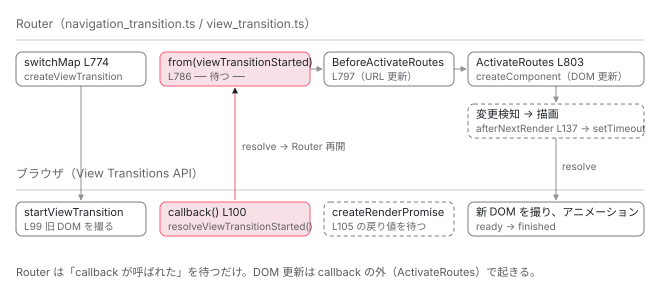

[目次](../README.md) › [Router の内側](README.md) › 第 19 回 / 全 21 回

# withViewTransitions：document.startViewTransition をどこで待つか

> createViewTransition が afterNextRender の Promise と startViewTransition を組み合わせ、パイプラインが「遷移の開始」を待って ActivateRoutes に進む流れ。skipInitialTransition、onViewTransitionCreated、hasUAVisualTransition の意味。

angular/angular · 読了 約 11 分 · 発展 · [サイトで読む（デモが動きます）](https://angular-deep-dive-cyan.vercel.app/chapter/router-view-transitions)

---

`provideRouter(routes, withViewTransitions())` と書くと、ページ遷移のときに新旧の画面がクロスフェードします。ブラウザの View Transitions API（`document.startViewTransition(callback)`：現在の DOM のスナップショットを撮り、`callback` で DOM を更新させ、新旧をアニメーションで切り替える API）を使っています。この章では、Router が**パイプラインのどこで**`startViewTransition` を呼び、**何を待ってから** DOM を変えるのか、そして `skipInitialTransition`・`onViewTransitionCreated`・`hasUAVisualTransition` の 3 つがどの `if` に対応するのかを追います。

読む対象は `packages/router/src/utils/view_transition.ts`（139 行、全部読みます）と、`navigation_transition.ts` の 774〜793 行目、`provide_router.ts` の `withViewTransitions` です。

1. 1 本の RxJS パイプライン
2. URL → UrlTree
3. routerLink の配列 → UrlTree
4. Route 設定の検証と正規化
5. provideRouter の中身
6. 最初のナビゲーション
7. navigateByUrl → NavigationTransition
8. setupNavigations の全段
9. Recognizer と match
10. redirectTo
11. loadChildren と loadComponent
12. ガードの実行順
13. resolve と data と title
14. ActivatedRoute と Snapshot
15. RouterOutlet への配置
16. ブラウザの URL と履歴
17. Router.events の全種類
18. RouterLink と RouterLinkActive
19. **withViewTransitions**（この章）
20. withRouterResources
21. Navigation API

## 1. withViewTransitions が provide するのは 2 つ

📄 `angular/packages/router/src/provide_router.ts` L892–904 （▶ の行: 892, 897, 899–900）

```ts
892 ▶ export function withViewTransitions(
893 │   options?: ViewTransitionsFeatureOptions,
894 │ ): ViewTransitionsFeature {
895 │   performanceMarkFeature('NgRouterViewTransitions');
896 │   const providers = [
897 ▶     {provide: CREATE_VIEW_TRANSITION, useValue: createViewTransition},
898 │     {
899 ▶       provide: VIEW_TRANSITION_OPTIONS,
900 ▶       useValue: {skipNextTransition: !!options?.skipInitialTransition, ...options},
901 │     },
902 │   ];
903 │   return routerFeature(RouterFeatureKind.ViewTransitionsFeature, providers);
904 │ }
```

897 行目、`CREATE_VIEW_TRANSITION` トークンに `createViewTransition` という**関数そのもの**を `useValue` で入れます。899〜900 行目、`VIEW_TRANSITION_OPTIONS` トークンに、あなたが渡したオプションと `skipNextTransition: !!options?.skipInitialTransition` を合わせたオブジェクトを入れます。`skipInitialTransition` は「次の 1 回を飛ばす」という**可変の状態**`skipNextTransition` に変換されて保持されます。この名前の違いが 3 節で効きます。

📄 `angular/packages/router/src/utils/view_transition.ts` L14–19 （▶ の行: 14, 17–18）

```ts
14 ▶ export const CREATE_VIEW_TRANSITION = new InjectionToken<typeof createViewTransition>(
15 │   typeof ngDevMode !== 'undefined' && ngDevMode ? 'view transition helper' : '',
16 │ );
17 ▶ export const VIEW_TRANSITION_OPTIONS = new InjectionToken<
18 ▶   ViewTransitionsFeatureOptions & {skipNextTransition: boolean}
19 │ >(typeof ngDevMode !== 'undefined' && ngDevMode ? 'view transition options' : '');
```

14 行目、トークンの型は `typeof createViewTransition`。17〜18 行目、オプション側の型は公開インターフェイス `ViewTransitionsFeatureOptions` に内部用の `skipNextTransition: boolean` を足したものです。

📄 `angular/packages/router/src/utils/view_transition.ts` L27–40 （▶ の行: 32, 39）

```ts
27 │ export interface ViewTransitionsFeatureOptions {
28 │   /**
29 │    * Skips the very first call to `startViewTransition`. This can be useful for disabling the
30 │    * animation during the application's initial loading phase.
31 │    */
32 ▶   skipInitialTransition?: boolean;
33 │ 
34 │   /**
35 │    * A function to run after the `ViewTransition` is created.
36 │    *
37 │    * This function is run in an injection context and can use `inject`.
38 │    */
39 ▶   onViewTransitionCreated?: (transitionInfo: ViewTransitionInfo) => void;
40 │ }
```

📄 `angular/packages/router/src/utils/view_transition.ts` L48–62 （▶ の行: 53, 57, 61）

```ts
48 │ export interface ViewTransitionInfo {
49 │   /**
50 │    * The `ViewTransition` returned by the call to `startViewTransition`.
51 │    * @see https://developer.mozilla.org/en-US/docs/Web/API/ViewTransition
52 │    */
53 ▶   transition: ViewTransition;
54 │   /**
55 │    * The `ActivatedRouteSnapshot` that the navigation is transitioning from.
56 │    */
57 ▶   from: ActivatedRouteSnapshot;
58 │   /**
59 │    * The `ActivatedRouteSnapshot` that the navigation is transitioning to.
60 │    */
61 ▶   to: ActivatedRouteSnapshot;
62 │ }
```

あなたが設定できるのは 32 行目 `skipInitialTransition` と 39 行目 `onViewTransitionCreated` の 2 つだけです。後者が受け取る `ViewTransitionInfo` は 53 行目のブラウザの `ViewTransition` オブジェクト、57・61 行目の遷移元・遷移先の `ActivatedRouteSnapshot` です。

## 2. パイプラインのどこで待つか

📄 `angular/packages/router/src/navigation_transition.ts` L371–376 （▶ の行: 372）

```ts
371 │   private readonly urlHandlingStrategy = inject(UrlHandlingStrategy);
372 ▶   private readonly createViewTransition = inject(CREATE_VIEW_TRANSITION, {optional: true});
373 │   private readonly navigationErrorHandler = inject(NAVIGATION_ERROR_HANDLER, {optional: true});
374 │   private readonly routerResourcesFeature = inject(ROUTER_RESOURCES_FEATURE, {
375 │     optional: true,
376 │   });
```

372 行目、`NavigationTransitions` は `CREATE_VIEW_TRANSITION` を `optional: true` で inject します。`withViewTransitions()` を付けなければ `null` です。

📄 `angular/packages/router/src/navigation_transition.ts` L771–793 （▶ の行: 771–772, 774, 776–780, 785–787, 793）

```ts
771 ▶           this.routerResourcesFeature?.setupAndRunResources(abortController.signal) ?? ((t) => t),
772 ▶           switchTap(() => this.afterPreactivation()),
773 │ 
774 ▶           switchMap(() => {
775 │             const {currentSnapshot, targetSnapshot} = overallTransitionState;
776 ▶             const viewTransitionStarted = this.createViewTransition?.(
777 ▶               this.environmentInjector,
778 ▶               currentSnapshot.root,
779 ▶               targetSnapshot!.root,
780 ▶               overallTransitionState.hasUAVisualTransition,
781 │             );
782 │ 
783 │             // If view transitions are enabled, block the navigation until the view
784 │             // transition callback starts. Otherwise, continue immediately.
785 ▶             return viewTransitionStarted
786 ▶               ? from(viewTransitionStarted).pipe(map(() => overallTransitionState))
787 ▶               : of(overallTransitionState);
788 │           }),
789 │ 
790 │           // Ensure that if some observable used to drive the transition doesn't
791 │           // complete, the navigation still finalizes This should never happen, but
792 │           // this is done as a safety measure to avoid surfacing this error (#49567).
793 ▶           take(1),
```

[第 8 回](08-router-pipeline.md)で見た段の並びの中で、771 行目の `setupAndRunResources`（[次章](20-router-resources.md)）と 772 行目の `afterPreactivation` のあと、**774 行目の `switchMap`** がビュー遷移の段です。

1. **776〜781 行目：`createViewTransition?.(injector, from, to, hasUAVisualTransition)`**

   `?.` なので、トークンが無ければ呼ばれず `viewTransitionStarted` は `undefined` です。引数は `EnvironmentInjector`、現在と遷移先の `RouterStateSnapshot` の `root`（`ActivatedRouteSnapshot`）、そしてこの遷移の `hasUAVisualTransition`（4 節）。
2. **785〜787 行目：Promise が返ったら `from(...)` で待つ。`undefined` なら `of(...)` で即続行**

   783〜784 行目のコメントどおり、**「ビュー遷移のコールバックが始まるまで」ナビゲーションを止めます**。何を待っているかは 3 節で分かります。
3. **793 行目：`take(1)`**

   790〜792 行目のコメント。上流の Observable が complete しなくてもナビゲーションを終わらせるための安全弁です。

📄 `angular/packages/router/src/navigation_transition.ts` L795–809 （▶ の行: 795, 797, 802–803, 809）

```ts
795 ▶           switchMap((t: NavigationTransition) => {
796 │             abortable = false;
797 ▶             this.events.next(new BeforeActivateRoutes());
798 │             const deferred = overallTransitionState.beforeActivateHandler.deferredHandle;
799 │             return deferred ? from(deferred.then(() => t)) : of(t);
800 │           }),
801 │ 
802 ▶           tap((t: NavigationTransition) => {
803 ▶             new ActivateRoutes(
804 │               router.routeReuseStrategy,
805 │               overallTransitionState.targetRouterState!,
806 │               overallTransitionState.currentRouterState,
807 │               (evt: Event) => this.events.next(evt),
808 │               this.inputBindingEnabled,
809 ▶             ).activate(this.rootContexts);
```

待ちが解けたあとが 795 行目です。797 行目で `BeforeActivateRoutes`（`HistoryStateManager` がここで URL を書きます。[第 16 回](16-router-browser-url.md)）、802〜809 行目で `ActivateRoutes.activate`、つまり `RouterOutlet` のコンポーネント生成・破棄（[第 15 回](15-router-activate-routes.md)）です。**`withViewTransitions` を付けると、URL の更新と DOM の更新の両方が、ビュー遷移の開始を待ってから起きます。**

## 3. createViewTransition：if の順

📄 `angular/packages/router/src/utils/view_transition.ts` L71–93 （▶ の行: 71, 75–78, 80–81, 84, 87–88, 92）

```ts
71 ▶ export function createViewTransition(
72 │   injector: Injector,
73 │   from: ActivatedRouteSnapshot,
74 │   to: ActivatedRouteSnapshot,
75 ▶   hasUAVisualTransition?: boolean,
76 ▶ ): Promise<void> | undefined {
77 ▶   const transitionOptions = injector.get(VIEW_TRANSITION_OPTIONS);
78 ▶   const document = injector.get(DOCUMENT);
79 │ 
80 ▶   if (hasUAVisualTransition) {
81 ▶     transitionOptions.skipNextTransition = false;
82 │     // The browser has already started presenting the navigation. Continuing synchronously gives it
83 │     // the earliest opportunity to display the post-navigation DOM.
84 ▶     return;
85 │   }
86 │ 
87 ▶   if (!document.startViewTransition || transitionOptions.skipNextTransition) {
88 ▶     transitionOptions.skipNextTransition = false;
89 │     // The timing of `startViewTransition` is closer to a macrotask. It won't be called
90 │     // until the current event loop exits so we use a promise resolved in a timeout instead
91 │     // of Promise.resolve().
92 ▶     return new Promise((resolve) => setTimeout(resolve));
93 │   }
```

1. **77〜78 行目：オプションと `DOCUMENT` を取り出す**

   `document` はグローバルではなく DI の `DOCUMENT` です。SSR では `startViewTransition` を持たないオブジェクトになります。
2. **80〜85 行目：`hasUAVisualTransition` が true なら、何もせず `return`（`undefined`）**

   82〜83 行目のコメント。「ブラウザが既にこのナビゲーションの表示を始めている。同期で続けるのが、遷移後の DOM を最も早く見せる方法」。81 行目で `skipNextTransition` も `false` に戻します。`undefined` が返るので、2 節の 787 行目 `of(...)` で待ちません。
3. **87〜93 行目：`startViewTransition` が無い、または `skipNextTransition` が true なら、`setTimeout` で解決する Promise**

   88 行目で `skipNextTransition = false`。**ここで 1 回だけ飛ばす**仕組みが完結しています。89〜91 行目のコメントが Promise の作り方の理由です。「`startViewTransition` のタイミングはマクロタスクに近い。現在のイベントループを抜けるまで呼ばれない。だから `Promise.resolve()` ではなく `setTimeout` で解決する Promise にする」。未対応ブラウザでも、対応ブラウザと**同じタイミング**で DOM が変わるように揃えています。

📄 `angular/packages/router/src/utils/view_transition.ts` L95–127 （▶ の行: 95–97, 99–100, 105, 107, 112, 117, 122–124, 126）

```ts
 95 ▶   let resolveViewTransitionStarted: () => void;
 96 ▶   const viewTransitionStarted = new Promise<void>((resolve) => {
 97 ▶     resolveViewTransitionStarted = resolve;
 98 │   });
 99 ▶   const transition = document.startViewTransition(() => {
100 ▶     resolveViewTransitionStarted();
101 │     // We don't actually update dom within the transition callback. The resolving of the above
102 │     // promise unblocks the Router navigation, which synchronously activates and deactivates
103 │     // routes (the DOM update). This view transition waits for the next change detection to
104 │     // complete (below), which includes the update phase of the routed components.
105 ▶     return createRenderPromise(injector);
106 │   });
107 ▶   transition.updateCallbackDone.catch((error) => {
108 │     if (typeof ngDevMode === 'undefined' || ngDevMode) {
109 │       console.error(error);
110 │     }
111 │   });
112 ▶   transition.ready.catch((error) => {
113 │     if (typeof ngDevMode === 'undefined' || ngDevMode) {
114 │       console.error(error);
115 │     }
116 │   });
117 ▶   transition.finished.catch((error) => {
118 │     if (typeof ngDevMode === 'undefined' || ngDevMode) {
119 │       console.error(error);
120 │     }
121 │   });
122 ▶   const {onViewTransitionCreated} = transitionOptions;
123 ▶   if (onViewTransitionCreated) {
124 ▶     runInInjectionContext(injector, () => onViewTransitionCreated({transition, from, to}));
125 │   }
126 ▶   return viewTransitionStarted;
127 │ }
```

1. **95〜98 行目：`viewTransitionStarted` という Promise を作り、その `resolve` を外に取り出す**

   この Promise が 126 行目で返され、2 節の 786 行目で待たれるものです。
2. **99 行目：`document.startViewTransition(callback)`**

   ブラウザはここで現在の DOM のスナップショットを撮り、準備ができたら `callback` を呼びます。100 行目、**`callback` の最初の行で `resolveViewTransitionStarted()`**。つまり Router が待っているのは「ブラウザがスナップショットを撮り終えて、DOM を変えてよいと言ってきた瞬間」です。
3. **101〜105 行目：callback の中では DOM を更新しない**

   101〜104 行目のコメントが設計を説明しています。「この callback の中で DOM を更新するのではない。上の Promise を解決することで Router のナビゲーションが進み、それが同期的にルートの activate / deactivate（DOM 更新）を行う。このビュー遷移は次の変更検知の完了を待つ」。105 行目で `createRenderPromise(injector)` を返します。ブラウザは callback が返した Promise が解決するまで「DOM 更新中」とみなします。
4. **107〜121 行目：3 つの Promise の reject を拾う**

   `updateCallbackDone`（callback の Promise が終わった）、`ready`（アニメーション開始可能）、`finished`（アニメーション終了）。開発モードでは `console.error`、本番では黙って握りつぶします。Unhandled rejection を出さないためです。
5. **122〜125 行目：`onViewTransitionCreated`**

   設定されていれば `runInInjectionContext(injector, ...)` で呼びます。だからこの関数の中で `inject()` が使えます（35〜39 行目のドキュメント）。渡されるのは `{transition, from, to}` で、たとえば `from` と `to` を比べて「戻る方向」のクラスを `document.documentElement` に付ける、といった使い方になります。

📄 `angular/packages/router/src/utils/view_transition.ts` L129–139 （▶ の行: 132, 134–137）

```ts
129 │ /**
130 │  * Creates a promise that resolves after next render.
131 │  */
132 ▶ function createRenderPromise(injector: Injector) {
133 │   return new Promise<void>((resolve) => {
134 ▶     // Wait for the microtask queue to empty after the next render happens (by waiting a macrotask).
135 ▶     // This ensures any follow-up renders in the microtask queue are completed before the
136 ▶     // view transition starts animating.
137 ▶     afterNextRender({read: () => setTimeout(resolve)}, {injector});
138 │   });
139 │ }
```

137 行目、`afterNextRender({read: () => setTimeout(resolve)}, {injector})`。`afterNextRender` は「次に変更検知が完了して DOM が描かれたあとに 1 回だけ呼ばれるフック」です（[cd シリーズの該当章](../cd/08-cd-after-render.md)）。さらに `setTimeout` を挟む理由が 134〜136 行目のコメントです。「次の描画のあと、マイクロタスクキューが空になるのを待つ。マイクロタスクに積まれた追加の描画が終わってからビュー遷移がアニメーションを始めるようにする」。ここで解決して初めて、ブラウザは新しい DOM のスナップショットを撮り、新旧をアニメーションします。



*withViewTransitions ありの 1 ナビゲーション。Router は startViewTransition の callback が呼ばれるまで止まり、callback 内で解決した Promise で再開して DOM を変える。ブラウザは afterNextRender + setTimeout の解決を待って新 DOM を撮る。*

## 4. hasUAVisualTransition はどこから来るか

80 行目の引数 `hasUAVisualTransition` は、Router が自分で計算した値ではありません。**ブラウザの `popstate` イベントのプロパティ**が、そのまま運ばれてきます。6 ファイルをまたぐので、下から順に追います。

📄 `angular/packages/common/src/location/platform_location.ts` L125–129 （▶ の行: 127）

```ts
125 │   override onPopState(fn: LocationChangeListener): VoidFunction {
126 │     const window = getDOM().getGlobalEventTarget(this._doc, 'window');
127 ▶     window.addEventListener('popstate', fn, false);
128 │     return () => window.removeEventListener('popstate', fn);
129 │   }
```

📄 `angular/packages/common/src/location/platform_location.ts` L85–90 （▶ の行: 88–89）

```ts
85 │ export interface LocationChangeEvent {
86 │   type: string;
87 │   state: any;
88 ▶   /** Whether the user agent performed a visual transition for this navigation. */
89 ▶   hasUAVisualTransition?: boolean;
90 │ }
```

127 行目、`BrowserPlatformLocation.onPopState` は `window` の `popstate` リスナーに `fn` をそのまま登録します。`fn` が受け取るのはブラウザのネイティブな `PopStateEvent` です。Angular 側の型 `LocationChangeEvent`（85〜90 行目）がそのプロパティを宣言しています。88 行目のコメント： 「**ユーザーエージェント（ブラウザ）がこのナビゲーションに対して視覚的な遷移を行ったかどうか**」。スワイプで戻るジェスチャーのように、ブラウザ自身が画面のアニメーションを済ませた場合に true になります。

📄 `angular/packages/common/src/location/location.ts` L79–90 （▶ の行: 79, 86–87, 89）

```ts
79 ▶     this._locationStrategy.onPopState((ev) => {
80 │       const popStateEvent: PopStateEvent = {
81 │         'url': this.path(true),
82 │         'pop': true,
83 │         'state': ev.state,
84 │         'type': ev.type,
85 │       };
86 ▶       if (ev.hasUAVisualTransition) {
87 ▶         popStateEvent.hasUAVisualTransition = true;
88 │       }
89 ▶       this._subject.next(popStateEvent);
90 │     });
```

79〜90 行目、`Location` のコンストラクタ。86〜88 行目で、ネイティブイベントに `hasUAVisualTransition` があれば `Location` の `PopStateEvent` にコピーし、89 行目で購読者に流します。

📄 `angular/packages/router/src/statemanager/state_manager.ts` L200–217 （▶ の行: 201–202, 205–206, 213）

```ts
200 │   ): SubscriptionLike {
201 ▶     return this.location.subscribe((event) => {
202 ▶       if (event['type'] === 'popstate') {
203 │         // The `setTimeout` was added in #12160 and is likely to support Angular/AngularJS
204 │         // hybrid apps.
205 ▶         setTimeout(() => {
206 ▶           listener(
207 │             event['url']!,
208 │             event.state as RestoredState | null | undefined,
209 │             'popstate',
210 │             {
211 │               replaceUrl: true,
212 │             },
213 ▶             event.hasUAVisualTransition,
214 │           );
215 │         });
216 │       }
217 │     });
```

`HistoryStateManager.registerNonRouterCurrentEntryChangeListener`。201〜202 行目で `Location` を購読し `popstate` だけ拾い、205 行目の `setTimeout` のあと、206〜214 行目でリスナーに `url, state, 'popstate', {replaceUrl: true}` と **5 番目の引数 `event.hasUAVisualTransition`**（213 行目）を渡します。

📄 `angular/packages/router/src/router.ts` L292–302 （▶ の行: 296–299）

```ts
292 │   setUpLocationChangeListener(): void {
293 │     // Don't need to use Zone.wrap any more, because zone.js
294 │     // already patch onPopState, so location change callback will
295 │     // run into ngZone
296 ▶     this.nonRouterCurrentEntryChangeSubscription ??=
297 ▶       this.stateManager.registerNonRouterCurrentEntryChangeListener(
298 ▶         (url, state, source, extras, hasUAVisualTransition) => {
299 ▶           this.navigateToSyncWithBrowser(url, source, state, extras, hasUAVisualTransition);
300 │         },
301 │       );
302 │   }
```

📄 `angular/packages/router/src/router.ts` L703–716 （▶ の行: 703, 710）

```ts
703 ▶     this.navigationTransitions.handleNavigationRequest({
704 │       source,
705 │       restoredState,
706 │       currentUrlTree: this.currentUrlTree,
707 │       currentRawUrl: this.currentUrlTree,
708 │       rawUrl,
709 │       extras,
710 ▶       hasUAVisualTransition,
711 │       resolve: resolve!,
712 │       reject: reject!,
713 │       promise,
714 │       currentSnapshot: this.routerState.snapshot,
715 │       currentRouterState: this.routerState,
716 │     });
```

298〜299 行目、`Router` のリスナーは `navigateToSyncWithBrowser(url, source, state, extras, hasUAVisualTransition)` を呼び、その中の `scheduleNavigation` が 703〜716 行目で `handleNavigationRequest` に渡すオブジェクトに 710 行目 `hasUAVisualTransition` を含めます。

📄 `angular/packages/router/src/navigation_transition.ts` L410–425 （▶ の行: 410, 418）

```ts
410 ▶     request: Pick<
411 │       NavigationTransition,
412 │       | 'source'
413 │       | 'restoredState'
414 │       | 'currentUrlTree'
415 │       | 'currentRawUrl'
416 │       | 'rawUrl'
417 │       | 'extras'
418 ▶       | 'hasUAVisualTransition'
419 │       | 'resolve'
420 │       | 'reject'
421 │       | 'promise'
422 │       | 'currentSnapshot'
423 │       | 'currentRouterState'
424 │     >,
425 │   ) {
```

📄 `angular/packages/router/src/navigation_transition.ts` L313–326 （▶ の行: 313, 321）

```ts
313 ▶ export interface NavigationTransition {
314 │   id: number;
315 │   currentUrlTree: UrlTree;
316 │   extractedUrl: UrlTree;
317 │   currentRawUrl: UrlTree;
318 │   urlAfterRedirects?: UrlTree;
319 │   rawUrl: UrlTree;
320 │   extras: NavigationExtras;
321 ▶   hasUAVisualTransition?: boolean;
322 │   resolve: (value: boolean | PromiseLike<boolean>) => void;
323 │   reject: (reason?: any) => void;
324 │   promise: Promise<boolean>;
325 │   source: NavigationTrigger;
326 │   restoredState: RestoredState | null;
```

418 行目、`handleNavigationRequest` が受け取る `Pick` に `'hasUAVisualTransition'` が含まれ、321 行目、`NavigationTransition` のフィールドになります。これが 2 節の 780 行目 `overallTransitionState.hasUAVisualTransition` です。`routerLink` のクリックや `navigateByUrl` から始まる遷移ではこの値は `undefined` で、80 行目の `if` は通りません。

📄 `angular/packages/router/src/router.ts` L236–247 （▶ の行: 236, 241）

```ts
236 ▶             this.scheduleNavigation(
237 │               mergedTree,
238 │               IMPERATIVE_NAVIGATION,
239 │               null,
240 │               extras,
241 ▶               currentTransition.hasUAVisualTransition,
242 │               {
243 │                 resolve: currentTransition.resolve,
244 │                 reject: currentTransition.reject,
245 │                 promise: currentTransition.promise,
246 │               },
247 │             );
```

236〜247 行目、ガードが `RedirectCommand` を返して `RedirectRequest` になったとき、やり直しの `scheduleNavigation` にも 241 行目で `currentTransition.hasUAVisualTransition` を引き継ぎます。戻るボタン → リダイレクト、という流れでも「ブラウザが既に遷移を描いた」事実は失われません。

> [!TIP]
> **新卒エンジニアへ**
>
> `Navigation API` 版（[次々章](21-router-platform-navigation.md)）では、同じ値が `popstate` ではなく `NavigateEvent.hasUAVisualTransition` から `NavigationStateManager` 経由で渡ります。経路は違っても、`createViewTransition` の 80 行目に届くまでに値を加工する場所は 1 つもありません。

> **🧪 DEMO — createViewTransition の分岐**
>
> 条件を選ぶと、view\_transition.ts 71〜127 行目の `if` をどの順に通り、何を返し、パイプライン（navigation\_transition.ts 785〜787 行目）が何をするかが出ます。
>
> ▶ [このデモはサイトで動かせます](https://angular-deep-dive-cyan.vercel.app/chapter/router-view-transitions)

## ここまでの呼び出し

- 👤 `provideRouter(routes, withViewTransitions({skipInitialTransition: true}))` — src/app/app.config.ts
  - `withViewTransitions(options)` — router/src/provide\_router.ts L892 — *CREATE\_VIEW\_TRANSITION と VIEW\_TRANSITION\_OPTIONS を provide*
- `setupNavigations` の 774 行目の switchMap — *（1 回のナビゲーション）* — router/src/navigation\_transition.ts L774 — *resources と afterPreactivation の後*
  - `createViewTransition(injector, from.root, to.root, hasUAVisualTransition)` — router/src/utils/view\_transition.ts L71
    - `if (hasUAVisualTransition) return;` — view\_transition.ts L80 — *popstate の値。true なら待たない*
    - `if (!document.startViewTransition || skipNextTransition)` — view\_transition.ts L87 — *setTimeout で解決する Promise*
    - `document.startViewTransition(callback)` — view\_transition.ts L99 — *旧 DOM のスナップショット*
      - `resolveViewTransitionStarted()` — view\_transition.ts L100 — *callback の先頭。Router の待ちが解ける*
      - `return createRenderPromise(injector)` — view\_transition.ts L105 — *afterNextRender → setTimeout で解決*
    - `runInInjectionContext(injector, () => onViewTransitionCreated({transition, from, to}))` — view\_transition.ts L124
  - `from(viewTransitionStarted)` — navigation\_transition.ts L786 — *── callback が呼ばれるまで待つ ──*
  - `this.events.next(new BeforeActivateRoutes())` — navigation\_transition.ts L797 — *URL 更新*
  - `new ActivateRoutes(...).activate(rootContexts)` — navigation\_transition.ts L803 — *DOM 更新*
  - `afterNextRender read → setTimeout(resolve)` — *（変更検知）* — view\_transition.ts L137 — *ブラウザが新 DOM を撮ってアニメーション開始*

## 聞かれそうな質問

**Q. withViewTransitions を付けると、DOM が変わるタイミングは遅れますか？何を待っているのですか？**

遅れます。navigation\_transition.ts 785〜786 行目で `from(viewTransitionStarted)` を待ってから 797 行目の `BeforeActivateRoutes`、803 行目の `ActivateRoutes` に進みます。待っているのは view\_transition.ts 96 行目の Promise で、これは 99 行目 `document.startViewTransition(callback)` の **`callback` が呼ばれた瞬間**（100 行目）に解決します。ブラウザが旧 DOM のスナップショットを撮り終えるまで、URL も DOM も変わりません。未対応ブラウザでも 92 行目の `setTimeout` 1 回分は遅れます。

**Q. 戻るボタンのときビュー遷移は走りますか？**

`popstate` イベントの `hasUAVisualTransition`（platform\_location.ts 88〜89 行目）次第です。ブラウザがスワイプなどで既に遷移を描いていれば true になり、location.ts 86〜87 行目 → state\_manager.ts 213 行目 → router.ts 299・710 行目 → navigation\_transition.ts 321・780 行目と運ばれて、view\_transition.ts 80〜84 行目で `startViewTransition` を呼ばずに `undefined` を返します。この場合 Router 側のアニメーションは走りません。通常の戻るボタン（視覚的遷移なし）なら false なので、routerLink と同じく 99 行目に進みます。

**Q. skipInitialTransition は最初の 1 回だけ効くのですか？2 回目はどうなりますか？**

1 回だけです。provide\_router.ts 900 行目で `skipNextTransition: !!skipInitialTransition` として保持され、view\_transition.ts 87 行目の `if` に入った時点で 88 行目が `false` に戻します。80 行目の経路を通っても 81 行目で `false` になります。2 回目以降は `startViewTransition` の有無だけで決まります。

**Q. onViewTransitionCreated の中で inject は使えますか？何が渡されますか？**

使えます。124 行目で `runInInjectionContext(injector, ...)` の中から呼ばれます。渡されるのは `{transition, from, to}`（48〜62 行目の `ViewTransitionInfo`）。`transition` はブラウザの `ViewTransition` なので `finished` を待ってクラスを外す、`from`・`to` の `ActivatedRouteSnapshot` から方向を決めて `document.documentElement` にクラスを付ける、といった使い方ができます。呼ばれるのは `startViewTransition` の直後（99 行目の後、126 行目の return の前）で、DOM 更新より前です。

**Q. アニメーションそのものは Router がやっているのですか？**

いいえ。Router が呼ぶのは 99 行目の `startViewTransition` だけで、見た目は CSS の `::view-transition-old(root)` / `::view-transition-new(root)` 擬似要素にブラウザが当てる既定のクロスフェードか、あなたが書いた CSS です。Router の仕事は「いつ撮るか（99 行目）」「いつ DOM を変えてよいか（100 行目 → 786 行目）」「いつ新 DOM を撮ってよいか（137 行目）」の 3 つのタイミングを合わせることです。

## 読み終えて

- `withViewTransitions` は `CREATE_VIEW_TRANSITION`（関数）と `VIEW_TRANSITION_OPTIONS`（`skipNextTransition` 付き）の 2 つを provide するだけ
- パイプラインの 774 行目の `switchMap` が、`startViewTransition` の callback が呼ばれるまで `BeforeActivateRoutes` / `ActivateRoutes` を止める
- `createViewTransition` の順は `hasUAVisualTransition`（待たない）→ 未対応 or `skipNextTransition`（`setTimeout` だけ）→ 本番
- DOM の更新は callback の外で起き、ブラウザは `afterNextRender` + `setTimeout` の Promise で「更新完了」を知る
- `hasUAVisualTransition` はブラウザの `popstate` のプロパティが 6 ファイルを無加工で通ってきた値

---

← 前: [RouterLink の href と RouterLinkActive の判定：isActive と containsTree](18-router-link-active.md)  
次: [withRouterResources：ルートに resource を結び付けて読み込みを待つ](20-router-resources.md) →
