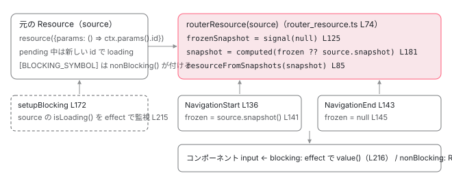

[目次](../README.md) › [Router の内側](README.md) › 第 20 回 / 全 21 回

# withRouterResources：ルートに resource を結び付けて読み込みを待つ

> routerResource と setupAndRunResources。BLOCKING\_SYMBOL / nonBlocking の区別、createTransactionalSnapshot が前のルートの値を保ったまま次を読む手順、createResourceOutletBindingEffects がコンポーネント input へ値を流す仕組み。v22 で入った新しい段。

angular/angular · 読了 約 12 分 · 発展 · [サイトで読む（デモが動きます）](https://angular-deep-dive-cyan.vercel.app/chapter/router-resources)

---

v22.2 で Route 設定に `resources` という項目が入りました。`resource()`（Signal ベースの非同期データ。状態遷移は [signals シリーズの resource の章](../signals/15-resource.md)）をルートに結び付け、**読み込みが終わるまでナビゲーションを止める**（blocking）か、**止めずに Resource のまま渡す**（nonBlocking）かを選べます。この章では、`withRouterResources()` が差し込む段 `setupAndRunResources` がパイプラインのどこで何を待つのか、`routerResource` が「前のルートの値を保ったまま次を読む」をどう実現しているのか、そしてコンポーネントの input に値が流れる経路を追います。

読む対象は `packages/router/src/router_resource.ts`（225 行）と `operators/setup_and_run_resources.ts`（230 行）、どちらも全部読みます。加えて `router_resource_feature.ts`、`directives/router_outlet.ts` の `RoutedComponentInputBinder` です。

1. 1 本の RxJS パイプライン
2. URL → UrlTree
3. routerLink の配列 → UrlTree
4. Route 設定の検証と正規化
5. provideRouter の中身
6. 最初のナビゲーション
7. navigateByUrl → NavigationTransition
8. setupNavigations の全段
9. Recognizer と match
10. redirectTo
11. loadChildren と loadComponent
12. ガードの実行順
13. resolve と data と title
14. ActivatedRoute と Snapshot
15. RouterOutlet への配置
16. ブラウザの URL と履歴
17. Router.events の全種類
18. RouterLink と RouterLinkActive
19. withViewTransitions
20. **withRouterResources**（この章）
21. Navigation API

## 1. Route.resources の型

📄 `angular/packages/router/src/models.ts` L758–763 （▶ の行: 760, 763）

```ts
758 │   /**
759 │    * A function that returns a record of resources.
760 ▶    * This function is executed during the Main Loading Phase of a navigation.
761 │    * @developerPreview 22.2
762 │    */
763 ▶   resources?: (ctx: ResourceContext) => ResourceResult | Promise<ResourceResult>;
```

📄 `angular/packages/router/src/models.ts` L27–31 （▶ の行: 31）

```ts
27 │ /**
28 │  * The expected return type of a `resources` function.
29 │  * @developerPreview 22.2
30 │  */
31 ▶ export type ResourceResult = Record<string, Resource<unknown>>;
```

📄 `angular/packages/router/src/models.ts` L40–64 （▶ の行: 46, 52, 57, 63）

```ts
40 │ export interface ResourceContext {
41 │   /**
42 │    * The matrix parameters of the route.
43 │    *
44 │    * @developerPreview 22.2
45 │    */
46 ▶   params: Signal<Params>;
47 │   /**
48 │    * The query parameters of the route.
49 │    *
50 │    * @developerPreview 22.2
51 │    */
52 ▶   queryParams: Signal<Params>;
53 │   /**
54 │    * The URL fragment.
55 │    * @developerPreview 22.2
56 │    */
57 ▶   fragment: Signal<string | null>;
58 │   /**
59 │    * Data provided in the route configuration.
60 │    *
61 │    * @developerPreview 22.2
62 │    */
63 ▶   data: Signal<Record<string, any>>;
64 │ }
```

763 行目、`resources` は **関数**です。`ResourceContext` を受け取り、`{キー: Resource}` の Record（31 行目）か、その Promise を返します。760 行目のコメント、「ナビゲーションの Main Loading Phase で実行される」。それがどこかは 3 節で確認します。46〜63 行目、コンテキストの 4 項目はすべて `Signal` です。`resource({params: () => ctx.params().id, loader})` のように `params` に使えば、パラメータが変わるたびに読み直す Resource になります。

## 2. withRouterResources が provide するもの

📄 `angular/packages/router/src/provide_router.ts` L936–947 （▶ の行: 936, 939, 941–942）

```ts
936 ▶ export function withRouterResources(): RouterResourcesFeature {
937 │   const providers = [
938 │     {
939 ▶       provide: ROUTER_RESOURCES_FEATURE,
940 │       useValue: {
941 ▶         setupAndRunResources,
942 ▶         createResourceOutletBindingEffects,
943 │       },
944 │     },
945 │   ];
946 │   return routerFeature(RouterFeatureKind.RouterResourcesFeature, providers);
947 │ }
```

📄 `angular/packages/router/src/router_resource_feature.ts` L15–27 （▶ の行: 15–16, 19, 25）

```ts
15 ▶ export interface RouterResourcesFeatureImplementation {
16 ▶   setupAndRunResources(
17 │     abortSignal: AbortSignal,
18 │   ): OperatorFunction<NavigationTransition, NavigationTransition>;
19 ▶   createResourceOutletBindingEffects?: (
20 │     componentRef: ComponentRef<unknown>,
21 │     route: ActivatedRoute,
22 │   ) => {createdEffects: EffectRef[]; handledKeys: string[]};
23 │ }
24 │ 
25 ▶ export const ROUTER_RESOURCES_FEATURE = new InjectionToken<RouterResourcesFeatureImplementation>(
26 │   typeof ngDevMode === 'undefined' || ngDevMode ? 'Router Resources Feature' : '',
27 │ );
```

939〜943 行目、`ROUTER_RESOURCES_FEATURE` トークンに **2 つの関数**を入れたオブジェクトを `useValue` します。16 行目 `setupAndRunResources`（パイプラインの段を作る）、19 行目 `createResourceOutletBindingEffects`（コンポーネント input に流す。8 節）。「機能を有効にする」とは、この 2 つの関数が inject できるようになる、という意味です。

📄 `angular/packages/router/src/navigation_transition.ts` L371–376 （▶ の行: 374–375）

```ts
371 │   private readonly urlHandlingStrategy = inject(UrlHandlingStrategy);
372 │   private readonly createViewTransition = inject(CREATE_VIEW_TRANSITION, {optional: true});
373 │   private readonly navigationErrorHandler = inject(NAVIGATION_ERROR_HANDLER, {optional: true});
374 ▶   private readonly routerResourcesFeature = inject(ROUTER_RESOURCES_FEATURE, {
375 ▶     optional: true,
376 │   });
```

📄 `angular/packages/router/src/navigation_transition.ts` L764–773 （▶ の行: 764–765, 768, 771–772）

```ts
764 ▶             this.currentNavigation.update((nav) => {
765 ▶               nav!.targetRouterState = state;
766 │               return nav;
767 │             });
768 ▶             return of(t);
769 │           }),
770 │ 
771 ▶           this.routerResourcesFeature?.setupAndRunResources(abortController.signal) ?? ((t) => t),
772 ▶           switchTap(() => this.afterPreactivation()),
773 │ 
```

374〜376 行目、`NavigationTransitions` が `optional: true` で inject します。771 行目が段そのものです。`this.routerResourcesFeature?.setupAndRunResources(abortController.signal) ?? ((t) => t)`。機能が無ければ **値をそのまま返す演算子**に置き換わり、パイプラインの形は変わりません。位置は、764〜768 行目で `targetRouterState` を作った直後（`createRouterState`、[第 14 回](14-router-router-state.md)）、772 行目の `afterPreactivation` と [ビュー遷移](19-router-view-transitions.md)の前です。ガード（[第 12 回](12-router-guards.md)）と resolve（[第 13 回](13-router-resolvers.md)）はもう終わっています。

📄 `angular/packages/router/src/navigation_transition.ts` L453–459 （▶ の行: 456）

```ts
453 │       switchMap((overallTransitionState) => {
454 │         let abortable = true;
455 │         let completedOrAborted = false;
456 ▶         const abortController = new AbortController();
457 │         const shouldContinueNavigation = () => {
458 │           return !completedOrAborted && this.currentTransition?.id === overallTransitionState.id;
459 │         };
```

771 行目で渡している `abortController.signal` は、456 行目でナビゲーションごとに 1 つ作られる `AbortController` のものです。このナビゲーションが捨てられたときに「待つのをやめる」ための合図になります（6 節）。

## 3. setupAndRunResources：木を歩いて Promise を集める

📄 `angular/packages/router/src/operators/setup_and_run_resources.ts` L28–63 （▶ の行: 32–33, 37–38, 40, 43–44, 58, 60）

```ts
28 │ export function setupAndRunResources(
29 │   abortSignal: AbortSignal,
30 │ ): OperatorFunction<NavigationTransition, NavigationTransition> {
31 │   return pipe(
32 ▶     switchTap(({newlyCreatedRoutes, targetRouterState}) => {
33 ▶       if (!newlyCreatedRoutes || !targetRouterState || abortSignal.aborted) {
34 │         return;
35 │       }
36 │ 
37 ▶       const resourceSetupPromises: Array<Promise<void>> = [];
38 ▶       const blockingResourcePromises: Array<Promise<void>> = [];
39 │ 
40 ▶       const traverse = (stateNode: TreeNode<ActivatedRoute>) => {
41 │         const route = stateNode.value;
42 │         if (route) {
43 ▶           initializeActivatedRoute(route);
44 ▶           processRoute(
45 │             route,
46 │             newlyCreatedRoutes,
47 │             resourceSetupPromises,
48 │             abortSignal,
49 │             blockingResourcePromises,
50 │           );
51 │         }
52 │ 
53 │         for (const childState of stateNode.children) {
54 │           traverse(childState);
55 │         }
56 │       };
57 │ 
58 ▶       traverse(targetRouterState._root);
59 │ 
60 ▶       return Promise.all(resourceSetupPromises).then(() => Promise.all(blockingResourcePromises));
61 │     }),
62 │   );
63 │ }
```

1. **32 行目：`switchTap`**

   `switchTap` は Router 独自の演算子で、「関数が Promise を返したらそれを待ってから元の値を流す。何も返さなければそのまま流す」です（[第 8 回](08-router-pipeline.md)）。33〜35 行目、`newlyCreatedRoutes` か `targetRouterState` が無い、または既に中断されていれば何もしません。
2. **37〜38 行目：2 本の Promise 配列**

   `resourceSetupPromises`（`resources` 関数の実行。Promise を返す関数なら待つ）と `blockingResourcePromises`（blocking な Resource の読み込み完了）。
3. **40〜58 行目：`targetRouterState._root` から全ノードを深さ優先で巡る**

   43 行目、各 `ActivatedRoute` に `initializeActivatedRoute`（下で見ます）。44 行目、`processRoute`。親から子の順です。
4. **60 行目：`Promise.all(setup).then(() => Promise.all(blocking))`**

   まず全ルートの `resources` 関数の実行が終わるのを待ち、**そのあと** blocking な Resource の完了を待ちます。この Promise が `switchTap` に返されるので、**ここで解決するまで 772 行目以降に進みません**。

📄 `angular/packages/router/src/navigation_transition.ts` L795–809 （▶ の行: 797, 803）

```ts
795 │           switchMap((t: NavigationTransition) => {
796 │             abortable = false;
797 ▶             this.events.next(new BeforeActivateRoutes());
798 │             const deferred = overallTransitionState.beforeActivateHandler.deferredHandle;
799 │             return deferred ? from(deferred.then(() => t)) : of(t);
800 │           }),
801 │ 
802 │           tap((t: NavigationTransition) => {
803 ▶             new ActivateRoutes(
804 │               router.routeReuseStrategy,
805 │               overallTransitionState.targetRouterState!,
806 │               overallTransitionState.currentRouterState,
807 │               (evt: Event) => this.events.next(evt),
808 │               this.inputBindingEnabled,
809 │             ).activate(this.rootContexts);
```

📄 `angular/packages/router/src/navigation_transition.ts` L820–834 （▶ の行: 825–826）

```ts
820 │             completedOrAborted = true;
821 │             this.currentNavigation.update((nav) => {
822 │               (nav as Writable<Navigation>).abort = noop;
823 │               return nav;
824 │             });
825 ▶             this.lastSuccessfulNavigation.set(untracked(this.currentNavigation));
826 ▶             this.events.next(
827 │               new NavigationEnd(
828 │                 t.id,
829 │                 this.urlSerializer.serialize(t.extractedUrl),
830 │                 this.urlSerializer.serialize(t.urlAfterRedirects!),
831 │               ),
832 │             );
833 │             this.titleStrategy?.updateTitle(t.targetRouterState!.snapshot);
834 │             t.resolve(true);
```

待ちが解けたあとに来るのが 797 行目の `BeforeActivateRoutes`（URL の更新）、803 行目の `ActivateRoutes`（コンポーネントの生成・破棄）、825〜826 行目の `lastSuccessfulNavigation` の更新と `NavigationEnd` です。blocking な Resource が 1 つでも未解決なら、この 3 つはどれも起きません。

📄 `angular/packages/router/src/create_router_state.ts` L41–46 （▶ の行: 42, 44）

```ts
41 │   // reuse an activated route that is currently displayed on the screen
42 ▶   if (prevState && routeReuseStrategy.shouldReuseRoute(curr.value, prevState.value.snapshot)) {
43 │     const value = prevState.value;
44 ▶     value._setPending(curr.value);
45 │     const children = createOrReuseChildren(routeReuseStrategy, curr, prevState, newlyCreatedRoutes);
46 │     return new TreeNode<ActivatedRoute>(value, children);
```

📄 `angular/packages/router/src/router_state.ts` L584–600 （▶ の行: 585, 589–590, 592–593）

```ts
584 │ export function initializeActivatedRoute(route: ActivatedRoute): void {
585 ▶   if (route.paramsSignal !== undefined) {
586 │     return;
587 │   }
588 │   const writableRoute = route as Writable<ActivatedRoute>;
589 ▶   const pendingSignal = signal(false);
590 ▶   writableRoute.pending = pendingSignal;
591 │ 
592 ▶   writableRoute.paramsSignal = computed(() =>
593 ▶     pendingSignal() || !route.snapshot ? route._futureSnapshot.params : route.snapshot.params,
594 │   );
595 │ 
596 │   writableRoute.queryParamsSignal = computed(() =>
597 │     pendingSignal() || !route.snapshot
598 │       ? route._futureSnapshot.queryParams
599 │       : route.snapshot.queryParams,
600 │   );
```

43 行目の `initializeActivatedRoute` です。585〜586 行目、2 回目以降は何もしません。589〜590 行目、`pending` という signal を作り、592〜593 行目、`paramsSignal` は **`pending` が true なら `_futureSnapshot`（遷移先）の params、そうでなければ `snapshot`（現在）の params** を返す computed です。`createRouterState` がルートを再利用するとき（create\_router\_state.ts 42〜44 行目）に `_setPending(curr.value)` で `pending` を true にするので、1 節の `ctx.params` は**ナビゲーションが完了する前から**新しいパラメータを返します。だから Resource は activate を待たずに新しい `id` で読み込みを始められます。

📄 `angular/packages/router/src/operators/setup_and_run_resources.ts` L65–85 （▶ の行: 72–73, 77, 79–80, 83）

```ts
65 │ function processRoute(
66 │   route: ActivatedRoute,
67 │   newlyCreatedRoutes: Set<ActivatedRoute>,
68 │   resourceSetupPromises: Array<Promise<void>>,
69 │   abortSignal: AbortSignal,
70 │   blockingResourcePromises: Array<Promise<void>>,
71 │ ) {
72 ▶   const resources = route.routeConfig?.resources;
73 ▶   if (!resources) {
74 │     return;
75 │   }
76 │ 
77 ▶   if (newlyCreatedRoutes.has(route)) {
78 │     // This route is new. We need to run its resources function once.
79 ▶     resourceSetupPromises.push(
80 ▶       setupNewRouterResources(route._futureSnapshot, route, abortSignal, blockingResourcePromises),
81 │     );
82 │   } else {
83 ▶     updateExistingResources(route, blockingResourcePromises, abortSignal);
84 │   }
85 │ }
```

72〜75 行目、`routeConfig.resources` が無いルートは飛ばします。77 行目、このナビゲーションで**新しく作られた**`ActivatedRoute` （`createRouterState` の `newlyCreatedRoutes`）なら 79〜81 行目 `setupNewRouterResources`、再利用されたルートなら 83 行目 `updateExistingResources`。`resources` 関数は**ルートが生まれたとき 1 回だけ**呼ばれます（78 行目のコメント）。

## 4. 新しいルート：resources 関数を 1 回呼び、全部を routerResource で包む

📄 `angular/packages/router/src/operators/setup_and_run_resources.ts` L87–112 （▶ の行: 93–94, 99–102, 105–109, 112）

```ts
 87 │ async function setupNewRouterResources(
 88 │   snapshot: ActivatedRouteSnapshot,
 89 │   route: ActivatedRoute,
 90 │   abortSignal: AbortSignal,
 91 │   blockingResourcePromises: Promise<void>[],
 92 │ ) {
 93 ▶   const resourcesFn = snapshot?.routeConfig?.resources;
 94 ▶   const parentInjector = snapshot?._environmentInjector;
 95 │   if (!resourcesFn || !parentInjector) {
 96 │     return;
 97 │   }
 98 │ 
 99 ▶   let childInjector = route._localInjector;
100 ▶   if (!childInjector) {
101 ▶     childInjector = createEnvironmentInjector([], parentInjector);
102 ▶     route._localInjector = childInjector; // Attach to route for cleanup
103 │   }
104 │ 
105 ▶   const context: ResourceContext = {
106 ▶     params: route.paramsSignal,
107 ▶     queryParams: route.queryParamsSignal,
108 ▶     fragment: route.fragmentSignal,
109 ▶     data: route.dataSignal,
110 │   };
111 │ 
112 ▶   const resourceResultRaw = runInInjectionContext(childInjector, () => resourcesFn(context));
```

1. **93〜94 行目：`resources` 関数と、ルートの `EnvironmentInjector`**

   `snapshot._environmentInjector` は `loadChildren` で作られた子インジェクタも含む、このルートが属する環境です（[第 11 回](11-router-lazy-loading.md)）。
2. **99〜103 行目：ルート専用の子 `EnvironmentInjector` を作り、`route._localInjector` に付ける**

   `createEnvironmentInjector([], parentInjector)`。プロバイダは空で、親につながるだけの空のインジェクタです。目的は**破棄の単位**です。`resource()` が内部で作る effect はこのインジェクタの `DestroyRef` に結び付くので、ルートが消えるときにまとめて片付けられます。
3. **105〜110 行目：`ResourceContext` を組む**

   3 節の `paramsSignal` などをそのまま渡します。
4. **112 行目：`runInInjectionContext(childInjector, () => resourcesFn(context))`**

   あなたの `resources` 関数は**注入コンテキストの中**で呼ばれます。`inject(HttpClient)` も `resource()` もそのまま書けます。

📄 `angular/packages/router/src/operators/setup_and_run_resources.ts` L113–144 （▶ の行: 114–115, 118, 126, 139, 142–143）

```ts
113 │   let resourceResult: ResourceResult;
114 ▶   if (resourceResultRaw instanceof Promise) {
115 ▶     resourceResult = await resourceResultRaw;
116 │     // Bail out if the router cancelled the navigation (and destroyed our injector!)
117 │     // while we were waiting.
118 ▶     if (abortSignal.aborted) return;
119 │   } else {
120 │     resourceResult = resourceResultRaw as ResourceResult;
121 │   }
122 │ 
123 │   if (!resourceResult) return;
124 │ 
125 │   const wrappedResult: ResourceResult = {};
126 ▶   for (const [key, res] of Object.entries(resourceResult)) {
127 │     if (typeof ngDevMode === 'undefined' || ngDevMode) {
128 │       if (
129 │         !res ||
130 │         typeof res !== 'object' ||
131 │         typeof (res as Partial<Resource<unknown>>).snapshot !== 'function'
132 │       ) {
133 │         throw new Error(
134 │           `Invalid resource returned for key "${key}". Expected a Resource, but got ${res === null ? 'null' : typeof res}.`,
135 │         );
136 │       }
137 │     }
138 │ 
139 ▶     wrappedResult[key] = runInInjectionContext(childInjector, () => routerResource(res));
140 │   }
141 │ 
142 ▶   route.resources = route._futureSnapshot.resources = snapshot.resources = wrappedResult;
143 ▶   setupBlocking(route, wrappedResult, blockingResourcePromises, abortSignal);
144 │ }
```

114〜118 行目、戻り値が Promise なら `await` し、待っている間にナビゲーションが中断されていたら（118 行目）捨てます。126〜140 行目、返された Record を 1 つずつ **`routerResource(res)` で包み直します**（139 行目。これも子インジェクタの注入コンテキストで）。開発モードでは `snapshot` 関数を持たない値を返すとここでエラーです（127〜137 行目）。142 行目、包んだ結果を `route.resources`、`_futureSnapshot.resources`、`snapshot.resources` の 3 か所に同じ参照で置き、143 行目で `setupBlocking`（6 節）。

📄 `angular/packages/router/src/router_state.ts` L169–181 （▶ の行: 169–172, 179, 181）

```ts
169 ▶   // Note for framework developers: Unlike `data` and `params`, the `resources` property
170 ▶   // is assigned once when the route is first initialized and its reference remains stable
171 ▶   // for the entire lifetime of the `ActivatedRoute` instance. Do NOT replace or swap this
172 ▶   // reference during pending navigations or route reuse, as doing so breaks reactivity
173 │   // for components subscribed to the underlying resource signals.
174 │   /**
175 │    * A map of resources for this route.
176 │    *
177 │    * @developerPreview 22.2
178 │    */
179 ▶   resources?: ResourceResult;
180 │   /** @internal */
181 ▶   _localInjector?: EnvironmentInjector;
```

169〜173 行目のコメントが設計上の約束です。「`data` や `params` と違い、`resources` は最初に 1 回代入され、`ActivatedRoute` の寿命の間ずっと同じ参照。ナビゲーション中やルート再利用で差し替えてはいけない。差し替えるとコンポーネントが購読している signal の反応性が壊れる」。コンポーネントは Resource を一度受け取ったら、その中の値が変わるのを signal で見ればよい、という構造です。

## 5. 再利用されたルート：関数は呼ばず、error なら reload

📄 `angular/packages/router/src/operators/setup_and_run_resources.ts` L146–170 （▶ の行: 151–153, 159–160, 164, 168–169）

```ts
146 │ function updateExistingResources(
147 │   route: ActivatedRoute,
148 │   blockingResourcePromises: Promise<void>[],
149 │   abortSignal: AbortSignal,
150 │ ) {
151 ▶   // This route is reused. We must eagerly update the resource context signals
152 ▶   // so that resources can react and fetch new data during the pending navigation.
153 ▶   const currentResources = route.snapshot?.resources;
154 │   if (!currentResources) {
155 │     return;
156 │   }
157 │ 
158 │   Object.values(currentResources).forEach((r) => {
159 ▶     const underlyingRes = (r as InternalRouterResource)[SOURCE_RESOURCE_SYMBOL];
160 ▶     if (underlyingRes.status() === 'error') {
161 │       // If a resource previously failed and the route is reused identically,
162 │       // the parameter signals won't change, meaning the internal effect won't automatically refetch.
163 │       // We must manually trigger a reload to ensure the new navigation attempts a retry.
164 ▶       (underlyingRes as unknown as {reload?: () => boolean}).reload?.();
165 │     }
166 │   });
167 │ 
168 ▶   route._futureSnapshot.resources = currentResources;
169 ▶   setupBlocking(route, currentResources, blockingResourcePromises, abortSignal);
170 │ }
```

151〜152 行目のコメント、「ルートは再利用される。コンテキストの signal は既に更新されているので、Resource は保留中のナビゲーションの間に新しいデータを取りに行ける」。3 節の `pending` の話です。153 行目、既存の `snapshot.resources` をそのまま使います。159〜165 行目、元の Resource（`SOURCE_RESOURCE_SYMBOL`）が `'error'` なら `reload()`。162〜163 行目のコメント：同じパラメータで再ナビゲーションしても signal が変わらないので自動では再取得されない。だから手動で再試行させる。168〜169 行目、`_futureSnapshot.resources` に同じ参照を置き、`setupBlocking`。

## 6. setupBlocking：blocking な Resource ごとに 1 つの Promise

📄 `angular/packages/router/src/router_resource.ts` L36–49 （▶ の行: 36, 39, 46–48）

```ts
36 ▶ export const BLOCKING_SYMBOL: unique symbol = Symbol(
37 │   typeof ngDevMode === 'undefined' || ngDevMode ? '__isBlocking' : '',
38 │ );
39 ▶ export const SOURCE_RESOURCE_SYMBOL: unique symbol = Symbol(
40 │   typeof ngDevMode === 'undefined' || ngDevMode ? '__sourceResource' : '',
41 │ );
42 │ 
43 │ /**
44 │  * Checks if a resource has a value or has transitioned to a resolved/non-loading status.
45 │  */
46 ▶ export function hasValueOrResolved(res: Resource<unknown>): boolean {
47 ▶   const status = res.status();
48 ▶   return res.hasValue() || (status !== 'loading' && status !== 'reloading');
49 │ }
```

📄 `angular/packages/router/src/router_resource.ts` L54–68 （▶ の行: 54–56, 65–67）

```ts
54 ▶ export interface InternalRouterResource<T = unknown> extends Resource<T> {
55 ▶   [SOURCE_RESOURCE_SYMBOL]: Resource<T>;
56 ▶   [BLOCKING_SYMBOL]?: boolean;
57 │   reload(): boolean;
58 │ }
59 │ 
60 │ /**
61 │  * Marks a resource as non-blocking. The Router will NOT wait for this resource to resolve
62 │  * before completing the navigation.
63 │  * @developerPreview 22.2
64 │  */
65 ▶ export function nonBlocking<T, R extends Resource<T>>(res: R): R {
66 ▶   (res as unknown as InternalRouterResource<T>)[BLOCKING_SYMBOL] = false;
67 ▶   return res;
68 │ }
```

36・39 行目、2 つの `Symbol` キー。`BLOCKING_SYMBOL`（待つかどうか）と `SOURCE_RESOURCE_SYMBOL`（包む前の元の Resource）。65〜68 行目、公開関数 `nonBlocking(res)` は**元の Resource に `BLOCKING_SYMBOL = false` を付けて返すだけ**です。46〜49 行目、`hasValueOrResolved` は「値を持っている、または loading / reloading ではない」。7 節のロールバック判定に使います。

📄 `angular/packages/router/src/operators/setup_and_run_resources.ts` L172–205 （▶ の行: 178, 182, 184–185, 187–188, 192, 194, 199–201, 204）

```ts
172 │ function setupBlocking(
173 │   route: ActivatedRoute,
174 │   resourceResult: ResourceResult,
175 │   blockingResourcePromises: Array<Promise<void>>,
176 │   abortSignal: AbortSignal,
177 │ ) {
178 ▶   if (abortSignal.aborted) return;
179 │   const childInjector = route._localInjector;
180 │   if (!childInjector || !resourceResult) return;
181 │ 
182 ▶   for (const r of Object.values(resourceResult)) {
183 │     const res = r as InternalRouterResource;
184 ▶     if (res[BLOCKING_SYMBOL] === false) {
185 ▶       continue;
186 │     }
187 ▶     const promise = new Promise<void>((resolve, reject) => {
188 ▶       const underlyingRes = res[SOURCE_RESOURCE_SYMBOL];
189 │       let isDestroyed = false;
190 │       let unregisterOnDestroy: (() => void) | undefined;
191 │ 
192 ▶       const cleanup = () => {
193 │         isDestroyed = true;
194 ▶         blockingEffect.destroy();
195 │         unregisterOnDestroy?.();
196 │         abortSignal.removeEventListener('abort', onAbort);
197 │       };
198 │ 
199 ▶       const onAbort = () => {
200 ▶         cleanup();
201 ▶         resolve();
202 │       };
203 │ 
204 ▶       abortSignal.addEventListener('abort', onAbort, {once: true});
205 │ 
```

📄 `angular/packages/router/src/operators/setup_and_run_resources.ts` L206–230 （▶ の行: 206, 211–217, 220, 223–225, 228）

```ts
206 ▶       const blockingEffect = effect(
207 │         () => {
208 │           if (isDestroyed) {
209 │             return;
210 │           }
211 ▶           const status = underlyingRes.status();
212 ▶           if (status === 'error') {
213 ▶             cleanup();
214 ▶             reject(underlyingRes.error());
215 ▶           } else if (!underlyingRes.isLoading()) {
216 ▶             cleanup();
217 ▶             resolve();
218 │           }
219 │         },
220 ▶         {injector: childInjector, manualCleanup: true},
221 │       );
222 │ 
223 ▶       unregisterOnDestroy = childInjector.get(DestroyRef).onDestroy(() => {
224 ▶         cleanup();
225 ▶         resolve();
226 │       });
227 │     });
228 ▶     blockingResourcePromises.push(promise);
229 │   }
230 │ }
```

1. **184〜186 行目：`BLOCKING_SYMBOL === false` なら `continue`**

   nonBlocking な Resource は Promise を作りません。パイプラインは待たず、Resource は読み込み中のまま次へ進みます。
2. **187〜188 行目：Promise を 1 つ作り、監視対象は**元の** Resource**

   包んだ側（`routerResource` の戻り値）は 7 節のとおり凍結されているので、本当の状態を見るには元の Resource が必要です。
3. **206〜221 行目：`effect` で状態を監視**

   211 行目で `status()` を読む（依存になる）。212〜214 行目、`'error'` なら片付けて `reject(error)`。215〜217 行目、`!isLoading()` なら片付けて `resolve()`。220 行目、`injector: childInjector`（4 節の子インジェクタ）、`manualCleanup: true`（192〜197 行目の `cleanup` で自分で `destroy` する）。この effect は `resource()` の loader が終わって `status` が変わった瞬間に再実行されます。
4. **199〜204 行目：中断されたら `resolve()`**

   2 節の `abortController.signal` です。中断は **reject ではなく resolve**。捨てられたナビゲーションの Promise を reject すると Unhandled rejection になるだけなので、黙って終わらせます。
5. **223〜226 行目：子インジェクタが破棄されたら `resolve()`**

   ルートが消えたのに待ち続けることが無いようにしています。

📄 `angular/packages/router/src/navigation_transition.ts` L872–890 （▶ の行: 872–873, 880, 885, 888）

```ts
872 ▶           finalize(() => {
873 ▶             abortController.abort();
874 │             /* When the navigation stream finishes either through error or success,
875 │              * we set the `completed` or `errored` flag. However, there are some
876 │              * situations where we could get here without either of those being set.
877 │              * For instance, a redirect during NavigationStart. Therefore, this is a
878 │              * catch-all to make sure the NavigationCancel event is fired when a
879 │              * navigation gets cancelled but not caught by other means. */
880 ▶             if (!completedOrAborted) {
881 │               const cancelationReason =
882 │                 typeof ngDevMode === 'undefined' || ngDevMode
883 │                   ? `Navigation ID ${overallTransitionState.id} is not equal to the current navigation id ${this.navigationId}`
884 │                   : '';
885 ▶               this.cancelNavigationTransition(
886 │                 overallTransitionState,
887 │                 cancelationReason,
888 ▶                 NavigationCancellationCode.SupersededByNewNavigation,
889 │               );
890 │             }
```

「読み込み中に別のリンクを押した」ときの経路です。`switchMap`（[概観](01-router.md)）が前のナビゲーションを捨てると 872〜873 行目の `finalize` で `abortController.abort()` が呼ばれ、上の 199〜202 行目 `onAbort` が走ります。880〜889 行目、まだ完了していなければ `NavigationCancel`（`SupersededByNewNavigation`）です。

> [!TIP]
> **新卒エンジニアへ**
>
> 既定は blocking です。`routerResource`（7 節）が `BLOCKING_SYMBOL` を `!== false` で判定するので、`nonBlocking()` で包まなかった Resource はすべて「完了まで待つ」側になります。待たせたくないものだけ `nonBlocking(resource(...))` と明示します。

## 7. routerResource：前の値を保ったまま次を読む

📄 `angular/packages/router/src/router_resource.ts` L74–109 （▶ の行: 74, 79, 85, 87–89, 92, 99–100, 102）

```ts
 74 ▶ export function routerResource<T>(source: Resource<T>): Resource<T> & {reload(): boolean} {
 75 │   ngDevMode && assertInInjectionContext(routerResource);
 76 │   const injector = inject(Injector);
 77 │   const router = injector.get(Router);
 78 │ 
 79 ▶   const {snapshot: snapshotSignal, frozenSnapshot} = createTransactionalSnapshot(
 80 │     source,
 81 │     router,
 82 │     injector,
 83 │   );
 84 │ 
 85 ▶   const res = resourceFromSnapshots(snapshotSignal) as unknown as InternalRouterResource<T>;
 86 │ 
 87 ▶   res[SOURCE_RESOURCE_SYMBOL] = source;
 88 ▶   res[BLOCKING_SYMBOL] =
 89 ▶     (source as unknown as InternalRouterResource<T>)[BLOCKING_SYMBOL] !== false;
 90 │ 
 91 │   if (typeof (source as any).reload === 'function') {
 92 ▶     res.reload = function (): boolean {
 93 │       // If the resource is currently frozen (e.g., during an active navigation transition
 94 │       // or while recovering from a cancelled navigation), we reject manual reload requests.
 95 │       // Triggering a reload during an active navigation (where the resource may already be
 96 │       // reactively loading new parameters behind the scenes) would disrupt the router's resource
 97 │       // tracking for the transition. Similarly, during a rollback recovery, the router is
 98 │       // already managing the resource reload to restore the previous state.
 99 ▶       if (frozenSnapshot() !== null) {
100 ▶         return false;
101 │       }
102 ▶       return (source as any).reload();
103 │     };
104 │   } else {
105 │     res.reload = () => false;
106 │   }
107 │ 
108 │   return res;
109 │ }
```

74 行目、入力は元の Resource、出力は `Resource & {reload(): boolean}`。79〜83 行目で「取引的な（transactional）スナップショット」の signal を作り、85 行目、core の `resourceFromSnapshots(snapshotSignal)` で **その signal を状態源とする新しい Resource** にします。元の Resource と包んだ Resource は別物で、包んだ側は `snapshotSignal` しか見ません。87〜89 行目、元への参照と、blocking かどうか（元に `false` が付いていなければ true）。92〜103 行目、`reload()` は凍結中（`frozenSnapshot() !== null`）は `false` を返して何もしません。93〜98 行目のコメントが理由です。

📄 `angular/packages/router/src/router_resource.ts` L115–134 （▶ の行: 125, 133）

```ts
115 │ function createTransactionalSnapshot<T>(
116 │   source: Resource<T>,
117 │   router: Router,
118 │   injector: Injector,
119 │ ): {
120 │   snapshot: Signal<ResourceSnapshot<T>>;
121 │   frozenSnapshot: Signal<ResourceSnapshot<T> | null>;
122 │ } {
123 │   // Holds a snapshot of the resource to keep the UI masked (frozen) during pending navigations
124 │   // or while recovering from a cancelled navigation.
125 ▶   const frozenSnapshot = signal<ResourceSnapshot<T> | null>(null);
126 │ 
127 │   // Tracks whether we are in a recovery phase after a cancelled navigation.
128 │   // The intended behavior is that on cancellation, the router reverts to the previous state.
129 │   // This reversion might trigger a new load of the previous state because the signal dependencies
130 │   // changed. If we were to release the frozen resource state immediately, the user would see a loading state
131 │   // for data they were just looking at. To avoid this "loading flash", we retain the frozen
132 │   // value (via frozenSnapshot) during this recovery load/reload until the resource settles.
133 ▶   const isRollbackRecoveryPending = signal(false);
134 │ 
```

状態は 2 つの signal だけです。125 行目 `frozenSnapshot`：null でなければ「この値で見せ続ける」。133 行目 `isRollbackRecoveryPending`：キャンセル後の復旧中かどうか。127〜132 行目のコメントが復旧中に凍結を保つ理由です。「キャンセルされると Router は前の状態に戻す。その巻き戻しで signal の依存が変わり、Resource が**前の状態をもう一度読み込み**に行くことがある。ここで凍結を解くと、直前まで見ていたデータに loading が一瞬出る（loading flash）」。

📄 `angular/packages/router/src/router_resource.ts` L135–166 （▶ の行: 135–136, 139, 141, 143, 145, 147, 152–153, 155–156, 162, 164）

```ts
135 ▶   const sub = router.events.subscribe((e) => {
136 ▶     if (e instanceof NavigationStart) {
137 │       isRollbackRecoveryPending.set(false);
138 │ 
139 ▶       if (frozenSnapshot() === null) {
140 │         // Freeze the snapshot at the start of navigation to keep the UI stable.
141 ▶         frozenSnapshot.set(source.snapshot());
142 │       }
143 ▶     } else if (e instanceof NavigationEnd) {
144 │       // Navigation succeeded, so we can unfreeze and use the live state.
145 ▶       frozenSnapshot.set(null);
146 │       isRollbackRecoveryPending.set(false);
147 ▶     } else if (e instanceof NavigationSkipped) {
148 │       // If a navigation is skipped while we have a frozen snapshot (e.g. navigating to the
149 │       // current URL to cancel an in-flight navigation), the in-flight navigation is aborted
150 │       // and parameter rollback begins. We must maintain the frozen snapshot until the rollback
151 │       // recovery load completes to prevent flashing a loading state.
152 ▶       if (frozenSnapshot() !== null) {
153 ▶         isRollbackRecoveryPending.set(true);
154 │       }
155 ▶     } else if (e instanceof NavigationCancel || e instanceof NavigationError) {
156 ▶       const isRollback =
157 │         e instanceof NavigationError ||
158 │         (e instanceof NavigationCancel &&
159 │           e.code !== NavigationCancellationCode.SupersededByNewNavigation &&
160 │           e.code !== NavigationCancellationCode.Redirect);
161 │ 
162 ▶       if (!isRollback) return;
163 │ 
164 ▶       isRollbackRecoveryPending.set(true);
165 │     }
166 │   });
```

1. **136〜142 行目：`NavigationStart` で凍結**

   139 行目、**まだ凍結していなければ** 141 行目で `source.snapshot()` をそのまま保存します。既に凍結中（前のナビゲーションが捨てられて新しいのが始まった）なら上書きしません。最初に見せていた値を保ち続けます。
2. **143〜146 行目：`NavigationEnd` で解凍**

   145 行目 `frozenSnapshot.set(null)`。この瞬間に 181 行目の computed が元の Resource の値に切り替わります。
3. **147〜154 行目：`NavigationSkipped`**

   凍結中に同じ URL へのナビゲーションがスキップされたとき（148〜151 行目のコメント：進行中のナビゲーションを止める目的で現在 URL へ navigate する手口）は、巻き戻しの読み込みが終わるまで待つため `isRollbackRecoveryPending = true`。
4. **155〜165 行目：`NavigationCancel` / `NavigationError`**

   156〜160 行目、`NavigationError`、または `Redirect` でも `SupersededByNewNavigation` でもない `NavigationCancel` （ガード拒否・resolver のデータなし・Aborted）が「巻き戻し」です。リダイレクトと後続ナビゲーションによる打ち消しは**巻き戻しではない**ので 162 行目で何もしません。凍結はそのまま次のナビゲーションへ持ち越されます。巻き戻しなら 164 行目で復旧待ちに入ります。

📄 `angular/packages/router/src/router_resource.ts` L168–184 （▶ の行: 170, 172–174, 181）

```ts
168 │   injector.get(DestroyRef).onDestroy(() => sub.unsubscribe());
169 │ 
170 ▶   effect(
171 │     () => {
172 ▶       if (isRollbackRecoveryPending() && hasValueOrResolved(source)) {
173 ▶         isRollbackRecoveryPending.set(false);
174 ▶         frozenSnapshot.set(null);
175 │       }
176 │     },
177 │     {injector},
178 │   );
179 │ 
180 │   return {
181 ▶     snapshot: computed(() => frozenSnapshot() ?? source.snapshot()),
182 │     frozenSnapshot,
183 │   };
184 │ }
```

170〜178 行目、復旧待ちの解除は `effect` です。172 行目、復旧待ち中に元の Resource が `hasValueOrResolved`（6 節）になった時点で 173〜174 行目、両方をリセット。181 行目、公開される snapshot は `frozenSnapshot() ?? source.snapshot()` の 1 行です。凍結中は凍結値、それ以外は元の値。



*routerResource の 2 層。コンポーネントが見るのは computed snapshot（L181）。NavigationStart で frozenSnapshot に元の snapshot を保存し、NavigationEnd で null に戻す。元の Resource は裏で新しい params を読み込み、blocking ならその完了を setupBlocking が待つ。*

## 8. コンポーネントの input へ：blocking は値、nonBlocking は Resource

📄 `angular/packages/router/src/provide_router.ts` L850–862 （▶ の行: 855, 857）

```ts
850 │ export function withComponentInputBinding(
851 │   options: ComponentInputBindingOptions = {},
852 │ ): ComponentInputBindingFeature {
853 │   const providers = [
854 │     {
855 ▶       provide: INPUT_BINDER,
856 │       useFactory: () =>
857 ▶         new RoutedComponentInputBinder(options, inject(ROUTER_RESOURCES_FEATURE, {optional: true})),
858 │     },
859 │   ];
860 │ 
861 │   return routerFeature(RouterFeatureKind.ComponentInputBindingFeature, providers);
862 │ }
```

📄 `angular/packages/router/src/directives/router_outlet.ts` L404–414 （▶ の行: 404, 411–412）

```ts
404 ▶     this.activated = location.createComponent(component, {
405 │       index: location.length,
406 │       injector,
407 │       environmentInjector: environmentInjector,
408 │     });
409 │     // Calling `markForCheck` to make sure we will run the change detection when the
410 │     // `RouterOutlet` is inside a `ChangeDetectionStrategy.OnPush` component.
411 ▶     this.changeDetector.markForCheck();
412 ▶     this.inputBinder?.bindActivatedRouteToOutletComponent(this, this.location.injector);
413 │     this.activateEvents.emit(this.activated.instance);
414 │   }
```

input への束縛は `withComponentInputBinding()` があるときだけです。857 行目、`RoutedComponentInputBinder` を作るときに `ROUTER_RESOURCES_FEATURE` を optional で渡します。両方の機能を付けたときだけ、この節の経路が動きます。404〜412 行目、`RouterOutlet.activateWith` がコンポーネントを作った直後、412 行目で binder に渡します（[第 15 回](15-router-activate-routes.md)）。

📄 `angular/packages/router/src/directives/router_outlet.ts` L487–504 （▶ の行: 491, 493–494, 498–499）

```ts
487 │   private subscribeToRouteData(outlet: RouterOutlet, injector: Injector) {
488 │     const {activatedRoute} = outlet;
489 │ 
490 │     const effects: EffectRef[] = [];
491 ▶     let keysBoundToBlockingResources: string[] = [];
492 │ 
493 ▶     if (this.feature?.createResourceOutletBindingEffects && outlet.activatedComponentRef) {
494 ▶       const {handledKeys, createdEffects} = this.feature.createResourceOutletBindingEffects(
495 │         outlet.activatedComponentRef,
496 │         activatedRoute,
497 │       );
498 ▶       effects.push(...createdEffects);
499 ▶       keysBoundToBlockingResources = handledKeys;
500 │     }
501 │ 
502 │     if (effects.length > 0) {
503 │       this.outletEffects.set(outlet, effects);
504 │     }
```

📄 `angular/packages/router/src/router_resource.ts` L197–225 （▶ の行: 197, 203, 208–211, 214, 216, 218, 220–221）

```ts
197 ▶ export function createResourceOutletBindingEffects(
198 │   componentRef: ComponentRef<unknown>,
199 │   route: ActivatedRoute,
200 │ ): {createdEffects: EffectRef[]; handledKeys: string[]} {
201 │   const createdEffects: EffectRef[] = [];
202 │   const handledKeys: string[] = [];
203 ▶   const mirror = route.component ? reflectComponentType(route.component) : null;
204 │   if (!mirror) {
205 │     return {createdEffects, handledKeys};
206 │   }
207 │ 
208 ▶   for (const {templateName} of mirror.inputs) {
209 ▶     const resource = route.resources?.[templateName];
210 ▶     if (!resource || !(resource as InternalRouterResource)[BLOCKING_SYMBOL]) {
211 ▶       continue;
212 │     }
213 │ 
214 ▶     const effectRef = effect(
215 │       () => {
216 ▶         componentRef.setInput(templateName, resource.value());
217 │       },
218 ▶       {injector: componentRef.injector},
219 │     );
220 ▶     createdEffects.push(effectRef);
221 ▶     handledKeys.push(templateName);
222 │   }
223 │ 
224 │   return {createdEffects, handledKeys};
225 │ }
```

1. **493〜499 行目：まず blocking な Resource の effect を作る**

   `createResourceOutletBindingEffects(componentRef, activatedRoute)` が返す `handledKeys` を控えます。
2. **203・208 行目：コンポーネントの input 名を `reflectComponentType` で列挙**

   `mirror.inputs` の `templateName`（テンプレートで使う名前）ごとに、209 行目で `route.resources[templateName]` を探します。
3. **210〜212 行目：見つからない、または `BLOCKING_SYMBOL` が falsy なら飛ばす**

   nonBlocking はここで対象外になります。
4. **214〜221 行目：blocking なら `effect(() => componentRef.setInput(name, resource.value()))`**

   `resource` は 7 節の包んだ側なので、`value()` は凍結中は前の値、`NavigationEnd` 後は新しい値です。effect はコンポーネントのインジェクタに結び付き（218 行目）、コンポーネントと一緒に消えます。処理したキーは 221 行目で `handledKeys` に入ります。

📄 `angular/packages/router/src/directives/router_outlet.ts` L512–520 （▶ の行: 513–515, 519）

```ts
512 │         switchMap(([queryParams, params, data], index) => {
513 ▶           // Precedence when keys collide is determined by the spread order:
514 ▶           // resources > data (including resolvers) > path params > query params
515 ▶           data = {
516 │             ...queryParams,
517 │             ...params,
518 │             ...data,
519 ▶             ...(activatedRoute.resources || {}),
520 │           };
```

📄 `angular/packages/router/src/directives/router_outlet.ts` L561–571 （▶ の行: 563–565, 569）

```ts
561 │         const behavior = this.options.unmatchedInputBehavior ?? 'alwaysUndefined';
562 │ 
563 ▶         for (const {templateName} of currentMirror.inputs) {
564 ▶           if (keysBoundToBlockingResources.includes(templateName)) {
565 ▶             continue;
566 │           }
567 │           const value = data[templateName];
568 │           if (value !== undefined || behavior === 'alwaysUndefined' || seenKeys.has(templateName)) {
569 ▶             outlet.activatedComponentRef.setInput(templateName, value);
570 │           }
571 │         }
```

従来の input 束縛（queryParams / params / data）の経路です。519 行目、`...(activatedRoute.resources || {})` を**最後に**展開するので、513〜514 行目のコメントどおり優先順位は `resources > data > params > queryParams`。ここで束縛されるのは **Resource オブジェクトそのもの**です。564〜566 行目、blocking として effect で処理済みのキーは飛ばします。結果、**blocking → 値、nonBlocking → Resource** という 2 本の経路になります。コンポーネント側は、blocking なら `user = input<User>()`、nonBlocking なら `user = input<Resource<User>>()` と型が変わります。

> **🧪 DEMO — 読み込み中に何が見えるか**
>
> Route `user/:id` に `resources: (ctx) => ({ user: resource(...) })` を置き、`/user/1`（値 Alice）から `/user/2`（Bob を読み込む）へ遷移します。ルートは再利用され、`withComponentInputBinding()` あり。各時点でパイプラインが何をし、`frozenSnapshot` が何で、コンポーネントの `user` 入力が何を読むかを並べます（擬似。赤い行がパイプラインの待ち）。
>
> ▶ [このデモはサイトで動かせます](https://angular-deep-dive-cyan.vercel.app/chapter/router-resources)

## ここまでの呼び出し

- 👤 `provideRouter(routes, withRouterResources(), withComponentInputBinding())` — src/app/app.config.ts
  - `withRouterResources()` — router/src/provide\_router.ts L936 — *ROUTER\_RESOURCES\_FEATURE に 2 関数*
- `createRouterState` の switchMap — *（1 回のナビゲーション）* — router/src/navigation\_transition.ts L750 — *再利用ルートは \_setPending → paramsSignal が新しい params*
  - `setupAndRunResources(abortController.signal)` — router/src/operators/setup\_and\_run\_resources.ts L28 — *L771 の段*
    - `traverse(targetRouterState._root)` — setup\_and\_run\_resources.ts L40
      - `initializeActivatedRoute(route)` — router/src/router\_state.ts L584
      - `processRoute(route, newlyCreatedRoutes, ...)` — setup\_and\_run\_resources.ts L65
        - `setupNewRouterResources(...)`（新規） — setup\_and\_run\_resources.ts L87 — *子 EnvironmentInjector → runInInjectionContext(resourcesFn)*
          - 👤 `resources(ctx)` → `{ user: resource(...) }` — あなたの routes
          - `routerResource(res)` × キー数 — router/src/router\_resource.ts L74 — *createTransactionalSnapshot + resourceFromSnapshots*
        - `updateExistingResources(...)`（再利用） — setup\_and\_run\_resources.ts L146 — *error なら reload()*
        - `setupBlocking(route, resources, blockingResourcePromises, signal)` — setup\_and\_run\_resources.ts L172 — *blocking ごとに effect で isLoading を監視*
    - `Promise.all(setup).then(() => Promise.all(blocking))` — setup\_and\_run\_resources.ts L60 — *── ここで待つ ──*
  - `afterPreactivation` → ビュー遷移 → `BeforeActivateRoutes` → `ActivateRoutes` — navigation\_transition.ts L772-809
    - `RouterOutlet.activateWith` → `inputBinder.bindActivatedRouteToOutletComponent` — router/src/directives/router\_outlet.ts L412
      - `createResourceOutletBindingEffects(componentRef, route)` — router\_resource.ts L197 — *blocking: effect → setInput(name, value())*
      - `combineLatest([...]).subscribe` → `setInput` — router\_outlet.ts L506-569 — *nonBlocking: Resource 本体。handledKeys は飛ばす*
  - `this.events.next(new NavigationEnd(...))` — navigation\_transition.ts L826 — *frozenSnapshot.set(null) → 新しい値が見える*

## 聞かれそうな質問

**Q. blocking な resource が未解決のとき、NavigationEnd は出ますか？コンポーネントは生成されますか？**

どちらも起きません。`setupAndRunResources` は navigation\_transition.ts 771 行目の段で、`switchTap`（setup\_and\_run\_resources.ts 32 行目）が 60 行目の `Promise.all(...)` を待ちます。blocking な Resource の Promise は 215〜217 行目で `!isLoading()` になるまで解決しないので、その間 772 行目以降、つまり 797 行目の `BeforeActivateRoutes`、803 行目の `ActivateRoutes`（コンポーネント生成）、826 行目の `NavigationEnd` には進みません。URL も変わりません（`urlUpdateStrategy` 既定の `'deferred'` では `BeforeActivateRoutes` で書くため）。

**Q. 読み込み中に別のリンクを押したら、待っていた Promise はどうなりますか？**

新しいナビゲーションで `switchMap` が前のものを捨て、navigation\_transition.ts 872〜873 行目の `finalize` が `abortController.abort()` を呼びます。setup\_and\_run\_resources.ts 199〜204 行目の `onAbort` が effect を片付けて `resolve()`（reject ではない）します。イベントは 885〜888 行目の `NavigationCancel`（`SupersededByNewNavigation`）で、router\_resource.ts 158〜162 行目でこれは「巻き戻しではない」ので凍結は解かれません。次のナビゲーションの `NavigationStart` でも 139 行目の条件で再凍結せず、最初の値を `NavigationEnd` まで見せ続けます。

**Q. withComponentInputBinding を付けていなくても resources は使えますか？**

使えます。`resources` 関数の実行と待ち合わせは `withRouterResources()` だけで動き、結果は `ActivatedRoute.resources`（router\_state.ts 179 行目、setup\_and\_run\_resources.ts 142 行目で代入）から `inject(ActivatedRoute).resources?.['user']` として読めます。input への自動束縛だけが `withComponentInputBinding()`（provide\_router.ts 857 行目で feature を binder に渡す）を必要とします。

**Q. nonBlocking にすると、コンポーネントの input には何が入りますか？**

**Resource そのもの**（`routerResource` で包んだ側）です。router\_resource.ts 210〜212 行目で blocking でないものは effect の対象から外れ、router\_outlet.ts 519 行目の `...activatedRoute.resources` で Record の値（Resource）がそのまま `setInput` されます。blocking なら 216 行目の `resource.value()`、つまり中身の値です。input の型をそれぞれ `Resource<T>` と `T` にします。

**Q. resources 関数の中で inject() は使えますか？作られた resource はいつ破棄されますか？**

使えます。setup\_and\_run\_resources.ts 112 行目で `runInInjectionContext(childInjector, ...)` の中から呼ばれます。`childInjector` は 101〜102 行目でルートごとに作られ `route._localInjector` に付く子 `EnvironmentInjector` で、`resource()` の内部 effect も、6 節の監視 effect（220 行目）も、このインジェクタに属します。ルートが破棄されるとまとめて消えます（223〜226 行目はその際に待ちを解く処理）。

**Q. 遷移中に前のページの値が見え続けるのはどの行の仕組みですか？**

router\_resource.ts 181 行目 `frozenSnapshot() ?? source.snapshot()` です。136〜142 行目で `NavigationStart` のときに元の snapshot を `frozenSnapshot` に保存し、143〜146 行目の `NavigationEnd` で `null` に戻します。その間、元の Resource が新しいパラメータで `loading` になっていても、包んだ側の `value()` は前の値です。キャンセル時は 155〜165 行目で復旧待ちに入り、170〜178 行目の effect が元の Resource の落ち着き（`hasValueOrResolved`、46〜49 行目）を見て解凍します。

## 読み終えて

- `withRouterResources()` は `ROUTER_RESOURCES_FEATURE` に `setupAndRunResources` と `createResourceOutletBindingEffects` の 2 関数を provide するだけ
- 段の位置は `createRouterState` の直後（771 行目）。`resources` 関数の実行 → blocking な Resource の完了、の 2 段の `Promise.all` を `switchTap` が待つ
- `resources` 関数はルートが新しく作られたときだけ 1 回。再利用時は `pending` signal 経由で新しい params が届き、Resource が自分で読み直す
- `routerResource` は `frozenSnapshot ?? source.snapshot()` の computed で元の Resource を包み、`NavigationStart` で凍結・`NavigationEnd` で解凍。打ち消しでは解凍しない
- input 束縛は blocking → `effect` で `value()`、nonBlocking → Resource 本体。優先順位は `resources > data > params > queryParams`

---

← 前: [withViewTransitions：document.startViewTransition をどこで待つか](19-router-view-transitions.md)  
次: [withExperimentalPlatformNavigation：Navigation API の navigate イベントを intercept する](21-router-platform-navigation.md) →
