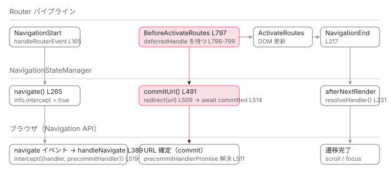

[目次](../README.md) › [Router の内側](README.md) › 第 21 回 / 全 21 回

# withExperimentalPlatformNavigation：Navigation API の navigate イベントを intercept する

> NavigationStateManager が history.pushState の代わりに navigation.navigate を使い、navigate イベントを handleNavigate で intercept し、precommitHandler で URL 確定を遅らせる手順。HistoryStateManager との差分と、Router の外から来た遷移の扱い。

angular/angular · 読了 約 13 分 · 発展 · [サイトで読む（デモが動きます）](https://angular-deep-dive-cyan.vercel.app/chapter/router-platform-navigation)

---

[第 16 回](16-router-browser-url.md)では、Router が `history.pushState` で URL を書き、`popstate` で戻るボタンを知る `HistoryStateManager` を追いました。この章はその**差し替え版**です。`withExperimentalPlatformNavigation()` を付けると `StateManager` が `NavigationStateManager` に替わり、ブラウザの Navigation API を使うようになります。`history.pushState` は呼ばれません。「URL はどこで変わるのか」「Router の外から来た遷移をどう捕まえるのか」「キャンセル時にどう戻すのか」の 3 点を、`HistoryStateManager` との差分として読みます。

読む対象は `packages/router/src/statemanager/navigation_state_manager.ts`（611 行、ほぼ全部）、`provide_router.ts` の `withExperimentalPlatformNavigation`、`packages/common/src/navigation/platform_navigation.ts`、`common/src/location/navigation_adapter_for_location.ts` です。

> [!WARNING]
> **ハマりどころ**
>
> この機能は `@experimental` です。ソースのドキュメントにも「本番で使うべきでない。ブラウザ対応は限定的で開発中」と書かれており（1 節）、API は今後変わる可能性があります。読む価値は「Router が外部の非同期 API と手順を合わせる設計」を見られることにあります。

1. 1 本の RxJS パイプライン
2. URL → UrlTree
3. routerLink の配列 → UrlTree
4. Route 設定の検証と正規化
5. provideRouter の中身
6. 最初のナビゲーション
7. navigateByUrl → NavigationTransition
8. setupNavigations の全段
9. Recognizer と match
10. redirectTo
11. loadChildren と loadComponent
12. ガードの実行順
13. resolve と data と title
14. ActivatedRoute と Snapshot
15. RouterOutlet への配置
16. ブラウザの URL と履歴
17. Router.events の全種類
18. RouterLink と RouterLinkActive
19. withViewTransitions
20. withRouterResources
21. **Navigation API**（この章）

## 0. Navigation API を 5 行で

`window.navigation` はブラウザが持つ履歴の新しい API です。この章で使う部分だけ押さえます。

- `navigation.navigate(url, {state, history: 'push' | 'replace', info})`：URL を変える。`state` は `history.state` とは別の保存領域、`info` は呼び出し元が付ける任意の値です。
- `navigate` イベント：**同一オリジンのあらゆる遷移の直前**に発火します。`navigation.navigate` も、素の `<a href>` も、戻るボタン（`navigationType: 'traverse'`）も同じイベントです。
- `event.intercept({handler, scroll, precommitHandler})`：ページ遷移を「同一ドキュメント内の遷移」に変えます。`handler` が返す Promise が解決するまでブラウザは「遷移中」とみなし、ローディング表示やアクセシビリティ通知を出せます。
- `precommitHandler`：まだ標準化途中の拡張で、**URL の確定（commit）を遅らせ**、`controller.redirect(url)` で確定先を変えられます。対応判定は 1 節。
- `navigation.currentEntry` / `traverseTo(key)`：現在の履歴エントリと、特定のエントリへの移動。エントリは `key`（位置）と `id`（内容）を持ちます。

## 1. 差し替わるのは StateManager と Location

📄 `angular/packages/router/src/provide_router.ts` L206–221 （▶ の行: 210–211, 217–221）

```ts
206 │  * Enables interop with the browser's `Navigation` API for router navigations.
207 │  *
208 │  * @description
209 │  * 
210 ▶  * CRITICAL: This feature is _highly_ experimental and should not be used in production. Browser support
211 ▶  * is limited and in active development. Use only for experimentation and feedback purposes.
212 │  * 
213 │  * This function provides a `Location` strategy that uses the browser's `Navigation` API.
214 │  * By using the platform's Navigation APIs, the Router is able to provide native
215 │  * browser navigation capabilities. Some advantages include:
216 │  * 
217 ▶  * - The ability to intercept navigations triggered outside the Router. This allows plain anchor
218 ▶  * elements _without_ `RouterLink` directives to be intercepted by the Router and converted to SPA navigations.
219 ▶  * - Native scroll and focus restoration support by the browser, without the need for custom implementations.
220 ▶  * - Communication of ongoing navigations to the browser, enabling built-in features like 
221 ▶  * accessibility announcements, loading indicators, stop buttons, and performance measurement APIs.
```

📄 `angular/packages/router/src/provide_router.ts` L247–249 （▶ の行: 247）

```ts
247 ▶ export function withExperimentalPlatformNavigation(): ExperimentalPlatformNavigationFeature {
248 │   const devModeLocationCheck =
249 │     typeof ngDevMode === 'undefined' || ngDevMode
```

📄 `angular/packages/router/src/provide_router.ts` L266–272 （▶ の行: 267–269）

```ts
266 │   const providers = [
267 ▶     {provide: StateManager, useExisting: NavigationStateManager},
268 ▶     {provide: Location, useClass: ɵNavigationAdapterForLocation},
269 ▶     devModeLocationCheck,
270 │   ];
271 │   return routerFeature(RouterFeatureKind.ExperimentalPlatformNavigationFeature, providers);
272 │ }
```

210〜211 行目が冒頭の警告の出典です。217〜221 行目が利点として挙げられている 3 つ：`RouterLink` 無しの `<a>` も Router が捕まえられる、スクロールとフォーカスの復元をブラウザに任せられる、進行中の遷移をブラウザに伝えられる。267 行目、`StateManager` → `NavigationStateManager`（`useExisting`）。268 行目、`Location` → `NavigationAdapterForLocation`。269 行目は開発モードの検査（`Location` がモックに差し替えられていると例外）です。

📄 `angular/packages/router/src/statemanager/state_manager.ts` L32–41 （▶ の行: 32–33, 40）

```ts
32 ▶ @Service({factory: () => inject(HistoryStateManager)})
33 ▶ export abstract class StateManager {
34 │   protected readonly urlSerializer = inject(UrlSerializer);
35 │   private readonly options = inject(ROUTER_CONFIGURATION, {optional: true}) || {};
36 │   protected readonly canceledNavigationResolution =
37 │     this.options.canceledNavigationResolution || 'replace';
38 │   protected location = inject(Location);
39 │   protected urlHandlingStrategy = inject(UrlHandlingStrategy);
40 ▶   protected urlUpdateStrategy = this.options.urlUpdateStrategy || 'deferred';
41 │ 
```

32 行目、`StateManager` の既定は `HistoryStateManager` です。267 行目がこの既定を上書きします （同じトークンは後勝ち。[zoneless の章](../zoneless/01-zoneless-default.md)で見た `records.set`）。40 行目、`urlUpdateStrategy` の既定 `'deferred'` は共通です。

📄 `angular/packages/common/src/navigation/platform_navigation.ts` L46–58 （▶ の行: 46–47, 49, 51, 54, 56）

```ts
46 ▶ @Injectable({providedIn: 'platform', useFactory: () => (window as any).navigation})
47 ▶ export abstract class PlatformNavigation implements Navigation {
48 │   abstract entries(): NavigationHistoryEntry[];
49 ▶   abstract currentEntry: NavigationHistoryEntry | null;
50 │   abstract updateCurrentEntry(options: NavigationUpdateCurrentEntryOptions): void;
51 ▶   abstract transition: NavigationTransition | null;
52 │   abstract canGoBack: boolean;
53 │   abstract canGoForward: boolean;
54 ▶   abstract navigate(url: string, options?: NavigationNavigateOptions | undefined): NavigationResult;
55 │   abstract reload(options?: NavigationReloadOptions | undefined): NavigationResult;
56 ▶   abstract traverseTo(key: string, options?: NavigationOptions | undefined): NavigationResult;
57 │   abstract back(options?: NavigationOptions | undefined): NavigationResult;
58 │   abstract forward(options?: NavigationOptions | undefined): NavigationResult;
```

📄 `angular/packages/common/src/navigation/platform_navigation.ts` L28–35 （▶ の行: 28, 30–32）

```ts
28 ▶ export const PRECOMMIT_HANDLER_SUPPORTED = new InjectionToken<boolean>('', {
29 │   factory: () => {
30 ▶     return (
31 ▶       typeof window !== 'undefined' &&
32 ▶       typeof (window as any).NavigationPrecommitController !== 'undefined'
33 │     );
34 │   },
35 │ });
```

46〜47 行目、`PlatformNavigation` は `window.navigation` をそのまま返す `providedIn: 'platform'` のサービスです。テストや SSR で差し替えるための抽象クラスで、メソッドはブラウザの `Navigation` と同じです（54 行目 `navigate`、56 行目 `traverseTo`）。28〜35 行目、`PRECOMMIT_HANDLER_SUPPORTED` は `window.NavigationPrecommitController` が存在するかで決まります。この真偽値が、この章の多くの分岐を左右します。

📄 `angular/packages/common/src/location/navigation_adapter_for_location.ts` L30–53 （▶ の行: 31, 42–43, 45, 52）

```ts
30 │ @Injectable()
31 ▶ export class NavigationAdapterForLocation extends Location {
32 │   private readonly navigation = inject(PlatformNavigation);
33 │   private readonly destroyRef = inject(DestroyRef);
34 │ 
35 │   constructor() {
36 │     super(inject(LocationStrategy));
37 │ 
38 │     this.registerNavigationListeners();
39 │   }
40 │ 
41 │   private registerNavigationListeners() {
42 ▶     const currentEntryChangeListener = () => {
43 ▶       this._notifyUrlChangeListeners(this.path(true), this.getState());
44 │     };
45 ▶     this.navigation.addEventListener('currententrychange', currentEntryChangeListener);
46 │     this.destroyRef.onDestroy(() => {
47 │       this.navigation.removeEventListener('currententrychange', currentEntryChangeListener);
48 │     });
49 │   }
50 │ 
51 │   override getState(): unknown {
52 ▶     return this.navigation.currentEntry?.getState();
53 │   }
```

📄 `angular/packages/common/src/location/navigation_adapter_for_location.ts` L55–67 （▶ の行: 55, 59, 62, 66）

```ts
55 ▶   override replaceState(path: string, query: string = '', state: any = null): void {
56 │     const url = this.prepareExternalUrl(path + normalizeQueryParams(query));
57 │     // Use navigation API consistently for navigations. The "navigation API state"
58 │     // field has no interaction with the existing "serialized state" field, which is what backs history.state
59 ▶     this.navigation.navigate(url, {state, history: 'replace'});
60 │   }
61 │ 
62 ▶   override go(path: string, query: string = '', state: any = null): void {
63 │     const url = this.prepareExternalUrl(path + normalizeQueryParams(query));
64 │     // Use navigation API consistently for navigations. The "navigation API state"
65 │     // field has no interaction with the existing "serialized state" field, which is what backs history.state
66 ▶     this.navigation.navigate(url, {state, history: 'push'});
67 │   }
```

`Location` 側の差し替えです。59・66 行目、`replaceState` と `go` は `history` ではなく `navigation.navigate(url, {state, history})` を呼びます。52 行目、`getState()` は `navigation.currentEntry.getState()`。45 行目、URL 変更の通知は `currententrychange` イベントです。`Location` を直接使うコード（`RouterLink` の `href` 計算など）はそのまま動き、裏側だけが Navigation API になります。

## 2. NavigationStateManager が持っているもの

📄 `angular/packages/router/src/statemanager/navigation_state_manager.ts` L46–47 （▶ の行: 46）

```ts
46 ▶ type NavigationInfo = {ɵrouterInfo: {intercept: boolean}};
47 │ 
```

📄 `angular/packages/router/src/statemanager/navigation_state_manager.ts` L62–78 （▶ の行: 62, 64, 67, 69–70, 77）

```ts
62 ▶ export class NavigationStateManager extends StateManager {
63 │   private readonly injector = inject(EnvironmentInjector);
64 ▶   private readonly navigation = inject(PlatformNavigation);
65 │   private readonly inMemoryScrollingEnabled = inject(ROUTER_SCROLLER, {optional: true}) !== null;
66 │   /** The base origin of the application, extracted from PlatformLocation. */
67 ▶   private readonly base = new URL(inject(PlatformLocation).href).origin;
68 │   /** The root URL of the Angular application, considering the base href. */
69 ▶   private readonly appRootUrl = new URL(this.location.prepareExternalUrl?.('/') ?? '/', this.base);
70 ▶   private readonly precommitHandlerSupported = inject(PRECOMMIT_HANDLER_SUPPORTED);
71 │   /**
72 │    * The `NavigationHistoryEntry` from the Navigation API that corresponds to the last successfully
73 │    * activated router state. This is crucial for restoring the browser state if an ongoing navigation
74 │    * is canceled or fails, allowing a precise rollback to a known good entry.
75 │    * It's updated on `navigatesuccess`.
76 │    */
77 ▶   private activeHistoryEntry: NavigationHistoryEntry = this.navigation.currentEntry!;
78 │ 
```

46 行目、`NavigationInfo`。Router が `navigation.navigate` を呼ぶときに `info` として付ける印で、`intercept: true`（Router の遷移として処理してほしい）か `false`（巻き戻しなのでブラウザに任せてほしい）の 2 値です。4 節の `handleNavigate` がこれを見て「自分が起こした navigate か」を判別します。

64 行目 `navigation`（`PlatformNavigation`）、67 行目 `base`（オリジン）、69 行目 `appRootUrl`（`<base href>` を含むアプリの根）、70 行目 `precommitHandlerSupported`。77 行目 `activeHistoryEntry` は**最後に成功した Router 状態に対応する履歴エントリ**で、キャンセル時に戻る先です（72〜76 行目のコメント）。

📄 `angular/packages/router/src/statemanager/navigation_state_manager.ts` L83–93 （▶ の行: 83, 86, 88, 90–92）

```ts
83 ▶   private currentNavigation: {
84 │     removeAbortListener?: () => void;
85 │     /** The Angular Router's internal representation of the ongoing navigation. */
86 ▶     routerTransition?: RouterNavigation;
87 │     /** Function to reject the intercepted navigation event. */
88 ▶     rejectNavigateEvent?: (reason?: any) => void;
89 │     /** Function to resolve the intercepted navigation event. */
90 ▶     resolveHandler?: (v: void) => void;
91 ▶     navigationEvent?: NavigateEvent;
92 ▶     commitUrl?: () => Promise<void>;
93 │   } = {};
```

83〜93 行目、`currentNavigation` が進行中の 1 遷移の作業領域です。Router 側の `Navigation`（86 行目）、intercept した `NavigateEvent`（91 行目）、その handler を解決・拒否する関数（88・90 行目）、URL を確定する関数 `commitUrl`（92 行目）。空オブジェクト `{}` が「何も進行していない」状態です。

📄 `angular/packages/router/src/statemanager/navigation_state_manager.ts` L114–126 （▶ の行: 119–120, 122–123）

```ts
114 │   constructor() {
115 │     super();
116 │ 
117 │     // Listen to the 'navigate' event from the Navigation API.
118 │     // This is the primary entry point for intercepting and handling navigations.
119 ▶     const navigateListener = (event: NavigateEvent) => {
120 ▶       this.handleNavigate(event);
121 │     };
122 ▶     this.navigation.addEventListener('navigate', navigateListener);
123 ▶     inject(DestroyRef).onDestroy(() =>
124 │       this.navigation.removeEventListener('navigate', navigateListener),
125 │     );
126 │   }
```

📄 `angular/packages/router/src/statemanager/navigation_state_manager.ts` L128–150 （▶ の行: 128, 137–140, 143–145）

```ts
128 ▶   override registerNonRouterCurrentEntryChangeListener(
129 │     listener: (
130 │       url: string,
131 │       state: RestoredState | null | undefined,
132 │       trigger: NavigationTrigger,
133 │       extras: NavigationExtras,
134 │       hasUAVisualTransition?: boolean,
135 │     ) => void,
136 │   ): SubscriptionLike {
137 ▶     this.activeHistoryEntry = this.navigation.currentEntry!;
138 ▶     this.nonRouterEntryChangeListener = this.nonRouterCurrentEntryChangeSubject.subscribe(
139 ▶       ({path, state, hasUAVisualTransition}) => {
140 ▶         listener(
141 │           path,
142 │           state,
143 ▶           'popstate',
144 ▶           !this.precommitHandlerSupported ? {replaceUrl: true} : {},
145 ▶           hasUAVisualTransition,
146 │         );
147 │       },
148 │     );
149 │     return this.nonRouterEntryChangeListener;
150 │   }
```

119〜125 行目、コンストラクタで `navigate` イベントに `handleNavigate` を登録します。入口はこれ 1 つです。128〜150 行目、`Router.setUpLocationChangeListener` から呼ばれる登録メソッド。`HistoryStateManager` が `Location` の `popstate` を購読していた場所（下の 200〜217 行目）に対し、こちらは 138 行目で自前の `Subject` を購読し、143 行目で trigger を `'popstate'` として Router に渡します。144 行目、`precommitHandler` が使えないブラウザでは `{replaceUrl: true}`（URL は既にブラウザが確定しているので、Router は置き換えで同期する）、使えるなら空です。145 行目、`hasUAVisualTransition` は [前々章](19-router-view-transitions.md)と同じ経路に乗ります。

📄 `angular/packages/router/src/statemanager/state_manager.ts` L200–217 （▶ の行: 201–202, 205, 211）

```ts
200 │   ): SubscriptionLike {
201 ▶     return this.location.subscribe((event) => {
202 ▶       if (event['type'] === 'popstate') {
203 │         // The `setTimeout` was added in #12160 and is likely to support Angular/AngularJS
204 │         // hybrid apps.
205 ▶         setTimeout(() => {
206 │           listener(
207 │             event['url']!,
208 │             event.state as RestoredState | null | undefined,
209 │             'popstate',
210 │             {
211 ▶               replaceUrl: true,
212 │             },
213 │             event.hasUAVisualTransition,
214 │           );
215 │         });
216 │       }
217 │     });
```

## 3. Router 発の遷移：handleRouterEvent は Promise を仕込む

📄 `angular/packages/router/src/router.ts` L193–200 （▶ の行: 194, 200）

```ts
193 │   private subscribeToNavigationEvents() {
194 ▶     const subscription = this.navigationTransitions.events.subscribe((e) => {
195 │       try {
196 │         const currentTransition = this.navigationTransitions.currentTransition;
197 │         const currentNavigation = untracked(this.navigationTransitions.currentNavigation);
198 │ 
199 │         if (currentTransition !== null && currentNavigation !== null) {
200 ▶           this.stateManager.handleRouterEvent(e, currentNavigation);
```

200 行目、`Router` はパイプラインの全イベントを `stateManager.handleRouterEvent(e, currentNavigation)` に渡します。戻り値は見ません。`HistoryStateManager` 版は同期でした。

📄 `angular/packages/router/src/statemanager/state_manager.ts` L220–244 （▶ の行: 220, 231–234）

```ts
220 ▶   override handleRouterEvent(e: Event | PrivateRouterEvents, currentTransition: Navigation): void {
221 │     if (e instanceof NavigationStart) {
222 │       this.updateStateMemento();
223 │     } else if (e instanceof NavigationSkipped) {
224 │       this.commitTransition(currentTransition);
225 │     } else if (e instanceof RoutesRecognized) {
226 │       if (this.urlUpdateStrategy === 'eager') {
227 │         if (!currentTransition.extras.skipLocationChange) {
228 │           this.setBrowserUrl(this.createBrowserPath(currentTransition), currentTransition);
229 │         }
230 │       }
231 ▶     } else if (e instanceof BeforeActivateRoutes) {
232 ▶       this.commitTransition(currentTransition);
233 ▶       if (this.urlUpdateStrategy === 'deferred' && !currentTransition.extras.skipLocationChange) {
234 ▶         this.setBrowserUrl(this.createBrowserPath(currentTransition), currentTransition);
235 │       }
236 │     } else if (e instanceof NavigationCancel && !isRedirectingEvent(e)) {
237 │       this.restoreHistory(currentTransition);
238 │     } else if (e instanceof NavigationError) {
239 │       this.restoreHistory(currentTransition, true);
240 │     } else if (e instanceof NavigationEnd) {
241 │       this.lastSuccessfulId = e.id;
242 │       this.currentPageId = this.browserPageId;
243 │     }
244 │   }
```

231〜235 行目、`BeforeActivateRoutes` が来たら `commitTransition` と `setBrowserUrl`（`Location.go` → `history.pushState`）を**その場で**行います。Navigation API 版は、ここが `async` になります。

📄 `angular/packages/router/src/statemanager/navigation_state_manager.ts` L160–174 （▶ の行: 160, 164–166, 169–170, 172–174）

```ts
160 ▶   override async handleRouterEvent(
161 │     e: Event | PrivateRouterEvents,
162 │     transition: RouterNavigation,
163 │   ): Promise<void> {
164 ▶     this.currentNavigation = {...this.currentNavigation, routerTransition: transition};
165 ▶     if (e instanceof NavigationStart) {
166 ▶       this.updateStateMemento();
167 │       // If we have precommit handler support, we can create a navigation
168 │       // immediately and redirect it later.
169 ▶       if (this.precommitHandlerSupported) {
170 ▶         this.maybeCreateNavigationForTransition(transition);
171 │       }
172 ▶     } else if (e instanceof NavigationSkipped) {
173 ▶       this.finishNavigation();
174 ▶       this.commitTransition(transition);
```

📄 `angular/packages/router/src/statemanager/navigation_state_manager.ts` L175–203 （▶ の行: 175–177, 179–180, 187, 189–190, 192, 194–195, 201–202）

```ts
175 ▶     } else if (e instanceof BeforeRoutesRecognized) {
176 ▶       transition.routesRecognizeHandler.deferredHandle = new Promise<void>(async (resolve) => {
177 ▶         if (this.urlUpdateStrategy === 'eager') {
178 │           try {
179 ▶             this.maybeCreateNavigationForTransition(transition);
180 ▶             await this.currentNavigation.commitUrl?.();
181 │           } catch {
182 │             // If commit fails (e.g., precommitHandler rejects), abort.
183 │             // The AbortSignal will notify
184 │             return;
185 │           }
186 │         }
187 ▶         resolve();
188 │       });
189 ▶     } else if (e instanceof BeforeActivateRoutes) {
190 ▶       transition.beforeActivateHandler.deferredHandle = new Promise<void>(async (resolve) => {
191 │         // If URL update strategy is 'deferred', commit the URL now (before activation).
192 ▶         if (this.urlUpdateStrategy === 'deferred') {
193 │           try {
194 ▶             this.maybeCreateNavigationForTransition(transition);
195 ▶             await this.currentNavigation.commitUrl?.();
196 │           } catch {
197 │             return;
198 │           }
199 │         }
200 │         // Commit the internal router state.
201 ▶         this.commitTransition(transition);
202 ▶         resolve();
203 │       });
```

1. **164 行目：進行中の Router `Navigation` を `currentNavigation.routerTransition` に保存**

   4 節の `handleNavigate` が、外から来た遷移を見たときに `abort()` する相手です。
2. **165〜171 行目：`NavigationStart`**

   `updateStateMemento`（巻き戻し用に現在状態を保存。`HistoryStateManager` と同じ）。169〜170 行目、`precommitHandler` が使えるなら**ここで**`maybeCreateNavigationForTransition`、つまり `navigation.navigate` を呼びます。167〜168 行目のコメント：「すぐに navigation を作り、あとでリダイレクトできる」。URL の確定は保留したまま、ブラウザに「遷移が始まった」と伝えるためです。
3. **175〜188 行目：`BeforeRoutesRecognized`（`'eager'` のとき URL 確定）**

   176 行目、`transition.routesRecognizeHandler.deferredHandle` に Promise を置きます。`urlUpdateStrategy` が `'eager'` なら 179〜180 行目で navigation を作り `commitUrl()` を `await`。これはパイプライン側の 566〜570 行目（下）が待つ Promise です。
4. **189〜203 行目：`BeforeActivateRoutes`（既定の `'deferred'` のとき URL 確定）**

   190 行目、同じく `beforeActivateHandler.deferredHandle` に Promise。192〜195 行目、`'deferred'` なら navigation を作り `await commitUrl()`。201 行目で `commitTransition`（Router 内部の `currentUrlTree` / `routerState` を確定）、202 行目で resolve。`commitUrl` が reject（`precommitHandler` が拒否）なら 196〜198 行目で resolve せずに return し、Promise は未解決のまま。その場合は navigate イベントの `abort` シグナルが Router 側の遷移を止めます（4 節の 434〜437 行目）。

📄 `angular/packages/router/src/navigation_transition.ts` L556–570 （▶ の行: 563, 566–568）

```ts
556 │                 tap((t) => {
557 │                   overallTransitionState.targetSnapshot = t.targetSnapshot;
558 │                   overallTransitionState.urlAfterRedirects = t.urlAfterRedirects;
559 │                   this.currentNavigation.update((nav) => {
560 │                     nav!.finalUrl = t.urlAfterRedirects;
561 │                     return nav;
562 │                   });
563 ▶                   this.events.next(new BeforeRoutesRecognized());
564 │                 }),
565 │ 
566 ▶                 switchMap((value) =>
567 ▶                   from(
568 ▶                     overallTransitionState.routesRecognizeHandler.deferredHandle ?? of(void 0),
569 │                   ).pipe(map(() => value)),
570 │                 ),
```

📄 `angular/packages/router/src/navigation_transition.ts` L795–800 （▶ の行: 797–799）

```ts
795 │           switchMap((t: NavigationTransition) => {
796 │             abortable = false;
797 ▶             this.events.next(new BeforeActivateRoutes());
798 ▶             const deferred = overallTransitionState.beforeActivateHandler.deferredHandle;
799 ▶             return deferred ? from(deferred.then(() => t)) : of(t);
800 │           }),
```

パイプライン側の受け口です。563 行目で `BeforeRoutesRecognized` を流し（`Router` → `handleRouterEvent` が同期で 176 行目の Promise を置く）、566〜570 行目で `routesRecognizeHandler.deferredHandle ?? of(void 0)` を待ちます。797〜799 行目、`BeforeActivateRoutes` も同じ形で `beforeActivateHandler.deferredHandle` を待ちます。`HistoryStateManager` はこの Promise を置かないので `?? of(void 0)`（または `of(t)`）で即時に進みます。**「StateManager がイベントに Promise を仕込み、パイプラインがそれを待つ」**が、同期版と非同期版を同じパイプラインで動かす仕掛けです。

### maybeCreateNavigationForTransition と navigate

📄 `angular/packages/router/src/statemanager/navigation_state_manager.ts` L235–256 （▶ の行: 236, 239, 244–246, 253–255）

```ts
235 │   private maybeCreateNavigationForTransition(transition: RouterNavigation) {
236 ▶     const {navigationEvent, commitUrl} = this.currentNavigation;
237 │     if (
238 │       // Presence of commitUrl function indicates the navigateEvent supports redirect
239 ▶       commitUrl ||
240 │       // If we are currently handling a traversal navigation, we do not need a new navigation for it
241 │       // because we are strictly restoring a previous state. If we are instead handling a navigation
242 │       // initiated outside the router, we do need to replace it with a router-triggered navigation
243 │       // to add the router-specific state.
244 ▶       (navigationEvent &&
245 ▶         navigationEvent.navigationType === 'traverse' &&
246 ▶         this.eventAndRouterDestinationsMatch(navigationEvent, transition))
247 │     ) {
248 │       return;
249 │     }
250 │     // Before we create a navigation for the Router transition, we have to remove any abort listeners
251 │     // from the previous navigation event. Creating the new navigation will cause the signal
252 │     // to be aborted, and we don't want that to cause our router transition to be aborted.
253 ▶     this.currentNavigation.removeAbortListener?.();
254 ▶     const path = this.createBrowserPath(transition);
255 ▶     this.navigate(path, transition);
256 │   }
```

239 行目、`commitUrl` が既にあるなら何もしません。「あとで URL を確定できる navigate イベントを既に握っている」状態です （Router 発で `NavigationStart` 時に作った場合、または外から来た `navigate` を intercept した場合）。244〜246 行目、intercept 中のイベントが `'traverse'`（戻る・進む）で行き先が Router の目的地と一致すれば、新しい navigation は作りません。過去のエントリを復元しているだけだからです。253 行目、前のイベントの abort リスナーを外してから（新しい navigate が前のイベントを abort するので、それで Router の遷移が止まらないように）、254〜255 行目で `navigate`。

📄 `angular/packages/router/src/statemanager/navigation_state_manager.ts` L265–303 （▶ の行: 265, 267–269, 272–274, 277, 282–283, 287–292, 297–300）

```ts
265 ▶   private navigate(internalPath: string, transition: RouterNavigation) {
266 │     // Determine the actual browser path, considering skipLocationChange.
267 ▶     const path = transition.extras.skipLocationChange
268 ▶       ? this.navigation.currentEntry!.url! // If skipping, use the current URL.
269 ▶       : this.location.prepareExternalUrl(internalPath); // Otherwise, prepare the external URL.
270 │ 
271 │     // Prepare the state to be stored in the NavigationHistoryEntry.
272 ▶     const state = {
273 ▶       ...transition.extras.state,
274 ▶       ...this.generateNgRouterState(transition),
275 │     };
276 │ 
277 ▶     const info: NavigationInfo = {ɵrouterInfo: {intercept: true}};
278 │     // https://issues.chromium.org/issues/460137775 - Bug in all browsers where URL might actually not be updated
279 │     // by the time we get here. replaceUrl was set to true in the Router when navigating to sync with the browser
280 │     // because it assumes the URL is already committed. In this scenario, we need to go back to 'push' behavior
281 │     // because it was not yet been committed and we should not replace the current entry.
282 ▶     if (!this.navigation.transition && this.currentNavigation.navigationEvent) {
283 ▶       transition.extras.replaceUrl = false;
284 │     }
285 │ 
286 │     // Determine if this should be a 'push' or 'replace' history operation.
287 ▶     const history =
288 ▶       this.location.isCurrentPathEqualTo(path) ||
289 ▶       transition.extras.replaceUrl ||
290 ▶       transition.extras.skipLocationChange
291 ▶         ? 'replace'
292 ▶         : 'push';
293 │ 
294 │     // Call the Navigation API and prevent unhandled promise rejections of the
295 │     // returned promises from `navigation.navigate`.
296 │     handleResultRejections(
297 ▶       this.navigation.navigate(path, {
298 ▶         state,
299 ▶         history,
300 ▶         info,
301 │       }),
302 │     );
303 │   }
```

📄 `angular/packages/router/src/statemanager/navigation_state_manager.ts` L580–586 （▶ の行: 582, 584）

```ts
580 │   private generateNgRouterState(transition: RouterNavigation) {
581 │     return {
582 ▶       ...this.routerUrlState(transition),
583 │       // Include router's navigationId for tracking. Required for in-memory scroll restoration
584 ▶       navigationId: transition.id,
585 │     };
586 │   }
```

1. **267〜269 行目：path**

   `skipLocationChange` なら現在のエントリの URL（URL を変えない）、そうでなければ `Location.prepareExternalUrl` で `<base href>` を前置した外部 URL。
2. **272〜275 行目：state**

   利用者の `extras.state` と、`generateNgRouterState`（582〜584 行目：`ɵrouterUrl` と `navigationId`）。`HistoryStateManager` が `ɵrouterPageId` を数えていたのに対し、こちらにはありません。エントリの `key` / `id` をブラウザが持つからです。
3. **277 行目：`info = {ɵrouterInfo: {intercept: true}}`**

   この navigate が発火させる `navigate` イベントの `event.info` に乗ります。4 節で読む印です。
4. **282〜284 行目：ブラウザの不具合への回避策**

   278〜281 行目のコメント。外から来た遷移を Router が同期するとき `replaceUrl: true` にしていますが（2 節の 144 行目）、ブラウザによってはこの時点でまだ URL が確定していません。`navigation.transition` が無いのに intercept 中のイベントを持っている、という条件で検出して `'push'` に戻します。
5. **287〜292 行目：push か replace か**

   現在パスと同じ、`replaceUrl`、`skipLocationChange` のどれかなら `'replace'`。`HistoryStateManager.setBrowserUrl`（下の 250 行目）と同じ判定です。
6. **296〜302 行目：`navigation.navigate(path, {state, history, info})`**

   これが `history.pushState` の代わりです。戻り値の `committed` / `finished` Promise には `catch(() => {})` を付けます（`handleResultRejections`）。**この呼び出しの中で同期的に `navigate` イベントが発火し、4 節の `handleNavigate` が走ります。**

📄 `angular/packages/router/src/statemanager/state_manager.ts` L246–265 （▶ の行: 250, 257, 263）

```ts
246 │   private setBrowserUrl(path: string, navigation: Navigation) {
247 │     const {extras, id} = navigation;
248 │     const {replaceUrl, state} = extras;
249 │ 
250 ▶     if (this.location.isCurrentPathEqualTo(path) || !!replaceUrl) {
251 │       // replacements do not update the target page
252 │       const currentBrowserPageId = this.browserPageId;
253 │       const newState = {
254 │         ...state,
255 │         ...this.generateNgRouterState(id, currentBrowserPageId, navigation),
256 │       };
257 ▶       this.location.replaceState(path, '', newState);
258 │     } else {
259 │       const newState = {
260 │         ...state,
261 │         ...this.generateNgRouterState(id, this.browserPageId + 1, navigation),
262 │       };
263 ▶       this.location.go(path, '', newState);
264 │     }
265 │   }
```

### NavigationEnd と、キャンセル／エラー

📄 `angular/packages/router/src/statemanager/navigation_state_manager.ts` L204–233 （▶ の行: 204, 209–213, 216–219, 223, 225, 231）

```ts
204 ▶     } else if (e instanceof NavigationCancel || e instanceof NavigationError) {
205 │       // If redirecting and the URL hasn't been committed yet (via precommmitHandler),
206 │       // the redirect will be handled by `commitUrl` using `controller.redirect` and
207 │       // we should retain the current NavigateEvent.
208 │       // Otherwise, a full cancellation and rollback is needed.
209 ▶       const redirectingBeforeUrlCommit =
210 ▶         e instanceof NavigationCancel &&
211 ▶         e.code === NavigationCancellationCode.Redirect &&
212 ▶         !!this.currentNavigation.commitUrl;
213 ▶       if (redirectingBeforeUrlCommit) {
214 │         return;
215 │       }
216 ▶       void this.cancel(transition, e);
217 ▶     } else if (e instanceof NavigationEnd) {
218 ▶       const {resolveHandler, removeAbortListener} = this.currentNavigation;
219 ▶       this.currentNavigation = {};
220 │       // We no longer care about aborts for this navigation once it's successfully ended.
221 │       // Since we're delaying the resolution of the handler until after next render, it's
222 │       // technically possible for it to still get aborted in that window, so we remove the listener here.
223 ▶       removeAbortListener?.();
224 │       // Update `activeHistoryEntry` to the new current entry from Navigation API.
225 ▶       this.activeHistoryEntry = this.navigation.currentEntry!;
226 │       // TODO(atscott): Consider initiating scroll here since it will be attempted periodically.
227 │       // We have to wait for render to resolve because focus reset is only done once in the spec.
228 │       // Render is not synchronous with NavigationEnd today. The Router's navigation promise resolve
229 │       // is what _causes_ the render to happen with ZoneJS...
230 │       // Resolve handler after next render to defer scroll and focus reset.
231 ▶       afterNextRender({read: () => resolveHandler?.()}, {injector: this.injector});
232 │     }
233 │   }
```

217〜232 行目、`NavigationEnd`。219 行目で作業領域を空にし、223 行目で abort リスナーを外し、225 行目で `activeHistoryEntry` を今のエントリに進めます。231 行目、**`afterNextRender` のあとで `resolveHandler()`**。これが intercept の `handler` Promise の解決で、ブラウザは「遷移完了」として スクロール位置とフォーカスのリセットを行います。226〜230 行目のコメント：描画の後まで遅らせるのは、仕様上フォーカスリセットは 1 回しか行われないため、新しい DOM が出てから行わせたいからです。

204〜216 行目、`NavigationCancel` / `NavigationError`。209〜212 行目、理由が `Redirect` で、かつ `commitUrl` がまだ残っている（URL 未確定）なら何もしません。リダイレクト先への再ナビゲーションが同じ navigate イベントの `commitUrl` を使って URL を確定するからです（205〜208 行目のコメント）。それ以外は 216 行目 `cancel`（5 節）。

## 4. handleNavigate：navigate イベントの入口

Router が起こした navigate も、素の `<a href>` も、戻るボタンも、全部ここに来ます。7 つの引用に分けて読みます。

📄 `angular/packages/router/src/statemanager/navigation_state_manager.ts` L389–403 （▶ の行: 389, 395–396, 399–401, 403）

```ts
389 ▶   private handleNavigate(event: NavigateEvent) {
390 │     // If the event cannot be intercepted (e.g., cross-origin, or some browser-internal
391 │     // navigations), let the browser handle it.
392 │     // We also do not convert reload navigation events to SPA navigations. Intercepting
393 │     // would prevent the generally expected hard refresh. If an application wants special
394 │     // handling for reloads, they can implement it in their own `navigate` event listener.
395 ▶     if (!event.canIntercept || event.navigationType === 'reload') {
396 ▶       return;
397 │     }
398 │ 
399 ▶     const routerInfo = (event?.info as NavigationInfo | undefined)?.ɵrouterInfo;
400 ▶     if (routerInfo && !routerInfo.intercept) {
401 ▶       return;
402 │     }
403 ▶     const isTriggeredByRouterTransition = !!routerInfo;
```

395〜397 行目、intercept できない（別オリジンなど。ブラウザが `canIntercept` で教えてくれる）か、リロードなら何もしません。392〜394 行目のコメント：リロードを SPA 遷移に変えると「普通のハードリフレッシュ」を期待する利用者を裏切るので、あえて触りません。399〜402 行目、`event.info.ɵrouterInfo` を見ます。あって `intercept: false` なら巻き戻し（5 節）なので何もしません。403 行目、`ɵrouterInfo` が**あるかどうか**が「Router が起こした遷移か」です。

📄 `angular/packages/router/src/statemanager/navigation_state_manager.ts` L404–427 （▶ の行: 404–406, 409–411, 413, 420, 422, 424–425）

```ts
404 ▶     if (!isTriggeredByRouterTransition) {
405 ▶       const {pathname: destPathname, origin: destOrigin} = new URL(event.destination.url);
406 ▶       const {pathname: rootPathname, origin: appOrigin} = this.appRootUrl;
407 │       const rootPath = rootPathname.endsWith('/') ? rootPathname : rootPathname + '/';
408 │ 
409 ▶       if (
410 ▶         destOrigin !== appOrigin ||
411 ▶         (destPathname !== rootPathname && !destPathname.startsWith(rootPath))
412 │       ) {
413 ▶         return;
414 │       }
415 │ 
416 │       // If there's an ongoing navigation in the Angular Router, abort it. This new navigation
417 │       // supersedes it. If the navigation was triggered by the Router, it may be the navigation
418 │       // happening from _inside_ the navigation transition, or a separate Router.navigate call
419 │       // that would have already handled cleanup of the previous navigation.
420 ▶       this.currentNavigation.routerTransition?.abort();
421 │ 
422 ▶       if (!this.registered) {
423 │         // If the router isn't set up to listen for these yet. Do not convert it to a router navigation.
424 ▶         this.finishNavigation();
425 ▶         return;
426 │       }
427 │     }
```

404〜427 行目は**Router の外から来た遷移だけ**が通ります。405〜414 行目、行き先のオリジンとパスが `appRootUrl` の中かを確かめ、外なら何もしません （同一オリジンの別アプリへの `<a href>` はブラウザに任せる）。420 行目、進行中の Router 遷移があれば `abort()`。利用者が別のリンクを押したので、前の遷移は捨てます。422〜426 行目、`Router` がまだリスナーを登録していなければ（起動直後）、`finishNavigation` で片付けて何もしません。

📄 `angular/packages/router/src/statemanager/navigation_state_manager.ts` L429–446 （▶ の行: 429–430, 434–435, 437–438, 441–444）

```ts
429 ▶     this.currentNavigation = {...this.currentNavigation};
430 ▶     this.currentNavigation.navigationEvent = event;
431 │     // Setup an abort handler. If the `NavigateEvent` is aborted (e.g., user clicks stop,
432 │     // or another navigation supersedes this one), we need to abort the Angular Router's
433 │     // internal navigation transition as well.
434 ▶     const abortHandler = () => {
435 ▶       this.currentNavigation.routerTransition?.abort();
436 │     };
437 ▶     event.signal.addEventListener('abort', abortHandler);
438 ▶     this.currentNavigation.removeAbortListener = () =>
439 │       event.signal.removeEventListener('abort', abortHandler);
440 │ 
441 ▶     let scroll = this.inMemoryScrollingEnabled
442 ▶       ? 'manual'
443 ▶       : (this.currentNavigation.routerTransition?.extras.scroll ?? 'after-transition');
444 ▶     const interceptOptions: NavigationInterceptOptions = {
445 │       scroll,
446 │     };
```

430 行目、イベントを作業領域に保存。434〜439 行目、`event.signal`（ブラウザがこの遷移を中止したときに発火する `AbortSignal`）に 「Router の遷移も `abort()` する」リスナーを付け、外す関数も保存します。441〜446 行目、`intercept` の `scroll` オプション。`withInMemoryScrolling` があれば `'manual'`（Router が自分で復元）、無ければ `extras.scroll` か `'after-transition'`（ブラウザが遷移完了後に復元）です。

📄 `angular/packages/router/src/statemanager/navigation_state_manager.ts` L448–472 （▶ の行: 448–450, 454–455, 459–462, 464–466, 471）

```ts
448 ▶     const {
449 ▶       promise: handlerPromise,
450 ▶       resolve: resolveHandler,
451 │       reject: rejectHandler,
452 │     } = promiseWithResolvers<void>();
453 │ 
454 ▶     const {
455 ▶       promise: precommitHandlerPromise,
456 │       resolve: resolvePrecommitHandler,
457 │       reject: rejectPrecommitHandler,
458 │     } = promiseWithResolvers<void>();
459 ▶     this.currentNavigation.rejectNavigateEvent = () => {
460 ▶       event.signal.removeEventListener('abort', abortHandler);
461 ▶       rejectPrecommitHandler();
462 ▶       rejectHandler();
463 │     };
464 ▶     this.currentNavigation.resolveHandler = () => {
465 ▶       this.currentNavigation.removeAbortListener?.();
466 ▶       resolveHandler();
467 │     };
468 │     // Prevent unhandled promise rejections from internal promises.
469 │     handlerPromise.catch(() => {});
470 │     precommitHandlerPromise.catch(() => {});
471 ▶     interceptOptions.handler = () => handlerPromise;
472 │ 
```

448〜458 行目、2 本の Promise を `promiseWithResolvers` で作ります。`handlerPromise`（遷移全体）と `precommitHandlerPromise`（URL 確定の許可）。459〜467 行目、両方を reject する `rejectNavigateEvent` と、`handlerPromise` を resolve する `resolveHandler` を作業領域に保存。3 節の `NavigationEnd`（231 行目）が呼ぶのは後者です。471 行目、`interceptOptions.handler = () => handlerPromise`。**ブラウザにとっての「遷移中」は、Router の `NavigationEnd` + 1 描画まで続きます。**

📄 `angular/packages/router/src/statemanager/navigation_state_manager.ts` L473–487 （▶ の行: 473–474, 478–479, 481, 483, 485）

```ts
473 ▶     if (this.deferredCommitSupported(event)) {
474 ▶       const redirect = new Promise<
475 │         (url: string, options: {state: unknown; history?: 'push' | 'replace'}) => void
476 │       >((resolve) => {
477 │         // The `precommitHandler` option is not in the standard DOM types yet
478 ▶         (interceptOptions as any).precommitHandler = (controller: any) => {
479 ▶           if (this.navigation.transition?.navigationType === 'traverse') {
480 │             // TODO(atscott): Figure out correct behavior for redirecting traversals
481 ▶             resolve(() => {});
482 │           } else {
483 ▶             resolve(controller.redirect.bind(controller));
484 │           }
485 ▶           return precommitHandlerPromise;
486 │         };
487 │       });
```

📄 `angular/packages/router/src/statemanager/navigation_state_manager.ts` L588–594 （▶ の行: 590, 592）

```ts
588 │   private deferredCommitSupported(event: NavigateEvent): boolean {
589 │     return (
590 ▶       this.precommitHandlerSupported &&
591 │       // Cannot defer commit if not cancelable by the Navigation API's rules.
592 ▶       event.cancelable
593 │     );
594 │   }
```

473 行目、`deferredCommitSupported`（588〜594 行目：`PRECOMMIT_HANDLER_SUPPORTED` かつ `event.cancelable`）のときだけ、URL 確定の保留を使います。478〜486 行目、`precommitHandler` を設定。ブラウザがこれを呼ぶと `controller.redirect` を 474 行目の Promise 経由で取り出し（483 行目）、`precommitHandlerPromise` を返します（485 行目）。**この Promise が解決するまで URL は変わりません。** 479〜481 行目、`traverse` 中は redirect を空関数にします（TODO コメント：正しい挙動は未決定）。

📄 `angular/packages/router/src/statemanager/navigation_state_manager.ts` L488–516 （▶ の行: 491–493, 497–503, 508–509, 511, 514）

```ts
488 │       // `commitUrl` is a function that will be called by the router's lifecycle
489 │       // (e.g., in `BeforeRoutesRecognized` or `BeforeActivateRoutes` depending on `urlUpdateStrategy`)
490 │       // to actually perform the URL change via the Navigation API.
491 ▶       this.currentNavigation.commitUrl = async () => {
492 ▶         this.currentNavigation.commitUrl = undefined; // Ensure it's only called once.
493 ▶         const transition = this.currentNavigation.routerTransition;
494 │ 
495 │         // If not skipping location change, use the `redirect` function (from `precommitHandler`'s
496 │         // controller) to perform the URL update with the correct state and history action.
497 ▶         if (transition && !transition.extras.skipLocationChange) {
498 ▶           const internalPath = this.createBrowserPath(transition);
499 ▶           const history =
500 ▶             this.location.isCurrentPathEqualTo(internalPath) || !!transition.extras.replaceUrl
501 ▶               ? 'replace'
502 ▶               : 'push';
503 ▶           const state = {
504 │             ...transition.extras.state,
505 │             ...this.generateNgRouterState(transition),
506 │           };
507 │           // this might be a path or an actual URL depending on the baseHref
508 ▶           const pathOrUrl = this.location.prepareExternalUrl(internalPath);
509 ▶           (await redirect)(pathOrUrl, {state, history});
510 │         }
511 ▶         resolvePrecommitHandler();
512 │         // Wait for the Navigation API's own `committed` promise if available (part of transition object)
513 │         // This ensures we respect the browser's timing for when the commit actually happens.
514 ▶         return await this.navigation.transition?.committed;
515 │       };
516 │     }
```

1. **491〜492 行目：`commitUrl` を作業領域に置く。1 回しか呼べない**

   3 節の `BeforeRoutesRecognized`（180 行目）か `BeforeActivateRoutes`（195 行目）がこれを `await` します。
2. **497〜510 行目：`skipLocationChange` でなければ `redirect(pathOrUrl, {state, history})`**

   498 行目で Router の最終 URL（リダイレクト後。`createBrowserPath`）を取り、499〜502 行目で push/replace を決め、503〜506 行目で state を作り、509 行目で `precommitHandler` から受け取った `redirect` を呼びます。**ここで初めてブラウザの URL が決まります。** Router の目的地が途中でリダイレクトされていても、ブラウザは最初から最終 URL だけを見ることになります。
3. **511 行目：`resolvePrecommitHandler()`**

   485 行目で返した Promise が解決し、ブラウザが commit を実行します。
4. **514 行目：`navigation.transition.committed` を待つ**

   ブラウザ側の確定が済むまで `commitUrl()` は解決しません。だから 3 節の 195 行目 `await` の後では URL が確実に変わっています。

📄 `angular/packages/router/src/statemanager/navigation_state_manager.ts` L518–527 （▶ の行: 519, 524–525）

```ts
518 │     // Intercept the navigation event with the configured options.
519 ▶     event.intercept(interceptOptions);
520 │ 
521 │     // If `routerInfo` is null, this `NavigateEvent` was not triggered by one of the Router's
522 │     // own `this.navigation.navigate()` calls. It's an external navigation (e.g., user click,
523 │     // browser back/forward that the Navigation API surfaces). We need to inform the Router.
524 ▶     if (!isTriggeredByRouterTransition) {
525 ▶       this.handleNavigateEventTriggeredOutsideRouterAPIs(event);
526 │     }
527 │   }
```

📄 `angular/packages/router/src/statemanager/navigation_state_manager.ts` L539–549 （▶ の行: 539, 542–544, 547）

```ts
539 ▶   private handleNavigateEventTriggeredOutsideRouterAPIs(event: NavigateEvent) {
540 │     // Extract the application-relative path from the full destination URL.
541 │     // The url will always start with the appRootUrl because of the boundary check in handleNavigate.
542 ▶     const path = event.destination.url.substring(this.appRootUrl.href.length - 1);
543 ▶     const state = event.destination.getState() as RestoredState | null | undefined;
544 ▶     this.nonRouterCurrentEntryChangeSubject.next({
545 │       path,
546 │       state,
547 ▶       hasUAVisualTransition: event.hasUAVisualTransition,
548 │     });
549 │   }
```

519 行目、`event.intercept(interceptOptions)`。この 1 行で、ブラウザの「ページを読み込む遷移」が「同一ドキュメント内の遷移」になります。524〜526 行目、Router の外から来た遷移なら `handleNavigateEventTriggeredOutsideRouterAPIs`。542 行目、`destination.url` から `appRootUrl` の分を削ってアプリ内パスにし、543 行目、state は `destination.getState()`（Navigation API の state。`history.state` ではない）、547 行目、`hasUAVisualTransition`。544 行目で 2 節の `Subject` に流れ、`Router.navigateToSyncWithBrowser` → `scheduleNavigation` で**通常のパイプラインが始まります**。素の `<a href="/about">` が、ガードも resolver も通る Router の遷移になる経路がこれです。



*Router 発の遷移（precommitHandler 対応ブラウザ、urlUpdateStrategy 'deferred'）。URL はパイプラインの BeforeActivateRoutes で commitUrl → redirect によって確定し、handler の解決は NavigationEnd の 1 描画後。*

## 5. cancel：どのエントリへ戻すか

📄 `angular/packages/router/src/statemanager/navigation_state_manager.ts` L319–338 （▶ の行: 319–320, 322, 324, 329–332, 336–337）

```ts
319 ▶   private async cancel(transition: RouterNavigation, cause: NavigationCancel | NavigationError) {
320 ▶     this.currentNavigation.rejectNavigateEvent?.();
321 │     const clearedState = {}; // Marker to detect if a new navigation started during async ops.
322 ▶     this.currentNavigation = clearedState;
323 │     // Do not reset state if we're redirecting or navigation is superseded by a new one.
324 ▶     if (isRedirectingEvent(cause)) {
325 │       return;
326 │     }
327 │     // Determine if the rollback should be a traversal to a specific previous entry
328 │     // or a replacement of the current URL.
329 ▶     const isTraversalReset =
330 ▶       this.canceledNavigationResolution === 'computed' &&
331 ▶       this.navigation.currentEntry!.key !== this.activeHistoryEntry.key;
332 ▶     this.resetInternalState(transition.finalUrl, isTraversalReset);
333 │ 
334 │     // If the current browser entry ID is already the same as our target active entry,
335 │     // no browser history manipulation is needed.
336 ▶     if (this.navigation.currentEntry!.id === this.activeHistoryEntry.id) {
337 ▶       return;
338 │     }
```

📄 `angular/packages/router/src/statemanager/navigation_state_manager.ts` L340–373 （▶ の行: 346–348, 354, 357–358, 363–364, 366–369）

```ts
340 │     // If the cancellation was not due to a guard or resolver (e.g., superseded by another
341 │     // navigation, or aborted by user), there's a race condition. Another navigation might
342 │     // have already started. A delay is used to see if `currentNavigation` changes,
343 │     // indicating a new navigation has taken over.
344 │     // We have no way of knowing if a navigation was aborted by another incoming navigation
345 │     // https://github.com/WICG/navigation-api/issues/288
346 ▶     if (cause instanceof NavigationCancel && cause.code === NavigationCancellationCode.Aborted) {
347 ▶       await Promise.resolve();
348 ▶       if (this.currentNavigation !== clearedState) {
349 │         // A new navigation has started, so don't attempt to roll back this one.
350 │         return;
351 │       }
352 │     }
353 │ 
354 ▶     if (isTraversalReset) {
355 │       // Traverse back to the specific `NavigationHistoryEntry` that was active before.
356 │       handleResultRejections(
357 ▶         this.navigation.traverseTo(this.activeHistoryEntry.key, {
358 ▶           info: {ɵrouterInfo: {intercept: false}} satisfies NavigationInfo,
359 │         }),
360 │       );
361 │     } else {
362 │       // Replace the current history entry with the state of the last known good URL/state.
363 ▶       const internalPath = this.urlSerializer.serialize(this.getCurrentUrlTree());
364 ▶       const pathOrUrl = this.location.prepareExternalUrl(internalPath);
365 │       handleResultRejections(
366 ▶         this.navigation.navigate(pathOrUrl, {
367 ▶           state: this.activeHistoryEntry.getState(),
368 ▶           history: 'replace',
369 ▶           info: {ɵrouterInfo: {intercept: false}} satisfies NavigationInfo,
370 │         }),
371 │       );
372 │     }
373 │   }
```

1. **320 行目：intercept していた navigate イベントを reject**

   `handler` と `precommitHandler` の両 Promise が reject され、ブラウザ側の遷移は失敗として終わります。URL が未確定なら変わりません。
2. **324〜326 行目：リダイレクトか後続ナビゲーションによる打ち消しなら、状態は戻さない**

   `isRedirectingEvent`。次のナビゲーションが状態を引き継ぐからです。
3. **329〜332 行目：`'computed'` で、今のエントリの `key` が `activeHistoryEntry` と違えば「履歴移動で戻す」**

   `canceledNavigationResolution`（`'replace'` が既定）。`HistoryStateManager` が `ɵrouterPageId` の差で `history.go(n)` していたところを、こちらはエントリの `key` の比較で判断します。332 行目で Router 内部状態を `stateMemento` に戻します。
4. **336〜338 行目：既に正しいエントリにいるなら終わり**

   `id` まで一致していれば、ブラウザ側は何も触りません。
5. **346〜352 行目：`Aborted` のときは 1 マイクロタスク待って、新しい遷移が始まっていないか見る**

   344〜345 行目のコメント：Navigation API には「別の遷移に取って代わられた abort か」を知る方法が無い（WICG issue 288）。待ってみて作業領域が変わっていたら、戻さずに新しい遷移に任せます。
6. **354〜360 行目：`navigation.traverseTo(activeHistoryEntry.key, {info: intercept false})`**

   履歴上の正しい位置へ移動します。`intercept: false` なので 4 節の 400〜402 行目で `handleNavigate` は何もしません。
7. **361〜372 行目：`navigation.navigate(前の URL, {state: activeHistoryEntry.getState(), history: 'replace', info: intercept false})`**

   今のエントリを、最後に成功した URL と state で置き換えます。`HistoryStateManager.resetUrlToCurrentUrlTree` の `location.replaceState` に当たります。

## 6. HistoryStateManager との差分

|   | HistoryStateManager（既定） | NavigationStateManager |
| --- | --- | --- |
| URL を変える API | `Location.go / replaceState` → `history.pushState / replaceState`（state\_manager.ts 257・263 行目） | `navigation.navigate(path, {state, history, info})`（297〜301 行目）。`precommitHandler` 対応なら `controller.redirect`（509 行目）で確定 |
| URL が変わる時点 | `BeforeActivateRoutes` の `handleRouterEvent` 内で同期（231〜235 行目） | `BeforeActivateRoutes` で `await commitUrl()`（192〜195 行目）。パイプラインは `deferredHandle`（798〜799 行目）で待つ |
| 外部遷移の検知 | `Location.subscribe` の `popstate` のみ（201〜202 行目）。素の `<a href>` はページ読み込みになる | `navigate` イベント（122 行目）。`<a href>`・`location.assign`・戻る進むを `intercept` して Router の遷移にする（519・525 行目） |
| 外部遷移時の extras | `{replaceUrl: true}` 固定（211 行目） | `precommitHandler` 対応なら `{}`、非対応なら `{replaceUrl: true}`（144 行目） |
| キャンセル時の戻し方 | `ɵrouterPageId` の差で `location.historyGo(n)`、または `replaceState`（[第 16 回](16-router-browser-url.md)） | エントリの `key` を比べて `navigation.traverseTo(key)`（357 行目）、または `navigate(..., 'replace')`（366 行目）。`info.intercept: false` で自分の `handleNavigate` を通過させる |
| state の置き場 | `history.state`。`navigationId` と `ɵrouterPageId`（`'computed'` 時） | Navigation API の entry state（`currentEntry.getState()`、adapter 52 行目）。`navigationId` と `ɵrouterUrl`（582〜584 行目）。`ɵrouterPageId` は無い |
| ブラウザへの進行通知 | 無し | `intercept` の `handler` Promise。`NavigationEnd` + `afterNextRender` で解決（231 行目） |

> **🧪 DEMO — handleNavigate の分岐**
>
> navigate イベントの出どころと `PRECOMMIT_HANDLER_SUPPORTED` を選ぶと、navigation\_state\_manager.ts 389〜527 行目をどう通るか、そのあと Router 側で何が起きるかが出ます。
>
> ▶ [このデモはサイトで動かせます](https://angular-deep-dive-cyan.vercel.app/chapter/router-platform-navigation)

## ここまでの呼び出し（Router 発、precommitHandler 対応、'deferred'）

- 👤 `router.navigateByUrl('/about')` — あなたのコード
  - `this.events.next(new NavigationStart(...))` — router/src/navigation\_transition.ts L528
    - `NavigationStateManager.handleRouterEvent(NavigationStart)` — statemanager/navigation\_state\_manager.ts L165 — *Router.subscribeToNavigationEvents L200 から*
      - `maybeCreateNavigationForTransition(transition)` — navigation\_state\_manager.ts L235 — *precommitHandlerSupported のとき*
        - `navigate(path, transition)` → `navigation.navigate(path, {state, history, info})` — navigation\_state\_manager.ts L265 / L297
          - `navigate` イベント → `handleNavigate(event)` — *（ブラウザ）* — navigation\_state\_manager.ts L389 — *同期*
            - `event.intercept({handler, scroll, precommitHandler})` — navigation\_state\_manager.ts L519 — *commitUrl を作業領域に置く L491*
  - recognize → guards → resolve → createRouterState → resources → view transition — navigation\_transition.ts L545-793
  - `this.events.next(new BeforeActivateRoutes())` — navigation\_transition.ts L797
    - `handleRouterEvent(BeforeActivateRoutes)` → `deferredHandle = new Promise(...)` — navigation\_state\_manager.ts L189-190
      - `await this.currentNavigation.commitUrl()` — navigation\_state\_manager.ts L195
        - `(await redirect)(pathOrUrl, {state, history})` → `resolvePrecommitHandler()` — navigation\_state\_manager.ts L509-511 — *── ここで URL が変わる ──*
        - `await this.navigation.transition?.committed` — navigation\_state\_manager.ts L514
      - `commitTransition(transition)` → `resolve()` — navigation\_state\_manager.ts L201-202
  - `from(deferred.then(() => t))` が解ける — navigation\_transition.ts L799
  - `ActivateRoutes` → `NavigationEnd` — navigation\_transition.ts L803 / L826
    - `handleRouterEvent(NavigationEnd)` → `afterNextRender({read: () => resolveHandler()})` — navigation\_state\_manager.ts L217-231 — *ブラウザの「遷移中」が終わる*

## 聞かれそうな質問

**Q. Navigation API 版は history.pushState を呼びますか？呼ばないなら URL はどこで変わりますか？**

呼びません。`Location` も `NavigationAdapterForLocation` に差し替わり（provide\_router.ts 268 行目）、`go` / `replaceState` は `navigation.navigate`（navigation\_adapter\_for\_location.ts 59・66 行目）です。Router 自身は `NavigationStateManager.navigate` の 297〜301 行目で `navigation.navigate(path, {state, history, info})` を呼びます。`precommitHandler` 対応ブラウザでは、この呼び出しでは URL は確定せず、`BeforeActivateRoutes` で `await commitUrl()`（195 行目）→ `redirect(pathOrUrl, ...)`（509 行目）→ `resolvePrecommitHandler()`（511 行目）の時点で確定します。非対応ブラウザでは `navigation.navigate` を `BeforeActivateRoutes` で呼び（192〜194 行目 → 254〜255 行目）、その `intercept` の時点で確定します。

**Q. 素の &lt;a href&gt; など、Router 以外から来た遷移はどう扱われますか？**

`navigate` イベントが `handleNavigate`（389 行目）に来ます。`event.info.ɵrouterInfo` が無いので 403 行目で「外から来た」と判定され、405〜414 行目で `appRootUrl` の中であることを確かめ、420 行目で進行中の Router 遷移を `abort()`、519 行目で `intercept`、525 行目 → 542〜548 行目でアプリ内パスと `destination.getState()` を `Subject` に流し、138〜147 行目で `Router` のリスナーに trigger `'popstate'` として渡します。そこから先は `navigateToSyncWithBrowser` → 通常のパイプライン（ガード・resolver も通る）です。別オリジンや `<base href>` の外（409〜414 行目）、リロード（395 行目）は触りません。

**Q. 戻るボタンのとき、Router は新しい navigation を作りますか？**

作りません。戻るは `navigationType: 'traverse'` の `navigate` イベントとして来て、上と同じ経路で Router のパイプラインが始まります。`NavigationStart` で呼ばれる `maybeCreateNavigationForTransition` は 244〜246 行目で「traverse で行き先が Router の目的地と一致」なら `return` し、intercept 済みの traverse をそのまま使います。state はエントリの `destination.getState()`（543 行目）から来るので、`history.state` は見ません。

**Q. ガードで拒否されたとき、ブラウザの URL はどう戻りますか？**

`NavigationCancel` で `cancel`（319 行目）。320 行目で intercept 中のイベントを reject し（URL 未確定なら変わらずに終わる）、確定後なら 336〜338 行目でエントリの `id` を比べ、違えば `canceledNavigationResolution` が `'computed'` なら `navigation.traverseTo(activeHistoryEntry.key)`（357 行目）、既定の `'replace'` なら `navigation.navigate(前の URL, {history: 'replace'})`（366〜370 行目）。どちらも `info.intercept: false` を付けるので、400〜402 行目で自分の `handleNavigate` を素通りします。

**Q. handleRouterEvent が async になっていますが、Router は await していません。パイプラインはどう待つのですか？**

router.ts 200 行目は戻り値を捨てています。待ち合わせは `Navigation` オブジェクトの `routesRecognizeHandler.deferredHandle`（176 行目）と `beforeActivateHandler.deferredHandle`（190 行目）に Promise を**同期で**置くことで行います。パイプライン側は `BeforeRoutesRecognized` を流した直後に 566〜570 行目、`BeforeActivateRoutes` の直後に 798〜799 行目でそれを待ちます。`HistoryStateManager` は Promise を置かないので `?? of(void 0)` / `of(t)` で即時に進みます。

**Q. ブラウザから見て「遷移中」はいつ終わりますか？**

`intercept` に渡した `handler`（471 行目）が返す `handlerPromise` が解決したときです。解決するのは `NavigationEnd` の `handleRouterEvent`（217 行目）が `afterNextRender({read: () => resolveHandler()})`（231 行目）を予約し、次の描画が終わった後です。226〜230 行目のコメント：フォーカスのリセットは仕様上 1 回しか行われないので、新しい DOM が描かれてから行わせるために遅らせています。

## 読み終えて

- `withExperimentalPlatformNavigation()` は `StateManager → NavigationStateManager`、`Location → NavigationAdapterForLocation` の 2 つを差し替えるだけ。パイプラインは同じ
- URL は `navigation.navigate` と、`precommitHandler` 対応なら `controller.redirect` で変える。`history.pushState` は呼ばない
- 同期だった `handleRouterEvent` は `deferredHandle` に Promise を置き、パイプラインがそれを待つ。`BeforeActivateRoutes` で `await commitUrl()`
- 入口は `navigate` イベント 1 つ。`event.info.ɵrouterInfo` の有無で Router 発か外部かを分け、外部なら `intercept` してから Router の遷移に変換する
- キャンセルは `activeHistoryEntry` の `key` / `id` を基準に `traverseTo` か `navigate(replace)`。`intercept: false` の印で自分を素通りさせる

---

← 前: [withRouterResources：ルートに resource を結び付けて読み込みを待つ](20-router-resources.md)  
次: [NgModule の概観：コンパイル時のスコープと実行時のインジェクタ、2 つの仕事](../ngmodule/01-ngmodule.md) →
