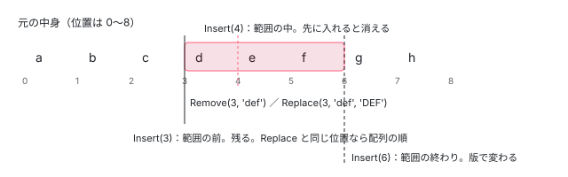

[目次](../README.md) › [@schematics/angular の道具と移行](README.md) › 第 1 回 / 全 11 回

# 変更の単位とファイルの道具：Change・json-file・workspace

> packages/schematics/angular/utility/change.ts・json-file.ts・workspace.ts・workspace-models.ts：InsertChange・RemoveChange・ReplaceChange と applyToUpdateRecorder、JSONFile の読み書き、updateWorkspace と getWorkspace、angular.json の型。

angular/angular-cli · 読了 約 12 分 · 中核 · [サイトで読む（デモが動きます）](https://angular-deep-dive-cyan.vercel.app/chapter/sca-change)

---

この章で分かること：`ng generate`・`ng add`・`ng update` の schematic がファイルの一部を書き換えるときの「変更の単位」（`Change`）と、JSON のファイルと `angular.json` を書き換える道具です。`InsertChange`・`RemoveChange`・`ReplaceChange` を同じファイルに重ねると並べる順で結果が変わること、`JSONFile` がコメントと改行は残すが字下げは残さないこと、`updateWorkspace` で project を足したときの `angular.json` の差分を、本物の `@schematics/angular` を Node で動かして確かめます。

読む対象は `packages/schematics/angular/utility/` の `change.ts`・`json-file.ts`・`eol.ts`・`workspace.ts`・`workspace-models.ts`・`index.ts` です（../angular-cli、44129f66a3）。`UpdateRecorder` の `insertLeft`・`remove` が MagicString を呼ぶところは[Tree の章](../dvk/06-dvk-tree.md)の 4 節、`angular.json` を読んで書き戻す本体（`workspaces.readWorkspace`・`writeWorkspace`）は[angular.json を読み書きする章](../dvk/04-dvk-workspace.md)が読んでいます。CLI の側にある別の `JSONFile`（`ng config` が使う）は[ng config の章](../ngx/03-ngx-config.md)の 6 節です。この章はその間をつなぐ `@schematics/angular` の道具を読みます。

1. **1. 変更の単位とファイルの道具**（この章）
2. [2. AST の道具](02-sca-ast-utils.md)
3. [3. 依存を足す](03-sca-dependency.md)
4. [4. standalone のアプリを書き換える](04-sca-standalone.md)
5. [5. builder の移行](05-sca-build-migrations.md)
6. [6. Karma から Vitest へ](06-sca-karma-vitest.md)
7. [7. Jasmine から Vitest へ（1）骨組み](07-sca-jv-overview.md)
8. [8. Jasmine から Vitest へ（2）spy と型](08-sca-jv-spy.md)
9. [9. Jasmine から Vitest へ（3）matcher](09-sca-jv-matcher.md)
10. [10. Jasmine から Vitest へ（4）lifecycle と fakeAsync](10-sca-jv-lifecycle.md)
11. [11. spec と issue](11-sca-tests-issues.md)

> [!TIP]
> **新卒エンジニアへ**
>
> 記録は、グローバルの `@angular/cli` 22.2.7 が持つ `@schematics/angular` 22.2.7 と、npm の `@schematics/angular` 22.2.0-next.7 の 2 つで同じスクリプトを走らせて取りました。この章のファイルは、44129f66a3・v22.2.0-next.7・v22.2.7 で差分 0 です（`git diff 44129f66a3 v22.2.7 -- packages/schematics/angular/utility` は `find-module.ts` と `add-declaration-to-ng-module.ts` だけ）。ただし下で使う `@angular-devkit/schematics` の依存の magic-string が、44129f66a3 と 22.2.0-next.7 では 1.2.3、22.2.7 では 1.4.1 です（a890b54fc7「build: update all non-major dependencies」）。記録で値が違ったのは、2 節の表の 2 行だけでした。

## 1. Change の約束：path・order・description と apply

📄 `angular-cli/packages/schematics/angular/utility/change.ts` L11–41 （▶ の行: 11–13, 16–17, 21, 23–25, 28, 34, 36–38）

```ts
11 ▶ export interface Host {
12 ▶   write(path: string, content: string): Promise<void>;
13 ▶   read(path: string): Promise<string>;
14 │ }
15 │ 
16 ▶ export interface Change {
17 ▶   apply(host: Host): Promise<void>;
18 │ 
19 │   // The file this change should be applied to. Some changes might not apply to
20 │   // a file (maybe the config).
21 ▶   readonly path: string | null;
22 │ 
23 ▶   // The order this change should be applied. Normally the position inside the file.
24 ▶   // Changes are applied from the bottom of a file to the top.
25 ▶   readonly order: number;
26 │ 
27 │   // The description of this change. This will be outputted in a dry or verbose run.
28 ▶   readonly description: string;
29 │ }
30 │ 
31 │ /**
32 │  * An operation that does nothing.
33 │  */
34 ▶ export class NoopChange implements Change {
35 │   description = 'No operation.';
36 ▶   order: number = Infinity;
37 ▶   path = null;
38 ▶   apply(): Promise<void> {
39 │     return Promise.resolve();
40 │   }
41 │ }
```

`Change` は「1 つのファイルへの 1 つの書き換え」を表す interface です。16〜29 行目で、17 行目の `apply(host)`、21 行目の `path`、25 行目の `order`、28 行目の `description` の 4 つを約束します。17 行目の `host` は schematic の `Tree` ではなく、11〜14 行目の `Host`（`read` と `write` が Promise を返すだけのもの）です。23〜24 行目のコメントは「order はふつうファイルの中の位置で、変更はファイルの下から上の順に当てる」と書いています。34〜41 行目の `NoopChange` は「何もしない変更」で、`order` が `Infinity`、`path` が `null` です。

📄 `angular-cli/packages/schematics/angular/utility/change.ts` L43–73 （▶ の行: 51–53, 55–56, 58–59, 65–68, 70）

```ts
43 │ /**
44 │  * Will add text to the source code.
45 │  */
46 │ export class InsertChange implements Change {
47 │   order: number;
48 │   description: string;
49 │ 
50 │   constructor(
51 ▶     public path: string,
52 ▶     public pos: number,
53 ▶     public toAdd: string,
54 │   ) {
55 ▶     if (pos < 0) {
56 ▶       throw new Error('Negative positions are invalid');
57 │     }
58 ▶     this.description = `Inserted ${toAdd} into position ${pos} of ${path}`;
59 ▶     this.order = pos;
60 │   }
61 │ 
62 │   /**
63 │    * This method does not insert spaces if there is none in the original string.
64 │    */
65 ▶   apply(host: Host): Promise<void> {
66 ▶     return host.read(this.path).then((content) => {
67 ▶       const prefix = content.substring(0, this.pos);
68 ▶       const suffix = content.substring(this.pos);
69 │ 
70 ▶       return host.write(this.path, `${prefix}${this.toAdd}${suffix}`);
71 │     });
72 │   }
73 │ }
```

📄 `angular-cli/packages/schematics/angular/utility/change.ts` L75–103 （▶ の行: 84–85, 87, 90–91, 96–97, 99–100）

```ts
 75 │ /**
 76 │  * Will remove text from the source code.
 77 │  */
 78 │ export class RemoveChange implements Change {
 79 │   order: number;
 80 │   description: string;
 81 │ 
 82 │   constructor(
 83 │     public path: string,
 84 ▶     private pos: number,
 85 ▶     public toRemove: string,
 86 │   ) {
 87 ▶     if (pos < 0) {
 88 │       throw new Error('Negative positions are invalid');
 89 │     }
 90 ▶     this.description = `Removed ${toRemove} into position ${pos} of ${path}`;
 91 ▶     this.order = pos;
 92 │   }
 93 │ 
 94 │   apply(host: Host): Promise<void> {
 95 │     return host.read(this.path).then((content) => {
 96 ▶       const prefix = content.substring(0, this.pos);
 97 ▶       const suffix = content.substring(this.pos + this.toRemove.length);
 98 │ 
 99 ▶       // TODO: throw error if toRemove doesn't match removed string.
100 ▶       return host.write(this.path, `${prefix}${suffix}`);
101 │     });
102 │   }
103 │ }
```

📄 `angular-cli/packages/schematics/angular/utility/change.ts` L105–139 （▶ の行: 114–116, 121–122, 129, 131–132, 135–136）

```ts
105 │ /**
106 │  * Will replace text from the source code.
107 │  */
108 │ export class ReplaceChange implements Change {
109 │   order: number;
110 │   description: string;
111 │ 
112 │   constructor(
113 │     public path: string,
114 ▶     private pos: number,
115 ▶     public oldText: string,
116 ▶     public newText: string,
117 │   ) {
118 │     if (pos < 0) {
119 │       throw new Error('Negative positions are invalid');
120 │     }
121 ▶     this.description = `Replaced ${oldText} into position ${pos} of ${path} with ${newText}`;
122 ▶     this.order = pos;
123 │   }
124 │ 
125 │   apply(host: Host): Promise<void> {
126 │     return host.read(this.path).then((content) => {
127 │       const prefix = content.substring(0, this.pos);
128 │       const suffix = content.substring(this.pos + this.oldText.length);
129 ▶       const text = content.substring(this.pos, this.pos + this.oldText.length);
130 │ 
131 ▶       if (text !== this.oldText) {
132 ▶         return Promise.reject(new Error(`Invalid replace: "${text}" != "${this.oldText}".`));
133 │       }
134 │ 
135 ▶       // TODO: throw error if oldText doesn't match removed string.
136 ▶       return host.write(this.path, `${prefix}${this.newText}${suffix}`);
137 │     });
138 │   }
139 │ }
```

1. **55〜59 行目（87〜91・118〜122 行目も同じ形）：負の位置は作る時点で止める**

   `order` には位置 `pos` をそのまま入れます。記録の `new InsertChange(p, -1, 'x')` は「Negative positions are invalid」でした。
2. **84 行目と 114 行目：Remove と Replace の pos は private**

   `InsertChange` の `pos`（52 行目）は public ですが、残りの 2 つは private です。だから 2 節の `applyToUpdateRecorder` は、位置として `order` を読みます。
3. **66〜70 行目・95〜100 行目：apply は文字列を切ってつなぐだけ**

   `RemoveChange` は 97 行目で `toRemove.length` 文字を消し、99 行目の TODO のとおり、消す文字が `toRemove` と同じかは見ません。
4. **129〜133 行目：Replace の apply だけは中身を確かめる**

   元の文字が `oldText` と違えば reject します。記録では「Error: Invalid replace: "def" != "XYZ".」でした。135 行目の TODO「oldText が消す文字と違えば例外にする」は、すぐ上の 131 行目ですでにしています。この 2 つの行は 44086c60ff（2018-06、devkit のリポジトリを戻した commit）からこの形です。

90 行目の `description` は「Removed de into position 3 of /f.ts」で、remove なのに「into」です（記録）。もう 1 つ、../angular-cli の中で `apply(host)` を呼ぶところは 1 つもありません（`grep` で当たるのは 17・65・94・125 行目の定義だけ）。schematic が実際に使うのは次の `applyToUpdateRecorder` です。23〜24 行目の「下から上に当てる」を `apply` で守らないと位置がずれます。記録で `InsertChange(0, '[A]')` と `InsertChange(4, '[B]')` を前から順に `apply` すると `[A]a[B]bcdefgh`（元の 4 文字目ではなく 1 文字目の後ろ）、同じ 2 つを `applyToUpdateRecorder` に渡すと `[A]abcd[B]efgh` でした。並べ替える関数はどこにもなく、`order` を読むのも 2 節の 146〜149 行目だけです。

## 2. applyToUpdateRecorder：位置は元の中身で数え、同じ位置は並べた順

📄 `angular-cli/packages/schematics/angular/utility/change.ts` L141–154 （▶ の行: 141–151）

```ts
141 ▶ export function applyToUpdateRecorder(recorder: UpdateRecorder, changes: Change[]): void {
142 ▶   for (const change of changes) {
143 ▶     if (change instanceof InsertChange) {
144 ▶       recorder.insertLeft(change.pos, change.toAdd);
145 ▶     } else if (change instanceof RemoveChange) {
146 ▶       recorder.remove(change.order, change.toRemove.length);
147 ▶     } else if (change instanceof ReplaceChange) {
148 ▶       recorder.remove(change.order, change.oldText.length);
149 ▶       recorder.insertLeft(change.order, change.newText);
150 ▶     } else if (!(change instanceof NoopChange)) {
151 ▶       throw new Error('Unknown Change type encountered when updating a recorder.');
152 │     }
153 │   }
154 │ }
```

1. **144 行目：Insert は insertLeft**

   位置は `UpdateRecorder` の中で、いつも書き換える前の中身で数えます（[Tree の章](../dvk/06-dvk-tree.md)の 4 節）。だから配列の順で位置がずれることはありません。
2. **146 行目：Remove は長さだけ使う**

   `toRemove` の中身は見ません。記録の `RemoveChange(p, 3, 'XYZ')` は、そこにあった `def` を黙って消して `abcgh` でした。
3. **148〜149 行目：Replace は remove と insertLeft の 2 つ**

   1 節の 131 行目の確かめはここには無く、記録の `ReplaceChange(p, 3, 'XYZ', 'new')` は `abcnewgh` になりました。`apply(host)` なら reject する入力です。
4. **150〜152 行目：NoopChange は飛ばし、ほかは例外**

   `instanceof` で見分けるので、`Change` の形をしたただの object は「Unknown Change type encountered when updating a recorder.」です（記録）。

この関数は dd58aa6210（2020-07「avoid InsertChange type assumptions」）で入りました。それまで app-shell と service-worker の schematic が `change as InsertChange` と型を決めつけていたのを 1 か所にまとめたもので、同じ commit で 2 つの class の `toRemove`・`oldText`・`newText` が private から public になっています。元の中身 `abcdefgh` に重ねた記録はこうでした（p は `'/f.ts'`、Remove と Replace は位置 3 の `def`）。

| 配列（左から順） | 22.2.7（magic-string 1.4.1） | 22.2.0-next.7（1.2.3） |
| --- | --- | --- |
| Insert(1)・Remove(3)・Replace(6,'gh','GH')、逆の順でも | `a[I]bcfGH` | 同じ |
| Insert(3,'\[1\]')・Insert(3,'\[2\]') ／ 逆 | `abc[1][2]defgh` ／ `abc[2][1]defgh` | 同じ |
| Insert(3) → Replace ／ Replace → Insert(3) | `abc[I]DEFgh` ／ `abcDEF[I]gh` | 同じ |
| Insert(4) → Remove（消す範囲の中） | `abcgh`（挿入が消える） | 同じ |
| Remove → Insert(4) | `abc[I]gh` | 同じ |
| **Insert(6) → Remove**（範囲の終わり） | `abc[I]gh` | `abcgh`（消える） |
| **Insert(6) → Replace** | `abcDEF[I]gh` | `abcDEFgh`（消える） |
| 重なる Replace(2,'cde','X')・Replace(3,'def','Y') | `abXYgh` | 同じ |

同じ位置への挿入は、配列の順に並びます（2・3 行目）。つまり「位置で結果が決まる」のではなく「並べた順でも結果が変わる」のが `applyToUpdateRecorder` です。消す範囲の中に先に入れた挿入は、どちらの版でも消えます（4 行目）。範囲の終わりの位置への挿入は、magic-string の版で残るか消えるかが変わりました（6・7 行目）。[Tree の章](../dvk/06-dvk-tree.md)の表（remove を先にしてから挿入）は、両方の版で残る形です。../angular-cli の中で `RemoveChange` と `ReplaceChange` を作るところは 0 か所、`new InsertChange` は `ast-utils.ts` と `standalone/rules.ts` の 2 ファイルだけです。Remove と Replace は、`@schematics/angular/utility/*` の deep import で使うほかのライブラリの schematic のために残っている形です（package.json の `"./utility/*"`）。



*applyToUpdateRecorder の位置は、いつも書き換える前の中身（abcdefgh）で数える。同じ位置への挿入は配列の順に並び、消す範囲（3〜6）の中への挿入は消える。範囲の終わり（6）への挿入は、magic-string 1.4.1 では残り、1.2.3 では消えた。*

## 3. JSONFile：読む側

📄 `angular-cli/packages/schematics/angular/utility/json-file.ts` L23–57 （▶ の行: 26–27, 35–36, 40–41, 46–51）

```ts
23 │ export type InsertionIndex = (properties: string[]) => number;
24 │ export type JSONPath = (string | number)[];
25 │ 
26 ▶ /** @private */
27 ▶ export class JSONFile {
28 │   content: string;
29 │   private eol: string;
30 │ 
31 │   constructor(
32 │     private readonly host: Tree,
33 │     private readonly path: string,
34 │   ) {
35 ▶     this.content = this.host.readText(this.path);
36 ▶     this.eol = getEOL(this.content);
37 │   }
38 │ 
39 │   private _jsonAst: Node | undefined;
40 ▶   private get JsonAst(): Node | undefined {
41 ▶     if (this._jsonAst) {
42 │       return this._jsonAst;
43 │     }
44 │ 
45 │     const errors: ParseError[] = [];
46 ▶     this._jsonAst = parseTree(this.content, errors, { allowTrailingComma: true });
47 ▶     if (errors.length) {
48 ▶       const { error, offset } = errors[0];
49 ▶       throw new Error(
50 ▶         `Failed to parse "${this.path}" as JSON AST Object. ${printParseErrorCode(
51 ▶           error,
52 │         )} at location: ${offset}.`,
53 │       );
54 │     }
55 │ 
56 │     return this._jsonAst;
57 │   }
```

1. **35 行目：作った時点でファイルを読む**

   無いファイルなら `new JSONFile` がその場で投げます。記録は「FileDoesNotExistException: Path "/none.json" does not exist.」でした。
2. **40〜46 行目：解析は最初に使うときまで遅らせる**

   壊れた JSON（`{ "a": }`）でも `new JSONFile` は通り、最初の `get` で 49〜52 行目の「Failed to parse "/bad.json" as JSON AST Object. ValueExpected at location: 7.」になりました。46 行目は jsonc-parser の `parseTree` で、末尾のカンマを許し、コメントも許します（`disallowComments` を渡していない）。
3. **26 行目：@private と書いてある**

   JSDoc は `@private` ですが、../angular-cli の中で 11 ファイル（移行の 2 つを含む）が `new JSONFile` をしていて、package.json の `"./utility/*"` から外にも出ています。

📄 `angular-cli/packages/schematics/angular/utility/json-file.ts` L59–72 （▶ の行: 60, 65–66, 69, 71）

```ts
59 │   get(jsonPath: JSONPath): unknown {
60 ▶     const jsonAstNode = this.JsonAst;
61 │     if (!jsonAstNode) {
62 │       return undefined;
63 │     }
64 │ 
65 ▶     if (jsonPath.length === 0) {
66 ▶       return getNodeValue(jsonAstNode);
67 │     }
68 │ 
69 ▶     const node = findNodeAtLocation(jsonAstNode, jsonPath);
70 │ 
71 ▶     return node === undefined ? undefined : getNodeValue(node);
72 │   }
```

65〜66 行目、空の道 `[]` はファイル全体の値です。記録の `get([])` は、コメントと末尾のカンマを落とした `{"compilerOptions":{"strict":true,"target":"ES2022"}}`、無い道は 71 行目で `undefined` でした。

📄 `angular-cli/packages/schematics/angular/utility/eol.ts` L9–25 （▶ の行: 15, 17–19, 21, 24）

```ts
 9 │ import { EOL } from 'node:os';
10 │ 
11 │ const CRLF = '\r\n';
12 │ const LF = '\n';
13 │ 
14 │ export function getEOL(content: string): string {
15 ▶   const newlines = content.match(/(?:\r?\n)/g);
16 │ 
17 ▶   if (newlines?.length) {
18 ▶     const crlf = newlines.filter((l) => l === CRLF).length;
19 ▶     const lf = newlines.length - crlf;
20 │ 
21 ▶     return crlf > lf ? CRLF : LF;
22 │   }
23 │ 
24 ▶   return EOL;
25 │ }
```

36 行目の改行は `getEOL` が決めます。15 行目で改行を全部拾い、18〜21 行目で CRLF が LF より多ければ CRLF、同じ数なら LF です。改行の無いファイルは 24 行目で、走らせている OS の `EOL` になります。

### 4. JSONFile：modify と remove、残るものと残らないもの

📄 `angular-cli/packages/schematics/angular/utility/json-file.ts` L74–97 （▶ の行: 77, 80–85, 88–89, 91–94）

```ts
74 │   modify(
75 │     jsonPath: JSONPath,
76 │     value: JsonValue | undefined,
77 ▶     insertInOrder?: InsertionIndex | false,
78 │   ): void {
79 │     let getInsertionIndex: InsertionIndex | undefined;
80 ▶     if (insertInOrder === undefined) {
81 ▶       const property = jsonPath.slice(-1)[0];
82 ▶       getInsertionIndex = (properties) =>
83 ▶         [...properties, property].sort().findIndex((p) => p === property);
84 ▶     } else if (insertInOrder !== false) {
85 ▶       getInsertionIndex = insertInOrder;
86 │     }
87 │ 
88 ▶     const edits = modify(this.content, jsonPath, value, {
89 ▶       getInsertionIndex,
90 │ 
91 ▶       formattingOptions: {
92 ▶         eol: this.eol,
93 ▶         insertSpaces: true,
94 ▶         tabSize: 2,
95 │       },
96 │     });
97 │ 
```

📄 `angular-cli/packages/schematics/angular/utility/json-file.ts` L98–115 （▶ の行: 98–99, 102–105, 110–112）

```ts
 98 ▶     if (edits.length > 0) {
 99 ▶       const editedContent = applyEdits(this.content, edits);
100 │ 
101 │       // Update the file content if it changed
102 ▶       if (editedContent !== this.content) {
103 ▶         this.content = editedContent;
104 ▶         this.host.overwrite(this.path, editedContent);
105 ▶         this._jsonAst = undefined;
106 │       }
107 │     }
108 │   }
109 │ 
110 ▶   remove(jsonPath: JSONPath): void {
111 ▶     if (this.get(jsonPath) !== undefined) {
112 ▶       this.modify(jsonPath, undefined);
113 │     }
114 │   }
115 │ }
```

1. **80〜83 行目：新しい key を入れる位置**

   `insertInOrder` を渡さないと、今ある key の名前に新しい名前を足して `sort()` し、その中の順番を位置にします。`false` なら位置を決めず、jsonc-parser が末尾に足します。
2. **88 行目：書き換えは jsonc-parser の modify が返す差分だけ**

   だから触っていない行のコメントは残ります（[angular.json の章](../dvk/04-dvk-workspace.md)の 5 節と同じ仕組み）。
3. **91〜95 行目：字下げは 2 つの空白に決め打ち**

   改行（92 行目）はファイルから読みますが、93〜94 行目の `insertSpaces: true`・`tabSize: 2` は読みません。CLI 側の `JSONFile` はここをファイルから読みます（[ng config の章](../ngx/03-ngx-config.md)の 6 節）。
4. **98〜106 行目：中身が変わったときだけ overwrite**

   同じ値の `modify` は、記録で `actions` が空のままでした。105 行目で AST を捨てるので、次の `get` は書き換えたあとの中身を解析し直します。
5. **110〜114 行目：remove は「ある道」だけ**

   値が `undefined` でなければ、`modify(道, undefined)` で消します。無い道は何もしません。

記録で確かめた、残るものと残らないものです。元はコメントと末尾のカンマ入りの tsconfig.json（2 つの空白）です。

| 呼んだもの | 結果 |
| --- | --- |
| `modify(['compilerOptions','baseUrl'], './')`・`sourceMap` | どちらも `strict` の前（ABC 順の位置）。コメントは残る |
| `{ "zeta", "alpha" }` に `beta`、続けて `omega` | `zeta, beta, omega, alpha`（並んでいない object では ABC 順にならない） |
| `modify(…, './', false)` | 末尾に足し、`target` の行の `/* 末尾のコメント */` が新しい行の後ろに移る |
| 最後の key を `remove` | 前の行が `"strict": true, /* 末尾のコメント */` になる（カンマとコメントが前に寄る） |
| 4 つの空白のファイルに object を `modify` | 足した行だけ 2 つずつの字下げ（`"paths": {` の中が 2 つ・4 つ・6 つ） |
| タブのファイルに `modify(['b'], { c: 1 })` | 新しい行は空白、**元の `"a": 1` の行もタブから 2 つの空白に変わる** |
| CRLF のファイルに同じ `modify` | 足した行も CRLF |
| `modify(['files', 0])`・`-1`・`10` | 0 は置き換え、-1 と 10 は末尾に足す（10 でも例外なし）。1 行の配列は 1 要素 1 行に開かれる |

80〜83 行目の並べ方は ef3bee6e7d（2020-07「keep tslint rules ordered」）で、jsonc-parser に移った cdff686a76（2020-06）のあと tslint.json の rule の順が変わった回帰を直すために入りました。92 行目の改行は 1e364bd00c（2024-01「retain existing EOL when updating JSON files」）です。字下げをファイルから読む変更は、この `JSONFile` にはまだ入っていません。

## 5. workspace.ts：Tree の上で angular.json を読み書きする

📄 `angular-cli/packages/schematics/angular/utility/workspace.ts` L13–46 （▶ の行: 13, 23, 26–27, 30–32, 34, 38, 40, 43–44）

```ts
13 ▶ const DEFAULT_WORKSPACE_PATH = '/angular.json';
14 │ 
15 │ // re-export the workspace definition types for convenience
16 │ export type WorkspaceDefinition = workspaces.WorkspaceDefinition;
17 │ export type ProjectDefinition = workspaces.ProjectDefinition;
18 │ export type TargetDefinition = workspaces.TargetDefinition;
19 │ 
20 │ /**
21 │  * A {@link workspaces.WorkspaceHost} backed by a Schematics {@link Tree} instance.
22 │  */
23 ▶ export class TreeWorkspaceHost implements workspaces.WorkspaceHost {
24 │   constructor(private readonly tree: Tree) {}
25 │ 
26 ▶   async readFile(path: string): Promise<string> {
27 ▶     return this.tree.readText(path);
28 │   }
29 │ 
30 ▶   async writeFile(path: string, data: string): Promise<void> {
31 ▶     if (this.tree.exists(path)) {
32 ▶       this.tree.overwrite(path, data);
33 │     } else {
34 ▶       this.tree.create(path, data);
35 │     }
36 │   }
37 │ 
38 ▶   async isDirectory(path: string): Promise<boolean> {
39 │     // approximate a directory check
40 ▶     return !this.tree.exists(path) && this.tree.getDir(path).subfiles.length > 0;
41 │   }
42 │ 
43 ▶   async isFile(path: string): Promise<boolean> {
44 ▶     return this.tree.exists(path);
45 │   }
46 │ }
```

`TreeWorkspaceHost` は、`@angular-devkit/core` の `workspaces` が求める 4 つのメソッド（[angular.json の章](../dvk/04-dvk-workspace.md)の 1 節）を `Tree` で書いたものです。31〜35 行目、あれば `overwrite`、無ければ `create` です。40 行目の `isDirectory` は、39 行目のコメントのとおり近似で、「そのパスにファイルが無く、**直下に**ファイルが 1 つ以上ある」です。記録では、`/sub/angular.json` がある木の `getWorkspace(tree, '/sub')` は読めましたが、`/deep/x/angular.json` しか無い `/deep` は直下にファイルが無いので「ディレクトリではない」になり、拡張子で形式を決められず「Error: Unable to determine format for workspace path.」でした。無いファイル（`/none.json`）も同じ文です。

📄 `angular-cli/packages/schematics/angular/utility/workspace.ts` L48–70 （▶ の行: 58–59, 61–62, 64, 66, 68）

```ts
48 │ /**
49 │  * Updates the workspace file (`angular.json`) found within the root of the schematic's tree.
50 │  * The workspace object model can be directly modified within the provided updater function
51 │  * with changes being written to the workspace file after the updater function returns.
52 │  * The spacing and overall layout of the file (including comments) will be maintained where
53 │  * possible when updating the file.
54 │  *
55 │  * @param updater An update function that can be used to modify the object model for the
56 │  * workspace. A {@link WorkspaceDefinition} is provided as the first argument to the function.
57 │  */
58 ▶ export function updateWorkspace(
59 ▶   updater: (workspace: WorkspaceDefinition) => void | Rule | PromiseLike<void | Rule>,
60 │ ): Rule {
61 ▶   return async (host: Tree) => {
62 ▶     const workspace = await getWorkspace(host);
63 │ 
64 ▶     const result = await updater(workspace);
65 │ 
66 ▶     await workspaces.writeWorkspace(workspace, new TreeWorkspaceHost(host));
67 │ 
68 ▶     return result || noop;
69 │   };
70 │ }
```

1. **62 行目：読む**

   下の `getWorkspace` で `/angular.json` を `WorkspaceDefinition` にします。
2. **64 行目：updater に渡して待つ**

   updater は object を直に書き換えます。変更は Proxy が帳簿に付けます（[angular.json の章](../dvk/04-dvk-workspace.md)の 4 節）。
3. **66 行目：書き戻す**

   `workspaces.writeWorkspace` が帳簿の分だけを jsonc-parser の `modify` で当てます。記録で何も変えない updater は、`actions` が空でした。
4. **68 行目：updater が返した Rule を次に走らせる**

   書き戻したあとに走ります。記録で `() => (tree) => tree.create('/made.txt', 'x')` を返すと `c /made.txt` が積まれました。

📄 `angular-cli/packages/schematics/angular/utility/workspace.ts` L72–91 （▶ の行: 72, 78–79, 82, 84, 86, 88, 90）

```ts
72 ▶ // TODO: This should be renamed `readWorkspace` once deep imports are restricted (already exported from `utility` with that name)
73 │ /**
74 │  * Reads a workspace file (`angular.json`) from the provided {@link Tree} instance.
75 │  *
76 │  * @param tree A schematics {@link Tree} instance used to access the workspace file.
77 │  * @param path The path where a workspace file should be found. If a file is specified, the file
78 ▶  * path will be used. If a directory is specified, the file `angular.json` will be used from
79 ▶  * within the specified directory. Defaults to `/angular.json`.
80 │  * @returns A {@link WorkspaceDefinition} representing the workspace found at the specified path.
81 │  */
82 ▶ export async function getWorkspace(
83 │   tree: Tree,
84 ▶   path: string = DEFAULT_WORKSPACE_PATH,
85 │ ): Promise<WorkspaceDefinition> {
86 ▶   const host = new TreeWorkspaceHost(tree);
87 │ 
88 ▶   const { workspace } = await workspaces.readWorkspace(path, host);
89 │ 
90 ▶   return workspace;
91 │ }
```

📄 `angular-cli/packages/schematics/angular/utility/workspace.ts` L93–112 （▶ の行: 95, 100–101, 104, 107, 109, 111）

```ts
 93 │ /**
 94 │  * Writes a workspace file (`angular.json`) to the provided {@link Tree} instance.
 95 ▶  * The spacing and overall layout of an exisitng file (including comments) will be maintained where
 96 │  * possible when writing the file.
 97 │  *
 98 │  * @param tree A schematics {@link Tree} instance used to access the workspace file.
 99 │  * @param workspace The {@link WorkspaceDefinition} to write.
100 ▶  * @param path The path where a workspace file should be written. If a file is specified, the file
101 ▶  * path will be used. If not provided, the definition's underlying file path stored during reading
102 │  * will be used.
103 │  */
104 ▶ export async function writeWorkspace(
105 │   tree: Tree,
106 │   workspace: WorkspaceDefinition,
107 ▶   path?: string,
108 │ ): Promise<void> {
109 ▶   const host = new TreeWorkspaceHost(tree);
110 │ 
111 ▶   return workspaces.writeWorkspace(workspace, host, path);
112 │ }
```

72 行目の TODO のとおり、`getWorkspace` は `utility/index.ts` では `readWorkspace` の名前で出ています（7 節）。`writeWorkspace` は 107 行目の `path` を省くと、読んだときのパスに書きます（100〜102 行目）。記録で `ng new demo` の `angular.json` に `ws.projects.add({ name: 'admin', root, sourceRoot, prefix, targets: { build } })` と `cli.analytics` を足すと、差分は `"cli"` の `"analytics": false`（前の行にカンマが付く）と、`projects` の最後の `"admin"` の塊だけで、target は `"architect"` の下に入りました（`"targets"` にならない理由は[angular.json の章](../dvk/04-dvk-workspace.md)の 6 節）。ほかの行は 1 行も動いていません。

## 6. 全部の target と options を回す、既定のパス

📄 `angular-cli/packages/schematics/angular/utility/workspace.ts` L126–144 （▶ の行: 126–130, 133, 136, 139–141）

```ts
126 ▶ export async function createDefaultPath(tree: Tree, projectName: string): Promise<string> {
127 ▶   const workspace = await getWorkspace(tree);
128 ▶   const project = workspace.projects.get(projectName);
129 ▶   if (!project) {
130 ▶     throw new Error(`Project "${projectName}" does not exist.`);
131 │   }
132 │ 
133 ▶   return buildDefaultPath(project);
134 │ }
135 │ 
136 ▶ export function* allWorkspaceTargets(
137 │   workspace: workspaces.WorkspaceDefinition,
138 │ ): Iterable<[string, workspaces.TargetDefinition, string, workspaces.ProjectDefinition]> {
139 ▶   for (const [projectName, project] of workspace.projects) {
140 ▶     for (const [targetName, target] of project.targets) {
141 ▶       yield [targetName, target, projectName, project];
142 │     }
143 │   }
144 │ }
```

📄 `angular-cli/packages/schematics/angular/utility/workspace.ts` L146–163 （▶ の行: 148, 150–151, 154–155, 158–160）

```ts
146 │ export function* allTargetOptions(
147 │   target: workspaces.TargetDefinition,
148 ▶   skipBaseOptions = false,
149 │ ): Iterable<[string | undefined, Record<string, json.JsonValue | undefined>]> {
150 ▶   if (!skipBaseOptions && target.options) {
151 ▶     yield [undefined, target.options];
152 │   }
153 │ 
154 ▶   if (!target.configurations) {
155 ▶     return;
156 │   }
157 │ 
158 ▶   for (const [name, options] of Object.entries(target.configurations)) {
159 ▶     if (options !== undefined) {
160 ▶       yield [name, options];
161 │     }
162 │   }
163 │ }
```

5 章と 6 章の移行は、どれもこの 2 つの generator で `angular.json` を歩きます。`allWorkspaceTargets` は 139〜143 行目で「project の順 → その中の target の順」に `[target 名, target, project 名, project]` を出します。`allTargetOptions` は 150〜152 行目で、まず名前 `undefined` の `options`、次に `configurations` を書いてある順に出します。記録の `ng new demo` では、targets が `demo:build, demo:serve, demo:test`、`allTargetOptions(build)` が `(options), production, development`、`skipBaseOptions` を `true` にすると `production, development` でした。159 行目で `undefined` の configuration は飛ばします。

`createDefaultPath` は 128 行目の project が無いと 130 行目の「Project "nothing" does not exist.」です（記録）。中で呼ぶ `buildDefaultPath`（この 2 つの引用の間の関数）は[ng generate component の章](../cli/15-schematics-component.md)の 4 節が読んでいます。記録では、`sourceRoot: 'src'` のアプリが `/src/app`、`sourceRoot` の無いライブラリが `/projects/lib/src/lib`、`projectType` の無い project も `/projects/x/src/lib` でした。main では、`sourceRoot` が `root` と同じライブラリを `/root/src/` の側にする分かれ道が足されています（22.2.7 には無い）。

## 7. 外に出している名前と angular.json の型

📄 `angular-cli/packages/schematics/angular/utility/index.ts` L9–22 （▶ の行: 10, 14–16, 18–19, 22）

```ts
 9 │ // Workspace related rules and types
10 ▶ export {
11 │   type ProjectDefinition,
12 │   type TargetDefinition,
13 │   type WorkspaceDefinition,
14 ▶   getWorkspace as readWorkspace,
15 ▶   updateWorkspace,
16 ▶   writeWorkspace,
17 │ } from './workspace';
18 ▶ export { Builders as AngularBuilder } from './workspace-models';
19 ▶ export * from './standalone';
20 │ 
21 │ // Package dependency related rules and types
22 ▶ export { DependencyType, ExistingBehavior, InstallBehavior, addDependency } from './dependency';
```

`@schematics/angular/utility` の入口です（b07ccfbb1b、2022-04「introduce a utility subpath export」）。ワークスペースの 3 つ（14 行目で `getWorkspace` を `readWorkspace` に改名）、18 行目の `Builders` を `AngularBuilder` の名前で、19 行目で 4 章の `addRootImport`・`addRootProvider`、22 行目で 3 章の `addDependency` を出します。`Change` の 3 つ、`JSONFile`、`insertImport` などはここに無く、`@schematics/angular/utility/change` のような deep import でだけ届きます。

📄 `angular-cli/packages/schematics/angular/utility/workspace-models.ts` L128–155 （▶ の行: 128–132, 137–138, 149–150, 152–153）

```ts
128 ▶ export interface BuilderTarget<TBuilder extends Builders, TOptions> {
129 ▶   builder: TBuilder;
130 ▶   options: TOptions;
131 ▶   configurations?: {
132 ▶     production: Partial<TOptions>;
133 │     [key: string]: Partial<TOptions>;
134 │   };
135 │ }
136 │ 
137 ▶ export type LibraryBuilderTarget = BuilderTarget<Builders.NgPackagr, LibraryBuilderOptions>;
138 ▶ export type BrowserBuilderTarget = BuilderTarget<Builders.Browser, BrowserBuilderOptions>;
139 │ export type ServerBuilderTarget = BuilderTarget<Builders.Server, ServerBuilderOptions>;
140 │ export type AppShellBuilderTarget = BuilderTarget<Builders.AppShell, AppShellBuilderOptions>;
141 │ export type TestBuilderTarget = BuilderTarget<Builders.Karma, TestBuilderOptions>;
142 │ export type ServeBuilderTarget = BuilderTarget<Builders.DevServer, ServeBuilderOptions>;
143 │ export type ExtractI18nBuilderTarget = BuilderTarget<Builders.ExtractI18n, ExtractI18nOptions>;
144 │ 
145 │ interface WorkspaceCLISchema {
146 │   warnings?: Record<string, boolean>;
147 │   schematicCollections?: string[];
148 │ }
149 ▶ export interface WorkspaceSchema {
150 ▶   version: 1;
151 │   cli?: WorkspaceCLISchema;
152 ▶   projects: {
153 ▶     [key: string]: WorkspaceProject<ProjectType.Application | ProjectType.Library>;
154 │   };
155 │ }
```

`workspace-models.ts` は `angular.json` を素の JSON として扱っていた頃の型です。132 行目の `production` は必須の configuration として書かれています。いま ../angular-cli の中でこれらの型（`WorkspaceSchema`・`BrowserBuilderTarget` など）を使うのは `use-application-builder/migration_spec.ts` だけで、本体の schematic は `WorkspaceDefinition`（5 節）と同じファイルの `Builders` の値だけを使います（`Builders` は[CLI の全体像の章](../cli/01-cli-overview.md)が引いています）。

> **🧪 DEMO — change・json-file・workspace を Node で直に動かした記録**
>
> ボタンは、手元の記録のスクリプトが `@schematics/angular` の `utility/change`・`utility/json-file`・`utility/workspace` を直に呼んだ記録を再生します。上の枠が呼んだコード（要点だけ）、下の枠が結果（ファイルは前後 2 行つきの差分、`+` が足した行、`-` が消えた行）、左に印のある枠が例外です。木は `SimpleMemoryHost` の上の `HostTree` で、ディスクには書いていません。各記録の 2 行目は、どの版の結果かです。
>
> ▶ [このデモはサイトで動かせます](https://angular-deep-dive-cyan.vercel.app/chapter/sca-change)

### ここまでの呼び出し（updateWorkspace で project を足す）

- 👤 `updateWorkspace((ws) => ws.projects.add(…))` — utility/workspace.ts L58
  - `getWorkspace(host)` — L82 — *path は '/angular.json'*
    - `workspaces.readWorkspace(path, new TreeWorkspaceHost(tree))` — L88 — *isDirectory は L40 の近似*
  - `updater(workspace)` — L64 — *Proxy が変更を帳簿に付ける*
  - `workspaces.writeWorkspace(workspace, host)` — L66 — *jsonc-parser の modify で差分だけ*
    - `TreeWorkspaceHost.writeFile` — L30 — *exists なら overwrite*
  - `return result || noop` — L68 — *updater の Rule が次に走る*

## テストと直し方

| ファイル | describe › it（行） | 固めている約束 |
| --- | --- | --- |
| `utility/workspace_spec.ts` | `readWorkspace`（25）› `reads a workspace using the default path value`（26）〜 `throws if workspace file does not exist when specifying a file path`（56） | 5 節の path の 3 通り。ディレクトリの直下にファイルが無い場合（40 行目の近似が外れる場合）の it は無い |
| 同上 | `writeWorkspace`（64）› 2 つ、`updateWorkspace`（86）› `updates a workspace using the default path value`（87）・`throws if workspace file does not exist`（103）・`allows executing a returned followup rule`（116） | 5 節の 62〜68 行目 |
| `utility/ast-utils_spec.ts` | 28 行目の `applyChanges`（spec の中の手書きの関数） | `InsertChange` を `insertLeft` するだけで、`applyToUpdateRecorder` は通らない |
| （無い） | `change.ts`・`json-file.ts`・`eol.ts` の spec | 2 節の順の表、4 節の字下げ、3 節の例外の文は、どの spec も固めていない |

📄 `走らせたコマンド（2026-11-27）`

```
$ cd ~/angular-research/angular-cli      # 44129f66a3、読むだけ
$ pnpm bazel test //packages/schematics/angular:test --nocache_test_results --test_output=all \
    "--test_arg=--filter=^(readWorkspace|writeWorkspace|updateWorkspace) "
Ran 10 of 863 specs
10 specs, 0 failures
//packages/schematics/angular:test    PASSED

$ node rec-change.js <22.2.7 の @schematics/angular> ch1-new.json   # 記録（DEMO）
$ node rec-change.js <22.2.0-next.7 の @schematics/angular> ch1-old.json
```

直すとしたら、4 節の字下げは `json-file.ts` の `modify`（88〜96 行目）で、CLI 側の `JSONFile` と同じようにファイルの最初の字下げから `insertSpaces` と `tabSize` を決めます。spec は `utility/json-file_spec.ts` を新しく作り、タブのファイルと 4 つの空白のファイルに `modify` して、元の行が変わらないことを確かめます。2 節の Replace の確かめは `change.ts` の `applyToUpdateRecorder` の 147〜149 行目ですが、`UpdateRecorder` は中身を読めないので、引数に `Tree` か元の文字列を足す形になります。同じ位置の Insert と Replace の順と、範囲の終わりの挿入は magic-string の版で変わったので、`utility/change_spec.ts` を作って 2 節の表をそのまま it にすると、依存を上げたときに気づけます。135 行目の TODO は、131 行目で済んでいる内容です。

## 聞かれそうな質問

**Q. Change の配列は、位置の順に並べてから渡す必要がありますか？**

`applyToUpdateRecorder` なら位置は動きません（位置は元の中身で数える）。ただし同じ位置への挿入は配列の順に並び、Insert と Replace を同じ位置に置くと順で結果が変わります（記録：`abc[I]DEFgh` と `abcDEF[I]gh`）。`apply(host)` を前から順に呼ぶと位置がずれます（23〜24 行目のコメントの「下から上」）。

**Q. `ReplaceChange` の `oldText` が中身と違うとどうなりますか？**

`apply(host)` は 131〜133 行目で reject しますが、`applyToUpdateRecorder` は 148〜149 行目で長さだけ使い、黙って置き換えます（記録：`abcnewgh`）。

**Q. `JSONFile` で tsconfig.json を書き換えると、コメントは消えますか？**

触っていない行のコメントは残ります。88 行目で jsonc-parser の `modify` が返す差分だけを当てるからです。ただし字下げは 93〜94 行目で 2 つの空白に決め打ちなので、タブのファイルでは足した行の前の行まで空白に変わりました（記録）。

**Q. `JSONFile.modify` で足した key は、どこに入りますか？**

`insertInOrder` を省くと、今ある key の名前と並べて `sort()` したときの位置です（81〜83 行目）。元が ABC 順でない object では、記録のように `zeta, beta, omega, alpha` になります。`false` なら末尾です。

**Q. `updateWorkspace` の updater から Rule を返すと、いつ走りますか？**

`angular.json` を書き戻した後です。66 行目の `writeWorkspace` を待ってから、68 行目で `result || noop` を返すので、その Rule が次に走ります。

## 読み終えて

- `Change` は「パス・位置・説明」と古い `apply(host)` を持つが、../angular-cli の中で使う道は `applyToUpdateRecorder` だけ。作られるのは `InsertChange` と `NoopChange` だけ。
- `applyToUpdateRecorder` の位置は元の中身で数える。同じ位置は並べた順、消す範囲の中の挿入は消え、範囲の終わりは magic-string の版で変わる。Remove と Replace は中身を確かめない。
- `JSONFile` は作った時点で読み、解析は最初に使うとき。コメントと改行は残すが、字下げは 2 つの空白に決め打ち。新しい key は ABC 順の位置。
- `updateWorkspace` は「読む → updater → 差分だけ書き戻す → 返した Rule」の順。`TreeWorkspaceHost.isDirectory` は直下のファイルで決める近似。
- 移行は `allWorkspaceTargets` と `allTargetOptions`（base の options → configurations）で `angular.json` を歩く。

---

← 前: [spec と issue を読む：@angular-devkit を固めているもの](../dvk/12-dvk-tests-issues.md)  
次: [AST の道具：ast-utils・ng-ast-utils・find-module](02-sca-ast-utils.md) →
