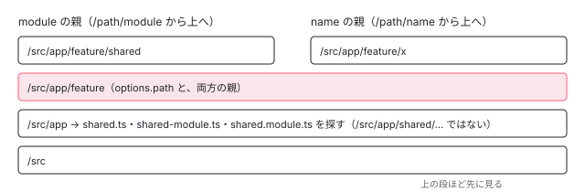

[目次](../README.md) › [@schematics/angular の道具と移行](README.md) › 第 2 回 / 全 11 回

# AST の道具：ast-utils・ng-ast-utils・find-module

> utility/ast-utils.ts・ng-ast-utils.ts・find-module.ts：findNodes と getSourceNodes、insertImport、addSymbolToNgModuleMetadata（declarations・imports・providers）、bootstrap の呼び出しを探す、モジュールを探す順。

angular/angular-cli · 読了 約 14 分 · 発展 · [サイトで読む（デモが動きます）](https://angular-deep-dive-cyan.vercel.app/chapter/sca-ast-utils)

---

この章で分かること：`ng generate module` や `ng add` の schematic が、TypeScript のファイルを「文字列」ではなく「構文木（AST）」として読み、どこに何を挿入するかを決める道具です。`findNodes` と `getSourceNodes` の歩き方、`insertImport` が import を足す 3 つの道、`addSymbolToNgModuleMetadata` が `@NgModule` の `imports` などに足す位置、`main.ts` から bootstrap の呼び出しと root の NgModule を探す道、`findModuleFromOptions` がモジュールを探す順を、いろいろな形の入力で本物を動かして確かめます。

読む対象は `packages/schematics/angular/utility/` の `ast-utils.ts`・`ng-ast-utils.ts`・`find-module.ts` です（../angular-cli、44129f66a3）。ここで返す `Change` を当てる `applyToUpdateRecorder` は[前の章](01-sca-change.md)の 2 節、`ng generate component` が `findModuleFromOptions` の入口と `findModule` の本体を通って `declarations` に足す流れは[ng generate component の章](../cli/15-schematics-component.md)の 7 節です。この章はその残りの行を読みます。

1. [1. 変更の単位とファイルの道具](01-sca-change.md)
2. **2. AST の道具**（この章）
3. [3. 依存を足す](03-sca-dependency.md)
4. [4. standalone のアプリを書き換える](04-sca-standalone.md)
5. [5. builder の移行](05-sca-build-migrations.md)
6. [6. Karma から Vitest へ](06-sca-karma-vitest.md)
7. [7. Jasmine から Vitest へ（1）骨組み](07-sca-jv-overview.md)
8. [8. Jasmine から Vitest へ（2）spy と型](08-sca-jv-spy.md)
9. [9. Jasmine から Vitest へ（3）matcher](09-sca-jv-matcher.md)
10. [10. Jasmine から Vitest へ（4）lifecycle と fakeAsync](10-sca-jv-lifecycle.md)
11. [11. spec と issue](11-sca-tests-issues.md)

> [!TIP]
> **新卒エンジニアへ**
>
> 記録は 22.2.7 と 22.2.0-next.7 の 2 つで取りました。この章の 3 つのファイルで 44129f66a3 と 22.2.7 が違うのは `find-module.ts` の 120 行目だけで（fe119a7c71、main は 490a6fe2f1）、記録で値が違ったのもその 1 つです（7 節）。`ast-utils.ts` は 2020 年の issue #18138 で「private API」と答えられているファイルで、`utility/index.ts` からは出ていません。それでも package.json の `"./utility/*"` で `@schematics/angular/utility/ast-utils` として届くので、ほかのライブラリの schematic も使います。

## 1. 歩く道具：findNodes・getSourceNodes・findNode

TypeScript の構文木は「節（node）」の木です。たとえば `import { A } from './a';` は `ImportDeclaration` という節で、その下に `ImportClause`、さらに下に `Identifier` の `A` がぶら下がります。

📄 `angular-cli/packages/schematics/angular/utility/ast-utils.ts` L130–157 （▶ の行: 132–134, 136, 140–141, 143, 146–149, 154–156）

```ts
130 │ export function findNodes<T extends ts.Node>(
131 │   node: ts.Node,
132 ▶   kindOrGuard: ts.SyntaxKind | ((node: ts.Node) => node is T),
133 ▶   max = Infinity,
134 ▶   recursive = false,
135 │ ): T[] {
136 ▶   if (!node || max == 0) {
137 │     return [];
138 │   }
139 │ 
140 ▶   const test =
141 ▶     typeof kindOrGuard === 'function'
142 │       ? kindOrGuard
143 ▶       : (node: ts.Node): node is T => node.kind === kindOrGuard;
144 │ 
145 │   // Caching is only supported for the entire file
146 ▶   if (ts.isSourceFile(node)) {
147 ▶     const sourceFileCache = findNodesCache.get(node);
148 ▶     if (sourceFileCache?.has(kindOrGuard)) {
149 ▶       return sourceFileCache.get(kindOrGuard) as T[];
150 │     }
151 │   }
152 │ 
153 │   const arr: T[] = [];
154 ▶   if (test(node)) {
155 ▶     arr.push(node);
156 ▶     max--;
157 │   }
```

📄 `angular-cli/packages/schematics/angular/utility/ast-utils.ts` L158–183 （▶ の行: 158–161, 164, 167, 173–174, 179）

```ts
158 ▶   if (max > 0 && (recursive || !test(node))) {
159 ▶     for (const child of node.getChildren()) {
160 ▶       findNodes(child, test, max, recursive).forEach((node) => {
161 ▶         if (max > 0) {
162 │           arr.push(node);
163 │         }
164 ▶         max--;
165 │       });
166 │ 
167 ▶       if (max <= 0) {
168 │         break;
169 │       }
170 │     }
171 │   }
172 │ 
173 ▶   if (ts.isSourceFile(node)) {
174 ▶     let sourceFileCache = findNodesCache.get(node);
175 │     if (!sourceFileCache) {
176 │       sourceFileCache = new Map();
177 │       findNodesCache.set(node, sourceFileCache);
178 │     }
179 ▶     sourceFileCache.set(kindOrGuard, arr);
180 │   }
181 │ 
182 │   return arr;
183 │ }
```

1. **140〜143 行目：種類か判定関数か**

   `ts.SyntaxKind` の値を渡すと「その種類か」、`ts.isImportDeclaration` のような関数を渡すとそれで判定します。
2. **158 行目：見つけたらその下は見ない**

   `recursive` が `false`（既定）なら、当たった節の子は探しません。記録で `{ d0: { d1: … } }` の `PropertyAssignment` は 1 つ、`recursive: true` なら 4 つでした。
3. **146〜151 行目と 173〜180 行目：SourceFile ごとの覚え書き**

   ファイル全体（`SourceFile`）から探したときだけ、結果を `WeakMap` に「種類か判定関数」をキーにして覚えます。14c0a9bacb（2025-08「optimize AST traversal utilities」）で入りました。

148 行目のキーには `max` と `recursive` が入っていません。記録では、同じ `SourceFile` に `findNodes(s, VariableStatement, 1)` のあと `findNodes(s, VariableStatement)` を呼ぶと 3 つではなく 1 つ、逆の順なら `max = 1` でも 3 つ、`recursive: false` のあとの `recursive: true` は 4 つではなく 1 つでした。149 行目は覚えた配列そのものを返すので、呼んだ側が `pop()` すると次の結果が 2 つに減りました。../angular-cli の中では、`SourceFile` に `max` か `recursive` を付けて呼ぶのは app-shell/index.ts の 172 行目（`recursive: true`、その場で作った `SourceFile`）だけで、同じ `SourceFile` に違う引数で 2 回呼ぶ道はありません。

📄 `angular-cli/packages/schematics/angular/utility/ast-utils.ts` L185–213 （▶ の行: 190–191, 194, 196, 199, 202–203, 208–209）

```ts
185 │ /**
186 │  * Get all the nodes from a source.
187 │  * @param sourceFile The source file object.
188 │  * @returns {Array<ts.Node>} An array of all the nodes in the source.
189 │  */
190 ▶ export function getSourceNodes(sourceFile: ts.SourceFile): ts.Node[] {
191 ▶   const nodes: ts.Node[] = [sourceFile];
192 │ 
193 │   // NOTE: nodes.length changes inside of the loop but we only append to the end
194 ▶   for (let i = 0; i < nodes.length; i++) {
195 │     const node = nodes[i];
196 ▶     nodes.push(...node.getChildren(sourceFile));
197 │   }
198 │ 
199 ▶   return nodes;
200 │ }
201 │ 
202 ▶ export function findNode(node: ts.Node, kind: ts.SyntaxKind, text: string): ts.Node | null {
203 ▶   if (node.kind === kind && node.getText() === text) {
204 │     return node;
205 │   }
206 │ 
207 │   let foundNode: ts.Node | null = null;
208 ▶   ts.forEachChild(node, (childNode) => {
209 ▶     foundNode = foundNode || findNode(childNode, kind, text);
210 │   });
211 │ 
212 │   return foundNode;
213 │ }
```

`getSourceNodes` は全部の節を 1 つの配列にします。194〜197 行目は配列の末尾に子を足しながら前から読むので、**幅優先**（浅い節から順）です。記録の `class A { m() {} }` と `class B {}` は、0 番が `SourceFile`、3 番と 4 番が 2 つの `ClassDeclaration`、5 番からが `A` の中身でした。14c0a9bacb の前は `shift` と `unshift` で深さ優先（`A` の中身が `B` より先）だったので、「最初に見つかったもの」を使う関数（3 節の `getDecoratorMetadata` など）の順が、深さの違う節どうしでは変わっています。202〜213 行目の `findNode` は、種類と `getText()` が両方合う最初の節を深さ優先で探します。

## 2. insertImport：import を足す 3 つの道

📄 `angular-cli/packages/schematics/angular/utility/ast-utils.ts` L23–48 （▶ の行: 23, 28–29, 32–33, 36–37, 40–42, 46–47）

```ts
23 ▶ export function insertImport(
24 │   source: ts.SourceFile,
25 │   fileToEdit: string,
26 │   symbolName: string,
27 │   fileName: string,
28 ▶   isDefault = false,
29 ▶   alias?: string,
30 │ ): Change {
31 │   const rootNode = source;
32 ▶   const allImports = findNodes(rootNode, ts.isImportDeclaration);
33 ▶   const importExpression = alias ? `${symbolName} as ${alias}` : symbolName;
34 │ 
35 │   // get nodes that map to import statements from the file fileName
36 ▶   const relevantImports = allImports.filter((node) => {
37 ▶     return ts.isStringLiteralLike(node.moduleSpecifier) && node.moduleSpecifier.text === fileName;
38 │   });
39 │ 
40 ▶   if (relevantImports.length > 0) {
41 ▶     const hasNamespaceImport = relevantImports.some((node) => {
42 ▶       return node.importClause?.namedBindings?.kind === ts.SyntaxKind.NamespaceImport;
43 │     });
44 │ 
45 │     // if imports * from fileName, don't add symbolName
46 ▶     if (hasNamespaceImport) {
47 ▶       return new NoopChange();
48 │     }
```

📄 `angular-cli/packages/schematics/angular/utility/ast-utils.ts` L49–66 （▶ の行: 50–52, 57–60, 62, 65）

```ts
49 │ 
50 ▶     const imports = relevantImports.flatMap((node) => {
51 ▶       return node.importClause?.namedBindings && ts.isNamedImports(node.importClause.namedBindings)
52 ▶         ? node.importClause.namedBindings.elements
53 │         : [];
54 │     });
55 │ 
56 │     // insert import if it's not there
57 ▶     if (!imports.some((node) => (node.propertyName || node.name).text === symbolName)) {
58 ▶       const fallbackPos =
59 ▶         findNodes(relevantImports[0], ts.SyntaxKind.CloseBraceToken)[0].getStart() ||
60 ▶         findNodes(relevantImports[0], ts.SyntaxKind.FromKeyword)[0].getStart();
61 │ 
62 ▶       return insertAfterLastOccurrence(imports, `, ${importExpression}`, fileToEdit, fallbackPos);
63 │     }
64 │ 
65 ▶     return new NoopChange();
66 │   }
```

📄 `angular-cli/packages/schematics/angular/utility/ast-utils.ts` L67–91 （▶ の行: 69, 72, 74–76, 78–82, 84, 89）

```ts
67 │ 
68 │   // no such import declaration exists
69 ▶   const useStrict = findNodes(rootNode, ts.isStringLiteral).filter((n) => n.text === 'use strict');
70 │   let fallbackPos = 0;
71 │   if (useStrict.length > 0) {
72 ▶     fallbackPos = useStrict[0].end;
73 │   }
74 ▶   const open = isDefault ? '' : '{ ';
75 ▶   const close = isDefault ? '' : ' }';
76 ▶   const eol = getEOL(rootNode.getText());
77 │   // if there are no imports or 'use strict' statement, insert import at beginning of file
78 ▶   const insertAtBeginning = allImports.length === 0 && useStrict.length === 0;
79 ▶   const separator = insertAtBeginning ? '' : `;${eol}`;
80 ▶   const toInsert =
81 ▶     `${separator}import ${open}${importExpression}${close}` +
82 ▶     ` from '${fileName}'${insertAtBeginning ? `;${eol}` : ''}`;
83 │ 
84 ▶   return insertAfterLastOccurrence(
85 │     allImports,
86 │     toInsert,
87 │     fileToEdit,
88 │     fallbackPos,
89 ▶     ts.SyntaxKind.StringLiteral,
90 │   );
91 │ }
```

1. **36〜38 行目：同じ module からの import を集める**

   module の文字列（`'@angular/common/http'`）で比べます。
2. **道 1（41〜48 行目）：namespace import があれば何もしない**

   `import * as http` があれば `NoopChange` です。呼んだ側は `http.HttpClient` と書く必要がありますが、それは返り値からは分かりません。
3. **道 2（50〜65 行目）：名前つきの import に足す**

   57 行目、すでに同じ名前（別名の元の名前 `propertyName` を含む）があれば何もしない。無ければ 62 行目で最後の名前の後ろに `, 名前`（`alias` があれば `, 名前 as 別名`）を足します。
4. **道 3（69〜90 行目）：新しい import 文を足す**

   最後の import の後ろ（89 行目、最後の import の中の最後の `StringLiteral` の終わり）に `;改行import …`。import も `'use strict'` も無いファイルは 78 行目でファイルの先頭に `import … ;改行`。`isDefault` なら 74〜75 行目で `{ }` を付けません。

記録の表です（下の DEMO の「2. insertImport」に全部の結果）。

| もとの import | 呼んだもの | 結果 |
| --- | --- | --- |
| `{ HttpClient }` | `'HttpParams'` | `import { HttpClient, HttpParams } …` |
| `{ HttpClient as Http }` | `'HttpClient'` | `NoopChange`（`HttpClient` という名前はファイルに無いまま） |
| `{ HttpClient }` | `'HttpParams', …, false, 'Params'` | `{ HttpClient, HttpParams as Params }` |
| `* as http` | `'HttpClient'` | `NoopChange` |
| `import type { HttpClient }` | `'HttpParams'` | `import type { HttpClient, HttpParams }`（**足した名前も型だけの import になる**） |
| `import moment, { duration }` | `'utc'` | `import moment, { duration, utc }` |
| `import moment from 'moment'` | `'duration'` | **TypeError: Cannot read properties of undefined (reading 'getStart')** |
| `import 'zone.js'` | `'x'` | 同じ TypeError |
| （空のファイル） | `'A', './a'` | 先頭に `import { A } from './a';` |
| `'use strict';` だけ | `'A', './a'` | `'use strict';` の直後の行 |

TypeError の 2 行は、59 行目が `findNodes(…, CloseBraceToken)[0].getStart()` と、`{``}` の無い import でも 0 番を読むからです。60 行目の `FromKeyword` への逃げ道は、`||` の左が例外になるので通りません（副作用の import には `from` も無い）。仮に通っても、`from` の前に `, duration` を入れると `import moment , durationfrom` の形になります。`import type` の行は、50〜54 行目が `importClause.isTypeOnly` を見ないからです。足した名前を値として使うと（provider の class など）、TypeScript が「error TS1361: 'B' cannot be used as a value because it was imported using 'import type'.」にします（手元の tsc で確かめた文）。57 行目の「別名の元の名前で比べる」は 90e69badcc（2023-06「allow for imports to be inserted under an alias」）で、4 章の `CodeBlock` が名前の衝突を避けて別名で import するために入りました。

📄 `angular-cli/packages/schematics/angular/utility/ast-utils.ts` L236–258 （▶ の行: 244–246, 249–250, 252–253, 255, 257）

```ts
236 │ export function insertAfterLastOccurrence(
237 │   nodes: ts.Node[] | ts.NodeArray<ts.Node>,
238 │   toInsert: string,
239 │   file: string,
240 │   fallbackPos: number,
241 │   syntaxKind?: ts.SyntaxKind,
242 │ ): Change {
243 │   let lastItem: ts.Node | undefined;
244 ▶   for (const node of nodes) {
245 ▶     if (!lastItem || lastItem.getStart() < node.getStart()) {
246 ▶       lastItem = node;
247 │     }
248 │   }
249 ▶   if (syntaxKind && lastItem) {
250 ▶     lastItem = findNodes(lastItem, syntaxKind).sort(nodesByPosition).pop();
251 │   }
252 ▶   if (!lastItem && fallbackPos == undefined) {
253 ▶     throw new Error(`tried to insert ${toInsert} as first occurence with no fallback position`);
254 │   }
255 ▶   const lastItemPosition: number = lastItem ? lastItem.getEnd() : fallbackPos;
256 │ 
257 ▶   return new InsertChange(file, lastItemPosition, toInsert);
258 │ }
```

`insertAfterLastOccurrence` は、渡した節のうち `getStart()` がいちばん後ろのものを選び（244〜248 行目）、`syntaxKind` があればその中の最後のその種類の節にし（250 行目）、その終わりに挿入する `InsertChange` を返します。252 行目は `fallbackPos == undefined` なので、`0` は「ある」と見なされます。

## 3. NgModule を見つける：getDecoratorMetadata と getMetadataField

📄 `angular-cli/packages/schematics/angular/utility/ast-utils.ts` L271–305 （▶ の行: 271, 275–276, 278, 281, 284, 290–291, 293）

```ts
271 ▶   if (!modulePath.startsWith('@angular/')) {
272 │     return {};
273 │   }
274 │ 
275 ▶   if (node.importClause) {
276 ▶     if (node.importClause.name) {
277 │       // This is of the form `import Name from 'path'`. Ignore.
278 ▶       return {};
279 │     } else if (node.importClause.namedBindings) {
280 │       const nb = node.importClause.namedBindings;
281 ▶       if (nb.kind == ts.SyntaxKind.NamespaceImport) {
282 │         // This is of the form `import * as name from 'path'`. Return `name.`.
283 │         return {
284 ▶           [nb.name.text + '.']: modulePath,
285 │         };
286 │       } else {
287 │         // This is of the form `import {a,b,c} from 'path'`
288 │         const namedImports = nb;
289 │ 
290 ▶         return namedImports.elements
291 ▶           .map((is: ts.ImportSpecifier) => (is.propertyName ? is.propertyName.text : is.name.text))
292 │           .reduce((acc: { [name: string]: string }, curr: string) => {
293 ▶             acc[curr] = modulePath;
294 │ 
295 │             return acc;
296 │           }, {});
297 │       }
298 │     }
299 │ 
300 │     return {};
301 │   } else {
302 │     // This is of the form `import 'path';`. Nothing to do.
303 │     return {};
304 │   }
305 │ }
```

📄 `angular-cli/packages/schematics/angular/utility/ast-utils.ts` L307–329 （▶ の行: 312–313, 322, 325–326, 329）

```ts
307 │ export function getDecoratorMetadata(
308 │   source: ts.SourceFile,
309 │   identifier: string,
310 │   module: string,
311 │ ): ts.Node[] {
312 ▶   const angularImports = findNodes(source, ts.isImportDeclaration)
313 ▶     .map((node) => _angularImportsFromNode(node))
314 │     .reduce((acc, current) => {
315 │       for (const key of Object.keys(current)) {
316 │         acc[key] = current[key];
317 │       }
318 │ 
319 │       return acc;
320 │     }, {});
321 │ 
322 ▶   return getSourceNodes(source)
323 │     .filter((node) => {
324 │       return (
325 ▶         node.kind == ts.SyntaxKind.Decorator &&
326 ▶         (node as ts.Decorator).expression.kind == ts.SyntaxKind.CallExpression
327 │       );
328 │     })
329 ▶     .map((node) => (node as ts.Decorator).expression as ts.CallExpression)
```

📄 `angular-cli/packages/schematics/angular/utility/ast-utils.ts` L330–356 （▶ の行: 331, 334–335, 339, 343–344, 346, 353, 355）

```ts
330 │     .filter((expr) => {
331 ▶       if (expr.expression.kind == ts.SyntaxKind.Identifier) {
332 │         const id = expr.expression as ts.Identifier;
333 │ 
334 ▶         return id.text == identifier && angularImports[id.text] === module;
335 ▶       } else if (expr.expression.kind == ts.SyntaxKind.PropertyAccessExpression) {
336 │         // This covers foo.NgModule when importing * as foo.
337 │         const paExpr = expr.expression as ts.PropertyAccessExpression;
338 │         // If the left expression is not an identifier, just give up at that point.
339 ▶         if (paExpr.expression.kind !== ts.SyntaxKind.Identifier) {
340 │           return false;
341 │         }
342 │ 
343 ▶         const id = paExpr.name.text;
344 ▶         const moduleId = (paExpr.expression as ts.Identifier).text;
345 │ 
346 ▶         return id === identifier && angularImports[moduleId + '.'] === module;
347 │       }
348 │ 
349 │       return false;
350 │     })
351 │     .filter(
352 │       (expr) =>
353 ▶         expr.arguments[0] && expr.arguments[0].kind == ts.SyntaxKind.ObjectLiteralExpression,
354 │     )
355 ▶     .map((expr) => expr.arguments[0] as ts.ObjectLiteralExpression);
356 │ }
```

1. **271〜305 行目：@angular/ から来た名前の表**

   `_angularImportsFromNode` は `@angular/` で始まる module の import だけを見ます。名前つきなら 291 行目で **元の名前**（`propertyName`）をキーに、namespace なら 284 行目で `名前.` をキーにします。
2. **322〜329 行目：全部の decorator の呼び出し**

   1 節の `getSourceNodes`（幅優先）の順で、`@X(…)` の形の decorator を集めます。
3. **334 行目：識別子なら、ファイルに書いた名前で表を引く**

   表のキーは元の名前なのに、引くのはファイルに書いた名前（`id.text`）です。だから `import { NgModule as Module }` で `@Module(…)` と書くと見つかりません（記録：changes が空）。`import * as core` の `@core.NgModule` は 343〜346 行目で見つかりました。
4. **353〜355 行目：最初の引数が object literal のものだけ**

   その object（`{ imports: […] }`）を返します。

📄 `angular-cli/packages/schematics/angular/utility/ast-utils.ts` L358–371 （▶ の行: 364, 367–368）

```ts
358 │ export function getMetadataField(
359 │   node: ts.ObjectLiteralExpression,
360 │   metadataField: string,
361 │ ): ts.PropertyAssignment[] {
362 │   return (
363 │     node.properties
364 ▶       .filter(ts.isPropertyAssignment)
365 │       // Filter out every fields that's not "metadataField". Also handles string literals
366 │       // (but not expressions).
367 ▶       .filter(({ name }) => {
368 ▶         return (ts.isIdentifier(name) || ts.isStringLiteral(name)) && name.text === metadataField;
369 │       })
370 │   );
371 │ }
```

`getMetadataField` は、`imports: […]` のような `PropertyAssignment` で、key が識別子か文字列のものを返します。`'imports': […]` も当たり（記録）、`imports,`（shorthand）や `[key]: …` は当たりません。

## 4. addSymbolToNgModuleMetadata：どこに何を足すか

📄 `angular-cli/packages/schematics/angular/utility/ast-utils.ts` L373–401 （▶ の行: 380–381, 384–385, 389, 391, 395–400）

```ts
373 │ export function addSymbolToNgModuleMetadata(
374 │   source: ts.SourceFile,
375 │   ngModulePath: string,
376 │   metadataField: string,
377 │   symbolName: string,
378 │   importPath: string | null = null,
379 │ ): Change[] {
380 ▶   const nodes = getDecoratorMetadata(source, 'NgModule', '@angular/core');
381 ▶   const node = nodes[0];
382 │ 
383 │   // Find the decorator declaration.
384 ▶   if (!node || !ts.isObjectLiteralExpression(node)) {
385 ▶     return [];
386 │   }
387 │ 
388 │   // Get all the children property assignment of object literals.
389 ▶   const matchingProperties = getMetadataField(node, metadataField);
390 │ 
391 ▶   if (matchingProperties.length == 0) {
392 │     // We haven't found the field in the metadata declaration. Insert a new field.
393 │     let position: number;
394 │     let toInsert: string;
395 ▶     if (node.properties.length == 0) {
396 ▶       position = node.getEnd() - 1;
397 ▶       toInsert = `
398 ▶   ${metadataField}: [
399 ▶ ${' '.repeat(4)}${symbolName}
400 ▶   ]
401 │ `;
```

📄 `angular-cli/packages/schematics/angular/utility/ast-utils.ts` L402–424 （▶ の行: 403–404, 406–407, 409–411, 413, 416, 419）

```ts
402 │     } else {
403 ▶       const childNode = node.properties[node.properties.length - 1];
404 ▶       position = childNode.getEnd();
405 │       // Get the indentation of the last element, if any.
406 ▶       const text = childNode.getFullText(source);
407 ▶       const matches = text.match(/^(\r?\n)(\s*)/);
408 │       if (matches) {
409 ▶         toInsert =
410 ▶           `,${matches[0]}${metadataField}: [${matches[1]}` +
411 ▶           `${' '.repeat(matches[2].length + 2)}${symbolName}${matches[0]}]`;
412 │       } else {
413 ▶         toInsert = `, ${metadataField}: [${symbolName}]`;
414 │       }
415 │     }
416 ▶     if (importPath !== null) {
417 │       return [
418 │         new InsertChange(ngModulePath, position, toInsert),
419 ▶         insertImport(source, ngModulePath, symbolName.replace(/\..*$/, ''), importPath),
420 │       ];
421 │     } else {
422 │       return [new InsertChange(ngModulePath, position, toInsert)];
423 │     }
424 │   }
```

📄 `angular-cli/packages/schematics/angular/utility/ast-utils.ts` L425–449 （▶ の行: 425, 428–430, 432, 439–442, 445, 447）

```ts
425 ▶   const assignment = matchingProperties[0];
426 │ 
427 │   // If it's not an array, nothing we can do really.
428 ▶   if (
429 ▶     !ts.isPropertyAssignment(assignment) ||
430 ▶     !ts.isArrayLiteralExpression(assignment.initializer)
431 │   ) {
432 ▶     return [];
433 │   }
434 │ 
435 │   let expression: ts.Expression | ts.ArrayLiteralExpression;
436 │   const assignmentInit = assignment.initializer;
437 │   const elements = assignmentInit.elements;
438 │ 
439 ▶   if (elements.length) {
440 ▶     const symbolsArray = elements.map((node) => node.getText());
441 ▶     if (symbolsArray.includes(symbolName)) {
442 ▶       return [];
443 │     }
444 │ 
445 ▶     expression = elements[elements.length - 1];
446 │   } else {
447 ▶     expression = assignmentInit;
448 │   }
449 │ 
```

📄 `angular-cli/packages/schematics/angular/utility/ast-utils.ts` L450–475 （▶ の行: 451–452, 454–455, 458–459, 461, 463, 467, 470, 474）

```ts
450 │   let toInsert: string;
451 ▶   let position = expression.getEnd();
452 ▶   if (ts.isArrayLiteralExpression(expression)) {
453 │     // We found the field but it's empty. Insert it just before the `]`.
454 ▶     position--;
455 ▶     toInsert = `\n${' '.repeat(4)}${symbolName}\n  `;
456 │   } else {
457 │     // Get the indentation of the last element, if any.
458 ▶     const text = expression.getFullText(source);
459 ▶     const matches = text.match(/^(\r?\n)(\s*)/);
460 │     if (matches) {
461 ▶       toInsert = `,${matches[1]}${' '.repeat(matches[2].length)}${symbolName}`;
462 │     } else {
463 ▶       toInsert = `, ${symbolName}`;
464 │     }
465 │   }
466 │ 
467 ▶   if (importPath !== null) {
468 │     return [
469 │       new InsertChange(ngModulePath, position, toInsert),
470 ▶       insertImport(source, ngModulePath, symbolName.replace(/\..*$/, ''), importPath),
471 │     ];
472 │   }
473 │ 
474 ▶   return [new InsertChange(ngModulePath, position, toInsert)];
475 │ }
```

1. **380〜386 行目：最初の NgModule だけ**

   3 節の結果の 0 番だけを使います。記録の「NgModule が 2 つ」のファイルでは `AModule` だけに足しました。見つからなければ 385 行目で空の配列（例外にしない）。
2. **391〜415 行目：field が無いとき**

   空の `{}` なら 396〜400 行目で、`}` の前に改行で挟んだ `imports` の 3 行。ほかの field があれば、最後の field の後ろに、その field の前の改行と字下げ（407 行目の正規表現）をまねて `,改行 imports: [改行 名前改行 ]` を足します。
3. **428〜433 行目：配列でなければ何もしない**

   `imports: IMPORTS`（変数）は記録で changes が空、差分なしでした。例外も警告も出ません。
4. **441 行目：同じ文字列があれば何もしない**

   比べるのは `getText()` の文字列なので、`RouterModule` がある配列に `RouterModule.forRoot(routes)` を足すのは止めません。
5. **451〜465 行目：空の配列か、最後の要素の後ろか**

   空なら `]` の前に `改行 名前改行 `。要素があれば、最後の要素の前の改行と字下げをまねて `,改行字下げ名前`、1 行なら `, 名前`。
6. **419 行目・470 行目：import も 1 つ足す**

   `importPath` があれば 2 節の `insertImport` を呼びます。名前の `.` から後ろを落とすので、`RouterModule.forRoot(routes)` は `RouterModule` の import になります（記録）。

いろいろな形の NgModule に `addImportToModule(source, '/m.ts', 'HttpClientModule', '@angular/common/http')` をした記録です。

| imports の形 | 結果（imports のところ） |
| --- | --- |
| 無い（`declarations: [App],` だけ） | `declarations: [App],` の後ろに 3 行の `imports: [ HttpClientModule ],` |
| 空の `@NgModule({})` | `@NgModule({`・`imports: [`・`HttpClientModule`・`]`・`})` の 5 行に開く |
| `imports: [],` | 3 行の `imports: [ HttpClientModule ],` |
| `imports: IMPORTS,` | 何も変わらない |
| `[BrowserModule, ...SHARED]` | `[BrowserModule, ...SHARED, HttpClientModule]` |
| `BrowserModule, // ブラウザ`（複数行） | `BrowserModule,` と `HttpClientModule, // ブラウザ`（コメントが新しい行に移る） |
| `{ imports: [BrowserModule] }`（1 行） | `[BrowserModule, HttpClientModule]` |
| `{ imports: [] }`（1 行の空配列） | `{ imports: [`・`HttpClientModule`・`] })`（454〜455 行目の決まった改行で、1 行が崩れる） |
| `'imports': [BrowserModule]` | `[BrowserModule, HttpClientModule]` |
| `[BrowserModule, HttpClientModule]` | 何も変わらない（441 行目） |

コメントの行は、要素の「前」の改行と字下げをまねて、最後の要素の終わり（カンマの前）に入れるので、後ろのコメントは新しい要素の後ろに残ります。

### 5. ラッパーと、ほかの小さな道具

📄 `angular-cli/packages/schematics/angular/utility/ast-utils.ts` L496–518 （▶ の行: 499, 505, 511, 517）

```ts
496 │ /**
497 │  * Custom function to insert an NgModule into NgModule imports. It also imports the module.
498 │  */
499 ▶ export function addImportToModule(
500 │   source: ts.SourceFile,
501 │   modulePath: string,
502 │   classifiedName: string,
503 │   importPath: string,
504 │ ): Change[] {
505 ▶   return addSymbolToNgModuleMetadata(source, modulePath, 'imports', classifiedName, importPath);
506 │ }
507 │ 
508 │ /**
509 │  * Custom function to insert a provider into NgModule. It also imports it.
510 │  */
511 ▶ export function addProviderToModule(
512 │   source: ts.SourceFile,
513 │   modulePath: string,
514 │   classifiedName: string,
515 │   importPath: string,
516 │ ): Change[] {
517 ▶   return addSymbolToNgModuleMetadata(source, modulePath, 'providers', classifiedName, importPath);
518 │ }
```

`addDeclarationToModule`・`addImportToModule`・`addProviderToModule`・`addExportToModule`・`addBootstrapToModule` は field の名前を決めて 4 節を呼ぶだけです。../angular-cli の中で使うのは `addImportToModule`（module/index.ts）と `addDeclarationToModule`（add-declaration-to-ng-module.ts）だけで、ほか 3 つは外のための名前です。

📄 `angular-cli/packages/schematics/angular/utility/ast-utils.ts` L544–570 （▶ の行: 552, 556, 559, 562–563）

```ts
544 │ /**
545 │  * Determine if an import already exists.
546 │  */
547 │ export function isImported(
548 │   source: ts.SourceFile,
549 │   classifiedName: string,
550 │   importPath: string,
551 │ ): boolean {
552 ▶   const allNodes = getSourceNodes(source);
553 │   const matchingNodes = allNodes
554 │     .filter(ts.isImportDeclaration)
555 │     .filter(
556 ▶       (imp) => ts.isStringLiteral(imp.moduleSpecifier) && imp.moduleSpecifier.text === importPath,
557 │     )
558 │     .filter((imp) => {
559 ▶       if (!imp.importClause) {
560 │         return false;
561 │       }
562 ▶       const nodes = findNodes(imp.importClause, ts.isImportSpecifier).filter(
563 ▶         (n) => n.getText() === classifiedName,
564 │       );
565 │ 
566 │       return nodes.length > 0;
567 │     });
568 │ 
569 │   return matchingNodes.length > 0;
570 │ }
```

📄 `angular-cli/packages/schematics/angular/utility/ast-utils.ts` L701–733 （▶ の行: 706–707, 712–714, 721, 723, 726）

```ts
701 │ export function hasTopLevelIdentifier(
702 │   sourceFile: ts.SourceFile,
703 │   symbolName: string,
704 │   skipModule: string | null = null,
705 │ ): boolean {
706 ▶   for (const node of sourceFile.statements) {
707 ▶     if (isNamedNode(node) && node.name.text === symbolName) {
708 │       return true;
709 │     }
710 │ 
711 │     if (
712 ▶       ts.isVariableStatement(node) &&
713 ▶       node.declarationList.declarations.some((decl) => {
714 ▶         return isNamedNode(decl) && decl.name.text === symbolName;
715 │       })
716 │     ) {
717 │       return true;
718 │     }
719 │ 
720 │     if (
721 ▶       ts.isImportDeclaration(node) &&
722 │       ts.isStringLiteralLike(node.moduleSpecifier) &&
723 ▶       node.moduleSpecifier.text !== skipModule &&
724 │       node.importClause?.namedBindings &&
725 │       ts.isNamedImports(node.importClause.namedBindings) &&
726 ▶       node.importClause.namedBindings.elements.some((el) => el.name.text === symbolName)
727 │     ) {
728 │       return true;
729 │     }
730 │   }
731 │ 
732 │   return false;
733 │ }
```

`isImported` は 563 行目で import の名前の節の `getText()` と比べるので、`import { A as B }` に対して `'A'` は `false`、`'A as B'` は `true` でした（記録）。../angular-cli の中で使うところはありません。`hasTopLevelIdentifier` は 4 章の `CodeBlock` が「その名前がもう使われているか」を見るのに使います。726 行目はファイルの中での名前（`el.name`）なので、`A as B` では `B` が `true`、`A` が `false`、723 行目の `skipModule` に同じ module を渡すと `C` は `false` でした。

📄 `angular-cli/packages/schematics/angular/utility/ast-utils.ts` L650–684 （▶ の行: 650, 654, 656–658, 669–670, 674–676, 678–679, 683）

```ts
650 ▶   const occurrencesCount = routesArr.elements.length;
651 │   const text = routesArr.getFullText(source);
652 │ 
653 │   let route: string = routeLiteral;
654 ▶   let insertPos = routesArr.elements.pos;
655 │ 
656 ▶   if (occurrencesCount > 0) {
657 ▶     const lastRouteLiteral = [...routesArr.elements].pop() as ts.Expression;
658 ▶     const lastRouteIsWildcard =
659 │       ts.isObjectLiteralExpression(lastRouteLiteral) &&
660 │       lastRouteLiteral.properties.some(
661 │         (n) =>
662 │           ts.isPropertyAssignment(n) &&
663 │           ts.isIdentifier(n.name) &&
664 │           n.name.text === 'path' &&
665 │           ts.isStringLiteral(n.initializer) &&
666 │           n.initializer.text === '**',
667 │       );
668 │ 
669 ▶     const indentation = text.match(/\r?\n(\r?)\s*/) || [];
670 ▶     const routeText = `${indentation[0] || ' '}${routeLiteral}`;
671 │ 
672 │     // Add the new route before the wildcard route
673 │     // otherwise we'll always redirect to the wildcard route
674 ▶     if (lastRouteIsWildcard) {
675 ▶       insertPos = lastRouteLiteral.pos;
676 ▶       route = `${routeText},`;
677 │     } else {
678 ▶       insertPos = lastRouteLiteral.end;
679 ▶       route = `,${routeText}`;
680 │     }
681 │   }
682 │ 
683 ▶   return new InsertChange(fileToAdd, insertPos, route);
684 │ }
```

`ng generate module --route` の道です。最後の route が `path: '**'` なら、674〜676 行目でその前に入れます（記録：`admin` の route が `**` の前に入った）。669 行目の字下げは配列の最初の改行から取ります。routes の配列は `RouterModule.forRoot(…)` の 1 つめの引数からたどるので（`getRouterModuleDeclaration` が NgModule の `imports` の中の `RouterModule…` の呼び出しを探す）、`provideRouter(routes)` を使う形では「Couldn't find a route declaration in …」で止まります。issue #24497（2023-01、open）がこの形です。

## 6. main.ts から bootstrap を探す：ng-ast-utils.ts

📄 `angular-cli/packages/schematics/angular/utility/ng-ast-utils.ts` L15–46 （▶ の行: 16–17, 19, 23–24, 27–30, 32, 38, 40–41）

```ts
15 │ export function findBootstrapModuleCall(host: Tree, mainPath: string): ts.CallExpression | null {
16 ▶   const mainText = host.readText(mainPath);
17 ▶   const source = ts.createSourceFile(mainPath, mainText, ts.ScriptTarget.Latest, true);
18 │ 
19 ▶   const allNodes = getSourceNodes(source);
20 │ 
21 │   let bootstrapCall: ts.CallExpression | null = null;
22 │ 
23 ▶   for (const node of allNodes) {
24 ▶     let bootstrapCallNode = findNode(node, ts.SyntaxKind.Identifier, 'bootstrapModule');
25 │ 
26 │     // Walk up the parent until CallExpression is found.
27 ▶     while (
28 ▶       bootstrapCallNode &&
29 ▶       bootstrapCallNode.parent &&
30 ▶       bootstrapCallNode.parent.kind !== ts.SyntaxKind.CallExpression
31 │     ) {
32 ▶       bootstrapCallNode = bootstrapCallNode.parent;
33 │     }
34 │ 
35 │     if (
36 │       bootstrapCallNode !== null &&
37 │       bootstrapCallNode.parent !== undefined &&
38 ▶       bootstrapCallNode.parent.kind === ts.SyntaxKind.CallExpression
39 │     ) {
40 ▶       bootstrapCall = bootstrapCallNode.parent as ts.CallExpression;
41 ▶       break;
42 │     }
43 │   }
44 │ 
45 │   return bootstrapCall;
46 │ }
```

23〜24 行目、全部の節について、その下に `bootstrapModule` という識別子があるかを 1 節の `findNode` で探し、見つかった識別子から親へ上って最初の `CallExpression` を返します。最初の節は `SourceFile` なので、ふつうは 1 回目で見つかります。`bootstrapModule` がどの module から来たかは見ません。

📄 `angular-cli/packages/schematics/angular/utility/ng-ast-utils.ts` L48–79 （▶ の行: 50–51, 54, 59–62, 64, 67–68, 74–76）

```ts
48 │ function findBootstrapModulePath(host: Tree, mainPath: string): string {
49 │   const bootstrapCall = findBootstrapModuleCall(host, mainPath);
50 ▶   if (!bootstrapCall) {
51 ▶     throw new SchematicsException('Bootstrap call not found');
52 │   }
53 │ 
54 ▶   const bootstrapModule = bootstrapCall.arguments[0];
55 │ 
56 │   const mainText = host.readText(mainPath);
57 │   const source = ts.createSourceFile(mainPath, mainText, ts.ScriptTarget.Latest, true);
58 │   const allNodes = getSourceNodes(source);
59 ▶   const bootstrapModuleRelativePath = allNodes
60 ▶     .filter(ts.isImportDeclaration)
61 ▶     .filter((imp) => {
62 ▶       return findNode(imp, ts.SyntaxKind.Identifier, bootstrapModule.getText());
63 │     })
64 ▶     .map((imp) => {
65 │       const modulePathStringLiteral = imp.moduleSpecifier as ts.StringLiteral;
66 │ 
67 ▶       return modulePathStringLiteral.text;
68 ▶     })[0];
69 │ 
70 │   return bootstrapModuleRelativePath;
71 │ }
72 │ 
73 │ export function getAppModulePath(host: Tree, mainPath: string): string {
74 ▶   const moduleRelativePath = findBootstrapModulePath(host, mainPath);
75 ▶   const mainDir = dirname(mainPath);
76 ▶   const modulePath = join(mainDir, `${moduleRelativePath}.ts`);
77 │ 
78 │   return modulePath;
79 │ }
```

1. **54 行目：最初の引数の文字列**

   `AppModule` です。
2. **59〜68 行目：その名前を含む import の module の文字列**

   62 行目は import の中に同じ文字の識別子があるかだけを見ます。
3. **76 行目：main.ts のフォルダに .ts を付けてつなぐ**

   記録の `ng new --no-standalone` の形は `/m1/app/app-module.ts` でした。

`AppModule` を main.ts の中で宣言している形（記録の m2）は、import が 1 つも当たらないので 68 行目が `undefined` になり、76 行目で **`/m2/undefined.ts`** が返りました（例外にならない）。次に `tree.readText` した側が「Path "/m2/undefined.ts" does not exist.」で止まります。`import * as m from './app'` と `m.AppModule` のような形も、62 行目は `'m.AppModule'` という識別子を探すので同じです。

📄 `angular-cli/packages/schematics/angular/utility/ng-ast-utils.ts` L81–93 （▶ の行: 81, 83, 85, 87–88, 91）

```ts
81 ▶ export function isStandaloneApp(host: Tree, mainPath: string): boolean {
82 │   try {
83 ▶     findBootstrapApplicationCall(host, mainPath);
84 │ 
85 ▶     return true;
86 │   } catch (error) {
87 ▶     if (error instanceof SchematicsException) {
88 ▶       return false;
89 │     }
90 │ 
91 ▶     throw error;
92 │   }
93 │ }
```

`isStandaloneApp` は 4 章の `findBootstrapApplicationCall`（`@angular/platform-browser` から import した `bootstrapApplication` の呼び出し）があれば `true`、`SchematicsException` なら `false` です。記録では、bootstrap の呼び出しがどこにも無い main.ts（m4）も `false`、つまり「NgModule のアプリ」と見なされます。

## 7. findModuleFromOptions：モジュールを探す順

📄 `angular-cli/packages/schematics/angular/utility/find-module.ts` L40–79 （▶ の行: 41–43, 45, 47–48, 50–51, 54–56, 59–61, 65–66, 68–69, 74–76）

```ts
40 │   } else {
41 ▶     const modulePath = normalize(`/${options.path}/${options.module}`);
42 ▶     const componentPath = normalize(`/${options.path}/${options.name}`);
43 ▶     const moduleBaseName = normalize(modulePath).split('/').pop();
44 │ 
45 ▶     const candidateSet = new Set<Path>([normalize(options.path || '/')]);
46 │ 
47 ▶     for (let dir = modulePath; dir != NormalizedRoot; dir = dirname(dir)) {
48 ▶       candidateSet.add(dir);
49 │     }
50 ▶     for (let dir = componentPath; dir != NormalizedRoot; dir = dirname(dir)) {
51 ▶       candidateSet.add(dir);
52 │     }
53 │ 
54 ▶     const candidatesDirs = [...candidateSet].sort((a, b) => b.length - a.length);
55 ▶     const candidateFiles: string[] = ['', `${moduleBaseName}.ts`];
56 ▶     if (options.moduleExt) {
57 │       candidateFiles.push(`${moduleBaseName}${options.moduleExt}`);
58 │     } else {
59 ▶       candidateFiles.push(
60 ▶         `${moduleBaseName}${MODULE_EXT}`,
61 ▶         `${moduleBaseName}${MODULE_EXT_LEGACY}`,
62 │       );
63 │     }
64 │ 
65 ▶     for (const c of candidatesDirs) {
66 ▶       for (const sc of candidateFiles) {
67 │         const scPath = join(c, sc);
68 ▶         if (host.exists(scPath) && host.readText(scPath).includes('@NgModule')) {
69 ▶           return normalize(scPath);
70 │         }
71 │       }
72 │     }
73 │ 
74 ▶     throw new Error(
75 ▶       `Specified module '${options.module}' does not exist.\n` +
76 ▶         `Looked in the following directories:\n    ${candidatesDirs.join('\n    ')}`,
77 │     );
78 │   }
79 │ }
```

1. **45〜52 行目：探すフォルダの候補**

   `options.path`、`/path/module` とその親を全部、`/path/name` とその親を全部、Set に入れます。
2. **54 行目：長い順に並べる**

   深いフォルダから先に見ます。
3. **55〜63 行目：各フォルダで試すファイル名**

   `''`（そのフォルダのパスそのもの）、`名前.ts`、`名前-module.ts`、`名前.module.ts` の順。`moduleExt` があれば最後の 2 つの代わりにそれ。
4. **68 行目：あって、@NgModule の文字を含むものの最初**

   v20 からのアプリのコンポーネントは `app.ts` なので、`--module app` では先に `/src/app/app.ts` が候補になりますが、`@NgModule` を含まないので飛ばし、`app-module.ts` を返しました（記録）。

候補はいつも「`path` と、`module` と `name` の親」だけです。記録で `path: '/src/app/feature'`・`module: 'shared'` は、`/src/app/shared/shared-module.ts` があっても見つからず、74〜76 行目の「Specified module 'shared' does not exist. Looked in the following directories:」に `/src/app/feature/shared`・`/src/app/feature/x`・`/src/app/feature`・`/src/app`・`/src` が並びました（`/src/app` では `shared-module.ts` を探す）。`module: '../shared/shared-module.ts'` なら、41 行目の正規化でそのファイル自体が候補のフォルダになり、55 行目の `''` で当たりました。



*path: '/src/app/feature'・name: 'x'・module: 'shared' のときの候補のフォルダ（54 行目で長い順）。各フォルダで ''・shared.ts・shared-module.ts・shared.module.ts を試すので、兄弟の /src/app/shared/shared-module.ts は候補に入らない。*

📄 `angular-cli/packages/schematics/angular/utility/find-module.ts` L84–97 （▶ の行: 84, 90, 93–96）

```ts
84 ▶ export function findModule(
85 │   host: Tree,
86 │   generateDir: string,
87 │   moduleExt?: string,
88 │   routingModuleExt?: string,
89 │ ): Path {
90 ▶   let dir: DirEntry | null = host.getDir('/' + generateDir);
91 │   let foundRoutingModule = false;
92 │ 
93 ▶   const moduleExtensions: string[] = moduleExt ? [moduleExt] : [MODULE_EXT, MODULE_EXT_LEGACY];
94 ▶   const routingModuleExtensions: string[] = routingModuleExt
95 ▶     ? [routingModuleExt]
96 ▶     : [ROUTING_MODULE_EXT, ROUTING_MODULE_EXT_LEGACY];
97 │ 
```

📄 `angular-cli/packages/schematics/angular/utility/find-module.ts` L117–125 （▶ の行: 118–122, 124）

```ts
117 │ 
118 ▶   const errorMsg = foundRoutingModule
119 ▶     ? 'Could not find a non Routing NgModule.' +
120 ▶       `\nModules with suffix '${routingModuleExt}' are strictly reserved for routing.` +
121 ▶       `\nUse the '--skip-import' option to skip importing in NgModule.`
122 ▶     : `Could not find an NgModule. Use the '--skip-import' option to skip importing in NgModule.`;
123 │ 
124 ▶   throw new Error(errorMsg);
125 │ }
```

`module` を渡さないときの `findModule` の本体（84〜97 行目の続き。親へ上りながら 1 つだけの module を探す）は[ng generate component の章](../cli/15-schematics-component.md)の 7 節です。記録では、routing の module しか無いフォルダからは親の `/src/app/app-module.ts` を見つけ、module が 2 つあるフォルダは「More than one module matches.」でした。木全体に routing の module しか無いと 118〜121 行目の文になります。44129f66a3（記録の 22.2.0-next.7）は 120 行目が渡されていない引数 `routingModuleExt` を出すので「Modules with suffix **'undefined'** are strictly reserved for routing.」、22.2.7 は「Modules with suffix '-routing-module.ts' or '-routing.module.ts' are strictly reserved for routing.」でした。どの schematic も `routingModuleExt` を渡さないこと、0b7d48c7ca で 2 つの接尾辞を見るようになってから表示がずれていたことが、fe119a7c71 の説明に書かれています。

📄 `angular-cli/packages/schematics/angular/utility/find-module.ts` L130–159 （▶ の行: 135–136, 139–140, 142–144, 149–152, 158）

```ts
130 │ export function buildRelativePath(from: string, to: string): string {
131 │   from = normalize(from);
132 │   to = normalize(to);
133 │ 
134 │   // Convert to arrays.
135 ▶   const fromParts = from.split('/');
136 ▶   const toParts = to.split('/');
137 │ 
138 │   // Remove file names (preserving destination)
139 ▶   fromParts.pop();
140 ▶   const toFileName = toParts.pop();
141 │ 
142 ▶   const relativePath = relative(
143 ▶     normalize(fromParts.join('/') || '/'),
144 ▶     normalize(toParts.join('/') || '/'),
145 │   );
146 │   let pathPrefix = '';
147 │ 
148 │   // Set the path prefix for same dir or child dir, parent dir starts with `..`
149 ▶   if (!relativePath) {
150 ▶     pathPrefix = '.';
151 ▶   } else if (!relativePath.startsWith('.')) {
152 ▶     pathPrefix = `./`;
153 │   }
154 │   if (pathPrefix && !pathPrefix.endsWith('/')) {
155 │     pathPrefix += '/';
156 │   }
157 │ 
158 ▶   return pathPrefix + (relativePath ? relativePath + '/' : '') + toFileName;
159 │ }
```

`buildRelativePath` は module のファイルから生成したファイルへの import の文字列を作ります。記録は `./feature/x.ts`・`../shared/y.ts`・`./z.ts` で、拡張子は付いたままです（取るのは呼んだ側、add-declaration-to-ng-module.ts）。

> **🧪 DEMO — ast-utils・find-module・ng-ast-utils を Node で直に動かした記録**
>
> ボタンは、手元の記録のスクリプトが `@schematics/angular` の `utility/ast-utils` などを直に呼んだ記録を再生します。上の枠が入力と呼んだコード、下の枠が返った `Change`（`InsertChange @位置 "足す文字列"`）と、それを当てたファイルの差分（前後 2 行つき）です。左に印のある枠は例外です。各記録の 2 行目は、どの版の結果かです。
>
> ▶ [このデモはサイトで動かせます](https://angular-deep-dive-cyan.vercel.app/chapter/sca-ast-utils)

### ここまでの呼び出し（ng generate module --module app で imports に足す）

- 👤 `ng generate module admin --module app` — module/index.ts
  - `findModuleFromOptions(host, options)` — find-module.ts L31 — *候補のフォルダを長い順に（L54）*
  - `addImportToModule(source, modulePath, 'AdminModule', relativePath)` — ast-utils.ts L499
    - `addSymbolToNgModuleMetadata(…, 'imports', …)` — L373
      - `getDecoratorMetadata(source, 'NgModule', '@angular/core')` — L307 — *getSourceNodes の幅優先の順*
      - `getMetadataField(node, 'imports')` — L358
      - `new InsertChange(…)` と `insertImport(…)` — L469〜470 — *Change の配列を返すだけ*
  - `applyToUpdateRecorder(recorder, changes)` — change.ts L141 — *前の章の 2 節*

## テストと直し方

| ファイル | describe › it（行） | 固めている約束 |
| --- | --- | --- |
| `utility/ast-utils_spec.ts` | `ast utils`（42）› `should add export to module`（66）〜 `should add into providers metadata in new line `（225） | 4 節の field が無い・空・1 行・文字列の key。変数・スプレッド・コメント・NgModule が 2 つの it は無い |
| 同上 | `insertImport`（683）› `should insert a new import into a file`（686）〜 `should not insert an import if there is a namespace import`（763） | 2 節の 3 つの道と別名。default import・副作用の import がある場合、`import type` の it は無い |
| 同上 | `findNodes`（642）› `should return node excluding nested nodes`（661）・`should return node including all nested nodes`（674） | 1 節の `recursive`。どちらも新しい `SourceFile` で 1 回だけ呼ぶので、148 行目の覚え書きは通らない |
| 同上 | `insertAfterLastOccurrence`（250）、`addRouteDeclarationToModule`（290）› 12 本、`hasTopLevelIdentifier`（773）› 6 本 | 2 節・5 節 |
| `utility/find-module_spec.ts` | `findModule`（13）› 9 本、`findModuleFromOptions`（87）› 10 本、`buildRelativePath`（202） | 7 節。44 行目の it は名前が「should throw if no modules found」ですが、確かめているのは「More than one module matches」です（beforeEach の module と合わせて 2 つになる） |

📄 `走らせたコマンド（2026-11-27）`

```
$ cd ~/angular-research/angular-cli      # 44129f66a3、読むだけ
$ pnpm bazel test //packages/schematics/angular:test --nocache_test_results --test_output=all \
    "--test_arg=--filter=^(ast utils|find-module) "
Ran 61 of 863 specs
61 specs, 0 failures
//packages/schematics/angular:test    PASSED

$ node rec-ast.js <22.2.7 の @schematics/angular> ch2-new.json   # 記録（DEMO）
$ node rec-ast.js <22.2.0-next.7 の @schematics/angular> ch2-old.json
```

直すとしたら、2 節の TypeError は `ast-utils.ts` の `insertImport` の 58〜60 行目で、`CloseBraceToken` が無い import（default だけ・副作用だけ）を `relevantImports` から外して道 3（新しい import 文）に回すか、default import には `, { 名前 }` を足す形にします。spec は `insertImport` の describe に「default import だけがある module に名前を足す」「`import 'x'` がある module に足す」を足します。`import type` は 50〜54 行目で `isTypeOnly` の import を外します。1 節の覚え書きは 148 行目と 179 行目のキーに `max` と `recursive` を入れるか、既定の引数のときだけ覚え、149 行目で配列の写しを返す形にし、`findNodes` の describe に「同じ `SourceFile` で `recursive` を変えて 2 回呼ぶ」を足します。6 節の `/undefined.ts` は `ng-ast-utils.ts` の `findBootstrapModulePath` の 68 行目のあとで、見つからなければ `SchematicsException` にします。

## 聞かれそうな質問

**Q. `addImportToModule` は、`imports: SHARED_IMPORTS` のような変数にも足せますか？**

足せません。428〜433 行目で配列 literal でなければ空の配列を返し、例外も警告も出ません。記録でも差分なしでした。呼んだ schematic は「足した」と思ったまま進みます。

**Q. `NgModule` を別名で import しているファイルでも動きますか？**

動きません。表のキーは元の名前（291 行目）、引く名前はファイルに書いた名前（334 行目）なので、`@Module(…)` は見つかりません。`import * as core` の `@core.NgModule` は 343〜346 行目で見つかります。

**Q. `insertImport` で、もう別名で import されている名前を頼むと？**

57 行目が元の名前で比べるので `NoopChange` です。ファイルにはその名前が無いまま（別名だけ）なので、足したコードが元の名前を使っていると壊れます。4 章の `CodeBlock` は `hasTopLevelIdentifier` で別名を付けて避けています。

**Q. `findNodes` の結果は毎回新しく探したものですか？**

`SourceFile` を渡したときは、2 回目から覚えた配列そのものです（146〜151 行目）。`max` と `recursive` はキーに入らないので、同じファイルで引数を変えると前の結果が返ります（記録）。

**Q. `--module` に渡す名前は、どのフォルダから探されますか？**

`path`、`path/module` とその親、`path/name` とその親を長い順に、各フォルダで `''`・`名前.ts`・`名前-module.ts`・`名前.module.ts` を試し、`@NgModule` の文字を含む最初のものです（45〜69 行目）。兄弟のフォルダ（`../shared`）は、相対パスで書かないと見ません。

## 読み終えて

- `findNodes` は当たった節の下を見ない（`recursive` で変える）。`SourceFile` では覚え書きを使い、`max`・`recursive` を区別しない。`getSourceNodes` は幅優先。
- `insertImport` は namespace なら何もせず、名前つきなら `, 名前`、無ければ新しい文。default だけ・副作用だけの import がある module では TypeError、`import type` には型として足す。
- `addSymbolToNgModuleMetadata` は最初の NgModule の field の配列に、前の要素の字下げをまねて足す。変数・別名の `NgModule` は黙って何もしない。
- bootstrap は識別子の文字で探し、root の module は import の文字列で探す。main.ts で宣言した module は `undefined.ts` になる。
- `findModuleFromOptions` の候補は「path と module・name の親」を長い順。routing だけのときの文は 22.2.7 で直った。

---

← 前: [変更の単位とファイルの道具：Change・json-file・workspace](01-sca-change.md)  
次: [依存を足す：dependency・dependencies・generate-from-files](03-sca-dependency.md) →
