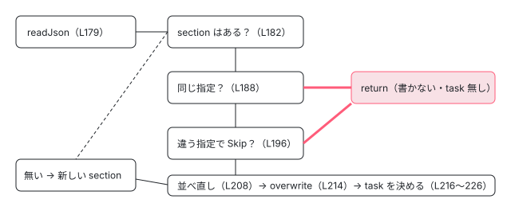

[目次](../README.md) › [@schematics/angular の道具と移行](README.md) › 第 3 回 / 全 11 回

# 依存を足す：dependency・dependencies・generate-from-files

> utility/dependency.ts・dependencies.ts・generate-from-files.ts：addDependency 規則（type・existing・install）、package.json の並び順、NodePackageInstallTask の予約、ファイルの雛形から生成する共通の規則。

angular/angular-cli · 読了 約 11 分 · 中核 · [サイトで読む（デモが動きます）](https://angular-deep-dive-cyan.vercel.app/chapter/sca-dependency)

---

この章で分かること：`ng add` や `ng update` の移行が package.json に依存を足すときの規則 `addDependency` が、`type`・`existing`・`install` の組み合わせで何を書き、いつ `npm install` の task を予約するか、並び順と書式がどう変わるかです。古い形の `dependencies.ts`、`ng generate class` などが共通で使う `generateFromFiles` も読みます。全部の組み合わせを本物の規則で走らせて記録しました。

読む対象は `packages/schematics/angular/utility/` の `dependency.ts`・`dependencies.ts`・`latest-versions.ts`・`generate-from-files.ts` です（../angular-cli、44129f66a3）。予約した `NodePackageInstallTask` が schematic のあとに何を打つかは[ワークフローの章](../dvk/08-dvk-workflow.md)の 8 節、`ng add` が自分で package.json を書いてインストールする道は[ng add と ng update の章](../cli/16-cli-add-update.md)の 3 節と 7 節です。`applyTemplates`・`move`・`mergeWith` は[Rule の組み立ての章](../cli/14-schematics-rules.md)です。

1. [1. 変更の単位とファイルの道具](01-sca-change.md)
2. [2. AST の道具](02-sca-ast-utils.md)
3. **3. 依存を足す**（この章）
4. [4. standalone のアプリを書き換える](04-sca-standalone.md)
5. [5. builder の移行](05-sca-build-migrations.md)
6. [6. Karma から Vitest へ](06-sca-karma-vitest.md)
7. [7. Jasmine から Vitest へ（1）骨組み](07-sca-jv-overview.md)
8. [8. Jasmine から Vitest へ（2）spy と型](08-sca-jv-spy.md)
9. [9. Jasmine から Vitest へ（3）matcher](09-sca-jv-matcher.md)
10. [10. Jasmine から Vitest へ（4）lifecycle と fakeAsync](10-sca-jv-lifecycle.md)
11. [11. spec と issue](11-sca-tests-issues.md)

> [!TIP]
> **新卒エンジニアへ**
>
> 記録は 22.2.7 と 22.2.0-next.7 の 2 つで取り、この章の記録は全部同じ値でした（この章の 4 つのファイルは 44129f66a3・v22.2.7 で差分 0）。Rule は `SchematicTestRunner.callRule` で走らせ、予約された task は `runner.tasks` で見ただけで、npm は走らせていません（[テストの道具の章](../dvk/11-dvk-testing.md)の 2 節）。package.json は `ng new demo`（22.2.7）が作ったものです。

## 1. 3 つの enum：type・install・existing

📄 `angular-cli/packages/schematics/angular/utility/dependency.ts` L13–30 （▶ の行: 13, 15–18, 25–28）

```ts
13 ▶ const installTasks = new WeakMap<SchematicContext, Set<string>>();
14 │ 
15 ▶ interface MinimalPackageManifest {
16 ▶   dependencies?: Record<string, string>;
17 ▶   devDependencies?: Record<string, string>;
18 ▶   peerDependencies?: Record<string, string>;
19 │ }
20 │ 
21 │ /**
22 │  * An enum used to specify the type of a dependency found within a package manifest
23 │  * file (`package.json`).
24 │  */
25 ▶ export enum DependencyType {
26 ▶   Default = 'dependencies',
27 ▶   Dev = 'devDependencies',
28 ▶   Peer = 'peerDependencies',
29 │ }
30 │ 
```

📄 `angular-cli/packages/schematics/angular/utility/dependency.ts` L31–55 （▶ の行: 36–38, 40–41, 43, 46–47, 49, 51–52, 54）

```ts
31 │ /**
32 │  * An enum used to specify the dependency installation behavior for the {@link addDependency}
33 │  * schematics rule. The installation behavior affects if and when {@link NodePackageInstallTask}
34 │  * will be scheduled when using the rule.
35 │  */
36 ▶ export enum InstallBehavior {
37 ▶   /**
38 ▶    * No installation will occur as a result of the rule when specified.
39 │    *
40 ▶    * NOTE: This does not prevent other rules from scheduling a {@link NodePackageInstallTask}
41 ▶    * which may install the dependency.
42 │    */
43 ▶   None,
44 │ 
45 │   /**
46 ▶    * Automatically determine the need to schedule a {@link NodePackageInstallTask} based on
47 ▶    * previous usage of the {@link addDependency} within the schematic.
48 │    */
49 ▶   Auto,
50 │ 
51 ▶   /**
52 ▶    * Always schedule a {@link NodePackageInstallTask} when the rule is executed.
53 │    */
54 ▶   Always,
55 │ }
```

📄 `angular-cli/packages/schematics/angular/utility/dependency.ts` L57–74 （▶ の行: 59–60, 62, 64, 66, 69–71, 73）

```ts
57 │ /**
58 │  * An enum used to specify the existing dependency behavior for the {@link addDependency}
59 ▶  * schematics rule. The existing behavior affects whether the named dependency will be added
60 ▶  * to the `package.json` when the dependency is already present with a differing specifier.
61 │  */
62 ▶ export enum ExistingBehavior {
63 │   /**
64 ▶    * The dependency will not be added or otherwise changed if it already exists.
65 │    */
66 ▶   Skip,
67 │ 
68 │   /**
69 ▶    * The dependency's existing specifier will be replaced with the specifier provided in the
70 ▶    * {@link addDependency} call. A warning will also be shown during schematic execution to
71 ▶    * notify the user of the replacement.
72 │    */
73 ▶   Replace,
74 │ }
```

`DependencyType` の値は package.json の section の名前そのもの（26〜28 行目）なので、`manifest[type]` と書けます。`optionalDependencies` はありません（6 節の古い形にはある）。`InstallBehavior` の JSDoc は、`Auto` を「前に同じ schematic の中で `addDependency` を使ったかで決める」（46〜47 行目）、`Always` を「規則を走らせたら**いつも**予約する」（51〜52 行目）と書いています。`None` は 40〜41 行目のとおり、ほかの規則が予約した task は止めません。`ExistingBehavior` は 59〜60 行目で「違う指定ですでにあるとき」の振る舞いで、`Replace` は 69〜71 行目で「置き換えて警告を出す」です。13 行目の `installTasks` は、`SchematicContext` ごとに「task を予約した package.json のパス」を覚える `WeakMap` です（3 節）。

📄 `angular-cli/packages/schematics/angular/utility/dependency.ts` L96–123 （▶ の行: 104, 107, 109, 111–113, 117, 122）

```ts
 96 │ /**
 97 │  * Gets information about a dependency from a `package.json` file.
 98 │  *
 99 │  * @param tree The schematic's virtual file system representation.
100 │  * @param name The name of the package to check.
101 │  * @param packageJsonPath The path to the `package.json` file. Defaults to `/package.json`.
102 │  * @returns An object containing the dependency's type and version, or null if not found.
103 │  */
104 ▶ export function getDependency(
105 │   tree: Tree,
106 │   name: string,
107 ▶   packageJsonPath = '/package.json',
108 │ ): Dependency | null {
109 ▶   const manifest = tree.readJson(packageJsonPath) as MinimalPackageManifest;
110 │ 
111 ▶   for (const type of [DependencyType.Default, DependencyType.Dev, DependencyType.Peer]) {
112 ▶     const section = manifest[type];
113 ▶     if (section?.[name]) {
114 │       return {
115 │         type,
116 │         name,
117 ▶         version: section[name],
118 │       };
119 │     }
120 │   }
121 │ 
122 ▶   return null;
123 │ }
```

`getDependency` は Default → Dev → Peer の順に見て、最初に見つかった section を返します（記録：`rxjs` は `dependencies`、`typescript` は `devDependencies`、無い名前は `null`）。`removeDependency` とともに ff711111b9（2025-08）で足されたもので、5 章の `use-application-builder` が使います。

## 2. addDependency：package.json を書く

📄 `angular-cli/packages/schematics/angular/utility/dependency.ts` L141–176 （▶ の行: 141–143, 149, 155, 162, 168, 171–175）

```ts
141 ▶ export function addDependency(
142 ▶   name: string,
143 ▶   specifier: string,
144 │   options: {
145 │     /**
146 │      * The type of the dependency determines the section of the `package.json` to which the
147 │      * dependency will be added. Defaults to {@link DependencyType.Default} (`dependencies`).
148 │      */
149 ▶     type?: DependencyType;
150 │ 
151 │     /**
152 │      * The path of the package manifest file (`package.json`) that will be modified.
153 │      * Defaults to `/package.json`.
154 │      */
155 ▶     packageJsonPath?: string;
156 │ 
157 │     /**
158 │      * The dependency installation behavior to use to determine whether a
159 │      * {@link NodePackageInstallTask} should be scheduled after adding the dependency.
160 │      * Defaults to {@link InstallBehavior.Auto}.
161 │      */
162 ▶     install?: InstallBehavior;
163 │ 
164 │     /**
165 │      * The behavior to use when the dependency already exists within the `package.json`.
166 │      * Defaults to {@link ExistingBehavior.Replace}.
167 │      */
168 ▶     existing?: ExistingBehavior;
169 │   } = {},
170 │ ): Rule {
171 ▶   const {
172 ▶     type = DependencyType.Default,
173 ▶     packageJsonPath = '/package.json',
174 ▶     install = InstallBehavior.Auto,
175 ▶     existing = ExistingBehavior.Replace,
176 │   } = options;
```

📄 `angular-cli/packages/schematics/angular/utility/dependency.ts` L178–212 （▶ の行: 179–180, 182, 184, 186, 188, 190, 193, 196–197, 201–203, 208–211）

```ts
178 │   return (tree, context) => {
179 ▶     const manifest = tree.readJson(packageJsonPath) as MinimalPackageManifest;
180 ▶     const dependencySection = manifest[type];
181 │ 
182 ▶     if (!dependencySection) {
183 │       // Section is not present. The dependency can be added to a new object literal for the section.
184 ▶       manifest[type] = { [name]: specifier };
185 │     } else {
186 ▶       const existingSpecifier = dependencySection[name];
187 │ 
188 ▶       if (existingSpecifier === specifier) {
189 │         // Already present with same specifier
190 ▶         return;
191 │       }
192 │ 
193 ▶       if (existingSpecifier) {
194 │         // Already present but different specifier
195 │ 
196 ▶         if (existing === ExistingBehavior.Skip) {
197 ▶           return;
198 │         }
199 │ 
200 │         // ExistingBehavior.Replace is the only other behavior currently
201 ▶         context.logger.warn(
202 ▶           `Package dependency "${name}" already exists with a different specifier. ` +
203 ▶             `"${existingSpecifier}" will be replaced with "${specifier}".`,
204 │         );
205 │       }
206 │ 
207 │       // Add new dependency in alphabetical order
208 ▶       const entries = Object.entries(dependencySection);
209 ▶       entries.push([name, specifier]);
210 ▶       entries.sort((a, b) => a[0].localeCompare(b[0]));
211 ▶       manifest[type] = Object.fromEntries(entries);
212 │     }
```

1. **172〜175 行目：既定**

   `dependencies`、`/package.json`、`Auto`、`Replace` です。
2. **179 行目：Tree の readJson で読む**

   無ければ「FileDoesNotExistException: Path "/package.json" does not exist.」、壊れていれば「Failed to parse "/package.json" as JSON. CloseBraceExpected at offset: 20.」でした（記録）。どちらも Rule の例外として schematic を止めます。
3. **182〜184 行目：section が無ければ作る**

   新しい object を manifest の末尾の key に置きます。記録の Peer は、`devDependencies` の後ろに `"peerDependencies": { "zod": "^4.0.0" }` が足されました。
4. **188〜191 行目：同じ指定ならすぐ帰る**

   ファイルも書かず、task も予約しません。
5. **193〜205 行目：違う指定**

   `Skip` なら 197 行目で帰る。`Replace` なら 201〜204 行目で warn を出して書き換えます（記録「Package dependency "rxjs" already exists with a different specifier. "~7.8.0" will be replaced with "~7.0.0".」）。b8bf3b480b（2022-07）で例外から警告に変わりました。
6. **208〜211 行目：section 全体を並べ直す**

   足した 1 つだけでなく、今ある key も `localeCompare` で並べ直します（4 節）。

見る section は `type` の 1 つだけです。記録で `dependencies` にある `rxjs` を `type: Dev` で足すと、`dependencies.rxjs = ~7.8.0` のまま `devDependencies.rxjs = ^7.0.0` が増え、2 つの section に同じ名前が並びました。

## 3. install の task：いつ予約するか

📄 `angular-cli/packages/schematics/angular/utility/dependency.ts` L213–228 （▶ の行: 214, 216, 218–219, 221–222, 224–225）

```ts
213 │ 
214 ▶     tree.overwrite(packageJsonPath, JSON.stringify(manifest, null, 2));
215 │ 
216 ▶     const installPaths = installTasks.get(context) ?? new Set<string>();
217 │     if (
218 ▶       install === InstallBehavior.Always ||
219 ▶       (install === InstallBehavior.Auto && !installPaths.has(packageJsonPath))
220 │     ) {
221 ▶       context.addTask(
222 ▶         new NodePackageInstallTask({ workingDirectory: path.dirname(packageJsonPath) }),
223 │       );
224 ▶       installPaths.add(packageJsonPath);
225 ▶       installTasks.set(context, installPaths);
226 │     }
227 │   };
228 │ }
```

214 行目で書き、216〜226 行目で task を決めます。`Always` か、`Auto` でこの context でまだそのパスを予約していなければ、`workingDirectory` に package.json のフォルダ（222 行目）を渡して予約します。記録の task は `node-package {"command":"install","quiet":true,"hideOutput":true,"workingDirectory":"/","allowScripts":false}` でした。

| rxjs（もとは ~7.8.0）に渡したもの | existing | install | package.json | task |
| --- | --- | --- | --- | --- |
| 同じ `~7.8.0` | Skip / Replace | None / Auto / **Always** | 書かない | **どれも無し** |
| 違う `~7.0.0` | Skip | None / Auto / **Always** | 書かない | **どれも無し** |
| 違う `~7.0.0` | Replace | None | `~7.0.0` に | 無し |
| 違う `~7.0.0` | Replace | Auto / Always | `~7.0.0` に | 1 つ |
| 無い `zod`（Default・Dev・Peer） | — | None ／ Auto・Always | 足す | 無し ／ 1 つ |

太字の行が JSDoc と違うところです。51〜52 行目の `Always` は「いつも予約する」ですが、2 節の 190 行目と 197 行目の `return` が 216 行目より前にあるので、同じ指定や `Skip` では予約しません。spec にも「does not schedule a package install task if version is the same」（dependency\_spec.ts 331 行目、`install` は既定の `Auto`）があり、`Always` の場合の it はありません。

1 つの schematic の中で何回も呼んだ記録です（どれも 1 つの `chain`、つまり 1 つの context）。

- `a`・`b`（Auto）・`c`（Always）：task は 2 つ（`a` の 1 つと、`c` の 1 つ）。
- `a` と、`packageJsonPath: '/projects/lib/package.json'` の `b`：2 つ（`workingDirectory` が `/` と `/projects/lib`）。
- `a`（None）と `b`（Auto）：1 つ。None は 224 行目の Set に入れないので、`b` が予約します。
- `removeDependency('rxjs')` と `addDependency('b')`：1 つ。2 つの規則は同じ `installTasks` を見ます。

`install` の 3 つの値は 707911d423（2022-05）で入りました。それまでは今の `Auto` だけで、その commit の説明も「同じ package.json について前の `addDependency` がまだ予約していなければ予約する」です。

## 4. 並び順と書式

2 節の 208〜211 行目は section の全部の key を並べ直し、214 行目は manifest 全体を `JSON.stringify(manifest, null, 2)` で書き直します。記録はこうでした。

| もと（dependencies の順） | 足した名前 | 結果の順 |
| --- | --- | --- |
| `zone.js`, `rxjs`, `@angular/core` | `Abc`・`abc` | `@angular/core`, `Abc`（`abc`）, `rxjs`, `zone.js` |
| `_x`・`-y` | `_x`（`-y`）, `@angular/core`, `rxjs`, `zone.js` |   |
| `@types/node` | `@angular/core`, `@types/node`, `rxjs`, `zone.js` |   |
| `zone` | `@angular/core`, `rxjs`, `zone`, `zone.js` |   |

どの行も、もとの 3 つの順まで変わっています。`localeCompare` は引数に言語を渡していないので、走らせている Node の既定の言語で比べます（記録の環境は `en-US`）。書式は、4 つの空白で字下げして末尾に改行のある package.json が、2 つの空白・末尾の改行なしに変わりました（DEMO の「2. 並び順と書式」）。同じファイルに 6 節の `addPackageJsonDependency`（[1 章](01-sca-change.md)の `JSONFile`）を使うと、もとの行は 4 つの空白のまま、足した行だけ 2 つずつの字下げでした。どちらの道も、もとの書式をそのまま残すことはしません。`ng add` の CLI 側も `JSON.stringify(…, null, 2)` で書き直します（[ng add の章](../ngx/05-ngx-add.md)）。

### 5. removeDependency

📄 `angular-cli/packages/schematics/angular/utility/dependency.ts` L253–284 （▶ の行: 254, 257–258, 260, 262–264, 268–269, 271, 273–274, 276）

```ts
253 │ ): Rule {
254 ▶   const { packageJsonPath = '/package.json', install = InstallBehavior.Auto } = options;
255 │ 
256 │   return (tree, context) => {
257 ▶     const manifest = tree.readJson(packageJsonPath) as MinimalPackageManifest;
258 ▶     let wasRemoved = false;
259 │ 
260 ▶     for (const type of [DependencyType.Default, DependencyType.Dev, DependencyType.Peer]) {
261 │       const dependencySection = manifest[type];
262 ▶       if (dependencySection?.[name]) {
263 ▶         delete dependencySection[name];
264 ▶         wasRemoved = true;
265 │       }
266 │     }
267 │ 
268 ▶     if (wasRemoved) {
269 ▶       tree.overwrite(packageJsonPath, JSON.stringify(manifest, null, 2));
270 │ 
271 ▶       const installPaths = installTasks.get(context) ?? new Set<string>();
272 │       if (
273 ▶         install === InstallBehavior.Always ||
274 ▶         (install === InstallBehavior.Auto && !installPaths.has(packageJsonPath))
275 │       ) {
276 ▶         context.addTask(
277 │           new NodePackageInstallTask({ workingDirectory: path.dirname(packageJsonPath) }),
278 │         );
279 │         installPaths.add(packageJsonPath);
280 │         installTasks.set(context, installPaths);
281 │       }
282 │     }
283 │   };
284 │ }
```

260〜266 行目で 3 つの section から消し、1 つでも消えたときだけ 269 行目で書いて task を決めます。記録で `rxjs` は `o /package.json` と task 1 つ、無い名前は actions も task も無しでした。package.json が無ければ 257 行目で `addDependency` と同じ例外です。この関数の JSDoc は「project の root の package.json から消す」ですが、`packageJsonPath` で別の場所も選べます。

## 6. 古い形：dependencies.ts と latest-versions.ts

📄 `angular-cli/packages/schematics/angular/utility/dependencies.ts` L15–35 （▶ の行: 16, 20, 27, 30–34）

```ts
15 │ const PKG_JSON_PATH = '/package.json';
16 ▶ export enum NodeDependencyType {
17 │   Default = 'dependencies',
18 │   Dev = 'devDependencies',
19 │   Peer = 'peerDependencies',
20 ▶   Optional = 'optionalDependencies',
21 │ }
22 │ 
23 │ export interface NodeDependency {
24 │   type: NodeDependencyType;
25 │   name: string;
26 │   version: string;
27 ▶   overwrite?: boolean;
28 │ }
29 │ 
30 ▶ const ALL_DEPENDENCY_TYPE = [
31 ▶   NodeDependencyType.Default,
32 ▶   NodeDependencyType.Dev,
33 ▶   NodeDependencyType.Optional,
34 ▶   NodeDependencyType.Peer,
35 │ ];
```

📄 `angular-cli/packages/schematics/angular/utility/dependencies.ts` L37–61 （▶ の行: 42, 44–47, 56, 58–59）

```ts
37 │ export function addPackageJsonDependency(
38 │   tree: Tree,
39 │   dependency: NodeDependency,
40 │   pkgJsonPath: string = PKG_JSON_PATH,
41 │ ): void {
42 ▶   const json = new JSONFile(tree, pkgJsonPath);
43 │ 
44 ▶   const { overwrite, type, name, version } = dependency;
45 ▶   const path = [type, name];
46 ▶   if (overwrite || !json.get(path)) {
47 ▶     json.modify(path, version);
48 │   }
49 │ }
50 │ 
51 │ export function removePackageJsonDependency(
52 │   tree: Tree,
53 │   name: string,
54 │   pkgJsonPath: string = PKG_JSON_PATH,
55 │ ): void {
56 ▶   const json = new JSONFile(tree, pkgJsonPath);
57 │ 
58 ▶   for (const depType of ALL_DEPENDENCY_TYPE) {
59 ▶     json.remove([depType, name]);
60 │   }
61 │ }
```

📄 `angular-cli/packages/schematics/angular/utility/dependencies.ts` L63–83 （▶ の行: 68, 70–71, 73–74）

```ts
63 │ export function getPackageJsonDependency(
64 │   tree: Tree,
65 │   name: string,
66 │   pkgJsonPath: string = PKG_JSON_PATH,
67 │ ): NodeDependency | null {
68 ▶   const json = new JSONFile(tree, pkgJsonPath);
69 │ 
70 ▶   for (const depType of ALL_DEPENDENCY_TYPE) {
71 ▶     const version = json.get([depType, name]);
72 │ 
73 ▶     if (typeof version === 'string') {
74 ▶       return {
75 │         type: depType,
76 │         name: name,
77 │         version,
78 │       };
79 │     }
80 │   }
81 │ 
82 │   return null;
83 │ }
```

`dependencies.ts` は Rule ではなく、Tree を受けてその場で書く関数です。[1 章](01-sca-change.md)の `JSONFile` を使うので、46 行目の `!json.get(path)` で「無ければ足す」、`overwrite` なら上書きし、新しい key は ABC 順の位置に入ります。task は予約しません。20 行目に `Optional` があり、`getPackageJsonDependency` は 30〜35 行目の順（Default → Dev → Optional → Peer）に見ます。../angular-cli の中で今も使うのは `getPackageJsonDependency`（server/index.ts の 143 行目と 239 行目）と次の `addTestRunnerDependencies` だけで、`addPackageJsonDependency` と `removePackageJsonDependency` を呼ぶところはありません。

📄 `angular-cli/packages/schematics/angular/utility/dependencies.ts` L85–110 （▶ の行: 85–87, 90–92, 103–107）

```ts
 85 ▶ export function addTestRunnerDependencies(
 86 ▶   testRunner: TestRunner | undefined,
 87 ▶   skipInstall: boolean,
 88 │ ): Rule[] {
 89 │   const dependencies =
 90 ▶     testRunner === TestRunner.Vitest
 91 ▶       ? ['vitest', 'jsdom']
 92 ▶       : [
 93 │           'karma',
 94 │           'karma-chrome-launcher',
 95 │           'karma-coverage',
 96 │           'karma-jasmine',
 97 │           'karma-jasmine-html-reporter',
 98 │           'jasmine-core',
 99 │           '@types/jasmine',
100 │           'istanbul-lib-instrument',
101 │         ];
102 │ 
103 ▶   return dependencies.map((name) =>
104 ▶     addDependency(name, latestVersions[name], {
105 ▶       type: DependencyType.Dev,
106 ▶       existing: ExistingBehavior.Skip,
107 ▶       install: skipInstall ? InstallBehavior.None : InstallBehavior.Auto,
108 │     }),
109 │   );
110 │ }
```

`ng new`（application）と `ng generate library` が、テストの道具を devDependencies に足すのに使います。90 行目が `Vitest` かだけを見るので、`testRunner` が `undefined` なら Karma の 8 つです（記録：`undefined` で 8 つの規則、`karma-jasmine` などが足された）。ng-new・application・library の schema の既定はどれも `vitest` なので、schematic から呼ぶときは `undefined` になりません。外から関数として呼ぶときだけの違いです。106 行目が `Skip` なので、記録の `ng new demo` の package.json（もう `vitest` と `jsdom` がある）では何も足さず、task もありませんでした。

📄 `angular-cli/packages/schematics/angular/utility/latest-versions.ts` L9–28 （▶ の行: 11, 13, 20, 23–27）

```ts
 9 │ // We could have used TypeScripts' `resolveJsonModule` to make the `latestVersion` object typesafe,
10 │ // but ts_library doesn't support JSON inputs.
11 ▶ const dependencies = require('./latest-versions/package.json')['dependencies'];
12 │ 
13 ▶ export const latestVersions: Record<string, string> & {
14 │   Angular: string;
15 │   DevkitBuildAngular: string;
16 │   AngularBuild: string;
17 │   AngularSSR: string;
18 │   NgPackagr: string;
19 │ } = {
20 ▶   ...dependencies,
21 │ 
22 │   // As Angular CLI works with same minor versions of Angular Framework, a tilde match for the current
23 ▶   Angular: '0.0.0-ANGULAR-FW-VERSION',
24 ▶   NgPackagr: '0.0.0-NG-PACKAGR-VERSION',
25 ▶   DevkitBuildAngular: '^0.0.0-PLACEHOLDER',
26 ▶   AngularBuild: '^0.0.0-PLACEHOLDER',
27 ▶   AngularSSR: '^0.0.0-PLACEHOLDER',
28 │ };
```

104 行目の `latestVersions[name]` は、11 行目で読む `utility/latest-versions/package.json` の `dependencies` です。23〜27 行目の `0.0.0-…` は、公開のときに stamp で本当の版に置き換わる値です（BUILD.bazel の `stamp_files` に `utility/latest-versions.js`）。

## 7. generateFromFiles：雛形から作る共通の規則

📄 `angular-cli/packages/schematics/angular/utility/generate-from-files.ts` L28–57 （▶ の行: 40–42, 44–47, 50, 52–54, 56）

```ts
28 │ export interface GenerateFromFilesOptions {
29 │   flat?: boolean;
30 │   name: string;
31 │   path?: string;
32 │   prefix?: string;
33 │   project: string;
34 │   skipTests?: boolean;
35 │   templateFilesDirectory?: string;
36 │   type?: string;
37 │   classifiedName?: string;
38 │ }
39 │ 
40 ▶ export function generateFromFiles(
41 ▶   options: GenerateFromFilesOptions,
42 ▶   extraTemplateValues: Record<string, string | ((v: string) => string)> = {},
43 │ ): Rule {
44 ▶   return async (host: Tree) => {
45 ▶     options.path ??= await createDefaultPath(host, options.project);
46 ▶     options.prefix ??= '';
47 ▶     options.flat ??= true;
48 │ 
49 │     // Schematic templates require a defined type value
50 ▶     options.type ??= '';
51 │ 
52 ▶     const parsedPath = parseName(options.path, options.name);
53 ▶     options.name = parsedPath.name;
54 ▶     options.path = parsedPath.path;
55 │ 
56 ▶     validateClassName(strings.classify(options.name));
57 │ 
```

📄 `angular-cli/packages/schematics/angular/utility/generate-from-files.ts` L58–84 （▶ の行: 58–64, 66–67, 69–70, 79, 82）

```ts
58 ▶     const templateFilesDirectory = options.templateFilesDirectory ?? './files';
59 ▶     const templateSource = apply(url(templateFilesDirectory), [
60 ▶       options.skipTests ? filter((path) => !path.endsWith('.spec.ts.template')) : noop(),
61 ▶       applyTemplates({
62 ▶         ...strings,
63 ▶         ...options,
64 ▶         ...extraTemplateValues,
65 │       }),
66 ▶       !options.type
67 ▶         ? forEach((file) => {
68 │             let filePath: string = file.path;
69 ▶             while (filePath.includes('..')) {
70 ▶               filePath = filePath.replaceAll('..', '.');
71 │             }
72 │ 
73 │             return {
74 │               content: file.content,
75 │               path: filePath,
76 │             } as ReturnType<FileOperator>;
77 │           })
78 │         : noop(),
79 ▶       move(parsedPath.path + (options.flat ? '' : '/' + strings.dasherize(options.name))),
80 │     ]);
81 │ 
82 ▶     return chain([mergeWith(templateSource)]);
83 │   };
84 │ }
```

1. **45〜50 行目：options を埋める**

   `path` が無ければ [1 章](01-sca-change.md)の `createDefaultPath`（無い project は「Project "nothing" does not exist.」）、`flat` の既定は `true`、`type` の既定は空文字です。受け取った `options` を直に書き換えます。
2. **52〜56 行目：名前とパスを分け、class の名前を検査**

   `name: 'admin/auth'` は `admin` を path に回します。56 行目は class の名前として正しい識別子かで、`'1st'` は「Class name "1st" is invalid.」でした。
3. **59〜65 行目：雛形**

   `./files` を読み、`skipTests` なら `.spec.ts.template` を落とし、`strings`・`options`・`extraTemplateValues` を混ぜて `applyTemplates` します。
4. **66〜78 行目：type が空ならファイル名の「..」を「.」に**

   雛形のファイル名 `__name@dasherize__.__type__.ts.template` は、type が空だと `user..ts` になるからです。69〜71 行目は、`...` のように 2 回以上続く場合のために、無くなるまで繰り返します（20af866c6b）。
5. **79 行目：flat でなければ名前のフォルダの下**

   記録の `service admin/auth --flat false` は `/src/app/admin/auth/auth.ts` でした。

これを使う schematic は class・enum・interface・service・guard・interceptor・resolver・directive・pipe の 9 つです。記録では `ng g interface user` が `/src/app/user.ts`（`--prefix I` なら中身は `export interface IUser {`）、`type: 'model'` なら `user.model.ts`、`ng g class store` は `store.ts` と `store.spec.ts` でした。

> **🧪 DEMO — addDependency ほかを本物の Rule で走らせた記録**
>
> ボタンは、手元の記録のスクリプトが `@schematics/angular` の `utility/dependency`・`utility/dependencies` と、`generateFromFiles` を使う schematic を走らせた記録を再生します。上の枠が呼んだもの、下の枠が結果です。task の行は `runner.tasks` に積まれた予約で、npm は走らせていません。左に印のある枠は例外です。
>
> ▶ [このデモはサイトで動かせます](https://angular-deep-dive-cyan.vercel.app/chapter/sca-dependency)



*addDependency の分かれ道。太線の 2 つの帰り道（同じ指定・Skip）は task を決める 216 行目より前にあるので、install が Always でも task は予約されない。*

### ここまでの呼び出し（ng update の移行が addDependency を返す）

- 👤 `return addDependency('vitest', latestVersions['vitest'], { type: Dev, existing: Skip })` — migrate-karma-to-vitest/migration.ts L372
  - `(tree, context) => …` — dependency.ts L178 — *options の既定は L171〜176*
    - `tree.readJson('/package.json')` — L179
    - `entries.sort((a, b) => a[0].localeCompare(b[0]))` — L210 — *section 全体*
    - `tree.overwrite(path, JSON.stringify(manifest, null, 2))` — L214
    - `context.addTask(new NodePackageInstallTask({ workingDirectory }))` — L221 — *installTasks（L13）に path を覚える*
  - `NodePackageInstallTask` の実行 — schematic のあと — *ワークフローの章の 8 節*

## テストと直し方

| ファイル | describe › it（行） | 固めている約束 |
| --- | --- | --- |
| `utility/dependency_spec.ts` | `addDependency`（54）› `adds a package to "dependencies" by default`（55）〜 `throws an error when the specified manifest path does not exist`（481）の 24 本 | 2 節・3 節。`does not schedule a package install task if version is the same`（331）は Auto だけ。Always で同じ指定・Skip の it、並べ直しで今ある key の順が変わる it、書式の it は無い |
| 同上 | `removeDependency`（495）› 8 本、`getDependency`（609）› 5 本 | 1 節・5 節 |
| `utility/dependencies_spec.ts` | `dependencies`（18）› `addDependency`（19）› `Type: …`（34）× 4・`should throw when missing package.json`（58）、`getDependency`（69）› 2 本 | 6 節。describe の名前は `addDependency` ですが、中で呼ぶのは `addPackageJsonDependency` です |
| `class`・`interface`・`enum`・`service` の `index_spec.ts` | `Class Schematic` › 9 本、`Interface Schematic` › 4 本、`Enum Schematic` › 4 本、`Service Schematic` › 10 本 | 7 節 |

📄 `走らせたコマンド（2026-11-27）`

```
$ cd ~/angular-research/angular-cli      # 44129f66a3、読むだけ
$ pnpm bazel test //packages/schematics/angular:test --nocache_test_results --test_output=all \
    "--test_arg=--filter=^(addDependency|removeDependency|getDependency|dependencies|Class Schematic|Interface Schematic|Enum Schematic|Service Schematic) "
Ran 75 of 863 specs
75 specs, 0 failures
//packages/schematics/angular:test    PASSED

$ WS_DIR=<ng new demo> node rec-dep.js <22.2.7 の @schematics/angular> ch3-new.json   # 記録（DEMO）
$ WS_DIR=<ng new demo> node rec-dep.js <22.2.0-next.7 の @schematics/angular> ch3-old.json
```

直すとしたら、3 節の `Always` は `dependency.ts` の `addDependency` で、188〜198 行目の 2 つの `return` の前に「`install === Always` なら task を予約する」を入れるか、JSDoc の 51〜52 行目を「package.json を書き換えたときは、いつも」に直すかのどちらかです。spec は dependency\_spec.ts の 331 行目の it の隣に、`install: InstallBehavior.Always` で同じ指定を渡す it を足します。4 節の書式は、214 行目を `JSONFile`（字下げを読むようにしたもの）の `modify` に替えると、もとの key の順と書式を残せます。そうすると 208〜211 行目の「全体を並べ直す」挙動も変わるので、dependency\_spec.ts の 153 行目の it（ABC 順に入る）と合わせて、もとが ABC 順でない section の it が要ります。

## 聞かれそうな質問

**Q. `install: InstallBehavior.Always` にすれば、必ず npm install が走りますか？**

走りません。同じ指定がもうある（190 行目）か、`Skip` で違う指定がある（197 行目）と、task を決める 216 行目の前に帰ります。記録の表の太字の行です。JSDoc（51〜52 行目）の「いつも」とは違います。

**Q. 1 つの schematic で `addDependency` を 5 回呼ぶと、npm install は何回走りますか？**

全部 `Auto` で同じ package.json なら 1 回です。13 行目の `WeakMap` が context ごとにパスを覚えます。`Always` を混ぜるとその分増え、`packageJsonPath` が違えばパスごとに 1 回です（記録）。

**Q. package.json の字下げや key の順は残りますか？**

残りません。210 行目で section 全体を `localeCompare` で並べ直し、214 行目で `JSON.stringify(…, null, 2)` で書き直すので、4 つの空白は 2 つになり、末尾の改行も消えました（記録）。

**Q. `dependencies` にあるパッケージを `type: Dev` で足すと、移りますか？**

移りません。180 行目で `type` の section だけを見るので、`devDependencies` に同じ名前が増え、2 つに並びます（記録）。移すなら先に `removeDependency` を呼びます。

**Q. `ng g interface user` がファイル名を `user..ts` にしないのはなぜですか？**

`generateFromFiles` の 66〜78 行目が、`type` が空のときファイル名の `..` を無くなるまで `.` に置き換えるからです。

## 読み終えて

- `addDependency` は `type` の section だけを見て、同じ指定・`Skip` なら何もせずに帰る。`Replace` は warn を出して置き換える。
- task は context ごと・パスごとに 1 回（`Auto`）。`Always` でも、書かなかったときは予約しない。
- 書くときは section 全体を `localeCompare` で並べ直し、`JSON.stringify(…, null, 2)` で書き直す。
- `dependencies.ts` は Tree にその場で書く古い形で、今は `getPackageJsonDependency` と `addTestRunnerDependencies` だけが使われている。
- `generateFromFiles` は options を埋め、名前を検査し、雛形を当て、type が空なら `..` を潰して、path の下に置く。

---

← 前: [AST の道具：ast-utils・ng-ast-utils・find-module](02-sca-ast-utils.md)  
次: [standalone のアプリを書き換える：utility/standalone](04-sca-standalone.md) →
