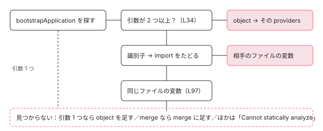

[目次](../README.md) › [@schematics/angular の道具と移行](README.md) › 第 4 回 / 全 11 回

# standalone のアプリを書き換える：utility/standalone

> utility/standalone/\*：addRootImport と addRootProvider、app.config.ts と bootstrapApplication の探し方、CodeBlock の小さなテンプレート、app component の探し方。

angular/angular-cli · 読了 約 13 分 · 発展 · [サイトで読む（デモが動きます）](https://angular-deep-dive-cyan.vercel.app/chapter/sca-standalone)

---

この章で分かること：ライブラリの `ng add` が「アプリの root に provider や module を足す」ときに使う `addRootProvider` と `addRootImport` が、standalone のアプリ（`bootstrapApplication`）と NgModule のアプリのどちらかを見分け、`main.ts` から app config を探し、`providers` に式を差し込み、必要な import を足すまでの手順です。`ng new` のままのアプリと、main.ts・app config の形を 1 つずつ変えたアプリに本物を当てて、前後の差分と例外を記録しました。

読む対象は `packages/schematics/angular/utility/standalone/` の `rules.ts`・`code_block.ts`・`app_config.ts`・`util.ts`・`app_component.ts` です（../angular-cli、44129f66a3）。足す位置を決める `addSymbolToNgModuleMetadata`・`insertImport`・`insertAfterLastOccurrence` は[前の章](02-sca-ast-utils.md)、当てる `applyToUpdateRecorder` は[1 章](01-sca-change.md)です。`bootstrapApplication` と `ApplicationConfig` が実行時に何をするかは[bootstrapApplication の中身の章](../boot/07-boot-bootstrap-application.md)が読んでいます。

1. [1. 変更の単位とファイルの道具](01-sca-change.md)
2. [2. AST の道具](02-sca-ast-utils.md)
3. [3. 依存を足す](03-sca-dependency.md)
4. **4. standalone のアプリを書き換える**（この章）
5. [5. builder の移行](05-sca-build-migrations.md)
6. [6. Karma から Vitest へ](06-sca-karma-vitest.md)
7. [7. Jasmine から Vitest へ（1）骨組み](07-sca-jv-overview.md)
8. [8. Jasmine から Vitest へ（2）spy と型](08-sca-jv-spy.md)
9. [9. Jasmine から Vitest へ（3）matcher](09-sca-jv-matcher.md)
10. [10. Jasmine から Vitest へ（4）lifecycle と fakeAsync](10-sca-jv-lifecycle.md)
11. [11. spec と issue](11-sca-tests-issues.md)

> [!TIP]
> **新卒エンジニアへ**
>
> 記録は 22.2.7 と 22.2.0-next.7 の 2 つで取り、28 の記録は全部同じ値でした（`utility/standalone/` は 44129f66a3・v22.2.7 で差分 0）。main では `app_component.ts` に 1 か所の修正があります（7 節）。木は `ng new demo` と `ng new demo-mod --no-standalone`（どちらも 22.2.7）のファイルを写したもので、Rule は `SchematicTestRunner.callRule` で走らせました。

## 1. 入口：addRootImport と addRootProvider

📄 `angular-cli/packages/schematics/angular/utility/standalone/rules.ts` L25–47 （▶ の行: 26–28, 33, 36–37, 42–45）

````ts
25 │ /**
26 ▶  * Adds an import to the root of the project.
27 ▶  * @param project Name of the project to which to add the import.
28 ▶  * @param callback Function that generates the code block which should be inserted.
29 │  * @example
30 │  *
31 │  * ```ts
32 │  * import { Rule } from '@angular-devkit/schematics';
33 ▶  * import { addRootImport } from '@schematics/angular/utility';
34 │  *
35 │  * export default function(): Rule {
36 ▶  *   return addRootImport('default', ({code, external}) => {
37 ▶  *     return code`${external('MyModule', '@my/module')}.forRoot({})`;
38 │  *   });
39 │  * }
40 │  * ```
41 │  */
42 ▶ export function addRootImport(project: string, callback: CodeBlockCallback): Rule {
43 ▶   return getRootInsertionRule(project, callback, 'imports', {
44 ▶     name: 'importProvidersFrom',
45 ▶     module: '@angular/core',
46 │   });
47 │ }
````

2 つとも `getRootInsertionRule` を呼ぶだけです。違いは 43〜46 行目で、`addRootImport` は NgModule なら `imports` に、standalone なら `importProvidersFrom(…)`（`@angular/core`）で包んで `providers` に入れます。`addRootProvider`（すぐ下の関数）は field が `providers` で、包みません。引数の `callback` は「差し込む式」を作る関数で、2 節の `CodeBlock` を受け取ります。36 行目の例は project の名前に `'default'` を渡していますが、`'default'` という project が無ければ 5 節の「Project target "build" not found.」です。この 2 つは b14b959901（2023-06「add bootstrap-agnostic utilities for writing ng-add schematics」）で、ライブラリの作者のために足されました。../angular-cli の中では server と service-worker の schematic が `addRootProvider` を使います。

📄 `angular-cli/packages/schematics/angular/utility/standalone/rules.ts` L78–117 （▶ の行: 84–86, 88–92, 98–99, 101–102, 104, 108–110, 113）

```ts
 78 │ function getRootInsertionRule(
 79 │   project: string,
 80 │   callback: CodeBlockCallback,
 81 │   ngModuleField: string,
 82 │   standaloneWrapperFunction?: { name: string; module: string },
 83 │ ): Rule {
 84 ▶   return async (host) => {
 85 ▶     const mainFilePath = await getMainFilePath(host, project);
 86 ▶     const codeBlock = new CodeBlock();
 87 │ 
 88 ▶     if (isStandaloneApp(host, mainFilePath)) {
 89 ▶       return (tree) =>
 90 ▶         addProviderToStandaloneBootstrap(
 91 ▶           tree,
 92 ▶           callback(codeBlock),
 93 │           mainFilePath,
 94 │           standaloneWrapperFunction,
 95 │         );
 96 │     }
 97 │ 
 98 ▶     const modulePath = getAppModulePath(host, mainFilePath);
 99 ▶     const pendingCode = CodeBlock.transformPendingCode(callback(codeBlock), modulePath);
100 │ 
101 ▶     return chain([
102 ▶       ...pendingCode.rules,
103 │       (tree) => {
104 ▶         const changes = addSymbolToNgModuleMetadata(
105 │           getSourceFile(tree, modulePath),
106 │           modulePath,
107 │           ngModuleField,
108 ▶           pendingCode.code.expression,
109 ▶           // Explicitly set the import path to null since we deal with imports here separately.
110 ▶           null,
111 │         );
112 │ 
113 ▶         applyChangesToFile(tree, modulePath, changes);
114 │       },
115 │     ]);
116 │   };
117 │ }
```

1. **85 行目：main のファイル**

   5 節の `getMainFilePath`。
2. **88 行目：standalone か**

   [前の章](02-sca-ast-utils.md)の 6 節の `isStandaloneApp`（`@angular/platform-browser` の `bootstrapApplication` の呼び出しがあるか）。
3. **89〜95 行目：standalone なら 3 節へ**

   `callback(codeBlock)` をここで呼び、出来た式を 3 節に渡す Rule を返します。
4. **98〜115 行目：NgModule なら root の module の field に**

   `getAppModulePath` で module のファイルを決め、2 節の `transformPendingCode` の Rule（import を足す）を先に走らせてから、`addSymbolToNgModuleMetadata` を `importPath: null`（109〜110 行目、import はもう足したので）で呼びます。

記録の `ng new demo-mod --no-standalone` では、`addRootProvider` が `app-module.ts` の `providers` の最後に `provideHttpClient(withFetch()),` の行を、`addRootImport` が `imports` の最後に `MatDialogModule` の行を足し、どちらも import を 1 行足しました。

## 2. CodeBlock：式と import を一緒に運ぶ

📄 `angular-cli/packages/schematics/angular/utility/standalone/code_block.ts` L14–51 （▶ の行: 15, 17, 20, 24, 27, 33, 39–40, 46–49）

```ts
14 │ /** Generated code that hasn't been interpolated yet. */
15 ▶ export interface PendingCode {
16 │   /** Code that will be inserted. */
17 ▶   expression: string;
18 │ 
19 │   /** Imports that need to be added to the file in which the code is inserted. */
20 ▶   imports: PendingImports;
21 │ }
22 │ 
23 │ /** Map keeping track of imports and aliases under which they're referred to in an expression. */
24 ▶ type PendingImports = Map<string, Map<string, string>>;
25 │ 
26 │ /** Counter used to generate unique IDs. */
27 ▶ let uniqueIdCounter = 0;
28 │ 
29 │ /**
30 │  * Callback invoked by a Rule that produces the code
31 │  * that needs to be inserted somewhere in the app.
32 │  */
33 ▶ export type CodeBlockCallback = (block: CodeBlock) => PendingCode;
34 │ 
35 │ /**
36 │  * Utility class used to generate blocks of code that
37 │  * can be inserted by the devkit into a user's app.
38 │  */
39 ▶ export class CodeBlock {
40 ▶   private _imports: PendingImports = new Map<string, Map<string, string>>();
41 │ 
42 │   // Note: the methods here are defined as arrow function so that they can be destructured by
43 │   // consumers without losing their context. This makes the API more concise.
44 │ 
45 │   /** Function used to tag a code block in order to produce a `PendingCode` object. */
46 ▶   code = (strings: TemplateStringsArray, ...params: unknown[]): PendingCode => {
47 ▶     return {
48 ▶       expression: strings.map((part, index) => part + (params[index] || '')).join(''),
49 ▶       imports: this._imports,
50 │     };
51 │   };
```

📄 `angular-cli/packages/schematics/angular/utility/standalone/code_block.ts` L53–71 （▶ の行: 59–61, 64, 66–67, 70）

```ts
53 │   /**
54 │    * Used inside of a code block to mark external symbols and which module they should be imported
55 │    * from. When the code is inserted, the required import statements will be produced automatically.
56 │    * @param symbolName Name of the external symbol.
57 │    * @param moduleName Module from which the symbol should be imported.
58 │    */
59 ▶   external = (symbolName: string, moduleName: string): string => {
60 ▶     if (!this._imports.has(moduleName)) {
61 ▶       this._imports.set(moduleName, new Map());
62 │     }
63 │ 
64 ▶     const symbolsPerModule = this._imports.get(moduleName) as Map<string, string>;
65 │ 
66 ▶     if (!symbolsPerModule.has(symbolName)) {
67 ▶       symbolsPerModule.set(symbolName, `@@__SCHEMATIC_PLACEHOLDER_${uniqueIdCounter++}__@@`);
68 │     }
69 │ 
70 ▶     return symbolsPerModule.get(symbolName) as string;
71 │   };
```

`CodeBlock` はタグ付きテンプレート（`` code`…` ``）で式を作る小さな道具です。`external(名前, module)` は、その場では 67 行目の `@@__SCHEMATIC_PLACEHOLDER_番号__@@` という仮の文字列を返し、「この仮の文字列はこの module のこの名前」と 24 行目の Map に覚えます。同じ module の同じ名前は同じ仮の文字列です（66 行目）。番号は 27 行目のファイル全体の数え上げなので、走らせるたびに増えます（記録では 47 と 48）。48 行目は `params[index] || ''` なので、偽の値は消えます。記録の `` code`a(${0}, ${false}, ${''}, ${null}, ${'x'})` `` は `a(, , , , x)` になりました。`0` と `false` を式に入れたいときは、文字列にして渡す必要があります。

📄 `angular-cli/packages/schematics/angular/utility/standalone/code_block.ts` L78–117 （▶ の行: 78–80, 82, 85–89, 99–100, 103–105, 108–109, 111）

```ts
 78 ▶   static transformPendingCode(
 79 ▶     initialCode: PendingCode,
 80 ▶     filePath: string,
 81 │   ): { code: PendingCode; rules: Rule[] } {
 82 ▶     const code = { ...initialCode };
 83 │     const rules: Rule[] = [];
 84 │ 
 85 ▶     code.imports.forEach((symbols, moduleName) => {
 86 ▶       symbols.forEach((placeholder, symbolName) => {
 87 ▶         rules.push((tree: Tree) => {
 88 ▶           const recorder = tree.beginUpdate(filePath);
 89 ▶           const sourceFile = ts.createSourceFile(
 90 │             filePath,
 91 │             tree.readText(filePath),
 92 │             ts.ScriptTarget.Latest,
 93 │             true,
 94 │           );
 95 │ 
 96 │           // Note that this could still technically clash if there's a top-level symbol called
 97 │           // `${symbolName}_alias`, however this is unlikely. We can revisit this if it becomes
 98 │           // a problem.
 99 ▶           const alias = hasTopLevelIdentifier(sourceFile, symbolName, moduleName)
100 ▶             ? symbolName + '_alias'
101 │             : undefined;
102 │ 
103 ▶           code.expression = code.expression.replace(
104 ▶             new RegExp(placeholder, 'g'),
105 ▶             alias || symbolName,
106 │           );
107 │ 
108 ▶           applyToUpdateRecorder(recorder, [
109 ▶             insertImport(sourceFile, filePath, symbolName, moduleName, false, alias),
110 │           ]);
111 ▶           tree.commitUpdate(recorder);
112 │         });
113 │       });
114 │     });
115 │ 
116 │     return { code, rules };
117 │   }
```

1. **85〜87 行目：覚えた名前 1 つにつき Rule を 1 つ**

   ここでは Rule を作るだけで、走らせるのは 1 節・3 節の `chain` です。
2. **89〜94 行目：その時点のファイルを読む**

   Rule が走るたびに読み直すので、前の Rule が足した import も見えます。
3. **99〜101 行目：名前がもう使われていれば \_alias**

   [前の章](02-sca-ast-utils.md)の 5 節の `hasTopLevelIdentifier` を、その module 自身は飛ばして（`skipModule`）呼びます。
4. **103〜106 行目：仮の文字列を本当の名前に**

   82 行目で写した `code` の `expression` を書き換えます。だから式は、全部の Rule が走ったあとで完成します。
5. **108〜111 行目：import を足す**

   前の章の `insertImport` に、別名が要るときは `alias` を渡します。

記録の「同じ名前を別の module から import している app.config.ts」（`import { provideHttpClient } from './my-http'`）では、`import { provideHttpClient as provideHttpClient_alias, withFetch } from '@angular/common/http'` を足し、式は `provideHttpClient_alias(withFetch())` でした。同じ module から同じ名前をもう import していれば、import は `withFetch` だけが増えました。

## 3. standalone：app config を探して providers に足す

📄 `angular-cli/packages/schematics/angular/utility/standalone/rules.ts` L126–164 （▶ の行: 132–134, 136–137, 142, 144–146, 151, 158–160）

```ts
126 │ function addProviderToStandaloneBootstrap(
127 │   host: Tree,
128 │   pendingCode: PendingCode,
129 │   mainFilePath: string,
130 │   wrapperFunction?: { name: string; module: string },
131 │ ): Rule {
132 ▶   const bootstrapCall = findBootstrapApplicationCall(host, mainFilePath);
133 ▶   const fileToEdit = findAppConfig(bootstrapCall, host, mainFilePath)?.filePath || mainFilePath;
134 ▶   const { code, rules } = CodeBlock.transformPendingCode(pendingCode, fileToEdit);
135 │ 
136 ▶   return chain([
137 ▶     ...rules,
138 │     () => {
139 │       let wrapped: PendingCode;
140 │       let additionalRules: Rule[];
141 │ 
142 ▶       if (wrapperFunction) {
143 │         const block = new CodeBlock();
144 ▶         const result = CodeBlock.transformPendingCode(
145 ▶           block.code`${block.external(wrapperFunction.name, wrapperFunction.module)}(${
146 ▶             code.expression
147 │           })`,
148 │           fileToEdit,
149 │         );
150 │ 
151 ▶         wrapped = result.code;
152 │         additionalRules = result.rules;
153 │       } else {
154 │         wrapped = code;
155 │         additionalRules = [];
156 │       }
157 │ 
158 ▶       return chain([
159 ▶         ...additionalRules,
160 ▶         (tree) => insertStandaloneRootProvider(tree, mainFilePath, wrapped.expression),
161 │       ]);
162 │     },
163 │   ]);
164 │ }
```

1. **133 行目：書き換えるファイルを先に決める**

   4 節の `findAppConfig` が見つけた app config のファイル、見つからなければ main.ts です。import はこのファイルに足します。
2. **136〜137 行目：import の Rule を先に走らせる**

   2 節の Rule です。
3. **142〜152 行目：包む関数があれば、もう 1 度 CodeBlock**

   `addRootImport` の `importProvidersFrom` は、ここで `importProvidersFrom(式)` の形になり、`@angular/core` の import の Rule が増えます。
4. **160 行目：最後に差し込む**

   下の `insertStandaloneRootProvider` です。

📄 `angular-cli/packages/schematics/angular/utility/standalone/rules.ts` L176–212 （▶ の行: 176–177, 184–185, 190, 193–199, 205–207, 210）

```ts
176 ▶   if (bootstrapCall.arguments.length === 0) {
177 ▶     throw new SchematicsException(
178 │       `Cannot add provider to invalid bootstrapApplication call in ${
179 │         bootstrapCall.getSourceFile().fileName
180 │       }`,
181 │     );
182 │   }
183 │ 
184 ▶   if (appConfig) {
185 ▶     addProvidersExpressionToAppConfig(tree, appConfig, expression);
186 │ 
187 │     return;
188 │   }
189 │ 
190 ▶   const newAppConfig = `, {\n${' '.repeat(2)}providers: [${expression}]\n}`;
191 │   let targetCall: ts.CallExpression;
192 │ 
193 ▶   if (bootstrapCall.arguments.length === 1) {
194 ▶     targetCall = bootstrapCall;
195 ▶   } else if (isMergeAppConfigCall(bootstrapCall.arguments[1])) {
196 ▶     targetCall = bootstrapCall.arguments[1];
197 ▶   } else {
198 ▶     throw new SchematicsException(
199 ▶       `Cannot statically analyze bootstrapApplication call in ${
200 │         bootstrapCall.getSourceFile().fileName
201 │       }`,
202 │     );
203 │   }
204 │ 
205 ▶   applyChangesToFile(tree, mainFilePath, [
206 ▶     insertAfterLastOccurrence(
207 ▶       targetCall.arguments,
208 │       newAppConfig,
209 │       mainFilePath,
210 ▶       targetCall.getEnd() - 1,
211 │     ),
212 │   ]);
```

📄 `angular-cli/packages/schematics/angular/utility/standalone/rules.ts` L221–257 （▶ の行: 228, 232–236, 238, 242, 246–248, 250–252, 255）

```ts
221 │ function addProvidersExpressionToAppConfig(
222 │   tree: Tree,
223 │   appConfig: ResolvedAppConfig,
224 │   expression: string,
225 │ ): void {
226 │   const { node, filePath } = appConfig;
227 │   const configProps = node.properties;
228 ▶   const providersLiteral = findProvidersLiteral(node);
229 │ 
230 │   // If there's a `providers` property, we can add the provider
231 │   // to it, otherwise we need to declare it ourselves.
232 ▶   if (providersLiteral) {
233 ▶     applyChangesToFile(tree, filePath, [
234 ▶       insertAfterLastOccurrence(
235 ▶         providersLiteral.elements,
236 ▶         (providersLiteral.elements.length === 0 ? '' : ', ') + expression,
237 │         filePath,
238 ▶         providersLiteral.getStart() + 1,
239 │       ),
240 │     ]);
241 │   } else {
242 ▶     const prop = `${' '.repeat(2)}providers: [${expression}]`;
243 │     let toInsert: string;
244 │     let insertPosition: number;
245 │ 
246 ▶     if (configProps.length === 0) {
247 ▶       toInsert = '\n' + prop + '\n';
248 ▶       insertPosition = node.getEnd() - 1;
249 │     } else {
250 ▶       const hasTrailingComma = configProps.hasTrailingComma;
251 ▶       toInsert = (hasTrailingComma ? '' : ',') + '\n' + prop;
252 ▶       insertPosition = configProps[configProps.length - 1].getEnd() + (hasTrailingComma ? 1 : 0);
253 │     }
254 │ 
255 ▶     applyChangesToFile(tree, filePath, [new InsertChange(filePath, insertPosition, toInsert)]);
256 │   }
257 │ }
```

app config があれば `addProvidersExpressionToAppConfig`、無ければ main.ts の呼び出しに引数を足します（190〜212 行目）。記録の表です（式はどれも `provideHttpClient(withFetch())`）。

| 形 | 結果 |
| --- | --- |
| ng new のまま（app.config.ts の複数行の `providers`） | 最後の要素と**同じ行**に `provideRouter(routes), provideHttpClient(withFetch())`（236 行目の `', '`） |
| `addRootImport`（ng new のまま） | `importProvidersFrom(MatDialogModule)`、`@angular/core` の import に `importProvidersFrom` が足される |
| 同じ `addRootProvider` を 2 回 | 同じ式が 2 つ並ぶ（重ねて足すのを止める確かめは無い） |
| main.ts：`bootstrapApplication(App)` | 193〜194 行目で、`App, {`・`providers: […]`・`}` の 3 行の object を足す |
| main.ts：`bootstrapApplication(App, {})` | 246〜248 行目で、空の object の中に `providers` の行 |
| main.ts：`{ appId: 'x' }` | 250〜252 行目で `appId: 'x',` の後ろに `providers` の行 |
| main.ts：`mergeApplicationConfig(appConfig, {…})` | 195〜196 行目で、`mergeApplicationConfig` の 3 つめの引数に object を足す |
| main.ts：同じファイルの `const appConfig = { providers: [] }` | その `[]` に足す |
| main.ts：`bootstrapApplication()` | 176〜182 行目「Cannot add provider to invalid bootstrapApplication call in src/main.ts」 |
| main.ts：`bootstrapApplication` を import していない | 「Bootstrap call not found」（88 行目が `false` なので NgModule の道へ行き、`getAppModulePath` が投げる） |

例外になった記録では、例外の前に 136〜137 行目の import の Rule が走り終わっていて、記録の木の main.ts には `import { provideHttpClient, withFetch } …` が足されたままでした。`ng add` の本番では、schematic が例外で止まると Tree はディスクに書かれないので（[Tree と sink の章](../cli/13-schematics.md)）、ファイルは変わりません。

## 4. app config を探す：app\_config.ts

📄 `angular-cli/packages/schematics/angular/utility/standalone/app_config.ts` L29–47 （▶ の行: 34–35, 37–38, 41–42, 46）

```ts
29 │ export function findAppConfig(
30 │   bootstrapCall: ts.CallExpression,
31 │   tree: Tree,
32 │   filePath: string,
33 │ ): ResolvedAppConfig | null {
34 ▶   if (bootstrapCall.arguments.length > 1) {
35 ▶     const config = bootstrapCall.arguments[1];
36 │ 
37 ▶     if (ts.isObjectLiteralExpression(config)) {
38 ▶       return { filePath, node: config };
39 │     }
40 │ 
41 ▶     if (ts.isIdentifier(config)) {
42 ▶       return resolveAppConfigFromIdentifier(config, tree, filePath);
43 │     }
44 │   }
45 │ 
46 ▶   return null;
47 │ }
```

📄 `angular-cli/packages/schematics/angular/utility/standalone/app_config.ts` L60–99 （▶ の行: 60, 62–64, 66–71, 76–77, 84–88, 91–92, 97, 99）

```ts
60 ▶   const sourceFile = identifier.getSourceFile();
61 │ 
62 ▶   for (const node of sourceFile.statements) {
63 ▶     // Only look at relative imports. This will break if the app uses a path
64 ▶     // mapping to refer to the import, but in order to resolve those, we would
65 │     // need knowledge about the entire program.
66 ▶     if (
67 ▶       !ts.isImportDeclaration(node) ||
68 ▶       !node.importClause?.namedBindings ||
69 ▶       !ts.isNamedImports(node.importClause.namedBindings) ||
70 ▶       !ts.isStringLiteralLike(node.moduleSpecifier) ||
71 ▶       !node.moduleSpecifier.text.startsWith('.')
72 │     ) {
73 │       continue;
74 │     }
75 │ 
76 ▶     for (const specifier of node.importClause.namedBindings.elements) {
77 ▶       if (specifier.name.text !== identifier.text) {
78 │         continue;
79 │       }
80 │ 
81 │       // Look for a variable with the imported name in the file. Note that ideally we would use
82 │       // the type checker to resolve this, but we can't because these utilities are set up to
83 │       // operate on individual files, not the entire program.
84 ▶       const filePath = join(dirname(bootstapFilePath), node.moduleSpecifier.text + '.ts');
85 ▶       const importedSourceFile = getSourceFile(tree, filePath);
86 ▶       const resolvedVariable = findAppConfigFromVariableName(
87 ▶         importedSourceFile,
88 ▶         (specifier.propertyName || specifier.name).text,
89 │       );
90 │ 
91 ▶       if (resolvedVariable) {
92 ▶         return { filePath, node: resolvedVariable };
93 │       }
94 │     }
95 │   }
96 │ 
97 ▶   const variableInSameFile = findAppConfigFromVariableName(sourceFile, identifier.text);
98 │ 
99 ▶   return variableInSameFile ? { filePath: bootstapFilePath, node: variableInSameFile } : null;
```

📄 `angular-cli/packages/schematics/angular/utility/standalone/app_config.ts` L107–127 （▶ の行: 111–113, 115–118, 120）

```ts
107 │ function findAppConfigFromVariableName(
108 │   sourceFile: ts.SourceFile,
109 │   variableName: string,
110 │ ): ts.ObjectLiteralExpression | null {
111 ▶   for (const node of sourceFile.statements) {
112 ▶     if (ts.isVariableStatement(node)) {
113 ▶       for (const decl of node.declarationList.declarations) {
114 │         if (
115 ▶           ts.isIdentifier(decl.name) &&
116 ▶           decl.name.text === variableName &&
117 ▶           decl.initializer &&
118 ▶           ts.isObjectLiteralExpression(decl.initializer)
119 │         ) {
120 ▶           return decl.initializer;
121 │         }
122 │       }
123 │     }
124 │   }
125 │ 
126 │   return null;
127 │ }
```

1. **34〜44 行目：2 つめの引数の形**

   object literal ならそれ、識別子なら下の関数。`getConfig()` のような呼び出しは `null` です。
2. **66〜74 行目：「.」で始まる名前つきの import だけ**

   63〜65 行目のコメントのとおり、tsconfig の path alias（`'@app/config'`）は見ません。
3. **77 行目と 88 行目：別名に対応**

   ファイルの中の名前（`name`）で探し、相手のファイルでは元の名前（`propertyName`）で探します。記録の `import { appConfig as config }` は app.config.ts に足せました。
4. **84 行目：import の文字列に .ts を付ける**

   `'./app/core/root-config'` のような別の名前・別のフォルダでも、相対パスなら見つかりました（記録）。
5. **111〜124 行目：トップレベルの変数で、初期値が object literal のもの**

   型注釈（`: ApplicationConfig`）は付いていても構いません。
6. **97〜99 行目：見つからなければ同じファイルの変数**

   それも無ければ `null`。

`null` のあと、3 節の 193〜203 行目は「引数が 2 つで、2 つめが `mergeApplicationConfig` でない」ので「Cannot statically analyze bootstrapApplication call in src/main.ts」を投げます。記録でこの文になったのは、path alias の import、`= {…} satisfies ApplicationConfig`（118 行目の初期値が `SatisfiesExpression` で object literal ではない）、`getConfig()` の 3 つでした。文は main.ts を指しますが、satisfies の場合に止まった理由は app.config.ts の書き方です。path alias を読まない制限は、NgModule の時代の issue #12740（2018-10、open「ng add fails to find app.module.ts when using custom tsconfig.json paths」）と同じ形です。`import { appConfig } from './app/app.config.js'`（拡張子つき）は、84 行目で `src/app/app.config.js.ts` になり、85 行目で「FileDoesNotExistException: Path "src/app/app.config.js.ts" does not exist.」でした。

## 5. main のファイルと bootstrap の呼び出し：util.ts

📄 `angular-cli/packages/schematics/angular/utility/standalone/util.ts` L22–44 （▶ の行: 23–25, 27–28, 33–35, 38, 40, 43）

```ts
22 │ export async function getMainFilePath(tree: Tree, projectName: string): Promise<string> {
23 ▶   const workspace = await getWorkspace(tree);
24 ▶   const project = workspace.projects.get(projectName);
25 ▶   const buildTarget = project?.targets.get('build');
26 │ 
27 ▶   if (!project || !buildTarget) {
28 ▶     throw targetBuildNotFoundError();
29 │   }
30 │ 
31 │   const options = buildTarget.options as Record<string, string>;
32 │ 
33 ▶   if (
34 ▶     buildTarget.builder === Builders.Application ||
35 ▶     buildTarget.builder === Builders.BuildApplication
36 │   ) {
37 │     // These builders support a default of `<project_source_root>/main.ts`
38 ▶     const projectSourceRoot = project.sourceRoot ?? join(project.root, 'src');
39 │ 
40 ▶     return options.browser ?? join(projectSourceRoot, 'main.ts');
41 │   }
42 │ 
43 ▶   return options.main;
44 │ }
```

application builder（2 つの名前）なら `options.browser`、無ければ 38〜40 行目で `sourceRoot`（無ければ `root/src`）の `main.ts` です。この既定は 07ac1742d2（2025-05「support using default browser option when not present」）で入りました。ほかの builder は 43 行目で `options.main` です。記録では 3 つとも `src/main.ts`（先頭の `/` は無い）、build target が無いときも project が無いときも 28 行目の「Project target "build" not found.」でした。25 行目の target の名前 `'build'` は決め打ちで、名前を変えたワークスペースではここで止まります（issue #26517、2023-11、open）。

📄 `angular-cli/packages/schematics/angular/utility/standalone/util.ts` L51–90 （▶ の行: 60–64, 67, 70–74, 76, 79–80, 89）

```ts
51 │ export function getSourceFile(tree: Tree, path: string): ts.SourceFile {
52 │   const content = tree.readText(path);
53 │   const source = ts.createSourceFile(path, content, ts.ScriptTarget.Latest, true);
54 │ 
55 │   return source;
56 │ }
57 │ 
58 │ /** Finds the call to `bootstrapApplication` within a file. */
59 │ export function findBootstrapApplicationCall(tree: Tree, mainFilePath: string): ts.CallExpression {
60 ▶   const sourceFile = getSourceFile(tree, mainFilePath);
61 ▶   const localName = findImportLocalName(
62 ▶     sourceFile,
63 ▶     'bootstrapApplication',
64 ▶     '@angular/platform-browser',
65 │   );
66 │ 
67 ▶   if (localName) {
68 │     let result: ts.CallExpression | null = null;
69 │ 
70 ▶     sourceFile.forEachChild(function walk(node) {
71 ▶       if (
72 ▶         ts.isCallExpression(node) &&
73 ▶         ts.isIdentifier(node.expression) &&
74 ▶         node.expression.text === localName
75 │       ) {
76 ▶         result = node;
77 │       }
78 │ 
79 ▶       if (!result) {
80 ▶         node.forEachChild(walk);
81 │       }
82 │     });
83 │ 
84 │     if (result) {
85 │       return result;
86 │     }
87 │   }
88 │ 
89 ▶   throw new SchematicsException(`Could not find bootstrapApplication call in ${mainFilePath}`);
90 │ }
```

📄 `angular-cli/packages/schematics/angular/utility/standalone/util.ts` L98–132 （▶ の行: 103, 105–108, 114–117, 123–124, 126）

```ts
 98 │ function findImportLocalName(
 99 │   sourceFile: ts.SourceFile,
100 │   name: string,
101 │   moduleName: string,
102 │ ): string | null {
103 ▶   for (const node of sourceFile.statements) {
104 │     // Only look for top-level imports.
105 ▶     if (
106 ▶       !ts.isImportDeclaration(node) ||
107 ▶       !ts.isStringLiteral(node.moduleSpecifier) ||
108 ▶       node.moduleSpecifier.text !== moduleName
109 │     ) {
110 │       continue;
111 │     }
112 │ 
113 │     // Filter out imports that don't have the right shape.
114 ▶     if (
115 ▶       !node.importClause ||
116 ▶       !node.importClause.namedBindings ||
117 ▶       !ts.isNamedImports(node.importClause.namedBindings)
118 │     ) {
119 │       continue;
120 │     }
121 │ 
122 │     // Look through the elements of the declaration for the specific import.
123 ▶     for (const element of node.importClause.namedBindings.elements) {
124 ▶       if ((element.propertyName || element.name).text === name) {
125 │         // The local name is always in `name`.
126 ▶         return element.name.text;
127 │       }
128 │     }
129 │   }
130 │ 
131 │   return null;
132 │ }
```

[前の章](02-sca-ast-utils.md)の `findBootstrapModuleCall`（識別子の文字だけで探す）と違い、こちらは 61〜65 行目で「`@angular/platform-browser` から import したときのファイルの中の名前」を先に決め、その名前の呼び出しを探します。記録の `import { bootstrapApplication as boot }` と `boot(App, appConfig)` も見つかりました。79 行目で、見つけたら下へは降りません。

📄 `angular-cli/packages/schematics/angular/utility/standalone/util.ts` L140–161 （▶ の行: 140–144, 149–150, 154–157, 160）

```ts
140 ▶ export function applyChangesToFile(tree: Tree, path: string, changes: Change[]): void {
141 ▶   if (changes.length > 0) {
142 ▶     const recorder = tree.beginUpdate(path);
143 ▶     applyToUpdateRecorder(recorder, changes);
144 ▶     tree.commitUpdate(recorder);
145 │   }
146 │ }
147 │ 
148 │ /** Checks whether a node is a call to `mergeApplicationConfig`. */
149 ▶ export function isMergeAppConfigCall(node: ts.Node): node is ts.CallExpression {
150 ▶   if (!ts.isCallExpression(node)) {
151 │     return false;
152 │   }
153 │ 
154 ▶   const localName = findImportLocalName(
155 ▶     node.getSourceFile(),
156 ▶     'mergeApplicationConfig',
157 ▶     '@angular/core',
158 │   );
159 │ 
160 ▶   return !!localName && ts.isIdentifier(node.expression) && node.expression.text === localName;
161 │ }
```

📄 `angular-cli/packages/schematics/angular/utility/standalone/util.ts` L164–179 （▶ の行: 167, 169–172, 174, 178）

```ts
164 │ export function findProvidersLiteral(
165 │   config: ts.ObjectLiteralExpression,
166 │ ): ts.ArrayLiteralExpression | null {
167 ▶   for (const prop of config.properties) {
168 │     if (
169 ▶       ts.isPropertyAssignment(prop) &&
170 ▶       ts.isIdentifier(prop.name) &&
171 ▶       prop.name.text === 'providers' &&
172 ▶       ts.isArrayLiteralExpression(prop.initializer)
173 │     ) {
174 ▶       return prop.initializer;
175 │     }
176 │   }
177 │ 
178 ▶   return null;
179 │ }
```

`applyChangesToFile` は `Change` が 1 つでもあれば recorder を開いて当てます。`findProvidersLiteral` は 169〜172 行目で `providers: [ … ]` の形だけを見るので、`providers: PROVIDERS`（変数）や `...base`（スプレッド）は「providers が無い」になり、3 節の 241〜255 行目が 2 つめの `providers` を足します。

### 6. NgModule のアプリでの道

1 節の 98〜115 行目の道です。[前の章](02-sca-ast-utils.md)の 6 節の `getAppModulePath` で `app-module.ts` を決め、同じ章の 4 節の `addSymbolToNgModuleMetadata` で `providers` か `imports` の最後に足します。前の章の 4 節の制限（変数の `imports`・別名の `NgModule` は黙って何もしない、main.ts で宣言した module は `undefined.ts`）は、そのままこの道の制限です。記録の `ng new demo-mod --no-standalone` の `app-module.ts` は、もとの `providers` が複数行で末尾にカンマがあるので、`provideBrowserGlobalErrorListeners(),` の次の行に `provideHttpClient(withFetch()),` が入りました。standalone の 3 節と違って、前の要素の字下げをまねて改行します。

## 7. app component を探す：app\_component.ts

📄 `angular-cli/packages/schematics/angular/utility/standalone/app_component.ts` L38–68 （▶ の行: 38, 44, 46–47, 50–53, 58, 61–62, 67）

```ts
38 ▶ export function resolveBootstrappedComponentData(
39 │   tree: Tree,
40 │   mainFilePath: string,
41 │ ): BootstrappedComponentData | null {
42 │   // First try to resolve for a standalone app.
43 │   try {
44 ▶     const call = findBootstrapApplicationCall(tree, mainFilePath);
45 │ 
46 ▶     if (call.arguments.length > 0 && ts.isIdentifier(call.arguments[0])) {
47 ▶       const resolved = resolveIdentifier(call.arguments[0]);
48 │ 
49 │       if (resolved) {
50 ▶         return {
51 ▶           componentName: resolved.name,
52 ▶           componentImportPathInSameFile: resolved.path,
53 ▶           moduleName: null,
54 │           moduleImportPathInSameFile: null,
55 │         };
56 │       }
57 │     }
58 ▶   } catch (e) {
59 │     // `findBootstrapApplicationCall` will throw if it can't find the `bootrstrapApplication` call.
60 │     // Catch so we can continue to the fallback logic.
61 ▶     if (!(e instanceof SchematicsException)) {
62 ▶       throw e;
63 │     }
64 │   }
65 │ 
66 │   // Otherwise fall back to resolving an NgModule-based app.
67 ▶   return resolveNgModuleBasedData(tree, mainFilePath);
68 │ }
```

📄 `angular-cli/packages/schematics/angular/utility/standalone/app_component.ts` L77–116 （▶ の行: 77, 79, 84, 86–88, 92–95, 97, 103, 106）

```ts
 77 ▶   const metadataNodes = getDecoratorMetadata(appModuleFile, 'NgModule', '@angular/core');
 78 │ 
 79 ▶   for (const node of metadataNodes) {
 80 │     if (!ts.isObjectLiteralExpression(node)) {
 81 │       continue;
 82 │     }
 83 │ 
 84 ▶     const bootstrapProp = getMetadataField(node, 'bootstrap').find((prop) => {
 85 │       return (
 86 ▶         ts.isArrayLiteralExpression(prop.initializer) &&
 87 ▶         prop.initializer.elements.length > 0 &&
 88 ▶         ts.isIdentifier(prop.initializer.elements[0])
 89 │       );
 90 │     });
 91 │ 
 92 ▶     const componentIdentifier = (bootstrapProp?.initializer as ts.ArrayLiteralExpression)
 93 ▶       .elements[0] as ts.Identifier | undefined;
 94 ▶     const componentResult = componentIdentifier ? resolveIdentifier(componentIdentifier) : null;
 95 ▶     const bootstrapCall = findBootstrapModuleCall(tree, mainFilePath);
 96 │ 
 97 ▶     if (
 98 │       componentResult &&
 99 │       bootstrapCall &&
100 │       bootstrapCall.arguments.length > 0 &&
101 │       ts.isIdentifier(bootstrapCall.arguments[0])
102 │     ) {
103 ▶       const moduleResult = resolveIdentifier(bootstrapCall.arguments[0]);
104 │ 
105 │       if (moduleResult) {
106 ▶         return {
107 │           componentName: componentResult.name,
108 │           componentImportPathInSameFile: componentResult.path,
109 │           moduleName: moduleResult.name,
110 │           moduleImportPathInSameFile: moduleResult.path,
111 │         };
112 │       }
113 │     }
114 │   }
115 │ 
116 │   return null;
```

📄 `angular-cli/packages/schematics/angular/utility/standalone/app_component.ts` L120–148 （▶ の行: 121, 124, 135–136, 140–141）

```ts
120 │ function resolveIdentifier(identifier: ts.Identifier): { name: string; path: string } | null {
121 ▶   const sourceFile = identifier.getSourceFile();
122 │ 
123 │   // Try to resolve the import path by looking at the top-level named imports of the file.
124 ▶   for (const node of sourceFile.statements) {
125 │     if (
126 │       !ts.isImportDeclaration(node) ||
127 │       !ts.isStringLiteral(node.moduleSpecifier) ||
128 │       !node.importClause ||
129 │       !node.importClause.namedBindings ||
130 │       !ts.isNamedImports(node.importClause.namedBindings)
131 │     ) {
132 │       continue;
133 │     }
134 │ 
135 ▶     for (const element of node.importClause.namedBindings.elements) {
136 ▶       if (element.name.text === identifier.text) {
137 │         return {
138 │           // Note that we use `propertyName` if available, because it contains
139 │           // the real name in the case where the import is aliased.
140 ▶           name: (element.propertyName || element.name).text,
141 ▶           path: node.moduleSpecifier.text,
142 │         };
143 │       }
144 │     }
145 │   }
146 │ 
147 │   return null;
148 │ }
```

server schematic（`ng add @angular/ssr` の中）が、server 側の main で bootstrap する component の名前と import のパスを知るための関数です（ea1143ddd8、2025-04）。standalone なら `bootstrapApplication` の 1 つめの引数、NgModule なら `bootstrap: [App]` の最初の要素を、main.ts の import から元の名前とパスにたどります。記録では standalone が `{"componentName":"App","componentImportPathInSameFile":"./app/app",…}`、NgModule が `"./app"` と `"./app/app-module"` でした。

92 行目は `bootstrapProp?.initializer` を `as` で配列と決めつけてから `.elements` を読みます。`bootstrap` の無い `@NgModule`（`ngDoBootstrap()` を使う root module や、同じファイルで先に宣言した shared module）があると、`?.` の結果の `undefined` の `.elements` で「TypeError: Cannot read properties of undefined (reading 'elements')」です（記録）。main の 090bc99802（2026-11-20、issue #34761）で、`bootstrapProp` が無ければ次の module へ進む形に直りました。22.2.7 には入っていません。

> **🧪 DEMO — addRootProvider・addRootImport を本物のワークスペースに当てた記録**
>
> ボタンは、手元の記録のスクリプトが `ng new` のファイルを写した木に `@schematics/angular` の `addRootProvider`・`addRootImport` などを走らせた記録を再生します。上の枠が変えた入力と呼んだもの、下の枠がファイルごとの差分（前後 2 行つき）です。例外になったものは、例外の文と、その時点の木の差分を並べています。
>
> ▶ [このデモはサイトで動かせます](https://angular-deep-dive-cyan.vercel.app/chapter/sca-standalone)



*addRootProvider が差し込み先を決める道。app config は「2 つめの引数が object」「相対パスの名前つき import の先の変数」「同じファイルの変数」の順に探し、どれでもなければ main.ts の呼び出しに引数を足すか、例外。*

### ここまでの呼び出し（standalone のアプリに addRootProvider）

- 👤 ``addRootProvider('demo', ({ code, external }) => code`…`)`` — rules.ts L66
  - `getMainFilePath(host, project)` — util.ts L22 — *options.browser か src/main.ts*
  - `isStandaloneApp(host, main)` — ng-ast-utils.ts L81 — *true*
  - `addProviderToStandaloneBootstrap(tree, callback(codeBlock), main)` — rules.ts L126
    - `findAppConfig(bootstrapCall, host, main)` — app\_config.ts L29 — *書き換えるファイルを決める*
    - `CodeBlock.transformPendingCode(code, fileToEdit)` — code\_block.ts L78 — *名前ごとに import の Rule*
      - `insertImport(…, alias)` — ast-utils.ts L23
    - `insertStandaloneRootProvider(tree, main, expression)` — rules.ts L172
      - `addProvidersExpressionToAppConfig(tree, appConfig, expression)` — rules.ts L221 — *providers の最後に ', 式'*

## テストと直し方

| ファイル | describe › it（行） | 固めている約束 |
| --- | --- | --- |
| `utility/standalone/rules_spec.ts` | `standalone utilities`（14）› `addRootImport`（65）› `should add a root import to an NgModule-based app`（66）〜 `should throw an error if there is no bootstrapApplication call`（391）の 12 本 | 1〜4 節の主な形（providers の無い config、inline、config なし、merge、別名の衝突、3 つの例外） |
| 同上 | `addRootProvider`（407）› 3 本（408・429・452） | NgModule・standalone・末尾のカンマ |
| （無い） | `app_component.ts`・`CodeBlock` の偽の値・path alias・satisfies・拡張子つきの import | 7 節と 2 節・4 節の表の例外の行。`resolveBootstrappedComponentData` は server schematic の spec からだけ通る |

📄 `走らせたコマンド（2026-11-27）`

```
$ cd ~/angular-research/angular-cli      # 44129f66a3、読むだけ
$ pnpm bazel test //packages/schematics/angular:test --nocache_test_results --test_output=all \
    "--test_arg=--filter=^standalone utilities "
Ran 15 of 863 specs
15 specs, 0 failures
//packages/schematics/angular:test    PASSED

$ WS_DIR=<ng new demo> WS_MOD=<ng new demo-mod --no-standalone> \
    node rec-standalone.js <22.2.7 の @schematics/angular> ch4-new.json   # 記録（DEMO）
```

直すとしたら、4 節の satisfies は `app_config.ts` の `findAppConfigFromVariableName` の 117〜118 行目で、初期値が `SatisfiesExpression`（と `AsExpression`）なら中の `expression` を見る形にし、rules\_spec.ts の `addRootProvider` の describe に「`satisfies ApplicationConfig` の app config」を足します。拡張子つきの import は 84 行目で `.js` を `.ts` に置き換えてから探します。2 節の偽の値は `code_block.ts` の 48 行目の `|| ''` を「`index < params.length` なら `String(params[index])`、そうでなければ空文字」にします。7 節は main の 090bc99802 と同じ形です。

## 聞かれそうな質問

**Q. ライブラリの `ng add` で、アプリが standalone か NgModule かを自分で見分ける必要はありますか？**

ありません。`addRootProvider`・`addRootImport` が 88 行目の `isStandaloneApp` で見分け、NgModule なら `providers`/`imports`、standalone なら app config の `providers`（import は `importProvidersFrom` で包む）に足します。

**Q. app.config.ts が別の名前・別のフォルダでも見つかりますか？**

main.ts から「.」で始まるパスで名前つき import していれば見つかります（66〜74 行目、84 行目）。path alias、`.js` の付いた import、`satisfies`、関数で返す config は見つからず、例外になります（記録）。

**Q. アプリにもう同じ名前の関数があると、どうなりますか？**

`CodeBlock` の 99〜101 行目が `hasTopLevelIdentifier` で見つけ、`名前_alias` で import して、式の中の名前もそれに置き換えます（記録：`provideHttpClient_alias(withFetch())`）。

**Q. 同じ `addRootProvider` を 2 回走らせると？**

同じ式が 2 つ並びます。236 行目は今ある要素を見ずに足すので、重ねて足すのを止めるのは呼んだ側の役目です。

**Q. 差し込んだ provider が 1 行に並んでしまうのはなぜですか？**

standalone の道は 236 行目で `', ' + 式` を最後の要素の後ろに入れるだけで、字下げをまねません。NgModule の道（`addSymbolToNgModuleMetadata`）は前の要素の改行と字下げをまねます。

## 読み終えて

- 入口は `getRootInsertionRule` 1 つ。standalone なら app config の `providers`、NgModule なら root module の field。`addRootImport` は standalone で `importProvidersFrom` に包む。
- `CodeBlock` は式に仮の文字列を入れて import を覚え、Rule が走るときに名前（衝突すれば `_alias`）に置き換える。偽の値は消える。
- app config は「object literal」「相対パスの名前つき import の先の変数」「同じファイルの変数」の順。`satisfies`・path alias・関数は見つからず「Cannot statically analyze」。
- bootstrap の呼び出しは import したときの名前で探すので、別名でも見つかる。
- `resolveBootstrappedComponentData` は `bootstrap` の無い NgModule で TypeError になり、main で直った。

---

← 前: [依存を足す：dependency・dependencies・generate-from-files](03-sca-dependency.md)  
次: [builder の移行：use-application-builder ほか](05-sca-build-migrations.md) →
