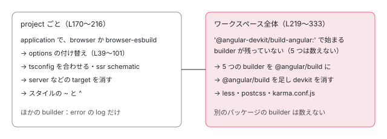

[目次](../README.md) › [@schematics/angular の道具と移行](README.md) › 第 5 回 / 全 11 回

# builder の移行：use-application-builder ほか

> migrations/use-application-builder/\*・trust-proxy-headers・add-istanbul-instrumenter：browser から application builder への options の付け替え、server target と依存の置き換え、スタイルの ~・^ の import の書き換え（css-import-lexer）、ほかの ng update の移行。

angular/angular-cli · 読了 約 13 分 · 発展 · [サイトで読む（デモが動きます）](https://angular-deep-dive-cyan.vercel.app/chapter/sca-build-migrations)

---

この章で分かること：`ng update` で走る `@schematics/angular` の移行のうち、builder にかかわるものの中身です。中心は `use-application-builder` で、webpack の `browser` builder の options を `application` builder の形に付け替え、server の target と tsconfig をまとめ、`@angular-devkit/build-angular` を `@angular/build` に替え、スタイルの `~` と `^` の import を書き換えます。`trust-proxy-headers`・`add-istanbul-instrumenter`・`update-workspace-config` も読みます。手で作った古い形のワークスペースと `ng new` の木に本物の移行を走らせ、差分を記録しました。

読む対象は `packages/schematics/angular/migrations/` の `use-application-builder/`（`migration.ts`・`stylesheet-updates.ts`・`css-import-lexer.ts`）、`trust-proxy-headers/migration.ts`、`add-istanbul-instrumenter/migration.ts` です（../angular-cli、44129f66a3）。`ng update` が `migration-collection.json` から移行を選んで走らせる流れと、`update-workspace-config` の本体は[ng add と ng update の章](../cli/16-cli-add-update.md)の 8〜9 節、移行の置き場の全体は[マイグレーションの全体像の章](../mig/01-mig-overview.md)です。移行のあとに動く `application` builder は[application builder の章](../boot/04-boot-application-build.md)です。

1. [1. 変更の単位とファイルの道具](01-sca-change.md)
2. [2. AST の道具](02-sca-ast-utils.md)
3. [3. 依存を足す](03-sca-dependency.md)
4. [4. standalone のアプリを書き換える](04-sca-standalone.md)
5. **5. builder の移行**（この章）
6. [6. Karma から Vitest へ](06-sca-karma-vitest.md)
7. [7. Jasmine から Vitest へ（1）骨組み](07-sca-jv-overview.md)
8. [8. Jasmine から Vitest へ（2）spy と型](08-sca-jv-spy.md)
9. [9. Jasmine から Vitest へ（3）matcher](09-sca-jv-matcher.md)
10. [10. Jasmine から Vitest へ（4）lifecycle と fakeAsync](10-sca-jv-lifecycle.md)
11. [11. spec と issue](11-sca-tests-issues.md)

> [!TIP]
> **新卒エンジニアへ**
>
> この章の範囲は、44129f66a3 と 22.2.7 の違いがいちばん多いところです。`use-application-builder/migration.ts` に 2 つ（`serviceWorker: true` の付け替え 2aa56cce06、`@angular/build` の版 881865f364）、`trust-proxy-headers/migration.ts` に 1 つ（`ssr.entry` も見る dd18bda9db）の修正が 22.2.7 に入っていて、main にも同じものがあります。引用は 44129f66a3、記録は 22.2.7 と 22.2.0-next.7（44129f66a3 と同じソース）の両方で、値が違った 5 つの記録は DEMO で並べます。

## 1. 入口と、移行の並び

📄 `angular-cli/packages/schematics/angular/migrations/use-application-builder/migration.ts` L345–381 （▶ の行: 345, 347–348, 350, 358–360, 362–364, 368–370, 372–374, 377–378）

```ts
345 ▶ function updateJsonFile(path: string, updater: (json: JSONFile) => void): Rule {
346 │   return (tree, ctx) => {
347 ▶     if (tree.exists(path)) {
348 ▶       updater(new JSONFile(tree, path));
349 │     } else {
350 ▶       ctx.logger.info(`Skipping updating '${path}' as it does not exist.`);
351 │     }
352 │   };
353 │ }
354 │ 
355 │ /**
356 │  * Migration main entrypoint
357 │  */
358 ▶ export default function (): Rule {
359 ▶   return chain([
360 ▶     updateProjects,
361 │     // Delete package.json helper scripts
362 ▶     updateJsonFile('package.json', (pkgJson) =>
363 ▶       ['build:ssr', 'dev:ssr', 'serve:ssr', 'prerender'].forEach((s) =>
364 ▶         pkgJson.remove(['scripts', s]),
365 │       ),
366 │     ),
367 │     // Update main tsconfig
368 ▶     updateJsonFile('tsconfig.json', (rootJson) => {
369 ▶       const module = rootJson.get(['compilerOptions', 'module']);
370 ▶       const hasPreserveModule = typeof module === 'string' && module.toLowerCase() === 'preserve';
371 │ 
372 ▶       if (!hasPreserveModule) {
373 ▶         rootJson.modify(['compilerOptions', 'esModuleInterop'], true);
374 ▶         rootJson.modify(['compilerOptions', 'moduleResolution'], 'bundler');
375 │       }
376 │ 
377 ▶       rootJson.modify(['compilerOptions', 'downlevelIteration'], undefined);
378 ▶       rootJson.modify(['compilerOptions', 'allowSyntheticDefaultImports'], undefined);
379 │     }),
380 │   ]);
381 │ }
```

`migration-collection.json` の 5 つの移行は、どれも `"version": "22.0.0"` です。`use-application-builder` は `"optional": true`・`"recommended": true` で、`ng update` は選ぶかを聞きます（[ng add と ng update の章](../cli/16-cli-add-update.md)の 9 節）。入口は 3 つの Rule の `chain` です。360 行目の `updateProjects`（2〜5 節）、362〜366 行目で package.json の SSR 用の 4 つの script を消し、368〜379 行目で tsconfig.json を直します。`module` が `preserve` でなければ `esModuleInterop: true` と `moduleResolution: 'bundler'`、どちらでも `downlevelIteration` と `allowSyntheticDefaultImports` を消します（377〜378 行目、値に `undefined` で [1 章](01-sca-change.md)の `JSONFile.modify` が消す）。無いファイルは 350 行目の info を出して飛ばします。

## 2. build target の options を付け替える

📄 `angular-cli/packages/schematics/angular/migrations/use-application-builder/migration.ts` L39–64 （▶ の行: 47, 49–51, 55–57, 59, 61–62）

```ts
39 │ function* updateBuildTarget(
40 │   projectName: string,
41 │   buildTarget: TargetDefinition,
42 │   serverTarget: TargetDefinition | undefined,
43 │   tree: Tree,
44 │   context: SchematicContext,
45 │ ): Iterable<Rule> {
46 │   // Update builder target and options
47 ▶   buildTarget.builder = Builders.Application;
48 │ 
49 ▶   for (const [, options] of allTargetOptions(buildTarget, false)) {
50 ▶     if (options['index'] === '') {
51 ▶       options['index'] = false;
52 │     }
53 │ 
54 │     // Rename and transform options
55 ▶     options['browser'] = options['main'];
56 ▶     if (serverTarget && typeof options['browser'] === 'string') {
57 ▶       options['server'] = dirname(options['browser']) + '/main.server.ts';
58 │     }
59 ▶     options['serviceWorker'] = options['ngswConfigPath'] ?? options['serviceWorker'];
60 │ 
61 ▶     if (typeof options['polyfills'] === 'string') {
62 ▶       options['polyfills'] = [options['polyfills']];
63 │     }
64 │ 
```

📄 `angular-cli/packages/schematics/angular/migrations/use-application-builder/migration.ts` L65–101 （▶ の行: 66–67, 69–71, 76, 79–80, 83–88, 95–100）

```ts
 65 │     let outputPath = options['outputPath'];
 66 ▶     if (typeof outputPath === 'string') {
 67 ▶       if (!/\/browser\/?$/.test(outputPath)) {
 68 │         // TODO: add prompt.
 69 ▶         context.logger.warn(
 70 ▶           `The output location of the browser build has been updated from "${outputPath}" to ` +
 71 ▶             `"${join(outputPath, 'browser')}". ` +
 72 │             'You might need to adjust your deployment pipeline or, as an alternative, ' +
 73 │             'set outputPath.browser to "" in order to maintain the previous functionality.',
 74 │         );
 75 │       } else {
 76 ▶         outputPath = outputPath.replace(/\/browser\/?$/, '');
 77 │       }
 78 │ 
 79 ▶       options['outputPath'] = {
 80 ▶         base: outputPath,
 81 │       };
 82 │ 
 83 ▶       if (typeof options['resourcesOutputPath'] === 'string') {
 84 ▶         const media = options['resourcesOutputPath'].replaceAll('/', '');
 85 ▶         if (media && media !== 'media') {
 86 ▶           options['outputPath'] = {
 87 ▶             base: outputPath,
 88 ▶             media,
 89 │           };
 90 │         }
 91 │       }
 92 │     }
 93 │ 
 94 │     // Delete removed options
 95 ▶     delete options['vendorChunk'];
 96 ▶     delete options['commonChunk'];
 97 ▶     delete options['resourcesOutputPath'];
 98 ▶     delete options['buildOptimizer'];
 99 ▶     delete options['main'];
100 ▶     delete options['ngswConfigPath'];
101 │   }
```

49 行目の [1 章](01-sca-change.md)の `allTargetOptions` で、base の options と全部の configuration を同じ規則で書き換えます。記録の入力（DEMO の「1」の最初の記録）での付け替えはこうでした。

| browser builder の option | 行 | application builder では |
| --- | --- | --- |
| `builder` | 47 | `@angular-devkit/build-angular:application`（5 節で `@angular/build:application` に） |
| `main: 'src/main.ts'` | 55・99 | `browser: 'src/main.ts'`（object の最後に足される） |
| `index: ''`（production） | 50〜52 | `index: false` |
| `polyfills: 'zone.js'` | 61〜63 | `['zone.js']` |
| `outputPath: 'dist/app'` | 67〜81 | `{ base: 'dist/app' }` と warn「The output location of the browser build has been updated from "dist/app" to "dist/app/browser". …」 |
| `outputPath: 'dist/app/browser'` | 76 | `{ base: 'dist/app' }`（warn なし） |
| `resourcesOutputPath: 'media-files/'` | 83〜90 | `outputPath.media: 'media-files'`（`/` を全部取る。`media` なら何もしない） |
| `serviceWorker: true` と `ngswConfigPath: 'ngsw-config.json'` | 59 | `serviceWorker: 'ngsw-config.json'` |
| `ngswConfigPath: 'ngsw-prod.json'`（production だけ） | 59 | `serviceWorker: 'ngsw-prod.json'` |
| `vendorChunk`・`commonChunk`・`buildOptimizer` | 95〜98 | 消える（configuration の中のものも） |

59 行目は `ngswConfigPath ?? serviceWorker` なので、`serviceWorker: true` だけ（`ngswConfigPath` を書かず、browser builder が `<projectRoot>/ngsw-config.json` を既定にしていた形）は `true` のまま残ります。記録の 22.2.0-next.7 はそうでした。`application` builder の schema の `serviceWorker` は「文字列か `false`」なので、移行のあとの最初の `ng build` が schema の検査で止まります。22.2.7（2aa56cce06）は `true` なら `ngswConfigPath` か base の `ngswConfigPath` か `join(projectRoot, 'ngsw-config.json')` を入れ、記録でも `"serviceWorker": "ngsw-config.json"` になりました。68 行目の TODO「add prompt」のとおり、`outputPath` の行き先が変わることは聞かずに warn だけです。

### 3. server target と tsconfig をまとめる

📄 `angular-cli/packages/schematics/angular/migrations/use-application-builder/migration.ts` L103–135 （▶ の行: 104–106, 108, 115, 122–123, 127–129, 133, 135）

```ts
103 │   // Merge browser and server tsconfig
104 ▶   if (serverTarget) {
105 ▶     const browserTsConfig = buildTarget.options?.tsConfig;
106 ▶     const serverTsConfig = serverTarget.options?.tsConfig;
107 │ 
108 ▶     if (typeof browserTsConfig !== 'string') {
109 │       throw new SchematicsException(
110 │         `Cannot update project "${projectName}" to use the application builder` +
111 │           ` as the browser tsconfig cannot be located.`,
112 │       );
113 │     }
114 │ 
115 ▶     if (typeof serverTsConfig !== 'string') {
116 │       throw new SchematicsException(
117 │         `Cannot update project "${projectName}" to use the application builder` +
118 │           ` as the server tsconfig cannot be located.`,
119 │       );
120 │     }
121 │ 
122 ▶     const browserJson = new JSONFile(tree, browserTsConfig);
123 ▶     const serverJson = new JSONFile(tree, serverTsConfig);
124 │ 
125 │     const filesPath = ['files'];
126 │ 
127 ▶     const files = new Set([
128 ▶       ...((browserJson.get(filesPath) as string[] | undefined) ?? []),
129 ▶       ...((serverJson.get(filesPath) as string[] | undefined) ?? []),
130 │     ]);
131 │ 
132 │     // Server file will be added later by the means of the ssr schematic.
133 ▶     files.delete('server.ts');
134 │ 
135 ▶     browserJson.modify(filesPath, Array.from(files));
```

📄 `angular-cli/packages/schematics/angular/migrations/use-application-builder/migration.ts` L136–164 （▶ の行: 137–138, 141–143, 149, 153, 156–157, 160–161）

```ts
136 │ 
137 ▶     const typesPath = ['compilerOptions', 'types'];
138 ▶     browserJson.modify(
139 │       typesPath,
140 │       Array.from(
141 ▶         new Set([
142 ▶           ...((browserJson.get(typesPath) as string[] | undefined) ?? []),
143 ▶           ...((serverJson.get(typesPath) as string[] | undefined) ?? []),
144 │         ]),
145 │       ),
146 │     );
147 │ 
148 │     // Delete server tsconfig
149 ▶     yield deleteFile(serverTsConfig);
150 │   }
151 │ 
152 │   // Update server file
153 ▶   const ssrMainFile = serverTarget?.options?.['main'];
154 │   if (typeof ssrMainFile === 'string') {
155 │     // Do not delete the server main file if it's the same as the browser file.
156 ▶     if (buildTarget.options?.browser !== ssrMainFile) {
157 ▶       yield deleteFile(ssrMainFile);
158 │     }
159 │ 
160 ▶     yield externalSchematic('@schematics/angular', 'ssr', {
161 ▶       project: projectName,
162 │     });
163 │   }
164 │ }
```

1. **56〜58 行目（2 節）：server の入口**

   server target があれば、`browser` と同じフォルダの `main.server.ts` を `server` に入れます。
2. **127〜135 行目：files を合わせる**

   browser と server の tsconfig の `files` を Set で合わせ、133 行目で `server.ts` だけ消します（132 行目のコメント「ssr schematic があとで足す」）。
3. **137〜146 行目：types を合わせる**

   記録では `[]` と `['node']` で `['node']`。
4. **149 行目：server の tsconfig を消す**
5. **153〜158 行目：server の main を消す**

   browser の入口と同じファイルでなければ消します。
6. **160〜162 行目：ssr schematic を外から呼ぶ**

   `externalSchematic('@schematics/angular', 'ssr', { project })`。

記録の「server target あり」（server の `main: 'server.ts'`）では、`/server.ts` と `/tsconfig.server.json` が消え、ssr schematic が `/src/server.ts` を新しく作り、build の options に `server: 'src/main.server.ts'`・`outputMode: 'server'`・`ssr.entry`・`security.allowedHosts` が足され、server・serve-ssr・prerender の target が消えました（5 節）。古い `server.ts` に書いていた express の処理は、新しい `src/server.ts`（ssr schematic の雛形）には移りません。消す前に知らせる log は出ませんでした（DEMO の記録に log の行が無い）。tsconfig.app.json の 1 行の `"types": []` は、`JSONFile` の字下げ（[1 章](01-sca-change.md)の 4 節）で `{ "types": [`・`"node"`・`] }` の 3 行に開きました。

## 4. どの project を移すか、要らない target

📄 `angular-cli/packages/schematics/angular/migrations/use-application-builder/migration.ts` L166–199 （▶ の行: 171, 176–180, 185–187, 189–191, 194, 197, 199）

```ts
166 │ function updateProjects(tree: Tree, context: SchematicContext) {
167 │   return updateWorkspace((workspace) => {
168 │     const rules: Rule[] = [];
169 │ 
170 │     for (const [name, project] of workspace.projects) {
171 ▶       if (project.extensions.projectType !== ProjectType.Application) {
172 │         // Only interested in application projects since these changes only effects application builders
173 │         continue;
174 │       }
175 │ 
176 ▶       const buildTarget = project.targets.get('build');
177 ▶       if (
178 ▶         !buildTarget ||
179 ▶         buildTarget.builder === Builders.Application ||
180 ▶         buildTarget.builder === Builders.BuildApplication
181 │       ) {
182 │         continue;
183 │       }
184 │ 
185 ▶       if (
186 ▶         buildTarget.builder !== Builders.BrowserEsbuild &&
187 ▶         buildTarget.builder !== Builders.Browser
188 │       ) {
189 ▶         context.logger.error(
190 ▶           `Cannot update project "${name}" to use the application builder.` +
191 ▶             ` Only "${Builders.BrowserEsbuild}" and "${Builders.Browser}" can be automatically migrated.`,
192 │         );
193 │ 
194 ▶         continue;
195 │       }
196 │ 
197 ▶       const serverTarget = project.targets.get('server');
198 │ 
199 ▶       rules.push(...updateBuildTarget(name, buildTarget, serverTarget, tree, context));
```

📄 `angular-cli/packages/schematics/angular/migrations/use-application-builder/migration.ts` L200–236 （▶ の行: 202–208, 214–215, 219–220, 222–226, 229, 232–233）

```ts
200 │ 
201 │       // Delete all redundant targets
202 ▶       for (const [key, target] of project.targets) {
203 ▶         switch (target.builder) {
204 ▶           case Builders.Server:
205 ▶           case Builders.Prerender:
206 ▶           case Builders.AppShell:
207 ▶           case Builders.SsrDevServer:
208 ▶             project.targets.delete(key);
209 │             break;
210 │         }
211 │       }
212 │ 
213 │       // Update CSS/Sass import specifiers
214 ▶       const projectSourceRoot = join(project.root, project.sourceRoot ?? 'src');
215 ▶       updateStyleImports(tree, projectSourceRoot, buildTarget);
216 │     }
217 │ 
218 │     // Check for @angular-devkit/build-angular Webpack usage
219 ▶     let hasAngularDevkitUsage = false;
220 ▶     for (const [, target] of allWorkspaceTargets(workspace)) {
221 │       switch (target.builder) {
222 ▶         case Builders.Application:
223 ▶         case Builders.DevServer:
224 ▶         case Builders.ExtractI18n:
225 ▶         case Builders.Karma:
226 ▶         case Builders.NgPackagr:
227 │           // Ignore application, dev server, and i18n extraction for devkit usage check.
228 │           // Both will be replaced if no other usage is found.
229 ▶           continue;
230 │       }
231 │ 
232 ▶       if (target.builder.startsWith('@angular-devkit/build-angular:')) {
233 ▶         hasAngularDevkitUsage = true;
234 │         break;
235 │       }
236 │     }
```

1. **171 行目：application の project だけ**

   library は 2 節・3 節の付け替えをしません（5 節の builder の名前は替える）。
2. **177〜183 行目：もう application builder なら飛ばす**
3. **185〜195 行目：browser と browser-esbuild だけ**

   ほかは error の log を出して次の project へ。例外にはしません。
4. **202〜211 行目：server・prerender・app-shell・ssr-dev-server の target を消す**
5. **214〜215 行目：スタイルの import を直す**

   6 節。
6. **219〜236 行目：webpack の builder がまだ残っているか**

   全部の target を見て、`@angular-devkit/build-angular:` で始まる builder があれば `hasAngularDevkitUsage`。ただし 222〜226 行目の 5 つ（application・dev-server・extract-i18n・karma・ng-packagr）は、5 節で置き換えるので数えません。

記録の「移せない builder」は、build だけを `@angular-builders/custom-webpack:browser`（別のパッケージの webpack の builder）にしたものです。189〜192 行目の「Cannot update project "app" to use the application builder. Only … can be automatically migrated.」が出て build はそのまま、ところが 232 行目は `@angular-devkit/build-angular:` で始まる名前しか見ないので `hasAngularDevkitUsage` は `false` のままで、5 節に進みました。結果は、**serve が `@angular/build:dev-server`、test が `@angular/build:karma` に替わり、package.json から `@angular-devkit/build-angular` が消えました**（22.2.7 と 22.2.0-next.7 で同じ）。`@angular/build:dev-server` は、build target の options を application builder の options として読みます（packages/angular/build/src/builders/dev-server/vite/index.ts L90〜93 の `validateOptions(rawBrowserOptions, builderName)` の結果を `ApplicationBuilderInternalOptions` として使う）。webpack の builder の build target はその形ではありません。

## 5. @angular/build に替える：builder の名前・依存・karma.conf.js

📄 `angular-cli/packages/schematics/angular/migrations/use-application-builder/migration.ts` L238–270 （▶ の行: 239, 242–245, 247–248, 253–255, 257, 260–262, 266–267）

```ts
238 │     // Use @angular/build directly if there is no devkit package usage
239 ▶     if (!hasAngularDevkitUsage) {
240 │       const karmaConfigFiles = new Set<string>();
241 │ 
242 ▶       for (const [, target] of allWorkspaceTargets(workspace)) {
243 ▶         switch (target.builder) {
244 ▶           case Builders.Application:
245 ▶             target.builder = '@angular/build:application';
246 │             break;
247 ▶           case Builders.DevServer:
248 ▶             target.builder = '@angular/build:dev-server';
249 │             break;
250 │           case Builders.ExtractI18n:
251 │             target.builder = '@angular/build:extract-i18n';
252 │             break;
253 ▶           case Builders.Karma:
254 ▶             target.builder = '@angular/build:karma';
255 ▶             for (const [, karmaOptions] of allTargetOptions(target)) {
256 │               // Remove "builderMode" option since the builder will always use "application"
257 ▶               delete karmaOptions['builderMode'];
258 │ 
259 │               // Collect custom karma configurations for @angular-devkit/build-angular plugin removal
260 ▶               const karmaConfig = karmaOptions['karmaConfig'];
261 ▶               if (karmaConfig && typeof karmaConfig === 'string') {
262 ▶                 karmaConfigFiles.add(karmaConfig);
263 │               }
264 │             }
265 │             break;
266 ▶           case Builders.NgPackagr:
267 ▶             target.builder = '@angular/build:ng-packagr';
268 │             break;
269 │         }
270 │       }
```

📄 `angular-cli/packages/schematics/angular/migrations/use-application-builder/migration.ts` L272–305 （▶ の行: 273–276, 278, 285–287, 289, 297–299, 301）

```ts
272 │       // Add direct @angular/build dependencies and remove @angular-devkit/build-angular
273 ▶       rules.push(
274 ▶         addDependency('@angular/build', latestVersions.DevkitBuildAngular, {
275 ▶           type: DependencyType.Dev,
276 ▶           existing: ExistingBehavior.Replace,
277 │         }),
278 ▶         removeDependency('@angular-devkit/build-angular'),
279 │       );
280 │ 
281 │       // Add less dependency if any projects contain a Less stylesheet file.
282 │       // This check does not consider Node.js packages due to the performance
283 │       // cost of searching such a large directory structure. A build time error
284 │       // will provide instructions to install the package in this case.
285 ▶       if (hasLessStylesheets(tree)) {
286 ▶         rules.push(
287 ▶           addDependency('less', latestVersions['less'], {
288 │             type: DependencyType.Dev,
289 ▶             existing: ExistingBehavior.Skip,
290 │           }),
291 │         );
292 │       }
293 │ 
294 │       // Add postcss dependency if any projects have a custom postcss configuration file.
295 │       // The build system only supports files in a project root or workspace root with
296 │       // names of either 'postcss.config.json' or '.postcssrc.json'.
297 ▶       if (hasPostcssConfiguration(tree, workspace)) {
298 ▶         rules.push(
299 ▶           addDependency('postcss', latestVersions['postcss'], {
300 │             type: DependencyType.Dev,
301 ▶             existing: ExistingBehavior.Replace,
302 │           }),
303 │         );
304 │       }
305 │ 
```

5 つの builder の名前を `@angular/build:…` に替え、karma の options からは 257 行目で `builderMode` を消し、260〜263 行目で `karmaConfig` のファイルを集めます。依存は 274 行目で `@angular/build` を `latestVersions.DevkitBuildAngular`（移行を走らせている CLI の版）・`Replace` で足し、278 行目で `@angular-devkit/build-angular` を消します（[3 章](03-sca-dependency.md)の `addDependency`・`removeDependency`）。記録の package.json（`@angular-devkit/build-angular: ^17.3.8`）は、22.2.0-next.7 では `"@angular/build": "^22.2.0-next.7"`、22.2.7 では `"^17.3.8"` でした。22.2.7 は 881865f364（#30696）で、`getDependency` で今の `@angular-devkit/build-angular` の指定を引き継ぎ、`existing` を `Skip` にしています。古い CLI のワークスペースで `ng update --name use-application-builder` をすると、最新の major が入ってしまうのを直したものです。285〜304 行目、木のどこかに `.less` があれば `less`（`Skip`）、workspace か project の root に `postcss.config.json` か `.postcssrc.json` があれば `postcss`（`Replace`）を足します。記録の入力には両方あったので、2 つとも足されました。

📄 `angular-cli/packages/schematics/angular/migrations/use-application-builder/migration.ts` L306–337 （▶ の行: 307, 313–315, 317–319, 322, 326–327, 329）

```ts
306 │       for (const karmaConfigFile of karmaConfigFiles) {
307 ▶         if (!tree.exists(karmaConfigFile)) {
308 │           continue;
309 │         }
310 │ 
311 │         try {
312 │           const originalKarmaConfigText = tree.readText(karmaConfigFile);
313 ▶           const updatedKarmaConfigText = originalKarmaConfigText
314 ▶             .replaceAll(`require('@angular-devkit/build-angular/plugins/karma'),`, '')
315 ▶             .replaceAll(`require('@angular-devkit/build-angular/plugins/karma')`, '');
316 │ 
317 ▶           if (updatedKarmaConfigText.includes('@angular-devkit/build-angular/plugins')) {
318 ▶             throw new Error(
319 ▶               'Migration does not support found usage of "@angular-devkit/build-angular".',
320 │             );
321 │           } else {
322 ▶             tree.overwrite(karmaConfigFile, updatedKarmaConfigText);
323 │           }
324 │         } catch (error) {
325 │           const reason = error instanceof Error ? `Reason: ${error.message}` : '';
326 ▶           context.logger.warn(
327 ▶             `Unable to update custom karma configuration file ("${karmaConfigFile}"). ` +
328 │               reason +
329 ▶               '\nReferences to the "@angular-devkit/build-angular" package within the file may need to be removed manually.',
330 │           );
331 │         }
332 │       }
333 │     }
334 │ 
335 │     return chain(rules);
336 │   });
337 │ }
```

karma.conf.js は文字列の置き換えです。314〜315 行目で `require('@angular-devkit/build-angular/plugins/karma')` を（カンマつきと無しの 2 通り）空にし、まだ `@angular-devkit/build-angular/plugins` が残っていれば 318 行目の例外を 324〜331 行目で warn にします。記録では plugin の行が字下げだけの空の行として残り、`frameworks: ['jasmine', '@angular-devkit/build-angular']` はそのまま残りました。`/plugins` を含まないので 317 行目にも当たりません。`@angular/build:karma` の側がこの framework を外して「Ignoring framework "@angular-devkit/build-angular" from karma config file because it's not compatible with the application builder.」と warn する（packages/angular/build/src/builders/karma/application\_builder.ts L380〜385）ので、テストは走ります。

## 6. スタイルの import：stylesheet-updates.ts

webpack の時代の Sass と CSS は、`@import '~bootstrap/…'` の `~` で「node\_modules から」、`^` で「解決しないで残す」を表していました。application builder はどちらも使わないので、移行が書き換えます。

📄 `angular-cli/packages/schematics/angular/migrations/use-application-builder/stylesheet-updates.ts` L181–212 （▶ の行: 189–190, 196–197, 200–201, 204–205, 207–208, 210）

```ts
181 │ export function updateStyleImports(
182 │   tree: Tree,
183 │   projectSourceRoot: string,
184 │   buildTarget: TargetDefinition,
185 │ ): void {
186 │   const allExternalDeps = new Set<string>();
187 │   let projectNeedsIncludePath = false;
188 │ 
189 ▶   for (const [path, content] of visitStylesheets(tree.getDir(projectSourceRoot))) {
190 ▶     const { needsWorkspaceIncludePath, externalDependencies, contentChanges } = analyzeStylesheet(
191 │       path,
192 │       content,
193 │       tree,
194 │     );
195 │ 
196 ▶     if (needsWorkspaceIncludePath) {
197 ▶       projectNeedsIncludePath = true;
198 │     }
199 │ 
200 ▶     for (const dep of externalDependencies) {
201 ▶       allExternalDeps.add(dep);
202 │     }
203 │ 
204 ▶     if (contentChanges.length > 0) {
205 ▶       const updater = tree.beginUpdate(path);
206 │       // Apply changes in reverse to avoid index shifting
207 ▶       for (const change of contentChanges.sort((a, b) => b.start - a.start)) {
208 ▶         updater.remove(change.start, change.length);
209 │       }
210 ▶       tree.commitUpdate(updater);
211 │     }
212 │   }
```

📄 `angular-cli/packages/schematics/angular/migrations/use-application-builder/stylesheet-updates.ts` L213–231 （▶ の行: 214–219, 223–225, 227–228）

```ts
213 │ 
214 ▶   if (projectNeedsIncludePath) {
215 ▶     buildTarget.options ??= {};
216 ▶     const styleOptions = (buildTarget.options['stylePreprocessorOptions'] ??= {});
217 ▶     const includePaths = ((styleOptions as { includePaths?: string[] })['includePaths'] ??= []);
218 ▶     if (Array.isArray(includePaths)) {
219 ▶       includePaths.push('.');
220 │     }
221 │   }
222 │ 
223 ▶   if (allExternalDeps.size > 0) {
224 ▶     buildTarget.options ??= {};
225 ▶     const externalDeps = ((buildTarget.options['externalDependencies'] as string[] | undefined) ??=
226 │       []);
227 ▶     if (Array.isArray(externalDeps)) {
228 ▶       externalDeps.push(...allExternalDeps);
229 │     }
230 │   }
231 │ }
```

📄 `angular-cli/packages/schematics/angular/migrations/use-application-builder/stylesheet-updates.ts` L94–111 （▶ の行: 95–97, 99, 104–105, 109）

```ts
 94 │ function* visitStylesheets(directory: DirEntry): IterableIterator<[path: string, content: string]> {
 95 ▶   for (const path of directory.subfiles) {
 96 ▶     if (path.endsWith('.css') || path.endsWith('.scss') || path.endsWith('.sass')) {
 97 ▶       const entry = directory.file(path);
 98 │       if (entry) {
 99 ▶         yield [entry.path, entry.content.toString()];
100 │       }
101 │     }
102 │   }
103 │ 
104 ▶   for (const path of directory.subdirs) {
105 ▶     if (path === 'node_modules' || path.startsWith('.')) {
106 │       continue;
107 │     }
108 │ 
109 ▶     yield* visitStylesheets(directory.dir(path));
110 │   }
111 │ }
```

📄 `angular-cli/packages/schematics/angular/migrations/use-application-builder/stylesheet-updates.ts` L150–170 （▶ の行: 151, 158–165）

```ts
150 │ function analyzeStylesheet(filePath: string, content: string, tree: Tree): StylesheetAnalysis {
151 ▶   const isSass = filePath.endsWith('.scss') || filePath.endsWith('.sass');
152 │   const analysis: StylesheetAnalysis = {
153 │     needsWorkspaceIncludePath: false,
154 │     externalDependencies: new Set<string>(),
155 │     contentChanges: [],
156 │   };
157 │ 
158 ▶   for (const { start, specifier, fromUse } of findImports(content, isSass)) {
159 ▶     if (specifier.startsWith('~')) {
160 ▶       analysis.contentChanges.push({ start: start + 1, length: 1 });
161 ▶     } else if (specifier.startsWith('^')) {
162 ▶       analysis.contentChanges.push({ start: start + 1, length: 1 });
163 ▶       analysis.externalDependencies.add(specifier.slice(1));
164 ▶     } else if (isSass && isWorkspaceRelativeSassImport(specifier, filePath, tree, !fromUse)) {
165 ▶       analysis.needsWorkspaceIncludePath = true;
166 │     }
167 │   }
168 │ 
169 │   return analysis;
170 │ }
```

1. **189 行目：project の sourceRoot の下だけ**

   94〜111 行目で `.css`・`.scss`・`.sass` を、`node_modules` と `.` で始まるフォルダを飛ばして歩きます。記録の `/other/outside.scss`（`sourceRoot` の外）と `/src/legacy.less`（`.less`）の `~` は残りました。
2. **158〜160 行目：~ は 1 文字消す**

   `start` は引用符の位置なので、`start + 1` が `~` です。
3. **161〜163 行目：^ は消して externalDependencies に**

   記録の `@import '^external/theme'` は `'external/theme'` になり、build の options に `externalDependencies: ['external/theme']` が足されました。
4. **164〜165 行目：Sass で、workspace の root からのパス**

   次の `isWorkspaceRelativeSassImport` が `true` なら、214〜221 行目で `stylePreprocessorOptions.includePaths` に `'.'` を足します。
5. **207〜209 行目：後ろから消す**

   206 行目のコメントは「位置がずれないように」ですが、recorder の位置はいつも元の中身で数えるので（[1 章](01-sca-change.md)の 2 節）、順はどちらでも同じ結果です。

📄 `angular-cli/packages/schematics/angular/migrations/use-application-builder/stylesheet-updates.ts` L124–140 （▶ の行: 130–131, 133–134, 136, 139）

```ts
124 │ function isWorkspaceRelativeSassImport(
125 │   specifier: string,
126 │   filePath: string,
127 │   tree: Tree,
128 │   fromImport: boolean,
129 │ ): boolean {
130 ▶   const relativeBase = dirname(filePath);
131 ▶   const potentialWorkspacePaths = [...potentialSassImports(specifier, '/', fromImport)];
132 │ 
133 ▶   if (potentialWorkspacePaths.some((p) => tree.exists(p))) {
134 ▶     const potentialRelativePaths = [...potentialSassImports(specifier, relativeBase, fromImport)];
135 │ 
136 ▶     return potentialRelativePaths.every((p) => !tree.exists(p));
137 │   }
138 │ 
139 ▶   return false;
140 │ }
```

📄 `angular-cli/packages/schematics/angular/migrations/use-application-builder/stylesheet-updates.ts` L242–258 （▶ の行: 248–251, 254–256）

```ts
242 │ function* yieldSassImportCandidates(
243 │   directory: string,
244 │   filename: string,
245 │   extensions: readonly string[],
246 │   fromImport: boolean,
247 │ ): Iterable<string> {
248 ▶   if (fromImport) {
249 ▶     for (const ext of extensions) {
250 ▶       yield join(directory, filename + '.import' + ext);
251 ▶       yield join(directory, SASS_PARTIAL_PREFIX + filename + '.import' + ext);
252 │     }
253 │   }
254 ▶   for (const ext of extensions) {
255 ▶     yield join(directory, filename + ext);
256 ▶     yield join(directory, SASS_PARTIAL_PREFIX + filename + ext);
257 │   }
258 │ }
```

📄 `angular-cli/packages/schematics/angular/migrations/use-application-builder/stylesheet-updates.ts` L270–282 （▶ の行: 275–278, 280–281）

```ts
270 │ function* potentialSassImports(
271 │   specifier: string,
272 │   base: string,
273 │   fromImport: boolean,
274 │ ): Iterable<string> {
275 ▶   const directory = join(base, dirname(specifier));
276 ▶   const extension = extname(specifier);
277 ▶   const hasStyleExtension = SASS_EXTENSIONS.includes(extension);
278 ▶   const filename = basename(specifier, hasStyleExtension ? extension : undefined);
279 │ 
280 ▶   const extensionsToTry = hasStyleExtension ? [extension] : SASS_EXTENSIONS;
281 ▶   yield* yieldSassImportCandidates(directory, filename, extensionsToTry, fromImport);
282 │ }
```

「workspace の root から」とは、root（`/`）から探すと Sass が読むファイルがあり、そのファイルのフォルダから探すと 1 つも無いことです（133〜136 行目）。候補は dart-sass の探し方をまねて、`@import` なら `名前.import.拡張子` と `_名前.import.拡張子`、続けて `名前.拡張子` と `_名前.拡張子`、拡張子は `.scss`・`.sass`・`.css` の順です。記録の `@import 'src/app/theme'`（`/src/app/_theme.scss` がある）は includePaths に `'.'`、`@import 'local'`（同じフォルダに `_local.scss`）は何も足しませんでした。218〜220 行目は、すでに `'.'` があっても、もう 1 つ足します。

📄 `angular-cli/packages/schematics/angular/migrations/use-application-builder/stylesheet-updates.ts` L43–63 （▶ の行: 44, 47–49, 54–55, 58）

```ts
43 │ export function hasLessStylesheets(tree: Tree): boolean {
44 ▶   const directories = [tree.getDir('/')];
45 │ 
46 │   let current;
47 ▶   while ((current = directories.pop())) {
48 ▶     for (const path of current.subfiles) {
49 ▶       if (path.endsWith('.less')) {
50 │         return true;
51 │       }
52 │     }
53 │ 
54 ▶     for (const path of current.subdirs) {
55 ▶       if (path === 'node_modules' || path.startsWith('.')) {
56 │         continue;
57 │       }
58 ▶       directories.push(current.dir(path));
59 │     }
60 │   }
61 │ 
62 │   return false;
63 │ }
```

📄 `angular-cli/packages/schematics/angular/migrations/use-application-builder/stylesheet-updates.ts` L73–87 （▶ の行: 74–75, 77, 79–80）

```ts
73 │ export function hasPostcssConfiguration(tree: Tree, workspace: WorkspaceDefinition): boolean {
74 ▶   const projectRoots = [...workspace.projects.values()].map((p) => p.root).filter(Boolean);
75 ▶   const searchDirectories = new Set(['', ...projectRoots]);
76 │ 
77 ▶   for (const dir of searchDirectories) {
78 │     if (
79 ▶       tree.exists(join(dir, 'postcss.config.json')) ||
80 ▶       tree.exists(join(dir, '.postcssrc.json'))
81 │     ) {
82 │       return true;
83 │     }
84 │   }
85 │ 
86 │   return false;
87 │ }
```

### 7. css-import-lexer：何を「import」と見なすか

📄 `angular-cli/packages/schematics/angular/migrations/use-application-builder/css-import-lexer.ts` L34–66 （▶ の行: 34–36, 38–41, 57, 60–63）

```ts
34 ▶ export function* findImports(
35 ▶   contents: string,
36 ▶   sass: boolean,
37 │ ): Iterable<{ start: number; end: number; specifier: string; fromUse?: boolean }> {
38 ▶   yield* find(contents, '@import ');
39 ▶   if (sass) {
40 ▶     for (const result of find(contents, '@use ')) {
41 ▶       yield { ...result, fromUse: true };
42 │     }
43 │   }
44 │ }
45 │ 
46 │ /**
47 │  * Scans a CSS or Sass file and locates all valid function/directive values as defined by the
48 │  * syntax specification.
49 │  * @param contents A string containing a CSS or Sass file to scan.
50 │  * @param prefix The prefix to start a valid segment.
51 │  * @returns An iterable that yields each CSS url function value found.
52 │  */
53 │ function* find(
54 │   contents: string,
55 │   prefix: string,
56 │ ): Iterable<{ start: number; end: number; specifier: string }> {
57 ▶   let pos = 0;
58 │   let width = 1;
59 │   let current = -1;
60 ▶   const next = () => {
61 ▶     pos += width;
62 ▶     current = contents.codePointAt(pos) ?? -1;
63 ▶     width = current > 0xffff ? 2 : 1;
64 │ 
65 │     return current;
66 │   };
```

📄 `angular-cli/packages/schematics/angular/migrations/use-application-builder/css-import-lexer.ts` L68–96 （▶ の行: 69, 71, 75, 80, 84–85, 89–91, 95）

```ts
68 │   // Based on https://www.w3.org/TR/css-syntax-3/#consume-ident-like-token
69 ▶   while ((pos = contents.indexOf(prefix, pos)) !== -1) {
70 │     // Set to position of the last character in prefix
71 ▶     pos += prefix.length - 1;
72 │     width = 1;
73 │ 
74 │     // Consume all leading whitespace
75 ▶     while (isWhitespace(next())) {
76 │       /* empty */
77 │     }
78 │ 
79 │     // Initialize URL state
80 ▶     const url = { start: pos, end: -1, specifier: '' };
81 │     let complete = false;
82 │ 
83 │     // If " or ', then consume the value as a string
84 ▶     if (current === 0x0022 || current === 0x0027) {
85 ▶       const ending = current;
86 │       // Based on https://www.w3.org/TR/css-syntax-3/#consume-string-token
87 │       while (!complete) {
88 │         switch (next()) {
89 ▶           case -1: // EOF
90 ▶             return;
91 ▶           case 0x000a: // line feed
92 │           case 0x000c: // form feed
93 │           case 0x000d: // carriage return
94 │             // Invalid
95 ▶             complete = true;
96 │             break;
```

📄 `angular-cli/packages/schematics/angular/migrations/use-application-builder/css-import-lexer.ts` L97–129 （▶ の行: 97, 99, 107–109, 113, 115, 117, 120, 125–126）

```ts
 97 ▶           case 0x005c: // \ -- character escape
 98 │             // If not EOF or newline, add the character after the escape
 99 ▶             switch (next()) {
100 │               case -1:
101 │                 return;
102 │               case 0x000a: // line feed
103 │               case 0x000c: // form feed
104 │               case 0x000d: // carriage return
105 │                 // Skip when inside a string
106 │                 break;
107 ▶               default:
108 ▶                 // TODO: Handle hex escape codes
109 ▶                 url.specifier += String.fromCodePoint(current);
110 │                 break;
111 │             }
112 │             break;
113 ▶           case ending:
114 │             // Full string position should include the quotes for replacement
115 ▶             url.end = pos + 1;
116 │             complete = true;
117 ▶             yield url;
118 │             break;
119 │           default:
120 ▶             url.specifier += String.fromCodePoint(current);
121 │             break;
122 │         }
123 │       }
124 │ 
125 ▶       next();
126 ▶       continue;
127 │     }
128 │   }
129 │ }
```

CSS の文法を全部読むのではなく、69 行目で `'@import '`（空白 1 つまで含む文字列）を `indexOf` で探し、空白を飛ばし（75 行目）、引用符で始まる文字列だけを読みます（84 行目）。文字列でなければ何も出さずに、次の `indexOf` へ進みます。記録の `findImports` の表です。

| 書き方 | 拾うか | 理由（行） |
| --- | --- | --- |
| `@import '~a';`・`@import "~b";` | 拾う | 84 行目 |
| `@use '~c' as c;` | Sass のときだけ拾う（`fromUse`） | 39〜43 行目 |
| `@import '~d', '~e';` | `~d` だけ | 125〜126 行目で 1 つめの文字列のあと次の `@import` を探す |
| `@import"~f";`・`@import(タブ)'~g';`・`@import(改行)'~h';` | 拾わない | 69 行目の `'@import '` は空白 1 つで決め打ち |
| `@import url(~i.css);`・`url("~j.css")` | 拾わない | 84 行目が引用符で始まるものだけ |
| `/* @import '~k'; */`・`// @import '~l';` | **拾う** | コメントを飛ばさない（記録の app.css のコメントの中の `~` も消えた） |
| `@forward '~m';` | 拾わない | 探すのは `@import` と `@use` だけ |
| `@import 'n\'q';` | `n'q` | 97〜112 行目のエスケープ（16 進のエスケープは 108 行目の TODO） |
| `@import 'o(改行)X';` | 拾わない | 91〜96 行目、文字列の中の改行は不正 |
| `@IMPORT '~p';` | 拾わない | `indexOf` は大文字と小文字を分ける |

拾わない書き方の `~` は移行のあとも残り、application builder でそのファイルを解決できなければ build のエラーになります。拾ったコメントの中は、消えても build には影響しません。

## 8. ほかの移行：trust-proxy-headers・add-istanbul-instrumenter・update-workspace-config

📄 `angular-cli/packages/schematics/angular/migrations/trust-proxy-headers/migration.ts` L17–55 （▶ の行: 20, 22–23, 27–29, 34–35, 40, 44, 48, 52）

```ts
17 │ export default function (): Rule {
18 │   return async (tree) => {
19 │     const workspace = await getWorkspace(tree);
20 ▶     const serverFiles = new Set<string>();
21 │ 
22 ▶     for (const [targetName, target] of allWorkspaceTargets(workspace)) {
23 ▶       if (targetName !== 'build') {
24 │         continue;
25 │       }
26 │ 
27 ▶       for (const [, options] of allTargetOptions(target)) {
28 ▶         if (typeof options?.['server'] === 'string') {
29 ▶           serverFiles.add(options['server']);
30 │         }
31 │       }
32 │     }
33 │ 
34 ▶     for (const path of serverFiles) {
35 ▶       if (!tree.exists(path)) {
36 │         continue;
37 │       }
38 │ 
39 │       const content = tree.readText(path);
40 ▶       if (content.includes(TODO_COMMENT)) {
41 │         continue;
42 │       }
43 │ 
44 ▶       if (!content.includes('AngularAppEngine') && !content.includes('AngularNodeAppEngine')) {
45 │         continue;
46 │       }
47 │ 
48 ▶       const parseResult = parseSync(path, content, {
49 │         sourceType: 'module',
50 │       });
51 │ 
52 ▶       if (parseResult.errors.length > 0) {
53 │         continue;
54 │       }
55 │ 
```

📄 `angular-cli/packages/schematics/angular/migrations/trust-proxy-headers/migration.ts` L56–76 （▶ の行: 59–62, 65, 67–69, 72–73）

```ts
56 │       const recorder = tree.beginUpdate(path);
57 │ 
58 │       const visitor = new Visitor({
59 ▶         NewExpression(node) {
60 ▶           if (
61 ▶             node.callee.type === 'Identifier' &&
62 ▶             (node.callee.name === 'AngularNodeAppEngine' || node.callee.name === 'AngularAppEngine')
63 │           ) {
64 │             // Check arguments
65 ▶             if (!node.arguments || node.arguments.length === 0) {
66 │               // Case 1: No arguments passed
67 ▶               const hasParens = content[node.end - 1] === ')';
68 ▶               const insertPos = hasParens ? node.end - 1 : node.end;
69 ▶               recorder.insertRight(
70 │                 insertPos,
71 │                 hasParens
72 ▶                   ? `{\n  ${TODO_COMMENT}\n  ` +
73 ▶                       `trustProxyHeaders: ['x-forwarded-host', 'x-forwarded-proto'],\n}`
74 │                   : `({\n  ${TODO_COMMENT}\n  ` +
75 │                       `trustProxyHeaders: ['x-forwarded-host', 'x-forwarded-proto'],\n})`,
76 │               );
```

📄 `angular-cli/packages/schematics/angular/migrations/trust-proxy-headers/migration.ts` L77–110 （▶ の行: 78–79, 81, 84–87, 90, 92–93, 105, 107）

```ts
 77 │             } else if (node.arguments.length > 0) {
 78 ▶               const firstArg = node.arguments[0];
 79 ▶               if (firstArg.type === 'ObjectExpression') {
 80 │                 // Check if trustProxyHeaders is already present
 81 ▶                 const hasTrustProxyHeaders = firstArg.properties.some(
 82 │                   (prop) =>
 83 │                     prop.type === 'Property' &&
 84 ▶                     ((!prop.computed &&
 85 ▶                       prop.key.type === 'Identifier' &&
 86 ▶                       prop.key.name === 'trustProxyHeaders') ||
 87 ▶                       (prop.key.type === 'Literal' && prop.key.value === 'trustProxyHeaders')),
 88 │                 );
 89 │ 
 90 ▶                 if (!hasTrustProxyHeaders) {
 91 │                   // Insert right after the opening brace
 92 ▶                   const insertPos = firstArg.start + 1;
 93 ▶                   recorder.insertRight(
 94 │                     insertPos,
 95 │                     `\n  ${TODO_COMMENT}\n  ` +
 96 │                       `trustProxyHeaders: ['x-forwarded-host', 'x-forwarded-proto'],`,
 97 │                   );
 98 │                 }
 99 │               }
100 │             }
101 │           }
102 │         },
103 │       });
104 │ 
105 ▶       visitor.visit(parseResult.program);
106 │ 
107 ▶       tree.commitUpdate(recorder);
108 │     }
109 │   };
110 │ }
```

`trust-proxy-headers` は、v22 で `AngularNodeAppEngine`・`AngularAppEngine` が `X-Forwarded-Host`・`X-Forwarded-Proto` を既定で信用しなくなったのに合わせ、今までどおり信用する設定と TODO のコメントを足します。対象のファイルは 22〜32 行目で、**build target の `server` option だけ**です。application builder の `server` は `src/main.server.ts`（bootstrap するだけ）で、`AngularNodeAppEngine` を作るのは `ssr.entry` の `src/server.ts` です。だから 44129f66a3 では、44 行目の文字列の確かめで飛ばされ、`ng new --ssr` のままの木に何もしませんでした（記録の 22.2.0-next.7）。22.2.7（dd18bda9db）は `ssr.entry` も集め、`new AngularNodeAppEngine({`・TODO・`trustProxyHeaders: ['x-forwarded-host', 'x-forwarded-proto'],`・`})` の 4 行になりました。引数が object なら 92 行目で `{` の直後に入れるので、記録の `{ allowedHosts: […] }` は `trustProxyHeaders: […], allowedHosts: ['example.com'] });` と同じ行に続きました。引数が変数（`options`）は 79 行目で何もせず、`'trustProxyHeaders'`（文字列の key）がもうあれば 87 行目で何もしません。40 行目で TODO のコメントがあるファイルを飛ばすので、2 回目は何もしませんでした。解析には TypeScript ではなく oxc-parser（48 行目）を使います。

📄 `angular-cli/packages/schematics/angular/migrations/add-istanbul-instrumenter/migration.ts` L15–52 （▶ の行: 20–23, 27–30, 45–48）

```ts
15 │ export default function (): Rule {
16 │   return async (tree) => {
17 │     const workspace = await getWorkspace(tree);
18 │     let needInstrumenter = false;
19 │ 
20 ▶     for (const [, project] of workspace.projects) {
21 ▶       for (const [, target] of project.targets) {
22 ▶         if (target.builder === Builders.Karma || target.builder === Builders.BuildKarma) {
23 ▶           needInstrumenter = true;
24 │           break;
25 │         }
26 │ 
27 ▶         if (target.builder === Builders.BuildUnitTest) {
28 ▶           for (const [, options] of allTargetOptions(target)) {
29 ▶             if (options['runner'] === 'karma') {
30 ▶               needInstrumenter = true;
31 │               break;
32 │             }
33 │           }
34 │         }
35 │ 
36 │         if (needInstrumenter) {
37 │           break;
38 │         }
39 │       }
40 │       if (needInstrumenter) {
41 │         break;
42 │       }
43 │     }
44 │ 
45 ▶     if (needInstrumenter) {
46 ▶       return addDependency('istanbul-lib-instrument', latestVersions['istanbul-lib-instrument'], {
47 ▶         type: DependencyType.Dev,
48 ▶         existing: ExistingBehavior.Skip,
49 │       });
50 │     }
51 │   };
52 │ }
```

`add-istanbul-instrumenter` は、Karma の builder（2 つの名前）か、`unit-test` builder の `runner: 'karma'` がどこかにあれば、`istanbul-lib-instrument` を `Skip` で足します。`@angular/build` で `istanbul-lib-instrument` が任意の peer dependency に移った（3007f46b7e「move istanbul-lib-instrument to optional peer dependency」）ので、Karma の coverage を使うワークスペースは自分で入れる必要があるからです（移行は 43505066e2、2026-04）。記録の `ng new demo-karma --test-runner=karma` は、package.json にもうあるので何も変わらず、外してから走らせると `"istanbul-lib-instrument": "^6.0.3"` が足され、task が 1 つ積まれました。`runner` を `vitest` にすると足しません。`update-workspace-config` は application builder の `ssr.experimentalPlatform` を `ssr.platform` に名前を替えるだけで（本体は[ng add と ng update の章](../cli/16-cli-add-update.md)）、記録では base と production の 2 か所が替わりました。

> **🧪 DEMO — 移行を SchematicTestRunner で走らせた記録**
>
> ボタンは、手元の記録のスクリプトが `@schematics/angular` の `migration-collection.json` の移行を `runSchematic` で走らせた記録を再生します。下の枠は log の行と、変わったファイルごとの差分（前後 2 行つき、`…` は省いた行）、消えた・できたファイルです。22.2.7 と 22.2.0-next.7 で結果が違ったものは 2 つ並べています。
>
> ▶ [このデモはサイトで動かせます](https://angular-deep-dive-cyan.vercel.app/chapter/sca-build-migrations)



*use-application-builder の 2 つの段。前の段は移せる project の build target だけを書き換え、後ろの段はワークスペース全体の builder の名前と依存を替える。後ろの段に進むかは「@angular-devkit/build-angular: で始まる builder が残っているか」だけで決まる。*

### ここまでの呼び出し（ng update で use-application-builder を選んだとき）

- 👤 `ng update @angular/cli` → use-application-builder を選ぶ — migration-collection.json
  - `chain([updateProjects, updateJsonFile('package.json'), updateJsonFile('tsconfig.json')])` — migration.ts L359
    - `updateWorkspace((workspace) => …)` — L167 — *1 章の 5 節*
      - `updateBuildTarget(name, buildTarget, serverTarget, tree, context)` — L199 — *generator が Rule を出す*
      - `updateStyleImports(tree, projectSourceRoot, buildTarget)` — stylesheet-updates.ts L181
        - `findImports(content, isSass)` — css-import-lexer.ts L34
      - `addDependency('@angular/build', …)`・`removeDependency(…)` — L273〜279 — *3 章*
    - `chain(rules)` — L335 — *deleteFile・externalSchematic('ssr')・依存の Rule*

## テストと直し方

| ファイル | describe › it（行） | 固めている約束 |
| --- | --- | --- |
| `use-application-builder/migration_spec.ts` | `Migration to use the application builder`（53）› `should replace 'outputPath' to string if 'resourcesOutputPath' is set to 'media'`（66）〜 `it should not add esModuleInterop and moduleResolution when module is preserve`（453）の 24 本 | 2 節の outputPath、5 節の karma と less・postcss、6 節の ~ と ^。server target・`serviceWorker`・依存の版・移せない builder の it は無い（22.2.7 で `serviceWorker` と版の it が足された） |
| `use-application-builder/stylesheet-updates_spec.ts` | `Migration to use application builder: stylesheet updates`（22）› `hasLessStylesheets`（54）5 本・`hasPostcssConfiguration`（81）4 本・`updateStyleImports`（102）8 本 | 6 節。`css-import-lexer.ts` の spec は無い（7 節の表のどの行も固めていない） |
| `trust-proxy-headers/migration_spec.ts` | `Migration to add trustProxyHeaders to server.ts`（34）› 9 本 | 8 節の形。44129f66a3 の spec は `server` option に `server.ts` を入れた木なので、`ssr.entry` の形を通らない（22.2.7 で 40 行が足された） |
| `add-istanbul-instrumenter/migration_spec.ts` | `Migration to add istanbul-lib-instrument`（14）› 7 本 | 8 節 |
| `update-workspace-config/migration_spec.ts` | `Migration to update the angular workspace configuration`（13）› 2 本 | 8 節 |

📄 `走らせたコマンド（2026-11-27）`

```
$ cd ~/angular-research/angular-cli      # 44129f66a3、読むだけ
$ pnpm bazel test //packages/schematics/angular:test --nocache_test_results --test_output=all \
    "--test_arg=--filter=^Migration to (use application builder|use the application builder|add trustProxyHeaders|update the angular workspace|add istanbul-lib-instrument)"
Ran 59 of 863 specs
59 specs, 0 failures
//packages/schematics/angular:test    PASSED

$ WS_SSR=<ng new demo-ssr> WS_KARMA=<ng new demo-karma --test-runner=karma> \
    node rec-build.js <22.2.7 の @schematics/angular> ch5-new.json   # 記録（DEMO）
```

直すとしたら、4 節の「移せない builder」は `use-application-builder/migration.ts` の 219〜236 行目で、185〜195 行目で移せなかった project があれば `hasAngularDevkitUsage` を `true` にする（または、その project の serve・test・extract-i18n の builder を替えない）形にし、migration\_spec.ts に「build が別のパッケージの webpack の builder のとき、dev-server と `@angular-devkit/build-angular` を残す」を足します。7 節の lexer は 69 行目の `'@import '` を、`@import` のあとに CSS の空白（同じファイルの `isWhitespace`）か引用符が来る形に広げ、コメントを飛ばし、`,` で続く文字列も読む形にします。spec は `css-import-lexer_spec.ts` を新しく作り、7 節の表をそのまま it にします。3 節の古い `server.ts` は、消す前に warn を出すと気づけます。

## 聞かれそうな質問

**Q. `use-application-builder` のあと、出力のフォルダが変わるのはなぜですか？**

application builder は `outputPath` の下に `browser`（と `server`）を作るからです。67〜75 行目で、`…/browser` で終わらない `outputPath` には warn を出して `{ base }` にします。前と同じ場所にしたいときは、warn の文のとおり `outputPath.browser` を `""` にします。

**Q. webpack の別のパッケージの builder を使っていても、移行は安全ですか？**

build target は 185〜195 行目で移されず error の log が出ますが、219〜236 行目は `@angular-devkit/build-angular:` で始まる builder しか数えないので、serve・test などは `@angular/build` に替わり、`@angular-devkit/build-angular` は package.json から消えました（記録）。移行のあとの `angular.json` と package.json を見直す必要があります。

**Q. Sass の `~` は全部消えますか？**

project の `sourceRoot` の下の `.css`・`.scss`・`.sass` で、`@import '…'`・`@use '…'` の形（`@import` のあとに空白 1 つ、引用符の文字列）だけです。`url(~…)`・`@forward`・空白の無い形・2 つめ以降の文字列・`.less`・`sourceRoot` の外は残ります（7 節の表）。

**Q. `trust-proxy-headers` を 44129f66a3 の版で走らせたのに、server.ts が変わらなかったのはなぜですか？**

22〜32 行目が build の `server` option（`src/main.server.ts`）しか集めず、`AngularNodeAppEngine` のある `ssr.entry`（`src/server.ts`）を見ないからです。22.2.7 の dd18bda9db で `ssr.entry` も集めるようになりました。

**Q. karma.conf.js の `frameworks` に残った `@angular-devkit/build-angular` は、消さないといけませんか？**

移行は消しませんが、`@angular/build:karma` が読み込むときに外して warn を出します（application\_builder.ts L380〜385）。plugin の `require` は 314〜315 行目で消えます。

## 読み終えて

- `use-application-builder` は、移せる project の build target の options を付け替える段と、ワークスペース全体の builder の名前と依存を替える段の 2 つ。後ろの段は「`@angular-devkit/build-angular:` の builder が残っているか」だけで決まる。
- `main` → `browser`、`outputPath` → `{ base, media }`、`ngswConfigPath` → `serviceWorker`。`serviceWorker: true` と `@angular/build` の版は 22.2.7 で直った。
- server target があると、tsconfig を合わせて古い server の main を消し、ssr schematic で作り直す。
- スタイルの `~`・`^` は `'@import '` の `indexOf` で探す小さな lexer で、コメントも拾い、`url()`・空白の無い形・2 つめの文字列は拾わない。
- `trust-proxy-headers` は `ssr.entry` を見ないため、44129f66a3 では `ng new --ssr` の木を変えなかった（22.2.7 で直った）。

---

← 前: [standalone のアプリを書き換える：utility/standalone](04-sca-standalone.md)  
次: [Karma から Vitest へ：migrate-karma-to-vitest](06-sca-karma-vitest.md) →
