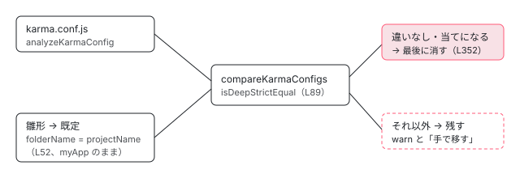

[目次](../README.md) › [@schematics/angular の道具と移行](README.md) › 第 6 回 / 全 11 回

# Karma から Vitest へ：migrate-karma-to-vitest

> migrations/migrate-karma-to-vitest/\*：karma.conf.js を読んで既定と比べる analyzer と comparer、karma-processor、angular.json の test target の書き換え、残すものと捨てるもの。

angular/angular-cli · 読了 約 13 分 · 発展 · [サイトで読む（デモが動きます）](https://angular-deep-dive-cyan.vercel.app/chapter/sca-karma-vitest)

---

この章で分かること：`ng update` の任意の移行 `migrate-karma-to-vitest` が、Karma の test target を `@angular/build:unit-test`（runner は Vitest）に書き換えるときに、`karma.conf.js` を TypeScript の構文木で読んで値を取り出し（analyzer）、CLI の既定の `karma.conf.js` と比べ（comparer）、残す設定と捨てるファイルを決める手順です。既定の `karma.conf.js` と、browsers・reporters・plugins・files などを変えたものに本物を当て、比べた結果、移行後の `angular.json`、残るファイル、警告の文を記録しました。

読む対象は `packages/schematics/angular/migrations/migrate-karma-to-vitest/` の `migration.ts`・`karma-processor.ts`・`karma-config-analyzer.ts`・`karma-config-comparer.ts`・`constants.ts` です（../angular-cli、44129f66a3）。移行のあとに動く `unit-test` builder は[テストを探す章](../vit/01-vit-discovery.md)から始まる vit の章、移行の前の Karma の builder が `karma.conf.js` と builder の値を組み合わせる順は[Karma の入口の章](../kar/01-kar-entry.md)の 5〜6 節です。テストのファイルの中身（Jasmine の書き方）を Vitest に直すのは別の schematic で、[次の章](07-sca-jv-overview.md)から読みます。

1. [1. 変更の単位とファイルの道具](01-sca-change.md)
2. [2. AST の道具](02-sca-ast-utils.md)
3. [3. 依存を足す](03-sca-dependency.md)
4. [4. standalone のアプリを書き換える](04-sca-standalone.md)
5. [5. builder の移行](05-sca-build-migrations.md)
6. **6. Karma から Vitest へ**（この章）
7. [7. Jasmine から Vitest へ（1）骨組み](07-sca-jv-overview.md)
8. [8. Jasmine から Vitest へ（2）spy と型](08-sca-jv-spy.md)
9. [9. Jasmine から Vitest へ（3）matcher](09-sca-jv-matcher.md)
10. [10. Jasmine から Vitest へ（4）lifecycle と fakeAsync](10-sca-jv-lifecycle.md)
11. [11. spec と issue](11-sca-tests-issues.md)

> [!TIP]
> **新卒エンジニアへ**
>
> 記録は 22.2.7 と 22.2.0-next.7 の 2 つで取り、17 の記録は全部同じ値でした（`migrate-karma-to-vitest/` は 44129f66a3・v22.2.7 で差分 0、main は `migration.ts` の import を `'node:util'` にしただけ）。木は `ng new demo-karma --test-runner=karma`（22.2.7）の test target を `@angular/build:karma` に替え、`karma.conf.js` を `ng g config karma`（config schematic）で作ったものです。`ng new` の Karma は今は `@angular/build:unit-test` の `runner: 'karma'` で、この移行の対象ではありません（1 節）。

## 1. どの project を移すか

📄 `angular-cli/packages/schematics/angular/migrations/migrate-karma-to-vitest/migration.ts` L212–245 （▶ の行: 213, 216, 223, 225–226, 231–235, 237, 242–244）

```ts
212 │ function updateProjects(tree: Tree, context: SchematicContext): Rule {
213 ▶   return updateWorkspace(async (workspace) => {
214 │     let needsCoverage = false;
215 │     let needsIstanbul = false;
216 ▶     const removableKarmaConfigs = new Map<string, KarmaConfigProcessingResult>();
217 │     const migratedProjects: string[] = [];
218 │     const tsConfigsToUpdate = new Set<string>();
219 │     const skippedNonApplications: string[] = [];
220 │     const skippedMissingAppBuilder: string[] = [];
221 │     const manualMigrationFiles: string[] = [];
222 │ 
223 ▶     for (const [projectName, project] of workspace.projects) {
224 │       // Restrict to application types for now
225 ▶       if (project.extensions.projectType !== 'application') {
226 ▶         skippedNonApplications.push(projectName);
227 │         continue;
228 │       }
229 │ 
230 │       // Check if build target uses the new application builder
231 ▶       const buildTarget = project.targets.get('build');
232 ▶       if (!buildTarget || buildTarget.builder !== '@angular/build:application') {
233 ▶         context.logger.info(
234 ▶           `Project "${projectName}" cannot be migrated to Vitest yet. ` +
235 ▶             `The project must first be migrated to use the "@angular/build:application" builder.`,
236 │         );
237 ▶         skippedMissingAppBuilder.push(projectName);
238 │         continue;
239 │       }
240 │ 
241 │       // Find the test target to migrate
242 ▶       const testTarget = project.targets.get('test');
243 ▶       if (!testTarget) {
244 ▶         continue;
245 │       }
```

📄 `angular-cli/packages/schematics/angular/migrations/migrate-karma-to-vitest/migration.ts` L247–277 （▶ の行: 250–253, 255–256, 260, 265–267, 270, 272, 277）

```ts
247 │       let isKarma = false;
248 │       let needDevkitPlugin = false;
249 │       // Check if target uses Karma builders
250 ▶       switch (testTarget.builder) {
251 ▶         case Builders.Karma:
252 ▶           isKarma = true;
253 ▶           needDevkitPlugin = true;
254 │           break;
255 ▶         case Builders.BuildKarma:
256 ▶           isKarma = true;
257 │           break;
258 │       }
259 │ 
260 ▶       if (!isKarma) {
261 │         continue;
262 │       }
263 │ 
264 │       // Collect tsConfig paths to perform globals updates
265 ▶       const baseTsConfig = testTarget.options?.['tsConfig'];
266 ▶       if (typeof baseTsConfig === 'string') {
267 ▶         tsConfigsToUpdate.add(baseTsConfig);
268 │       }
269 │       if (testTarget.configurations) {
270 ▶         for (const config of Object.values(testTarget.configurations)) {
271 │           if (typeof config?.['tsConfig'] === 'string') {
272 ▶             tsConfigsToUpdate.add(config['tsConfig']);
273 │           }
274 │         }
275 │       }
276 │       // Always include fallback to the default tsconfig.spec.json path
277 ▶       tsConfigsToUpdate.add(join(project.root, 'tsconfig.spec.json'));
```

1. **225 行目：application の project だけ**

   library は数えるだけで飛ばします（224 行目「Restrict to application types for now」）。
2. **232 行目：build が `@angular/build:application` であること**

   文字列で 1 つの名前だけを比べるので、`@angular-devkit/build-angular:application` も「まだ」です。記録では「Project "demo-karma" cannot be migrated to Vitest yet. The project must first be migrated to use the "@angular/build:application" builder.」でした。[前の章](05-sca-build-migrations.md)の `use-application-builder` が、webpack の builder が残っていなければ `@angular/build:…` に替えるので、その後で走らせる順になります。
3. **250〜262 行目：Karma の builder の 2 つの名前**

   `@angular-devkit/build-angular:karma` なら `needDevkitPlugin`（既定の `karma.conf.js` に devkit の plugin が入る形）、`@angular/build:karma` ならそれなし。`unit-test` builder の `runner: 'karma'` は対象ではありません。
4. **265〜277 行目：型を直す tsconfig を集める**

   test の `tsConfig`（base と configuration）と、いつも `root/tsconfig.spec.json`。6 節で使います。

## 2. test target の options を付け替える

📄 `angular-cli/packages/schematics/angular/migrations/migrate-karma-to-vitest/migration.ts` L21–52 （▶ の行: 33–34, 36–41, 46–49）

```ts
21 │ async function processTestTargetOptions(
22 │   testTarget: TargetDefinition,
23 │   projectName: string,
24 │   context: SchematicContext,
25 │   tree: Tree,
26 │   removableKarmaConfigs: Map<string, KarmaConfigProcessingResult>,
27 │   customBuildOptions: Record<string, Record<string, json.JsonValue | undefined>>,
28 │   needDevkitPlugin: boolean,
29 │   manualMigrationFiles: string[],
30 │ ): Promise<{ needsCoverage: boolean; needsIstanbul: boolean }> {
31 │   let needsCoverage = false;
32 │   let needsIstanbul = false;
33 ▶   for (const [configName, options] of allTargetOptions(testTarget, false)) {
34 ▶     const configKey = configName || '';
35 │ 
36 ▶     if (!customBuildOptions[configKey]) {
37 ▶       // Match Karma behavior where AOT was disabled by default
38 ▶       customBuildOptions[configKey] = {
39 ▶         aot: false,
40 ▶         optimization: false,
41 ▶         extractLicenses: false,
42 │       };
43 │     }
44 │ 
45 │     // Collect custom build options
46 ▶     for (const key of BUILD_OPTIONS_KEYS) {
47 ▶       if (options[key] !== undefined) {
48 ▶         customBuildOptions[configKey][key] = options[key];
49 ▶         delete options[key];
50 │       }
51 │     }
52 │ 
```

📄 `angular-cli/packages/schematics/angular/migrations/migrate-karma-to-vitest/constants.ts` L9–44 （▶ の行: 9, 20, 31–35, 43）

```ts
 9 ▶ export const SUPPORTED_REPORTERS = new Set([
10 │   'default',
11 │   'verbose',
12 │   'dots',
13 │   'json',
14 │   'junit',
15 │   'tap',
16 │   'tap-flat',
17 │   'html',
18 │ ]);
19 │ 
20 ▶ export const SUPPORTED_COVERAGE_REPORTERS = new Set([
21 │   'html',
22 │   'lcov',
23 │   'lcovonly',
24 │   'text',
25 │   'text-summary',
26 │   'cobertura',
27 │   'json',
28 │   'json-summary',
29 │ ]);
30 │ 
31 ▶ export const BUILD_OPTIONS_KEYS = [
32 ▶   'assets',
33 ▶   'styles',
34 ▶   'scripts',
35 ▶   'polyfills',
36 │   'inlineStyleLanguage',
37 │   'stylePreprocessorOptions',
38 │   'externalDependencies',
39 │   'loader',
40 │   'define',
41 │   'fileReplacements',
42 │   'webWorkerTsConfig',
43 ▶   'aot',
44 │ ];
```

1. **36〜43 行目：configuration ごとに「build に移す options」の箱を作る**

   中身の初めは `aot: false`・`optimization: false`・`extractLicenses: false` で、37 行目のコメントのとおり Karma の既定（AOT なし）に合わせたものです。
2. **46〜51 行目：build の options に当たるものを移す**

   `constants.ts` の 31〜44 行目の 12 個（`assets`・`styles`・`polyfills`・`aot` など）を test から消して箱に入れます。unit-test builder は build target を通してビルドするので、これらは build の側の値になります（6 節）。

📄 `angular-cli/packages/schematics/angular/migrations/migrate-karma-to-vitest/migration.ts` L53–82 （▶ の行: 54–56, 59–60, 64–65, 68–70, 73, 77–81）

```ts
53 │     // Map Karma options to Unit-Test options
54 ▶     if (options['codeCoverage'] !== undefined) {
55 ▶       options['coverage'] = options['codeCoverage'];
56 ▶       delete options['codeCoverage'];
57 │     }
58 │ 
59 ▶     if (options['codeCoverageExclude'] !== undefined) {
60 ▶       options['coverageExclude'] = options['codeCoverageExclude'];
61 │       delete options['codeCoverageExclude'];
62 │     }
63 │ 
64 ▶     if (options['coverage'] === true || options['coverageExclude'] !== undefined) {
65 ▶       needsCoverage = true;
66 │     }
67 │ 
68 ▶     if (options['sourceMap'] !== undefined) {
69 ▶       context.logger.info(
70 ▶         `Project "${projectName}" has "sourceMap" set for tests. ` +
71 │           `In unit-test builder with Vitest, source maps are always enabled. The option has been removed.`,
72 │       );
73 ▶       delete options['sourceMap'];
74 │     }
75 │ 
76 │     // Convert browser list to array format if it is a comma-separated string
77 ▶     const browsers = options['browsers'];
78 ▶     if (typeof browsers === 'string') {
79 ▶       options['browsers'] = browsers.split(',').map((b) => b.trim());
80 ▶     } else if (browsers === false) {
81 ▶       options['browsers'] = [];
82 │     }
```

📄 `angular-cli/packages/schematics/angular/migrations/migrate-karma-to-vitest/migration.ts` L84–106 （▶ の行: 84–86, 91, 93, 96–97, 100–103）

```ts
 84 ▶     const updatedBrowsers = options['browsers'];
 85 ▶     if (Array.isArray(updatedBrowsers) && updatedBrowsers.length > 0) {
 86 ▶       const hasNonChromium = updatedBrowsers.some((b) => {
 87 │         if (typeof b !== 'string') {
 88 │           return false;
 89 │         }
 90 │ 
 91 ▶         const normalized = b.toLowerCase();
 92 │ 
 93 ▶         return !['chrome', 'chromium', 'edge'].some((name) => normalized.includes(name));
 94 │       });
 95 │ 
 96 ▶       if (hasNonChromium) {
 97 ▶         needsIstanbul = true;
 98 │       }
 99 │ 
100 ▶       context.logger.info(
101 ▶         `Project "${projectName}" has browsers configured for tests. ` +
102 ▶           `To run tests in a browser with Vitest, you will need to install either ` +
103 ▶           `"@vitest/browser-playwright" or "@vitest/browser-webdriverio" depending on your preference.`,
104 │       );
105 │     }
106 │ 
```

📄 `angular-cli/packages/schematics/angular/migrations/migrate-karma-to-vitest/migration.ts` L107–138 （▶ の行: 108–110, 123–125, 127–128, 134）

```ts
107 │     // Check if the karma configuration file can be safely removed and extract settings
108 ▶     const karmaConfig = options['karmaConfig'];
109 ▶     if (typeof karmaConfig === 'string') {
110 ▶       await processKarmaConfig(
111 │         karmaConfig,
112 │         options,
113 │         projectName,
114 │         context,
115 │         tree,
116 │         removableKarmaConfigs,
117 │         needDevkitPlugin,
118 │         manualMigrationFiles,
119 │       );
120 │     }
121 │ 
122 │     // Map the main entry file to the setupFiles of the unit-test builder
123 ▶     const mainFile = options['main'];
124 ▶     if (typeof mainFile === 'string') {
125 ▶       options['setupFiles'] = [mainFile];
126 │ 
127 ▶       context.logger.info(
128 ▶         `Project "${projectName}" uses a "main" entry file for tests: "${mainFile}". ` +
129 │           `This has been mapped to the unit-test builder "setupFiles" array. ` +
130 │           `Please ensure you remove any TestBed.initTestEnvironment calls from this file ` +
131 │           `as the builder now handles test environment initialization automatically.`,
132 │       );
133 │     }
134 ▶     delete options['main'];
135 │   }
136 │ 
137 │   return { needsCoverage, needsIstanbul };
138 │ }
```

| Karma の test の option | 行 | 移行のあと |
| --- | --- | --- |
| `codeCoverage`・`codeCoverageExclude` | 54〜62 | `coverage`・`coverageExclude`（`true` なら coverage の依存を足す印） |
| `sourceMap` | 68〜74 | 消して info「In unit-test builder with Vitest, source maps are always enabled.」 |
| `browsers: 'ChromeHeadless,Firefox'` | 77〜82 | `['ChromeHeadless', 'Firefox']`。`false` は `[]` |
| Chromium 以外の browser（Firefox など） | 86〜98 | coverage があれば `@vitest/coverage-istanbul` も足す印 |
| browser がある | 100〜104 | info「… you will need to install either "@vitest/browser-playwright" or "@vitest/browser-webdriverio" …」（configuration ごとに出る） |
| `karmaConfig` | 108〜120 | 5 節の `processKarmaConfig`。`karmaConfig` は消える |
| `main: 'src/test.ts'` | 123〜134 | `setupFiles: ['src/test.ts']` と info「Please ensure you remove any TestBed.initTestEnvironment calls from this file …」 |

93 行目の判定は名前の中に `chrome`・`chromium`・`edge` のどれかを含むかなので、`ChromeHeadless` は Chromium、`Firefox` はそうでない、になります。

## 3. karma.conf.js を読む：analyzer

📄 `angular-cli/packages/schematics/angular/migrations/migrate-karma-to-vitest/karma-config-analyzer.ts` L44–78 （▶ の行: 50–51, 57–63, 66–70, 72, 76）

```ts
44 │ /**
45 │  * Analyzes the content of a Karma configuration file to extract its settings.
46 │  *
47 │  * @param content The string content of the `karma.conf.js` file.
48 │  * @returns An object containing the configuration settings and a flag indicating if unsupported values were found.
49 │  */
50 ▶ export function analyzeKarmaConfig(content: string): KarmaConfigAnalysis {
51 ▶   const sourceFile = ts.createSourceFile('karma.conf.js', content, ts.ScriptTarget.Latest, true);
52 │   const settings = new Map<string, KarmaConfigValue>();
53 │   let hasUnsupportedValues = false;
54 │ 
55 │   function visit(node: ts.Node) {
56 │     // The Karma configuration is defined within a `config.set({ ... })` call.
57 ▶     if (
58 ▶       ts.isCallExpression(node) &&
59 ▶       ts.isPropertyAccessExpression(node.expression) &&
60 ▶       node.expression.expression.getText(sourceFile) === 'config' &&
61 ▶       node.expression.name.text === 'set' &&
62 ▶       node.arguments.length === 1 &&
63 ▶       ts.isObjectLiteralExpression(node.arguments[0])
64 │     ) {
65 │       // We found `config.set`, now we extract the properties from the object literal.
66 ▶       for (const prop of node.arguments[0].properties) {
67 ▶         if (isSupportedPropertyAssignment(prop)) {
68 ▶           const key = prop.name.text;
69 ▶           const value = extractValue(prop.initializer);
70 ▶           settings.set(key, value);
71 │         } else {
72 ▶           hasUnsupportedValues = true;
73 │         }
74 │       }
75 │     } else {
76 ▶       ts.forEachChild(node, visit);
77 │     }
78 │   }
```

1. **51 行目：JavaScript のファイルを TypeScript の構文木にする**

   実行はしません。値は書いてある形から読みます。
2. **57〜63 行目：config.set({ … }) を探す**

   呼ぶ側の名前が文字で `config` で、引数が 1 つの object literal のもの。`module.exports = function (karma) { karma.set(…) }` のように引数の名前が違うと見つかりません。
3. **66〜73 行目：key: 値 の形だけ**

   スプレッド（`...extra`）や `[key]:` は 72 行目で `hasUnsupportedValues` にします。

📄 `angular-cli/packages/schematics/angular/migrations/migrate-karma-to-vitest/karma-config-analyzer.ts` L80–119 （▶ の行: 82–87, 89, 93–94, 101–105, 107, 111–113, 115–116）

```ts
 80 │   function extractValue(node: ts.Expression): KarmaConfigValue {
 81 │     switch (node.kind) {
 82 ▶       case ts.SyntaxKind.StringLiteral:
 83 ▶       case ts.SyntaxKind.NoSubstitutionTemplateLiteral:
 84 ▶         return (node as ts.StringLiteral | ts.NoSubstitutionTemplateLiteral).text;
 85 ▶       case ts.SyntaxKind.NumericLiteral:
 86 ▶         return Number((node as ts.NumericLiteral).text);
 87 ▶       case ts.SyntaxKind.TrueKeyword:
 88 │         return true;
 89 ▶       case ts.SyntaxKind.FalseKeyword:
 90 │         return false;
 91 │       case ts.SyntaxKind.Identifier: {
 92 │         const identifier = (node as ts.Identifier).text;
 93 ▶         if (identifier === '__dirname' || identifier === '__filename') {
 94 ▶           return identifier;
 95 │         }
 96 │         break;
 97 │       }
 98 │       case ts.SyntaxKind.CallExpression: {
 99 │         const callExpr = node as ts.CallExpression;
100 │         // Handle require('...')
101 ▶         if (
102 ▶           ts.isIdentifier(callExpr.expression) &&
103 ▶           callExpr.expression.text === 'require' &&
104 ▶           callExpr.arguments.length === 1 &&
105 ▶           ts.isStringLiteral(callExpr.arguments[0])
106 │         ) {
107 ▶           return { module: callExpr.arguments[0].text };
108 │         }
109 │ 
110 │         // Handle calls on a require, e.g. require('path').join()
111 ▶         const calleeValue = extractValue(callExpr.expression);
112 ▶         if (isRequireInfo(calleeValue)) {
113 ▶           return {
114 │             ...calleeValue,
115 ▶             isCall: true,
116 ▶             arguments: callExpr.arguments.map(extractValue),
117 │           };
118 │         }
119 │         break;
```

📄 `angular-cli/packages/schematics/angular/migrations/migrate-karma-to-vitest/karma-config-analyzer.ts` L121–160 （▶ の行: 125–127, 129, 132–134, 137–138, 142–145, 147, 149, 151, 159–160）

```ts
121 │       case ts.SyntaxKind.PropertyAccessExpression: {
122 │         const propAccessExpr = node as ts.PropertyAccessExpression;
123 │ 
124 │         // Handle config constants like `config.LOG_INFO`
125 ▶         if (
126 ▶           ts.isIdentifier(propAccessExpr.expression) &&
127 ▶           propAccessExpr.expression.text === 'config'
128 │         ) {
129 ▶           return `config.${propAccessExpr.name.text}`;
130 │         }
131 │ 
132 ▶         const value = extractValue(propAccessExpr.expression);
133 ▶         if (isRequireInfo(value)) {
134 ▶           const currentExport = value.export
135 │             ? `${value.export}.${propAccessExpr.name.text}`
136 │             : propAccessExpr.name.text;
137 ▶ 
138 ▶           return { ...value, export: currentExport };
139 │         }
140 │         break;
141 │       }
142 ▶       case ts.SyntaxKind.ArrayLiteralExpression:
143 ▶         return (node as ts.ArrayLiteralExpression).elements.map(extractValue);
144 ▶       case ts.SyntaxKind.ObjectLiteralExpression: {
145 ▶         const obj: { [key: string]: KarmaConfigValue } = Object.create(null);
146 │         for (const prop of (node as ts.ObjectLiteralExpression).properties) {
147 ▶           if (isSupportedPropertyAssignment(prop)) {
148 │             // Recursively extract values for nested objects.
149 ▶             obj[prop.name.text] = extractValue(prop.initializer);
150 │           } else {
151 ▶             hasUnsupportedValues = true;
152 │           }
153 │         }
154 │ 
155 │         return obj;
156 │       }
157 │     }
158 │ 
159 ▶     // For complex expressions (like variables) that we don't need to resolve,
160 ▶     // we mark the analysis as potentially incomplete.
```

読める値は、文字列（置き換えの無いテンプレート文字列を含む、0d1f298448）・数・`true`/`false`・`__dirname`/`__filename`・`require('x')`（`{ module: 'x' }`）とその上の呼び出しとプロパティ（`require('path').join(__dirname, '…')` は `{ module: 'path', export: 'join', isCall: true, arguments: […] }`）・`config.LOG_INFO`（文字列 `'config.LOG_INFO'`）・配列・object です。ほかは 159〜161 行目で `hasUnsupportedValues = true` にして `undefined` を返します。記録の既定の `karma.conf.js` は 9 つの key（`basePath`・`frameworks`・`plugins`・`client`・`jasmineHtmlReporter`・`coverageReporter`・`reporters`・`browsers`・`restartOnFileChange`）で `hasUnsupportedValues: false`、`browsers: process.env.CI ? […] : […]` と `...extra` を足すと `browsers = undefined`・`hasUnsupportedValues: true` でした。コメントの中身（`client.jasmine` の中の 4 行のコメント）は値に入りません。

## 4. 既定と比べる：comparer

📄 `angular-cli/packages/schematics/angular/migrations/migrate-karma-to-vitest/karma-config-comparer.ts` L32–59 （▶ の行: 39–42, 44–45, 47–50, 52, 54–56）

```ts
32 │ /**
33 │  * Generates the default Karma configuration file content as a string.
34 │  * @param relativePathToWorkspaceRoot The relative path from the Karma config file to the workspace root.
35 │  * @param projectName The name of the project.
36 │  * @param needDevkitPlugin A boolean indicating if the devkit plugin is needed.
37 │  * @returns The content of the default `karma.conf.js` file.
38 │  */
39 ▶ export async function generateDefaultKarmaConfig(
40 ▶   relativePathToWorkspaceRoot: string,
41 ▶   projectName: string,
42 ▶   needDevkitPlugin: boolean,
43 │ ): Promise<string> {
44 ▶   const templatePath = require.resolve('../../config/files/karma.conf.js.template');
45 ▶   let template = await readFile(templatePath, 'utf-8');
46 │ 
47 ▶   // TODO: Replace this with the actual schematic templating logic.
48 ▶   template = template
49 ▶     .replace(/<%= relativePathToWorkspaceRoot %>/g, () =>
50 ▶       path.normalize(relativePathToWorkspaceRoot).replace(/\\/g, '/'),
51 │     )
52 ▶     .replace(/<%= folderName %>/g, () => projectName);
53 │ 
54 ▶   const devkitPluginRegex = /<% if \(needDevkitPlugin\) { %>(.*?)<% } %>/gs;
55 ▶   const replacement = needDevkitPlugin ? '$1' : '';
56 ▶   template = template.replace(devkitPluginRegex, replacement);
57 │ 
58 │   return template;
59 │ }
```

📄 `angular-cli/packages/schematics/angular/migrations/migrate-karma-to-vitest/karma-config-comparer.ts` L67–101 （▶ の行: 78, 80–82, 84–90, 99）

```ts
 67 │ export function compareKarmaConfigs(
 68 │   projectAnalysis: KarmaConfigAnalysis,
 69 │   defaultAnalysis: KarmaConfigAnalysis,
 70 │ ): KarmaConfigDiff {
 71 │   const added = new Map<string, KarmaConfigValue>();
 72 │   const removed = new Map<string, KarmaConfigValue>();
 73 │   const modified = new Map<
 74 │     string,
 75 │     { projectValue: KarmaConfigValue; defaultValue: KarmaConfigValue }
 76 │   >();
 77 │ 
 78 ▶   const allKeys = new Set([...projectAnalysis.settings.keys(), ...defaultAnalysis.settings.keys()]);
 79 │ 
 80 ▶   for (const key of allKeys) {
 81 ▶     const projectValue = projectAnalysis.settings.get(key);
 82 ▶     const defaultValue = defaultAnalysis.settings.get(key);
 83 │ 
 84 ▶     if (projectValue !== undefined && defaultValue === undefined) {
 85 ▶       added.set(key, projectValue);
 86 ▶     } else if (projectValue === undefined && defaultValue !== undefined) {
 87 ▶       removed.set(key, defaultValue);
 88 ▶     } else if (projectValue !== undefined && defaultValue !== undefined) {
 89 ▶       if (!isDeepStrictEqual(projectValue, defaultValue)) {
 90 ▶         modified.set(key, { projectValue, defaultValue });
 91 │       }
 92 │     }
 93 │   }
 94 │ 
 95 │   return {
 96 │     added,
 97 │     removed,
 98 │     modified,
 99 ▶     isReliable: !projectAnalysis.hasUnsupportedValues && !defaultAnalysis.hasUnsupportedValues,
100 │   };
101 │ }
```

📄 `angular-cli/packages/schematics/angular/migrations/migrate-karma-to-vitest/karma-config-comparer.ts` L142–161 （▶ の行: 148–150, 153–156, 158, 160）

```ts
142 │ export async function compareKarmaConfigToDefault(
143 │   projectConfigOrAnalysis: string | KarmaConfigAnalysis,
144 │   projectName: string,
145 │   karmaConfigPath: string,
146 │   needDevkitPlugin: boolean,
147 │ ): Promise<KarmaConfigDiff> {
148 ▶   const projectAnalysis =
149 ▶     typeof projectConfigOrAnalysis === 'string'
150 ▶       ? analyzeKarmaConfig(projectConfigOrAnalysis)
151 │       : projectConfigOrAnalysis;
152 │ 
153 ▶   const defaultContent = await generateDefaultKarmaConfig(
154 ▶     relativePathToWorkspaceRoot(path.dirname(karmaConfigPath)),
155 ▶     projectName,
156 ▶     needDevkitPlugin,
157 │   );
158 ▶   const defaultAnalysis = analyzeKarmaConfig(defaultContent);
159 │ 
160 ▶   return compareKarmaConfigs(projectAnalysis, defaultAnalysis);
161 │ }
```

1. **44〜56 行目：既定の karma.conf.js を作る**

   config schematic の雛形 `config/files/karma.conf.js.template` を読み、47 行目の TODO のとおり schematic の雛形の仕組みを使わず、3 つの印を正規表現で置き換えます。`folderName` には 52 行目で **`projectName` をそのまま**入れます。
2. **154 行目：workspace の root への相対パス**

   `karma.conf.js` のあるフォルダから決めます。
3. **78〜93 行目：両方の key を合わせて、足した・消した・変えた**

   値は 89 行目の `isDeepStrictEqual` で比べるので、配列の順も違いになります。
4. **99 行目：どちらかに読めない値があれば「当てにならない」**

記録の比べた結果です（左が project の値）。

| 既定から変えたところ | 結果 |
| --- | --- |
| 変えない・コメントと空白だけ変える | 違いなし（`isReliable: true`） |
| `browsers: ['ChromeHeadless']` | modified `browsers` |
| `reporters` に `junit`・`custom` | modified `reporters` |
| `plugins` に `require('karma-junit-reporter')` | modified `plugins`（配列全体を比べる） |
| `files: ['src/extra.js']` を足す | added `files` |
| `jasmineHtmlReporter` を消す | removed `jasmineHtmlReporter` |
| 三項演算子とスプレッド | `isReliable: false`、`browsers` は読めず removed 扱い |
| **project の名前が `myApp`（ng g config karma のまま）** | **modified `coverageReporter`**（`./coverage/my-app` ← 既定 `./coverage/myApp`） |

最後の行が食い違いです。config schematic（`config/index.ts` L182〜185）は、project の名前が `@` で始まれば取り、大文字を含めば `dasherize` したものを `folderName` にします。comparer の 52 行目は名前をそのまま入れるので、大文字を含む名前（`myApp`）や scope つきの名前の project では、CLI が作ったままの `karma.conf.js` が「既定と違う」になります。記録の移行では `karma.conf.js` が消されずに残り、「uses a custom Karma configuration file "karma.conf.js". … you may need to manually migrate custom settings …」と「The following Karma configuration files require manual migration: - karma.conf.js」が出ました。

📄 `angular-cli/packages/schematics/angular/migrations/migrate-karma-to-vitest/karma-config-comparer.ts` L112–140 （▶ の行: 115–117, 120–123, 130–132, 136–139）

```ts
112 │ /**
113 │  * Compares a project's Karma configuration with the default configuration.
114 │  * @param projectConfigContent The content of the project's `karma.conf.js` file.
115 ▶  * @param projectRoot The root directory of the project.
116 ▶  * @param needDevkitPlugin A boolean indicating if the devkit plugin is needed for the default config.
117 ▶  * @param karmaConfigPath The path to the Karma configuration file, used to resolve relative paths.
118 │  * @returns A diff object representing the changes.
119 │  */
120 ▶ export async function compareKarmaConfigToDefault(
121 ▶   projectConfigContent: string,
122 ▶   projectName: string,
123 ▶   karmaConfigPath: string,
124 │   needDevkitPlugin: boolean,
125 │ ): Promise<KarmaConfigDiff>;
126 │ 
127 │ /**
128 │  * Compares a project's Karma configuration with the default configuration.
129 │  * @param projectAnalysis The analysis of the project's configuration.
130 ▶  * @param projectRoot The root directory of the project.
131 ▶  * @param needDevkitPlugin A boolean indicating if the devkit plugin is needed for the default config.
132 ▶  * @param karmaConfigPath The path to the Karma configuration file, used to resolve relative paths.
133 │  * @returns A diff object representing the changes.
134 │  */
135 │ export async function compareKarmaConfigToDefault(
136 ▶   projectAnalysis: KarmaConfigAnalysis,
137 ▶   projectName: string,
138 ▶   karmaConfigPath: string,
139 ▶   needDevkitPlugin: boolean,
140 │ ): Promise<KarmaConfigDiff>;
```

もう 1 つ、JSDoc と引数が合っていません。115 行目と 130 行目の `@param projectRoot`「project の root のフォルダ」は、実際の 2 つめの引数 `projectName`（122 行目・137 行目）で、上の 52 行目で `folderName` に使う名前です。`@param` の並び（`needDevkitPlugin` が `karmaConfigPath` の前）も引数の順と逆です。

## 5. 残すもの：karma-processor.ts

📄 `angular-cli/packages/schematics/angular/migrations/migrate-karma-to-vitest/karma-processor.ts` L137–174 （▶ の行: 137, 139–141, 143–145, 151, 154–155, 158–160, 162–164, 169, 173）

```ts
137 ▶   let cachedResult = cache.get(karmaConfig);
138 │ 
139 ▶   if (!cachedResult && tree.exists(karmaConfig)) {
140 ▶     const content = tree.readText(karmaConfig);
141 ▶     const analysis = analyzeKarmaConfig(content);
142 │ 
143 ▶     let isRemovable = false;
144 ▶     if (!analysis.hasUnsupportedValues) {
145 ▶       const diff = await compareKarmaConfigToDefault(
146 │         analysis,
147 │         projectName,
148 │         karmaConfig,
149 │         needDevkitPlugin,
150 │       );
151 ▶       isRemovable = !hasDifferences(diff) && diff.isReliable;
152 │     }
153 │ 
154 ▶     cachedResult = { analysis, isRemovable };
155 ▶     cache.set(karmaConfig, cachedResult);
156 │   }
157 │ 
158 ▶   if (cachedResult) {
159 ▶     extractReporters(cachedResult.analysis, options, projectName, context);
160 ▶     extractCoverageSettings(cachedResult.analysis, options, projectName, context);
161 │ 
162 ▶     if (!cachedResult.isRemovable) {
163 ▶       context.logger.warn(
164 ▶         `Project "${projectName}" uses a custom Karma configuration file "${karmaConfig}". ` +
165 │           `Tests have been migrated to use Vitest, but you may need to manually migrate custom settings ` +
166 │           `from this Karma config to a Vitest config (e.g. "vitest-base.config.mts") ` +
167 │           `and set the "runnerConfig" option to true.`,
168 │       );
169 ▶       manualMigrationFiles.push(karmaConfig);
170 │     }
171 │   }
172 │ 
173 ▶   delete options['karmaConfig'];
174 │ }
```

1. **137〜156 行目：ファイルごとに 1 回だけ読む**

   読めない値が無いときだけ比べ、違いが無くて当てになるなら `isRemovable`。結果は project をまたぐ `cache`（6 節の `removableKarmaConfigs`）に入れます。
2. **159〜160 行目：reporters と coverage を取り出す**

   既定の `karma.conf.js` でも取り出します。
3. **162〜170 行目：消せないなら warn して「手で移すもの」に**
4. **173 行目：karmaConfig は必ず消す**

   ファイルが無くても options から消えます。

📄 `angular-cli/packages/schematics/angular/migrations/migrate-karma-to-vitest/karma-processor.ts` L21–55 （▶ の行: 21–22, 26–30, 35–39, 45–46, 51–52）

```ts
21 ▶   const reporters = analysis.settings.get('reporters');
22 ▶   if (Array.isArray(reporters)) {
23 │     const mappedReporters: string[] = [];
24 │     for (const r of reporters) {
25 │       if (typeof r === 'string') {
26 ▶         if (r === 'progress') {
27 ▶           mappedReporters.push('default');
28 ▶         } else if (r === 'kjhtml') {
29 ▶           context.logger.warn(
30 ▶             `Project "${projectName}" uses the "kjhtml" reporter. ` +
31 │               `This has not been automatically mapped. ` +
32 │               `For an interactive test UI in Vitest, consider setting the "ui" option to true in your test target options ` +
33 │               `and installing "@vitest/ui".`,
34 │           );
35 ▶         } else if (SUPPORTED_REPORTERS.has(r)) {
36 ▶           mappedReporters.push(r);
37 ▶         } else {
38 ▶           context.logger.warn(
39 ▶             `Project "${projectName}" uses a custom Karma reporter "${r}". ` +
40 │               `This reporter cannot be automatically mapped to Vitest. ` +
41 │               `Please check the Vitest documentation for equivalent reporters.`,
42 │           );
43 │         }
44 │       } else {
45 ▶         context.logger.warn(
46 ▶           `Project "${projectName}" has a non-string reporter in Karma config. ` +
47 │             `This cannot be automatically mapped to Vitest.`,
48 │         );
49 │       }
50 │     }
51 ▶     if (mappedReporters.length > 0) {
52 ▶       options['reporters'] = [...new Set(mappedReporters)];
53 │     }
54 │   }
55 │ }
```

📄 `angular-cli/packages/schematics/angular/migrations/migrate-karma-to-vitest/karma-processor.ts` L63–97 （▶ の行: 63–64, 69–70, 74–76, 78–79, 83–84, 86–87, 94–95）

```ts
63 ▶   const coverageReporter = analysis.settings.get('coverageReporter');
64 ▶   if (typeof coverageReporter !== 'object' || coverageReporter === null) {
65 │     return;
66 │   }
67 │ 
68 │   // Extract coverage reporters
69 ▶   const covReporters = (coverageReporter as Record<string, unknown>)['reporters'];
70 ▶   if (Array.isArray(covReporters)) {
71 │     const mappedCovReporters: string[] = [];
72 │     for (const r of covReporters) {
73 │       let type: string | undefined;
74 ▶       if (typeof r === 'object' && r !== null && 'type' in r) {
75 ▶         if (typeof r['type'] === 'string') {
76 ▶           type = r['type'];
77 │         }
78 ▶       } else if (typeof r === 'string') {
79 ▶         type = r;
80 │       }
81 │ 
82 │       if (type) {
83 ▶         if (SUPPORTED_COVERAGE_REPORTERS.has(type)) {
84 ▶           mappedCovReporters.push(type);
85 │         } else {
86 ▶           context.logger.warn(
87 ▶             `Project "${projectName}" uses a custom coverage reporter "${type}". ` +
88 │               `This reporter cannot be automatically mapped to Vitest. ` +
89 │               `Please check the Vitest documentation for equivalent coverage reporters.`,
90 │           );
91 │         }
92 │       }
93 │     }
94 ▶     if (mappedCovReporters.length > 0) {
95 ▶       options['coverageReporters'] = [...new Set(mappedCovReporters)];
96 │     }
97 │   }
```

📄 `angular-cli/packages/schematics/angular/migrations/migrate-karma-to-vitest/karma-processor.ts` L99–120 （▶ の行: 100–103, 105, 108, 112–115）

```ts
 99 │   // Extract coverage thresholds
100 ▶   const check = (coverageReporter as Record<string, unknown>)['check'];
101 ▶   if (typeof check === 'object' && check !== null) {
102 ▶     const global = (check as Record<string, unknown>)['global'];
103 ▶     if (typeof global === 'object' && global !== null) {
104 │       const thresholds: Record<string, number> = {};
105 ▶       const keys = ['statements', 'branches', 'functions', 'lines'];
106 │       for (const key of keys) {
107 │         const value = (global as Record<string, unknown>)[key];
108 ▶         if (typeof value === 'number') {
109 │           thresholds[key] = value;
110 │         }
111 │       }
112 ▶       if (Object.keys(thresholds).length > 0) {
113 ▶         options['coverageThresholds'] = {
114 ▶           ...thresholds,
115 ▶           perFile: false,
116 │         };
117 │       }
118 │     }
119 │   }
120 │ }
```

`progress` は Vitest の `default` に、`constants.ts` の 9〜18 行目の 8 つはそのまま、`kjhtml` と知らない名前は warn です。coverage の reporter は `{ type }` か文字列から、20〜29 行目の 8 つだけを残します。`check.global` の 4 つの数は `coverageThresholds` に `perFile: false` を付けて入れます（`check.each` は読まない）。記録の「変えた karma.conf.js」は、`reporters` が `['default', 'junit']`（`custom` は warn）、`coverageReporters` が `['html', 'text-summary', 'cobertura']`（`teamcity` は warn）、`coverageThresholds` が `{ statements: 80, branches: 70, perFile: false }` でした。既定の `karma.conf.js` も `reporters: ['progress', 'kjhtml']` なので、消されるファイルなのに「uses the "kjhtml" reporter. This has not been automatically mapped. …」の warn が出て、test の options に `reporters: ['default']` と `coverageReporters: ['html', 'text-summary']` が書かれました（記録の「既定のまま移行」）。

## 6. build の testing 設定、型、依存、後片付け

📄 `angular-cli/packages/schematics/angular/migrations/migrate-karma-to-vitest/migration.ts` L279–302 （▶ の行: 285–286, 296–298, 302）

```ts
279 │       // Store custom build options to move to a new build configuration if needed
280 │       const customBuildOptions: Record<
281 │         string,
282 │         Record<string, json.JsonValue | undefined>
283 │       > = Object.create(null);
284 │ 
285 ▶       const projectCoverageInfo = await processTestTargetOptions(
286 ▶         testTarget,
287 │         projectName,
288 │         context,
289 │         tree,
290 │         removableKarmaConfigs,
291 │         customBuildOptions,
292 │         needDevkitPlugin,
293 │         manualMigrationFiles,
294 │       );
295 │ 
296 ▶       if (projectCoverageInfo.needsCoverage) {
297 ▶         needsCoverage = true;
298 ▶         if (projectCoverageInfo.needsIstanbul) {
299 │           needsIstanbul = true;
300 │         }
301 │       }
302 ▶ 
```

📄 `angular-cli/packages/schematics/angular/migrations/migrate-karma-to-vitest/migration.ts` L303–341 （▶ の行: 306–307, 311–313, 317–318, 321–324, 327, 330, 332, 334, 336–338, 341）

```ts
303 │       // If we have custom build options, create testing configurations
304 │       const baseOptions = buildTarget.options || {};
305 │ 
306 ▶       for (const [configKey, configOptions] of Object.entries(customBuildOptions)) {
307 ▶         const finalConfig: Record<string, json.JsonValue | undefined> = {};
308 │ 
309 │         // Omit options that already have the same value in the base build options.
310 │         // Using isDeepStrictEqual for a deep comparison of arrays and objects.
311 ▶         for (const [key, value] of Object.entries(configOptions)) {
312 ▶           if (!isDeepStrictEqual(value, baseOptions[key])) {
313 ▶             finalConfig[key] = value;
314 │           }
315 │         }
316 │ 
317 ▶         if (Object.keys(finalConfig).length > 0) {
318 ▶           buildTarget.configurations ??= {};
319 │           const configurations = buildTarget.configurations;
320 │ 
321 ▶           let configName = configKey ? `testing-${configKey}` : 'testing';
322 ▶           if (configurations[configName]) {
323 ▶             let counter = 1;
324 ▶             while (configurations[`${configName}-${counter}`]) {
325 │               counter++;
326 │             }
327 ▶             configName = `${configName}-${counter}`;
328 │           }
329 │ 
330 ▶           configurations[configName] = finalConfig;
331 │ 
332 ▶           if (configKey === '') {
333 │             testTarget.options ??= {};
334 ▶             testTarget.options['buildTarget'] = `:build:${configName}`;
335 │           } else {
336 ▶             testTarget.configurations ??= {};
337 ▶             testTarget.configurations[configKey] ??= {};
338 ▶             testTarget.configurations[configKey]['buildTarget'] = `:build:${configName}`;
339 │           }
340 │         }
341 ▶       }
```

1. **311〜315 行目：build の base の options と同じ値は省く**

   記録の既定の木では、test の `assets` と `styles` が build と同じだったので省かれ、`testing` の configuration は 3 つの `false` と `polyfills`（ng new の build の options には `polyfills` が無いので、同じ値にならない）になりました。
2. **321〜328 行目：名前は testing、test の configuration なら testing-名前**

   同じ名前があれば `-1`・`-2` を付けます。
3. **332〜339 行目：test から `buildTarget` で指す**

   base は `:build:testing`、configuration は `:build:testing-ci` のように。project の名前を省いた形です。
4. **344〜346 行目：builder と runner**

   `@angular/build:unit-test` と `runner: 'vitest'`。

📄 `angular-cli/packages/schematics/angular/migrations/migrate-karma-to-vitest/migration.ts` L342–368 （▶ の行: 344, 346, 352–354, 359, 362）

```ts
342 │ 
343 │       // Update builder
344 ▶       testTarget.builder = '@angular/build:unit-test';
345 │       testTarget.options ??= {};
346 ▶       testTarget.options['runner'] = 'vitest';
347 │ 
348 │       migratedProjects.push(projectName);
349 │     }
350 │ 
351 │     // Perform cleanup of removable karma config files
352 ▶     for (const [configPath, result] of removableKarmaConfigs) {
353 ▶       if (result.isRemovable && tree.exists(configPath)) {
354 ▶         tree.delete(configPath);
355 │       }
356 │     }
357 │ 
358 │     // Update TSConfig files to use Vitest types instead of Jasmine
359 ▶     updateTsConfigTypes(tree, tsConfigsToUpdate, context);
360 │ 
361 │     // Log summary
362 ▶     logSummary(
363 │       context,
364 │       migratedProjects,
365 │       skippedNonApplications,
366 │       skippedMissingAppBuilder,
367 │       manualMigrationFiles,
368 │     );
```

📄 `angular-cli/packages/schematics/angular/migrations/migrate-karma-to-vitest/migration.ts` L140–171 （▶ の行: 145–146, 148–151, 153–154, 157–159, 161, 164–166）

```ts
140 │ function updateTsConfigTypes(
141 │   tree: Tree,
142 │   tsConfigsToUpdate: Set<string>,
143 │   context: SchematicContext,
144 │ ): void {
145 ▶   for (const tsConfigPath of tsConfigsToUpdate) {
146 ▶     if (tree.exists(tsConfigPath)) {
147 │       try {
148 ▶         const json = new JSONFile(tree, tsConfigPath);
149 ▶         const typesPath = ['compilerOptions', 'types'];
150 ▶         const existingTypes = (json.get(typesPath) as string[] | undefined) ?? [];
151 ▶         const newTypes = existingTypes.filter((t) => t !== 'jasmine');
152 │ 
153 ▶         if (!newTypes.includes('vitest/globals')) {
154 ▶           newTypes.push('vitest/globals');
155 │         }
156 │ 
157 ▶         if (
158 ▶           newTypes.length !== existingTypes.length ||
159 ▶           newTypes.some((t, i) => t !== existingTypes[i])
160 │         ) {
161 ▶           json.modify(typesPath, newTypes);
162 │         }
163 │       } catch (err) {
164 ▶         context.logger.warn(
165 ▶           `Failed to automatically update types in "${tsConfigPath}". ` +
166 ▶             `Please manually remove "jasmine" and add "vitest/globals" to compilerOptions.types.`,
167 │         );
168 │       }
169 │     }
170 │   }
171 │ }
```

📄 `angular-cli/packages/schematics/angular/migrations/migrate-karma-to-vitest/migration.ts` L370–407 （▶ の行: 370, 372, 374, 378, 380, 386, 389, 405–406）

```ts
370 ▶     if (migratedProjects.length > 0) {
371 │       const rules = [
372 ▶         addDependency('vitest', latestVersions['vitest'], {
373 │           type: DependencyType.Dev,
374 ▶           existing: ExistingBehavior.Skip,
375 │         }),
376 │       ];
377 │ 
378 ▶       if (needsCoverage) {
379 │         rules.push(
380 ▶           addDependency('@vitest/coverage-v8', latestVersions['@vitest/coverage-v8'], {
381 │             type: DependencyType.Dev,
382 │             existing: ExistingBehavior.Skip,
383 │           }),
384 │         );
385 │ 
386 ▶         if (needsIstanbul) {
387 │           rules.push(
388 │             addDependency(
389 ▶               '@vitest/coverage-istanbul',
390 │               latestVersions['@vitest/coverage-istanbul'],
391 │               {
392 │                 type: DependencyType.Dev,
393 │                 existing: ExistingBehavior.Skip,
394 │               },
395 │             ),
396 │           );
397 │         }
398 │       }
399 │ 
400 │       return chain(rules);
401 │     }
402 │   });
403 │ }
404 │ 
405 ▶ export default function (): Rule {
406 ▶   return updateProjects;
407 │ }
```

消してよい `karma.conf.js` は、全部の project を見終わってから 352〜356 行目でまとめて消します（aed407db8b「defer karma config deletion」、複数の project が同じファイルを使う場合のため）。tsconfig は `types` の `jasmine` を外して `vitest/globals` を足し、依存は `vitest`、coverage があれば `@vitest/coverage-v8`、Chromium 以外の browser もあれば `@vitest/coverage-istanbul` を、どれも `Skip` で足します。記録で**残ったもの**は、package.json の `karma`・`karma-jasmine`・`jasmine-core`・`@types/jasmine` など（消す処理は無い）、`main` だった `src/test.ts`（`setupFiles` として使い続ける）、消せないと決めた `karma.conf.js` です。spec のファイルの `jasmine.createSpy` などもそのままで、要約の最後に `ng g @schematics/angular:refactor-jasmine-vitest <project_name>` を勧める文が出ます（[次の章](07-sca-jv-overview.md)）。

> **🧪 DEMO — migrate-karma-to-vitest の analyzer・comparer と移行の記録**
>
> ボタンは、手元の記録のスクリプトが `analyzeKarmaConfig`・`compareKarmaConfigToDefault` を直に呼んだ結果と、`migrate-karma-to-vitest` を `runSchematic` で走らせた log と差分を再生します。「1」は `ng g config karma` が作った `karma.conf.js` と、analyzer が取り出した値（`key = JSON`）、「2」は既定と比べた足した・消した・変えた key、「3」は移行の log（`log 種類: 文`）とファイルの差分です。
>
> ▶ [このデモはサイトで動かせます](https://angular-deep-dive-cyan.vercel.app/chapter/sca-karma-vitest)



*karma.conf.js が消えるかどうかの決まり方。comparer が作る「既定」は project の名前をそのまま folderName にするので、config schematic が dasherize した名前（myApp → my-app）と食い違う。*

### ここまでの呼び出し（1 つの project の移行）

- 👤 `ng update @angular/cli --name migrate-karma-to-vitest` — migration-collection.json
  - `updateWorkspace(async (workspace) => …)` — migration.ts L213
    - `processTestTargetOptions(testTarget, …)` — L285 — *configuration ごと（L33）*
      - `processKarmaConfig(karmaConfig, options, …)` — karma-processor.ts L127
        - `analyzeKarmaConfig(content)` — karma-config-analyzer.ts L50
        - `compareKarmaConfigToDefault(analysis, projectName, karmaConfig, needDevkitPlugin)` — karma-config-comparer.ts L142 — *雛形から既定を作る（L39）*
        - `extractReporters`・`extractCoverageSettings` — karma-processor.ts L15・L57
    - `buildTarget.configurations[configName] = finalConfig` — migration.ts L330 — *testing / testing-名前*
    - `tree.delete(configPath)`・`updateTsConfigTypes`・`logSummary` — L352〜368
  - `chain([addDependency('vitest', …), …])` — L371〜400 — *3 章*

## テストと直し方

| ファイル | describe › it（行） | 固めている約束 |
| --- | --- | --- |
| `karma-config-analyzer_spec.ts` | `Karma Config Analyzer`（12）› `should parse a basic karma config file`（13）〜 `should flag template literals with substitution as unsupported`（311）の 15 本 | 3 節。`config` 以外の引数の名前の it は無い |
| `karma-config-comparer_spec.ts` | `Karma Config Comparer`（16）› `compareKarmaConfigs`（17）› 10 本、`compareKarmaConfigToDefault`（254）› 4 本 | 4 節。既定の文字列は 258 行目の `generateDefaultKarmaConfig('.', 'test-project', true)`、つまり comparer 自身が作ったもので、config schematic が作ったファイルとは比べていない |
| `migration_spec.ts` | `Migration from Karma to Vitest unit-test builder`（15）› `should migrate standard karma builder to unit-test builder`（62）〜 `should automatically transition types in referenced tsconfigs from jasmine to vitest/globals`（424）の 19 本 | 1〜2 節・5〜6 節。`should delete default karma.conf.js`（283）は手で書いた既定の文字列で、project の名前は `app` |

📄 `走らせたコマンド（2026-11-27）`

```
$ cd ~/angular-research/angular-cli      # 44129f66a3、読むだけ
$ pnpm bazel test //packages/schematics/angular:test --nocache_test_results --test_output=all \
    "--test_arg=--filter=^(Karma Config Analyzer|Karma Config Comparer|Migration from Karma to Vitest unit-test builder) "
Ran 48 of 863 specs
48 specs, 0 failures
//packages/schematics/angular:test    PASSED

$ WS_KARMA=<ng new demo-karma --test-runner=karma> \
    node rec-karma.js <22.2.7 の @schematics/angular> ch6-new.json   # 記録（DEMO）
```

直すとしたら、4 節の名前の食い違いは `karma-config-comparer.ts` の `generateDefaultKarmaConfig` の 52 行目で、config schematic（`config/index.ts` L182〜185）と同じく `@` を取り、大文字を含めば `strings.dasherize` した名前を `folderName` にします（同じ関数を 2 か所から呼ぶ形にすると、ずれが起きにくくなります）。spec は karma-config-comparer\_spec.ts の `compareKarmaConfigToDefault` の describe に「`myApp` の project で、config schematic と同じ規則で作った karma.conf.js は違いなし」を足すか、migration\_spec.ts で `config` schematic を走らせて作ったファイルが消えることを確かめます。115〜139 行目の JSDoc は `@param projectName` にして、引数の順に並べ直します。

## 聞かれそうな質問

**Q. この移行は、`ng new --test-runner=karma` で作ったプロジェクトにも効きますか？**

効きません。今の `ng new` の Karma は `@angular/build:unit-test` の `runner: 'karma'` で、250〜262 行目が見るのは `@angular-devkit/build-angular:karma` と `@angular/build:karma` の builder だけです。

**Q. `karma.conf.js` はいつ消えますか？**

読めない値が無く（`hasUnsupportedValues: false`）、CLI の既定の雛形から作った設定と key も値も同じとき（138〜152 行目）です。コメントや空白の違いは気にしません。消すのは全部の project を見終わったあとです（352〜356 行目）。

**Q. CLI が作ったままの `karma.conf.js` なのに「手で移して」と言われたのはなぜですか？**

project の名前に大文字が入っていると（`myApp`）、config schematic は `coverage/my-app` と書き、comparer は 52 行目で `coverage/myApp` の既定を作るので、`coverageReporter` が違うと判定されるからです（記録）。

**Q. test の options に書いていた `styles` や `assets` はどこへ行きますか？**

46〜51 行目で test から消え、build target の `testing`（または `testing-名前`）の configuration に移り、test は `buildTarget: ':build:testing'` で指します。build の base の options と同じ値は 311〜315 行目で省かれます。

**Q. 移行のあと、Karma のパッケージは package.json から消えますか？**

消えません。移行が足すのは `vitest` と coverage のパッケージだけで（370〜400 行目）、`karma` や `jasmine-core` を消す処理はありません。

## 読み終えて

- 対象は application の project で、build が `@angular/build:application`、test が Karma の builder のものだけ。
- test の options は、build に当たる 12 個を build の testing の configuration へ、`codeCoverage`・`browsers`・`main` などは unit-test の名前へ付け替える。
- `karma.conf.js` は実行せずに構文木で読み、読める形は限られる。読めない値が 1 つでもあれば消さない。
- 既定と比べる雛形は project の名前をそのまま `folderName` にするので、大文字や scope のある名前では CLI が作ったままのファイルでも残る。
- reporters と coverage の値は、消すファイルからも取り出して test の options に書く。Karma のパッケージと `src/test.ts` は残る。

---

← 前: [builder の移行：use-application-builder ほか](05-sca-build-migrations.md)  
次: [Jasmine から Vitest へ（1）：refactor の骨組み](07-sca-jv-overview.md) →
