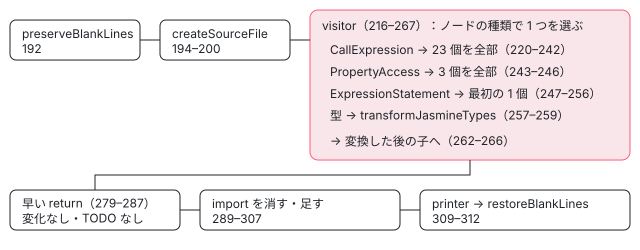

[目次](../README.md) › [@schematics/angular の道具と移行](README.md) › 第 7 回 / 全 11 回

# Jasmine から Vitest へ（1）：refactor の骨組み

> refactor/jasmine-vitest/index.ts・test-file-transformer.ts・utils/\*：対象のファイルの選び方、変換器を順に当てる仕組み、AST の道具、TODO のコメントと reporter。

angular/angular-cli · 読了 約 12 分 · 中核 · [サイトで読む（デモが動きます）](https://angular-deep-dive-cyan.vercel.app/chapter/sca-jv-overview)

---

この章で分かること：`ng g @schematics/angular:refactor-jasmine-vitest` が、どの spec のファイルを選び、1 つのファイルの AST（TypeScript の構文木）にどの順で変換器を当て、どこで書き戻すかです。直せないものに付ける TODO のコメントと、終わりに出す要約・Markdown のレポートの作り方も読みます。作業用のワークスペースで本物を走らせ、**変換の要らないファイルまで書き換えられる**ことと、レポートの置き場所が説明文と違うことを記録で確かめます。

読む対象は `packages/schematics/angular/refactor/jasmine-vitest/` の `index.ts`・`schema.json`・`test-file-transformer.ts`・`test-helpers.ts` と `utils/` の 7 つです（../angular-cli、44129f66a3）。個々の変換器（spy・matcher・lifecycle・fakeAsync）は次の 3 回で読みます。Karma の設定ごと Vitest に移す `ng update` の移行は[前の回](06-sca-karma-vitest.md)、移った先の unit-test builder が spec をどう見つけて走らせるかは[Vitest の spec の見つけ方の章](../vit/01-vit-discovery.md)です。schematic を Tree の上で動かす仕組みそのものは[エンジンと規則の章](../dvk/07-dvk-engine.md)が読んでいます。

1. [1. 変更の単位とファイルの道具](01-sca-change.md)
2. [2. AST の道具](02-sca-ast-utils.md)
3. [3. 依存を足す](03-sca-dependency.md)
4. [4. standalone のアプリを書き換える](04-sca-standalone.md)
5. [5. builder の移行](05-sca-build-migrations.md)
6. [6. Karma から Vitest へ](06-sca-karma-vitest.md)
7. **7. Jasmine から Vitest へ（1）骨組み**（この章）
8. [8. Jasmine から Vitest へ（2）spy と型](08-sca-jv-spy.md)
9. [9. Jasmine から Vitest へ（3）matcher](09-sca-jv-matcher.md)
10. [10. Jasmine から Vitest へ（4）lifecycle と fakeAsync](10-sca-jv-lifecycle.md)
11. [11. spec と issue](11-sca-tests-issues.md)

> [!TIP]
> **新卒エンジニアへ**
>
> 記録は、グローバルの `@angular/cli` 22.2.7 の `ng`（同じ版の `@schematics/angular`）を、`ng new jv --skip-install --skip-git --defaults` で作ったワークスペースの写しで走らせて取りました。この章で読むファイルは 44129f66a3 と v22.2.7 で同じです（`git diff 44129f66a3 v22.2.7` の違いは `jasmine-spy.ts`・`jasmine-matcher.ts`・`todo-notes.ts` とその spec だけで、それらは次の 2 回で扱います）。新しい本家（0a61cbc4bf）でも、この章の `index.ts`・`test-file-transformer.ts`・`utils/`（`todo-notes.ts` を除く）は変わっていません。

## 1. 入口：collection と options

この schematic は collection.json で `"[EXPERIMENTAL] Refactors Jasmine tests to use Vitest APIs."`、`"hidden": true` として登録されています。`ng g --help` の一覧には出ませんが、名前を書けば動きます。options は schema.json です。

📄 `angular-cli/packages/schematics/angular/refactor/jasmine-vitest/schema.json` L1–23 （▶ の行: 8, 10, 12, 15, 17, 19–21）

```json
 1 │ {
 2 │   "$schema": "http://json-schema.org/draft-07/schema",
 3 │   "$id": "SchematicsAngularJasmineToVitest",
 4 │   "title": "Angular Jasmine to Vitest Schematic",
 5 │   "type": "object",
 6 │   "description": "Refactors a Jasmine test file to use Vitest.",
 7 │   "properties": {
 8 ▶     "include": {
 9 │       "type": "string",
10 ▶       "description": "A path to a specific file or directory to refactor. If not provided, all test files in the project will be refactored."
11 │     },
12 ▶     "fileSuffix": {
13 │       "type": "string",
14 │       "description": "The file suffix to identify test files (e.g., '.spec.ts', '.test.ts').",
15 ▶       "default": ".spec.ts"
16 │     },
17 ▶     "project": {
18 │       "type": "string",
19 ▶       "description": "The name of the project where the tests should be refactored. If not specified, the CLI will determine the project from the current directory.",
20 ▶       "$default": {
21 ▶         "$source": "projectName"
22 │       }
23 │     },
```

📄 `angular-cli/packages/schematics/angular/refactor/jasmine-vitest/schema.json` L24–50 （▶ の行: 29, 31, 34, 36, 39, 42, 44, 46–47）

```json
24 │     "verbose": {
25 │       "type": "boolean",
26 │       "description": "Enable verbose logging to see detailed information about the transformations being applied.",
27 │       "default": false
28 │     },
29 ▶     "addImports": {
30 │       "type": "boolean",
31 ▶       "description": "Whether to add imports for the Vitest API. The Angular `unit-test` system automatically uses the Vitest globals option, which means explicit imports for global APIs like `describe`, `it`, `expect`, and `vi` are often not strictly necessary unless Vitest has been configured not to use globals.",
32 │       "default": false
33 │     },
34 ▶     "browserMode": {
35 │       "type": "boolean",
36 ▶       "description": "Whether the tests are intended to run in browser mode. If true, the `toHaveClass` assertions are left as is because Vitest browser mode has such an assertion. Otherwise they're migrated to an equivalent assertion.",
37 │       "default": false
38 │     },
39 ▶     "fakeAsync": {
40 │       "type": "boolean",
41 │       "description": "Whether to transform `fakeAsync` tests to Vitest fake timers.",
42 ▶       "default": false
43 │     },
44 ▶     "report": {
45 │       "type": "boolean",
46 ▶       "description": "Whether to generate a summary report file (jasmine-vitest-<date>.md) in the project root.",
47 ▶       "default": true
48 │     }
49 │   }
50 │ }
```

1. **8〜16 行目：何を探すか**

   `include`（ファイルかフォルダ）と `fileSuffix`（既定 `.spec.ts`）。
2. **17〜23 行目：どの project か**

   `$default` の `projectName` は、CLI が今いるフォルダを含む project の名前を入れる仕組みです（[ng generate component の章](../cli/15-schematics-component.md)）。
3. **29〜43 行目：変換の切り替え 3 つ**

   `addImports`（`import { describe, it, ... } from 'vitest'` を足すか）、`browserMode`（`toHaveClass` を残すか）、`fakeAsync`（`fakeAsync`・`tick` を偽のタイマーに直すか）。3 つとも既定は `false` です。`fakeAsync` を付けないと、`fakeAsync` の spec はそのまま残ります（[第 10 回](10-sca-jv-lifecycle.md)）。
4. **44〜48 行目：レポート**

   既定で `jasmine-vitest-<date>.md` を作ります。46 行目の説明は「in the project root」です。5 節で、実際に置かれる場所を確かめます。

## 2. 対象のファイルの選び方

📄 `angular-cli/packages/schematics/angular/refactor/jasmine-vitest/index.ts` L22–47 （▶ の行: 28–29, 31, 37–38, 43, 45）

```ts
22 │ async function getProject(
23 │   tree: Tree,
24 │   projectName: string | undefined,
25 │ ): Promise<{ project: ProjectDefinition; name: string }> {
26 │   const workspace = await getWorkspace(tree);
27 │ 
28 ▶   if (projectName) {
29 ▶     const project = workspace.projects.get(projectName);
30 │     if (!project) {
31 ▶       throw new SchematicsException(`Project "${projectName}" not found.`);
32 │     }
33 │ 
34 │     return { project, name: projectName };
35 │   }
36 │ 
37 ▶   if (workspace.projects.size === 1) {
38 ▶     const [name, project] = Array.from(workspace.projects.entries())[0];
39 │ 
40 │     return { project, name };
41 │   }
42 │ 
43 ▶   const projectNames = Array.from(workspace.projects.keys());
44 │   throw new SchematicsException(
45 ▶     `Multiple projects found: [${projectNames.join(', ')}]. Please specify a project name.`,
46 │   );
47 │ }
```

28〜35 行目は名前を指定したとき、37〜41 行目は project が 1 つだけのときです。2 つ以上あって名前が無ければ 44〜46 行目の例外です。`ng` から呼ぶと 1 節の `$default` が名前を入れるので、ここに来るのは名前を入れない呼び方（spec の `SchematicTestRunner` など）のときです。

📄 `angular-cli/packages/schematics/angular/refactor/jasmine-vitest/index.ts` L49–72 （▶ の行: 49, 53, 56–59, 63–65, 67）

```ts
49 ▶ const DIRECTORIES_TO_SKIP = new Set(['node_modules', '.git', 'dist', '.angular']);
50 │ 
51 │ function findTestFiles(directory: DirEntry, fileSuffix: string): string[] {
52 │   const files: string[] = [];
53 ▶   const stack: DirEntry[] = [directory];
54 │ 
55 │   let current: DirEntry | undefined;
56 ▶   while ((current = stack.pop())) {
57 ▶     for (const path of current.subfiles) {
58 ▶       if (path.endsWith(fileSuffix)) {
59 ▶         files.push(current.path + '/' + path);
60 │       }
61 │     }
62 │ 
63 ▶     for (const path of current.subdirs) {
64 ▶       if (DIRECTORIES_TO_SKIP.has(path)) {
65 ▶         continue;
66 │       }
67 ▶       stack.push(current.dir(path));
68 │     }
69 │   }
70 │ 
71 │   return files;
72 │ }
```

`findTestFiles` は Tree の `DirEntry`（[Tree の章](../dvk/06-dvk-tree.md)）を、53 行目の配列を積み木（stack）にして深さ優先でたどります。58 行目は名前の末尾だけを見ます。64 行目の飛ばすフォルダは**名前だけ**で比べるので、`src/app/dist/` のようにソースの中の `dist` という名前のフォルダも、どの深さでも飛ばされます。

📄 `angular-cli/packages/schematics/angular/refactor/jasmine-vitest/index.ts` L74–111 （▶ の行: 76–77, 79, 85–86, 91, 96–97, 99–100, 102, 104, 110）

```ts
 74 │ export default function (options: Schema): Rule {
 75 │   return async (tree: Tree, context: SchematicContext) => {
 76 ▶     const reporter = new RefactorReporter(context.logger);
 77 ▶     const { project, name: projectName } = await getProject(tree, options.project);
 78 │     const projectRoot = project.root;
 79 ▶     const fileSuffix = options.fileSuffix ?? '.spec.ts';
 80 │ 
 81 │     let files: string[];
 82 │     let searchScope: string;
 83 │ 
 84 │     if (options.include) {
 85 ▶       const normalizedInclude = options.include.replace(/\\/g, '/');
 86 ▶       const includePath = normalize(join(projectRoot, normalizedInclude));
 87 │       searchScope = options.include;
 88 │ 
 89 │       let dirEntry: DirEntry | null = null;
 90 │       try {
 91 ▶         dirEntry = tree.getDir(includePath);
 92 │       } catch {
 93 │         // Path is not a directory.
 94 │       }
 95 │ 
 96 ▶       // Approximation of a directory exists check
 97 ▶       if (dirEntry && (dirEntry.subdirs.length > 0 || dirEntry.subfiles.length > 0)) {
 98 │         // It is a directory
 99 ▶         files = findTestFiles(dirEntry, fileSuffix);
100 ▶       } else if (tree.exists(includePath)) {
101 │         // It is a file
102 ▶         files = [includePath];
103 │       } else {
104 ▶         throw new SchematicsException(
105 │           `The specified include path '${options.include}' does not exist.`,
106 │         );
107 │       }
108 │     } else {
109 │       searchScope = `project '${projectName}'`;
110 ▶       files = findTestFiles(tree.getDir(projectRoot), fileSuffix);
111 │     }
```

1. **79 行目：fileSuffix の既定をもう一度**

   schema の 15 行目と同じ `'.spec.ts'` を、Rule の側でも入れます。
2. **85〜86 行目：include は project の root から**

   `\` を `/` にしてから、project の `root` とつなぎます。ワークスペースの root からではありません。
3. **96〜99 行目：フォルダかどうかの「近似」**

   96 行目のコメントのとおり、中に何かがあるかでフォルダと決めます。空のフォルダは 100 行目のファイルの確かめにも通らず、104 行目の「does not exist」になります。
4. **100〜102 行目：ファイルなら fileSuffix を見ない**

   `include` に `.test.ts` のファイルを渡せば、既定の suffix のままでも変換されます。
5. **110 行目：include が無いとき**

   project の root から全部です。`ng new` のアプリは root が `""` なので、ワークスペース全体（`projects/` の下の library も）をたどります。

記録で確かめた結果です（DEMO のボタンで全部の行を見られます）。ワークスペースには `ng new` の `app.spec.ts` のほかに、Jasmine の書き方の `a-todo.spec.ts`、もう Vitest で書いてある `b-clean.spec.ts`、`c-other.test.ts`、`dist/skipped.spec.ts` を `src/app/` に置きました。

| 実行 | 見たファイル | 読んだ行 |
| --- | --- | --- |
| options 無し | 3 つ（`a-todo`・`app`・`b-clean`）。`c-other.test.ts` と `dist/skipped.spec.ts` は数にも入らない | 58・64 行目 |
| `--file-suffix .test.ts` | `c-other.test.ts` の 1 つ | 58 行目 |
| `--include src/app/c-other.test.ts` | 同じ 1 つ（suffix は見ない） | 100〜102 行目 |
| `--include src/app/dist` | `dist/skipped.spec.ts`（入口のフォルダ自身は飛ばさない） | 99・64 行目 |
| `--include src/app/empty`（空のフォルダ） | 「The specified include path 'src/app/empty' does not exist.」 | 97・104 行目 |
| library を足したワークスペースの root で options 無し | 4 つ。`projects/lib/src/lib/lib.spec.ts` も入る | 110 行目（root が `""`） |
| `projects/lib` の中で options 無し | `lib.spec.ts` の 1 つ | 1 節の `$default` |

## 3. 1 つのファイルを変換する：transformJasmineToVitest

📄 `angular-cli/packages/schematics/angular/refactor/jasmine-vitest/index.ts` L113–144 （▶ の行: 113, 119–125, 128–130, 134, 136–137, 142）

```ts
113 ▶     if (files.length === 0) {
114 │       throw new SchematicsException(
115 │         `No files ending with '${fileSuffix}' found in ${searchScope}.`,
116 │       );
117 │     }
118 │ 
119 ▶     for (const file of files) {
120 ▶       reporter.incrementScannedFiles();
121 ▶       const content = tree.readText(file);
122 ▶       const newContent = transformJasmineToVitest(file, content, reporter, {
123 ▶         addImports: !!options.addImports,
124 ▶         browserMode: !!options.browserMode,
125 ▶         fakeAsync: !!options.fakeAsync,
126 │       });
127 │ 
128 ▶       if (content !== newContent) {
129 ▶         tree.overwrite(file, newContent);
130 ▶         reporter.incrementTransformedFiles();
131 │       }
132 │     }
133 │ 
134 ▶     if (options.report) {
135 │       const reportContent = reporter.generateReportContent();
136 ▶       tree.create(
137 ▶         `jasmine-vitest-${new Date().toISOString().replaceAll(/[-:.]/g, '')}.md`,
138 │         reportContent,
139 │       );
140 │     }
141 │ 
142 ▶     reporter.printSummary(options.verbose);
143 │   };
144 │ }
```

119〜132 行目で 1 ファイルずつ、121 行目で中身を読み、122 行目の `transformJasmineToVitest` に渡します。返ってきた文字列が 128 行目で元と違えば上書きし、「変換した」と数えます。`reporter` は 76 行目で 1 つだけ作り、**全部のファイルで同じもの**を渡します。この 1 つが 5 節の食い違いの元です。

📄 `angular-cli/packages/schematics/angular/refactor/jasmine-vitest/test-file-transformer.ts` L63–84 （▶ の行: 67, 72, 74–75, 77–78）

```ts
63 │ /**
64 │  * A placeholder used to temporarily replace blank lines in the source code.
65 │  * This is necessary because TypeScript's printer removes blank lines by default.
66 │  */
67 ▶ const BLANK_LINE_PLACEHOLDER = '// __PRESERVE_BLANK_LINE__';
68 │ 
69 │ /**
70 │  * Jasmine to Vitest imports map that should be employed when the --add-imports option is used.
71 │  */
72 ▶ const JASMINE_TO_VITEST_IMPORT = new Map<string, string>([
73 │   ['describe', 'describe'],
74 ▶   ['fdescribe', 'describe'],
75 ▶   ['xdescribe', 'describe'],
76 │   ['it', 'it'],
77 ▶   ['fit', 'it'],
78 ▶   ['xit', 'it'],
79 │   ['expect', 'expect'],
80 │   ['beforeEach', 'beforeEach'],
81 │   ['afterEach', 'afterEach'],
82 │   ['beforeAll', 'beforeAll'],
83 │   ['afterAll', 'afterAll'],
84 │ ]);
```

📄 `angular-cli/packages/schematics/angular/refactor/jasmine-vitest/test-file-transformer.ts` L86–109 （▶ の行: 92, 95, 105–106, 108）

```ts
 86 │ /**
 87 │  * Replaces blank lines in the content with a placeholder to prevent TypeScript's printer
 88 │  * from removing them. This ensures that the original formatting of blank lines is preserved.
 89 │  * @param content The source code content.
 90 │  * @returns The content with blank lines replaced by placeholders.
 91 │  */
 92 ▶ function preserveBlankLines(content: string): string {
 93 │   return content
 94 │     .split('\n')
 95 ▶     .map((line) => (line.trim() === '' ? BLANK_LINE_PLACEHOLDER : line))
 96 │     .join('\n');
 97 │ }
 98 │ 
 99 │ /**
100 │  * Restores blank lines in the content by replacing the placeholder with actual blank lines.
101 │  * This is called after TypeScript's printer has processed the file.
102 │  * @param content The content with blank line placeholders.
103 │  * @returns The content with blank lines restored.
104 │  */
105 ▶ function restoreBlankLines(content: string): string {
106 ▶   const regex = /^\s*\/\/ __PRESERVE_BLANK_LINE__\s*$/gm;
107 │ 
108 ▶   return content.replace(regex, '');
109 │ }
```

TypeScript の printer（AST を文字列に戻す部品）は空行を残しません。95 行目で空白だけの行を `// __PRESERVE_BLANK_LINE__` のコメントに置き換えてから解析し、printer の出力を 106〜108 行目で空行に戻します（512ad282ae、2025-10「preserve blank lines」）。空行は戻りますが、字下げや `;` は printer の決まり（4 文字の字下げ）になります（ワークスペースに prettier があれば、CLI がそのあと整え直します。5 節）。72〜84 行目は `addImports` のときの名前の対応で、`fdescribe`・`xdescribe` は `describe` を import します。

📄 `angular-cli/packages/schematics/angular/refactor/jasmine-vitest/test-file-transformer.ts` L184–215 （▶ の行: 190, 192, 194, 198, 202–204, 207–213）

```ts
184 │ export function transformJasmineToVitest(
185 │   filePath: string,
186 │   content: string,
187 │   reporter: RefactorReporter,
188 │   options: { addImports: boolean; browserMode: boolean; fakeAsync?: boolean },
189 │ ): string {
190 ▶   options.fakeAsync ??= false;
191 │ 
192 ▶   const contentWithPlaceholders = preserveBlankLines(content);
193 │ 
194 ▶   const sourceFile = ts.createSourceFile(
195 │     filePath,
196 │     contentWithPlaceholders,
197 │     ts.ScriptTarget.Latest,
198 ▶     true,
199 │     ts.ScriptKind.TS,
200 │   );
201 │ 
202 ▶   const pendingVitestValueImports = new Set<string>();
203 ▶   const pendingVitestTypeImports = new Set<string>();
204 ▶   const pendingImportSpecifierRemovals = new Map<string, Set<string>>();
205 │ 
206 │   const transformer: ts.TransformerFactory<ts.SourceFile> = (context) => {
207 ▶     const refactorCtx: RefactorContext = {
208 ▶       sourceFile,
209 ▶       reporter,
210 ▶       tsContext: context,
211 ▶       pendingVitestValueImports,
212 ▶       pendingVitestTypeImports,
213 ▶       pendingImportSpecifierRemovals,
214 │     };
215 │ 
```

194〜200 行目、型の検査はせず構文だけの `SourceFile` を作ります。198 行目の `true` は `setParentNodes` で、変換器が `node.parent` を上にたどれるようにします（4 節の `addTodoComment` や、次の回の `isChainedWithAnd` が使う）。202〜204 行目の 3 つの集まりは、変換器が「あとで import を足す・消す」と書き残す場所で、207〜214 行目の `RefactorContext` に入れて全部の変換器に渡します。

## 4. 変換器の並びと、当てる順

📄 `angular-cli/packages/schematics/angular/refactor/jasmine-vitest/test-file-transformer.ts` L112–151 （▶ の行: 113–116, 122, 124–126, 130, 132, 140, 147, 150）

```ts
112 │  * A collection of transformers that operate on `ts.CallExpression` nodes.
113 ▶  * These are applied in stages to ensure correct order of operations:
114 ▶  * 1. High-Level & Context-Sensitive: Transformations that fundamentally change the call.
115 ▶  * 2. Core Matcher & Spy: Bulk conversions for `expect(...)` and `spyOn(...)`.
116 ▶  * 3. Global Functions & Cleanup: Handles global Jasmine functions and unsupported APIs.
117 │  */
118 │ const callExpressionTransformers = [
119 │   // **Stage 1: High-Level & Context-Sensitive Transformations**
120 │   // These transformers often wrap or fundamentally change the nature of the call,
121 │   // so they need to run before more specific matchers.
122 ▶   transformWithContext,
123 │   transformExpectAsync,
124 ▶   transformFocusedAndSkippedTests,
125 ▶   transformPending,
126 ▶   transformDoneCallback,
127 │ 
128 │   // **Stage 2: Core Matcher & Spy Transformations**
129 │   // This is the bulk of the `expect(...)` and `spyOn(...)` conversions.
130 ▶   transformSyntacticSugarMatchers,
131 │   transformComplexMatchers,
132 ▶   transformSpies,
133 │   transformCreateSpy,
134 │   transformCreateSpyObj,
135 │   transformSpyReset,
136 │   transformSpyCallInspection,
137 │   transformToHaveBeenCalledBefore,
138 │   transformToHaveClass,
139 │   transformToBeNullish,
140 ▶   transformFakeAsyncTest,
141 │   transformFakeAsyncTick,
142 │   transformFakeAsyncFlush,
143 │   transformFakeAsyncFlushMicrotasks,
144 │ 
145 │   // **Stage 3: Global Functions & Cleanup**
146 │   // These handle global Jasmine functions and catch-alls for unsupported APIs.
147 ▶   transformFail,
148 │   transformTimerMocks,
149 │   transformUnsupportedGlobalFunctions,
150 ▶   transformUnsupportedJasmineCalls,
151 │ ];
```

📄 `angular-cli/packages/schematics/angular/refactor/jasmine-vitest/test-file-transformer.ts` L153–173 （▶ の行: 157, 159–161, 166, 168–169, 172）

```ts
153 │ /**
154 │  * A collection of transformers that operate on `ts.PropertyAccessExpression` nodes.
155 │  * These primarily handle `jasmine.any()` and other `jasmine.*` properties.
156 │  */
157 ▶ const propertyAccessExpressionTransformers = [
158 │   // These transformers handle `jasmine.any()` and other `jasmine.*` properties.
159 ▶   transformAsymmetricMatchers,
160 ▶   transformSpyCallInspection,
161 ▶   transformUnknownJasmineProperties,
162 │ ];
163 │ 
164 │ /**
165 │  * A collection of transformers that operate on `ts.ExpressionStatement` nodes.
166 ▶  * These are mutually exclusive; the first one that matches will be applied.
167 │  */
168 ▶ const expressionStatementTransformers = [
169 ▶   transformCalledOnceWith,
170 │   transformArrayWithExactContents,
171 │   transformExpectNothing,
172 ▶   transformJasmineMembers,
173 │ ];
```

📄 `angular-cli/packages/schematics/angular/refactor/jasmine-vitest/test-file-transformer.ts` L216–246 （▶ の行: 216, 220–221, 225, 229–232, 240, 243–245）

```ts
216 ▶     const visitor: ts.Visitor = (node) => {
217 │       let transformedNode: ts.Node | readonly ts.Node[] = node;
218 │ 
219 │       // Transform the node itself based on its type
220 ▶       if (ts.isCallExpression(transformedNode)) {
221 ▶         if (options.addImports && ts.isIdentifier(transformedNode.expression)) {
222 │           const name = transformedNode.expression.text;
223 │           const importSpecifierName = JASMINE_TO_VITEST_IMPORT.get(name);
224 │           if (importSpecifierName) {
225 ▶             addVitestValueImport(pendingVitestValueImports, importSpecifierName);
226 │           }
227 │         }
228 │ 
229 ▶         for (const transformer of callExpressionTransformers) {
230 ▶           if (!(
231 ▶             (options.browserMode && transformer === transformToHaveClass) ||
232 ▶             (options.fakeAsync === false &&
233 │               [
234 │                 transformFakeAsyncFlush,
235 │                 transformFakeAsyncFlushMicrotasks,
236 │                 transformFakeAsyncTick,
237 │                 transformFakeAsyncTest,
238 │               ].includes(transformer))
239 │           )) {
240 ▶             transformedNode = transformer(transformedNode, refactorCtx);
241 │           }
242 │         }
243 ▶       } else if (ts.isPropertyAccessExpression(transformedNode)) {
244 ▶         for (const transformer of propertyAccessExpressionTransformers) {
245 ▶           transformedNode = transformer(transformedNode, refactorCtx);
246 │         }
```

📄 `angular-cli/packages/schematics/angular/refactor/jasmine-vitest/test-file-transformer.ts` L247–270 （▶ の行: 247, 250, 252, 254, 257–258, 262–263, 265, 269）

```ts
247 ▶       } else if (ts.isExpressionStatement(transformedNode)) {
248 │         // Statement-level transformers are mutually exclusive. The first one that
249 │         // matches will be applied, and then the visitor will stop for this node.
250 ▶         for (const transformer of expressionStatementTransformers) {
251 │           const result = transformer(transformedNode, refactorCtx);
252 ▶           if (result !== transformedNode) {
253 │             transformedNode = result;
254 ▶             break;
255 │           }
256 │         }
257 ▶       } else if (ts.isQualifiedName(transformedNode) || ts.isTypeReferenceNode(transformedNode)) {
258 ▶         transformedNode = transformJasmineTypes(transformedNode, refactorCtx);
259 │       }
260 │ 
261 │       // Visit the children of the node to ensure they are transformed
262 ▶       if (Array.isArray(transformedNode)) {
263 ▶         return transformedNode.map((node) => ts.visitEachChild(node, visitor, context));
264 │       } else {
265 ▶         return ts.visitEachChild(transformedNode as ts.Node, visitor, context);
266 │       }
267 │     };
268 │ 
269 ▶     return (node) => ts.visitEachChild(node, visitor, context);
270 │   };
```

1. **220〜242 行目：呼び出しの式（CallExpression）なら 23 個を全部**

   118〜151 行目の並びを順に当て、前の変換器の出力を次の入力にします。どれかが当たっても止まりません。231 行目は `browserMode` のとき `transformToHaveClass` を、232〜238 行目は `fakeAsync` が `false` のとき fakeAsync の 4 つを飛ばします。
2. **243〜246 行目：プロパティの参照（`a.b`）なら 3 つ**

   `jasmine.any` などです。`transformSpyCallInspection` は 136 行目と 160 行目の両方に入っています（`spy.calls.count()` は呼び出し、`spy.calls.mostRecent().args` は参照）。
3. **247〜256 行目：式の文なら最初に当たった 1 つだけ**

   1 つの文を 2 つの文に割る変換（`toHaveBeenCalledOnceWith` など）がここです。252 行目で「返したものが別物なら当たった」とみなし、254 行目で止めます。
4. **257〜259 行目：型**

   `jasmine.Spy` などの型の名前（[次の回](08-sca-jv-spy.md)）。
5. **262〜266 行目：そのあとで子をたどる**

   変換した**後の**ノードの子を `visitEachChild` でたどります。外側の式が先、内側が後です。

「外が先」は記録の `--verbose` で見えます。`spyOn(calc, 'add').and.returnValue(42)` の 4 行目について、ログは「L4: Transformed spy strategy \`.and.returnValue()\` to \`.mockReturnValue()\`.」が先、「L4: Transformed \`spyOn\` to \`vi.spyOn\`.」が後でした。外側の `.and.returnValue(42)` の呼び出しを先に書き換え、その子の `spyOn(...)` を後で書き換えているからです。



*1 つの spec のファイルが通る道（数字は test-file-transformer.ts の行）*

## 5. 書き戻し：変えていないファイルも書き換わる

📄 `angular-cli/packages/schematics/angular/refactor/jasmine-vitest/test-file-transformer.ts` L272–288 （▶ の行: 272–273, 279–282, 286）

```ts
272 ▶   const result = ts.transform(sourceFile, [transformer]);
273 ▶   let transformedSourceFile = result.transformed[0];
274 │ 
275 │   const hasPendingValueImports = pendingVitestValueImports.size > 0;
276 │   const hasPendingTypeImports = pendingVitestTypeImports.size > 0;
277 │   const hasPendingImportSpecifierRemovals = pendingImportSpecifierRemovals.size > 0;
278 │ 
279 ▶   if (
280 ▶     transformedSourceFile === sourceFile &&
281 ▶     !reporter.hasTodos &&
282 ▶     !hasPendingValueImports &&
283 │     !hasPendingTypeImports &&
284 │     !hasPendingImportSpecifierRemovals
285 │   ) {
286 ▶     return content;
287 │   }
288 │ 
```

279〜287 行目は「何も変わらなければ元の文字列をそのまま返す」近道です。ところが 281 行目の `reporter.hasTodos` は、3 節のとおり全部のファイルで共有している reporter の「これまでに TODO が 1 つでもあったか」です（refactor-reporter.ts の 21〜23 行目、下の 7 節）。前のファイルで TODO が出ると、それより後のファイルは何も変わっていなくてもこの近道を通らず、309 行目の printer で全体を書き直されます。

📄 `angular-cli/packages/schematics/angular/refactor/jasmine-vitest/test-file-transformer.ts` L289–313 （▶ の行: 289–290, 296–299, 302–303, 309–310, 312）

```ts
289 ▶   if (hasPendingImportSpecifierRemovals) {
290 ▶     transformedSourceFile = removeImportSpecifiers(
291 │       transformedSourceFile,
292 │       pendingImportSpecifierRemovals,
293 │     );
294 │   }
295 │ 
296 ▶   if (hasPendingTypeImports || (options.addImports && hasPendingValueImports)) {
297 ▶     const vitestImport = getVitestAutoImports(
298 ▶       options.addImports ? pendingVitestValueImports : new Set(),
299 ▶       pendingVitestTypeImports,
300 │     );
301 │     if (vitestImport) {
302 ▶       transformedSourceFile = ts.factory.updateSourceFile(transformedSourceFile, [
303 ▶         vitestImport,
304 │         ...transformedSourceFile.statements,
305 │       ]);
306 │     }
307 │   }
308 │ 
309 ▶   const printer = ts.createPrinter();
310 ▶   const transformedContentWithPlaceholders = printer.printFile(transformedSourceFile);
311 │ 
312 ▶   return restoreBlankLines(transformedContentWithPlaceholders);
313 │ }
```

記録の「options 無し」（node\_modules の無いワークスペース）では、`a-todo.spec.ts`（`pending` と `addMatchers` の TODO が 2 つ）の後に処理された `app.spec.ts` と `b-clean.spec.ts` も UPDATE になり、要約は「3 file(s) transformed.」でした。`app.spec.ts` は 25 行の字下げが 2 文字から 4 文字に変わっただけ、`b-clean.spec.ts` は字下げのほかに `vi.fn( )` が `vi.fn()` に、`expect(fn).toHaveBeenCalledWith(1)` に `;` が付きました。同じ `b-clean.spec.ts` を `--include` で 1 つだけ走らせると「0 file(s) transformed.」「1 file(s) skipped (no changes needed).」です。

`npm install` 済みのワークスペース（node\_modules に prettier がある）で同じ src を走らせると、UPDATE になるファイルは同じ 3 つで、中身の違いだけが小さくなりました。CLI は schematic が書いたファイルを、ワークスペースに prettier があれば prettier で整えます（[ng config の章](../ngx/03-ngx-config.md)の `formatFiles`）。そのため字下げは 2 文字に戻り、`app.spec.ts` の差分は `})` と次の行の `.compileComponents();` が 1 行にまとまっただけでした。それでも、Jasmine の書き方の無いファイルが書き換わることは変わりません。どのファイルが書き換わるかが、たどる順と前のファイルの TODO で決まります。この行は e7d955bedd（2025-10、matcher の変換を足した commit）からあり、新しい本家でも同じです。

296〜307 行目は import です。型の import（`Mock` など）は `addImports` に関係なくいつも足し、値の import（`vi`・`describe` など）は `addImports` のときだけ足します（cc132e9524、2025-11）。Angular の unit-test builder は Vitest の `globals` を使うので、値は import しなくても動く、というのが schema の 31 行目の説明です。

レポートは index.ts の 136〜139 行目で、相対のファイル名を `tree.create` します。Tree の root はワークスペースの root なので、記録の「projects/lib の中で」でも作られたのは `projects/lib/` の下ではなく、ワークスペースの root の `jasmine-vitest-<日時>.md` でした。schema の 46 行目の「in the project root」と違います。ファイル名の `replaceAll(/[-:.]/g, '')` は、Windows で `:` を含む名前が作れなかった issue #32323 を受けた a60f8bc817（2026-01）です。

## 6. 変換器が共有する道具

📄 `angular-cli/packages/schematics/angular/refactor/jasmine-vitest/utils/refactor-context.ts` L16–46 （▶ の行: 16, 18, 21, 24, 27, 30, 36, 43–46）

```ts
16 ▶ export interface RefactorContext {
17 │   /** The root ts.SourceFile node of the file being transformed. */
18 ▶   readonly sourceFile: ts.SourceFile;
19 │ 
20 │   /** The reporter for logging changes and TODOs. */
21 ▶   readonly reporter: RefactorReporter;
22 │ 
23 │   /** The official context from the TypeScript Transformer API. */
24 ▶   readonly tsContext: ts.TransformationContext;
25 │ 
26 │   /** A set of Vitest value imports to be added to the file. */
27 ▶   readonly pendingVitestValueImports: Set<string>;
28 │ 
29 │   /** A set of Vitest type imports to be added to the file. */
30 ▶   readonly pendingVitestTypeImports: Set<string>;
31 │ 
32 │   /**
33 │    * Map of module specifier -> names to remove from that import.
34 │    * Used when transforming identifiers that become inlined (e.g. flush -> vi.runAllTimersAsync).
35 │    */
36 ▶   readonly pendingImportSpecifierRemovals: Map<string, Set<string>>;
37 │ }
38 │ 
39 │ /**
40 │  * A generic transformer function that operates on a specific type of ts.Node.
41 │  * @template T The specific type of AST node this transformer works on (e.g., ts.CallExpression).
42 │  */
43 ▶ export type NodeTransformer<T extends ts.Node> = (
44 ▶   node: T,
45 ▶   refactorCtx: RefactorContext,
46 ▶ ) => ts.Node | readonly ts.Node[];
```

どの変換器も 43〜46 行目の `NodeTransformer` の形で、ノードと `RefactorContext` を受け取り、ノード（か 1 つの文を割った配列）を返します。36 行目は fakeAsync の回で使う「import から消す名前」です。

📄 `angular-cli/packages/schematics/angular/refactor/jasmine-vitest/utils/refactor-helpers.ts` L29–65 （▶ の行: 40, 46–47, 49, 61–62, 64）

```ts
29 │ /**
30 │  * Creates a call expression to a vitest method.
31 │  * This also adds the `vi` identifier to the context object,
32 │  * to import it later if addImports option is enabled.
33 │  *
34 │  * @param ctx The refactor context object.
35 │  * @param args The arguments to pass to the method.
36 │  * @param typeArgs The type arguments to pass to the method.
37 │  * @param methodeName The name of the vitest method to call.
38 │  * @returns The created identifier node.
39 │  */
40 ▶ export function createViCallExpression(
41 │   ctx: RefactorContext,
42 │   methodName: string,
43 │   args: readonly ts.Expression[] = [],
44 │   typeArgs: ts.TypeNode[] | undefined = undefined,
45 │ ): ts.CallExpression {
46 ▶   const vi = requireVitestIdentifier(ctx, 'vi');
47 ▶   const callee = ts.factory.createPropertyAccessExpression(vi, methodName);
48 │ 
49 ▶   return ts.factory.createCallExpression(callee, typeArgs, args);
50 │ }
51 │ 
52 │ /**
53 │  * Creates an identifier for a vitest value import.
54 │  * This also adds the identifier to the context object,
55 │  * to import it later if addImports option is enabled.
56 │  *
57 │  * @param ctx The refactor context object.
58 │  * @param name The name of the vitest identifier to require.
59 │  * @returns The created identifier node.
60 │  */
61 ▶ export function requireVitestIdentifier(ctx: RefactorContext, name: string): ts.Identifier {
62 ▶   ctx.pendingVitestValueImports.add(name);
63 │ 
64 ▶   return ts.factory.createIdentifier(name);
65 │ }
```

📄 `angular-cli/packages/schematics/angular/refactor/jasmine-vitest/utils/ast-validation.ts` L16–45 （▶ の行: 21–22, 27, 31, 40, 44）

```ts
16 │ /**
17 │  * If a node is a `jasmine.method()` call, returns the method name.
18 │  * @param node The node to check.
19 │  * @returns The name of the method if it's a jasmine call, otherwise undefined.
20 │  */
21 ▶ export function getJasmineMethodName(node: ts.Node): string | undefined {
22 ▶   if (!ts.isCallExpression(node) || !ts.isPropertyAccessExpression(node.expression)) {
23 │     return undefined;
24 │   }
25 │ 
26 │   const pae = node.expression;
27 ▶   if (!ts.isIdentifier(pae.expression) || pae.expression.text !== 'jasmine') {
28 │     return undefined;
29 │   }
30 │ 
31 ▶   return ts.isIdentifier(pae.name) ? pae.name.text : undefined;
32 │ }
33 │ 
34 │ /**
35 │  * Checks if a node is a call expression for a specific method on the `jasmine` object.
36 │  * @param node The node to check.
37 │  * @param methodName The name of the method on the `jasmine` object.
38 │  * @returns True if the node is a `jasmine.<methodName>()` call.
39 │  */
40 ▶ export function isJasmineCallExpression(
41 │   node: ts.Node,
42 │   methodName: string,
43 │ ): node is ts.CallExpression {
44 ▶   return getJasmineMethodName(node) === methodName;
45 │ }
```

📄 `angular-cli/packages/schematics/angular/refactor/jasmine-vitest/utils/ast-helpers.ts` L62–79 （▶ の行: 62, 66, 69, 74–75）

```ts
62 ▶ export function createExpectCallExpression(
63 │   args: ts.Expression[],
64 │   typeArgs: ts.TypeNode[] | undefined = undefined,
65 │ ): ts.CallExpression {
66 ▶   return ts.factory.createCallExpression(ts.factory.createIdentifier('expect'), typeArgs, args);
67 │ }
68 │ 
69 ▶ export function createPropertyAccess(
70 │   expressionOrIndentifierText: ts.Expression | string,
71 │   name: string | ts.MemberName,
72 │ ): ts.PropertyAccessExpression {
73 │   return ts.factory.createPropertyAccessExpression(
74 ▶     typeof expressionOrIndentifierText === 'string'
75 ▶       ? ts.factory.createIdentifier(expressionOrIndentifierText)
76 │       : expressionOrIndentifierText,
77 │     name,
78 │   );
79 │ }
```

`createViCallExpression` は `vi.<名前>(...)` を作り、46 行目から 62 行目で `vi` を「値の import の候補」に入れます。`getJasmineMethodName` は 27 行目で左側が `jasmine` という**名前の識別子**かだけを見ます。型も import も見ないので、`const j = jasmine; j.createSpy()` は対象外、自分で作った `jasmine` という変数も対象になります。

📄 `angular-cli/packages/schematics/angular/refactor/jasmine-vitest/utils/ast-helpers.ts` L19–58 （▶ の行: 23, 27, 31, 38, 42, 49, 54, 58）

```ts
19 │ export function getVitestAutoImports(
20 │   valueImports: Set<string>,
21 │   typeImports: Set<string>,
22 │ ): ts.ImportDeclaration | undefined {
23 ▶   if (valueImports.size === 0 && typeImports.size === 0) {
24 │     return undefined;
25 │   }
26 │ 
27 ▶   const isClauseTypeOnly = valueImports.size === 0 && typeImports.size > 0;
28 │   const allSpecifiers: ts.ImportSpecifier[] = [];
29 │ 
30 │   // Add value imports
31 ▶   for (const i of [...valueImports].sort()) {
32 │     allSpecifiers.push(
33 │       ts.factory.createImportSpecifier(false, undefined, ts.factory.createIdentifier(i)),
34 │     );
35 │   }
36 │ 
37 │   // Add type imports
38 ▶   for (const i of [...typeImports].sort()) {
39 │     // Only set isTypeOnly on individual specifiers if the clause itself is NOT type-only
40 │     allSpecifiers.push(
41 │       ts.factory.createImportSpecifier(
42 ▶         !isClauseTypeOnly,
43 │         undefined,
44 │         ts.factory.createIdentifier(i),
45 │       ),
46 │     );
47 │   }
48 │ 
49 ▶   allSpecifiers.sort((a, b) => a.name.text.localeCompare(b.name.text));
50 │ 
51 │   return ts.factory.createImportDeclaration(
52 │     undefined,
53 │     ts.factory.createImportClause(
54 ▶       isClauseTypeOnly, // Set isTypeOnly on the clause if only type imports
55 │       undefined,
56 │       ts.factory.createNamedImports(allSpecifiers),
57 │     ),
58 ▶     ts.factory.createStringLiteral('vitest'),
```

27 行目、値が無く型だけなら `import type { ... }`、両方あれば 42 行目で型の名前ごとに `type` を付けます。49 行目で名前の順に並べ直します。記録の `--add-imports` では `import { beforeAll, describe, expect, it, vi } from "vitest";` が 1 行目に入りました（引用符は printer の決まりの `"`）。

## 7. TODO のコメントと reporter

📄 `angular-cli/packages/schematics/angular/refactor/jasmine-vitest/utils/todo-notes.ts` L9–39 （▶ の行: 10–11, 26–27, 29, 31–34）

```ts
 9 │ /**
10 ▶  * @fileoverview This file is the single source of truth for all "TODO" notes
11 ▶  * generated by the Jasmine to Vitest schematic.
12 │  *
13 │  * It defines the `TODO_NOTES` constant, which contains the message and optional
14 │  * documentation URL for each category of manual migration task.
15 │  *
16 │  * The file also exports advanced mapped types (`TodoCategory`, `TodoContextMap`)
17 │  * that are inferred directly from the `TODO_NOTES` object. This creates a
18 │  * maintainable, type-safe system that ensures consistency across all
19 │  * transformers and prevents runtime errors.
20 │  */
21 │ 
22 │ /**
23 │  * The central configuration for all "TODO" notes. Each key represents a unique
24 │  * `TodoCategory`.
25 │  *
26 ▶  * Each entry is an object with:
27 ▶  * - `message`: A string or a function that returns a string. If it's a function,
28 │  *   it receives a `context` object to generate a dynamic message.
29 ▶  * - `url`: An optional documentation URL that will be appended to the message.
30 │  */
31 ▶ export const TODO_NOTES = {
32 ▶   'pending': {
33 ▶     message: 'The pending() function was converted to a skipped test (`it.skip`).',
34 ▶     url: 'https://vitest.dev/api/vi.html#it-skip',
35 │   },
36 │   'toHaveSpyInteractions': {
37 │     message:
38 │       'Unsupported matcher ".toHaveSpyInteractions()" found. ' +
39 │       'Please migrate this manually by checking the `mock.calls.length` of the individual spies.',
```

📄 `angular-cli/packages/schematics/angular/refactor/jasmine-vitest/utils/todo-notes.ts` L196–223 （▶ の行: 201, 218–221）

```ts
196 │ /**
197 │  * A union type of all possible "TODO" categories.
198 │  * It is derived from the keys of the `TODO_NOTES` object to ensure that only
199 │  * valid categories can be used throughout the transformers.
200 │  */
201 ▶ export type TodoCategory = keyof typeof TODO_NOTES;
202 │ 
203 │ /**
204 │  * A mapped type that creates a map from a `TodoCategory` to the type of the
205 │  * context object that its message function expects. This provides strong type
206 │  * safety for calls to `addTodoComment`.
207 │  *
208 │  * It works by checking if the `message` property for a given category is a
209 │  * function. If it is, it uses `infer` to extract the type of the first
210 │  * parameter (`P`). If it's not a function, it resolves to `never`.
211 │  *
212 │  * @example
213 │  * // `Context` will be `{ name: string }`
214 │  * type Context = TodoContextMap['unknown-jasmine-property'];
215 │  *
216 │  * // `Context` will be `never`
217 │  * type Context = TodoContextMap['pending'];
218 ▶  */
219 ▶ export type TodoContextMap = {
220 ▶   [K in TodoCategory]: (typeof TODO_NOTES)[K]['message'] extends (context: infer P) => string
221 ▶     ? P
222 │     : never;
223 │ };
```

TODO の文は 31 行目の `TODO_NOTES` 1 か所に集め、201 行目でそのキーを `TodoCategory` の型にします。218〜223 行目は「message が関数ならその引数の型、文字列なら `never`」を取り出す型で、文脈の要らない種類に文脈を渡す・要る種類に渡し忘れる、をコンパイルで止めます（d2932cd0c2、2025-10「type-safe TODO notes」）。44129f66a3 で種類は 35 個です。

📄 `angular-cli/packages/schematics/angular/refactor/jasmine-vitest/utils/comment-helpers.ts` L40–72 （▶ の行: 45, 47–50, 59–60, 63, 66, 69）

```ts
40 │ export function addTodoComment(
41 │   node: ts.Node,
42 │   category: TodoCategory,
43 │   context?: Record<string, unknown>,
44 │ ): void {
45 ▶   const note = TODO_NOTES[category];
46 │   // The type assertion is safe here because the overloads guarantee the correct context is passed.
47 ▶   const message =
48 ▶     typeof note.message === 'function' ? note.message(context as never) : note.message;
49 ▶   const url = 'url' in note && note.url ? ` See: ${note.url}` : '';
50 ▶   const commentText = ` TODO: vitest-migration: ${message}${url}`;
51 │ 
52 │   let statement: ts.Node = node;
53 │ 
54 │   // Traverse up the AST to find the containing statement for the node.
55 │   // This ensures that the comment is placed before the entire statement,
56 │   // rather than being attached to a deeply nested node. For example, if the
57 │   // node is an `Identifier`, we want the comment on the `VariableStatement`
58 │   // or `ExpressionStatement` that contains it.
59 ▶   while (statement.parent && !ts.isBlock(statement.parent) && !ts.isSourceFile(statement.parent)) {
60 ▶     if (ts.isExpressionStatement(statement) || ts.isVariableStatement(statement)) {
61 │       break;
62 │     }
63 ▶     statement = statement.parent;
64 │   }
65 │ 
66 ▶   ts.addSyntheticLeadingComment(
67 │     statement,
68 │     ts.SyntaxKind.SingleLineCommentTrivia,
69 ▶     commentText,
70 │     true,
71 │   );
72 │ }
```

📄 `angular-cli/packages/schematics/angular/refactor/jasmine-vitest/utils/comment-helpers.ts` L74–92 （▶ の行: 81–84, 88）

```ts
74 │ /**
75 │  * Safely comments out the full text of a node line-by-line and attaches
76 │  * it to a target node. This prevents multi-line statements from breaking
77 │  * syntax when converted to single-line comments.
78 │  * @param targetNode The node to which the comments will be added.
79 │  * @param nodeToComment The original node whose text will be commented out.
80 │  */
81 ▶ export function addCommentedNodeText(targetNode: ts.Node, nodeToComment: ts.Node): void {
82 ▶   const originalText = nodeToComment.getFullText().trim();
83 ▶   const lines = originalText.split('\n');
84 ▶   for (const line of lines) {
85 │     ts.addSyntheticLeadingComment(
86 │       targetNode,
87 │       ts.SyntaxKind.SingleLineCommentTrivia,
88 ▶       ` ${line.trim()}`,
89 │       true,
90 │     );
91 │   }
92 │ }
```

`addTodoComment` は 50 行目で `" TODO: vitest-migration: "` を頭に付け、59〜64 行目で親をたどって文（式の文か変数の宣言）まで上がり、66 行目でその文の前に 1 行のコメントを足します。AST の中のコメントなので、ファイルの書き換えは printer が 309 行目で出すときに起きます。`addCommentedNodeText` は消す文の元の字面を 1 行ずつコメントにして残す道具で、59e5e967a3（2026-06）が複数行の文を壊さないよう 83 行目で行に割りました。

📄 `angular-cli/packages/schematics/angular/refactor/jasmine-vitest/utils/refactor-reporter.ts` L12–48 （▶ の行: 13–17, 21–22, 33–34, 38, 40, 47）

```ts
12 │ export class RefactorReporter {
13 ▶   private filesScanned = 0;
14 ▶   private filesTransformed = 0;
15 ▶   private readonly todos = new Map<string, number>();
16 ▶   private readonly verboseLogs = new Map<string, string[]>();
17 ▶   private readonly fileTodos = new Map<string, { category: TodoCategory; line: number }[]>();
18 │ 
19 │   constructor(private logger: { info(message: string): void; warn(message: string): void }) {}
20 │ 
21 ▶   get hasTodos(): boolean {
22 ▶     return this.todos.size > 0;
23 │   }
24 │ 
25 │   incrementScannedFiles(): void {
26 │     this.filesScanned++;
27 │   }
28 │ 
29 │   incrementTransformedFiles(): void {
30 │     this.filesTransformed++;
31 │   }
32 │ 
33 ▶   recordTodo(category: TodoCategory, sourceFile: ts.SourceFile, node: ts.Node): void {
34 ▶     this.todos.set(category, (this.todos.get(category) ?? 0) + 1);
35 │ 
36 │     const { line } = ts.getLineAndCharacterOfPosition(
37 │       sourceFile,
38 ▶       ts.getOriginalNode(node).getStart(sourceFile),
39 │     );
40 ▶     const filePath = sourceFile.fileName;
41 │ 
42 │     let fileTodos = this.fileTodos.get(filePath);
43 │     if (!fileTodos) {
44 │       fileTodos = [];
45 │       this.fileTodos.set(filePath, fileTodos);
46 │     }
47 ▶     fileTodos.push({ category, line: line + 1 });
48 │   }
```

📄 `angular-cli/packages/schematics/angular/refactor/jasmine-vitest/utils/refactor-reporter.ts` L50–63 （▶ の行: 50, 53, 57, 62）

```ts
50 ▶   reportTransformation(sourceFile: ts.SourceFile, node: ts.Node, message: string): void {
51 │     const { line } = ts.getLineAndCharacterOfPosition(
52 │       sourceFile,
53 ▶       ts.getOriginalNode(node).getStart(sourceFile),
54 │     );
55 │     const filePath = sourceFile.fileName;
56 │ 
57 ▶     let logs = this.verboseLogs.get(filePath);
58 │     if (!logs) {
59 │       logs = [];
60 │       this.verboseLogs.set(filePath, logs);
61 │     }
62 ▶     logs.push(`L${line + 1}: ${message}`);
63 │   }
```

reporter には 2 つの書き方があります。`recordTodo`（33 行目）は TODO の種類を数え、ファイルと行を覚えます。`reportTransformation`（50 行目）は `--verbose` のときだけ出す「何をしたか」のログです。`addTodoComment` とは別の呼び出しなので、変換器は TODO のたびに `recordTodo` と `addTodoComment` の 2 つを呼びます。38 行目の `getOriginalNode` は、作り直したノードでも元のファイルの行番号を引くためです。

📄 `angular-cli/packages/schematics/angular/refactor/jasmine-vitest/utils/refactor-reporter.ts` L65–104 （▶ の行: 69, 73–76, 91–92）

```ts
 65 │   generateReportContent(): string {
 66 │     const lines: string[] = [];
 67 │     lines.push('# Jasmine to Vitest Refactoring Report');
 68 │     lines.push('');
 69 ▶     lines.push(`Date: ${new Date().toISOString()}`);
 70 │     lines.push('');
 71 │ 
 72 │     const summaryEntries = [
 73 ▶       { label: 'Files Scanned', value: this.filesScanned },
 74 ▶       { label: 'Files Transformed', value: this.filesTransformed },
 75 ▶       { label: 'Files Skipped', value: this.filesScanned - this.filesTransformed },
 76 ▶       { label: 'Total TODOs', value: [...this.todos.values()].reduce((a, b) => a + b, 0) },
 77 │     ];
 78 │ 
 79 │     const firstColPad = Math.max(...summaryEntries.map(({ label }) => label.length));
 80 │     const secondColPad = 5;
 81 │ 
 82 │     lines.push('## Summary');
 83 │     lines.push('');
 84 │     lines.push(`| ${' '.padEnd(firstColPad)} | ${'Count'.padStart(secondColPad)} |`);
 85 │     lines.push(`|:${'-'.repeat(firstColPad + 1)}|${'-'.repeat(secondColPad + 1)}:|`);
 86 │     for (const { label, value } of summaryEntries) {
 87 │       lines.push(`| ${label.padEnd(firstColPad)} | ${String(value).padStart(secondColPad)} |`);
 88 │     }
 89 │     lines.push('');
 90 │ 
 91 ▶     if (this.todos.size > 0) {
 92 ▶       lines.push('## TODO Overview');
 93 │       lines.push('');
 94 │       const todoEntries = [...this.todos.entries()];
 95 │       const firstColPad = Math.max(
 96 │         'Category'.length,
 97 │         ...todoEntries.map(([category]) => category.length),
 98 │       );
 99 │       const secondColPad = 5;
100 │ 
101 │       lines.push(`| ${'Category'.padEnd(firstColPad)} | ${'Count'.padStart(secondColPad)} |`);
102 │       lines.push(`|:${'-'.repeat(firstColPad + 1)}|${'-'.repeat(secondColPad + 1)}:|`);
103 │       for (const [category, count] of todoEntries) {
104 │         lines.push(`| ${category.padEnd(firstColPad)} | ${String(count).padStart(secondColPad)} |`);
```

📄 `angular-cli/packages/schematics/angular/refactor/jasmine-vitest/utils/refactor-reporter.ts` L109–136 （▶ の行: 113, 116–117, 124, 129–130, 132）

```ts
109 │     if (this.fileTodos.size > 0) {
110 │       lines.push('## Files Requiring Manual Attention');
111 │       lines.push('');
112 │       // Sort files alphabetically
113 ▶       const sortedFiles = [...this.fileTodos.keys()].sort();
114 │ 
115 │       for (const filePath of sortedFiles) {
116 ▶         const relativePath = filePath.startsWith('/') ? filePath.substring(1) : filePath;
117 ▶         lines.push(`### [\`${relativePath}\`](./${relativePath})`);
118 │         const todos = this.fileTodos.get(filePath);
119 │         if (todos) {
120 │           // Sort todos by line number
121 │           todos.sort((a, b) => a.line - b.line);
122 │ 
123 │           for (const todo of todos) {
124 ▶             lines.push(`- [L${todo.line}](./${relativePath}#L${todo.line}): ${todo.category}`);
125 │           }
126 │         }
127 │         lines.push('');
128 │       }
129 ▶     } else {
130 ▶       lines.push('## No Manual Changes Required');
131 │       lines.push('');
132 ▶       lines.push('All identified patterns were successfully transformed.');
133 │     }
134 │ 
135 │     return lines.join('\n');
136 │   }
```

📄 `angular-cli/packages/schematics/angular/refactor/jasmine-vitest/utils/refactor-reporter.ts` L138–163 （▶ の行: 139–140, 148–150, 152–153, 156, 158, 160）

```ts
138 │   printSummary(verbose = false): void {
139 ▶     if (verbose && this.verboseLogs.size > 0) {
140 ▶       this.logger.info('Detailed Transformation Log:');
141 │       for (const [filePath, logs] of this.verboseLogs) {
142 │         this.logger.info(`Processing: ${filePath}`);
143 │         logs.forEach((log) => this.logger.info(`  - ${log}`));
144 │       }
145 │       this.logger.info(''); // Add a blank line for separation
146 │     }
147 │ 
148 ▶     this.logger.info('Jasmine to Vitest Refactoring Summary:');
149 ▶     this.logger.info(`- ${this.filesScanned} test file(s) scanned.`);
150 ▶     this.logger.info(`- ${this.filesTransformed} file(s) transformed.`);
151 │     const filesSkipped = this.filesScanned - this.filesTransformed;
152 ▶     if (filesSkipped > 0) {
153 ▶       this.logger.info(`- ${filesSkipped} file(s) skipped (no changes needed).`);
154 │     }
155 │ 
156 ▶     if (this.todos.size > 0) {
157 │       const totalTodos = [...this.todos.values()].reduce((a, b) => a + b, 0);
158 ▶       this.logger.warn(`- ${totalTodos} TODO(s) added for manual review:`);
159 │       for (const [category, count] of this.todos) {
160 ▶         this.logger.warn(`  - ${count}x ${category}`);
161 │       }
162 │     }
163 │   }
```

レポートの「Files Skipped」（75 行目）は「見た数 − 書き換えた数」です。5 節の記録では、変換の要らない 2 つのファイルが書き換わったので「Files Skipped 0」でした。117・124 行目のリンクはレポートからの相対（`./src/app/a-todo.spec.ts#L11`）で、レポートがワークスペースの root にあるので開けます。要約は 148〜154 行目が `info`、156〜162 行目の TODO の数が `warn` です。

> **🧪 DEMO — refactor-jasmine-vitest を作業用のワークスペースで走らせた記録**
>
> ボタンは、options を変えて `ng g @schematics/angular:refactor-jasmine-vitest` を走らせた 11 回の記録です。「npm install 済み」以外は、各回、node\_modules の無い元のワークスペースを写してから走らせました。「CLI」は CLI が出した CREATE・UPDATE の行、「差分」は走らせる前と後の `diff -u`、「整形だけ」は空白だけが変わったファイルです。パスは `<work>`、日時は `<日時>` に置き換えました。
>
> ▶ [このデモはサイトで動かせます](https://angular-deep-dive-cyan.vercel.app/chapter/sca-jv-overview)

## 8. テストと直し方

| spec | describe / it（行） | 固めている約束 |
| --- | --- | --- |
| `refactor/jasmine-vitest/index_spec.ts` | `Jasmine to Vitest Schematic`（13）。`fileSuffix`（65）、`verbose`（100）、``with `include` option``（126〜216）、要約（218）、`browserMode`（242・263） | 2 節の選び方と 7 節の要約。spec のファイルは毎回 1 つだけ書き換えるので、5 節の「2 つ目のファイル」は試していない |
| `test-file-transformer_spec.ts` | `Nested Transformations`（11）、`Comment Preservation`（127） | 4 節の当てる順とコメント。`toHaveBeenCalledOnceWith` の前のコメントの例（187〜200）は `skipped: true` で `xit` |
| `test-file-transformer_add-imports_spec.ts` | `addImports option`（11） | 6 節の import の形 |
| `test-file-transformer.integration_spec.ts` | `Integration Tests`（31） | コンポーネントの spec などを丸ごと変換した結果 |
| `utils/refactor-reporter_spec.ts`・`utils/comment-helpers_spec.ts` | `RefactorReporter`（13）、`addTodoComment`（12） | 7 節 |

📄 `angular-cli/packages/schematics/angular/refactor/jasmine-vitest/test-helpers.ts` L26–42 （▶ の行: 33–36, 38–39, 41）

```ts
26 │ export async function expectTransformation(
27 │   input: string,
28 │   expected: string,
29 │   addImports = false,
30 │ ): Promise<void> {
31 │   const logger = new logging.NullLogger();
32 │   const reporter = new RefactorReporter(logger);
33 ▶   const transformed = transformJasmineToVitest('spec.ts', input, reporter, {
34 ▶     addImports,
35 ▶     browserMode: false,
36 ▶     fakeAsync: true,
37 │   });
38 ▶   const formattedTransformed = await format(transformed, { parser: 'typescript' });
39 ▶   const formattedExpected = await format(expected, { parser: 'typescript' });
40 │ 
41 ▶   expect(formattedTransformed).toBe(formattedExpected);
42 │ }
```

変換器の spec はほとんどがこの `expectTransformation` を通ります。36 行目でいつも `fakeAsync: true`、38〜39 行目で入力と期待の両方を prettier で整えてから比べます。字下げや `;` の違いは spec では見えないので、5 節の「整形だけの書き換え」はこの道具では捕まりません。

📄 `走らせたコマンド（2026-11-27）`

```
$ cd ~/angular-research/angular-cli      # 44129f66a3、読むだけ
$ pnpm bazel test //packages/schematics/angular:test --nocache_test_results --test_output=all
（packages/schematics/angular の spec を全部。結果は下の段落）
```

手元の bazel で `//packages/schematics/angular:test` は 863 specs・0 failures・1 pending（その 1 つが上の `xit`）でした。`--test_arg=--filter=` で refactor の describe（`^(Jasmine to Vitest|Comment Preservation|RefactorReporter|addTodoComment|transform)`）に絞ると 224 specs、この章の表の 6 つの describe に絞ると 53 specs・1 pending です。

直すとしたら、5 節の近道は `test-file-transformer.ts` の 281 行目を「このファイルで TODO が出たか」に変えます。たとえば `RefactorReporter` に `fileTodos.has(filePath)` を返す関数を足し、`transformJasmineToVitest` の最初と最後で比べます。spec は `index_spec.ts` に「TODO の出るファイルと、変換の要らないファイルの 2 つを置いて走らせ、後者が元のまま」を足します。レポートの場所は、index.ts の 137 行目で `projectRoot` とつなぐか、schema.json の 46 行目を「workspace root」に直すかのどちらかです。

## 聞かれそうな質問

**Q. Jasmine の書き方が 1 つも無いファイルが UPDATE になったのはなぜ？**

test-file-transformer.ts の 281 行目が見る `reporter.hasTodos` が、全部のファイルで共有の reporter（index.ts の 76 行目）の「これまでに TODO があったか」だからです。前のファイルで TODO が出ると、後のファイルは 309 行目の printer で書き直されます（prettier の無いワークスペースでは字下げが 4 文字に、ある場合も prettier の整え方に）。

**Q. `src/app/dist/` の spec が変換されないのはなぜ？**

index.ts の 49 行目の `DIRECTORIES_TO_SKIP` を、64 行目でフォルダの名前だけで比べるからです。どの深さの `dist` も飛ばします。`--include src/app/dist` と入口に指定すれば、そのフォルダ自身は飛ばしません。

**Q. `--add-imports` を付けないのに `import type { Mock } from "vitest"` が入るのは？**

test-file-transformer.ts の 296〜299 行目で、型の import は `addImports` に関係なく足すからです。値の import は globals で足りますが、型は globals では入らないためです（cc132e9524 の説明）。

**Q. 変換器の順番はどこで決まっている？**

呼び出しの式は 118〜151 行目の配列の順に全部、式の文は 168〜173 行目の配列の最初の 1 つだけです。木の中では、外側のノードを変換してから 265 行目でその子をたどるので、外側が先です。

**Q. TODO のコメントはどこに付く？**

comment-helpers.ts の 59〜64 行目で、ノードから親をたどって最初の式の文か変数の宣言まで上がり、その前に 1 行で付けます。中身の文は todo-notes.ts の `TODO_NOTES` の 1 か所にあります。

## 読み終えて

- 対象は project の root からの `fileSuffix` の一致で、`include` のファイルは suffix を見ず、`dist` などの名前のフォルダはどの深さでも飛ばす。
- 1 ファイルは、空行をコメントで守って解析 → ノードの種類ごとの変換器の並び（呼び出しは全部、文は最初の 1 つ）→ import の後始末 → printer の順。
- 書き換わったファイルは printer の字面になる（prettier があれば CLI が整え直す）。共有の reporter のせいで、Jasmine の書き方の無いファイルまで書き換わることがある。
- TODO は `recordTodo`（数える）と `addTodoComment`（コメントを付ける）の 2 つ。レポートはワークスペースの root に置かれる。

---

← 前: [Karma から Vitest へ：migrate-karma-to-vitest](06-sca-karma-vitest.md)  
次: [Jasmine から Vitest へ（2）：spy と型](08-sca-jv-spy.md) →
