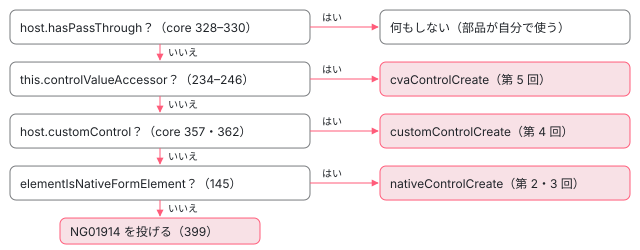

[目次](../README.md) › [Signal Forms の \[formField\]：フィールドと DOM の境目](README.md) › 第 1 回 / 全 6 回

# FormField の全体：1 つのディレクティブが相手を見分けるまで

> コンパイラが \[formField\] に ɵɵcontrolCreate と ɵɵcontrol を足し、core が素通しと value / checked の model を調べてから、form\_field.ts の FormField が CVA → カスタムコントロール → ネイティブの要素の順に経路を決めるまで（複数の CVA から選ぶ規則を標準の forms の selectValueAccessor に揃えた de56d74da39）、bindings.ts が前回の値と比べて状態を書く行、\[type\] を束縛した input で min / max の判定を最初の更新まで遅らせた 394ad0c2a26、FormRoot とファイル名の変更（f4a5b42ebe6）。

angular/angular · 読了 約 13 分 · 中核 · [サイトで読む（デモが動きます）](https://angular-deep-dive-cyan.vercel.app/chapter/sfd-form-field)

---

`[formField]` は、1 つのディレクティブ `FormField` で `<input>` にも自作の部品にも古い `ControlValueAccessor`（以下 CVA）にもつながります。この章では、**コンパイラが `[formField]` を見つけてから、core の命令が `FormField` に「ホストの情報」を渡し、`FormField` が 3 つの経路のどれに入るかを決めるまで**を 1 行ずつ追います。決める順（CVA → カスタムコントロール → ネイティブ）が de56d74da39 で標準の forms と揃った経緯と、`[type]` を束縛した input で `min` / `max` が付かなかった問題（394ad0c2a26）も、差分で確かめます。

読む対象は `packages/forms/signals/src/directive/form_field.ts`・`bindings.ts`、core の `packages/core/src/render3/instructions/control.ts`、コンパイラの `packages/compiler/src/template/pipeline/src/phases/control_directives.ts`、`@angular/forms` に移った `packages/forms/src/directives/native.ts`、spec は `test/web/form_field.spec.ts`・`interop.spec.ts` です。`form()` と `FieldState` の作り（`value` と `controlValue` が分かれている理由）は [signal-forms](../signals/17-signal-forms.md) で読みました。この章はその 8 節の続きです。

1. **1. FormField の全体**（この章）
2. [2. ネイティブの要素](02-sfd-native.md)
3. [3. parse エラーと validity](03-sfd-validity.md)
4. [4. カスタムコントロール](04-sfd-custom-control.md)
5. [5. ControlValueAccessor との互換](05-sfd-cva.md)
6. [6. spec と issue](06-sfd-tests-issues.md)

## 1. FormField が引き受けること

📄 `angular/packages/forms/signals/src/directive/form_field.ts` L83–104 （▶ の行: 85–87, 91–94）

```ts
 83 │ /**
 84 │  * Binds a form `FieldTree` to a UI control that edits it. A UI control can be one of several things:
 85 ▶  * 1. A native HTML input or textarea
 86 ▶  * 2. A signal forms custom control that implements `FormValueControl` or `FormCheckboxControl`
 87 ▶  * 3. A component that provides a `ControlValueAccessor`. This should only be used for backwards
 88 │  *    compatibility with reactive forms. Prefer options (1) and (2).
 89 │  *
 90 │  * This directive has several responsibilities:
 91 ▶  * 1. Two-way binds the field state's value with the UI control's value
 92 ▶  * 2. Binds additional forms related state on the field state to the UI control (disabled, required, etc.)
 93 ▶  * 3. Relays relevant events on the control to the field state (e.g. marks touched on blur)
 94 ▶  * 4. Provides a fake `NgControl` that implements a subset of the features available on the
 95 │  *    reactive forms `NgControl`. This is provided to improve interoperability with controls
 96 │  *    designed to work with reactive forms. It should not be used by controls written for signal
 97 │  *    forms.
 98 │  *
 99 │  * @category control
100 │  *
101 │  * @see [How the FormField directive works](guide/forms/signals/custom-controls#how-the-formfield-directive-works)
102 │  *
103 │  * @publicApi 22.0
104 │  */
```

85〜87 行目が、`[formField]` がつながる 3 種類の相手です。85 行目はネイティブの `input` と `textarea`（コメントにはありませんが、後で見るとおり `select` も入ります）、86 行目は `FormValueControl` か `FormCheckboxControl` を実装した Signal Forms の部品（**カスタムコントロール**。`value` か `checked` の `model()` を持つ部品のことです）、87 行目は CVA を provide する部品で、「後方互換のためだけ」と書かれています。91〜94 行目が仕事の一覧です。値の双方向の同期（91）、`disabled` や `required` などの状態を相手に書くこと（92）、`blur` で touched にするなどの通知（93）、そして偽の `NgControl` を出すこと（94）です。

デコレーター（105〜116 行目）と `field` の input（121 行目）は [signal-forms](../signals/17-signal-forms.md) の 8 節で引用しました。`providers` は 3 つで、`FORM_FIELD`（自分自身）・`NgControl`（偽の `InteropNgControl`、[forms-sf-submit-compat](../forms/19-forms-sf-submit-compat.md)）・`FORM_CONTROL_INTEGRATION`（`transformedValue` が parse エラーを届ける窓口、[第 3 回](03-sfd-validity.md)）です。

## 2. コンパイラと core：\[formField\] は「制御ディレクティブ」として呼ばれる

`FormField` は自分から DOM のイベントを購読しません。テンプレートのコンパイラが `[formField]` の束縛を見つけると、専用の命令を 2 つ出力します。

📄 `angular/packages/compiler/src/template/pipeline/src/phases/control_directives.ts` L53–88 （▶ の行: 57, 59, 64, 67, 74, 82–87）

```ts
53 │ function isRelevantCreateOp(createOp: ir.CreateOp): createOp is ir.CreateOp & {xref: ir.XrefId} {
54 │   return CONTROL_OP_CREATE_KINDS.has(createOp.kind);
55 │ }
56 │ 
57 ▶ function findCreateInstruction(view: ViewCompilationUnit, target: ir.XrefId): ir.CreateOp | null {
58 │   let lastFoundOp: ir.CreateOp | null = null;
59 ▶   for (const createOp of view.create) {
60 │     if (!isRelevantCreateOp(createOp) || createOp.xref !== target) {
61 │       continue;
62 │     }
63 │ 
64 ▶     lastFoundOp = createOp;
65 │   }
66 │ 
67 ▶   return lastFoundOp;
68 │ }
69 │ 
70 │ function addControlInstruction(
71 │   view: ViewCompilationUnit,
72 │   propertyOp: ir.PropertyOp | ir.TwoWayPropertyOp | ir.AttributeOp,
73 │ ): void {
74 ▶   const targetCreateOp = findCreateInstruction(view, propertyOp.target);
75 │   if (targetCreateOp === null) {
76 │     // If we didn't find a relevant create instruction, it's possible this property
77 │     // was applied to an element that doesn't support control instructions (like a
78 │     // structural directive or block). We can safely ignore it.
79 │     return;
80 │   }
81 │ 
82 ▶   const controlCreateOp = ir.createControlCreateOp(propertyOp.sourceSpan);
83 ▶   ir.OpList.insertAfter<ir.CreateOp>(controlCreateOp, targetCreateOp);
84 ▶   ir.OpList.insertAfter<ir.UpdateOp>(
85 ▶     ir.createControlOp(propertyOp.target, propertyOp.sourceSpan),
86 ▶     propertyOp,
87 ▶   );
88 │ }
```

`addControlInstruction` は、同じファイルの先頭の表（`ELIGIBLE_CONTROL_PROPERTIES`）で `formField`（ほかに `formControl`・`formControlName`・`ngModel`）という名前のプロパティ束縛を見つけたときに呼ばれます。74 行目で束縛の相手の要素の「作る命令」を 57〜68 行目の `findCreateInstruction` で探し、82〜83 行目でその後ろに `ɵɵcontrolCreate`、84〜87 行目で束縛の更新の後ろに `ɵɵcontrol` を入れます。更新の側は、この後の並べ替えの段で **その要素の全部のプロパティ束縛の後ろ**へ動きます（`ordering.ts` の `UPDATE_ORDERING` の最後が `OpKind.Control`。表は [domr-styling-overview](../domr/09-domr-styling-overview.md) で引用しました）。だから `<input [formField]="f" [type]="t()">` と書いても、`ɵɵcontrol` が走るときには `type` がもう書かれています（7 節で効いてきます）。

> [!NOTE]
> **さらに深く**
>
> この版の `findCreateInstruction` は、59〜65 行目で見つかるたびに 64 行目で上書きするので、67 行目で返すのはその要素の**最後の**作る命令（`ElementEnd`）です。だから `ɵɵcontrolCreate` はテンプレートの `(input)` などの `listener` の後に走り、利用者の `(input)` のほうが `FormField` の `input` の購読より先に呼ばれます。angular-main の 6688a3d5502（2026-07-28、fix(forms): create controls before listeners）は、最初の作る命令を返すように変え、`ɵɵcontrolCreate` を listener より前に出しました。サイトの 22.1.6 には入っていません。

core の側で、`ɵɵcontrolCreate` は最初の 1 回だけ、その要素に「制御ディレクティブ」と「カスタムコントロール」がいるかを調べて `TNode` に書きます。

📄 `angular/packages/core/src/render3/instructions/control.ts` L309–336 （▶ の行: 312, 314–315, 326, 328, 330, 335）

```ts
309 │ function initializeControlFirstCreatePass(tView: TView, tNode: TNode, lView: LView): void {
310 │   ngDevMode && assertFirstCreatePass(tView);
311 │ 
312 ▶   for (let i = tNode.directiveStart; i < tNode.directiveEnd; i++) {
313 │     const directiveDef = tView.data[i] as DirectiveDef<unknown>;
314 ▶     if (directiveDef.controlDef) {
315 ▶       tNode.controlDirectiveIndex = i;
316 │       break;
317 │     }
318 │   }
319 │ 
320 │   if (tNode.controlDirectiveIndex === -1) {
321 │     // No control directive found on this element.
322 │     return;
323 │   }
324 │ 
325 │   const controlDef = (tView.data[tNode.controlDirectiveIndex] as DirectiveDef<unknown>).controlDef!;
326 ▶   if (controlDef.passThroughInput) {
327 │     // This control directive has a `passThroughInput` property binding.
328 ▶     if ((tNode.inputs?.[controlDef.passThroughInput]?.length ?? 0) > 1) {
329 │       // Another directive has bound `controlDef.passThroughInput`.
330 ▶       tNode.flags |= TNodeFlags.isPassThroughControl;
331 │       return;
332 │     }
333 │   }
334 │ 
335 ▶   initializeCustomControlStatus(tView, tNode);
336 │ }
```

1. **制御ディレクティブを探す**

   312〜318 行目。要素に乗っているディレクティブのうち、定義に `controlDef` を持つ最初の 1 つの番号を `controlDirectiveIndex` に入れます。`controlDef` は `ɵngControlCreate` を持つディレクティブにコンパイラが付ける `ɵɵControlFeature` が作ります（signal-forms の 8 節）。
2. **素通し（pass-through）かを決める**

   326〜331 行目。`FormField` の `passThroughInput` は `'formField'` です（`ɵngControlCreate(host: ControlDirectiveHost<'formField'>)` の型引数から、コンパイラが取り出します）。同じ要素で `formField` という input を持つディレクティブが 2 つ以上いれば（328 行目）、330 行目で `isPassThroughControl` の印を付けて終わります。これは「`[formField]` を受け取って自分のテンプレートの中で使う部品」の場合で、`FormField` は 383〜385 行目（signal-forms の 8 節の引用）で何もせずに戻ります。
3. **カスタムコントロールを探す**

   335 行目で次の関数へ進みます。

📄 `angular/packages/core/src/render3/instructions/control.ts` L349–367 （▶ の行: 354, 357–359, 362–364）

```ts
349 │ function initializeCustomControlStatus(tView: TView, tNode: TNode): void {
350 │   for (let i = tNode.directiveStart; i < tNode.directiveEnd; i++) {
351 │     const directiveDef = tView.data[i] as DirectiveDef<unknown>;
352 │     // Host directives shouldn't be matched directly since their types are not in
353 │     // `directiveToIndex`. We match them through their host component's `hostDirectiveInputs` instead.
354 ▶     if (tNode.directiveToIndex && !tNode.directiveToIndex.has(directiveDef.type)) {
355 │       continue;
356 │     }
357 ▶     if (hasModelInput(directiveDef, 'value')) {
358 ▶       tNode.flags |= TNodeFlags.isFormValueControl;
359 ▶       tNode.customControlIndex = i;
360 │       return;
361 │     }
362 ▶     if (hasModelInput(directiveDef, 'checked')) {
363 ▶       tNode.flags |= TNodeFlags.isFormCheckboxControl;
364 ▶       tNode.customControlIndex = i;
365 │       return;
366 │     }
367 │   }
```

357 行目、`value` という **model の input**（input と `valueChange` の output の組）を持つディレクティブがあれば `isFormValueControl`、362 行目で `checked` なら `isFormCheckboxControl` の印を付け、その番号を `customControlIndex` に入れます。354 行目は、`hostDirectives` で付いたディレクティブをここでは数えない、という意味です（その場合はこの関数の後半で、ホストのコンポーネントの `hostDirectiveInputs` を通して探します。[第 4 回](04-sfd-custom-control.md)）。この番号が、`ControlDirectiveHost` の `customControl`（`lView[customControlIndex]` を返す getter）の中身です。

ここで分かるのは、**「カスタムコントロールかどうか」はクラスが `FormValueControl` を `implements` しているかでは決まらない**ことです。TypeScript の `implements` は実行時に残りません。core が見るのは、ディレクティブ定義の `inputs` に `value`（か `checked`）があり、それが model かどうかだけです。

## 3. FormField が作られたときに持つもの

📄 `angular/packages/forms/signals/src/directive/form_field.ts` L134–168 （▶ の行: 142, 145–147, 155–157, 162, 165, 168）

```ts
134 │   /**
135 │    * The node injector for the DOM element hosting this field binding.
136 │    */
137 │   readonly injector = inject(Injector);
138 │ 
139 │   /**
140 │    * The DOM element hosting this field binding.
141 │    */
142 ▶   readonly element = inject<ElementRef<HTMLElement>>(ElementRef).nativeElement;
143 │ 
144 │   // Compute some helper booleans about the type of element we're sitting on.
145 ▶   private readonly elementIsNativeFormElement = isNativeFormElement(this.element);
146 ▶   private readonly elementAcceptsTextualValues = isTextualFormElement(this.element);
147 ▶   private _elementAcceptsMinMax: boolean | undefined;
148 │ 
149 │   /**
150 │    * Utility that casts `this.element` to `NativeFormControl` to avoid repeated type guards. Only
151 │    * safe to access when `elementIsNativeFormElement` is true.
152 │    *
153 │    * @internal
154 │    */
155 ▶   readonly nativeFormElement: NativeFormControl = (this.elementIsNativeFormElement
156 ▶     ? this.element
157 ▶     : undefined) as NativeFormControl;
158 │ 
159 │   /**
160 │    * Current focus implementation, set by `registerAsBinding`.
161 │    */
162 ▶   private focuser = (options?: FocusOptions) => this.element.focus(options);
163 │ 
164 │   /** Any `ControlValueAccessor` instances provided on the host element. */
165 ▶   private readonly controlValueAccessors = inject(NG_VALUE_ACCESSOR, {optional: true, self: true});
166 │ 
167 │   private readonly config = inject(SIGNAL_FORMS_CONFIG, {optional: true});
168 ▶   private readonly validityMonitor = inject(InputValidityMonitor);
```

142 行目でホストの要素を取ります。145〜146 行目の 2 つの真偽値は、**constructor の中で 1 回だけ**計算されます。`isNativeFormElement` は `tagName` が `INPUT`・`SELECT`・`TEXTAREA` のどれか、`isTextualFormElement` は `INPUT` か `TEXTAREA` か、です（7 節の引用の 24〜28 行目と 39〜41 行目）。タグの名前は後から変わらないので、ここで決めて構いません。147 行目の `_elementAcceptsMinMax` だけは `undefined` のまま置かれ、後で決まります（7 節）。

155〜157 行目の `nativeFormElement` は、ネイティブの要素のときだけ要素そのもの、それ以外は `undefined` です。162 行目の `focuser` は既定で要素の `focus()` を呼び、カスタムコントロールが `focus` を渡せば差し替わります（[第 4 回](04-sfd-custom-control.md)）。165 行目で **同じ要素の**`NG_VALUE_ACCESSOR` を `{optional: true, self: true}` で集めます。`self` なので、親の要素に CVA があっても拾いません。168 行目の `InputValidityMonitor` は日付の input の検証の変化を拾うサービスです（[第 3 回](03-sfd-validity.md)）。

## 4. 経路を決める順：CVA → カスタムコントロール → ネイティブ

`ɵngControlCreate`（form\_field.ts の 382〜408 行目）の本体は [signal-forms](../signals/17-signal-forms.md) の 8 節で引用しました。387 行目の `this.controlValueAccessor` が値を返せば `cvaControlCreate`、389 行目の `host.customControl`（2 節の 357〜365 行目が決めた番号）があれば `customControlCreate`、391 行目の `elementIsNativeFormElement`（3 節の 145 行目）なら `nativeControlCreate`、どれでもなければ 399 行目で `INVALID_FIELD_DIRECTIVE_HOST` を投げます。最初に問われる `controlValueAccessor` の中身がこれです。

📄 `angular/packages/forms/signals/src/directive/form_field.ts` L229–247 （▶ の行: 235–236, 242–244）

```ts
229 │   /**
230 │    * A `ControlValueAccessor`, if configured, for the host component.
231 │    *
232 │    * @internal
233 │    */
234 │   get controlValueAccessor(): ControlValueAccessor | undefined {
235 ▶     if (!this.controlValueAccessors || this.controlValueAccessors.length === 0) {
236 ▶       return this.interopNgControl?.valueAccessor ?? undefined;
237 │     }
238 │ 
239 │     // Rely on the exact logic in `@angular/forms` to pick the accessors with correct priority,
240 │     // passing our fake `InteropNgControl` to fulfill its first parameter requirement.
241 │     return (
242 ▶       selectValueAccessor(
243 ▶         this.interopNgControl as unknown as NgControl,
244 ▶         this.controlValueAccessors,
245 │       ) ?? undefined
246 │     );
247 │   }
```

1. **同じ要素に NG\_VALUE\_ACCESSOR が無い**

   235〜236 行目。`interopNgControl.valueAccessor` を返します。これは、部品が `NG_VALUE_ACCESSOR` を provide せずに、constructor で `inject(NgControl).valueAccessor = this` と自分を登録する書き方（標準の forms でもよく使う形）のためです。`NgControl` は 110 行目の provider（signal-forms の 8 節の引用）で `FormField` の `interopNgControl` になるので、部品が自分を入れた先がここです。部品の constructor は `FormField` の `ɵngControlCreate` より先に走るので、この時点で入っています。
2. **ある**

   242〜245 行目。標準の forms の `selectValueAccessor` をそのまま呼びます。中身（独自の CVA → 組み込みの CVA → `DefaultValueAccessor` の順に選び、同じ種類が 2 つあれば開発モードで投げる）は [forms-value-accessor](../forms/09-forms-value-accessor.md) で読みました。243 行目は、第 1 引数に `NgControl` を要求する関数に偽の `InteropNgControl` を渡しているだけで、エラーの文言に使われます。

de56d74da39 の前は、ここが配列の先頭を取るだけでした。

📄 `git show de56d74da39（form_field.ts の部分）`

```
$ git show de56d74da39 -- packages/forms/signals/src/directive/form_field.ts
# fix(forms): align FormField CVA selection priority with standard forms（2026-04-03）
@@ -193,7 +194,18 @@ export class FormField<T> {
    * @internal
    */
   get controlValueAccessor(): ControlValueAccessor | undefined {
-    return this.controlValueAccessors?.[0] ?? this.interopNgControl?.valueAccessor ?? undefined;
+    if (!this.controlValueAccessors || this.controlValueAccessors.length === 0) {
+      return this.interopNgControl?.valueAccessor ?? undefined;
+    }
+
+    // Rely on the exact logic in `@angular/forms` to pick the accessors with correct priority,
+    // passing our fake `InteropNgControl` to fulfill its first parameter requirement.
+    return (
+      selectValueAccessor(
+        this.interopNgControl as unknown as NgControl,
+        this.controlValueAccessors,
+      ) ?? undefined
+    );
   }
 
   /**
```

`controlValueAccessors?.[0]` は「DI が集めた順で最初のもの」です。`<custom-control [formField]="f" ngDefaultControl />` のように `DefaultValueAccessor` も乗る要素では、どちらが先に来るかは import の順で変わります。このコミットで標準の forms の関数を `ɵselectValueAccessor` として出し（`packages/forms/src/forms.ts`）、`readonly` の配列も受け取れるように型を広げて、同じ規則にしました。



*ɵngControlCreate が経路を決める順。上から順に問い、最初に当たった経路の「更新の関数」を ɵngControlUpdate に入れる*

| ホストに乗っているもの | 入る経路 | 決める行 |
| --- | --- | --- |
| 同じ要素に `NG_VALUE_ACCESSOR`（何であっても） | CVA（`cvaControlCreate`） | 387（`value` の model を持っていても CVA が勝つ） |
| `NG_VALUE_ACCESSOR` は無いが、部品が `NgControl.valueAccessor` に自分を入れた | CVA | 236 → 387 |
| `value` か `checked` の model を持つディレクティブ | カスタムコントロール（`customControlCreate`） | core の 357・362 → 389 |
| `input`・`select`・`textarea` | ネイティブ（`nativeControlCreate`） | 145 → 391 |
| それ以外（`<div>` など） | エラー NG01914（`INVALID_FIELD_DIRECTIVE_HOST`） | 399 |
| 別のディレクティブも `formField` の input を持つ | 何もしない（素通し） | core の 328〜330 → 383 |

> [!NOTE]
> **ポイント**
>
> CVA がカスタムコントロールより先なのは、部品の作者が `NG_VALUE_ACCESSOR` を provide したなら、それが「この部品は CVA として扱ってほしい」という明示の宣言だからです。`value` という名前の model はたまたま付いていることがある（`<input>` を包んだだけの部品など）ので、名前だけで判断するほうを後に回しています。DEMO の「両方を持つ部品」で確かめられます。CVA の経路の中身は[第 5 回](05-sfd-cva.md)、カスタムコントロールの経路の中身は[第 4 回](04-sfd-custom-control.md)で読みます。

## 5. bindings.ts：状態を「前回の値」と比べて書く

3 つの経路はどれも、`FieldState` の状態（`disabled`・`required`・`errors` など 16 個）を相手に書きます。状態の名前と束縛の名前の表（`FIELD_STATE_KEY_TO_CONTROL_BINDING`、25〜42 行目）と、名前から状態を読む `readFieldStateBindingValue`（58〜64 行目）は [forms-sf-rules-metadata](../forms/18-forms-sf-rules-metadata.md) で引用しました。残りの 3 つの関数です。

📄 `angular/packages/forms/signals/src/directive/bindings.ts` L66–84 （▶ の行: 67–68, 70–71, 79–81）

```ts
66 │ /** The keys of {@link FIELD_STATE_KEY_TO_CONTROL_BINDING} */
67 ▶ export const CONTROL_BINDING_NAMES = /* @__PURE__ */ (() =>
68 ▶   Object.values(FIELD_STATE_KEY_TO_CONTROL_BINDING))() as Array<ControlBindingKey>;
69 │ 
70 ▶ export function createBindings<TKey extends string>(): {[K in TKey]?: unknown} {
71 ▶   return {};
72 │ }
73 │ 
74 │ export function bindingUpdated<TKey extends string>(
75 │   bindings: {[K in TKey]?: unknown},
76 │   key: TKey,
77 │   value: unknown,
78 │ ) {
79 ▶   if (bindings[key] !== value) {
80 ▶     bindings[key] = value;
81 ▶     return true;
82 │   }
83 │   return false;
84 │ }
```

67〜68 行目の `CONTROL_BINDING_NAMES` は表の値の一覧で、各経路の更新の関数はこれを順に回します。70〜72 行目の `createBindings` はただの空のオブジェクトで、経路ごとに 1 つ持つ「前回に書いた値」の箱です。79〜81 行目の `bindingUpdated` は、前回と `!==` で比べて違えば箱を更新して `true` を返します。**変わったものだけ DOM や部品に書く**のは、この関数のおかげです。

> [!WARNING]
> **ハマりどころ**
>
> 79 行目の `!==` は `NaN` を前回と違うと判断します（`NaN !== NaN` は `true`）。だからモデルの値が `NaN` の数のフィールドは、変更検知のたびに値を書き直します。angular-main の e118e155271（2026-10-05、fix(forms): use `Object.is` when comparing control bindings in signal forms）がここを `!Object.is(...)` に変えました。サイトの 22.1.6 は `!==` のままです（`fesm2022/signals.mjs` の `bindingUpdated` で確かめました）。同じ変更は 2e32872720e にも含まれていましたが、そちらは revert されました（[第 2 回](02-sfd-native.md)）。

## 6. registerAsBinding：フィールドに「この要素で表示している」と登録する

3 つの経路はどれも、作る関数の中で `parent.registerAsBinding()` を呼びます。前半（306〜325 行目、二重の登録を投げる・`focus` と `reset` の差し替え）は[第 4 回](04-sfd-custom-control.md)で引用します。後半です。

📄 `angular/packages/forms/signals/src/directive/form_field.ts` L326–364 （▶ の行: 330, 332–335, 337–339, 346, 350, 352）

```ts
326 │ 
327 │     // Register this control on the field state it is currently bound to. We do this at the end of
328 │     // initialization so that it only runs if we are actually syncing with this control
329 │     // (as opposed to just passing the field state through to its `formField` input).
330 ▶     effect(
331 │       (onCleanup) => {
332 ▶         const fieldNode = this.state() as unknown as FieldNode;
333 ▶         fieldNode.nodeState.formFieldBindings.update((controls) => [
334 ▶           ...controls,
335 ▶           this as FormField<unknown>,
336 │         ]);
337 ▶         onCleanup(() => {
338 ▶           fieldNode.nodeState.formFieldBindings.update((controls) =>
339 ▶             controls.filter((c) => c !== this),
340 │           );
341 │         });
342 │       },
343 │       {injector: this.injector},
344 │     );
345 │ 
346 ▶     if (typeof ngDevMode !== 'undefined' && ngDevMode) {
347 │       effect(
348 │         () => {
349 │           const fieldNode = this.state() as unknown as FieldNode;
350 ▶           if (fieldNode.hidden()) {
351 │             const path = fieldNode.structure.pathKeys().join('.') || '<root>';
352 ▶             console.warn(
353 │               formatRuntimeError(
354 │                 RuntimeErrorCode.RENDERED_HIDDEN_FIELD,
355 │                 `Field '${path}' is hidden but is being rendered. ` +
356 │                   `Hidden fields should be removed from the DOM using @if.`,
357 │               ),
358 │             );
359 │           }
360 │         },
361 │         {injector: this.injector},
362 │       );
363 │     }
364 │   }
```

330〜344 行目の `effect` が、`FieldNode` の `nodeState.formFieldBindings`（このフィールドを表示している `FormField` の配列）に自分を足し、337〜341 行目の `onCleanup` で抜きます。`this.state()` を読んでいるので、`[formField]` に渡すフィールドが変わると、古いフィールドから抜けて新しいフィールドに入ります。この配列を読むのは 4 か所です。`field/node.ts` の `getBindingForFocus`（`focusBoundControl()` がどの要素にフォーカスするか）と `_reset`（各 `FormField` の `reset()` を呼ぶ）、`field/validation.ts` の `parseErrors`（各 `FormField` の parse エラーを集める。[第 3 回](03-sfd-validity.md)）と `getFirstBoundElement`（エラーを DOM の位置で並べる）です。346〜363 行目は開発モードだけの警告で、`hidden()` のフィールドを描いていれば NG01916 を出します（d75046bc091）。web の spec を走らせると、この警告がログに 8 回出ます（テストの節）。

327〜329 行目のコメントのとおり、登録は「作る関数の最後」です。2 節の素通しの場合は作る関数を呼ばないので登録もしません。素通しの部品は受け取ったフィールドを自分のテンプレートの `[formField]` に渡し、そちらの `FormField` が登録します。

## 7. 型が後から決まる input と、@angular/forms に移ったユーティリティ

`min` / `max` を DOM の属性として書いてよいかは、input の `type` で決まります。その判定は今は `@angular/forms` の側にあります。

📄 `angular/packages/forms/src/directives/native.ts` L19–41 （▶ の行: 24, 26, 30–31, 35–36, 39–40）

```ts
19 │ export type NativeFormControl =
20 │   | HTMLInputElement
21 │   | HTMLSelectElement
22 │   | (HTMLTextAreaElement & {type: 'textarea'});
23 │ 
24 ▶ export function isNativeFormElement(element: HTMLElement): element is NativeFormControl {
25 │   return (
26 ▶     element.tagName === 'INPUT' || element.tagName === 'SELECT' || element.tagName === 'TEXTAREA'
27 │   );
28 │ }
29 │ 
30 ▶ export function elementAcceptsMinMax(element: HTMLElement): boolean {
31 ▶   if (element.tagName !== 'INPUT') {
32 │     return false;
33 │   }
34 │ 
35 ▶   const type = (element as HTMLInputElement).type;
36 ▶   return type === 'number' || type === 'range' || type === 'date' || type === 'month';
37 │ }
38 │ 
39 ▶ export function isTextualFormElement(element: HTMLElement): boolean {
40 ▶   return element.tagName === 'INPUT' || element.tagName === 'TEXTAREA';
41 │ }
```

24〜28 行目と 39〜41 行目はタグの名前だけを見ます。30〜37 行目の `elementAcceptsMinMax` は、35 行目で **その時点の**`type` を読み、36 行目の 4 つ（`number`・`range`・`date`・`month`）なら `true` を返します。このファイルは 9d19d2321a8（2026-01-27、refactor(forms): move native utilities up to @angular/forms）が `forms/signals` から移したもので、標準の forms の `ng_control.ts` もこの `isNativeFormElement` と `setNativeDomProperty` を import しています（リアクティブフォームの `[formControl]` がカスタムコントロールにつながる経路のため）。`forms/signals` の `native.ts` は `ɵ` 付きの名前で import し直しています（[第 2 回](02-sfd-native.md)）。36 行目に `date` と `month` が入ったのは 1f30aacbe5d（2026-05-05、`minDate` / `maxDate` を `min` / `max` の属性に書く変更）で、その前の名前は `isNumericFormElement` でした。

394ad0c2a26 は、この判定を呼ぶ時期を変えました。

📄 `git show 394ad0c2a26（form_field.ts の部分）`

```
$ git show 394ad0c2a26 -- packages/forms/signals/src/directive/form_field.ts
# fix(forms): allow late-bound input types for signals forms（2026-03-24、Fixes #66987）
@@ -131,8 +131,8 @@ export class FormField<T> {
 
   // Compute some helper booleans about the type of element we're sitting on.
   private readonly elementIsNativeFormElement = isNativeFormElement(this.element);
-  private readonly elementAcceptsNumericValues = isNumericFormElement(this.element);
   private readonly elementAcceptsTextualValues = isTextualFormElement(this.element);
+  private _elementAcceptsNumericValues: boolean | undefined;
 
   /**
    * Utility that casts `this.element` to `NativeFormControl` to avoid repeated type guards. Only
@@ -360,7 +360,8 @@ export class FormField<T> {
     switch (key) {
       case 'min':
       case 'max':
-        return this.elementAcceptsNumericValues;
+        return (this._elementAcceptsNumericValues ??= isNumericFormElement(this.element));
+
       case 'minLength':
       case 'maxLength':
         return this.elementAcceptsTextualValues;
```

変更の前は、判定を**フィールドの初期化子**（constructor の中）で計算していました。`<input [type]="inputType()" [formField]="f">` では、`[type]` はプロパティ束縛なので、最初の更新の時に初めて書かれます。constructor の時点の `type` は既定の `'text'` なので、`number` の input でも `min` が付きませんでした（#66987）。変更の後は、`elementAcceptsNativeProperty` の中で最初に `'min'` か `'max'` を聞かれたときに計算して `??=` で覚えます。最初に聞かれるのは最初の `ɵngControlUpdate` の中で、2 節のとおりその時には `[type]` がもう書かれています。

> [!WARNING]
> **ハマりどころ**
>
> `??=` なので、計算は 1 回だけです。最初の更新の後で `[type]` の値が `text` から `number` に変わっても、`_elementAcceptsMinMax` は `false` のままで、`min` / `max` の属性は書かれません。spec（テストの節）が確かめているのは「初期化の間に late-bound された」場合だけです。同じ「作るときに 1 回だけ `type` を見る」形は、`control_native.ts` の検証の監視にもあります（[第 3 回](03-sfd-validity.md)）。

## 8. FormRoot と、ファイル名の変更

`<form [formRoot]="f">` の `FormRoot`（`form_root.ts` の 35〜57 行目）は、`novalidate` を付け、`submit` イベントで既定の動作を止めて、フォームに `submission` の設定があれば `submit(f)` を呼ぶだけのディレクティブです。中身は [forms-sf-submit-compat](../forms/19-forms-sf-submit-compat.md) で読みました。`FormField` とは独立していて、`FormRoot` が中の `[formField]` を探すことはありません。

この 2 つのファイルは、2026-03 に今の名前になりました。古い記事や issue の行のリンクを読むときに必要になります。

📄 `git show --stat f4a5b42ebe6`

```
$ git show --stat f4a5b42ebe6   # refactor(forms): rename directive files for consistency (#67727)、2026-03-17
 .../signals/src/directive/{form_field_directive.ts => form_field.ts}  | 0
 .../forms/signals/src/directive/{ng_signal_form.ts => form_root.ts}   | 0
 .../signals/test/node/{ng_signal_form.spec.ts => form_root.spec.ts}   | 0
 .../test/web/{form_field_directive.spec.ts => form_field.spec.ts}     | 0
 （ほかに import の行を 1 行ずつ直したファイルが 10 個）
 14 files changed, 11 insertions(+), 11 deletions(-)
```

同じ PR（#67727）の 0eeb1b5f033 が、`submission` の無いフォームでも `FormRoot` を使えるようにしました（`form_root.ts` の 52 行目の `if`）。

## 9. DEMO：同じフィールドを 5 つの相手につなぎ替える

> **🧪 DEMO — FormField はどの経路を選んだか**
>
> 本物の `@angular/forms/signals`（22.1.6）です。`form(signal('angular'), p => { required(p, { when }); disabled(p, { when }) })` の 1 つのフィールドを、選んだ相手に `[formField]` でつなぎます。FVC は `value = model('')` だけの部品、CVA は `NG_VALUE_ACCESSOR` を provide する部品、「両方」は `value` の model も `NG_VALUE_ACCESSOR` も持つ部品です。部品の中の input に打つと、部品がモデルへ渡す道（`valueChange` か `onChange`）がログに出ます。
>
> ▶ [このデモはサイトで動かせます](https://angular-deep-dive-cyan.vercel.app/chapter/sfd-form-field)

手元の Chrome（headless）で、相手ごとに「ng と打つ → モデルに set → required と disabled を切り替える → 外から調べる」を押した結果です。

| 相手 | DOM の required 属性 | writeValue の回数 | value の input に書かれた回数 | 部品がモデルへ渡す道 | disabled を切り替えたとき |
| --- | --- | --- | --- | --- | --- |
| `<input>` | あり | 0 | 0 | `input` イベント → parser → `controlValue.set` | DOM の `disabled` 属性 |
| `<select>` | あり | 0 | 0 | 同じ（`input` イベント） | DOM の `disabled` 属性 |
| FVC | なし | 0 | 2（付け替えたときと set のとき） | `value.set` → `valueChange` | （`disabled` の input を持たないので何も届かない） |
| CVA | なし | 2 | 0 | `onChange(v)` | `setDisabledState(true)` / `(false)` |
| 両方を持つ部品 | なし | 2 | 0 | `onChange(v)` | `setDisabledState` |

`required` 属性がネイティブの要素にだけ付くのは、`elementAcceptsNativeProperty`（[forms-sf-rules-metadata](../forms/18-forms-sf-rules-metadata.md) の引用の 418〜420 行目）がネイティブでなければ `false` を返すからです。「両方を持つ部品」で `value` の input が 1 度も書かれないのが、4 節の 387 行目が 389 行目より先にあることの確かめです。CVA の 4 つのメソッドが呼ばれる順（`registerOnChange` → `registerOnTouched` → `writeValue` → `setDisabledState`）は[第 5 回](05-sfd-cva.md)で読みます。

## ここまでの呼び出し

- 👤 `<input [formField]="f">` を書く
  - `addControlInstruction` — control\_directives.ts 70–87 — *コンパイル時。ɵɵcontrolCreate と ɵɵcontrol を足す*
  - `new FormField()` — form\_field.ts 142–168 — *タグの名前の判定・NG\_VALUE\_ACCESSOR を self で集める*
  - `ɵɵcontrolCreate` → `initializeControlFirstCreatePass` — control.ts 309–336 — *最初の 1 回だけ*
    - `initializeCustomControlStatus` — control.ts 349–367 — *value / checked の model を探す*
    - `FormField.ɵngControlCreate(host)` — form\_field.ts 382–408
      - `this.controlValueAccessor` → `selectValueAccessor` — form\_field.ts 234–246
      - `cvaControlCreate` / `customControlCreate` / `nativeControlCreate` — 387 / 389 / 391 — *更新の関数を返す*
        - `registerAsBinding()` — form\_field.ts 306–364 — *formFieldBindings に入る*
  - `ɵɵcontrol` → `ɵngControlUpdate()` — テンプレートの更新のたび
    - `bindingUpdated(bindings, name, value)` — bindings.ts 74–84 — *変わったものだけ書く*

## テストと直し方

この章の約束は `packages/forms/signals/test/web/form_field.spec.ts` の `describe('field directive')`（94 行目）と `interop.spec.ts` の `describe('ControlValueAccessor')`（59 行目）が固めています。経路の入口は `it('should throw for invalid field directive host')`（5837 行目）、`describe('field input')`（95 行目）の `it('should bind new field to control when changed')`（96 行目）、7 節は `describe('min')`（2797 行目）の `it('should apply min/max if type is late-bound to a numeric type during initialization')`（2818 行目）と、`describe('maxLength')` の 3401 行目の同じ形の it、4 節は `interop.spec.ts` の 522 行目です。

📄 `angular/packages/forms/signals/test/web/form_field.spec.ts` L5837–5849 （▶ の行: 5840, 5846–5847）

```ts
5837 │   it('should throw for invalid field directive host', () => {
5838 │     @Component({
5839 │       imports: [FormField],
5840 ▶       template: `<div [formField]="f"></div>`,
5841 │     })
5842 │     class TestCmp {
5843 │       f = form(signal(''));
5844 │     }
5845 │ 
5846 ▶     expect(() => act(() => TestBed.createComponent(TestCmp))).toThrowError(
5847 ▶       /<div> is an invalid \[formField\] directive host\./,
5848 │     );
5849 │   });
```

5840 行目の `<div>` は 3 つの経路のどれにも当たらず、5847 行目の文言は form\_field.ts の 403 行目（signal-forms の 8 節の引用。`host.descriptor` が `<div>`）から来ます。

📄 `angular/packages/forms/signals/test/web/form_field.spec.ts` L2818–2834 （▶ の行: 2821, 2824, 2832, 2834）

```ts
2818 │       it('should apply min/max if type is late-bound to a numeric type during initialization', () => {
2819 │         @Component({
2820 │           imports: [FormField],
2821 ▶           template: `<input [type]="inputType()" [formField]="f" />`,
2822 │         })
2823 │         class TestCmp {
2824 ▶           readonly inputType = signal('number');
2825 │           readonly min = signal(10);
2826 │           readonly f = form(signal(15), (p) => {
2827 │             min(p, this.min);
2828 │           });
2829 │         }
2830 │ 
2831 │         const fixture = act(() => TestBed.createComponent(TestCmp));
2832 ▶         const input = fixture.nativeElement.firstChild as HTMLInputElement;
2833 │ 
2834 ▶         expect(input.min).toBe('10');
```

2821 行目が `[type]` の束縛、2834 行目が「`min` の属性が付いた」です。7 節の注意のとおり、`inputType` を後から変える場合は確かめていません。

📄 `angular/packages/forms/signals/test/web/interop.spec.ts` L522–539 （▶ の行: 527–528, 537–538）

```ts
522 │   it('should pick custom CVA over default CVA when both are present', () => {
523 │     @Component({
524 │       selector: 'app-root',
525 │       // Import ReactiveFormsModule to provide the non-standalone DefaultValueAccessor directive.
526 │       // The selector for DefaultValueAccessor matches `[ngDefaultControl]`.
527 ▶       imports: [FormField, CustomControl, ReactiveFormsModule],
528 ▶       template: `<custom-control [formField]="f" ngDefaultControl />`,
529 │     })
530 │     class App {
531 │       f = form<string>(signal(''));
532 │     }
533 │ 
534 │     const fixture = act(() => TestBed.createComponent(App));
535 │     const customControlInstance = fixture.debugElement.children[0].injector.get(CustomControl);
536 │ 
537 ▶     act(() => fixture.componentInstance.f().value.set('updated'));
538 ▶     expect(customControlInstance.writeCount).toBe(2); // 1 initial + 1 update
539 │   });
```

528 行目で `ngDefaultControl` を付けて `DefaultValueAccessor` も同じ要素に乗せ、538 行目で独自の CVA の `writeValue` が 2 回（最初と set の後）呼ばれたことを確かめます。de56d74da39 の前は、DI の順によっては `DefaultValueAccessor` が選ばれていました。

📄 `走らせ方`

```
cd ~/angular-research/angular
# web の suite（Chromium で全部の spec を 1 本の bundle にして走らせる。--test_arg=--filter は効かない）
pnpm bazel test //packages/forms/signals/test/web:test_chromium \
  --nocache_test_results --test_output=all
```

📄 `結果`

```
# 2026-11-16、手元の macOS で（8576f161ae4）
Chromium: |██████████████████████████████| 1/1 test files | 350 passed, 0 failed
Finished running tests in 1s, all tests passed!
//packages/forms/signals/test/web:test_chromium                          PASSED in 1.5s
# 途中の Browser logs に NG01921（text input が null を受けた）が 4 回、NG01916（hidden の field を描いている）が 8 回出る
# 350 は test/web の 15 個の spec ファイル（form_field.spec.ts 208・interop.spec.ts 42 など）の合計
```

### 直すとしたら

- 7 節の「最初の更新の後で `[type]` が変わると `min` / `max` が書かれない」は、`FormField.elementAcceptsNativeProperty`（form\_field.ts の 414〜437 行目、[forms-sf-rules-metadata](../forms/18-forms-sf-rules-metadata.md) の引用）の `??=` が原因です。毎回 `elementAcceptsMinMax(this.element)` を呼ぶ形にすると判定は正しくなりますが、`bindingUpdated` は値が変わったときにしか呼ばないので、`type` だけが変わったときに `min` を書き直すきっかけも要ります。spec は `form_field.spec.ts` の `describe('min')`（2797 行目）に、2818 行目の it と同じ部品で `inputType` を `'text'` から始めて後で `'number'` にする it を足す形です。
- 4 節の順は `interop.spec.ts` の 522 行目が固めています。「`value` の model と `NG_VALUE_ACCESSOR` を両方持つ部品」（DEMO の 5 つ目）を固める it は無いので、`describe('ControlValueAccessor')`（59 行目）に足すならここです。

## 聞かれそうな質問

**Q. FormValueControl を implements し忘れた部品は、カスタムコントロールとして扱われますか？**

扱われます。core の `initializeCustomControlStatus` は 357 行目でディレクティブ定義に `value` の model があるかだけを見ます。`implements` は型チェックのためのもので、実行時には残りません。逆に、`implements` していても `value` が `model()` でなく `input()` だけなら当たりません。

**Q. value の model を持つ部品が NG\_VALUE\_ACCESSOR も provide していたら、どちらになりますか？**

CVA です。`ɵngControlCreate` の 387 行目（`controlValueAccessor`）が 389 行目（`host.customControl`）より先です。DEMO の「両方を持つ部品」で、`writeValue` だけが呼ばれ `value` の input は書かれないのが見えます。

**Q. &lt;div \[formField\]&gt; はなぜエラーになるのですか？どのエラーですか？**

`div` は CVA でもカスタムコントロールでもなく、145 行目の `isNativeFormElement` も `false` なので、399 行目で `INVALID_FIELD_DIRECTIVE_HOST`（NG01914。`errors.ts` の enum で 1914）を投げます。`contenteditable` の要素を使いたいときは、その要素を包んだ部品に `value` の model を持たせてカスタムコントロールにします。

**Q. \[formField\] を受け取る自作の部品に \[formField\] を書くと、FormField は二重に動きませんか？**

動きません。部品が `formField` という input を持つと、同じ要素で `formField` を持つディレクティブが 2 つになり、core の 328〜330 行目で素通しの印が付きます。`FormField` は 383〜385 行目で何もせずに戻り、`registerAsBinding` も呼びません。

**Q. &lt;input \[type\]="t()" \[formField\]="f"&gt; で min の属性が付かないことはありますか？**

最初の描画では付きます。`ɵɵcontrol` は並べ替えでプロパティ束縛の後ろに回るので、最初の `ɵngControlUpdate` の時には `type` が書かれていて、394ad0c2a26 の `??=` がそこで判定します。ただし判定は 1 回だけなので、その後 `t()` が `text` から `number` に変わった場合は付きません（7 節）。

## 読み終えて

- コンパイラが `[formField]` の束縛に `ɵɵcontrolCreate` と `ɵɵcontrol` を足し、`ɵɵcontrol` はその要素のプロパティ束縛の後ろに並ぶ
- core は最初の 1 回だけ、制御ディレクティブ・素通し・`value` / `checked` の model を調べて `TNode` に書く。カスタムコントロールかどうかは `implements` ではなく model の有無で決まる
- `FormField` は CVA（`selectValueAccessor` で標準の forms と同じ優先順位、de56d74da39）→ カスタムコントロール → ネイティブ → エラーの順に決める
- 状態は `bindingUpdated` の `!==` で前回と比べ、変わったものだけ書く（angular-main では `Object.is`）
- `min` / `max` を書けるかの判定は最初の更新で 1 回だけ。394ad0c2a26 で `[type]` の束縛には効くようになったが、後からの変更には効かない

---

← 前: [spec と issue を読む：upgrade を固めているテスト](../upg/06-upg-tests-issues.md)  
次: [ネイティブの要素：input・select・checkbox・radio の読み書き](02-sfd-native.md) →
