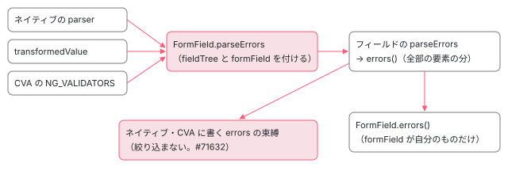

[目次](../README.md) › [Signal Forms の \[formField\]：フィールドと DOM の境目](README.md) › 第 3 回 / 全 6 回

# parse エラーと validity：ブラウザの検証をフィールドに戻す

> parse エラーが 3 つの出す側から FormField の parseErrorsSource に入り、FormField.parseErrors（f43bad4d7b7 の shallowArrayEquals）を通ってフィールドの errors() に並ぶまで、validity.badInput を parse エラーにする行、input\_validity\_monitor.ts が :valid / :invalid のアニメーションの animationstart で input イベントの無い変化を拾う仕組みとリスナーの外し忘れの修正（6cc54e5edef）、transformed\_value.ts の transformedValue、同じフィールドの別の要素に parse エラーが届く #71632 と \[formControl\] での 1 回遅れ（#71127）。

angular/angular · 読了 約 13 分 · 発展 · [サイトで読む（デモが動きます）](https://angular-deep-dive-cyan.vercel.app/chapter/sfd-validity)

---

Signal Forms の「parse エラー」は、規則（`validate()` など）が出すエラーと違い、**UI の文字をモデルの値に直せなかった**ことを表すエラーです。モデルは書き換わらず、エラーだけがフィールドに付きます。この章では、parse エラーがどこで生まれ（ネイティブの input の parser・`transformedValue`・ブラウザの `validity.badInput`）、`FormField` の `parseErrors` を通ってフィールドの `errors()` に入るまでを 1 行ずつ追います。ブラウザが `input` イベントを出さずに検証の状態だけを変える場面を、CSS の `animationstart` で拾う `InputValidityMonitor` の仕掛けも読みます。

読む対象は `packages/forms/signals/src/directive/input_validity_monitor.ts`・`form_field.ts`・`native.ts`・`control_native.ts`、`src/api/transformed_value.ts`、`src/field/validation.ts`、`src/util/array.ts`、spec は `test/web/input_validity_monitor.spec.ts`・`number_input.spec.ts`・`form_field.spec.ts` と `test/node/parse_errors.spec.ts` です。parser（`util/parser.ts` の `createParser`）の本体は [signal-forms](../signals/17-signal-forms.md) の 8 節、規則のエラーと `errors()` の合成は [forms-sf-validation](../forms/17-forms-sf-validation.md) で読みました。

1. [1. FormField の全体](01-sfd-form-field.md)
2. [2. ネイティブの要素](02-sfd-native.md)
3. **3. parse エラーと validity**（この章）
4. [4. カスタムコントロール](04-sfd-custom-control.md)
5. [5. ControlValueAccessor との互換](05-sfd-cva.md)
6. [6. spec と issue](06-sfd-tests-issues.md)

## 1. parse エラーの入口：FormField の parseErrorsSource

parse エラーを出す側は 3 つありますが、どれも `FormField` の 1 つの signal に「エラーの signal」を入れます。

📄 `angular/packages/forms/signals/src/directive/form_field.ts` L212–227 （▶ の行: 215–216, 220–221）

```ts
212 │   private parseErrorsResetCallback?: (value?: unknown) => void;
213 │ 
214 │   /** @internal */
215 ▶   setParseErrors(source: Signal<ReadonlyArray<{readonly kind: string}>> | undefined): void {
216 ▶     this.parseErrorsSource.set(source);
217 │   }
218 │ 
219 │   /** @internal */
220 ▶   set onReset(callback: ((value?: unknown) => void) | undefined) {
221 ▶     this.parseErrorsResetCallback = callback;
222 │   }
223 │ 
224 │   /** @internal */
225 │   get onReset(): ((value?: unknown) => void) | undefined {
226 │     return this.parseErrorsResetCallback;
227 │   }
```

| 出す側 | 入れる行 | 入れるもの |
| --- | --- | --- |
| ネイティブの input | `control_native.ts` 56 行目（signal-forms の 8 節の引用） | parser の `errors` |
| `transformedValue` を使うカスタムコントロール | 6 節の 139 行目（`setParseErrors`） | その `transformedValue` の parser の `errors` |
| CVA の部品の `NG_VALIDATORS` | `control_cva.ts`（f9f24fc6699、[第 5 回](05-sfd-cva.md)） | 古い検証の結果を変換した `computed` |

215〜217 行目の `setParseErrors` は `parseErrorsSource` に signal を入れるだけです。220〜222 行目の `onReset` は、`FormField.reset()` の後で parser のエラーを消すための関数を受け取ります（`reset()` の流れは[第 4 回](04-sfd-custom-control.md)）。どちらも `@internal` で、`@angular/forms` の `shared.ts` の `ɵFormControlIntegration`（`setParseErrors` と `onReset` を持つインターフェース）と同じ名前です。`FormField` は[第 1 回](01-sfd-form-field.md)の 1 節の provider で、自分を `FORM_CONTROL_INTEGRATION` として出しています。

## 2. FormField.parseErrors：エラーに「どの要素か」を付ける

📄 `angular/packages/forms/signals/src/directive/form_field.ts` L170–202 （▶ の行: 171, 185, 187, 189–192, 196, 200–201）

```ts
170 │   /** @internal */
171 ▶   readonly parseErrorsSource = signal<
172 │     Signal<readonly ValidationError.WithoutFieldTree[]> | undefined
173 │   >(undefined);
174 │ 
175 │   /** A lazily instantiated fake `NgControl`. */
176 │   private _interopNgControl: InteropNgControl | undefined;
177 │ 
178 │   /** Lazily instantiates a fake `NgControl` for this form field. */
179 │   /** @internal */
180 │   get interopNgControl(): InteropNgControl {
181 │     return (this._interopNgControl ??= new InteropNgControl(this.state));
182 │   }
183 │ 
184 │   /** @internal */
185 ▶   readonly parseErrors = computed<ValidationError.WithFormField[]>(
186 │     () =>
187 ▶       this.parseErrorsSource()?.().map((err) => ({
188 │         ...err,
189 ▶         fieldTree: untracked(this.state).fieldTree,
190 ▶         formField: this as FormField<unknown>,
191 ▶       })) ?? [],
192 ▶     {equal: shallowArrayEquals},
193 │   );
194 │ 
195 │   /** Errors associated with this form field. */
196 ▶   readonly errors = computed(
197 │     () =>
198 │       this.state()
199 │         .errors()
200 ▶         .filter((err) => !err.formField || err.formField === this),
201 ▶     {equal: shallowArrayEquals},
202 │   );
```

171〜173 行目の `parseErrorsSource` は「signal を入れる signal」です。185〜193 行目の `parseErrors` は、187 行目でその中の signal を読み、エラー 1 つずつに 189 行目で `fieldTree`（どのフィールドか）、190 行目で `formField: this`（どの要素か）を付けます。189 行目は `untracked` なので、この `computed` は `state` の変化には依存せず、エラーの signal が変わったときだけ計算し直します。191 行目で、まだ何も入っていなければ空の配列です。

196〜202 行目の `errors` は公開のメンバーで、フィールドの全部のエラーのうち、200 行目で「`formField` が付いていない（規則のエラー）か、付いていて自分」のものだけを返します。同じフィールドに 2 つの input をつないだとき、それぞれの `FormField.errors()` には自分の parse エラーしか出ない、というのがこの行です。

192 行目の `equal` は f43bad4d7b7 が足しました。

📄 `git show f43bad4d7b7`

```
$ git show f43bad4d7b7
# perf(forms): avoid spurious recomputation in FormField.parseErrors（2026-05-07）
@@ -184,6 +184,7 @@ export class FormField<T> {
         fieldTree: untracked(this.state).fieldTree,
         formField: this as FormField<unknown>,
       })) ?? [],
+    {equal: shallowArrayEquals},
   );
 
   /** Errors associated with this form field. */
```

📄 `angular/packages/forms/signals/src/util/array.ts` L13–24 （▶ の行: 17, 19, 21）

```ts
13 │ export function shallowArrayEquals<T>(
14 │   a: readonly T[] | undefined,
15 │   b: readonly T[] | undefined,
16 │ ): boolean {
17 ▶   if (a === b) return true;
18 │   if (!a || !b) return false;
19 ▶   if (a.length !== b.length) return false;
20 │   for (let i = 0; i < a.length; i++) {
21 ▶     if (!Object.is(a[i], b[i])) return false;
22 │   }
23 │   return true;
24 │ }
```

`computed` は既定で前回の値と `===` で比べるので、191 行目の `?? []` や 187 行目の `.map()` が毎回新しい配列を返すと、中身が同じでも「変わった」として下流（次の節の `validation.ts` の `parseErrors` と `errors`）を作り直させます。`shallowArrayEquals` は 19 行目で長さ、21 行目で要素を `Object.is` で比べます。187〜191 行目の `map` は毎回 **新しいオブジェクト**（`{...err, ...}`）を作るので、要素の比べ方では空でない配列は前回と同じになりません。この `equal` で止まるのは「前も今も空」の場合で、コミットの本文の「空の配列が更新を起こさないようにする」もこの意味です。

## 3. フィールドの errors() に入る

📄 `angular/packages/forms/signals/src/field/validation.ts` L250–262 （▶ の行: 258–260）

```ts
250 │       }
251 │       return this.rawAsyncErrors().filter(
252 │         (err) => err === 'pending' || err.fieldTree === this.node.fieldTree,
253 │       );
254 │     },
255 │     {equal: shallowArrayEquals},
256 │   );
257 │ 
258 ▶   readonly parseErrors: Signal<ValidationError.WithFormField[]> = computed(
259 ▶     () => this.node.formFieldBindings().flatMap((field) => field.parseErrors()),
260 ▶     {equal: shallowArrayEquals},
261 │   );
262 │ 
```

フィールドの側（`FieldValidationState`）の `parseErrors` は、259 行目でこのフィールドを表示している全部の `FormField`（[第 1 回](01-sfd-form-field.md)の 6 節の `formFieldBindings`）の `parseErrors()` を 1 本につなぎます。その後の `errors`（[forms-sf-validation](../forms/17-forms-sf-validation.md) の引用の 266〜273 行目）が parse エラー・同期の規則のエラー・非同期の規則のエラーの順に並べます。だから `f.vol().errors()` や `f.vol().invalid()` は、どの要素で起きた parse エラーでも変わります。parse エラーがあるとフィールドは `invalid` になり、`submit()` は既定で action を呼ばずに `onInvalid` へ回ります（`ignoreValidators: 'all'` のときを除く。[forms-sf-submit-compat](../forms/19-forms-sf-submit-compat.md)）。



*parse エラーの流れ。出す側 3 つが FormField に入り、FormField.errors() は自分の分だけ、フィールドの errors() は全部をつなぐ。ネイティブと CVA に書かれる errors は後者*

> [!WARNING]
> **ハマりどころ**
>
> ネイティブの input と CVA の部品に書かれる `errors` の束縛は、**2 節の 200 行目で絞り込んだ `FormField.errors()` ではなく、この 1 本につないだ `errors()`** です。ネイティブの経路の更新の関数は `readFieldStateBindingValue(state, 'errors')`（`control_native.ts` の 103 行目、signal-forms の 8 節の引用）で、フィールドの `errors()` をそのまま読みます。カスタムコントロールの経路（`control_custom.ts`）だけが `name === 'errors'` のときに `parent.errors()` を使います（[第 4 回](04-sfd-custom-control.md)）。これが開いている #71632（2026-10-26）で、DEMO の 1 つ目で「number に `5e` と打つと、range の要素に乗ったディレクティブの `errors` の input にも `parse` が入る」のが見えます（range の `FormField.errors()` は空のまま）。issue によると、絞り込みは parse エラーを入れた ebae211add3（コミットの日付 2026-01-22）では全部の経路にあり、制御のコードを `FormField` に移した a67e00741c2（コミットの日付 2026-01-29）でカスタムコントロールにだけ残りました。

## 4. ブラウザの validity：badInput は parse エラー

`type="number"` の input に `5e` のような数でない文字を打つと、ブラウザは `value` を `""` にし、`validity.badInput` を `true` にします。`""` だけを見ると「空にした」のと区別できません。

📄 `angular/packages/forms/signals/src/directive/native.ts` L26–49 （▶ の行: 45–47）

```ts
26 │ /**
27 │  * Returns the value from a native control element.
28 │  *
29 │  * @param element The native control element.
30 │  * @param currentValue A function that returns the current value from the control's corresponding
31 │  *   field state.
32 │  *
33 │  * The type of the returned value depends on the `type` property of the control, and will attempt to
34 │  * match the current value's type. For example, the value of `<input type="number">` can be read as
35 │  * a `string` or a `number`. If the current value is a `number`, then this will return a `number`.
36 │  * Otherwise, this will return the value as a `string`.
37 │  */
38 │ export function getNativeControlValue(
39 │   element: NativeFormControl,
40 │   currentValue: () => unknown,
41 │   validityMonitor: InputValidityMonitor,
42 │ ): ParseResult<unknown> {
43 │   let modelValue: unknown;
44 │ 
45 ▶   if (isInput(element) && validityMonitor.isBadInput(element)) {
46 ▶     return {
47 ▶       error: new NativeInputParseError() as WithoutFieldTree<NativeInputParseError>,
48 │     };
49 │   }
```

`getNativeControlValue` は、`type` ごとの枝（[第 2 回](02-sfd-native.md)）の前に 45 行目で `validityMonitor.isBadInput(element)` を聞き、`true` なら 46〜48 行目で `NativeInputParseError`（`kind: 'parse'`）だけを返します。`value` が無いので、parser はモデルを書き換えません。`validity` を直接読まずにサービスを通しているので、spec はブラウザの状態を `TestInputValidityMonitor` で差し替えられます（テストの節）。

## 5. InputValidityMonitor：input イベントの無い変化を CSS で拾う

日付の input には、ブラウザの UI の「クリア」ボタンなど、**`input` イベントを出さずに値と検証の状態が変わる**操作があります。df8b020299b（2026-03-03、fix(forms): clear native date inputs correctly in signal forms when changed via native UI、Fixes #67300）は、その変化を拾うためにこのサービスを作りました。

📄 `angular/packages/forms/signals/src/directive/input_validity_monitor.ts` L19–34 （▶ の行: 22–24, 26, 28, 33）

```ts
19 │ /**
20 │  * Service that monitors validity state changes on native form elements.
21 │  *
22 ▶  * It works by dynamically installing a CSS transition on `input, textarea` `:valid`
23 ▶  * and `:invalid` states, which allows us to intercept a `transitionstart` event
24 ▶  * whenever the native validity state changes without an `input` event (e.g. clearing a date input).
25 │  */
26 ▶ @Injectable({providedIn: 'root', useClass: forwardRef(() => AnimationInputValidityMonitor)})
27 │ export abstract class InputValidityMonitor {
28 ▶   abstract watchValidity(
29 │     destroyRef: DestroyRef,
30 │     element: HTMLInputElement,
31 │     callback: () => void,
32 │   ): void;
33 ▶   abstract isBadInput(element: HTMLInputElement): boolean;
34 │ }
```

26 行目、`providedIn: 'root'` の抽象クラスで、実体は `useClass` の `AnimationInputValidityMonitor` です。spec はこの抽象クラスを token にして、別の実装に差し替えます。22〜24 行目のコメントは「CSS の transition を入れて `transitionstart` を拾う」と書いていますが、下の実装は **animation と `animationstart`** です。angular-main の 45707157122（2026-10-26、refactor(forms): correct the InputValidityMonitor doc comment）が、コメントを実装に合わせ、`createTransitionStyle` を `createAnimationStyle` に改名しました。

📄 `angular/packages/forms/signals/src/directive/input_validity_monitor.ts` L36–74 （▶ の行: 39–40, 48, 52–54, 57, 60–61, 63, 66–68, 73）

```ts
36 │ @Injectable()
37 │ export class AnimationInputValidityMonitor extends InputValidityMonitor implements OnDestroy {
38 │   private readonly document = inject(DOCUMENT);
39 ▶   private readonly cspNonce = inject(CSP_NONCE, {optional: true});
40 ▶   private readonly injectedStyles = new WeakMap<Document | ShadowRoot, HTMLStyleElement>();
41 │ 
42 │   /** Starts watching the given element for validity state changes. */
43 │   override watchValidity(
44 │     destroyRef: DestroyRef,
45 │     element: HTMLInputElement,
46 │     callback: () => void,
47 │   ): void {
48 ▶     if (typeof ngServerMode !== 'undefined' && ngServerMode) {
49 │       return;
50 │     }
51 │ 
52 ▶     const rootNode = element.getRootNode() as Document | ShadowRoot;
53 ▶     if (!this.injectedStyles.has(rootNode)) {
54 ▶       this.injectedStyles.set(rootNode, this.createTransitionStyle(rootNode));
55 │     }
56 │ 
57 ▶     const onAnimationStart = (event: Event) => {
58 │       const animationEvent = event as AnimationEvent;
59 │       if (
60 ▶         animationEvent.animationName === 'ng-valid' ||
61 ▶         animationEvent.animationName === 'ng-invalid'
62 │       ) {
63 ▶         callback();
64 │       }
65 │     };
66 ▶     element.addEventListener('animationstart', onAnimationStart);
67 ▶     destroyRef.onDestroy(() => {
68 ▶       element.removeEventListener('animationstart', onAnimationStart);
69 │     });
70 │   }
71 │ 
72 │   override isBadInput(element: HTMLInputElement): boolean {
73 ▶     return element.validity?.badInput ?? false;
74 │   }
```

1. **サーバーでは何もしない**

   48〜50 行目。`ngServerMode` は SSR のビルドで `true` になる定数です。
2. **要素の根に style を 1 つだけ入れる**

   52 行目の `getRootNode()` は、要素が document の中にあれば `document`、Shadow DOM の中なら `ShadowRoot` を返します。40 行目の `WeakMap` で根ごとに 1 回だけ、54 行目で style を作って入れます。
3. **animationstart を聞く**

   57〜66 行目。アニメーションの名前が `ng-valid` か `ng-invalid` なら、63 行目で `callback()`（`control_native.ts` が渡す `parser.setRawValue(undefined)`）を呼びます。
4. **壊すときに外す**

   67〜69 行目。6cc54e5edef（2026-04-12）が足しました（下の差分）。

📄 `angular/packages/forms/signals/src/directive/input_validity_monitor.ts` L76–107 （▶ の行: 78–79, 82–85, 87–88, 91–92, 94, 101）

```ts
 76 │   private createTransitionStyle(rootNode: Document | ShadowRoot): HTMLStyleElement {
 77 │     const element = this.document.createElement('style');
 78 ▶     if (this.cspNonce) {
 79 ▶       element.nonce = this.cspNonce;
 80 │     }
 81 │     element.textContent = `
 82 ▶       @keyframes ng-valid {}
 83 ▶       @keyframes ng-invalid {}
 84 ▶       input:valid, textarea:valid {
 85 ▶         animation: ng-valid 0.001s;
 86 │       }
 87 ▶       input:invalid, textarea:invalid {
 88 ▶         animation: ng-invalid 0.001s;
 89 │       }
 90 │     `;
 91 ▶     if (rootNode.nodeType === 9 /* Node.DOCUMENT_NODE */) {
 92 ▶       (rootNode as Document).head?.appendChild(element);
 93 │     } else {
 94 ▶       rootNode.appendChild(element);
 95 │     }
 96 │     return element;
 97 │   }
 98 │ 
 99 │   ngOnDestroy(): void {
100 │     // We explicitly clean up the main document's injected style wrapper.
101 ▶     this.injectedStyles.get(this.document)?.remove();
102 │ 
103 │     // We do not need to iterate over ShadowRoots to clean them up.
104 │     // The WeakMap drops the reference when the ShadowRoot is destroyed,
105 │     // and the DOM subtree takes care of its own garbage collection.
106 │   }
107 │ }
```

これが仕掛けの本体です。82〜83 行目で中身の無い `@keyframes` を 2 つ作り、84〜89 行目で `:valid` の input には `ng-valid`、`:invalid` の input には `ng-invalid` を 0.001 秒だけ付けます。検証の状態が `:valid` から `:invalid`（または逆）に変わると、要素の `animation-name` が変わり、ブラウザが新しいアニメーションを始めて `animationstart` を出します。`input` イベントが無くても、です。78〜80 行目は CSP の nonce（`CSP_NONCE`）を付けて、`style-src` を絞ったページでも入るようにしています。91〜95 行目で、根が document なら `head`、ShadowRoot ならその直下に入れます。99〜106 行目の `ngOnDestroy`（アプリが壊れるとき）は document の style だけを外します。

📄 `git show 6cc54e5edef（input_validity_monitor.ts の後半）`

```
$ git show 6cc54e5edef -- packages/forms/signals/src/directive/input_validity_monitor.ts
# fix(forms): remove animationstart listener on component destroy to prevent memory leak（2026-04-12）
# （前半の import と watchValidity の引数に destroyRef を足す部分は省略）
@@ -40,7 +54,7 @@ export class AnimationInputValidityMonitor extends InputValidityMonitor implemen
       this.injectedStyles.set(rootNode, this.createTransitionStyle(rootNode));
     }
 
-    element.addEventListener('animationstart', (event: Event) => {
+    const onAnimationStart = (event: Event) => {
       const animationEvent = event as AnimationEvent;
       if (
         animationEvent.animationName === 'ng-valid' ||
@@ -48,6 +62,10 @@ export class AnimationInputValidityMonitor extends InputValidityMonitor implemen
       ) {
         callback();
       }
+    };
+    element.addEventListener('animationstart', onAnimationStart);
+    destroyRef.onDestroy(() => {
+      element.removeEventListener('animationstart', onAnimationStart);
     });
   }
```

変更の前は、`addEventListener` に渡した関数を誰も外していませんでした。コミットの本文は、関数が部品を閉じ込め、部品が要素を持つので、要素が DOM から外れても回収されなかった、と説明しています。変更の後は関数を名前のある変数に入れ、`FormField` の `DestroyRef` が壊れるときに同じ関数で `removeEventListener` します。同じコミットで、サーバーかどうかの判定も `isPlatformBrowser(PLATFORM_ID)` から 48 行目の `ngServerMode` に変わりました。

### 5.1 監視するのは日付の 5 つの type だけ、作るときに 1 回だけ

📄 `angular/packages/forms/signals/src/directive/control_native.ts` L63–73 （▶ の行: 64, 67–69）

```ts
63 │   // Pass undefined as the raw value since the parse function doesn't care about it.
64 ▶   host.listenToDom('input', () => parser.setRawValue(undefined));
65 │   host.listenToDom('blur', () => parent.state().markAsTouched());
66 │ 
67 ▶   // TODO: move extraction to first update pass?
68 ▶   if (isInput(input) && inputRequiresValidityTracking(input)) {
69 ▶     validityMonitor.watchValidity(parent.destroyRef, input, () => parser.setRawValue(undefined));
70 │   }
71 │ 
72 │   parent.registerAsBinding();
73 │ 
```

📄 `angular/packages/forms/signals/src/directive/native.ts` L177–189 （▶ の行: 181, 183, 187）

```ts
177 │ export function isInput(element: HTMLElement): element is HTMLInputElement {
178 │   return element.tagName === 'INPUT';
179 │ }
180 │ 
181 ▶ export function inputRequiresValidityTracking(input: HTMLInputElement): boolean {
182 │   return (
183 ▶     input.type === 'date' ||
184 │     input.type === 'datetime-local' ||
185 │     input.type === 'month' ||
186 │     input.type === 'time' ||
187 ▶     input.type === 'week'
188 │   );
189 │ }
```

68 行目、`nativeControlCreate`（作る関数）の中で、input の `type` が 183〜187 行目の 5 つ（`date`・`datetime-local`・`month`・`time`・`week`）のときだけ監視を始めます。`number` は入っていません。number の `badInput` は文字を打ったときに変わり、そのときは `input` イベントが出るので、64 行目の購読で parser が走ります（DEMO の 1 つ目）。

> [!WARNING]
> **ハマりどころ**
>
> 68 行目は**作る関数の中で 1 回だけ**、その時点の `input.type` を見ます（67 行目の TODO も「最初の更新に移すか？」と書いています）。[第 1 回](01-sfd-form-field.md)の 2 節のとおり、作る関数（`ɵɵcontrolCreate`）は作る段で走り、`[type]` の束縛はその後の更新の段で書かれます。だから `<input [type]="'date'" [formField]="f">` の時点の `type` は既定の `'text'` で、監視は始まりません。DEMO の 3 つ目で「`[type]` の束縛の input を置く」を押すと、style が 1 つも入らないのが見えます。394ad0c2a26 が `min` / `max` について直したのと同じ形の問題です。

### 5.2 置いただけで dirty になる、style が input の中に入る

DEMO の 3 つ目で、静的な `type="date"` の input を `@if` の中に後から置くと、2 つのことが起きます（headless Chrome で、22.1.6 のときのサイトと今のサイトの 22.2.6 の両方で確かめました）。

1. **触っていないのに dirty() が true になる**

   要素が描かれると、ブラウザは CSS の `:valid` / `:invalid` に合う最初のアニメーションを始め、`animationstart` を出します。63 行目の `callback` → `parser.setRawValue` → `controlValue.set` と進み、`controlValue` の `set` は同じ値でも `markAsDirty()` を呼ぶ（`field/node.ts` の `controlValueSignal`、signal-forms の引用の 386〜390 行目）ので、dirty になります。開いている #69632（2026-07-03、「`[formField]` の date の input が読み込んだだけで dirty になる」）と同じ現象です。
2. **style が document ではなく input の子に入る**

   `@if` の中の要素は、作られた時点ではまだ document につながっていません（作ってから挿入します）。そのため 52 行目の `getRootNode()` は document ではなく、つながっていない木の根（この場合は input 自身）を返し、91 行目の判定が `false` になって 94 行目で **input の子**に style を入れます。DEMO の表の「style の置き場所」が `<input#sfdv-date-static>` になるのがそれです。input が document に挿入されると style も効くので動きはしますが、40 行目の `WeakMap` の鍵がその input になるので、`@if` や `@for` の中の日付の input は 1 つずつ自分の style を持ちます。

## 6. transformedValue：部品の中の文字とモデルの値を行き来する

カスタムコントロールの中で「表示用の文字」と「モデルの値」を分けたいとき（`1,234` と表示して `1234` を持つなど）に使うのが `transformedValue` です。

📄 `angular/packages/forms/signals/src/api/transformed_value.ts` L21–33 （▶ の行: 24, 28, 32）

```ts
21 │ /**
22 │  * Result of parsing a raw value into a model value.
23 │  */
24 ▶ export interface ParseResult<TValue> {
25 │   /**
26 │    * The parsed value. If omitted, the model is not updated.
27 │    */
28 ▶   readonly value?: TValue;
29 │   /**
30 │    * Errors encountered during parsing, if any.
31 │    */
32 ▶   readonly error?: OneOrMany<ValidationError.WithoutFieldTree>;
33 │ }
```

28 行目の `value` を省くと「モデルを書き換えない」、32 行目の `error` は 1 つでも配列でもよい、という形です。ネイティブの parser の `getNativeControlValue` もこの `ParseResult` を返します（4 節の 42 行目）。

📄 `angular/packages/forms/signals/src/api/transformed_value.ts` L121–157 （▶ の行: 126, 129, 133–134, 137–143, 148–150, 152–153）

```ts
121 │ export function transformedValue<TValue, TRaw>(
122 │   value: ModelSignal<TValue>,
123 │   options: TransformedValueOptions<TValue, TRaw>,
124 │ ): TransformedValueSignal<TRaw> {
125 │   const {parse, format} = options;
126 ▶   const parser = createParser(value, value.set, parse);
127 │ 
128 │   // Create the result signal with overridden set/update and a `parseErrors` property.
129 ▶   const rawValue = linkedSignal(() => format(value()));
130 │   const result = rawValue as WritableSignal<TRaw> & {
131 │     parseErrors: Signal<readonly ValidationError.WithoutFieldTree[]>;
132 │   };
133 ▶   result.parseErrors = parser.errors;
134 ▶   const originalSet = result.set.bind(result);
135 │ 
136 │   // Wire up the integration with the form control (parse errors and reset handling).
137 ▶   const integration = inject(FORM_CONTROL_INTEGRATION, {self: true, optional: true});
138 ▶   if (integration) {
139 ▶     integration.setParseErrors(parser.errors);
140 ▶     integration.onReset = (resetValue) => {
141 ▶       parser.reset();
142 ▶       const modelValue = resetValue !== undefined ? resetValue : value();
143 ▶       originalSet(format(modelValue));
144 │     };
145 │   }
146 │ 
147 │   // Notify the parser when `set` or `update` is called on the raw value
148 ▶   result.set = (newRawValue: TRaw) => {
149 ▶     parser.setRawValue(newRawValue);
150 ▶     originalSet(newRawValue);
151 │   };
152 ▶   result.update = (updateFn: (value: TRaw) => TRaw) => {
153 ▶     result.set(updateFn(rawValue()));
154 │   };
155 │ 
156 │   return result;
157 │ }
```

1. **parser と、表示用の linkedSignal**

   126 行目、ネイティブと同じ `createParser` を、モデルの `model()` の読み書きと利用者の `parse` で作ります。129 行目の `rawValue` は `linkedSignal(() => format(value()))` で、**モデルが外から変わると表示用の文字が `format` し直される**、という形です。
2. **FormField に parse エラーを届ける**

   137 行目で `FORM_CONTROL_INTEGRATION` を `{self: true, optional: true}` で探します。`self` なので、**この部品のホストの要素に乗った**`FormField`（[第 1 回](01-sfd-form-field.md)の 1 節の provider）か、標準の forms の `NgControl` だけが当たります。139 行目で 1 節の `setParseErrors` に parser のエラーを渡し、140〜144 行目で `reset` のときに表示用の文字を `format` し直す関数を渡します。見つからなければ（`[formField]` の外で使えば）自動の報告はせず、133 行目の `parseErrors` を部品が自分で読みます。
3. **set を包む**

   148〜151 行目、部品が `rawValue.set(text)` を呼ぶと、149 行目で先に parser に渡し（成功すればモデルが書き換わり、129 行目の linkedSignal が `format` し直す）、150 行目で打った文字をそのまま入れ直します。この順なので、`1,234` と打っている途中の `1,2` が `12` に整形されて消えることはありません。

parser の `errors` は「モデルの値が変わると空に戻る `linkedSignal`」です（signal-forms の 8 節の `parser.ts` の 46〜50 行目）。だから同じフィールドの別の要素がモデルを書き換えると、こちらの parse エラーは消えます（テストの節の `number_input.spec.ts` の 61 行目、DEMO の 1 つ目の「range を動かす」）。

## 7. #71127：\[formControl\] の下では 1 回遅れる（22.2.6 で直った）

`transformedValue` を使う `FormValueControl` は、標準の forms の `[formControl]` や `ngModel` にもつなげます（6 節の 137 行目が `NgControl` の `FORM_CONTROL_INTEGRATION` を見つける）。そのとき、parse エラーは `FormControl` の `errors` には入るのに、**部品自身の `errors` の input には次の変更検知まで届かない**、というのが #71127（2026-10-01）です。

書いたときのサイトの 22.1.6 で DEMO の 2 つ目を押した記録です（部品の右の「この部品の errors input」）。`[formControl]` の側に `12x` と打つと `[]` のまま、何もしないボタンを押すと `[parse]` になり、`7` と打って直しても `[parse]` のまま、もう一度押すと `[]` に戻ります。`[formField]` の側は打った直後に変わります。今のサイトの 22.2.6 には下の修正が入っているので、DEMO では `[formControl]` の側も打った直後に `[parse]` になり、`7` と打てばすぐ `[]` に戻ります（ボタンを押さなくても変わります）。

📄 `git show 67c4e8fc6c3（ng_control.ts の部分）`

```
$ git show 67c4e8fc6c3 -- packages/forms/src/directives/ng_control.ts   # angular-main の手元には無い。v22.2.6 のタグに入っている
# fix(forms): prevent duplicate valueChanges events on parseErrors update（Fixes #71127、84d332f9c58 の cherry-pick）
# （前半の import の並べ替えは省略）
@@ -455,7 +455,7 @@ export abstract class NgControl extends AbstractControlDirective {
       return;
     }
 
-    let convertedErrors: ValidationErrors | null = null;
+    let lastSeenErrors: ValidationErrors | null = null;
     const convertedParseErrors = computed(() => {
       const rawErrors = parseErrors();
       if (rawErrors.length === 0) {
@@ -472,13 +472,20 @@ export abstract class NgControl extends AbstractControlDirective {
     });
 
     // Create validator that returns current parse errors
-    this.parseErrorsValidator = (() => convertedErrors).bind(this);
+    this.parseErrorsValidator = () => {
+      lastSeenErrors = convertedParseErrors();
+      return lastSeenErrors;
+    };
 
     // Setup effect to watch parseErrors and trigger revalidation
     effect(
       () => {
-        convertedErrors = convertedParseErrors();
-        this.control?.updateValueAndValidity({emitEvent: false});
+        const currentErrors = convertedParseErrors();
+        if (currentErrors !== lastSeenErrors) {
+          lastSeenErrors = currentErrors;
+          this.control?.updateValueAndValidity({emitEvent: false});
+          this.injector?.get(ChangeDetectorRef)?.markForCheck();
+        }
       },
       {injector: this.injector},
     );
```

変更の前は、parse エラーの `effect` が `updateValueAndValidity({emitEvent: false})` で `FormControl` の検証だけをやり直していました。`emitEvent: false` なので `statusChanges` が出ず、部品の側を `markForCheck` する購読が動かなかった、というのが issue の分析です。変更の後は `markForCheck()` を自分で呼びます。同時に、検証の関数が `computed` を直接読むようにして、`setValue` の中の同期の検証が新しい parse エラーを見られるようにしました（`valueChanges` が 2 回出る問題も直す）。#71127 は 2026-11-09 に PR #71132 のマージで閉じられました（COMPLETED）。v22.2.6 にはこの cherry-pick と、検証の関数の中の読み取りを `untracked` にする a55fb233761（2026-11-06）が入っています（npm の 22.2.6 の `fesm2022/forms.mjs` の `setParseErrorSource` で確かめました）。main の 84d332f9c58 のコミットの日付は 2026-11-09 で、手元の angular-main（74961c66242、2026-10-30）より後です。

## 8. DEMO：parse エラーの行き先

> **🧪 DEMO — validity・parseErrors・モデルの値**
>
> 本物の `@angular/forms/signals`（22.2.6）です。1 つ目は `vol`（`50`）に `type="number"` と `type="range"` をつなぎ、どちらの要素にも `errors` の input を持つだけのディレクティブ（`sfdvErrorsProbe`）を乗せています。number に `5e` と打ってから「読み直す」を見てください。2 つ目は `transformedValue` で `1,234` と表示する部品を、`[formField]` と `[formControl]` の両方につないでいます。3 つ目は日付の input を `@if` の中に後から置きます。
>
> ▶ [このデモはサイトで動かせます](https://angular-deep-dive-cyan.vercel.app/chapter/sfd-validity)

| 操作（手元の headless Chrome） | 見えたもの | 行 |
| --- | --- | --- |
| number に `5e` | number: badInput `true`・value `""`・`FormField.errors()``[parse]`。range: `FormField.errors()``[]`、ディレクティブの `errors``[parse]`。モデル `5`・`invalid``true` | 4 節の 45 行目、2 節の 200 行目、3 節の注意（#71632） |
| その後 range を 70 に | 両方の `errors` が `[]`、number の value も `"70"` | parser の `errors` がモデルの変化で空に戻る（6 節の最後） |
| \[formControl\] に `12x`、次に `7` | 部品の `errors` の input が打った直後に `[parse]`、`7` で `[]`（22.1.6 では 1 回遅れていた） | 7 節（#71127、22.2.6 には修正が入っている） |
| `[type]="'date'"` の input を置く | dirty `false`、style 0 個 | 5.1 節の注意 |
| `type="date"` の input を置く | dirty `true`、style 1 個（`<input#sfdv-date-static>` の中） | 5.2 節 |

## ここまでの呼び出し

- 👤 number の input に `5e` と打つ
  - `listenToDom('input')` → `parser.setRawValue(undefined)` — control\_native.ts 64
    - `getNativeControlValue` → `validityMonitor.isBadInput` — native.ts 45 → input\_validity\_monitor.ts 72–74 — *badInput なので value の無い結果*
    - `errors.set([NativeInputParseError])` — parser.ts — *モデルは書かない*
  - `FormField.parseErrors` — form\_field.ts 185–193 — *fieldTree と formField を付ける*
  - `FieldValidationState.parseErrors` → `errors` — validation.ts 258–261 — *全部の FormField の分をつなぐ*
  - `FormField.errors` — form\_field.ts 196–202 — *自分の分だけ*
  - 更新の関数 → `readFieldStateBindingValue(state, 'errors')` — control\_native.ts 103 — *絞り込まない（#71632）*
- 👤 （日付の input）ブラウザの UI でクリア
  - `animationstart`（`ng-valid` / `ng-invalid`） — input\_validity\_monitor.ts 57–66
    - `parser.setRawValue(undefined)` — control\_native.ts 69

## テストと直し方

この章の約束は、`test/web/input_validity_monitor.spec.ts` の `describe('InputValidityMonitor')`（13 行目。style の数と `isBadInput`）、`form_field.spec.ts` の `'should re-evaluate validity and value when native UI clears date input without input event'`（5476 行目、time は 5513 行目、datetime-local は 5632 行目）、`number_input.spec.ts` の `describe('parsing logic')`（28 行目）、`test/node/parse_errors.spec.ts` の `describe('parse errors')`（22 行目。`transformedValue` の 13 個の it）が固めています。

📄 `angular/packages/forms/signals/test/web/test_input_validity_monitor.ts` L12–44 （▶ の行: 13, 16, 22, 25–26, 29, 35, 37–38, 40–41）

```ts
12 │ @Injectable()
13 ▶ export class TestInputValidityMonitor extends InputValidityMonitor {
14 │   private state = new Map<HTMLInputElement, {badInput?: boolean; callback?: () => void}>();
15 │ 
16 ▶   override watchValidity(
17 │     _destroyRef: DestroyRef,
18 │     element: HTMLInputElement,
19 │     callback: () => void,
20 │   ): void {
21 │     const currentState = this.state.get(element) ?? {};
22 ▶     this.state.set(element, {...currentState, callback});
23 │   }
24 │ 
25 ▶   override isBadInput(element: HTMLInputElement): boolean {
26 ▶     return this.state.get(element)?.badInput ?? false;
27 │   }
28 │ 
29 ▶   setInputState(element: HTMLInputElement, value: string, badInput: boolean) {
30 │     const currentState = this.state.get(element);
31 │     const previousBadInput = currentState?.badInput ?? false;
32 │     const valueChanged = element.value !== value;
33 │ 
34 │     this.state.set(element, {...currentState, badInput});
35 ▶     element.value = value;
36 │ 
37 ▶     if (valueChanged) {
38 ▶       element.dispatchEvent(new Event('input'));
39 │     }
40 ▶     if (previousBadInput !== badInput) {
41 ▶       currentState?.callback?.();
42 │     }
43 │   }
44 │ }
```

web の spec の多くは、本物の `AnimationInputValidityMonitor` ではなくこの `TestInputValidityMonitor` に差し替えて走ります。16〜23 行目は `callback` を覚えるだけで、29〜43 行目の `setInputState` が「値が変われば `input` イベント（37〜39 行目）、`badInput` が変われば覚えた `callback`（40〜42 行目）」を呼びます。つまりこれらの spec が確かめているのは「`callback` が呼ばれたら parser がやり直す」までで、CSS の `animationstart` が本当に来るかは確かめていません。

📄 `angular/packages/forms/signals/test/web/form_field.spec.ts` L5476–5512 （▶ の行: 5479, 5485, 5497, 5501, 5505, 5509–5510）

```ts
5476 │     it('should re-evaluate validity and value when native UI clears date input without input event', () => {
5477 │       @Component({
5478 │         imports: [FormField],
5479 ▶         template: `<input type="date" [formField]="f" />`,
5480 │       })
5481 │       class TestCmp {
5482 │         f = form(signal('2024-01-01'));
5483 │       }
5484 │ 
5485 ▶       const validityMonitor = configureTestValidityMonitor();
5486 │       const fix = act(() => TestBed.createComponent(TestCmp));
5487 │       const input = fix.nativeElement.firstChild as HTMLInputElement;
5488 │       const cmp = fix.componentInstance as TestCmp;
5489 │ 
5490 │       // 1. Start in valid input state
5491 │       expect(input.value).toBe('2024-01-01');
5492 │       // 2. Field should be valid
5493 │       expect(cmp.f().errors()).toEqual([]);
5494 │ 
5495 │       // 3. Transition to bad input state (invalid input from the user keyboard)
5496 │       act(() => {
5497 ▶         validityMonitor.setInputState(input, '', true);
5498 │       });
5499 │ 
5500 │       // 4. Field should be invalid (parse error)
5501 ▶       expect(cmp.f().errors()).toEqual([jasmine.objectContaining({kind: 'parse'})]);
5502 │ 
5503 │       // 5. Transition to empty input state (native UI clears date input without input event)
5504 │       act(() => {
5505 ▶         validityMonitor.setInputState(input, '', false);
5506 │       });
5507 │ 
5508 │       // 6. Field should be valid again (parse error gone)
5509 ▶       expect(cmp.f().errors()).toEqual([]);
5510 ▶       expect(cmp.f().value()).toBe('');
5511 │     });
5512 │ 
```

5497 行目で `badInput: true` にすると 5501 行目で parse エラー、5505 行目で値を `''`・`badInput: false` にすると（値は変わらないので `input` イベントは出ず、`callback` だけが呼ばれる）5509〜5510 行目でエラーが消えて値が `''` になります。これが df8b020299b の場面（UI でクリア）です。

📄 `angular/packages/forms/signals/test/web/number_input.spec.ts` L61–102 （▶ の行: 65–66, 72, 84, 87, 93, 96–97）

```ts
 61 │     it('should clear parse errors on one control when another control for the same field updates the model', () => {
 62 │       @Component({
 63 │         imports: [FormField],
 64 │         template: `
 65 ▶           <input id="input1" type="number" [formField]="f" />
 66 ▶           <input id="input2" type="number" [formField]="f" />
 67 │         `,
 68 │       })
 69 │       class TestCmp {
 70 │         readonly data = signal<number>(5);
 71 │         readonly f = form(this.data);
 72 ▶         readonly bindings = viewChildren(FormField);
 73 │       }
 74 │ 
 75 │       const fixture = act(() => TestBed.createComponent(TestCmp));
 76 │       const input1 = fixture.nativeElement.querySelector('#input1') as HTMLInputElement;
 77 │       const input2 = fixture.nativeElement.querySelector('#input2') as HTMLInputElement;
 78 │ 
 79 │       expect(input1.value).toBe('5');
 80 │       expect(input2.value).toBe('5');
 81 │ 
 82 │       // Trigger parse error on input1
 83 │       act(() => {
 84 ▶         validityMonitor.setInputState(input1, '5e', true);
 85 │       });
 86 │ 
 87 ▶       expect(fixture.componentInstance.bindings()[0].errors()).toEqual([
 88 │         jasmine.objectContaining({kind: 'parse'}),
 89 │       ]);
 90 │ 
 91 │       // Update model via input2
 92 │       act(() => {
 93 ▶         validityMonitor.setInputState(input2, '42', false);
 94 │       });
 95 │ 
 96 ▶       expect(fixture.componentInstance.bindings()[0].errors()).toEqual([]);
 97 ▶       expect(fixture.componentInstance.data()).toBe(42);
 98 │       expect(input1.value).toBe('42');
 99 │       expect(input2.value).toBe('42');
100 │     });
101 │   });
102 │ 
```

84 行目で input1 に parse エラーを出し、93 行目で input2 からモデルを 42 にすると、96 行目で input1 の `FormField.errors()` が空になります（6 節の最後の linkedSignal）。87 行目と 96 行目が見ているのは `bindings()[0]`、つまり input1 の `FormField.errors()` だけで、input2 に乗ったディレクティブの `errors` の input（#71632）は見ていません。

📄 `angular/packages/forms/signals/test/web/input_validity_monitor.spec.ts` L108–127 （▶ の行: 109, 111, 117, 120, 126）

```ts
108 │   describe('isBadInput', () => {
109 ▶     it('should return false when validity.badInput is not set or false', () => {
110 │       const element = document.createElement('input');
111 ▶       expect(monitor.isBadInput(element)).toBe(false);
112 │ 
113 │       const input = document.createElement('input');
114 │       expect(monitor.isBadInput(input)).toBe(false);
115 │     });
116 │ 
117 ▶     it('should return value of validity.badInput when available', () => {
118 │       // Create a fake element that simulates the `validity` property
119 │       // since we cannot programmatically set `.validity.badInput` on a real DOM node here without an actual user event
120 ▶       const fakeInput = {
121 │         validity: {
122 │           badInput: true,
123 │         },
124 │       } as unknown as HTMLInputElement;
125 │       expect(monitor.isBadInput(fakeInput)).toBe(true);
126 ▶     });
127 │   });
```

📄 `走らせ方`

```
cd ~/angular-research/angular
# node の suite（jasmine。--filter が効く）: transformedValue と parse エラーの 13 個
pnpm bazel test //packages/forms/signals/test/node:test --nocache_test_results \
  --test_output=all '--test_arg=--filter=^parse errors '
# web の suite（Chromium。絞り込めないので全体）: input_validity_monitor.spec.ts と number_input.spec.ts を含む
pnpm bazel test //packages/forms/signals/test/web:test_chromium \
  --nocache_test_results --test_output=all
```

📄 `結果`

```
# 2026-11-16、手元の macOS で（8576f161ae4）
Ran 13 of 539 specs
13 specs, 0 failures
//packages/forms/signals/test/node:test                                  PASSED in 1.1s

Chromium: |██████████████████████████████| 1/1 test files | 350 passed, 0 failed
//packages/forms/signals/test/web:test_chromium                          PASSED in 1.5s
```

### 直すとしたら

- #71632 は、`control_native.ts` の更新の関数（99〜129 行目）と `control_cva.ts` の同じループで、`name === 'errors'` のときに `control_custom.ts` と同じく `parent.errors()` を読む形です。issue は 3 つの経路を 1 つの補助関数にまとめる案を挙げています。spec は `number_input.spec.ts` の 61 行目の it と同じ部品で、2 つ目の input に `errors` の input を持つディレクティブを乗せ、1 つ目に parse エラーを出しても空のままであることを確かめる形です。
- 5.1 節の「`[type]` の束縛の日付の input は監視されない」は、`control_native.ts` の 68〜70 行目を、67 行目の TODO のとおり最初の更新（更新の関数の中で `updateMode` が `false` の 1 回目）に移す形です。spec は `form_field.spec.ts` の 5476 行目の it を `[type]="'date'"` にした版で、`TestInputValidityMonitor` の `watchValidity` が呼ばれたこと（`setInputState` で `callback` が動くこと）を確かめます。
- 5.2 節の style の置き場所は `input_validity_monitor.ts` の 52〜55 行目で、`getRootNode()` が document でも `ShadowRoot` でもない（つながっていない）ときの扱いが無いのが原因です。`input_validity_monitor.spec.ts` の `describe('Document injected styles')`（22 行目）は、つながった要素で 1 個になることしか確かめていません。

## 聞かれそうな質問

**Q. parse エラーと、validate() で出すエラーは何が違いますか？**

parse エラーは UI の文字をモデルの値に直せなかったときに parser が出し、モデルは書き換わりません（4 節の 46〜48 行目、6 節の 149 行目）。エラーには `formField`（どの要素か）が付きます（2 節の 190 行目）。規則のエラーはモデルの値から計算され、`formField` は付きません。フィールドの `errors()` では parse エラーが先に並びます（3 節）。

**Q. number の input に「e」とだけ打つと、モデルは null になりますか？**

なりません。ブラウザは `value` を `""` にしますが `validity.badInput` が `true` なので、native.ts の 45 行目で parse エラーになり、モデルは前の値のままです。本当に空にしたとき（`badInput` が `false` の `""`）だけ `null` です（[第 2 回](02-sfd-native.md)の 62 行目）。

**Q. InputValidityMonitor はなぜ CSS のアニメーションを使うのですか？**

`:valid` / `:invalid` の変化を知らせるイベントが DOM に無いからです。82〜89 行目で状態ごとに別の `animation-name` を付けておくと、状態が変わったときにブラウザが新しいアニメーションを始め、`animationstart` が出ます。日付の input を UI でクリアしたときのように、`input` イベントが出ない変化もこれで拾えます（df8b020299b）。

**Q. 同じフィールドに 2 つの input をつなぐと、片方の parse エラーはもう片方に出ますか？**

`FormField.errors()`（2 節の 200 行目）には出ません。フィールドの `errors()` と `invalid()` には出ます（3 節）。ネイティブの要素と CVA の部品に束縛される `errors` には今の版では出てしまいます（#71632、DEMO の 1 つ目）。

**Q. transformedValue を \[formField\] の外で使うとどうなりますか？**

6 節の 137 行目で `FORM_CONTROL_INTEGRATION` が見つからないので、自動の報告と `reset` の連携をしません。モデルとの行き来（126・129・148〜151 行目）は同じで、parse エラーは 133 行目の `parseErrors()` を部品が自分で読みます（`parse_errors.spec.ts` の 328 行目の it）。

## 読み終えて

- parse エラーは 3 つの出す側から `FormField.parseErrorsSource` に入り、`parseErrors` で `fieldTree` と `formField` が付き、フィールドの `errors()` の先頭に並ぶ
- `FormField.errors()` は自分の parse エラーだけに絞るが、ネイティブと CVA に束縛される `errors` は絞らない（#71632）
- `validity.badInput` は `InputValidityMonitor.isBadInput` を通して parse エラーになる。日付の input は `:valid` / `:invalid` のアニメーションの `animationstart` で、`input` イベントの無い変化も拾う
- 監視は作るときの `type` で 1 回だけ決まり、置いただけで dirty になる（#69632）。`@if` の中では style が input の子に入る
- `transformedValue` は `linkedSignal` と parser の組で、`FORM_CONTROL_INTEGRATION` を通して `[formField]` にも `[formControl]` にも parse エラーを届ける。後者の 1 回遅れ（#71127）は 22.2.6 で直った

---

← 前: [ネイティブの要素：input・select・checkbox・radio の読み書き](02-sfd-native.md)  
次: [カスタムコントロール：FormValueControl と FormCheckboxControl](04-sfd-custom-control.md) →
