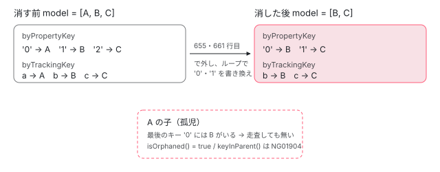

[目次](../README.md) › [Signal Forms のフィールドの木：子を作り、配列を追い、古い木と橋をかける](README.md) › 第 2 回 / 全 5 回

# 配列の追跡：要素が動いても同じフィールドを使う

> 配列の要素のオブジェクトに書き込む TrackingKey（symbol の印）、createKeyOrOrphanSignals が親の子の表から自分の位置を探し孤児を見分ける行、maybeRemoveStaleArrayFields・maybeRemoveStaleObjectFields が消えた子を外す行（73ab88e65bf）、孤児のフィールドが落ちないようにした 3c44d7c90b2・5835a5e3a73。同じ印の要素が 1 つの子を共有する #70840 と、keyInParent が文字列の #71616 も今のコードで確かめる。

angular/angular · 読了 約 13 分 · 発展 · [サイトで読む（デモが動きます）](https://angular-deep-dive-cyan.vercel.app/chapter/sft-array-identity)

---

配列のフィールドでは、要素が並べ替えられても「Ann の行のフィールド」は Ann の行についていってほしいはずです。この章では、**Signal Forms が配列の要素のオブジェクトに印（`TrackingKey`）を書き込んで要素を追い、並べ替え・挿入・削除のたびにどの子を使い回し、どの子が孤児（親の子の表から外れたフィールド）になるか**を 1 行ずつ追います。孤児のフィールドが読まれても落ちないようにした 3c44d7c90b2・5835a5e3a73 の差分と、配列についての開いている issue（#70772・#71616・#70840）を今のコードで確かめます。

読む対象は `packages/forms/signals/src/field/structure.ts`（`createKeyOrOrphanSignals`・`computeChildrenMap` の配列の分岐・`maybeRemoveStaleArrayFields`・`maybeRemoveStaleObjectFields`）、`field/manager.ts`、`errors.ts`、spec は `test/node/field_node.spec.ts`・`test/node/dynamic.spec.ts`・`test/web/orphan_repro.spec.ts` です。子の表 `childrenMap`（`byPropertyKey` の `reader` と `node`）と `computeChildrenMap` の流れは[前の章](01-sft-structure.md)で読みました。

1. [1. 子の作り方](01-sft-structure.md)
2. **2. 配列の追跡と孤児**（この章）
3. [3. proxy と context](03-sft-proxy-context.md)
4. [4. SignalFormControl と extract](04-sft-signal-form-control.md)
5. [5. spec と issue](05-sft-tests-issues.md)

## 1. TrackingKey と identitySymbol

📄 `angular/packages/forms/signals/src/field/structure.ts` L30–44 （▶ の行: 30–31, 39–40, 42–43）

```ts
30 ▶ const ORPHAN_TOKEN = Symbol(typeof ngDevMode !== 'undefined' && ngDevMode ? 'ORPHAN_TOKEN' : '');
31 ▶ const FALSE_SIGNAL = computed(() => false);
32 │ 
33 │ /**
34 │  * Key by which a parent `FieldNode` tracks its children.
35 │  *
36 │  * Often this is the actual property key of the child, but in the case of arrays it could be a
37 │  * tracking key allocated for the object.
38 │  */
39 ▶ export type TrackingKey = PropertyKey & {__brand: 'FieldIdentity'};
40 ▶ export type ChildNodeCtor = (
41 │   key: string,
42 ▶   trackingKey: TrackingKey | undefined,
43 ▶   isArray: boolean,
44 │ ) => FieldNode;
```

39 行目の `TrackingKey` は「`PropertyKey`（文字列・数・symbol）に型だけの印 `__brand` を付けたもの」です。実行時はただの symbol で、型の上で「ふつうのキーと取り違えない」ためだけの印です（このような型を brand 型と呼びます）。40〜44 行目の `ChildNodeCtor` は、前の章の 2 節の `newChild` の形で、42 行目の `trackingKey` と 43 行目の `isArray` を受け取ります。30 行目の `ORPHAN_TOKEN` と 31 行目の `FALSE_SIGNAL` は 3 節で使います。

📄 `angular/packages/forms/signals/src/field/structure.ts` L80–88 （▶ の行: 84–87）

```ts
80 │   readonly node: FieldNode;
81 │ 
82 │   readonly createChildNode: ChildNodeCtor;
83 │ 
84 ▶   /** Added to array elements for tracking purposes. */
85 ▶   // TODO: given that we don't ever let a field move between parents, is it safe to just extract
86 ▶   // this to a shared symbol for all fields, rather than having a separate one per parent?
87 ▶   readonly identitySymbol = Symbol();
88 │ 
```

87 行目、**構造ごとに 1 つの symbol** を持ちます。配列のフィールドの構造が、自分の要素のオブジェクトにこの symbol をキーにして印を書きます。85〜86 行目の TODO は「フィールドが親をまたいで動くことは無いので、全部で 1 つの symbol でもよいのでは」という覚え書きです。

## 2. 要素のオブジェクトに印を書く

前の章の 4 節で飛ばした、`computeChildrenMap` のループの中の配列の分岐です。

📄 `angular/packages/forms/signals/src/field/structure.ts` L362–389 （▶ の行: 362, 365–366, 372, 375–377, 379, 381, 387）

```ts
362 ▶       if (parentIsArray && isObject(childValue) && !isArray(childValue)) {
363 │         // For object values in arrays, assign a synthetic identity. This will be used to
364 │         // preserve the field instance even as this object moves around in the parent array.
365 ▶         trackingKey = (childValue[this.identitySymbol] as TrackingKey) ??= Symbol(
366 ▶           ngDevMode ? `id:${globalId++}` : '',
367 │         ) as TrackingKey;
368 │       }
369 │ 
370 │       let childNode: FieldNode | undefined;
371 │ 
372 ▶       if (trackingKey) {
373 │         // If tracking is in use, then the `FieldNode` instance is always managed via its
374 │         // tracking key. Create the instance if needed, or look it up otherwise.
375 ▶         if (!prevData.byTrackingKey?.has(trackingKey)) {
376 ▶           materializedChildren ??= {...(prevData as MutableChildrenData)};
377 ▶           materializedChildren.byTrackingKey ??= new Map();
378 │ 
379 ▶           materializedChildren.byTrackingKey.set(
380 │             trackingKey,
381 ▶             this.createChildNode(key, trackingKey, parentIsArray),
382 │           );
383 │         }
384 │ 
385 │         // Note: materializedChildren ?? prevData is needed because we might have freshly instantiated
386 │         // `byTrackingKey` only in `materializedChildren` above.
387 ▶         childNode = (materializedChildren ?? prevData).byTrackingKey!.get(trackingKey)!;
388 │       }
389 │ 
```

1. **362 行目：親が配列で、要素がオブジェクト（配列ではない）のときだけ**

   文字列や数の要素、配列の中の配列は印を持たず、**位置（index）**で追います。配列を外したのは f80b51a738e（2025-10）で、コミットメッセージによると `[...oldValue]` の展開では配列に付けた symbol が写らないからです。
2. **365〜367 行目：要素に symbol の印を書き込む**

   `childValue[this.identitySymbol] ??= Symbol(...)` は、**利用者のモデルのオブジェクトそのもの**に、1 節 87 行目の symbol をキーとして新しい symbol を書きます。もう印があればそれを使います。366 行目、開発ビルドでは `id:0`, `id:1` … という説明が付きます。
3. **372〜383 行目：印ごとに子を 1 つ**

   前回の `byTrackingKey` にその印が無ければ、381 行目で子を作って 379 行目で入れます。作るときに印（`trackingKey`）を渡すので、子は「自分はこの印の要素だ」と知っています（3 節の `identityInParent`）。
4. **387 行目：印から子を引く**

   あとは前の章の 4 節のとおり、キー（`'0'`, `'1'` …）の `ChildData` が無ければ作り、あって別の子が入っていれば `child.node` を書き換えます。並べ替えたときに「キー 0 の子が Ann から Cy に替わる」のは、この書き換えです。

印が写るかどうかで、使い回されるかが決まります。Signal Forms 自身の書き込みは `{...前の値, [key]: 新しい値}` で（[signal-forms](../signals/17-signal-forms.md) の 4 節の `valueForWrite`）、オブジェクトの展開は自分の数え上げられる symbol のプロパティも写すので、`f[0].name` に書いても印は残ります。`structuredClone` や `JSON.parse`、サーバーから届き直したデータは印を持たないので、全部の子が新しくなります。

📄 `記録（Node、22.2.6）`

```
# ~/angular-research/angular-deep-dive の node_modules（@angular/core・@angular/forms 22.2.6）を Node で読み込んで動かした
# F1, F2 … は FieldNode ごとの印（f[i] の FieldTree を初めて見たときに付けた）
# @angular/forms 22.2.6 / node v24.22.1
-- はじめ                  [0] F1 key="0" {"n":"a"}   [1] F2 key="1" {"n":"b"}   [2] F3 key="2" {"n":"c"}
-- 並べ替え [c,a,b]        [0] F3 key="0"             [1] F1 key="1"             [2] F2 key="2"
-- 先頭に挿入              [0] F4 key="0" {"n":"new"} [1] F3 key="1"  [2] F1 key="2"  [3] F2 key="3"
-- a を削除                [0] F4  [1] F3  [2] F2
    old F1: keyInParent=throw NG01904: Orphan field, can't find element in array <root>.
            value=throw NG01904: Orphan field, can't find element in array <root>.
-- 全部を {...x} で作り直す  [0] F4  [1] F3  [2] F2          # symbol も写るので同じ
-- structuredClone で作り直す [0] F5  [1] F6  [2] F7          # symbol は写らないので全部新しい
    old F2: keyInParent=throw NG01904 …
-- プリミティブの配列 ['p','q'] [0] F5 key="0" "p"  [1] F6 key="1" "q"   # 位置にいた子をそのまま使う
typeof keyInParent: string
-- 同じオブジェクトを 2 回 [x, x]  [0] F8 key="0"  [1] F8 key="0"
f[0] === f[1]: true
-- f[1].n に書いた後        [0] F8 {"n":"changed-via-1"}  [1] F8 {"n":"changed-via-1"}
model: [{"n":"changed-via-1"},{"n":"dup"}]                # 書いたのは index 0、f[1] も index 0 を見ている
```

並べ替え・挿入では子がついていき、`keyInParent()` は新しい位置を返します。削除した `a` の子（F1）は孤児になり、`keyInParent()` も `value()` も NG01904 を投げます（`value` は `deepSignal(親の value, keyInParent)` なので、キーを読んだ所で投げる）。文字列の配列に変えたときは、前に位置 0・1 にいた子（F5・F6）がそのまま文字列の子になりました。キー `'0'` の `ChildData` はあり、文字列には印が無いので、前の章の 4 節の「キーにいる子が入れ替わった」分岐（印から引いた `childNode` があるときだけ）に当たらないからです。

> [!WARNING]
> **ハマりどころ**
>
> 記録の最後の 2 つが #70840（2026-09、開いている）です。同じ印を持つ要素が 2 つあると（同じオブジェクトを 2 回入れる、印の付いた要素を `{...x}` で複製する）、387 行目で同じ子が引かれ、`f[1]` は `f[0]` と同じもので、`keyInParent()` は 3 節の近道で `'0'` を返します。`f[1].n` に書いた値は index 0 に入り、model の index 1 は変わりません。また 365 行目は書き込みなので、`Object.freeze` した要素では投げます。

📄 `記録（Node、22.2.6）`

```
# @angular/forms 22.2.6 / node v24.22.1
# form(signal({items: [Object.freeze({n: 'a'})]}))
1. f.items[0] を読む: TypeError: Cannot add property Symbol(), object is not extensible
# 同じモデルで、何も読まずに ApplicationRef.tick() だけ
2. 何も読まずに tick: tick が投げた TypeError: Cannot add property Symbol(), object is not extensible
   stack の中: at ChildFieldNodeStructure.children / at FormFieldManager.markStructuresLive
```

凍結した要素は、読まなくても投げます。[前の章](01-sft-structure.md)の 7 節のとおり、掃除の effect が `children()` で全部の段の表を作るからで、stack に `markStructuresLive` が出ています。#70840 を直す PR #71217（「重複と凍結した要素に自分のフィールドを与える」）は 2026-10-29 に閉じられ、origin/main（ca92b968b8e）の 362〜368 行目は 8576f161ae4 と同じです。

## 3. keyInParent：親の子の表の中に自分を探す

📄 `angular/packages/forms/signals/src/field/structure.ts` L220–249 （▶ の行: 223, 228–229, 232–233, 235–237, 240–242, 246–248）

```ts
220 │   /**
221 │    * Creates signals for keyInParent and isOrphaned status for a field node.
222 │    */
223 ▶   protected createKeyOrOrphanSignals(
224 │     kind: 'child' | 'root',
225 │     identityInParent: TrackingKey | undefined,
226 │     initialKeyInParent: string | undefined,
227 │   ): {keyInParent: Signal<string>; isOrphaned: Signal<boolean>} {
228 ▶     if (kind === 'root') {
229 ▶       return {keyInParent: ROOT_KEY_IN_PARENT, isOrphaned: FALSE_SIGNAL};
230 │     }
231 │ 
232 ▶     const parent = this.parent!;
233 ▶     let lastKnownKey = initialKeyInParent!;
234 │ 
235 ▶     const keyOrOrphan = computed(() => {
236 ▶       if (parent.structure.isOrphaned()) {
237 ▶         return ORPHAN_TOKEN;
238 │       }
239 │ 
240 ▶       const map = parent.structure.childrenMap();
241 ▶       if (!map) {
242 ▶         return ORPHAN_TOKEN;
243 │       }
244 │ 
245 │       // Fast path: check last known key
246 ▶       const lastKnownChild = map.byPropertyKey.get(lastKnownKey);
247 ▶       if (lastKnownChild && lastKnownChild.node === this.node) {
248 ▶         return lastKnownKey;
249 │       }
```

子の構造の constructor が呼ぶ関数です（前の章の 8 節）。228〜229 行目、根なら前の章の 8 節の共有の signal を返します。子では 233 行目の `lastKnownKey`（最後に見つけたキー。最初は作られたときのキー）を持ち、235 行目の computed `keyOrOrphan` が「今のキー」か `ORPHAN_TOKEN` を返します。

1. **236〜238 行目：親が孤児なら自分も孤児**

   親の `isOrphaned` を読むので、孤児は下へ連なります。
2. **240〜243 行目：親の子の表が無ければ孤児**

   親の値がオブジェクトでなくなった（`null` を入れた）とき、親の表は `undefined` になります（前の章の 4 節の「オブジェクトでなければ子は無い」）。
3. **246〜249 行目：最後のキーにまだ自分がいれば、そのキー**

   並べ替えの無いふつうの更新はここで終わり、表を全部見ません。

📄 `angular/packages/forms/signals/src/field/structure.ts` L250–289 （▶ の行: 251, 253, 256–258, 261, 265, 267, 269–272, 279–280, 285）

```ts
250 │ 
251 ▶       if (identityInParent === undefined) {
252 │         // Object property: if not at last known key, it's orphaned
253 ▶         return ORPHAN_TOKEN;
254 │       } else {
255 │         // Array element: scan for node in childrenMap
256 ▶         for (const [key, child] of map.byPropertyKey) {
257 ▶           if (child.node === this.node) {
258 ▶             return (lastKnownKey = key);
259 │           }
260 │         }
261 ▶         return ORPHAN_TOKEN;
262 │       }
263 │     });
264 │ 
265 ▶     const isOrphaned = computed(() => keyOrOrphan() === ORPHAN_TOKEN);
266 │ 
267 ▶     const keyInParent = computed(() => {
268 │       const key = keyOrOrphan();
269 ▶       if (key === ORPHAN_TOKEN) {
270 ▶         if (identityInParent === undefined) {
271 ▶           throw new RuntimeError(
272 ▶             RuntimeErrorCode.ORPHAN_FIELD_PROPERTY,
273 │             ngDevMode &&
274 │               `Orphan field, looking for property '${initialKeyInParent}' of ${getDebugName(
275 │                 parent,
276 │               )}`,
277 │           );
278 │         } else {
279 ▶           throw new RuntimeError(
280 ▶             RuntimeErrorCode.ORPHAN_FIELD_NOT_FOUND,
281 │             ngDevMode && `Orphan field, can't find element in array ${getDebugName(parent)}`,
282 │           );
283 │         }
284 │       }
285 ▶       return key;
286 │     });
287 │ 
288 │     return {keyInParent, isOrphaned};
289 │   }
```

1. **251〜253 行目：印の無い子は、最後のキーにいなければ孤児**

   オブジェクトのプロパティの子と、位置で追う配列の要素（文字列など）の子です。キーが動くことは無いので探しません。配列が短くなって位置 2 が消えれば、位置 2 の子は孤児です。
2. **256〜261 行目：印のある子は、表を全部見て自分を探す**

   見つかれば 258 行目で `lastKnownKey` を書き換えて返し、見つからなければ 261 行目で孤児です。比べるのは値ではなく、表に入っている `node` が自分か（257 行目の `===`）です。
3. **265 行目と 267〜286 行目：投げない isOrphaned と、投げる keyInParent**

   同じ `keyOrOrphan` から 2 つを作ります。265 行目の `isOrphaned` は真偽を返すだけです。267 行目の `keyInParent` は孤児のとき、印が無ければ 272 行目の `ORPHAN_FIELD_PROPERTY`、あれば 280 行目の `ORPHAN_FIELD_NOT_FOUND` を投げます。

📄 `angular/packages/forms/signals/src/errors.ts` L13–21 （▶ の行: 17–20）

```ts
13 │ export const enum RuntimeErrorCode {
14 │   // Signal Forms errors (1900-1999)
15 │   PATH_NOT_IN_FIELD_TREE = 1900,
16 │   PATH_RESOLUTION_FAILED = 1901,
17 ▶   ORPHAN_FIELD_PROPERTY = -1902,
18 ▶   ORPHAN_FIELD_ARRAY = 1903,
19 ▶   ORPHAN_FIELD_NOT_FOUND = 1904,
20 ▶   ROOT_FIELD_NO_PARENT = 1905,
21 │   PARENT_NOT_ARRAY = 1906,
```

17 行目の `-1902` の負の数は「説明のページがある」印で、エラーの文言に `Find more at https://v22.angular.dev/errors/NG01902` が付きます（前の章の DEMO の 5）。18 行目の `ORPHAN_FIELD_ARRAY`（1903）は、もう誰も投げません。

📄 `記録`

```
$ cd packages/forms/signals && grep -rn "ORPHAN_FIELD_ARRAY\|ORPHAN_FIELD_NOT_FOUND\|ORPHAN_FIELD_PROPERTY" src compat
src/errors.ts:17:  ORPHAN_FIELD_PROPERTY = -1902,
src/errors.ts:18:  ORPHAN_FIELD_ARRAY = 1903,
src/errors.ts:19:  ORPHAN_FIELD_NOT_FOUND = 1904,
src/field/structure.ts:272:            RuntimeErrorCode.ORPHAN_FIELD_PROPERTY,
src/field/structure.ts:280:            RuntimeErrorCode.ORPHAN_FIELD_NOT_FOUND,
# 1903 を投げる所は 3c44d7c90b2 で無くなった。adev/src/content/reference/errors/ にあるのは NG01902.md だけ
```

285 行目で返すキーは、前の章の 3 節の `byPropertyKey` のキー、つまり `Object.keys` の文字列です。配列の要素でも `'1'` で、記録の `typeof keyInParent: string` のとおりです。公開の型（`FieldState.keyInParent`）は配列の子で `number` と書かれていて、合いません。これが #71616（2026-10-26、開いている）で、数を返す PR #71617 が開いています。

## 4. 3c44d7c90b2・5835a5e3a73：孤児を読む人が落ちないように

3 節の形になったのは 3c44d7c90b2 です。前は `keyInParent` だけがあり、配列の要素では親の**値**を走査して印を探し、見つからなければ投げていました。#66711 は、`@for` の中の入力欄の要素を配列から消したとき、DOM から外れた入力欄の `blur` が `markAsTouched` を呼び、そこから `keyInParent` を読んで落ちる、という報告です。

📄 `3c44d7c90b2 の差分`

```
$ git show 3c44d7c90b2 -- packages/forms/signals/src/field/structure.ts（抜粋）
# fix(forms): fix orphan field error on blur during array removal（2026-05-04、Fixes #66711）
-  protected createKeyInParent(
-    options: FieldNodeOptions,
+  protected createKeyOrOrphanSignals(
+    kind: 'child' | 'root',
     identityInParent: TrackingKey | undefined,
     initialKeyInParent: string | undefined,
-  ): Signal<string> {
+  ): {keyInParent: Signal<string>; isOrphaned: Signal<boolean>} {
 …
-    if (identityInParent === undefined) {
-      const key = initialKeyInParent!;
-      return computed(() => {
-        if (this.parent!.structure.getChild(key) !== this.node) {
-          throw new RuntimeError(RuntimeErrorCode.ORPHAN_FIELD_PROPERTY, …);
-        }
-        return key;
-      });
-    } else {
-      let lastKnownKey = initialKeyInParent!;
-      return computed(() => {
-        const parentValue = this.parent!.structure.value();
-        if (!isArray(parentValue)) {
-          throw new RuntimeError(RuntimeErrorCode.ORPHAN_FIELD_ARRAY, …);
-        }
-        // Check the parent value at the last known key to avoid a scan.
-        const data = parentValue[lastKnownKey as unknown as number];
-        if (isObject(data) && data.hasOwnProperty(this.parent!.structure.identitySymbol) &&
-            data[this.parent!.structure.identitySymbol] === identityInParent) {
-          return lastKnownKey;
-        }
-        // Otherwise, we need to check all the keys in the parent.
-        for (let i = 0; i < parentValue.length; i++) { …同じ比較… return (lastKnownKey = i.toString()); }
-        throw new RuntimeError(RuntimeErrorCode.ORPHAN_FIELD_NOT_FOUND, …);
-      });
-    }
+    const keyOrOrphan = computed(() => { …（今の 235〜263 行目）… });
+    const isOrphaned = computed(() => keyOrOrphan() === ORPHAN_TOKEN);
+    const keyInParent = computed(() => { …（今の 267〜286 行目）… });
+    return {keyInParent, isOrphaned};

$ git show 3c44d7c90b2 -- packages/forms/signals/src/field/node.ts
   markAsTouched(options?: MarkAsTouchedOptions): void {
+    if (this.structure.isOrphaned()) {
+      return;
+    }
   markAsTouchedInternal(options?: MarkAsTouchedOptions): void {
+    if (this.structure.isOrphaned()) {
+      return;
+    }
（ほかに compat/src/compat_structure.ts を同じ形に、test/web/orphan_repro.spec.ts を新しく足した）
```

直しは 2 つです。キーを親の値ではなく親の**子の表**から探す（3 節の 240〜261 行目）ことと、投げない `isOrphaned` を作って `markAsTouched` の頭で見ることです。続く 5835a5e3a73 は、同じ考えを debounce と非同期の検証に広げました。

📄 `5835a5e3a73 の差分`

```
$ git show 5835a5e3a73 -- packages/forms/signals/src
# fix(forms): prevent orphan field crashes in debounceSync and async validation（2026-05-04）
--- a/packages/forms/signals/src/field/node.ts
@@ -418,6 +418,10 @@ export class FieldNode implements FieldState<unknown> {
+    if (this.structure.isOrphaned()) {
+      return;
+    }
+
     this.sync();
--- a/packages/forms/signals/src/field/validation.ts
@@ -364,7 +364,11 @@ export class FieldValidationState implements ValidationState {
   readonly shouldSkipValidation = computed(
-    () => this.node.hidden() || this.node.disabled() || this.node.readonly(),
+    () =>
+      this.node.hidden() ||
+      this.node.disabled() ||
+      this.node.readonly() ||
+      this.node.structure.isOrphaned(),
   );
```

| isOrphaned を見る所 | 入れたコミット | 今のコードの引用 |
| --- | --- | --- |
| `markAsTouched`・`markAsTouchedInternal` | 3c44d7c90b2 | [signal-forms](../signals/17-signal-forms.md)・[forms-sf-submit-compat](../forms/19-forms-sf-submit-compat.md) |
| `debounceSync`（debounce が解けたときに孤児なら書かない） | 5835a5e3a73 | [signal-forms](../signals/17-signal-forms.md) の 7 節 |
| `shouldSkipValidation`（孤児なら検証しない） | 5835a5e3a73 | [forms-sf-rules-metadata](../forms/18-forms-sf-rules-metadata.md) |
| `FormField` のクラスの束縛（`afterRenderEffect`） | c0dc8c4bbee（2026-09-25、Fixes #70934） | origin/main と 22.2.6 の `signals.mjs` にある |
| `FormField` が外れるときの `flushSync` | c58464d13ed（2026-09-28、Fixes #71004） | 同上 |

見ない所は今も投げます。記録のとおり、孤児の `keyInParent()` と `value()` は NG01904 を投げます。#66711 と #66796 で `@for (child of f.items; track child.id().value())` が落ちたのは、消えた行の track の式が孤児の `value()` を読むからで、issue の中で alxhub は `track child`（`FieldTree` そのもので追う）を勧めています。

3c44d7c90b2 の spec が `test/web/orphan_repro.spec.ts` です（テストと直し方）。5835a5e3a73 のコミットメッセージには、spec を書く途中で core の `resource` の `PendingTasks` が残る不具合に当たり、promise を解く回避を入れた、とあります。

## 5. 消えた要素を外す：maybeRemoveStaleArrayFields と maybeRemoveStaleObjectFields

前の章の 4 節で `computeChildrenMap` がループの前に呼ぶ 2 つの関数です。

📄 `angular/packages/forms/signals/src/field/structure.ts` L629–666 （▶ の行: 638–639, 641, 643–645, 652, 655, 658, 661）

```ts
629 │ function maybeRemoveStaleArrayFields(
630 │   prevData: ChildrenData,
631 │   value: ReadonlyArray<unknown>,
632 │   identitySymbol: PropertyKey,
633 │ ): MutableChildrenData | undefined {
634 │   let data: MutableChildrenData | undefined;
635 │ 
636 │   // TODO: we should be able to optimize this diff away in the fast case where nothing has
637 │   // actually changed structurally.
638 ▶   const oldKeys = new Set(prevData.byPropertyKey.keys());
639 ▶   const oldTracking = prevData.byTrackingKey && new Set(prevData.byTrackingKey.keys());
640 │ 
641 ▶   for (let i = 0; i < value.length; i++) {
642 │     const childValue = value[i];
643 ▶     oldKeys.delete(i.toString());
644 ▶     if (oldTracking && isObject(childValue) && Object.hasOwn(childValue, identitySymbol)) {
645 ▶       oldTracking.delete(childValue[identitySymbol] as TrackingKey);
646 │     }
647 │   }
648 │ 
649 │   // `oldKeys` and `oldTracking` now contain stale keys and tracking keys, respectively.
650 │   // Remove them from their corresponding maps.
651 │ 
652 ▶   if (oldKeys.size > 0) {
653 │     data ??= {...(prevData as MutableChildrenData)};
654 │     for (const key of oldKeys) {
655 ▶       data.byPropertyKey.delete(key);
656 │     }
657 │   }
658 ▶   if (oldTracking && oldTracking.size > 0) {
659 │     data ??= {...(prevData as MutableChildrenData)};
660 │     for (const id of oldTracking) {
661 ▶       data.byTrackingKey!.delete(id);
662 │     }
663 │   }
664 │ 
665 │   return data;
666 │ }
```

1. **638〜639 行目：前回のキーと印を全部集める**

   639 行目、前回 `byTrackingKey` が無ければ（印を使っていなければ）集めません。
2. **641〜647 行目：今の配列にあるものを消していく**

   643 行目で位置のキーを、644〜645 行目で要素が自分の印を持っていればその印を消します。
3. **652〜663 行目：残ったものが「消えたもの」**

   655 行目で配列より後ろの位置のキーを、661 行目で配列から消えた要素の印を表から外します。

`[A, B, C]` から `A` を消して `[B, C]` にすると、ここでキー `'2'` と `A` の印が外れます。続くループでキー `'0'` は `B` の印の子に、`'1'` は `C` の子に書き換わります。`A` の子は表のどこにもいなくなり、3 節の 256〜261 行目の走査で見つからず、孤児になります。



*\[A, B, C\] から A を消したときの子の表。位置のキー '2' と A の印が外れ、'0' と '1' には印から引いた B と C が入り直す。A の子はどこからも指されず、孤児になる。*

📄 `73ab88e65bf の差分`

```
$ git show 73ab88e65bf -- packages/forms/signals/src/field/structure.ts
# refactor(forms): avoid unnecessary Set allocation in maybeRemoveStaleArrayFields（2026-06-13）
   const oldKeys = new Set(prevData.byPropertyKey.keys());
-  const oldTracking = new Set(prevData.byTrackingKey?.keys());
+  const oldTracking = prevData.byTrackingKey && new Set(prevData.byTrackingKey.keys());

   for (let i = 0; i < value.length; i++) {
     const childValue = value[i];
     oldKeys.delete(i.toString());
-    if (isObject(childValue) && childValue.hasOwnProperty(identitySymbol)) {
+    if (oldTracking && isObject(childValue) && Object.hasOwn(childValue, identitySymbol)) {
       oldTracking.delete(childValue[identitySymbol] as TrackingKey);
     }
   }
@@ -655,10 +655,10 @@ function maybeRemoveStaleArrayFields(
-  if (oldTracking.size > 0) {
+  if (oldTracking && oldTracking.size > 0) {
     data ??= {...(prevData as MutableChildrenData)};
     for (const id of oldTracking) {
-      data.byTrackingKey?.delete(id);
+      data.byTrackingKey!.delete(id);
     }
   }
```

73ab88e65bf（2026-06-13）は 3 つの片付けです。印を使っていない親で空の `Set` を作らない（639 行目）、そのとき 644 行目の判定を飛ばす、`hasOwnProperty` を `Object.hasOwn` にする。コミットメッセージによると、最後のものは `Object.create(null)` の要素（`hasOwnProperty` を持たない）で投げていたのを直しています。661 行目の `!` は「印の Set があるなら `byTrackingKey` もある」ことを書いたものです。

📄 `angular/packages/forms/signals/src/field/structure.ts` L668–684 （▶ の行: 676–677, 679）

```ts
668 │ function maybeRemoveStaleObjectFields(
669 │   prevData: ChildrenData,
670 │   value: Record<PropertyKey, unknown>,
671 │ ): MutableChildrenData | undefined {
672 │   let data: MutableChildrenData | undefined;
673 │ 
674 │   // For objects, we diff a bit differently, and use the value to check whether an old
675 │   // property still exists on the object value.
676 ▶   for (const key of prevData.byPropertyKey.keys()) {
677 ▶     if (!Object.hasOwn(value, key)) {
678 │       data ??= {...(prevData as MutableChildrenData)};
679 ▶       data.byPropertyKey.delete(key);
680 │     }
681 │   }
682 │ 
683 │   return data;
684 │ }
```

オブジェクトの値では、前回のキーごとに 677 行目で今の値に自分のプロパティとして残っているかを見て、無ければ 679 行目で外します。この行の `Object.hasOwn` は 732e5050180（2026-08-18、core 全体で `hasOwnProperty` を置き換えた）で入りました。

## 6. 孤児の後始末：FormFieldManager の effect

📄 `angular/packages/forms/signals/src/field/manager.ts` L35–71 （▶ の行: 40, 56, 58–59, 62–65, 69）

```ts
35 │   /**
36 │    * Contains all child field structures that have been created as part of the current form.
37 │    * New child structures are automatically added when they are created.
38 │    * Structures are destroyed and removed when they are no longer reachable from the root.
39 │    */
40 ▶   readonly structures = new Set<FieldNodeStructure>();
41 │ 
42 │   /**
43 │    * Creates an effect that runs when the form's structure changes and checks for structures that
44 │    * have become unreachable to clean up.
45 │    *
46 │    * For example, consider a form wrapped around the following model: `signal([0, 1, 2])`.
47 │    * This form would have 4 nodes as part of its structure tree.
48 │    * One structure for the root array, and one structure for each element of the array.
49 │    * Now imagine the data is updated: `model.set([0])`. In this case the structure for the first
50 │    * element can still be reached from the root, but the structures for the second and third
51 │    * elements are now orphaned and not connected to the root. Thus they will be destroyed.
52 │    *
53 │    * @param root The root field structure.
54 │    */
55 │   createFieldManagementEffect(root: FieldNodeStructure): void {
56 ▶     effect(
57 │       () => {
58 ▶         const liveStructures = new Set<FieldNodeStructure>();
59 ▶         this.markStructuresLive(root, liveStructures);
60 │ 
61 │         // Destroy all nodes that are no longer live.
62 ▶         for (const structure of this.structures) {
63 ▶           if (!liveStructures.has(structure)) {
64 ▶             this.structures.delete(structure);
65 ▶             untracked(() => structure.destroy());
66 │           }
67 │         }
68 │       },
69 ▶       {injector: this.injector},
70 │     );
71 │   }
```

40 行目の `structures` は、作られた子の構造の全部です（子の構造が constructor で自分を足す。前の章の 8 節）。56 行目の effect は、59 行目で根からたどれる構造を集め、62〜67 行目で `structures` の中のたどれないものを外して、65 行目で `destroy()` します。孤児はもう根からたどれないので、次の effect でその injector が壊れ、その上で動いていた非同期の検証の resource も止まります。46〜51 行目のコメントの例（`[0, 1, 2]` を `[0]` にすると 2 つの構造が壊れる）がこれです。

壊れるのは injector だけで、`FieldNode` のオブジェクトは、利用者が `FieldTree` を持っている限り残ります。読めば 3 節のとおり投げます。59 行目のたどり方が `children()` で全部の段を作ってしまうことは、[前の章](01-sft-structure.md)の 7 節（#70627）で見ました。

## 7. 開いている issue を今のコードで確かめる

| issue | 今のコードで |
| --- | --- |
| #70772（開いている）独自の追跡 | 追跡は 365 行目の symbol だけで、`id` のような業務のキーで追う口はありません。サーバーから同じ id のデータが届き直すと全部の子が新しくなります（記録の `structuredClone`、DEMO の「新しいオブジェクトで丸ごと置き換え」）。 |
| #71616（開いている）keyInParent が文字列 | 285 行目で返すのは `Object.keys` の文字列。PR #71617 が開いています。 |
| #70840（開いている）同じ印の要素・凍結 | 387 行目で同じ子が引かれる、365 行目が凍結で投げる（2 節の記録）。PR #71217 は閉じた。 |
| #67212（閉じた）大きな配列 | 98c5afdb021 で同期の部分は軽くなったが、掃除の effect が全部作る（前の章の 7 節、#70627 は開いている）。 |
| #66711・#66796（閉じた）消えた行の track | `blur` の経路は 3c44d7c90b2 で落ちなくなった。孤児の `value()` を読む式は今も投げる（4 節）。 |
| #68441（閉じた）要素を足しても木が増えない | JeanMeche が「モデルを書き換えて（mutate）いるのでは」と返し、報告者が最小の再現では起きないと確かめて閉じた。書き換えでは model の値が同じオブジェクトのままなので、`childrenMap` の linkedSignal は作り直されない。 |
| #68511（開いている）`string[]` の要素の子 | 362 行目で文字列は位置で追われ、要素ごとに子ができる（読まれれば）。設計の議論の issue です。 |

origin/main（ca92b968b8e、2026-11-16）までの `git log 8576f161ae4..origin/main -- packages/forms/signals` の 38 件のうち、structure.ts に触れたのは 67e50693274（`destroy()`、前の章の 6 節）だけで、この章の行は変わっていません。

## 8. DEMO：配列を動かして、どの子が残るか

> **🧪 DEMO — 本物の form() の配列（@angular/forms 22.2.6）**
>
> 「初期化」の後、ほかのボタンを好きな順に押してください。押すたびに `f[0]` から順に読み、FieldNode（`f[i]()`）に印を付けて前の操作の後と `===` で比べます。配列から外れた FieldNode は下の表に出し、`keyInParent()` と `value()` を try/catch で読みます。本番ビルドなので、エラーの文言はコード（NG01904 など）だけです。
>
> ▶ [このデモはサイトで動かせます](https://angular-deep-dive-cyan.vercel.app/chapter/sft-array-identity)

- **逆順・先頭に挿入**：全部「使い回し（前は n）」で、`keyInParent()` は新しい位置です（2 節の 387 行目と 3 節の 256〜258 行目）。
- **先頭を削除**：外れた 1 つが下の表に出て、両方とも投げます（5 節、3 節の 280 行目）。
- **`{...x}` で作り直す**は全部使い回し、**新しいオブジェクトで丸ごと置き換え**は全部新しく作られ、前の全部が外れます（#70772）。
- **文字列の配列にする**：前にその位置にいた子が「使い回し（同じ位置）」で残ります（2 節の記録の F5・F6）。
- **同じオブジェクトを 2 回**の後に **f\[1\].name に書く**：`f[0]` と `f[1]` が同じ印で、書いた値は `model()[0]` に入り、`f[1]().value()` は `model()[1]` と食い違います（#70840）。

## ここまでの呼び出し

- 👤 `model.update(v => v.slice(1))` — 利用者のコード
  - `childrenMap`（linkedSignal）の computation → `computeChildrenMap(value, prev, false)` — structure.ts 297 — *読まれたときに走る*
    - `maybeRemoveStaleArrayFields` — structure.ts 629 — *位置 '2' と A の印を外す*
    - `Object.keys(value)` のループ → 印で子を引く → `child.node = childNode` — structure.ts 362–413 — *'0' は B、'1' は C に*
  - `A の keyOrOrphan` — structure.ts 235 — *最後のキー '0' は B、走査しても無い → ORPHAN\_TOKEN*
    - `isOrphaned()` → `true` / `keyInParent()` → NG01904 — structure.ts 265 / 280
  - `FormFieldManager` の effect → `structures` から外して `destroy()` — manager.ts 62–66 — *次の変更検知で*

## テストと直し方

配列の追跡は `test/node/field_node.spec.ts` の `describe('arrays')`（723 行目）の中の `describe('tracking')`（795 行目）が固めています。`it('maintains identity across value moves')`（796 行目）・`it('maintains identity across value update')`（808 行目）・`it('uses index as identity for primitive values')`（820 行目）・`it('uses index as identity for array values')`（832 行目、f80b51a738e が足した）の 4 つです。

📄 `angular/packages/forms/signals/test/node/field_node.spec.ts` L795–831 （▶ の行: 802, 804–805, 814, 816–817, 826, 828–829）

```ts
795 │     describe('tracking', () => {
796 │       it('maintains identity across value moves', () => {
797 │         const value = signal([{name: 'Alex'}, {name: 'Kirill'}]);
798 │         const f = form(value, {injector: TestBed.inject(Injector)});
799 │         const alex = f[0];
800 │         const kirill = f[1];
801 │ 
802 ▶         value.update((old) => [old[1], old[0]]);
803 │ 
804 ▶         expect(f[0] === kirill).toBeTrue();
805 ▶         expect(f[1] === alex).toBeTrue();
806 │       });
807 │ 
808 │       it('maintains identity across value update', () => {
809 │         const value = signal([{name: 'Alex'}, {name: 'Kirill'}]);
810 │         const f = form(value, {injector: TestBed.inject(Injector)});
811 │         const alex = f[0];
812 │         const kirill = f[1];
813 │ 
814 ▶         value.update((old) => [old[1], {...old[0], name: 'Pawel'}]);
815 │ 
816 ▶         expect(f[0] === kirill).toBeTrue();
817 ▶         expect(f[1] === alex).toBeTrue();
818 │       });
819 │ 
820 │       it('uses index as identity for primitive values', () => {
821 │         const value = signal([1, 'two']);
822 │         const f = form(value, {injector: TestBed.inject(Injector)});
823 │         const first = f[0];
824 │         const second = f[1];
825 │ 
826 ▶         value.update((old) => [old[1], old[0]]);
827 │ 
828 ▶         expect(f[0] === first).toBeTrue();
829 ▶         expect(f[1] === second).toBeTrue();
830 │       });
831 │ 
```

802 行目で入れ替え、804〜805 行目で子がついていったことを見ます。814 行目は `{...old[0], name: 'Pawel'}` で、展開が印を写すので 817 行目で同じ子のままです（2 節）。826〜829 行目は文字列と数の要素で、入れ替えても子は位置に残ります。

📄 `angular/packages/forms/signals/test/node/dynamic.spec.ts` L36–53 （▶ の行: 43, 45, 47, 50–51）

```ts
36 │   describe('tracking', () => {
37 │     it('should write to the right key after a move', () => {
38 │       const data = signal([
39 │         {name: 'Alex', counter: 0},
40 │         {name: 'Miles', counter: 0},
41 │       ]);
42 │       const f = form(data, {injector: TestBed.inject(Injector)});
43 ▶       const c0 = f[0].counter();
44 │       // Swap
45 ▶       data.update(([v0, v1]) => [v1, v0]);
46 │ 
47 ▶       c0.value.set(1);
48 │       expect(data()[0].name).toBe('Miles');
49 │       expect(data()[0].counter).toBe(0);
50 ▶       expect(data()[1].name).toBe('Alex');
51 ▶       expect(data()[1].counter).toBe(1);
52 │     });
53 │   });
```

`test/node/dynamic.spec.ts` の `describe('tracking')`（36 行目）の `it('should write to the right key after a move')`（37 行目）です。43 行目で取った `f[0].counter` の状態を、45 行目で入れ替えた後に 47 行目で書くと、50〜51 行目で `Alex` の行（今は index 1）に入ります。3 節の 256〜258 行目でキーが `'1'` に変わるからです。

📄 `angular/packages/forms/signals/test/web/orphan_repro.spec.ts` L44–70 （▶ の行: 49, 53–54, 59, 63, 65）

```ts
44 │     // 1. Focus the second input (item 'two')
45 │     let blurFired = false;
46 │     input1.addEventListener('blur', () => {
47 │       blurFired = true;
48 │     });
49 ▶     input1.focus();
50 │     expect(document.activeElement).toBe(input1);
51 │ 
52 │     // 2. Delete the second item from the model array
53 ▶     fixture.componentInstance.model.update((m) => ({
54 ▶       items: m.items.slice(0, 1), // Remove 'two', leaving only 'one'
55 │     }));
56 │ 
57 │     // 3. Manually dispatch blur event to simulate browser behavior where
58 │     // removing an active element from the DOM fires 'blur' synchronously.
59 ▶     input1.dispatchEvent(new Event('blur'));
60 │ 
61 │     // 4. Wait for change detection and DOM removal.
62 │     try {
63 ▶       await appRef.whenStable();
64 │     } catch (e: any) {
65 ▶       fail('Expected test not to throw error, but it threw: ' + e.message + '\n' + e.stack);
66 │     } finally {
67 │       // Clean up DOM
68 │       document.body.removeChild(fixture.nativeElement);
69 │     }
70 │   });
```

`test/web/orphan_repro.spec.ts` の `describe('Signal Forms array removal orphan repro')`（13 行目）の 1 つ目の it（14 行目、3c44d7c90b2）です。49 行目でフォーカスし、53〜54 行目で 2 つ目の行を消し、59 行目で `blur` を手で送ります。63 行目の `whenStable` が投げれば 65 行目で失敗します。2 つ目（71 行目、debounce が孤児になった後に解ける）と 3 つ目（129 行目、`validateAsync` が孤児になった後に解ける）は 5835a5e3a73 が足しました。

📄 `走らせ方`

```
cd ~/angular-research/angular
pnpm bazel test //packages/forms/signals/test/node:test --nocache_test_results --test_output=all \
  --test_arg=--filter="tracking|lazy materialization|instances"
# web の suite（Chromium。--filter は効かないので全部走る。orphan_repro.spec.ts の 3 つもここ）
pnpm bazel test //packages/forms/signals/test/web:test_chromium --nocache_test_results --test_output=all
```

📄 `結果`

```
# 2026-11-18、手元の macOS で（8576f161ae4）
Ran 10 of 539 specs
10 specs, 0 failures      # field_node の tracking 4・dynamic の tracking 1 を含む
//packages/forms/signals/test/node:test                                  PASSED in 0.9s
Chromium: |██████████████████████████████| 1/1 test files | 350 passed, 0 failed
//packages/forms/signals/test/web:test_chromium                          PASSED in 1.5s
```

### 直すとしたら

- #70840 の「同じ印の要素」は `computeChildrenMap` の 362〜388 行目です。1 回の計算の中で、前の位置がもう使った印に出会ったら、新しい印にする（要素を書き換えずに済むよう、別の表で持つ）形になります。凍結した要素は 365 行目の前に `Object.isExtensible` を見て、位置で追う側に回すことになります。どちらも、Signal Forms の書き込み（展開のコピー）の後に同じ子を保つか、が要の所で、#70840 のコメントでもそこが論点になっています。spec は `field_node.spec.ts` の `describe('tracking')`（795 行目）に、`[x, x]` と `[x, {...x}]` で `f[0] !== f[1]` と、`f[1]` に書いた値が index 1 に入ることを見る it を足す形です。
- #71616 は 285 行目で返すキーです。親が配列なら `Number(key)` にする（PR #71617 の形）か、型を `string` にするかで、前者は `pathKeys`（文字列の列）との食い違いをどう扱うかも決める必要があります。spec は `field_node.spec.ts` の `describe('tracking')` の 796 行目の it に `keyInParent()` の `toBe(1)` を足す形です。

## 聞かれそうな質問

**Q. 配列の要素を並べ替えると、f\[0\] は別のフィールドになりますか？**

要素がオブジェクトなら、要素についていきます。365 行目で要素に印を書き、387 行目で印から子を引くので、並べ替えた後の `f[0]` は「前に Cy だった子」です。文字列や数、配列の要素は 362 行目の条件に当たらず位置で追うので、`f[0]` は同じ子のまま、値だけが入れ替わります（spec の 826〜829 行目）。

**Q. サーバーから同じ id の配列を取り直したら、touched や dirty は残りますか？**

残りません。印は要素のオブジェクトに書いた symbol なので、新しいオブジェクトには無く、全部の子が新しく作られます（DEMO の「新しいオブジェクトで丸ごと置き換え」）。`id` で追う口は無く、#70772 がその要望です。前の要素を `{...old, ...new}` のように展開して作れば印は写ります。

**Q. 孤児になったフィールドを読むと何が起きますか？**

`keyInParent()` は、印のある要素なら 280 行目の NG01904、オブジェクトのプロパティなら 272 行目の NG01902 を投げます。`value()` もキーを読むので同じものを投げます。`markAsTouched()`・debounce・検証は `isOrphaned` を先に見るので投げません（4 節の表）。

**Q. keyInParent() が '1' のような文字列なのはなぜですか？**

子の表のキーが `Object.keys` の文字列だからで、285 行目はそれをそのまま返します。公開の型は配列の子で `number` と書かれていて、#71616 で報告されています。比べるときは `Number()` にしてください。

**Q. 同じオブジェクトを配列に 2 回入れるとどうなりますか？**

印が 1 つなので 387 行目で同じ子が引かれ、`f[0] === f[1]` になります。`f[1]` の `keyInParent()` は 246〜248 行目の近道で `'0'` を返すので、`f[1]` に書いた値は index 0 に入ります（#70840）。

## 読み終えて

- 配列の要素のオブジェクトには、親の構造ごとの symbol で印を書き込み（365 行目）、印ごとに子を 1 つ持つ。文字列・数・配列の要素は位置で追う
- `keyInParent` は親の子の表の中に自分を探す。印のある子は走査して新しい位置を見つけ、見つからなければ孤児。投げない `isOrphaned` と投げる `keyInParent` は 3c44d7c90b2 で分かれた
- `markAsTouched`・debounce・検証は `isOrphaned` を見て止まる（3c44d7c90b2・5835a5e3a73）。孤児の `keyInParent()` と `value()` は今も投げる
- 消えた位置と印は `maybeRemoveStale*` が外し、孤児の injector は掃除の effect が壊す
- 印が写るかで使い回しが決まる。`{...x}` は写り、新しいオブジェクトは写らない。同じ印が 2 つあると 1 つの子を共有する（#70840）

---

← 前: [子の作り方：FieldNodeStructure が値から子を作る](01-sft-structure.md)  
次: [proxy と context：f.items\[0\].name と読めるわけ](03-sft-proxy-context.md) →
