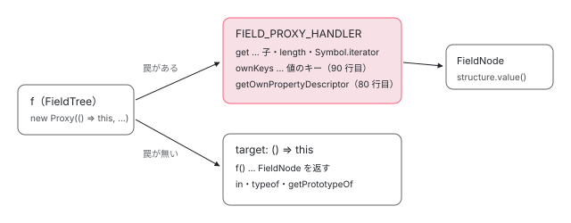

[目次](../README.md) › [Signal Forms のフィールドの木：子を作り、配列を追い、古い木と橋をかける](README.md) › 第 3 回 / 全 5 回

# proxy と context：f.items\[0\].name と読めるわけ

> field/proxy.ts の FIELD\_PROXY\_HANDLER が、プロパティの読み出し・length・Symbol.iterator・ownKeys・getOwnPropertyDescriptor を子のフィールドと値のキーに変える行と、has の罠が無いので in が target の関数を見ること（#70252）、FieldNodeContext の key・index・pathKeys・valueOf・stateOf・fieldTreeOf と resolve の cache（鍵が path だけ）、di.ts・util.ts・resolution.ts、2a141847a5e の isFieldTree。

angular/angular · 読了 約 12 分 · 発展 · [サイトで読む（デモが動きます）](https://angular-deep-dive-cyan.vercel.app/chapter/sft-proxy-context)

---

`f.items[0].name` と書けるのは、`form()` が返す `FieldTree` が、ただの関数を包んだ Proxy だからです。この章では、その Proxy の残りの罠（`length`・`Symbol.iterator`・`ownKeys`・`getOwnPropertyDescriptor`）と、罠が**無い**ために起きること（`in` が子のキーを見ない）を行で追い、ルールの関数が受け取る `FieldNodeContext` の `key`・`index`・`valueOf`・`stateOf`・`fieldTreeOf` が何を返すかを読みます。最後に `di.ts`・`util.ts`・`resolution.ts` の小さな部品と、フィールドの木を見分ける `isFieldTree`（2a141847a5e）を読みます。

読む対象は `packages/forms/signals/src/field/` の `proxy.ts`・`context.ts`・`resolution.ts`・`di.ts`・`util.ts` と、`src/api/assertions.ts`・`src/api/di.ts` です（../angular、8576f161ae4）。Proxy の `get` の前半（子を探して返すところ）と、`FieldNode` が `new Proxy(() => this, …)` を作るところは [signal-forms](../signals/17-signal-forms.md) の 5 節で、`resolve` が path を値の木の上で探す道筋は [forms-sf-schema](../forms/16-forms-sf-schema.md) で読みました。子がいつ作られるか（`getChild` の中身）は[第 1 回](01-sft-structure.md)です。

1. [1. 子の作り方](01-sft-structure.md)
2. [2. 配列の追跡と孤児](02-sft-array-identity.md)
3. **3. proxy と context**（この章）
4. [4. SignalFormControl と extract](04-sft-signal-form-control.md)
5. [5. spec と issue](05-sft-tests-issues.md)

## 1. FieldTree は「関数を包んだ Proxy」

📄 `angular/packages/forms/signals/src/field/proxy.ts` L9–23 （▶ の行: 12, 17–20, 23）

```ts
 9 │ import {untracked} from '@angular/core';
10 │ import {isArray, isObject} from '../util/type_guards';
11 │ import type {FieldNode} from './node';
12 ▶ import {FIELD_TREE} from '../api/symbols';
13 │ 
14 │ /**
15 │  * Proxy handler which implements `FieldTree<T>` on top of `FieldNode`.
16 │  */
17 ▶ export const FIELD_PROXY_HANDLER: ProxyHandler<() => FieldNode> = {
18 ▶   get(getTgt: () => FieldNode, property: string | symbol, receiver: Record<string, unknown>) {
19 ▶     if (property === FIELD_TREE) {
20 ▶       return true;
21 │     }
22 │ 
23 ▶     const tgt = getTgt();
```

17 行目の型 `ProxyHandler<() => FieldNode>` のとおり、Proxy の対象（target）は「呼ぶと `FieldNode` を返す関数」です。Proxy は、罠（trap）を書いた操作だけを handler の関数に回し、書いていない操作はそのまま target に対して行います。このファイルが書いている罠は `get`・`getOwnPropertyDescriptor`・`ownKeys` の 3 つだけです。

- 18 行目の `get` は、`f.name` のようなプロパティの読み出しのたびに呼ばれます。19〜21 行目、読んだのが `FIELD_TREE`（12 行目で `api/symbols.ts` から読む Symbol）なら、`FieldNode` にも触らずに `true` を返します（4 節の `isFieldTree` のため）。
- 23 行目で target の関数を呼んで `FieldNode` を取り、このすぐ下で子を探します（signal-forms の 5 節）。
- 罠の無い操作は target の関数に行きます。`f()` と呼ぶと関数が走って `FieldNode`（= `FieldState`）が返り、`typeof f` は `'function'`、`Array.isArray(f.items)` は `false` です。`in` 演算子も罠が無いので target に行きます（3 節）。



*FieldTree への操作の行き先。罠のある 3 つは handler が FieldNode と値を見て答え、罠の無いものは target の関数 () =&gt; this がそのまま答える。*

## 2. 配列のフィールド：length と Symbol.iterator

📄 `angular/packages/forms/signals/src/field/proxy.ts` L33–63 （▶ の行: 37, 39, 41, 43–44, 48–50, 56–57, 60）

```ts
33 │     // Otherwise, we need to consider whether the properties they're accessing are related to array
34 │     // iteration. We're specifically interested in `length`, but we only want to pass this through
35 │     // if the value is actually an array.
36 │     //
37 ▶     // We untrack the value here to avoid spurious reactive notifications. In reality, we've already
38 │     // incurred a dependency on the value via `tgt.getChild()` above.
39 ▶     const value = untracked(tgt.value);
40 │ 
41 ▶     if (isArray(value)) {
42 │       // Allow access to the length for field arrays, it should be the same as the length of the data.
43 ▶       if (property === 'length') {
44 ▶         return (tgt.value() as Array<unknown>).length;
45 │       }
46 │       // Allow access to the iterator. This allows the user to spread the field array into a
47 │       // standard array in order to call methods like `filter`, `map`, etc.
48 ▶       if (property === Symbol.iterator) {
49 ▶         return () => {
50 ▶           // When creating an iterator, we need to account for reactivity. The iterator itself will
51 │           // read things each time `.next()` is called, but that may happen outside of the context
52 │           // where the iterator was created (e.g. with `@for`, actual diffing happens outside the
53 │           // reactive context of the template).
54 │           //
55 │           // Instead, side-effectfully read the value here to ensure iterator creation is reactive.
56 ▶           tgt.value();
57 ▶           return Array.prototype[Symbol.iterator].apply(tgt.fieldTree);
58 │         };
59 │       }
60 ▶       // Note: We can consider supporting additional array methods if we want in the future,
61 │       // but they should be thoroughly tested. Just forwarding the method directly from the
62 │       // `Array` prototype results in broken behavior for some methods like `map`.
63 │     }
```

子が見つからなかったときの続きです。

1. **39 行目：値を untracked で読む**

   37〜38 行目のコメントのとおり、子を探した時点（`getChild`）で値への依存はもう付いているので、ここでは依存を足しません。
2. **41〜45 行目：配列なら length**

   `f.items.length` は 44 行目で、今度は `tgt.value()` を**追跡して**読み、データの配列の長さを返します。テンプレートの `f.items.length` は、要素が増えると読み直されます。
3. **48〜58 行目：配列なら Symbol.iterator**

   返すのは「反復子を作る関数」です。作るときに 56 行目で `tgt.value()` を一度読み、57 行目で `Array.prototype[Symbol.iterator]` を `tgt.fieldTree`（この Proxy 自身）に当てます。配列の反復子は `length` と `0`・`1`… を読むので、それがまた 44 行目と子の検索に来て、子の `FieldTree` が順に出てきます。
4. **60〜62 行目：ほかの配列のメソッドは渡さない**

   `f.items.map` は `undefined` です。`[...f.items].map(...)` のように一度配列に広げて使います。

56 行目は b96f65a963f（2025-12-02、PR #65802「memoize reads of child fields」）が足した行で、50〜55 行目のコメントが理由です。`@for` は反復子の `next()` を、反復子を作ったリアクティブな文脈の外（差分を取る処理）で呼ぶので、作る時点で値を読んでおかないと、配列が変わってもテンプレートが読み直されません。この行は Node の spec では固まっていません。作業木でこの行を消すと、`test/node` の 539 本は全部通り、`test/web` の `field_proxy.spec.ts` 15 行目の `@for over array field should be reactive` の 1 本だけが落ちます（7 節）。

## 3. オブジェクトのフィールド：Object.keys と for...of、そして in

📄 `angular/packages/forms/signals/src/field/proxy.ts` L64–94 （▶ の行: 65, 67–70, 77, 80–82, 84–85, 90–92）

```ts
64 │ 
65 ▶     if (isObject(value)) {
66 │       // For object fields, allow iteration over their entries for convenience of use with `@for`.
67 ▶       if (property === Symbol.iterator) {
68 ▶         return function* () {
69 ▶           for (const key in receiver) {
70 ▶             yield [key, receiver[key]];
71 │           }
72 │         };
73 │       }
74 │     }
75 │ 
76 │     // Otherwise, this property doesn't exist.
77 ▶     return undefined;
78 │   },
79 │ 
80 ▶   getOwnPropertyDescriptor(getTgt: () => FieldNode, prop: string | symbol) {
81 ▶     const value = untracked(getTgt().value) as Object;
82 ▶     const desc = Reflect.getOwnPropertyDescriptor(value, prop);
83 │     // In order for `Object.keys` to function properly, keys must be reported as configurable.
84 ▶     if (desc && !desc.configurable) {
85 ▶       desc.configurable = true;
86 │     }
87 │     return desc;
88 │   },
89 │ 
90 ▶   ownKeys(getTgt: () => FieldNode) {
91 ▶     const value = untracked(getTgt().value);
92 ▶     return typeof value === 'object' && value !== null ? Reflect.ownKeys(value) : [];
93 │   },
94 │ };
```

- **65〜73 行目**：オブジェクトのフィールドの `Symbol.iterator` は、`[キー, 子]` を順に出すジェネレーターです。69 行目の `for (const key in receiver)` の `receiver` は Proxy 自身なので、`for...in` が下の 2 つの罠を呼んでキーを集め、70 行目の `receiver[key]` がまた `get` で子を返します。
- **77 行目**：子でも配列の 2 つでもない読み出しは全部 `undefined` です。`f.toString`・`f.bind` も `undefined` なので、`String(f)` は「プリミティブにできない」で投げます（6 節のデモ）。
- **90〜93 行目の ownKeys**：値がオブジェクト（配列を含む）なら値のキーを、そうでなければ空の配列を返します。`Object.keys(f)` はこのキーのうち、次の罠が「列挙できる」と答えたものです。配列なら `Reflect.ownKeys` が `'length'` も返しますが、配列の `length` は列挙できないので `Object.keys(f.items)` は `['0', '1']` です。
- **80〜88 行目の getOwnPropertyDescriptor**：82 行目で値の側の記述子をそのまま返し、84〜86 行目で `configurable` を `true` に書き換えます。Proxy には「target に無い性質を、設定変更できない（configurable: false）と答えてはいけない」という決まりがあり、target の関数に無い配列の `length`（設定変更できない）をそのまま返すと TypeError になるためです。作業木で 85 行目を消すと、`field_proxy.spec.ts` 46 行目と `signal_form_control_in_form_group.spec.ts` 325 行目の 2 本が落ちます。

この 3 つ（オブジェクトの反復・ownKeys・getOwnPropertyDescriptor）は e87f423d907（2025-10-29「add better support for Object.keys and Symbol.iterator」）がまとめて足しました。その差分のまま、ownKeys には 92 行目の「オブジェクトでなければ空」の分かれ道がありますが、getOwnPropertyDescriptor には無く、81 行目の `as Object` の型の上だけでオブジェクトとして扱っています。値が文字列・数・`null` のフィールドに `Object.hasOwn(f.name, 'x')` や `Object.getOwnPropertyDescriptor(f.name, 'x')` を呼ぶと、82 行目の `Reflect.getOwnPropertyDescriptor` が「オブジェクトでないものに呼ばれた」TypeError を投げます（6 節のデモ。`Object.keys(f.name)` は 92 行目のおかげで `[]`）。

### in は罠が無いので target の関数を見る

`has` の罠が無いので、`'items' in f` は target の関数 `() => this` にキーがあるかを調べます。矢印関数が自分で持つ性質は `length` と `name` だけなので、子のある `'items' in f` は `false`、どのフィールドでも `'name' in f` と `'length' in f` は `true`、配列のフィールドでも `Symbol.iterator in f.items` は `false` です（`get` は 48 行目で関数を返すのに）。最後のものが開いている #70252（2026-08-18）で、「`Symbol.iterator in fieldTree` で反復できるかを調べたいのに常に false」という報告です。`has` の罠を足す PR は 2 つあり、#70253（下書き、2026-09-16 に動きが無いまま閉じた）と #72040（2026-11-13 に閉じた）です。どちらも `proxy.ts` と `test/node/field_proxy.spec.ts` だけを触っていました。

## 4. isFieldTree：フィールドの木かどうか（2a141847a5e）

📄 `angular/packages/forms/signals/src/api/assertions.ts` L9–20 （▶ の行: 9, 16, 18–19）

```ts
 9 ▶ import {FIELD_TREE} from './symbols';
10 │ import type {FieldTree} from './types';
11 │ 
12 │ /**
13 │  * Asserts whether a value is a `FieldTree`.
14 │  * @param value Value to be checked.
15 │  *
16 ▶  * @publicApi 22.1
17 │  */
18 ▶ export function isFieldTree(value: unknown): value is FieldTree<unknown> {
19 ▶   return typeof value === 'function' && (value as any)[FIELD_TREE] === true;
20 │ }
```

19 行目、「関数で、`FIELD_TREE` を読むと `true`」ならフィールドの木です。`FieldTree` は関数なので `typeof` で先に絞り、そのあと 1 節の 19〜21 行目に当たります。`FIELD_TREE` は `api/symbols.ts` の `Symbol('FIELD_TREE')` で、公開していません。2a141847a5e（2026-07-29、「fix(forms): add utility to assert that value is a field tree」、Fixes #69984）が、この関数と symbols.ts と、`proxy.ts` の 19〜21 行目と、`test/web/assertions.spec.ts` を足しました。16 行目のとおり 22.1 からの公開 API で、#69984 は「`isSignal()` と並ぶ `isFieldTree()` を」という要望でした（コミットの本文は「Material で必要になった」）。

同じことを compat の `extractValue` は自分の `isFieldTreeNode`（`typeof value === 'function'` だけ）でしています（[第 4 回](04-sft-signal-form-control.md)）。`FieldState` の `fieldTree`（b772f518f1e で足された「状態から木に戻る」プロパティ）も同じ Proxy を返すので、`isFieldTree(f.name().fieldTree)` は `true` です。

## 5. FieldNodeContext：ルールの関数が受け取るもの

📄 `angular/packages/forms/signals/src/field/context.ts` L34–61 （▶ の行: 37, 41, 46–48, 53, 58–59）

```ts
34 │ /**
35 │  * `FieldContext` implementation, backed by a `FieldNode`.
36 │  */
37 ▶ export class FieldNodeContext implements FieldContext<unknown> {
38 │   /**
39 │    * Cache of paths that have been resolved for this context.
40 │    *
41 ▶    * For each resolved path we keep track of a signal of field that it maps to rather than a static
42 │    * field, since it theoretically could change. In practice for the current system it should not
43 │    * actually change, as they only place we currently track fields moving within the parent
44 │    * structure is for arrays, and paths do not currently support array indexing.
45 │    */
46 ▶   private readonly cache = new WeakMap<
47 ▶     SchemaPath<unknown, SchemaPathRules>,
48 ▶     Signal<ReadonlyFieldTree<unknown>>
49 │   >();
50 │ 
51 │   constructor(
52 │     /** The field node this context corresponds to. */
53 ▶     private readonly node: FieldNode,
54 │   ) {
55 │     // These methods are explicitly bound to the context instance so that they
56 │     // safely retain their `this` reference if destructured by consumers
57 │     // (e.g., during validation when `stateOf` or `fieldTreeOf` are extracted).
58 ▶     this.fieldTreeOf = this.fieldTreeOf.bind(this);
59 ▶     this.stateOf = this.stateOf.bind(this);
60 │   }
61 │ 
```

`validate(p.name, (ctx) => …)` の `ctx` がこのクラスです。`FieldNode` の `context` の getter が、最初に読まれたときに 1 つだけ作ります（`node.ts`。signal-forms の 3 節の引用の中にあります）。1 つのフィールドに 1 つの context で、53 行目でそのフィールドの `FieldNode` を持ちます。46〜49 行目の `cache` は「path → そのフィールドを返す signal」の WeakMap で、6 節で使います。58〜59 行目で `fieldTreeOf` と `stateOf` を `bind` するので、`({stateOf}) => stateOf(p.x)` と分割代入して呼んでも `this` が外れません（`valueOf` は下の 168 行目の矢印関数なので最初から外れない）。

origin/main の d2f5ec92de9（2026-10-20）は、公開の型 `RootFieldContext` のこの 3 つに `this: void` を付けました。lint の `unbound-method` が分割代入を誤って咎めていたためで、型だけの変更です（5d7303aeda2 が `field_context.spec.ts` に分割代入と `ThisParameterType` の検査を足した）。8576f161ae4 の spec に分割代入の `stateOf` を確かめる it は無いのですが、作業木で 59 行目を消すと `compat.spec.ts` 429 行目の `supports getting control from stateOf` が落ちるので、この行は別の spec が固めています。

📄 `angular/packages/forms/signals/src/field/context.ts` L108–147 （▶ の行: 110, 112, 115–116, 119–120, 123–124, 127–128, 131–132, 135, 137, 139, 141, 146）

```ts
108 │       });
109 │ 
110 ▶       this.cache.set(target, resolver);
111 │     }
112 ▶     return this.cache.get(target)!() as ReadonlyFieldTree<U>;
113 │   }
114 │ 
115 ▶   get fieldTree(): ReadonlyFieldTree<unknown> {
116 ▶     return this.node.fieldProxy;
117 │   }
118 │ 
119 ▶   get state(): ReadonlyFieldState<unknown> {
120 ▶     return this.node;
121 │   }
122 │ 
123 ▶   get value(): WritableSignal<unknown> {
124 ▶     return this.node.structure.value;
125 │   }
126 │ 
127 ▶   get key(): Signal<string> {
128 ▶     return this.node.structure.keyInParent;
129 │   }
130 │ 
131 ▶   get pathKeys(): Signal<readonly string[]> {
132 ▶     return this.node.structure.pathKeys;
133 │   }
134 │ 
135 ▶   readonly index = computed(() => {
136 │     // Attempt to read the key first, this will throw an error if we're on a root field.
137 ▶     const key = this.key();
138 │     // Assert that the parent is actually an array.
139 ▶     if (!isArray(untracked(this.node.structure.parent!.value))) {
140 │       throw new RuntimeError(
141 ▶         RuntimeErrorCode.PARENT_NOT_ARRAY,
142 │         ngDevMode && 'Cannot access index, parent field is not an array.',
143 │       );
144 │     }
145 │     // Return the key as a number if we are indeed inside an array field.
146 ▶     return Number(key);
147 │   });
```

| メンバー | 行 | 返すもの |
| --- | --- | --- |
| `fieldTree` | 115〜117 | このフィールドの `FieldTree`（`node.fieldProxy`）。`f.items[1]` と `===` |
| `state` | 119〜121 | `FieldNode` そのもの（= `f.items[1]()`） |
| `value` | 123〜125 | このフィールドの値の signal（`structure.value`） |
| `key` | 127〜129 | 親の中でのキーの signal（`keyInParent`）。根では読むと NG01905 |
| `pathKeys` | 131〜133 | 根からのキーの列の signal。根は `[]`、`f.items[1]` は `['items', '1']` |
| `index` | 135〜147 | 配列の中の位置（数）。根は NG01905、親が配列でなければ NG01906 |

`index` は 135 行目の `computed` です。137 行目で `key()` を読み（根ならここで投げる）、139 行目で親の値が配列かを untracked で確かめ、146 行目で `Number(key)` にします。`keyInParent` は配列の要素でも文字列なので（`'0'`、`'1'`）、数がほしいときは `key` ではなく `index` を読みます。型では `keyInParent` が数のように見えることが開いている #71616 で、PR #71617（数を返すようにする）も開いています。配列の要素が動くと、`keyInParent` は新しい位置を返すので（[第 2 回](02-sft-array-identity.md)）、同じ context の `key()`・`index()` も変わります（6 節のデモの「items の先頭を消す」）。

フィールドの**親**を返すメンバーはありません。139 行目のように中では `structure.parent` を使いますが、`FieldContext` にも `FieldState` にも出ていません。親をたどって設定を受け継ぎたい、という要望が開いている #71266（2026-10-09、PR なし）です。

📄 `angular/packages/forms/signals/src/field/context.ts` L149–179 （▶ の行: 153, 156, 165–166, 168–169, 171–173）

```ts
149 │   // Note: `fieldTreeOf` and `stateOf` are purposefully defined as overloaded class
150 │   // methods rather than arrow-function properties. This allows their signatures
151 │   // to successfully satisfy the complex, deferred conditional generic typings
152 │   // required by the `RootFieldContext` interface.
153 ▶   fieldTreeOf<PModel>(
154 │     p: SchemaPathTree<PModel>,
155 │   ): [PModel] extends [any] ? ReadonlyFieldTree<PModel> : never {
156 ▶     return this.resolve<PModel>(p) as any;
157 │   }
158 │ 
159 │   stateOf<PControl extends AbstractControl>(
160 │     p: CompatSchemaPath<PControl>,
161 │   ): [PControl] extends [any] ? ReadonlyCompatFieldState<PControl> : never;
162 │   stateOf<PValue>(
163 │     p: SchemaPath<PValue, SchemaPathRules>,
164 │   ): [PValue] extends [any] ? ReadonlyFieldState<PValue> : never;
165 ▶   stateOf<TModel>(p: SchemaPath<TModel, SchemaPathRules> | CompatSchemaPath<any>): any {
166 ▶     return this.resolve<TModel>(p as any)();
167 │   }
168 ▶   readonly valueOf = <TValue>(p: SchemaPath<TValue, SchemaPathRules>) => {
169 ▶     const result = this.resolve(p)().value();
170 │ 
171 ▶     if (result instanceof AbstractControl) {
172 ▶       throw new RuntimeError(
173 ▶         RuntimeErrorCode.ABSTRACT_CONTROL_IN_FORM,
174 │         ngDevMode &&
175 │           `Tried to read an 'AbstractControl' value from a 'form()'. Did you mean to use 'compatForm()' instead?`,
176 │       );
177 │     }
178 │     return result;
179 │   };
```

- `fieldTreeOf(p.x)`：156 行目、`resolve` が返すフィールドの `FieldTree`。
- `stateOf(p.x)`：166 行目、その `FieldTree` を呼んだ `FieldState`。
- `valueOf(p.x)`：169 行目、その状態の `value()`。171〜177 行目、値が `AbstractControl` なら NG1907（「`form()` で `FormControl` を読んだ。`compatForm()` では？」）を投げます。

3 つとも `resolve` を通ります。どれも、ルールを付けた path ではない**別のフィールド**を、値の木の上で探して読むための道具です（探し方は [forms-sf-schema](../forms/16-forms-sf-schema.md)）。171 行目の `instanceof AbstractControl` は、`AbstractControl` のクラスの値への参照なので、`form()` だけを使うアプリにもリアクティブフォームのクラスが残ります。origin/main の 4422f4ef509 がこれを Symbol の印の検査に替えました。

📄 `origin/main の差分（4422f4ef509）`

```
$ git show 4422f4ef509 -- packages/forms/signals/src/field/context.ts
# perf(forms): avoid retaining AbstractControl in signal forms（2026-11-02、origin/main）
@@ -14,7 +14,7 @@ import {
   ɵRuntimeError as RuntimeError,
 } from '@angular/core';
 import {RuntimeErrorCode} from '../errors';
-import {AbstractControl} from '@angular/forms';
+import {type AbstractControl, ɵisAbstractControl as isAbstractControl} from '@angular/forms';
@@ -168,7 +168,7 @@ export class FieldNodeContext implements FieldContext<unknown> {
   readonly valueOf = <TValue>(p: SchemaPath<TValue, SchemaPathRules>) => {
     const result = this.resolve(p)().value();

-    if (result instanceof AbstractControl) {
+    if (isAbstractControl(result)) {
```

`ɵisAbstractControl` は `AbstractControl` のコンストラクタが付ける私有の Symbol を見る関数で、同じコミットで `forms/src/model/abstract_model.ts` に足されました（Fixes #71621）。サイトの依存の 22.2.6 の `fesm2022/_validation_errors-chunk.mjs` は、すでに `_isAbstractControl(result)` の形です。compat の側の話は[第 4 回](04-sft-signal-form-control.md)に続けます。

## 6. resolve の cache と「束ねた深さ」

📄 `angular/packages/forms/signals/src/field/resolution.ts` L9–24 （▶ の行: 9, 15–16）

```ts
 9 ▶ let boundPathDepth = 0;
10 │ 
11 │ /**
12 │  * The depth of the current path when evaluating a logic function.
13 │  * Do not set this directly, it is a context variable managed by `setBoundPathDepthForResolution`.
14 │  */
15 ▶ export function getBoundPathDepth() {
16 ▶   return boundPathDepth;
17 │ }
18 │ 
19 │ /**
20 │  * Sets the bound path depth for the duration of the given logic function.
21 │  * This is used to ensure that the field resolution algorithm walks far enough up the field tree to
22 │  * reach the point where the root of the path we're bound to is applied. This normally isn't a big
23 │  * concern, but matters when we're dealing with recursive structures.
24 │  *
```

📄 `angular/packages/forms/signals/src/field/context.ts` L77–83 （▶ の行: 78–80, 82）

```ts
77 │         // applied schema.
78 ▶         let field: FieldNode | undefined = this.node;
79 ▶         let stepsRemaining = getBoundPathDepth();
80 ▶         while (stepsRemaining > 0 || !field.structure.logic.hasLogic(targetPathNode.root.builder)) {
81 │           stepsRemaining--;
82 ▶           field = field.structure.parent;
83 │           if (field === undefined) {
```

9 行目の `boundPathDepth` はモジュールに 1 つの変数です。ルールの関数は登録のときに、同じファイルの下にある `setBoundPathDepthForResolution`（forms-sf-schema で引用）で包まれ、走っている間だけ「その関数を付けた path の、スキーマの根からの深さ」がここに入ります。`resolve` の中の `computed` は、79 行目でそれを読み、80 行目で「少なくともその深さまでは親に上る」ようにします。再帰のスキーマで、内側の適用を外側の適用と取り違えないためです（resolution.ts のコメントに、`apply(p.next, s)` の例があります）。

ところが、5 節の 110・112 行目のとおり、`cache` の鍵は **path だけ**です。79 行目の深さは鍵に入らず、`computed` の依存にもなりません（ただの変数なので）。そのため、**同じフィールドの context で、同じ path を、違う深さに付けたルールから読む**と、最初に読んだルールの深さで決まったフィールドが、2 番目のルールにもそのまま返ります。再帰のスキーマでは、ある 1 つのフィールドに「外側の適用で子の path に付けたルール」と「内側の適用で根の path に付けたルール」が両方乗るので、これが起きます。

📄 `Node で動かした記録（22.2.6）`

```
# Node 24 + サイトの node_modules の @angular/forms 22.2.6（<scratchpad>/sft-demo/b/node/depth2.mjs）
# s = schema(p => { [A] validate(p.next, ({valueOf}) => valueOf(p.data))
#                   [B] validate(p,      ({valueOf}) => valueOf(p.data))
#                   applyWhenValue(p.next, v => v != null, s) })
# model = {data: 'D0', next: {data: 'D1', next: null}}、f.next().errors() を読む
A=false B=true
  B(p に付けた, depth 0) at [next] valueOf(p.data)=D1
A=true B=false
  A(p.next に付けた, depth 1) at [next] valueOf(p.data)=D0
A=true B=true
  A(p.next に付けた, depth 1) at [next] valueOf(p.data)=D0
  B(p に付けた, depth 0) at [next] valueOf(p.data)=D0
```

B だけなら、`next` のフィールドの context で `p.data` は `next.data`（D1）です。A を足すと、A が先に同じ context で同じ `p.data` を深さ 1 で解き（根の `data`、D0）、それが cache に残って、B も D0 を読みます。8576f161ae4 の作業木に同じ形の spec を足すと、B が `'B:D0'` を返して落ちます（`Expected $[1] = 'B:D0' to equal 'B:D1'`）。`cache` も 79 行目の深さも、最初のコミット b8314bd3409（2025-08-26）からある形で、origin/main（ca92b968b8e）でも変わっていません。46〜49 行目の上の 41〜45 行目のコメントは「今の仕組みでは、path が指すフィールドは実際には変わらない（should not actually change）」と書いていて、深さによって変わる場合は考えていません。作業木で `resolution.ts` の、finally で深さを 0 に戻す行を消しても 539 本は全部通るので、深さの扱いを固めているのは `recursive_logic.spec.ts` の「正しい深さで解ける」側だけです。

## 7. di.ts・util.ts と、フィールドの注入器

📄 `angular/packages/forms/signals/src/field/di.ts` L9–15 （▶ の行: 13–14）

```ts
 9 │ import {InjectionToken} from '@angular/core';
10 │ import type {SignalFormsConfig} from '../api/di';
11 │ 
12 │ /** Injection token for the signal forms configuration. */
13 ▶ export const SIGNAL_FORMS_CONFIG = new InjectionToken<SignalFormsConfig>(
14 ▶   typeof ngDevMode !== 'undefined' && ngDevMode ? 'SIGNAL_FORMS_CONFIG' : '',
15 │ );
```

📄 `angular/packages/forms/signals/src/api/di.ts` L20–36 （▶ の行: 22–23, 34–35）

```ts
20 │ export interface SignalFormsConfig {
21 │   /** A map of CSS class names to predicate functions that determine when to apply them. */
22 ▶   classes?: {
23 ▶     [className: string]: (formField: FormFieldBinding) => boolean;
24 │   };
25 │ }
26 │ 
27 │ /**
28 │  * Provides configuration options for signal forms.
29 │  *
30 │  * @see [Automatic status classes](guide/forms/signals/migration#automatic-status-classes)
31 │  *
32 │  * @publicApi 22.0
33 │  */
34 ▶ export function provideSignalFormsConfig(config: SignalFormsConfig): Provider[] {
35 ▶   return [{provide: SIGNAL_FORMS_CONFIG, useValue: config}];
36 │ }
```

`field/di.ts` は注入トークン `SIGNAL_FORMS_CONFIG` 1 つだけです。14 行目、開発ビルドでだけ名前を付けます。公開の入口は `api/di.ts` の `provideSignalFormsConfig`（34〜36 行目）で、22〜24 行目の `classes`（クラス名 → 付ける条件）を渡します。読むのは `[formField]` のディレクティブ（`directive/form_field.ts`）で、`inject(SIGNAL_FORMS_CONFIG, {optional: true})` です（ディレクティブ全体は [sfd-form-field](../sfd/01-sfd-form-field.md)）。フィールドの木そのものはこのトークンを読みません。

📄 `angular/packages/forms/signals/src/field/util.ts` L9–34 （▶ の行: 12–13, 17–18, 22, 28–30, 33）

```ts
 9 │ import type {FieldNodeOptions} from './structure';
10 │ 
11 │ /** A shortCircuit function for reduceChildren that short-circuits if the value is false. */
12 ▶ export function shortCircuitFalse(value: boolean): boolean {
13 ▶   return !value;
14 │ }
15 │ 
16 │ /** A shortCircuit function for reduceChildren that short-circuits if the value is true. */
17 ▶ export function shortCircuitTrue(value: boolean): boolean {
18 ▶   return value;
19 │ }
20 │ 
21 │ /** Recasts the given value as a new type. */
22 ▶ export function cast<T>(value: unknown): asserts value is T {}
23 │ 
24 │ /**
25 │  * A helper method allowing to get injector regardless of the options type.
26 │  * @param options
27 │  */
28 ▶ export function getInjectorFromOptions(options: FieldNodeOptions) {
29 ▶   if (options.kind === 'root') {
30 ▶     return options.fieldManager.injector;
31 │   }
32 │ 
33 ▶   return options.parent.structure.root.structure.injector;
34 │ }
```

- 12〜19 行目：`reduceChildren`（子を順に畳み込む、`structure.ts`）に渡す「打ち切り」の関数です。`shortCircuitTrue` は `state.ts` の dirty・touched（1 つでも真なら真）、`shortCircuitFalse` は `validation.ts` の `syncValid`（1 つでも偽なら偽）が使います。
- 22 行目：`cast` は中身の無い型の主張で、`schema/logic.ts` の `getMetadata` が使います。
- 28〜34 行目：`getInjectorFromOptions`。根なら `FormFieldManager` の注入器（`form()` に渡した注入器）、子なら 33 行目で**根のフィールドの**`structure.injector` を返します。使うのは compat の `extractControlPropToSignal` だけで、`toSignal` を注入コンテキストで作るためです（[第 4 回](04-sft-signal-form-control.md)）。

`structure.injector` は、フィールドごとの注入器を初めて読まれたときに `Injector.create` で作る getter です（[第 1 回](01-sft-structure.md)の `structure.ts`）。8576f161ae4 では、フィールドを捨てるときの `destroy()` がこの getter を読むので、一度も使わなかったフィールドにも、捨てる瞬間に注入器ができていました。origin/main の 67e50693274 がそれを直しています（#71623 は 2026-11-04 に完了）。

📄 `origin/main の差分（67e50693274）`

```
$ git show 67e50693274 -- packages/forms/signals/src/field/structure.ts
# perf(forms): avoid creating unused field injectors（2026-10-30、origin/main、Fixes #71623）
@@ -214,7 +214,7 @@ export abstract class FieldNodeStructure {
   /** Destroys the field when it is no longer needed. */
   destroy(): void {
-    this.injector.destroy();
+    this._injector?.destroy();
   }
# metadata.ts では、key.create がある metadata のときだけ runInInjectionContext(this.node.structure.injector, …) に入るよう、
# ループと runInInjectionContext の内外を入れ替えている（getter を読むと注入器ができるため）
```

サイトの 22.2.6 の `_validation_errors-chunk.mjs` も、すでに `this._injector?.destroy()` です。

## 8. DEMO：FieldTree に JavaScript の道具を当てる

> **🧪 DEMO 1 — 本物の form() の FieldTree**
>
> サイトの依存の `@angular/forms/signals`（22.2.6）で、ページの上に `form(signal({name: 'Ann', items: [{t: 'a'}, {t: 'b'}], age: null}), schema)` を作っています。「式を試す」は、下の式を 1 つずつ try/catch の中で評価して表にします（投げたものは画面に出すだけで、コンソールには出しません）。スキーマは各フィールドに `validate` を付けて、受け取った context を Map に取っておくだけのものです。「context を読む」で、取っておいた context の各メンバーを今の時点で読みます。
>
> ▶ [このデモはサイトで動かせます](https://angular-deep-dive-cyan.vercel.app/chapter/sft-proxy-context)

見どころは次のとおりです。

- `'items' in f` が `false`、`'name' in f` が `true`、`Symbol.iterator in f.items` が `false` で、`typeof f.items[Symbol.iterator]` は `'function'`（3 節）。
- `Object.keys(f.name)` は `[]` なのに、`Object.hasOwn(f.name, 'x')` は TypeError（3 節の 82 行目）。`age` を null のままでも 20 にしても同じです。
- `[...f.items][0] === f.items[0]` が `true`。反復子も添字も同じ子の `FieldTree` を返します。
- 「items の先頭を消す」のあとで context を読むと、`t='b'` の context の `key()` が `"0"`、`index()` が `0` になり、`fieldTree` は今の `f.items[0]` と同じです。消した `t='a'` の context は Map に残っていて、`key()`・`index()`・`pathKeys()` は孤児のフィールドとして NG01904 を投げ（[第 2 回](02-sft-array-identity.md)）、`valueOf(p.name)` は親をたどって根の `name` を読めます。
- 根の行の `key()`・`index()` は NG01905、`f.name` の行の `index()` は NG01906 です。`valueOf(p.name)` はどのフィールドの context からでも根の `name` を読みます。

> **🧪 DEMO 2 — 再帰のスキーマで valueOf(p.data) を読む**
>
> 6 節の記録と同じスキーマを、押すたびに新しく作ります。`s = schema(p => { [A] validate(p.next, …valueOf(p.data)) ; [B] validate(p, …valueOf(p.data)) ; applyWhenValue(p.next, 非 null, s) })`、値は `{data: 'D0', next: {data: 'D1', next: null}}` で、`f.next().errors()` を読んで `next` のフィールドの 2 つのルールを走らせます。
>
> ▶ [このデモはサイトで動かせます](https://angular-deep-dive-cyan.vercel.app/chapter/sft-proxy-context)

## 9. 呼び出しの連なり：validate の中の valueOf(p.name)

- 👤 `validate(p.items[i], ({valueOf}) => valueOf(p.name))` — 利用者のスキーマ — *登録のとき setBoundPathDepthForResolution で包まれる*
  - `syncErrors.compute(this.node.context)` — field/validation.ts — *errors() が読まれたとき*
    - `get context()` — field/node.ts — *最初の 1 回だけ new FieldNodeContext(this)*
    - `boundPathDepth = depth; fn(ctx)` — field/resolution.ts の setBoundPathDepthForResolution — *走っている間だけ深さが入る*
      - `valueOf(p.name)` — field/context.ts 168 — *矢印関数なので分割代入してよい*
        - `resolve(p.name)` — field/context.ts の resolve — *cache の鍵は path だけ（110）*
          - `getBoundPathDepth()` — context.ts 79 — *この深さまで親に上る*
          - `field.structure.getChild(key)` — field/structure.ts — *下りる（第 1 回）*
        - `.fieldTree()` → `.value()` — context.ts 169 — *AbstractControl なら NG1907*

## テストと直し方

| spec | describe / it（行） | 固めているもの |
| --- | --- | --- |
| `test/node/field_proxy.spec.ts` | 13 `FieldTree proxy` › 14 メソッドを転送しない・20 配列を広げる・35 オブジェクトのキー・46 配列のキー・57/84 子の変化にだけ反応・107 プリミティブのキー・115/127 反復・136 プリミティブは反復できない（11 本） | 2・3 節（77・90〜93 行目、85 行目） |
| `test/web/field_proxy.spec.ts` | 14 `field proxy` › 15 `@for over array field should be reactive` | 2 節の 56 行目（Node の spec では固まっていない） |
| `test/web/assertions.spec.ts` | 13 `assertions` › 14 木を見分ける・31 木でないものを見分ける | 4 節 |
| `test/node/field_context.spec.ts` | 44 `Field Context` › 45 value・52 state・59 fieldTree・67 key・96 index・135 pathKeys・156 valueOf・164 stateOf・172 fieldTreeOf（9 本） | 5 節（146 行目は 96 行目の it が固める） |
| `test/node/recursive_logic.spec.ts` | 34 `recursive schema logic` › 35 再帰・61 相互再帰・90 配列の再帰 | 6 節の 80 行目（深さで上る） |

📄 `走らせたコマンドと結果（8576f161ae4、2026-11-18）`

```
$ cd ~/angular-research/angular
$ pnpm bazel test //packages/forms/signals/test/node:test --nocache_test_results --test_output=all
539 specs, 0 failures
$ pnpm bazel test //packages/forms/signals/test/node:test --nocache_test_results --test_output=all "--test_arg=--filter=FieldTree proxy"
Ran 11 of 539 specs / 11 specs, 0 failures
$ pnpm bazel test //packages/forms/signals/test/node:test --nocache_test_results --test_output=all "--test_arg=--filter=Field Context"
Ran 9 of 539 specs / 9 specs, 0 failures
$ pnpm bazel test //packages/forms/signals/test/node:test --nocache_test_results --test_output=all "--test_arg=--filter=recursive schema logic"
Ran 3 of 539 specs / 3 specs, 0 failures
$ pnpm bazel test //packages/forms/signals/test/web:test_chromium --nocache_test_results --test_output=all
Chromium: 1/1 test files | 350 passed, 0 failed   # web は --filter が効かないので全部走る

# 作業木（8576f161ae4）で 1 行ずつ消して node と web を走らせた結果
proxy.ts 56 行目（tgt.value();）を消す      node 539 / 0 failures、web 349 passed 1 failed（field proxy > @for over array field should be reactive）
proxy.ts 85 行目（configurable = true）を消す node 539 / 2 failures（FieldTree proxy should get keys and values for array field ほか 1）
context.ts 59 行目（stateOf の bind）を消す  node 539 / 1 failure（Forms compat exposing control supports getting control from stateOf）
context.ts 146 行目を key のままにする        node 539 / 1 failure（Field Context index）
resolution.ts 58 行目（深さを 0 に戻す）を消す node 539 / 0 failures
```

- **`in` を子のキーに合わせる**なら、`proxy.ts` の `FIELD_PROXY_HANDLER` に `has` を足し、`get` と同じ判断（子・配列の `length` と `Symbol.iterator`・オブジェクトの `Symbol.iterator`）を返します。足す先は `test/node/field_proxy.spec.ts`。
- **プリミティブの値の getOwnPropertyDescriptor**なら、同じ handler の 80〜88 行目に、92 行目と同じ「オブジェクトでなければ `undefined`」を足します。足す先も `field_proxy.spec.ts`（107 行目の it の隣）。
- **resolve の cache**なら、`context.ts` の `resolve` で、鍵に深さを入れる（path ごとに深さ → signal の Map を持つ）のが筋です。足す先は `test/node/recursive_logic.spec.ts`（6 節の形の it）。
- 2 節の 56 行目を Node で固めたいなら、`field_proxy.spec.ts` に「反復子を effect の中で作り、配列を差し替えたら effect が走り直す」it を足します。

## 聞かれそうな質問

**Q. FieldTree を Array.isArray で調べると false なのはなぜですか？**

Proxy の target が配列ではなく関数 `() => this` だからです（1 節 17 行目）。`Array.isArray` は Proxy の target を見ます。配列のように見えるのは、`get` が `length`（44 行目）と `Symbol.iterator`（48〜58 行目）だけを配列の値から作って返しているためで、`map` などは返しません（60〜62 行目）。

**Q. 'email' in f が false なのに f.email は使えるのはなぜですか？**

`has` の罠が無く、`in` は target の関数のキー（`length`・`name`）を見るからです（3 節）。`f.email` は `get` の罠が子を返します。子があるかを調べるなら `Object.keys(f)`（値のキー、90〜93 行目）か、`f.email !== undefined` です。`Symbol.iterator in f.items` が false の件が #70252 です。

**Q. context.key() と context.index() はどう違いますか？**

`key()` は `keyInParent` そのもので、配列の要素でも文字列です（127〜129 行目）。`index()` は親が配列であることを確かめてから `Number(key)` にします（139〜146 行目）。根ではどちらも NG01905、配列でない親の子の `index()` は NG01906 です。

**Q. ルールの中で ({stateOf}) と分割代入して呼んでも大丈夫ですか？**

大丈夫です。`fieldTreeOf`・`stateOf` はコンストラクタで `bind` し（58〜59 行目）、`valueOf` は矢印関数です（168 行目）。origin/main の d2f5ec92de9 は、そのことを型（`this: void`）に書いただけです。

**Q. isFieldTree は何を見ていますか？**

`typeof value === 'function'` と、`value[FIELD_TREE] === true` です（assertions.ts 19 行目）。`FIELD_TREE` の読み出しは Proxy の `get` が最初に `true` を返すので（proxy.ts 19〜21 行目）、`FieldNode` にも値にも触りません。

**Q. 再帰のスキーマで valueOf が外側のフィールドを読んでしまうことはありますか？**

あります。同じフィールドに、違う深さに付けたルールが 2 つ乗り、同じ path を読むと、先に読んだ方の深さで決まったフィールドが cache（110 行目、鍵は path だけ）から返ります（6 節の記録と DEMO 2）。片方だけなら、深さ（79 行目）で正しいフィールドを探します。

## 読み終えて

- `FieldTree` は関数 `() => this` を包んだ Proxy で、罠は `get`・`ownKeys`・`getOwnPropertyDescriptor` の 3 つ。`in`・`typeof`・呼び出しは target の関数が答える。
- 配列のフィールドは `length` と `Symbol.iterator` だけを値から作り、反復子は作るときに値を読んで `@for` を反応させる（56 行目、web の spec だけが固めている）。
- getOwnPropertyDescriptor は値がオブジェクトでないと投げ、`in` は子のキーを見ない。どちらも 22.2.6 と origin/main でそのまま。
- `FieldNodeContext` は 1 フィールドに 1 つで、`key`・`index`・`pathKeys` は自分の位置、`valueOf`・`stateOf`・`fieldTreeOf` は `resolve` で別のフィールドを探す。cache の鍵は path だけ。
- `isFieldTree` は Proxy が最初に答える Symbol を見る。注入器は使うときにだけ作るように origin/main で直った（67e50693274）。

---

← 前: [配列の追跡：要素が動いても同じフィールドを使う](02-sft-array-identity.md)  
次: [SignalFormControl と extract：リアクティブフォームの中の Signal Forms](04-sft-signal-form-control.md) →
