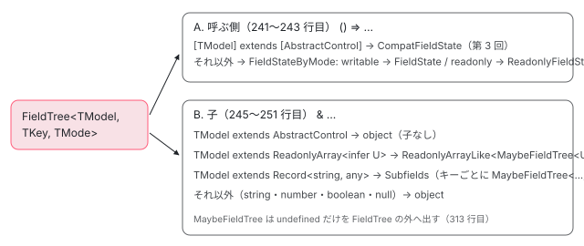

[目次](../README.md) › [Signal Forms の型を読む：FieldTree から SchemaPath まで、api/types.ts の 1000 行](README.md) › 第 1 回 / 全 6 回

# FieldTree と Field：呼べて、プロパティで下りられる木の型

> types.ts の Field・FieldTree・ReadonlyFieldTree・Subfields・ReadonlyArrayLike・MaybeFieldTree。関数の型とオブジェクトの型の交差で「f() で状態、f.name で子」を表す書き方、配列・タプル・Record・undefined を含む値の扱い、型と実行時の Proxy が食い違う所、型の spec（types.spec.ts・field\_proxy.spec.ts）で固めている行。

angular/angular · 読了 約 13 分 · 発展 · [サイトで読む（デモが動きます）](https://angular-deep-dive-cyan.vercel.app/chapter/sfty-tree)

---

`form(model)` が返す `FieldTree` は、**呼ぶと状態（`FieldState`）が返る関数**であり、**プロパティで子の `FieldTree` に下りられる木**でもあります。この章では、その 2 つの顔を TypeScript でどう書いているか（関数の型とオブジェクトの型の交差、値が配列・タプル・Record・`undefined` のときの条件型の分かれ道、`TKey` の意味）を 1 行ずつ読み、手元の tsc で記録した型エラーと、本物の `form()` を実行時に覗いた結果を並べて、型と実物がどこで食い違うかを確かめます。

読む対象は `packages/forms/signals/src/api/types.ts` の 195〜313 行目（`Field`・`FieldTree`・`ReadonlyFieldTree`・`Subfields`・`ReadonlyArrayLike`・`MaybeFieldTree`）、spec は `test/node/types.spec.ts` と `test/node/field_proxy.spec.ts` です。実行時にこの形を作る `Proxy`（`field/proxy.ts`）の罠は [sft-proxy-context](../sft/03-sft-proxy-context.md) の 1〜3 節で読んだので、ここでは繰り返さず、型と突き合わせるだけにします。`Field` と「プロパティをたどって、呼んで状態を取る」という使い方の入口は [signal-forms](../signals/17-signal-forms.md) の 5 節です。

1. **1. FieldTree と Field**（この章）
2. [2. FieldState の読み口](02-sfty-state.md)
3. [3. 検証の結果と binding の型](03-sfty-results.md)
4. [4. PathKind と SchemaPath](04-sfty-path.md)
5. [5. validateHttp と debounce](05-sfty-http-debounce.md)
6. [6. spec と issue](06-sfty-tests-issues.md)

## 1. Field：呼ぶと FieldState を返す関数の型

📄 `angular/packages/forms/signals/src/api/types.ts` L195–209 （▶ の行: 198–199, 206–208）

```ts
195 │ /**
196 │  * A field accessor function that returns the state of the field.
197 │  *
198 ▶  * @template TValue The type of the value stored in the field.
199 ▶  * @template TKey The type of the property key which this field resides under in its parent.
200 │  *
201 │  * @see [Accessing field state](guide/forms/signals/field-state-management#accessing-field-state)
202 │  *
203 │  * @category types
204 │  * @publicApi 22.0
205 │  */
206 ▶ export type Field<TValue, TKey extends string | number = string | number> = () => FieldState<
207 ▶   TValue,
208 ▶   TKey
209 │ >;
```

206〜209 行目の `Field` は「引数なしで呼ぶと `FieldState<TValue, TKey>` を返す関数」です。子に下りる道は持っていません。`[formField]` の入力の型は 3606902b33e（2026-02）でこの `Field` に緩められ、「状態さえ取れればよい」所はこの型を受け取ります。198〜199 行目のとおり、型引数は 2 つです。`TValue` は値の型、`TKey` は「親の中でどのキーの下にいるか」の型で、既定は `string | number` です。`TKey` は `FieldState` の `keyInParent: Signal<TKey>` に流れます（[次の章](02-sfty-state.md)の 2 節）。

## 2. FieldTree：関数の型と、子の型の交差

📄 `angular/packages/forms/signals/src/api/types.ts` L227–251 （▶ の行: 228–229, 231, 241–243, 245–251）

````ts
227 │   TModel,
228 ▶   TKey extends string | number = string | number,
229 ▶   TMode extends 'writable' | 'readonly' = 'writable',
230 │ > =
231 ▶   // Note: We use `[TModel]` in several places below to avoid the condition from being distributed
232 │   // over a recursive union type, which seems to result in infinite type recursion. By adding the
233 │   // tuple we're not testing a naked type parameter, and thus the condition is not distributed.
234 │   // (See https://typescriptlang.org/docs/handbook/2/conditional-types.html#distributive-conditional-types)
235 │   // The example below demonstrates the problematic situation we want to avoid:
236 │   //
237 │   // ```
238 │   // type RecursiveType = (number | RecursiveType)[]
239 │   // type Test = FieldTree<RecursiveType> // Infinite type recursion if condition distributes.
240 │   // ```
241 ▶   (() => [TModel] extends [AbstractControl]
242 ▶     ? CompatFieldState<TModel, TKey, TMode>
243 ▶     : FieldStateByMode<TModel, TKey, TMode>) &
244 │     // Children:
245 ▶     (TModel extends AbstractControl
246 ▶       ? object
247 ▶       : TModel extends ReadonlyArray<infer U>
248 ▶         ? ReadonlyArrayLike<MaybeFieldTree<U, number, TMode>>
249 ▶         : TModel extends Record<string, any>
250 ▶           ? Subfields<TModel, TMode>
251 ▶           : object);
````

`FieldTree` の本体は `A & B` の形です。`&`（交差型）は「A でもあり B でもある」型で、関数の型とオブジェクトの型を交差させると「呼べて、プロパティも持つ」値の型になります。A が 241〜243 行目の「呼ぶと状態を返す関数」、B が 245〜251 行目の「子」です。229 行目の 3 つ目の型引数 `TMode` は `'writable'` か `'readonly'` で、A の中身を切り替えます（4 節と[次の章](02-sfty-state.md)）。

1. **241〜243 行目：呼んだときの型**

   `[TModel] extends [AbstractControl]` なら互換の `CompatFieldState`（Reactive Forms の control を値に持つ場合。[第 3 回](03-sfty-results.md)）、そうでなければ `FieldStateByMode` で、`TMode` に応じて `FieldState` か `ReadonlyFieldState` になります。`[TModel]` と 1 要素のタプルで包むのは、条件型の**分配**を止めるためです。条件型 `T extends X ? A : B` は、`T` が裸の型引数で、そこに和の型（`true | false` など）が入ると、和の 1 つずつに分けて評価して結果を和にします。タプルで包むと分けずに 1 回だけ評価します。
2. **245〜246 行目：control なら子は無い**

   `AbstractControl` の値は、子を Signal Forms の木としては見せません。`object` と交差させるのは、0efb3f6d1f4（2025-11-06）で `unknown` から替えたもので、型エラーの文面に `() => FieldState<…>` ではなく `FieldTree<…>` と出るようにするためです（DEMO の下の記録の T12 の文面）。
3. **247〜248 行目：配列（タプルも）なら ReadonlyArrayLike**

   `infer U` で要素の型を取り出し、`ReadonlyArrayLike<MaybeFieldTree<U, number, TMode>>` にします。2 つ目の型引数の `number` が、要素の `TKey` です。`ReadonlyArray` で受けるので `readonly string[]` も通ります（282220d032a、2025-12）。タプル `[string, number]` も `ReadonlyArray<string | number>` に当てはまるので、**位置ごとの型は失われ**、`f.pair[0]` は `FieldTree<string | number>` です（記録の T8）。
4. **249〜250 行目：オブジェクトなら Subfields**

   `Record<string, any>` は値が `any` の索引シグネチャなので、プロパティを持つどのオブジェクトの型も当てはまります。`Date` も当てはまり、3 節の `Subfields<Date>` になります。
5. **251 行目：それ以外（string・number・boolean・null…）**

   子は無く、`object` です。`for (const x of f.name)` は「`[Symbol.iterator]()` が無い」TS2488 になります（記録の T11）。



*FieldTree の 2 つの顔。上が「呼んだとき」の型（\[TModel\] で包み分配しない）、下が「子」の型（裸の TModel で分配する）。2 つを & で交差させたものが FieldTree。*

子の側（245・247・249 行目）は、呼ぶ側と違って**裸の `TModel`** で、分配します。83032e36059（2026-02-25、Fixes #65535）がこの形にしました。まだ決まっていない型引数の和 `T extends {a: 1} | {a: 1; b: 2}` を `FieldTree<T>` に渡したとき、分配すれば `f.a`（どちらにもあるキー）が読めます。呼ぶ側は分配すると `FieldTree<boolean>` が `(() => FieldState<true>) | (() => FieldState<false>)` のような和になり、`value.set(false)` が通らなくなるので、タプルのまま残しています（テストと直し方の W2 で確かめました）。

📄 `83032e36059 の差分`

```
$ git show 83032e36059 -- packages/forms/signals/src/api/types.ts（抜粋）
# fix(forms): support generic unions in signal form schemas（2026-02-25、Fixes #65535）
@@ -232,9 +232,9 @@ export type FieldTree<
     ? CompatFieldState<TModel, TKey, TMode>
     : FieldStateByMode<TModel, TKey, TMode>) &
     // Children:
-    ([TModel] extends [AbstractControl]
+    (TModel extends AbstractControl
       ? object
-      : [TModel] extends [ReadonlyArray<infer U>]
+      : TModel extends ReadonlyArray<infer U>
         ? ReadonlyArrayLike<MaybeFieldTree<U, number, TMode>>
         : TModel extends Record<string, any>
           ? Subfields<TModel, TMode>
@@ -277,10 +277,11 @@
-export type ReadonlyArrayLike<T> = Pick<
-  ReadonlyArray<T>,
-  number | 'length' | typeof Symbol.iterator
->;
+export interface ReadonlyArrayLike<T> {
+  readonly [n: number]: T;
+  readonly length: number;
+  [Symbol.iterator](): IterableIterator<T>;
+}
（ほかに SchemaPathTree の子の側を逆に [TModel] で包み、RootFieldContext の stateOf などを
 [P] extends [any] ? … : never の形に変え、types.spec.ts に 109〜116 行目の it を足した）
```

> [!WARNING]
> **ハマりどころ**
>
> 231〜239 行目のコメントは「`[TModel]` を**下のいくつかの所で**使う」と書いています。このコメントは faccf03ee04（2025-11-06）が、子の側も `[TModel] extends [AbstractControl]` にしたときに書いたものです。83032e36059 が子の側を裸に戻した後も文面はそのままで、今の 241〜251 行目でタプルで包んでいるのは 241 行目の 1 か所だけです。再帰する型 `(number | RecursiveType)[]` が無限に展開されないのは、今は 3 節の `ReadonlyArrayLike` を `interface` にしたことによります（同じコミットのメッセージの「Array Interface Deflection」）。

## 3. ReadonlyFieldTree と Subfields：子のキーの選び方

📄 `angular/packages/forms/signals/src/api/types.ts` L253–281 （▶ の行: 259, 262, 273–277, 280）

```ts
253 │ /**
254 │  * A readonly {@link FieldTree}.
255 │  *
256 │  * @category types
257 │  * @publicApi 22.0
258 │  */
259 ▶ export type ReadonlyFieldTree<TModel, TKey extends string | number = string | number> = FieldTree<
260 │   TModel,
261 │   TKey,
262 ▶   'readonly'
263 │ >;
264 │ 
265 │ /**
266 │  * The sub-fields that a user can navigate to from a `FieldTree<TModel>`.
267 │  *
268 │  * @template TModel The type of the data which the parent field is wrapped around.
269 │  * @template TMode Determines whether the field state is readonly or writable.
270 │  *
271 │  * @publicApi 22.0
272 │  */
273 ▶ export type Subfields<TModel, TMode extends 'writable' | 'readonly' = 'writable'> = {
274 ▶   readonly [K in keyof TModel as TModel[K] extends Function ? never : K]: MaybeFieldTree<
275 ▶     TModel[K],
276 ▶     string,
277 ▶     TMode
278 │   >;
279 │ } & {
280 ▶   [Symbol.iterator](): Iterator<[string, MaybeFieldTree<TModel[keyof TModel], string, TMode>]>;
281 │ };
```

259〜263 行目の `ReadonlyFieldTree` は、`TMode` に `'readonly'` を入れただけの別名です。a1a6c5282ed（2026-02-19「restrict reactive logic to a readonly API」）が `TMode` と一緒に足しました。ルールの関数が受け取る `ctx.fieldTree` や、エラーの `fieldTree` がこの型です。書き込みが型から消える仕組みは[次の章](02-sfty-state.md)で読みます。

- **274 行目**：`as` 句（キーの付け替え）で、値が関数のキーを `never` にして消します。モデルに `greet: () => string` があっても `f.greet` は TS2339 です（記録の T4）。`Date` のキーは全部メソッドなので、`Subfields<Date>` には子が 1 つもなく、`f.birthday.getDate` も TS2339 です（T5、field\_proxy.spec.ts の 16 行目）。実行時の Proxy は値の型を見ないので、`f.greet` はモデルの関数を値に持つ `FieldTree` を返します（Node での記録 `typeof f.greet → "function"`）。型のほうが厳しい側の食い違いです。
- **274 行目の `readonly`**：子のキーは全部読み取り専用です。`f.name = f.name` は TS2540 です（T7）。型を外して実行したときに何が起きるかは 6 節です。
- **275〜277 行目**：子は `MaybeFieldTree<TModel[K], string, TMode>`。オブジェクトの子の `TKey` は `string` で、`f.name().keyInParent()` を `number` に入れると TS2322 です（T9）。
- **280 行目**：`for (const [key, child] of f.address)` の型です。`child` は全部のキーの値の型の和（`TModel[keyof TModel]`）の `MaybeFieldTree` になります。

`dict: Record<string, number>` のように索引シグネチャを持つ値では、`keyof` が `string` になり、`f.dict['nope']` も `FieldTree<number>` と型が付きます（T16 通る）。実行時は、値に無いキーなので Proxy の `get` は `undefined` を返します（Node での記録 `f.dict.nope → undefined`）。こちらは型のほうが緩い側の食い違いです。

## 4. ReadonlyArrayLike と MaybeFieldTree：配列の顔と undefined の外し方

📄 `angular/packages/forms/signals/src/api/types.ts` L283–313 （▶ の行: 290–293, 309, 313）

```ts
283 │ /**
284 │  * An iterable object with the same shape as a readonly array.
285 │  *
286 │  * @template T The array item type.
287 │  *
288 │  * @publicApi 22.0
289 │  */
290 ▶ export interface ReadonlyArrayLike<T> {
291 ▶   readonly [n: number]: T;
292 ▶   readonly length: number;
293 ▶   [Symbol.iterator](): IterableIterator<T>;
294 │ }
295 │ 
296 │ /**
297 │  * Helper type for defining `FieldTree`. Given a type `TValue` that may include `undefined`,
298 │  * it extracts the `undefined` outside the `FieldTree` type.
299 │  *
300 │  * For example `MaybeFieldTree<{a: number} | undefined, TKey>` would be equivalent to
301 │  * `undefined | FieldTree<{a: number}, TKey>`.
302 │  *
303 │  * @template TModel The type of the data which the field is wrapped around.
304 │  * @template TKey The type of the property key which this field resides under in its parent.
305 │  * @template TMode Determines whether the field state is readonly or writable.
306 │  *
307 │  * @publicApi 22.0
308 │  */
309 ▶ export type MaybeFieldTree<
310 │   TModel,
311 │   TKey extends string | number = string | number,
312 │   TMode extends 'writable' | 'readonly' = 'writable',
313 ▶ > = (TModel & undefined) | FieldTree<Exclude<TModel, undefined>, TKey, TMode>;
```

290〜294 行目の `ReadonlyArrayLike` は、数の添字・`length`・`Symbol.iterator` の 3 つだけを持つ interface です。`map` や `filter` は型にありません（T6 の TS2339）。実行時の Proxy も `length` と `Symbol.iterator` だけを答え、ほかは `undefined` です（[sft-proxy-context](../sft/03-sft-proxy-context.md) の 2 節）。ここは型と実物が揃っています。`[...f.items].map(…)` と一度配列に広げるのが決まった使い方です。

313 行目の `MaybeFieldTree` は、値の型に `undefined` が含まれていれば、それを `FieldTree` の**外**に出します。`(TModel & undefined)` は「`TModel` のうち `undefined` の部分」で、`{bio: string} | undefined` なら `undefined`、`string` なら `never`（何も足さない）です。右側の `FieldTree<Exclude<TModel, undefined>, …>` で残りの型の木を作るので、`f.profile` は `FieldTree<{bio: string}> | undefined` になります。

1. **子に下りる前に確かめさせる**

   `f.profile.bio` は TS18048「possibly undefined」、`f.profile?.bio` は通ります（T1・T2）。省略可能なキー `nick?: string` も同じで、`f.nick()` は TS2722 です（T3）。
2. **実行時もそのとおり**

   値が `undefined` のキーは子が作られず、`f.profile` は `undefined` です（[sft-structure](../sft/01-sft-structure.md) の 4 節）。DEMO の 3・4 で、値を入れると子が現れ、戻すと消えるのが見えます。
3. **null は外さない**

   外すのは `undefined` だけです。`string | null` の値は `FieldTree<string | null>` のままで、呼べば状態が取れます。省略可能なキーが `undefined` の外に出されたため `[field]` に渡せなかった報告が #64428（2025-10、閉じた）です。

## 5. 型と実物を並べる：どこが食い違うか

ここまでの型を、本物の `form()` を Node で動かした結果と並べます（`@angular/forms` 22.2.6。下の DEMO で同じものを画面でも見られます）。実行時の答えを出しているのは `FIELD_PROXY_HANDLER` の 3 つの罠と、罠の無い操作を受ける target の関数 `() => this` です（[sft-proxy-context](../sft/03-sft-proxy-context.md) の 1 節）。

📄 `記録（Node、22.2.6）`

```
$ node tree.mjs     # 記録用のモデル（tree.ts と同じキー）に値を入れて form() を作り、式を 1 つずつ評価した
# @angular/forms 22.2.6 / node v24.22.1
typeof f                                     "function"
typeof f()                                   "object"
f() constructor                              "FieldNode"
Object.keys(f)                               ["name","address","items","tags","pair","dict","nick","profile","birthday","greet"]
Object.keys(f()) (FieldNode own)             ["structure","validationState","metadataState","nodeState","submitState","fieldAdapter","controlValue","_context","fieldProxy","pathNode","pendingSync"]
f.items[0] === f.items[0]                    true
f.items === f.items                          true
f.items.length                               2
Array.isArray(f.items)                       false
f.items.map                                  undefined
'items' in f                                 false
'name' in f                                  true
'length' in f                                true
Symbol.iterator in f.items                   false
f.pair[1]().value()                          1
typeof f.pair[1]().keyInParent()             "string"
f.items[1]().keyInParent()                   "1"
f.name().keyInParent()                       "name"
f.dict.a().value()                           1
f.dict.nope                                  undefined
f.nick                                       undefined
f.profile                                    undefined
f.birthday.getDate                           undefined
f.birthday().value() instanceof Date         true
Object.keys(f.birthday)                      []
typeof f.greet                               "function"
f.greet().value() === m().greet              true
f.name.length                                undefined
f.name.name                                  undefined
f().fieldTree === f                          true
typeof f().fieldTree.name                    "function"
[...f.items].length                          2
[...f.address].map(([k]) => k)               ["city","zip"]
f.name = f.address (strict)                  throw TypeError: Cannot assign to read only property 'name' of function '() => this'
profile を入れた後 f.profile.bio().value()        "x"
```

| 式 | 型（tsc の記録） | 実行時 | どちらが正しいか |
| --- | --- | --- | --- |
| `f.items[0]().keyInParent()` | `number`（T10 通る。248 行目の `number`） | `"1"` などの文字列 | 型が外れている。#71616（開いている）。理由は [sft-array-identity](../sft/02-sft-array-identity.md) の 3 節 |
| `f.name.length` | `number`（T20 通る） | `undefined` | 型が外れている。241 行目の関数の型が、`Function` の `length` を持ち込む |
| `f.address.name`（子に `name` が無い） | `string`（T21 通る） | `undefined` | 同じく `Function` の `name`。子に `name` があればそちらが優先される（`f.name` は `FieldTree<string>`） |
| `f.dict['nope']` | `FieldTree<number>`（T16 通る） | `undefined` | 型が緩い。索引シグネチャの値を `MaybeFieldTree` に通すだけで、キーの有無は型に無い |
| `f.pair[0]`（タプル） | `FieldTree<string \| number>`（T8） | 値は `"x"` | 型が粗い。247 行目の `infer U` が要素の和を取る |
| `f.greet`（関数の値） | TS2339（T4） | `FieldTree`（関数） | 型が厳しい。274 行目 |
| `'items' in f` | `boolean` | `false` | `has` の罠が無く target の関数を見る。`'name' in f` は `true`（sft-proxy-context の 3 節） |
| `Symbol.iterator in f.items` | 型には `[Symbol.iterator]` がある（293 行目） | `false` | 同じ理由。#70252（開いている） |
| `f.items.map` | TS2339（T6） | `undefined` | 揃っている |

> [!NOTE]
> **さらに深く**
>
> `f.name.length` と `f.address.name` に型が付くのは、241 行目の `() => …` が関数の型だからです。TypeScript は、関数の型の値でプロパティが見つからないとき、`Function` のメンバー（`name`・`length`・`bind`…）を探します。`Subfields` にあるキーはそちらが先に見つかるので、`f.name` は子になります。`f().fieldTree` は `FieldTree<unknown>` で子の型が `object` なので、`f().fieldTree.name` は `string` と型が付き、実行時は子の `FieldTree` が返ります（[次の章](02-sfty-state.md)の記録の S10）。

## 6. 型が禁じる代入を、型を外して実行すると

3 節の 274 行目の `readonly` で、`f.address = f.name` は TS2540 です（T7）。field\_proxy.spec.ts の 25〜33 行目も、この型だけを確かめています（テストと直し方）。では `as any` などで型を外して代入すると何が起きるか、Node で確かめた記録です。

📄 `記録（Node、22.2.6、抜粋）`

```
$ node assign.mjs     # @angular/forms 22.2.6 / node v24.22.1（ES モジュールなので strict mode）
1. f.address = f.name → 投げずに終わる
2. f.address を読む → throw TypeError: 'get' on proxy: property 'address' is a read-only and
   non-configurable data property on the proxy target but the proxy did not return its actual value
3. Object.keys(f) → throw TypeError: 'getOwnPropertyDescriptor' on proxy: trap returned descriptor
   for property 'address' that is incompatible with the existing property in the proxy target
4. m() → {"name":"Ada","address":{"city":"T"}}
6. g.name = g.name（target の関数に name がある） → throw TypeError: Cannot assign to read only property 'name' of function '() => this'
7. h[0] = h[1] → 投げずに終わる
8. h[0] を読む → throw TypeError: 'get' on proxy: property '0' is a read-only and non-configurable …
```

1. **代入は投げずに終わる**

   Proxy に `set` の罠が無いので、代入は JavaScript の既定の手順で進みます。既定の手順は、まず受け手（Proxy）の `getOwnPropertyDescriptor` を呼び、proxy.ts の罠が値の側の記述子（書き込み可）を返すので、次に受け手へ `{value: …}` だけの定義を頼みます。`defineProperty` の罠も無いので、その定義は target の関数 `() => this` に、**書き込み不可・設定変更不可**の新しい性質として作られます（記述子で省いた欄は false になる）。
2. **それ以後、そのキーを読むと必ず投げる**

   Proxy には「target の書き込み不可・設定変更不可の性質と違う値を `get` で返してはいけない」という決まりがあります。`get` の罠は子の `FieldTree` を返すので、記録の 2 のとおり毎回 TypeError です。`Object.keys(f)` も 3 のとおり投げます。モデル（4）は何も変わっていません。
3. **キーが `name`・`length` なら、代入で投げる**

   target の矢印関数がもともと持っている `name` は書き込み不可なので、6 のとおり代入の時点で投げます。配列の `h[0] = h[1]` は 7・8 のとおり、オブジェクトと同じ壊れ方です。

TypeScript の型が通らないので、型を守っていれば起きません。型を外したコード（`any` を経由した値、JavaScript から呼ぶライブラリ）で起きると、壊れるのは代入した所ではなく、その後で読んだ所です。gh で「proxy set trap」などを探した範囲では、既存の issue と PR は見つかりませんでした。直し方は章末に書きます。

## 7. DEMO：本物の FieldTree を覗く

> **🧪 DEMO — form() の FieldTree の型と実物（@angular/forms 22.2.6）**
>
> モデルは `{name, address: {city, zip}, items: [{title, qty}, …], profile: {bio} | undefined}`。1 を押してから 2〜4 で値を変えると、表を読み直します。5 は、型が禁じる子の付け替えを、使い捨ての form で型を外して実行します（6 節）。
>
> ▶ [このデモはサイトで動かせます](https://angular-deep-dive-cyan.vercel.app/chapter/sfty-tree)

- **1 の直後**：`typeof f` は `"function"`、`Object.keys(f)` はモデルのキー、`f.items[0] === f.items[0]` は `true`（同じキーの子は同じ `FieldTree`。[sft-structure](../sft/01-sft-structure.md) の 4 節）です。`Object.keys(f())` の数は、`FieldNode` が自分で持つ欄の数で、`FieldState` の型には無い内部の部品も入ります（[次の章](02-sfty-state.md)）。
- **2**：`f.items.length` と `[...f.items].length` が 3 になり、`f.items[1]().keyInParent()` は文字列の `"1"` のままです。
- **3・4**：`f.profile` が `undefined` と `FieldTree` の間を行き来し、`f.profile?.bio().value()` が `"hello"` と `undefined` を行き来します（4 節の 313 行目のとおり）。
- **5**：代入は投げずに終わり、その後の `typeof g.address` と `Object.keys(g)` が TypeError を投げます。

### tsc の記録

型の列の根拠です。次のファイルの頭に、表の 1 行を 1 行ずつ足して `tsc --strict` にかけました（TypeScript 6.0.3、型は 22.2.6 の `.d.ts`）。

📄 `tree.ts（記録用、1〜16 行目）`

```
import {signal} from '@angular/core';
import {form, type FieldTree, type ReadonlyFieldTree} from '@angular/forms/signals';

interface Model {
  name: string;
  address: {city: string; zip: string};
  items: {title: string; qty: number}[];
  tags: readonly string[];
  pair: [string, number];
  dict: Record<string, number>;
  nick?: string;
  profile: {bio: string} | undefined;
  birthday: Date;
  greet: () => string;
}
declare const f: FieldTree<Model>;
```

| 記号 | 行 | 書いたもの | 確かめたいこと | tsc の結果 |
| --- | --- | --- | --- | --- |
| T1 | 18 | `f.profile.bio;` | undefined を含む値の子に下りる | TS18048 'f.profile' is possibly 'undefined'. |
| T2 | 19 | `f.profile?.bio;` | ?. なら通る | 通る |
| T3 | 20 | `f.nick();` | 省略可能なキーを呼ぶ | TS2722 Cannot invoke an object which is possibly 'undefined'. |
| T4 | 21 | `f.greet;` | 関数の値のキー | TS2339 Property 'greet' does not exist on type 'FieldTree&lt;Model&gt;'. |
| T5 | 22 | `f.birthday.getDate;` | Date のメソッド | TS2339 Property 'getDate' does not exist on type 'FieldTree&lt;Date, string, "writable"&gt;'. |
| T6 | 23 | `f.items.map;` | 配列のメソッド | TS2339 Property 'map' does not exist on type 'FieldTree&lt;{ title: string; qty: number; }\[\], string, "writable"&gt;'. |
| T7 | 24 | `f.name = f.name;` | 子の付け替え | TS2540 Cannot assign to 'name' because it is a read-only property. |
| T8 | 25 | `const s0: string = f.pair[0]().value();` | タプルの要素 | TS2322 Type 'string \| number' is not assignable to type 'string'. |
| T9 | 26 | `const k1: number = f.name().keyInParent();` | オブジェクトの子の TKey | TS2322 Type 'string' is not assignable to type 'number'. |
| T10 | 27 | `const k2: number = f.items[0]().keyInParent();` | 配列の要素の TKey | 通る |
| T11 | 28 | `for (const x of f.name) {}` | 文字列のフィールドを for...of | TS2488 Type 'FieldTree&lt;string, string, "writable"&gt;' must have a '\[Symbol.iterator\]()' method that returns an iterator. |
| T12 | 29 | `const n1: FieldTree<number> = f.name;` | 型の違う FieldTree に代入 | TS2322 Type 'FieldTree&lt;string, string, "writable"&gt;' is not assignable to type 'FieldTree&lt;number&gt;'. |
| T13 | 31 | `r.name().value.set('x');` | 読み取り専用の木から書く | TS2339 Property 'set' does not exist on type 'Signal&lt;string&gt;'. |
| T14 | 32 | `const w: FieldTree<Model> = r;` | 読み取り専用を書ける木に代入 | TS2322 Type 'ReadonlyFieldTree&lt;Model&gt;' is not assignable to type 'FieldTree&lt;Model&gt;'. |
| T15 | 33 | `const ro: ReadonlyFieldTree<Model> = f;` | 書ける木を読み取り専用に代入 | 通る |
| T16 | 34 | `const d: FieldTree<number> = f.dict['nope'];` | Record の無いキー | 通る |
| T17 | 35 | `const okLen: number = f.items.length;` | 配列の length | 通る |
| T18 | 37 | `const c: FieldTree<string> \| undefined = child;` | オブジェクトの反復 | 通る |
| T19 | 39 | `const ff = form(signal<Model>(null!));` | form() の戻り値 | 通る |
| T20 | 41 | `const nl: number = f.name.length;` | 文字列のフィールドの length | 通る |
| T21 | 42 | `const nn: string = f.address.name;` | 子に name が無いオブジェクトの .name | 通る |
| T22 | 43 | `const iter: () => Iterator<unknown> = f.items[Symbol.iterator];` | 配列のフィールドの Symbol.iterator | 通る |
| T23 | 45 | `takesOptional(f.nick);` | 省略可能なキーの子の型 | 通る |

## ここまでの型の評価（f.profile?.bio の型ができるまで）

- 👤 `form(signal<Model>(…))` — 利用者のコード — *戻り値は FieldTree&lt;Model&gt;（T19）*
  - `FieldTree<Model, string | number, 'writable'>` — types.ts 227–251
    - `() => FieldStateByMode<Model, …, 'writable'>` — types.ts 241–243 — *呼ぶ側。\[TModel\] で分配しない*
    - `Model extends Record<string, any>` → `Subfields<Model, 'writable'>` — types.ts 249–250 — *子の側。裸の TModel*
      - `readonly profile: MaybeFieldTree<{bio} | undefined, string>` — types.ts 274–277 — *関数の値のキーはここで消える*
        - `undefined | FieldTree<{bio: string}, string>` — types.ts 313
          - `?.bio` → `Subfields<{bio}>` の `bio` → `FieldTree<string, string>` — types.ts 249–251 — *string の子は object*
- `f.profile?.bio` を実行時に読む → `FIELD_PROXY_HANDLER.get` → `getChild('profile')` — field/proxy.ts — *sft-proxy-context の 1 節*

## テストと直し方

この章の型を固めているのは、`test/node/types.spec.ts` の `describe('types')` の 4 つの it と、`test/node/field_proxy.spec.ts` の `describe('FieldTree proxy')`（13 行目）です。

📄 `angular/packages/forms/signals/test/node/types.spec.ts` L104–141 （▶ の行: 104–106, 109, 112–113, 118, 120, 125–126, 131, 137–138）

```ts
104 ▶     it('should allow FieldTree of recursive type', () => {
105 ▶       type RecursiveType = (number | RecursiveType)[];
106 ▶       form(signal<RecursiveType>([5]));
107 │     });
108 │ 
109 ▶     it('should allow property access on generic type unions', () => {
110 │       // Validates that uninstantiated generic unions can still access shared
111 │       // fields via naked conditional distribution in FieldTree
112 ▶       function testGeneric<T extends {a: 1} | {a: 1; b: 2}>(f: FieldTree<T>) {
113 ▶         const x: FieldTree<1> = f.a;
114 │         return x;
115 │       }
116 │     });
117 │ 
118 ▶     it('should allow ReadonlyArray in model and be iterable', () => {
119 │       interface Order {
120 ▶         readonly products: readonly string[];
121 │       }
122 │       const order: WritableSignal<Order> = null!;
123 │       const f = form(order);
124 │       // Iterating over products should yield FieldTree<string> items, not [string, FieldTree] entries
125 ▶       for (const product of f.products) {
126 ▶         const p: FieldTree<string> = product;
127 │         p().value();
128 │       }
129 │     });
130 │ 
131 ▶     it('should allow Array in model and be iterable', () => {
132 │       interface Order {
133 │         products: string[];
134 │       }
135 │       const order: WritableSignal<Order> = null!;
136 │       const f = form(order);
137 ▶       for (const product of f.products) {
138 ▶         const p: FieldTree<string> = product;
139 │         p().value();
140 │       }
141 │     });
```

- `it('should allow FieldTree of recursive type')`（104 行目）：105〜106 行目の再帰する型で `form()` がコンパイルできること。faccf03ee04 が足しました。
- `it('should allow property access on generic type unions')`（109 行目）：112〜113 行目、まだ決まっていない和の型から共通のキー `a` が読めること。2 節の子の側の分配です。
- `it('should allow ReadonlyArray in model and be iterable')`（118 行目）と `it('should allow Array in model and be iterable')`（131 行目）：`for...of` で出てくるのが `[string, FieldTree]` の組（280 行目）ではなく `FieldTree<string>`（293 行目）であること。

このファイルの it は、ファイルの頭で宣言した `function typeVerificationOnlyDoNotRunMe()` の中にあり、その関数はどこからも呼ばれません。jasmine はこの describe を見つけないので、spec の数に入りません。検査は「`test_lib` のコンパイルが通ること」で、型が崩れると test の前の段で落ちます（下の W1・W2）。

📄 `angular/packages/forms/signals/test/node/field_proxy.spec.ts` L13–33 （▶ の行: 14, 16–17, 25, 27, 29–32）

```ts
13 │ describe('FieldTree proxy', () => {
14 ▶   it('should not forward methods through the proxy', () => {
15 │     const f = form(signal(new Date()), {injector: TestBed.inject(Injector)});
16 ▶     // @ts-expect-error
17 ▶     expect(f.getDate).toBe(undefined as any);
18 │   });
19 │ 
20 │   it('should allow spreading field arrays', () => {
21 │     const f = form(signal([0, 1, 2]), {injector: TestBed.inject(Injector)});
22 │     expect([...f].map((i) => i().value())).toEqual([0, 1, 2]);
23 │   });
24 │ 
25 ▶   it('should not allow mutation of the field structure', () => {
26 │     const f = form(signal({arr: [0, 1]}), {injector: TestBed.inject(Injector)});
27 ▶     // Just to have an expectation, really this test is just to check the typings below.
28 │     expect(f).toBeDefined();
29 ▶     // @ts-expect-error
30 ▶     f.arr = f.arr;
31 ▶     // @ts-expect-error
32 ▶     f.arr[0] = f.arr[0];
33 │   });
```

16 行目の `@ts-expect-error` は「次の行は型エラーになる」と宣言する印で、エラーにならないと TS2578「Unused '@ts-expect-error' directive」でコンパイルが落ちます。17 行目は 3 節の 274 行目（`Date` のメソッドを消す）を固めています。25〜33 行目は 27 行目のコメントのとおり型だけのための it ですが、jasmine で**実際に走ります**。30 行目の `f.arr = f.arr` は 6 節の代入そのもので、投げずに終わり、そのあと誰も `f.arr` を読まないので通っています。

📄 `angular/packages/forms/signals/test/node/field_proxy.spec.ts` L136–143 （▶ の行: 136, 139–140, 142）

```ts
136 ▶   it('should not iterate over primitive field', () => {
137 │     const f = form(signal(1), {injector: TestBed.inject(Injector)});
138 │     expect(() => {
139 ▶       // @ts-expect-error - not iterable
140 ▶       for (const child of f) {
141 │       }
142 ▶     }).toThrow();
143 │   });
```

139 行目は 2 節の 251 行目（文字列の子は `object`）を、142 行目は実行時に投げることを固めています。

📄 `走らせ方`

```
cd ~/angular-research/angular
pnpm bazel test //packages/forms/signals/test/node:test --nocache_test_results --test_output=all \
  --test_arg=--filter="FieldTree proxy"
pnpm bazel test //packages/forms/signals/test/node:test --nocache_test_results --test_output=all
```

📄 `結果`

```
# 2026-11-19、手元の macOS で（8576f161ae4）
Ran 11 of 539 specs
11 specs, 0 failures            # field_proxy.spec.ts の it は 11 本
//packages/forms/signals/test/node:test                                  PASSED in 0.8s
539 specs, 0 failures           # フィルタなし。types.spec.ts の it は 1 本も数に入らない
//packages/forms/signals/test/node:test                                  PASSED in 1.1s
```

型を 1 か所ずつ崩して、spec がそれを捕まえるかを作業木で確かめました。

📄 `結果（作業木、bazel を直接）`

```
# 作業木（8576f161ae4）で types.ts を 1 か所ずつ変え、//packages/forms/signals/test/node:test を走らせた
# 試した後は git checkout で戻し、作業木も消した

[W1] 274 行目の as … extends Function ? never : K を外す（関数の値のキーも子にする）
packages/forms/signals/test/node/field_proxy.spec.ts:16:5 - error TS2578: Unused '@ts-expect-error' directive.
ERROR: Build did NOT complete successfully      # テストは 1 本も走らない

[W2] 241 行目の [TModel] extends [AbstractControl] を TModel extends AbstractControl にする（呼ぶ側も分配させる）
packages/forms/signals/test/node/field_node.spec.ts:190:17 - error TS2345: Argument of type 'false' is not assignable to parameter of type 'undefined'.
packages/forms/signals/test/node/field_node.spec.ts:197:17 - error TS2345: Argument of type 'null' is not assignable to parameter of type 'undefined'.
packages/forms/signals/test/node/api/when.spec.ts:90:32 - error TS2345: Argument of type 'true' is not assignable to parameter of type 'never'.
（ほか when.spec.ts に 8 件、合わせて 11 件。190 行目は form(signal(true)) の f().reset(false)）
ERROR: Build did NOT complete successfully
```

W1 は field\_proxy.spec.ts の 16 行目が捕まえます。W2 は、呼ぶ側の `[TModel]` を外すと `boolean` のフォームが壊れることを、`FieldTree` の型の spec ではなく、`reset(false)` や `value.set(true)` を書いたふつうの spec が捕まえています。types.spec.ts には `FieldTree<boolean>` を直接確かめる it はありません。足すなら `describe('types')` に `form(signal(true))().value.set(false)` の 1 行の it です。

### 直すとしたら

- 6 節の代入は、`field/proxy.ts` の `FIELD_PROXY_HANDLER` に、`false` を返す `set` と `defineProperty` の罠を足す形です。strict mode の代入はその場で TypeError になり、Proxy は壊れません。spec は `field_proxy.spec.ts` の `describe('FieldTree proxy')` に足し、25〜33 行目の it の 30・32 行目も `expect(() => …).toThrowError(TypeError)` で包み直す必要があります（今の 30 行目は代入が通ることを前提に走っている）。作業木で試した差分と結果です。

📄 `作業木で試した差分`

```
# 作業木で試した差分（試した後で消した）
--- a/packages/forms/signals/src/field/proxy.ts
+++ b/packages/forms/signals/src/field/proxy.ts
@@ -87,6 +87,14 @@ export const FIELD_PROXY_HANDLER: ProxyHandler<() => FieldNode> = {
     return desc;
   },
 
+  set() {
+    return false;
+  },
+
+  defineProperty() {
+    return false;
+  },
+
   ownKeys(getTgt: () => FieldNode) {
--- a/packages/forms/signals/test/node/field_proxy.spec.ts
+++ b/packages/forms/signals/test/node/field_proxy.spec.ts
+  it('should throw instead of breaking the proxy when assigning to a child', () => {
+    const f = form(signal({a: {b: 1}, c: 2}), {injector: TestBed.inject(Injector)});
+    const a = f.a;
+    expect(() => {
+      (f as any).a = f.c;
+    }).toThrowError(TypeError);
+    expect(f.a).toBe(a);
+    expect(Object.keys(f)).toEqual(['a', 'c']);
+  });
```

📄 `結果（作業木、bazel を直接、--filter=FieldTree proxy）`

```
# spec だけを足した状態（proxy.ts は元のまま）
1) FieldTree proxy should throw instead of breaking the proxy when assigning to a child
Ran 12 of 540 specs
12 specs, 1 failure
# proxy.ts も替えた状態
1) FieldTree proxy should not allow mutation of the field structure
  Message:
    TypeError: 'set' on proxy: trap returned falsish for property 'arr'
  Stack:
        at UserContext.<anonymous> (./packages/forms/signals/test/node/field_proxy.spec.ts:30:10)
Ran 12 of 540 specs
12 specs, 1 failure             # 足した it は通り、元からある 25〜33 行目の it が 30 行目で投げる
```

- 231〜239 行目のコメントは、今の形（呼ぶ側だけをタプルで包み、子の側は分配させる）に合わせて書き直す所です。型は変わらないので spec は要りません。
- `keyInParent` の型と実物の食い違い（#71616）は、数を返す PR #71617 が開いています（[sft-array-identity](../sft/02-sft-array-identity.md) の 3 節）。

## 聞かれそうな質問

**Q. FieldTree はなぜ「呼べて、プロパティも持てる」のですか？**

型の上では 241 行目の関数の型と 245〜251 行目の子の型の交差（`&`）だからです。実行時は、関数 `() => this` を target にした Proxy で、呼ぶと target の関数が `FieldNode` を返し、プロパティの読み出しは `get` の罠が子を探します（sft-proxy-context の 1 節）。

**Q. 値が `{bio: string} | undefined` のキーに、なぜ `?.` が要るのですか？**

313 行目の `MaybeFieldTree` が `undefined` を `FieldTree` の外に出し、子の型を `undefined | FieldTree<{bio}>` にするからです。実行時も値が `undefined` の間は子が作られず `undefined` が返るので、型と実物が揃っています（DEMO の 3・4）。

**Q. `f.items.map(…)` が書けないのはなぜですか？**

248 行目で配列の子は `ReadonlyArrayLike` になり、290〜294 行目の interface には数の添字・`length`・`Symbol.iterator` しかないからです。実行時の Proxy も同じ 3 つしか答えません。`[...f.items]` で配列に広げてから使います。

**Q. TKey は何に使われますか？**

そのフィールドが親のどのキーの下にいるかの型で、`FieldState.keyInParent` の型になります。オブジェクトの子は 276 行目で `string`、配列の要素は 248 行目で `number` です。ただし実行時の `keyInParent()` は配列の要素でも文字列を返し、型と合いません（#71616）。

**Q. 241 行目だけ `[TModel]` と包み、245 行目は包まないのはなぜですか？**

子の側は分配させたほうが、まだ決まっていない和の型でも共通のキーが読める（83032e36059、types.spec.ts 109 行目）からです。呼ぶ側を分配させると `boolean` が `true` と `false` の状態の和になり、`value.set(false)` が通りません（W2）。

**Q. 型を外して `f.address = f.name` を実行するとどうなりますか？**

代入は投げずに終わりますが、target の関数に書き込み不可・設定変更不可の `address` が作られ、それ以後 `f.address` と `Object.keys(f)` が毎回 TypeError を投げます（6 節の記録）。モデルは変わりません。

## 読み終えて

- `FieldTree` は「呼ぶと状態を返す関数の型」と「子の型」の交差。`TMode` が呼んだときの型を `FieldState` と `ReadonlyFieldState` で切り替える
- 子の型は条件型の分かれ道で決まる：control は `object`、配列とタプルは `ReadonlyArrayLike<MaybeFieldTree<要素, number>>`、オブジェクトは `Subfields`（関数のキーを消し、全部 readonly）、それ以外は `object`
- `MaybeFieldTree` は `undefined` だけを木の外に出す。`null` は外さない
- 型と実物は、配列の `keyInParent`・`Function` の `name`/`length`・索引シグネチャ・`in` で食い違う。型を外した子の代入は Proxy を壊す
- 型の spec は jasmine で走らず、`test_lib` のコンパイルで検査される。`@ts-expect-error` は「エラーにならなければ落ちる」印

---

← 前: [spec と issue を読む：組み込みの検証を固めているテスト](../sfv/05-sfv-tests-issues.md)  
次: [FieldState と ReadonlyFieldState：状態の読み口を型で並べる](02-sfty-state.md) →
