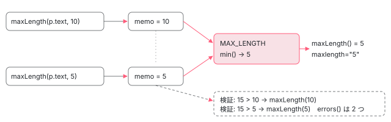

[目次](../README.md) › [Signal Forms の組み込みの検証：required から minDate まで、1 つの validate に下りるまで](README.md) › 第 2 回 / 全 5 回

# 数と長さの上限下限：max・minLength・maxLength と metadata の集約

> max.ts・min\_length.ts・max\_length.ts が上限を memo の metadata に 1 回だけ計算し、MAX\_NUMBER・MIN\_LENGTH・MAX\_LENGTH の鍵の reducer が複数のルールを厳しい方にまとめる行（エラーはルールごと）、NaN の上限を先に積むと max() と属性が NaN になる順序、getLengthOrSize が文字列・配列・Set を同じに数えるわけ、その metadata を \[formField\] が input の max・maxlength 属性に渡すところ（#69690・#69831・#70600）、組み込みのルールが使わない注入器を作っていた #71623（67e50693274）。

angular/angular · 読了 約 13 分 · 発展 · [サイトで読む（デモが動きます）](https://angular-deep-dive-cyan.vercel.app/chapter/sfv-limits)

---

`max`・`min`・`maxLength`・`minLength` は、検証の関数を積むだけでなく、上限・下限の値を metadata に載せます。この章では **上限を 1 回だけ計算する memo、複数のルールを 1 つにまとめる鍵（`MAX_NUMBER`・`MIN_LENGTH`・`MAX_LENGTH`）と reducer、文字列・配列・Set を同じに数える `getLengthOrSize`**を読み、その値がフィールドの `maxLength()` などを通って input の `maxlength` 属性になるまでを追います。2 つのルールを足すと metadata は厳しい方になるのに、エラーは両方出る理由もここで分かります。

読む対象は `packages/forms/signals/src/api/rules/validation/` の `max.ts`・`max_length.ts`・`min_length.ts`・`util.ts`、`api/rules/metadata.ts` の鍵の定義、spec の `test/node/api/validators/max.spec.ts`・`max_length.spec.ts` です。`min.ts` は [forms-sf-rules-metadata](../forms/18-forms-sf-rules-metadata.md) の 6 節で全部読んだので、ここでは `max.ts` を主に読み、`min` は違いだけを見ます。共通の設定（`when`・`message`・`error`）と `isEmpty` は[第 1 回](01-sfv-common.md)です。

1. [1. 共通の形と isEmpty](01-sfv-common.md)
2. **2. 数と長さの上限下限**（この章）
3. [3. 日付の上限下限](03-sfv-dates.md)
4. [4. エラーの型](04-sfv-errors.md)
5. [5. spec と issue](05-sfv-tests-issues.md)

## 1. max：memo・公開の鍵・指す鍵・検証の 4 つのルール

📄 `angular/packages/forms/signals/src/api/rules/validation/max.ts` L33–71 （▶ の行: 33, 35, 38, 41–42, 45, 49, 52–53, 55, 58–59, 62, 66）

```ts
33 ▶ export function max<TValue extends number | null, TPathKind extends PathKind = PathKind.Root>(
34 │   path: SchemaPath<TValue, SchemaPathRules.Supported, TPathKind>,
35 ▶   maxValue: number | LogicFn<TValue, number | undefined, TPathKind>,
36 │   config?: BaseValidatorConfig<TValue, TPathKind>,
37 │ ): void {
38 ▶   const MAX_MEMO = createMetadataKey<number | undefined>();
39 │ 
40 │   // Memoize the maximum valid value.
41 ▶   metadata(path, MAX_MEMO, (ctx) => {
42 ▶     if (config?.when && !config.when(ctx)) {
43 │       return undefined;
44 │     }
45 ▶     return typeof maxValue === 'function' ? maxValue(ctx) : maxValue;
46 │   });
47 │ 
48 │   // Publish the memoized maximum value for aggregation.
49 ▶   metadata(path, MAX_NUMBER, ({state}) => state.metadata(MAX_MEMO)!());
50 │ 
51 │   // Use `MAX_NUMBER` to define the `max` property of the field.
52 ▶   metadata(path, MAX, () => MAX_NUMBER as LimitKey<TValue>);
53 ▶   validate(path, (ctx) => {
54 │     const value = ctx.value();
55 ▶     if (value === null || Number.isNaN(value)) {
56 │       return undefined;
57 │     }
58 ▶     const max = ctx.state.metadata(MAX_MEMO)!();
59 ▶     if (max === undefined || Number.isNaN(max)) {
60 │       return undefined;
61 │     }
62 ▶     if (value > max) {
63 │       if (config?.error) {
64 │         return getOption(config.error, ctx);
65 │       } else {
66 ▶         return maxError(max, {message: getOption(config?.message, ctx)});
67 │       }
68 │     }
69 │     return undefined;
70 │   });
71 │ }
```

1. **38・41〜46 行目：上限を memo に 1 回だけ計算する**

   38 行目でこの `max()` 呼び出し専用の鍵を作ります。reducer を渡さない `createMetadataKey()` なので、値は 1 つを上書きするだけです。41 行目の metadata の関数は、42 行目の `when` が偽なら `undefined`、45 行目で関数なら呼び、数ならそのまま返します。metadata の値は `computed` で覚えられるので、49 行目と 58 行目の 2 か所から読んでも、上限の関数は 1 回しか走りません。
2. **49 行目：公開の鍵 MAX\_NUMBER に流す**

   memo の値を、数の上限をまとめる `MAX_NUMBER` に書きます。同じフィールドの他の `max()` もここに書くので、2 節の reducer でまとめられます。
3. **52 行目：MAX には「MAX\_NUMBER を見よ」と書く**

   `MAX` に入るのは数ではなく**鍵そのもの**です。フィールドの `max()` はまず `MAX` から鍵を取り、その鍵の値を読みます（[forms-sf-rules-metadata](../forms/18-forms-sf-rules-metadata.md) の 6 節）。日付の `maxDate` は同じ `MAX` に `MAX_DATE` を入れます。この間接参照は[第 3 回](03-sfv-dates.md)で読みます。
4. **53〜70 行目：検証は自分の memo だけを見る**

   55 行目、値が `null` か `NaN` なら黙ります。`isEmpty` を使わず、33 行目の型（`number | null`）に合わせて直接比べています。58 行目で読むのは 2 節でまとめた値ではなく、**この呼び出しの memo**です。59 行目で上限が `undefined`（`when` が偽）か `NaN` なら黙り、62 行目で比べ、66 行目で `maxError` を返します。

`min.ts` との違いは、名前と 62 行目の不等号だけです。`max_length.ts` と `min_length.ts` も同じ関係です。

📄 `diff（doc コメントを除く）`

```
$ diff max.ts min.ts   # 38 行目から下（関数の本体）だけ
<   const MAX_MEMO = createMetadataKey<number | undefined>();
>   const MIN_MEMO = createMetadataKey<number | undefined>();
<     return typeof maxValue === 'function' ? maxValue(ctx) : maxValue;
>     return typeof minValue === 'function' ? minValue(ctx) : minValue;
<   metadata(path, MAX_NUMBER, ({state}) => state.metadata(MAX_MEMO)!());
>   metadata(path, MIN_NUMBER, ({state}) => state.metadata(MIN_MEMO)!());
<   metadata(path, MAX, () => MAX_NUMBER as LimitKey<TValue>);
>   metadata(path, MIN, () => MIN_NUMBER as LimitKey<TValue>);
<     if (value > max) {
>     if (value < min) {
<         return maxError(max, {message: getOption(config?.message, ctx)});
>         return minError(min, {message: getOption(config?.message, ctx)});

$ diff max_length.ts min_length.ts   # 同じく本体だけ
<     return typeof maxLength === 'number' ? maxLength : maxLength(ctx);
>     return typeof minLength === 'number' ? minLength : minLength(ctx);
<   metadata(path, MAX_LENGTH, ({state}) => state.metadata(MAX_LENGTH_MEMO)!());
>   metadata(path, MIN_LENGTH, ({state}) => state.metadata(MIN_LENGTH_MEMO)!());
<     if (getLengthOrSize(ctx.value()) > maxLength) {
>     if (getLengthOrSize(ctx.value()) < minLength) {
<         return maxLengthError(maxLength, {message: getOption(config?.message, ctx)});
>         return minLengthError(minLength, {message: getOption(config?.message, ctx)});
```

> [!NOTE]
> **ポイント**
>
> 33 行目の `number | null` は 2026-04-01 の 592a12d6c94（#68001）からです。それまでは文字列の値も受けていましたが、`[formField]` が数の input の値を数にして渡すようになったので外されました（BREAKING CHANGE）。空の数の input はモデルを `null` にし、55 行目で黙ります（[sfd-native](../sfd/02-sfd-native.md) の 1 節）。

## 2. 鍵と reducer：metadata は厳しい方、エラーは両方

📄 `angular/packages/forms/signals/src/api/rules/metadata.ts` L387–416 （▶ の行: 396, 406, 416）

```ts
387 │ 
388 │ /**
389 │  * A {@link MetadataKey} representing the maximum valid value of a number field.
390 │  *
391 │  * @see [Minimum and maximum validation](guide/forms/signals/validation#min-and-max)
392 │  *
393 │  * @category validation
394 │  * @publicApi 22.0
395 │  */
396 ▶ export const MAX_NUMBER: LimitKey<number> = createMetadataKey(MetadataReducer.min());
397 │ 
398 │ /**
399 │  * A {@link MetadataKey} representing the min length of the field.
400 │  *
401 │  * @see [Minimum and maximum length validation](guide/forms/signals/validation#minlength-and-maxlength)
402 │  *
403 │  * @category validation
404 │  * @publicApi 22.0
405 │  */
406 ▶ export const MIN_LENGTH: LimitKey<number> = createMetadataKey(MetadataReducer.max());
407 │ 
408 │ /**
409 │  * A {@link MetadataKey} representing the max length of the field.
410 │  *
411 │  * @see [Minimum and maximum length validation](guide/forms/signals/validation#minlength-and-maxlength)
412 │  *
413 │  * @category validation
414 │  * @publicApi 22.0
415 │  */
416 ▶ export const MAX_LENGTH: LimitKey<number> = createMetadataKey(MetadataReducer.min());
```

上限の鍵（396 行目の `MAX_NUMBER`、416 行目の `MAX_LENGTH`）の reducer は `min()`、下限の鍵（406 行目の `MIN_LENGTH`）は `max()` です。上限は小さい方、下限は大きい方、つまり**どちらも厳しい方**が残ります。`MIN_NUMBER` も `max()` です（[第 3 回](03-sfv-dates.md)の引用）。

📄 `angular/packages/forms/signals/src/api/rules/metadata.ts` L86–93 （▶ の行: 86, 88, 90）

```ts
86 ▶           return acc ?? item;
87 │         }
88 ▶         return item < acc ? item : acc;
89 │       },
90 ▶       getInitial: () => undefined,
91 │     };
92 │   },
93 │ 
```
*MetadataReducer.min() の reduce の後半（前半の 82〜85 行目は forms-sf-rules-metadata の 5 節の引用）*

90 行目の初期値は `undefined`、86 行目で片方が `undefined` ならもう片方、88 行目で小さい方です。`when` が偽の `max()` は memo が `undefined` なので、まとめから外れます。

📄 `記録：2 つの maxLength・配列と Set・NaN を混ぜた max・注入器`

```
# <scratchpad>/sfv-demo/a/rec-limits.mjs を Node 24 で実行（サイトの node_modules の @angular/forms 22.2.6）
--- maxLength(p.text, 10) と maxLength(p.text, 5)
text="abcdefghijklmno"  maxLength()=5  errors: maxLength(10) maxLength(5)
text="abcdefg"          maxLength()=5  errors: maxLength(5)
text="abc"              maxLength()=5  errors: （なし）
--- 配列と Set（maxLength 3）
tags=['a','b','c','d']   maxLength()=3  errors: maxLength(3)
ids=Set{1,2,3,4}         maxLength()=3  errors: maxLength(3)
--- 空の値と minLength
empty=''  minLength(3)  errors: （なし）
none=[]   minLength(1)  errors: minLength(1)
--- max に NaN を混ぜる（値は 12）
a: max(NaN) → max(10)   max()=NaN  errors: max(10)
b: max(10) → max(NaN)   max()=10  errors: max(10)
a の MAX は MAX_NUMBER を指す: true
--- フィールドの注入器（structure._injector）が作られたか（22.2.6、67e50693274 の後）
x（required + maxLength）: false
y（email）: false
z（managed metadata）: true
```

最初の 3 行が「metadata は厳しい方、エラーは両方」です。`maxLength()` は 416 行目の `min()` で常に 5 ですが、15 文字のときエラーは 2 つ出ます。1 節の 58 行目のとおり、検証の関数はそれぞれ**自分の memo**（10 と 5）と比べるからです。7 文字なら 5 の方だけ、3 文字なら無しです。



*maxLength を 2 回付けたフィールド。上限はそれぞれの memo にあり、MAX\_LENGTH が min() で厳しい方の 5 にまとめて maxLength() と maxlength 属性になる。検証の関数はそれぞれ自分の memo と比べるので、15 文字ならエラーは 2 つ*

> [!WARNING]
> **ハマりどころ**
>
> 「max に NaN を混ぜる」の 2 行は、**まとめた値が積んだ順で変わる**ことを示しています。88 行目の `item < acc` は、どちらかが `NaN` だと常に偽です。a は先に `NaN` が入り（86 行目で `undefined ?? NaN`）、次の 10 は `10 < NaN` が偽なので捨てられ、`max()` は `NaN` のままです。b は先に 10 が入り、`NaN < 10` が偽なので 10 が残ります。検証は 59 行目で `NaN` の上限を飛ばすのでどちらも `max(10)` のエラーが正しく出ますが、a の input には `max="NaN"` の属性が書かれます（DEMO の 2 つ目の表）。`max.spec.ts` の `it('treats NaN as no maximum')`（119 行目）は検証の結果だけを見ていて、`max()` の値は確かめていません。

## 3. maxLength：memo を metadata の戻り値で受ける

📄 `angular/packages/forms/signals/src/api/rules/validation/max_length.ts` L39–71 （▶ の行: 40, 47–48, 51, 53, 55, 58–59, 62, 66）

```ts
39 │ export function maxLength<
40 ▶   TValue extends ValueWithLengthOrSize,
41 │   TPathKind extends PathKind = PathKind.Root,
42 │ >(
43 │   path: SchemaPath<TValue, SchemaPathRules.Supported, TPathKind>,
44 │   maxLength: number | LogicFn<TValue, number | undefined, TPathKind>,
45 │   config?: BaseValidatorConfig<TValue, TPathKind>,
46 │ ) {
47 ▶   const MAX_LENGTH_MEMO = metadata(path, createMetadataKey<number | undefined>(), (ctx) => {
48 ▶     if (config?.when && !config.when(ctx)) {
49 │       return undefined;
50 │     }
51 ▶     return typeof maxLength === 'number' ? maxLength : maxLength(ctx);
52 │   });
53 ▶   metadata(path, MAX_LENGTH, ({state}) => state.metadata(MAX_LENGTH_MEMO)!());
54 │   validate(path, (ctx) => {
55 ▶     if (isEmpty(ctx.value())) {
56 │       return undefined;
57 │     }
58 ▶     const maxLength = ctx.state.metadata(MAX_LENGTH_MEMO)!();
59 ▶     if (maxLength === undefined) {
60 │       return undefined;
61 │     }
62 ▶     if (getLengthOrSize(ctx.value()) > maxLength) {
63 │       if (config?.error) {
64 │         return getOption(config.error, ctx);
65 │       } else {
66 ▶         return maxLengthError(maxLength, {message: getOption(config?.message, ctx)});
67 │       }
68 │     }
69 │     return undefined;
70 │   });
71 │ }
```

1. **47〜52 行目：鍵を作る行と metadata を積む行が 1 つ**

   `max.ts` は 38 行目で鍵を作ってから 41 行目で積みますが、こちらは `metadata(path, createMetadataKey(), fn)` の戻り値（鍵）を受けます。結果は同じです。51 行目の判定は `typeof maxLength === 'number'` で、`max.ts` の 45 行目（`typeof === 'function'`）と向きが逆です。
2. **53 行目：MAX\_LENGTH には値を直接書く**

   長さは型が数だけなので、`MAX` のような「指す鍵」は無く、`MAX_LENGTH` に値を書きます。
3. **55 行目：isEmpty で黙る**

   こちらは[第 1 回](01-sfv-common.md)の `isEmpty` を使います。`''` は空なので、`minLength(p.x, 3)` は空の文字列にエラーを出しません（記録の「空の値と minLength」）。`[]` は空でないので、`minLength(p.tags, 1)` は空の配列にエラーを出します。「1 つ以上選ぶ」を配列で書くときは `required` ではなく `minLength` です（#66721）。
4. **62 行目：getLengthOrSize で数える**

   40 行目の型 `ValueWithLengthOrSize` は「`length` か `size` を持つもの」です。

📄 `angular/packages/forms/signals/src/api/rules/validation/util.ts` L35–39 （▶ の行: 36–38）

```ts
35 │ /** Gets the length or size of the given value. */
36 ▶ export function getLengthOrSize(value: ValueWithLengthOrSize) {
37 ▶   const v = value as {length: number; size: number};
38 ▶   return typeof v.length === 'number' ? v.length : v.size;
39 │ }
```

38 行目、`length` が数ならそれ（文字列・配列）、そうでなければ `size`（`Set`・`Map`）です。記録の `Set{1,2,3,4}` は `size` の 4 で `maxLength(3)` のエラーになりました。文字列の `length` は UTF-16 の単位の数なので、絵文字 1 つが 2 と数えられることがあります。input の `maxlength` 属性も同じ単位で数えます。

## 4. 読み口と属性：maxLength() から maxlength へ

📄 `angular/packages/forms/signals/src/field/node.ts` L236–238 （▶ の行: 236–237）

```ts
236 ▶   get maxLength(): Signal<number | undefined> | undefined {
237 ▶     return this.metadata(MAX_LENGTH);
238 │   }
```

`FieldNode` の `maxLength` は 237 行目で `MAX_LENGTH` を読むだけの getter です。ルールが無ければ `undefined` なので、`f.x().maxLength?.()` と `?.` で読みます。`max` の方は「`MAX` から鍵を取ってその値を読む」2 段です（[forms-sf-rules-metadata](../forms/18-forms-sf-rules-metadata.md) の 6 節）。

`[formField]` は、更新のたびに `max`・`maxLength` などの名前ごとにこの getter を呼び（[forms-sf-rules-metadata](../forms/18-forms-sf-rules-metadata.md) の 8 節の `readFieldStateBindingValue`）、変わっていれば `setNativeDomProperty` で属性にします。`maxLength` は `maxlength`（HTML の属性は大文字と小文字を区別しない）に `toString()` した値、`undefined` なら属性を外します（[sfd-native](../sfd/02-sfd-native.md) の 3 節）。`maxLength` を属性にするのは input と textarea だけ、`max` は `number`・`range`・`date`・`month` の input だけです（`form_field.ts` の `elementAcceptsNativeProperty`。[forms-sf-rules-metadata](../forms/18-forms-sf-rules-metadata.md) の 8 節の引用と [sfd-form-field](../sfd/01-sfd-form-field.md) の 7 節）。

> [!WARNING]
> **ハマりどころ**
>
> 属性を書くので、ブラウザは `maxlength` を超える文字を**打たせません**。開いている #69831 は「長さを検証はしたいが、打つのは止めずに『長すぎます』を見せたい」という要望で、属性を書かない設定を求めています。今のコードには、`maxLength` のルールを付けたまま属性だけを止める設定はありません（`BaseValidatorConfig` は[第 1 回](01-sfv-common.md)の 1 節の 3 項目だけ）。DEMO の「12 文字を set」のように、スクリプトから入れた値は属性を超えられます。

閉じた #69690 は「`min` は input を `:invalid` にするのに、`minLength` はしない」という報告でした。HTML の仕様では、`minlength`・`maxlength` による `tooShort`・`tooLong` は「値が最後に**利用者の編集**で変わったとき」だけ立ち、スクリプトが書いた値では立ちません。`min` の `rangeUnderflow` にはこの条件がありません。Signal Forms はブラウザの検証に合わせる設計ではない（エラーは `errors()` が正）と答えられ、ドキュメントに書く PR（#69712・#69758）が紐づいて閉じられました。DEMO の 2 つ目の表で、「12 文字を set」の後も `tooLong=false` です。

📄 `angular/packages/forms/signals/src/api/control.ts` L103–109 （▶ の行: 107–109）

```ts
103 │   /**
104 │    * An input to receive the max length for the field. If implemented, the `Field` directive will
105 │    * automatically bind the max length from the bound field to this input.
106 │    */
107 ▶   readonly maxLength?:
108 ▶     | InputSignal<number | undefined>
109 ▶     | InputSignalWithTransform<number | undefined, unknown>;
```

自作の部品（`FormValueControl`）が `maxLength` の input を持つと、`[formField]` は同じ値をその input に渡します。107〜109 行目で、その input の型は `number | undefined` に決められています（`minLength` も同じ形）。開いている #70600 は、ライブラリの部品が以前から別の意味で持っている `minLength` や `min` の input が、この型と合わないために `[formField]` と一緒に使えない、という報告です。部品の側の扱いは [sfd-custom-control](../sfd/04-sfd-custom-control.md) です。

## 5. 67e50693274：組み込みのルールが作っていた注入器

1 節のとおり、`max` は metadata のルールを 3 つ積みます。`email` 以外の組み込みの検証は、どれも metadata を書きます。その metadata が、使われない注入器（`Injector`）をフィールドごとに作らせていた、というのが #71623（2026-10-26、閉）です。

📄 `git show 67e50693274（field/ の部分）`

```
$ git show 67e50693274 -- packages/forms/signals/src/field
# perf(forms): avoid creating unused field injectors（2026-10-30、Fixes #71623。22.2.x へは 96b027ebf68、v22.2.5 から）
--- a/packages/forms/signals/src/field/metadata.ts
+++ b/packages/forms/signals/src/field/metadata.ts
@@ -39,20 +39,21 @@ export class FieldMetadataState {
     const wasInParams = ɵisInParamsFunction();
     if (wasInParams) ɵsetInParamsFunction(false);
     try {
-      untracked(() =>
-        runInInjectionContext(this.node.structure.injector, () => {
-          for (const key of this.node.logicNode.logic.getMetadataKeys()) {
-            if (key.create) {
+      untracked(() => {
+        for (const key of this.node.logicNode.logic.getMetadataKeys()) {
+          if (key.create) {
+            // Accessing structure.injector creates the field injector, so only do it for managed keys.
+            runInInjectionContext(this.node.structure.injector, () => {
               const logic = this.node.logicNode.logic.getMetadata(key);
               const result = key.create!(
                 this.node,
                 computed(() => logic.compute(this.node.context)),
               );
               this.metadata.set(key, result);
-            }
+            });
           }
-        }),
-      );
+        }
+      });
     } finally {
       if (wasInParams) ɵsetInParamsFunction(true);
     }
--- a/packages/forms/signals/src/field/structure.ts
+++ b/packages/forms/signals/src/field/structure.ts
@@ -214,7 +214,7 @@ export abstract class FieldNodeStructure {

   /** Destroys the field when it is no longer needed. */
   destroy(): void {
-    this.injector.destroy();
+    this._injector?.destroy();
   }
```

1. **変更の前**

   `runMetadataCreateLifecycle` は、フィールドに metadata の鍵が 1 つでもあれば、`this.node.structure.injector` を読んでから鍵を回していました。この getter は初めて読まれたときに `Injector.create` で注入器を作ります（[sft-structure](../sft/01-sft-structure.md)）。注入器が要るのは `create` を持つ managed の鍵（`validateAsync` の resource など、[forms-sf-validation](../forms/17-forms-sf-validation.md) の 4 節）だけなのに、`required` や `maxLength` の鍵だけのフィールドでも作られていました。`destroy()` も getter を読むので、注入器の無いフィールドを消すときに作ってから壊していました（こちらは [sft-structure](../sft/01-sft-structure.md) の 6 節で読みました）。
2. **変更の後**

   `key.create` がある鍵のときだけ `runInInjectionContext(this.node.structure.injector, ...)` を呼び、`destroy()` は作られていれば（`_injector?.`）壊します。

記録の最後の 3 行は、サイトの 22.2.6（96b027ebf68 が入っている）で、`required` + `maxLength` のフィールドと `email` のフィールドには注入器が無く、managed の鍵を書いたフィールドにだけあることを示しています。issue には、1,000 行の明細のような表で、行ごとの `required()` や `min()` が 1 つ 1.1〜1.5 µs の注入器を作っていたという測定が書かれています。

## 6. DEMO：2 つの maxLength・配列と Set・NaN の max

> **🧪 DEMO — metadata の読み口・errors()・input の属性**
>
> 本物の `@angular/forms/signals`（22.2.6）です。text に `maxLength(10)` と `maxLength(() => limit())`、tags（`string[]`）と ids（`Set<number>`）に `maxLength(3)` と `minLength(1)`、a に `max(NaN)` → `max(10)`、b に `max(10)` → `max(NaN)` の順で積んでいます。text・a・b は `[formField]` で input につないでいます。
>
> ▶ [このデモはサイトで動かせます](https://angular-deep-dive-cyan.vercel.app/chapter/sfv-limits)

手元の Chrome で押した結果のうち、コードの行で説明できるものです。

| 操作 | 結果 | 理由（行） |
| --- | --- | --- |
| 最初の状態（text は 7 文字） | `maxLength()=5`・`maxLength(5)` のエラー 1 つ | 2 節。416 行目の `min()` と、検証ごとの memo |
| limit を 20 にする | `maxLength()=10`・エラー無し | 2 つ目の memo が 20 になり、`min(10, 20)` |
| limit を 5 に戻して「12 文字を set」 | エラー 2 つ、`maxlength="5"`・`tooLong=false` | 4 節。スクリプトの値は属性を超え、`tooLong` は立たない |
| その欄に 1 文字打ち足そうとする | 打てない | `maxlength` の属性（#69831） |
| tags を「空にする」 | `minLength(1)` | 3 節の 55 行目。`[]` は空でない |
| ids に 1 つ足す（5 つ） | `maxLength(3)` | util.ts の 38 行目の `size` |
| 「a と b に 12」 | a は `max()=NaN`・`max="NaN"`、b は `max()=10`・`max="10"`。エラーはどちらも `max(10)` | 2 節の注意。a の input は `rangeOverflow=false` |

## ここまでの呼び出し

- 👤 `maxLength(p.text, 10)`（schema の関数の中）
  - `metadata(path, createMetadataKey(), fn)` → `MAX_LENGTH_MEMO` — max\_length.ts 47
  - `metadata(path, MAX_LENGTH, ...)` — max\_length.ts 53 — *reducer は min()（metadata.ts 416）*
  - `validate(path, fn)` — max\_length.ts 54
- 👤 `[formField]` の更新（変更検知の中）
  - `readFieldStateBindingValue(state, 'maxLength')` — bindings.ts 58–64
    - `FieldNode.maxLength` → `metadata(MAX_LENGTH)` — node.ts 236–238 — *全部の memo を MetadataReducer.min() でまとめた値*
  - `setNativeDomProperty(renderer, input, 'maxLength', 5)` — forms/src/directives/native.ts 51–81 — *maxlength="5"*
- 👤 `f.text().errors()`
  - maxLength の検証の関数 × ルールの数 — max\_length.ts 54–70 — *isEmpty → 自分の memo → getLengthOrSize と比べる*

## テストと直し方

この章の約束を固めているのは `max.spec.ts`・`min.spec.ts`・`max_length.spec.ts`・`min_length.spec.ts` です。`max.spec.ts` の `describe('max validator')`（13 行目）、`it('is inclusive')` 27 行目・`'treats NaN as no maximum'` 119 行目・`'should treat empty value as valid'` 132 行目、`describe('custom properties')`（147 行目）の `'merges two maxes preferring the smaller option'` 165 行目・`'merges two maxes _dynamically_ ignores undefined'` 219 行目、`max_length.spec.ts` の `describe('maxLength validator')`（13 行目）、`it('returns maxLength error when the length is larger for arrays')` 27 行目・`'works with sets'` 112 行目・`'merges two maxLengths preferring the smaller option'` 161 行目です。`min.spec.ts` と `min_length.spec.ts` は同じ並びの鏡で、`'merges two mins preferring the larger option'`（min.spec.ts 187 行目）のように「larger」になります。

📄 `angular/packages/forms/signals/test/node/api/validators/max_length.spec.ts` L161–185 （▶ の行: 166–167, 173–175, 179, 184）

```ts
161 │     it('merges two maxLengths preferring the smaller option', () => {
162 │       const data = signal({text: 'abcdefghijklmno'});
163 │       const f = form(
164 │         data,
165 │         (p) => {
166 ▶           maxLength(p.text, 10);
167 ▶           maxLength(p.text, 5);
168 │         },
169 │         {injector: TestBed.inject(Injector)},
170 │       );
171 │ 
172 │       f.text().value.set('abcdefghijklmno');
173 ▶       expect(f.text().errors()).toEqual([
174 ▶         maxLengthError(10, {fieldTree: f.text}),
175 ▶         maxLengthError(5, {fieldTree: f.text}),
176 │       ]);
177 │ 
178 │       f.text().value.set('abcdefg');
179 ▶       expect(f.text().errors()).toEqual([maxLengthError(5, {fieldTree: f.text})]);
180 │ 
181 │       f.text().value.set('abc');
182 │       expect(f.text().errors()).toEqual([]);
183 │ 
184 ▶       expect(f.text().maxLength?.()).toBe(5);
185 │     });
```

173〜176 行目でエラーが 2 つ（10 と 5）、184 行目で `maxLength()` が 5。2 節の「metadata は厳しい方、エラーは両方」をそのまま固めています。

📄 `angular/packages/forms/signals/test/node/api/validators/max_length.spec.ts` L112–123 （▶ の行: 113, 117, 122）

```ts
112 │   it('works with sets', () => {
113 ▶     const data = signal(new Set([1, 2, 3, 4]));
114 │     const f = form(
115 │       data,
116 │       (p) => {
117 ▶         maxLength(p, 3);
118 │       },
119 │       {injector: TestBed.inject(Injector)},
120 │     );
121 │ 
122 ▶     expect(f().errors()).toEqual([maxLengthError(3, {fieldTree: f})]);
123 │   });
```

📄 `angular/packages/forms/signals/test/node/api/validators/max.spec.ts` L119–130 （▶ の行: 124, 129）

```ts
119 │   it('treats NaN as no maximum', () => {
120 │     const cat = signal({name: 'pirojok-the-cat', age: 6});
121 │     const f = form(
122 │       cat,
123 │       (p) => {
124 ▶         max(p.age, NaN);
125 │       },
126 │       {injector: TestBed.inject(Injector)},
127 │     );
128 │ 
129 ▶     expect(f.age().errors()).toEqual([]);
130 │   });
```

124 行目の `max(p.age, NaN)` 1 つだけで、129 行目は `errors()` だけを見ます。`NaN` と数を 2 つ積んだときの `max()` を確かめる it はありません。

📄 `走らせ方（Node の jasmine。--filter が効く）`

```
cd ~/angular-research/angular
pnpm bazel test //packages/forms/signals/test/node:test --nocache_test_results --test_output=all \
  "--test_arg=--filter=^(max|min|maxLength|minLength) validator "
```

📄 `結果`

```
# 2026-11-19、手元の macOS で（8576f161ae4）
Ran 59 of 539 specs
59 specs, 0 failures
//packages/forms/signals/test/node:test                                  PASSED in 3.1s
# 内訳: max validator 15・min validator 16・maxLength validator 14・minLength validator 14
```

### 直すとしたら

- 2 節の `NaN` の順序は `metadata.ts` の `MetadataReducer.min()`・`max()` の `reduce` で、86 行目の `undefined` の扱いと同じように `NaN` を「無いもの」として捨てる形か、`max.ts`・`min.ts` の 49 行目で memo の値が `NaN` なら `undefined` を流す形です。前者は `MIN_DATE`・`MAX_DATE` の Invalid Date（[第 3 回](03-sfv-dates.md)）にも効きます。spec は `max.spec.ts` の `describe('custom properties')` に、`max(p.age, NaN)` と `max(p.age, 10)` を積んで `f.age().max?.()` が 10 になることを確かめる it を足します（積む順を逆にした it も）。
- #69831 の「属性を書かない」は、`BaseValidatorConfig` に項目を足して `max_length.ts` の 53 行目の `MAX_LENGTH` を書かない形が issue の提案です。ただし `MAX_LENGTH` を書かないと 4 節の `maxLength()` も `undefined` になり、自作の部品にも値が渡らなくなります。属性だけを止めるには `[formField]` の側（`elementAcceptsNativeProperty`）に手を入れることになります。

## 聞かれそうな質問

**Q. 同じフィールドに maxLength を 2 回付けるとどうなりますか？**

`maxLength()`（と input の `maxlength`）は小さい方になります。metadata.ts の 416 行目の reducer が `min()` だからです。エラーは、max\_length.ts の 58 行目で検証の関数がそれぞれ自分の memo と比べるので、超えている上限の数だけ出ます（spec の 173〜176 行目）。

**Q. minLength は空の文字列にエラーを出しますか？**

出しません。max\_length.ts・min\_length.ts の 55 行目で `isEmpty` の値は黙るからです。空を拒むには `required` も付けます。空の配列 `[]` は `isEmpty` で空でないので、`minLength(p.tags, 1)` はエラーを出します。

**Q. Set や Map にも maxLength を付けられますか？**

付けられます。util.ts の 38 行目の `getLengthOrSize` が、`length` が数でなければ `size` を使います（spec の `'works with sets'`、112 行目）。

**Q. max と maxLength で、metadata の書き方が違うのはなぜですか？**

`max` の上限は数にも日付にもなるので、max.ts の 52 行目で `MAX` に「数の上限は `MAX_NUMBER` を見よ」と鍵を書き、型ごとに別の鍵と reducer を使います。長さは数だけなので、max\_length.ts の 53 行目で `MAX_LENGTH` に値を直接書きます。

**Q. maxLength を付けると、input に maxlength 属性が付いて打てなくなります。外せますか？**

今の設定には外す項目がありません。`[formField]` が `maxLength()` を input と textarea の `maxlength` に書くのは決まった動きです（4 節）。属性を書かない設定を求める #69831 が開いています。

## 読み終えて

- 上限下限のルールは「memo の metadata + 公開の鍵 + 検証」の束。上限の関数は memo で 1 回だけ走る
- 公開の鍵の reducer は厳しい方を残す（上限は `min()`、下限は `max()`）。検証は自分の memo と比べるので、エラーはルールごとに出る
- `max` は `MAX` に鍵を、`maxLength` は `MAX_LENGTH` に値を書く。長さは `length` か `size`
- `NaN` の上限は検証では飛ばされるが、reducer の比べ方のせいで、先に積むと `max()` と属性が `NaN` になる
- metadata を書く組み込みのルールは、22.2.4 まで（96b027ebf68 の前）フィールドごとに使わない注入器を作っていた（#71623）

---

← 前: [共通の形：when・message・error と、空の値を検証しない isEmpty](01-sfv-common.md)  
次: [日付の上限下限：minDate・maxDate が MIN の metadata に鍵を指させる](03-sfv-dates.md) →
