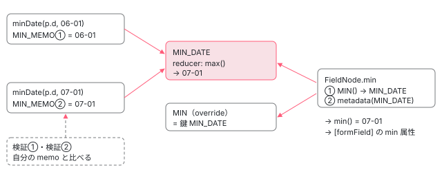

[目次](../README.md) › [Signal Forms の組み込みの検証：required から minDate まで、1 つの validate に下りるまで](README.md) › 第 3 回 / 全 5 回

# 日付の上限下限：minDate・maxDate が MIN の metadata に鍵を指させる

> min\_date.ts・max\_date.ts の MIN\_MEMO で下限を 1 回だけ計算する行、MIN\_DATE に値を載せ MIN（LimitSelectionKey）には鍵そのもの（LimitKey）を入れる書き方と、それを 2 段で読む FieldNode.min、null と Invalid Date を検証しない分岐と Invalid Date の下限が min() に残る順序、UTC で比べる約束（2a662755113）と input type=date との往復、CVA の経路の日付の属性（189afa9ce5d）。

angular/angular · 読了 約 12 分 · 発展 · [サイトで読む（デモが動きます）](https://angular-deep-dive-cyan.vercel.app/chapter/sfv-dates)

---

`minDate`・`maxDate` は `Date` の上限下限です。数の `min`・`max` と同じ `MIN`・`MAX` の metadata を使いながら、数とは別の鍵と reducer で上限をまとめます。この章では **`MIN_DATE` に値を書き、`MIN` には鍵そのもの（`LimitKey`）を書く間接参照と、それを読む `FieldNode.min`**、`null` と Invalid Date の分岐、そして input type=date と往復するときの「UTC の 0 時」という約束（2a662755113）を、記録と DEMO で確かめます。

読む対象は `packages/forms/signals/src/api/rules/validation/min_date.ts`・`max_date.ts`、`api/rules/metadata.ts` の `LimitKey`・`LimitSelectionKey` と日付の鍵、`field/node.ts` の `min`、`api/control.ts`、spec の `test/node/api/validators/min_date.spec.ts`・`max_date.spec.ts` です。memo・公開の鍵・検証の 3 段の形は[第 2 回](02-sfv-limits.md)の `max` と同じなので、ここでは日付で違うところを読みます。`Date` を input の `min` 属性の文字にする `formatDateForMinMax` は [sfd-native](../sfd/02-sfd-native.md) の 3 節で読みました。

1. [1. 共通の形と isEmpty](01-sfv-common.md)
2. [2. 数と長さの上限下限](02-sfv-limits.md)
3. **3. 日付の上限下限**（この章）
4. [4. エラーの型](04-sfv-errors.md)
5. [5. spec と issue](05-sfv-tests-issues.md)

## 1. minDate：MIN\_MEMO・MIN\_DATE・MIN

📄 `angular/packages/forms/signals/src/api/rules/validation/min_date.ts` L32–52 （▶ の行: 32, 34, 37, 40–41, 44, 48, 51）

```ts
32 ▶ export function minDate<TValue extends Date | null, TPathKind extends PathKind = PathKind.Root>(
33 │   path: SchemaPath<TValue, SchemaPathRules.Supported, TPathKind>,
34 ▶   minDateValue: Date | LogicFn<TValue, Date | undefined, TPathKind>,
35 │   config?: BaseValidatorConfig<TValue, TPathKind>,
36 │ ): void {
37 ▶   const MIN_MEMO = createMetadataKey<Date | undefined>();
38 │ 
39 │   // Memoize the minimum valid date.
40 ▶   metadata(path, MIN_MEMO, (ctx) => {
41 ▶     if (config?.when && !config.when(ctx)) {
42 │       return undefined;
43 │     }
44 ▶     return typeof minDateValue === 'function' ? minDateValue(ctx) : minDateValue;
45 │   });
46 │ 
47 │   // Publish the memoized minimum date for aggregation.
48 ▶   metadata(path, MIN_DATE, ({state}) => state.metadata(MIN_MEMO)!());
49 │ 
50 │   // Use `MIN_DATE` to define the `min` property of the field.
51 ▶   metadata(path, MIN, () => MIN_DATE as LimitKey<TValue>);
52 │ 
```

1. **37・40〜45 行目：下限の日付を memo に 1 回だけ計算する**

   32 行目の型で `Date | null` のフィールドにだけ付けられます。34 行目の下限は `Date` か、`Date | undefined` を返す `LogicFn` です。41 行目で `when` が偽なら `undefined`、44 行目で関数なら呼び、`Date` ならそのものを返します（`max.ts` の 41〜46 行目と同じ形）。
2. **48 行目：日付の公開の鍵 MIN\_DATE に流す**

   数の `min` が `MIN_NUMBER` に書くところを、`MIN_DATE` に書きます。2 節のとおり reducer は `max()`（一番遅い日付）です。
3. **51 行目：MIN には「MIN\_DATE を見よ」と書く**

   `MIN` に書くのは日付ではなく、鍵 `MIN_DATE` そのものです。`as LimitKey<TValue>` は、フィールドの型（`Date | null`）に合う上限の鍵だと型に伝えるための変換です（2 節）。

📄 `angular/packages/forms/signals/src/api/rules/validation/min_date.ts` L53–72 （▶ の行: 54–56, 59–60, 63, 67）

```ts
53 │   // Validate that the field value is not less than the minimum date.
54 ▶   validate(path, (ctx) => {
55 ▶     const value = ctx.value();
56 ▶     if (value === null || Number.isNaN(value.getTime())) {
57 │       return undefined;
58 │     }
59 ▶     const min = ctx.state.metadata(MIN_MEMO)!();
60 ▶     if (min === undefined || Number.isNaN(min.getTime())) {
61 │       return undefined;
62 │     }
63 ▶     if (value < min) {
64 │       if (config?.error) {
65 │         return getOption(config.error, ctx);
66 │       } else {
67 ▶         return minDateError(min, {message: getOption(config?.message, ctx)});
68 │       }
69 │     }
70 │     return undefined;
71 │   });
72 │ }
```

1. **56 行目：null と Invalid Date は黙る**

   `isEmpty`（[第 1 回](01-sfv-common.md)）は使わず、`value === null` と `Number.isNaN(value.getTime())` を直接見ます。Invalid Date は `new Date('x')` のように時刻の値が `NaN` の `Date` です。日付の input の `valueAsDate` は、空や不完全な入力では `null` を返すので、Invalid Date はアプリのコードが値を作ったときに来ます。
2. **59〜61 行目：自分の memo を読み、undefined か Invalid Date の下限なら黙る**

   読むのはまとめた `MIN_DATE` ではなく、この呼び出しの `MIN_MEMO` です。だから 2 つの `minDate` は、`maxLength` と同じく別々にエラーを出します（[第 2 回](02-sfv-limits.md)の 2 節）。
3. **63 行目：Date を &lt; で比べる**

   `Date` 同士の `<` は `valueOf()`（1970 年からのミリ秒）で比べます。日付だけでなく時刻まで比べるので、同じ日でも時刻が早ければ下限より前です（5 節）。
4. **67 行目：minDateError**

   エラーの kind は `'min'` ではなく `'minDate'` で、下限の `Date` を `minDate` という名前で持ちます（[第 4 回](04-sfv-errors.md)）。

📄 `diff（doc コメントを除く）`

```
$ diff min_date.ts max_date.ts   # 37 行目から下（関数の本体）だけ
<   const MIN_MEMO = createMetadataKey<Date | undefined>();
>   const MAX_MEMO = createMetadataKey<Date | undefined>();
<     return typeof minDateValue === 'function' ? minDateValue(ctx) : minDateValue;
>     return typeof maxDateValue === 'function' ? maxDateValue(ctx) : maxDateValue;
<   metadata(path, MIN_DATE, ({state}) => state.metadata(MIN_MEMO)!());
>   metadata(path, MAX_DATE, ({state}) => state.metadata(MAX_MEMO)!());
<   metadata(path, MIN, () => MIN_DATE as LimitKey<TValue>);
>   metadata(path, MAX, () => MAX_DATE as LimitKey<TValue>);
<     if (value < min) {
>     if (value > max) {
<         return minDateError(min, {message: getOption(config?.message, ctx)});
>         return maxDateError(max, {message: getOption(config?.message, ctx)});
```

## 2. 指す鍵：MIN は LimitSelectionKey

📄 `angular/packages/forms/signals/src/api/rules/metadata.ts` L344–364 （▶ の行: 353, 363）

```ts
344 │ 
345 │ /**
346 │  * A {@link MetadataKey} representing the minimum valid value of a date field.
347 │  *
348 │  * @see [Minimum and maximum validation](guide/forms/signals/validation#min-and-max)
349 │  *
350 │  * @category validation
351 │  * @publicApi 22.0
352 │  */
353 ▶ export const MIN_DATE: LimitKey<Date> = createMetadataKey(MetadataReducer.max());
354 │ 
355 │ /**
356 │  * A {@link MetadataKey} representing the minimum valid value of a number field.
357 │  *
358 │  * @see [Minimum and maximum validation](guide/forms/signals/validation#min-and-max)
359 │  *
360 │  * @category validation
361 │  * @publicApi 22.0
362 │  */
363 ▶ export const MIN_NUMBER: LimitKey<number> = createMetadataKey(MetadataReducer.max());
364 │ 
```

📄 `angular/packages/forms/signals/src/api/rules/metadata.ts` L365–386 （▶ の行: 368–369, 376, 386）

```ts
365 │ /**
366 │  * A {@link MetadataKey} that points to another key determining the maximum value of the field.
367 │  *
368 ▶  * This indirection allows different keys to be used for different types of values with their
369 ▶  * own reducers, such as {@link MAX_DATE} and {@link MAX_NUMBER}.
370 │  *
371 │  * @see [Minimum and maximum validation](guide/forms/signals/validation#min-and-max)
372 │  *
373 │  * @category validation
374 │  * @publicApi 22.0
375 │  */
376 ▶ export const MAX: LimitSelectionKey = createLimitSelectionKey();
377 │ 
378 │ /**
379 │  * A {@link MetadataKey} representing the maximum valid value of a date field.
380 │  *
381 │  * @see [Minimum and maximum validation](guide/forms/signals/validation#min-and-max)
382 │  *
383 │  * @category validation
384 │  * @publicApi 22.0
385 │  */
386 ▶ export const MAX_DATE: LimitKey<Date> = createMetadataKey(MetadataReducer.min());
```

353 行目の `MIN_DATE` と 363 行目の `MIN_NUMBER` は、どちらも reducer が `max()` の別々の鍵です。376 行目の `MAX` は `createLimitSelectionKey()` で作る「鍵を入れる鍵」で、368〜369 行目のコメントのとおり、値の型ごとに別の鍵と reducer を使うための間接参照です（`MIN` も同じ作り。[forms-sf-rules-metadata](../forms/18-forms-sf-rules-metadata.md) の 6 節の引用）。



*minDate を 2 回付けたフィールド。下限はそれぞれの MIN\_MEMO にあり、MIN\_DATE が max() でまとめ、MIN は MIN\_DATE という鍵を指すだけ。FieldNode.min は MIN から鍵を取ってからその値を読み、検証はそれぞれ自分の memo を読む*

📄 `angular/packages/forms/signals/src/api/rules/metadata.ts` L94–105 （▶ の行: 95, 98–99, 101）

```ts
 94 │   /** Creates a reducer that accumulates a the max of its individual item values. */
 95 ▶   max<T extends Date | number>(): MetadataReducer<T | undefined, T | undefined> {
 96 │     return {
 97 │       reduce: (acc, item) => {
 98 ▶         if (acc === undefined || item === undefined) {
 99 ▶           return acc ?? item;
100 │         }
101 ▶         return item > acc ? item : acc;
102 │       },
103 │       getInitial: () => undefined,
104 │     };
105 │   },
```

95 行目の型は `T extends Date | number` で、101 行目の `>` は `Date` でも数でも `valueOf()` で比べます。だから 1 つの reducer の関数で両方をまとめられますが、**まとめる鍵は型ごとに分けておく**必要があります。もし数と日付が同じ鍵に入ると、`Date` と数を比べることになるからです。`MIN` を直接 reducer 付きの鍵にせず「どの鍵を見るか」を入れるのはこのためです。

📄 `angular/packages/forms/signals/src/api/rules/metadata.ts` L173–209 （▶ の行: 182–185, 191, 203–206, 208）

```ts
173 │ /**
174 │  * Represents metadata that is used to define a valid limit for a field.
175 │  *
176 │  * @template TLimit The type the limit value.
177 │  *
178 │  * @see [Validation constraints](guide/forms/signals/custom-controls#validation-constraints)
179 │  *
180 │  * @publicApi 22.0
181 │  */
182 ▶ export type LimitKey<TLimit> = MetadataKey<
183 ▶   Signal<NonNullable<TLimit> | undefined>,
184 ▶   NonNullable<TLimit> | undefined,
185 ▶   NonNullable<TLimit> | undefined
186 │ >;
187 │ 
188 │ /**
189 │  * A symbol used to tag a `MetadataKey` as representing a limit selection key.
190 │  */
191 ▶ declare const LIMIT_SELECTION_KEY: unique symbol;
192 │ 
193 │ /**
194 │  * Used to select a {@link LimitKey}.
195 │  *
196 │  * This indirection allows rules to bind a {@link LimitKey} of a specific limit type (e.g. `number`
197 │  * or `Date`) matching the field's type to a generic {@link MetadataKey}.
198 │  *
199 │  * @see [Validation constraints](guide/forms/signals/custom-controls#validation-constraints)
200 │  *
201 │  * @publicApi 22.0
202 │  */
203 ▶ export type LimitSelectionKey = MetadataKey<
204 ▶   Signal<LimitKey<unknown> | undefined>,
205 ▶   LimitKey<unknown>,
206 ▶   LimitKey<unknown> | undefined
207 │ > & {
208 ▶   [LIMIT_SELECTION_KEY]: true;
209 │ };
```

📄 `angular/packages/forms/signals/src/api/rules/metadata.ts` L309–318 （▶ の行: 316–317）

```ts
309 │ /**
310 │  * Creates a {@link LimitSelectionKey}.
311 │  *
312 │  * @see [Validation constraints](guide/forms/signals/custom-controls#validation-constraints)
313 │  *
314 │  * @publicApi 22.0
315 │  */
316 ▶ export function createLimitSelectionKey(): LimitSelectionKey {
317 ▶   return createMetadataKey() as LimitSelectionKey;
318 │ }
```

1. **182〜186 行目：LimitKey&lt;T&gt;**

   読むと `Signal<T | undefined>`、書くのも溜めるのも `T | undefined` の鍵です。`MIN_DATE` は `LimitKey<Date>`、`MIN_NUMBER` は `LimitKey<number>`。
2. **203〜209 行目：LimitSelectionKey**

   書くのは `LimitKey<unknown>`、読むと `Signal<LimitKey | undefined>` の鍵です。208 行目の `[LIMIT_SELECTION_KEY]: true` は、191 行目で `declare` しただけの（実行時には無い）symbol で、型だけの印です。
3. **317 行目：中身はふつうの metadata の鍵**

   `createMetadataKey()` を reducer 無しで呼び、型だけ `LimitSelectionKey` にします。reducer は `override`（最後に書いた値が勝つ）なので、同じフィールドに `minDate` を 2 回付けても、`MIN` には同じ `MIN_DATE` が 2 回書かれ、最後の 1 つが残るだけです。

📄 `angular/packages/forms/signals/src/api/rules/metadata.ts` L40–46 （▶ の行: 43）

```ts
40 │   logic: NoInfer<
41 │     LogicFn<
42 │       TValue,
43 ▶       TKey extends LimitSelectionKey ? LimitKey<TValue> : MetadataSetterType<TKey>,
44 │       TPathKind
45 │     >
46 │   >,
```

208 行目の印は `metadata()` の型で使われます。43 行目、鍵が `LimitSelectionKey` なら、ルールの関数が返すべき型は `LimitKey<TValue>`（フィールドの値の型の鍵）です。`Date | null` のフィールドで `metadata(p.d, MIN, () => MIN_NUMBER)` と書くと、`LimitKey<number>` は `LimitKey<Date | null>` ではないので型エラーになります。1 節の 51 行目の `as LimitKey<TValue>` は、ジェネリックな `TValue`（`Date | null` のどれか）に対してこの型を満たすための変換です。

## 3. 読む側：FieldNode.min は 2 段

📄 `angular/packages/forms/signals/src/field/node.ts` L240–243 （▶ の行: 241–242）

```ts
240 │   get min(): Signal<{} | undefined> | undefined {
241 ▶     const minKey = this.metadata(MIN)?.();
242 ▶     return minKey ? this.metadata(minKey) : undefined;
243 │   }
```

241 行目で `MIN` の signal を読んで鍵を取り（ルールが無ければ `this.metadata(MIN)` 自体が `undefined` で、`?.` で止まる）、242 行目で鍵があればその鍵の signal を返します。受け取った鍵が `MIN_DATE` か `MIN_NUMBER` かは見ません。どちらでも `this.metadata(key)` で同じように読めるので、`min()` の値の型はフィールドの型で決まります（`Date` のフィールドなら `Date`）。この形になったのは `minDate` を入れた 276c917b349 からです。

📄 `git show 276c917b349（node.ts の部分）`

```
$ git show 276c917b349 -- packages/forms/signals/src/field/node.ts
# refactor(forms): add validation rules for date constraints (#68001)（2026-04-07）
-  get max(): Signal<number | undefined> | undefined {
-    return this.metadata(MAX);
+  get max(): Signal<{} | undefined> | undefined {
+    const maxKey = this.metadata(MAX)?.();
+    return maxKey ? this.metadata(maxKey) : undefined;
   }
# min も同じ。同じコミットで minDate / maxDate・MIN_DATE / MAX_DATE / MIN_NUMBER / MAX_NUMBER・LimitKey / LimitSelectionKey が入り、
# FormUiControl の min / max の input の型が number から NonNullable<TValue> になった（control.ts の 86〜88・100〜102 行目）。
```

`[formField]` は、更新のたびにこの `min` を読み（[forms-sf-rules-metadata](../forms/18-forms-sf-rules-metadata.md) の 8 節）、ネイティブの input なら `formatDateForMinMax` で `date` は `YYYY-MM-DD`、`month` は `YYYY-MM` の文字にしてから `min` 属性に書きます（[sfd-native](../sfd/02-sfd-native.md) の 3 節）。文字にするときの年月日は `getUTCFullYear` などの UTC の値です。

## 4. Invalid Date：検証は黙るが、まとめた値には残る

📄 `記録：minDate・maxDate、Invalid Date、ローカル時刻の下限`

```
# <work>/sfv-demo/a/rec-dates.mjs を Node 24 で実行（サイトの node_modules の @angular/forms 22.2.6）
$ TZ=Asia/Tokyo node rec-dates.mjs
--- minDate(p.d, 2026-06-01) と maxDate(p.d, 2026-08-31)
MIN は MIN_DATE を指す: true  MAX は MAX_DATE を指す: true
min()=2026-06-01  max()=2026-08-31
d=null          errors: （なし）
d=2026-05-31    errors: minDate(2026-06-01)
d=2026-06-01    errors: （なし）
d=2026-09-01    errors: maxDate(2026-08-31)
d=Invalid Date  errors: （なし）
--- minDate(p.bad, Invalid Date) → minDate(p.bad, 2026-07-01)、値は 2026-06-15
min()=Invalid Date  errors: minDate(2026-07-01)
--- minDate(p.local, new Date(2026, 5, 1))（ローカル時刻の 6 月 1 日 0 時）
min() の toISOString()=2026-05-31T15:00:00.000Z  UTC の日付=2026-05-31
値 2026-05-31（UTC 0 時）  errors: minDate(2026-05-31)
値 2026-06-01（UTC 0 時）  errors: （なし）

$ TZ=America/New_York node rec-dates.mjs   # 最後の節だけ
--- minDate(p.local, new Date(2026, 5, 1))（ローカル時刻の 6 月 1 日 0 時）
min() の toISOString()=2026-06-01T04:00:00.000Z  UTC の日付=2026-06-01
値 2026-05-31（UTC 0 時）  errors: minDate(2026-06-01)
値 2026-06-01（UTC 0 時）  errors: minDate(2026-06-01)
```

最初の節は 1 節の行のとおりです。`null` と Invalid Date の値は 56 行目で黙り、2026-06-01 ちょうどは 63 行目の `<` が偽なので通ります（下限を含む）。

> [!WARNING]
> **ハマりどころ**
>
> 2 つ目の節は、下限に Invalid Date を先に積んだ場合です。検証は 60 行目で Invalid Date の下限を飛ばすので、エラーは 2026-07-01 の方だけで正しいのですが、`min()` は Invalid Date になりました。101 行目の `item > acc` は、どちらかの `valueOf()` が `NaN` だと常に偽なので、先に入った Invalid Date が残り続けます（[第 2 回](02-sfv-limits.md)の 2 節の `NaN` と同じ）。input の `min` 属性は、Invalid Date を UTC の年月日にした `"NaN-NaN-NaN"` になります（DEMO の bad の行）。`min_date.spec.ts` の `it('handles invalid dates')`（58 行目）は Invalid Date の**値**だけを確かめています。

> [!WARNING]
> **ハマりどころ**
>
> 値の側の Invalid Date は、input につないでいると**モデルに残るとは限りません**。`setNativeControlValue` は Invalid Date を `valueAsDate` に書き、ブラウザは value を `""` にします（[sfd-native](../sfd/02-sfd-native.md) の 2 節）。そのとき input が範囲外で `:invalid` だったなら、`:valid` に変わったことを InputValidityMonitor が `animationstart`（`ng-valid`）で拾い、input を読み直します（[sfd-validity](../sfd/03-sfd-validity.md) の 5 節）。空の date の input の `valueAsDate` は `null` なので、モデルは `null` に書き換わります。範囲内の値から Invalid Date にしたときは検証の状態が変わらず、モデルは Invalid Date のままです（DEMO の 2 つの行）。

## 5. UTC の約束：2a662755113

ブラウザの `<input type="date">` の `valueAsDate` は、選んだ日の **UTC の 0 時**の `Date` を返します。Signal Forms はこれをそのままモデルに入れ（[sfd-native](../sfd/02-sfd-native.md) の 1 節）、属性は UTC の年月日で書きます（3 節）。だから下限も UTC の 0 時で作らないと、比べる相手とずれます。記録の 3 つ目の節がそのずれです。

1. **東京（UTC+9）**

   `new Date(2026, 5, 1)` は東京の 6 月 1 日 0 時、つまり UTC の 5 月 31 日 15 時です。属性は UTC の年月日で `min="2026-05-31"` になり、ブラウザは 5 月 31 日を選ばせます。ところが選んだ値は 5 月 31 日 0 時（UTC）で、63 行目の比べでは 15 時より前なので `minDate` のエラーです。属性が許す日を検証が拒みます。
2. **ニューヨーク（UTC−4、夏時間）**

   同じ `new Date(2026, 5, 1)` は UTC の 6 月 1 日 4 時です。属性は `min="2026-06-01"` で正しく見えますが、6 月 1 日を選ぶと 0 時（UTC）が 4 時より前なので、**下限の日そのもの**がエラーになります。

この約束は長く書かれておらず、2026-10-10 の 2a662755113 で doc コメントとガイドに足されました。

📄 `git show 2a662755113（min_date.ts の部分）`

```
$ git show 2a662755113 -- packages/forms/signals/src/api/rules/validation/min_date.ts
# docs(forms): document that minDate and maxDate expect UTC dates（2026-10-10。22.2.x へは 276248ff3d9、v22.2.3 から）
@@ -18,6 +18,11 @@ import {minDateError} from './validation_errors';
  * This function can only be called on date paths.
  * In addition to binding a validator, this function adds `MIN` property to the field.
  *
+ * When the field is bound to an `<input type="date">`, its value is a `Date` at midnight UTC, so the
+ * minimum should be built the same way, e.g. `new Date('2026-06-01')` or
+ * `new Date(Date.UTC(2026, 5, 1))`. A `Date` created from local time, such as `new Date(2026, 5, 1)`
+ * or `new Date()`, is offset by the user's time zone, which can make the limit date itself invalid.
+ *
  * @param path Path of the field to validate
  * @param minDate The minimum date, or a LogicFn that returns the minimum date.
  * @param config Optional, allows providing any of the following options:
@@ -25,7 +30,7 @@ import {minDateError} from './validation_errors';
- * @see [Signal Form Min Validation](guide/forms/signals/validation#min-and-max)
+ * @see [Signal Form Min Validation](guide/forms/signals/validation#mindate-and-maxdate)

# max_date.ts も同じ。adev の validation.md に「minDate() and maxDate()」の節（43 行）が足され、
# 「今日より前を拒む」には new Date() ではなく
#   const now = new Date();
#   const today = new Date(Date.UTC(now.getFullYear(), now.getMonth(), now.getDate()));
# を使う、と書かれた。
```

このコミットは 8576f161ae4 より後なので、手元の `min_date.ts` の doc コメント（1 節の引用の外）にはまだこの段落がありません。サイトの 22.2.6 には 22.2.x へ入った 276248ff3d9 が含まれています。コードは何も変わっておらず、使う側が `new Date('2026-06-01')`（日付だけの ISO 文字列は UTC として読まれる）か `Date.UTC` で下限を作る、という約束です。

## 6. 部品の側：min の input の型と、CVA の経路

📄 `angular/packages/forms/signals/src/api/control.ts` L82–102 （▶ の行: 86–88, 100–102）

```ts
 82 │   /**
 83 │    * An input to receive the min value for the field. If implemented, the `Field` directive will
 84 │    * automatically bind the min value from the bound field to this input.
 85 │    */
 86 ▶   readonly min?:
 87 ▶     | InputSignal<NonNullable<TValue> | undefined>
 88 ▶     | InputSignalWithTransform<NonNullable<TValue> | undefined, unknown>;
 89 │   /**
 90 │    * An input to receive the min length for the field. If implemented, the `Field` directive will
 91 │    * automatically bind the min length from the bound field to this input.
 92 │    */
 93 │   readonly minLength?:
 94 │     | InputSignal<number | undefined>
 95 │     | InputSignalWithTransform<number | undefined, unknown>;
 96 │   /**
 97 │    * An input to receive the max value for the field. If implemented, the `Field` directive will
 98 │    * automatically bind the max value from the bound field to this input.
 99 │    */
100 ▶   readonly max?:
101 ▶     | InputSignal<NonNullable<TValue> | undefined>
102 ▶     | InputSignalWithTransform<NonNullable<TValue> | undefined, unknown>;
```

自作の部品（`FormValueControl`）の `min`・`max` の input は、86〜88 行目・100〜102 行目で `NonNullable<TValue>`、つまり部品の値と同じ型です。`Date` の部品なら `Date` の `min` を受け取ります。276c917b349 より前は `number` に決まっていて、#65676（「date の input は min / max に日付の文字を受けるのに、`FormValueControl` は数だけ」）はこの変更（#68001）で閉じられました。3 節の `FieldNode.min` が、鍵の型に合わせた値を返すようになったのと対になっています。

`[formField]` の 3 つの経路のうち、ネイティブとカスタムコントロールは属性に書く前に `formatDateForMinMax` を通しますが、ControlValueAccessor（CVA）を持つ要素の経路には、22.2.6 ではこの変換がありません（[sfd-cva](../sfd/05-sfd-cva.md)）。

📄 `git show 189afa9ce5d（control_cva.ts の部分）と 22.2.6 の .mjs`

```js
$ git show 189afa9ce5d -- packages/forms/signals/src/directive/control_cva.ts
# fix(forms): format Date min/max for controls with a ControlValueAccessor（2026-11-13。22.2.x へは 818bf54607d、まだタグ無し）
-import {setNativeDomProperty} from './native';
+import {formatDateForMinMax, setNativeDomProperty} from './native';
@@ -109,11 +109,12 @@ export function cvaControlCreate(
         } else if (!propertyWasSet && parent.elementAcceptsNativeProperty(name)) {
           // Fall back to native DOM properties.
+          const domValue = formatDateForMinMax(name, value, parent.nativeFormElement.type);
           setNativeDomProperty(
             parent.renderer,
             parent.nativeFormElement,
             name,
-            value as string | number | undefined,
+            domValue as string | number | undefined,
           );

$ grep -c "= formatDateForMinMax(" node_modules/@angular/forms/fesm2022/signals.mjs   # サイトの 22.2.6
2      # カスタムコントロールとネイティブの 2 か所。CVA の経路には入っていない
```

変更の前は、CVA の付いた `<input type="date">` の `min` に `Date#toString()`（`"Mon Jun 01 2026 ..."`）が書かれ、date の input はその値を無視していました。origin/main の 189afa9ce5d で直り、22.2.x の枝にも 818bf54607d として入っていますが、まだリリースのタグはありません。

> [!NOTE]
> **ポイント**
>
> 開いている #67643 は、`Temporal.PlainDate` などを `minDate`・`maxDate` の上限に使いたいという要望です。今のコードでは、1 節の 32・34 行目の型が `Date`、56・60 行目が `getTime()`、2 節の reducer の型が `T extends Date | number` と、`Date` が 3 か所に書かれています。

## 7. DEMO：date の input と min() / 属性

> **🧪 DEMO — errors()・min() / max()・input の属性**
>
> 本物の `@angular/forms/signals`（22.2.6）です。d に `minDate(new Date('2026-06-01'))` と `maxDate(new Date('2026-08-31'))`、local に `minDate(new Date(2026, 5, 1))`（このブラウザのタイムゾーンの 6 月 1 日 0 時）、bad に `minDate(new Date('invalid'))` → `minDate(new Date('2026-07-01'))` の順で積み、3 つとも `type="date"` の input につないでいます。ボタンの日付は `new Date('YYYY-MM-DD')`（UTC の 0 時）で入れます。input で日付を選んでもかまいません。
>
> このページを開いているブラウザのタイムゾーン:
>
> ▶ [このデモはサイトで動かせます](https://angular-deep-dive-cyan.vercel.app/chapter/sfv-dates)

手元の Chrome（タイムゾーン Asia/Tokyo）で押した結果のうち、コードの行で説明できるものです。

| 操作 | 結果 | 理由（行） |
| --- | --- | --- |
| 「属性を読み直す」 | d は `min="2026-06-01" max="2026-08-31"`、local は `min="2026-05-31"`、bad は `min="NaN-NaN-NaN"` | 3 節の UTC の年月日。bad は 4 節 |
| d に 2026-05-31 | `minDate(2026-06-01)`、`rangeUnderflow` も `true` | 63 行目。ブラウザも `min` 属性で同じ判定をする |
| d に 2026-09-01 | `maxDate(2026-08-31)` | max\_date.ts の同じ位置の `>` |
| d に 2026-06-01 → Invalid Date | エラー無し、`value()` は Invalid Date のまま、DOM の value は `""` | 56 行目。`valueAsDate` に Invalid Date を書くと空になる |
| d に 2026-09-01 → Invalid Date | エラー無し、`value()` が `null` に変わる | 4 節の注意。`:invalid` から `:valid` への変化を InputValidityMonitor が拾い、空の input を読み直す |
| local に 2026-05-31 | `minDate(2026-05-31)`、`rangeUnderflow` は `false` | 5 節。属性は 5 月 31 日を許し、検証は 15 時と比べて拒む |
| bad に 2026-06-15 | `minDate(2026-07-01)` だけ、`min()` は Invalid Date | 4 節。60 行目で Invalid Date の下限は飛ばし、101 行目のまとめには残る |

同じビルドを `TZ=America/New_York` の Chrome で開くと、local の `min()` は `2026-06-01T04:00:00.000Z`、属性は `min="2026-06-01"` になり、「local に 2026-06-01」で `rangeUnderflow` は `false`（ブラウザは許す）のに `minDate(2026-06-01)` のエラーが出ます。5 節の 2 つ目の場合です。

## ここまでの呼び出し

- 👤 `minDate(p.d, new Date('2026-06-01'))`（schema の関数の中）
  - `metadata(path, MIN_MEMO, fn)` — min\_date.ts 40 — *when → 下限の Date*
  - `metadata(path, MIN_DATE, ...)` — min\_date.ts 48 — *reducer は max()（metadata.ts 353）*
  - `metadata(path, MIN, () => MIN_DATE)` — min\_date.ts 51 — *MIN の reducer は override（metadata.ts 317）*
  - `validate(path, fn)` — min\_date.ts 54
- 👤 `[formField]` の更新
  - `FieldNode.min` — node.ts 240–243 — *MIN から MIN\_DATE を取り、その signal を返す*
  - `formatDateForMinMax('min', date, 'date')` — directive/native.ts 202–211 — *UTC の YYYY-MM-DD*
  - `setNativeDomProperty(..., 'min', '2026-06-01')` — forms/src/directives/native.ts 51–81
- 👤 `f.d().errors()`
  - minDate の検証の関数 — min\_date.ts 54–71 — *null / Invalid Date → 自分の memo → value &lt; min → minDateError*

## テストと直し方

この章の約束を固めているのは `min_date.spec.ts` の `describe('minDate validator')`（13 行目）、`it('returns min error when the date is smaller')` 14 行目・`'returns no error when the date is equal'` 29 行目・`'returns no error when the date is larger'` 43 行目・`'handles invalid dates'` 58 行目と、`max_date.spec.ts` の同じ並びの 4 つ（`describe('maxDate validator')` 13 行目）です。input の属性の側は web の `form_field.spec.ts` にあり、[sfd-native](../sfd/02-sfd-native.md) の「テストと直し方」で読みました。

📄 `angular/packages/forms/signals/test/node/api/validators/min_date.spec.ts` L14–27 （▶ の行: 15–16, 21, 26）

```ts
14 │   it('returns min error when the date is smaller', () => {
15 ▶     const today = new Date('2026-04-01');
16 ▶     const yesterday = new Date('2026-03-31');
17 │     const model = signal(yesterday);
18 │     const f = form(
19 │       model,
20 │       (p) => {
21 ▶         minDate(p, today);
22 │       },
23 │       {injector: TestBed.inject(Injector)},
24 │     );
25 │ 
26 ▶     expect(f().errors()).toEqual([minDateError(today, {fieldTree: f})]);
27 │   });
```

15〜16 行目の日付はどちらも `new Date('YYYY-MM-DD')`（UTC の 0 時）で、5 節の約束に沿った書き方です。26 行目で `minDateError(today)` が 1 つ。

📄 `angular/packages/forms/signals/test/node/api/validators/min_date.spec.ts` L58–69 （▶ の行: 59, 63, 68）

```ts
58 │   it('handles invalid dates', () => {
59 ▶     const model = signal(new Date('invalid'));
60 │     const f = form(
61 │       model,
62 │       (p) => {
63 ▶         minDate(p, new Date('2026-04-01'));
64 │       },
65 │       {injector: TestBed.inject(Injector)},
66 │     );
67 │ 
68 ▶     expect(f().errors()).toEqual([]);
69 │   });
```

59 行目で値を Invalid Date にし、68 行目でエラー無し。56 行目の枝を固めています。下限が Invalid Date のとき（60 行目）や、`minDate` を 2 つ積んだときの `min()`（2・4 節）を確かめる it は、この 2 つのファイルにありません。数の側には `min.spec.ts` の `'merges two mins preferring the larger option'`（187 行目）があります。

📄 `走らせ方（Node の jasmine。--filter が効く）`

```
cd ~/angular-research/angular
pnpm bazel test //packages/forms/signals/test/node:test --nocache_test_results --test_output=all \
  "--test_arg=--filter=^(minDate|maxDate) validator "
```

📄 `結果`

```
# 2026-11-19、手元の macOS で（8576f161ae4）
Ran 8 of 539 specs
8 specs, 0 failures
//packages/forms/signals/test/node:test                                  PASSED in 2.4s
# 内訳: minDate validator 4・maxDate validator 4
```

### 直すとしたら

- 4 節の Invalid Date の残りは、`metadata.ts` の `MetadataReducer.max()` の `reduce`（98〜101 行目）と `min()` の同じ位置で `valueOf()` が `NaN` の項目を捨てる形か、`min_date.ts`・`max_date.ts` の 48 行目で memo の値が Invalid Date なら `undefined` を流す形です。前者は[第 2 回](02-sfv-limits.md)の `NaN` の `max()` も一緒に直ります。spec は `min_date.spec.ts` に、`minDate(p, new Date('invalid'))` と `minDate(p, new Date('2026-07-01'))` を積んで `f().min?.()` が 2026-07-01 になる it を、積む順を変えて 2 つ足します。
- `minDate` を 2 つ積んだときの `min()` は、`min.spec.ts` の 187 行目の it を日付に置き換えた形（2026-06-01 と 2026-07-01 を積み、`min()` が 2026-07-01、エラーは値によって 1 つか 2 つ）で足せます。

## 聞かれそうな質問

**Q. minDate と min は同じ min() に出ますか？**

出ます。min\_date.ts の 51 行目も、min.ts の同じ位置の行も `MIN` に鍵を書き、node.ts の 241〜242 行目がその鍵の値を返すからです。違うのは書く鍵で、日付は `MIN_DATE`、数は `MIN_NUMBER`（metadata.ts の 353・363 行目）です。

**Q. なぜ MIN に直接日付を入れないのですか？**

上限をまとめる reducer の比べ（metadata.ts の 101 行目）を、数と日付で混ぜないためです。`MIN` は「どの鍵を見るか」だけを持ち（317 行目、override）、まとめる鍵は型ごとに分かれています。metadata.ts の 43 行目の型が、フィールドの型に合う鍵しか `MIN` に書かせません。

**Q. new Date() で「今日以降」を指定したら、今日が選べません。**

input が返す今日は UTC の 0 時で、`new Date()` は今の時刻なので、min\_date.ts の 63 行目で今日の 0 時が下限より前になるからです。2a662755113 のガイドのとおり `new Date(Date.UTC(now.getFullYear(), now.getMonth(), now.getDate()))` で作ります。

**Q. 値が Invalid Date だとどうなりますか？**

エラーは出ません。min\_date.ts の 56 行目で `null` と同じく黙ります（spec の 58 行目）。下限が Invalid Date のときも 60 行目で黙りますが、そのときは `min()` と input の属性に Invalid Date が残ることがあります（4 節）。

**Q. 自作の日付の部品に min を渡せますか？**

渡せます。control.ts の 86〜88 行目で `min` の input の型は部品の値の型（`Date`）です。ネイティブの input に属性として書くときだけ、`formatDateForMinMax` で文字にします。CVA の経路でこの変換が入るのは 189afa9ce5d からです。

## 読み終えて

- `minDate` は `min` と同じ形。違うのは公開の鍵（`MIN_DATE`）と、`null`・Invalid Date を直接見る分岐
- `MIN`・`MAX` は鍵を入れる鍵（`LimitSelectionKey`）。`FieldNode.min` は鍵を取ってから値を読む 2 段
- 日付の input の値は UTC の 0 時。下限も `new Date('YYYY-MM-DD')` か `Date.UTC` で作る（2a662755113）
- Invalid Date の下限は検証では飛ばされるが、先に積むと `min()` と属性に残る
- CVA の経路の日付の属性は 189afa9ce5d で直ったが、22.2.6 にはまだ入っていない

---

← 前: [数と長さの上限下限：max・minLength・maxLength と metadata の集約](02-sfv-limits.md)  
次: [エラーの型：ValidationError を作る関数とクラス、fieldTree が付くまで](04-sfv-errors.md) →
