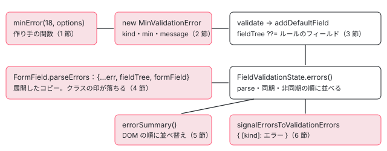

[目次](../README.md) › [Signal Forms の組み込みの検証：required から minDate まで、1 つの validate に下りるまで](README.md) › 第 4 回 / 全 5 回

# エラーの型：ValidationError を作る関数とクラス、fieldTree が付くまで

> validation\_errors.ts の requiredError・minError・emailError など 10 の作り手（fieldTree を渡す形・渡さない形の型と new の 1 行）、kind ごとのクラス（RequiredValidationError ほか）と options の Object.assign を子のフィールドが上書きする順番、message と fieldTree の付き方（addDefaultField がオブジェクトに書き込む）、\[formField\] の parse エラーが展開でクラスを失い instanceof NgValidationError が偽になること、compat/validation\_errors.ts が Reactive Forms のエラーと行き来する行（#71634）。既定のエラーの名前を書いた 45125306905。

angular/angular · 読了 約 12 分 · 中核 · [サイトで読む（デモが動きます）](https://angular-deep-dive-cyan.vercel.app/chapter/sfv-errors)

---

組み込みの検証が「落ちた」と言うとき、フィールドの `errors()` に入るのは `requiredError()` や `minError()` が作ったクラスのインスタンスです。この章では、その作り手の関数とクラスが何を持ち（`kind`・`message`・`min` などの値・`fieldTree`）、どの行でそれが決まるかを読みます。あわせて、`instanceof NgValidationError` が真になる場合とならない場合、エラーに「どのフィールドのものか」が付く時点、Reactive Forms の `ValidationErrors` との行き来を、ページの上の本物の `form()` で確かめます。

読む対象は `packages/forms/signals/src/api/rules/validation/validation_errors.ts`（作り手とクラス）、`standard_schema.ts` の後半、`src/compat/validation_errors.ts`、`src/directive/form_field.ts` の `parseErrors`、`src/field/validation.ts` の並べ替え、`src/controls/interop_ng_control.ts` の `errors` です。`ValidationError` の interface・`WithFieldTree` の 3 段階・`BaseNgValidationError`・`NgValidationError` の和・`addDefaultField` は [forms-sf-validation](../forms/17-forms-sf-validation.md) の 1 節と 3 節で読んだので、ここでは引用しません。組み込みの検証が `message` と `error` の設定を読む行（`getOption`）は[第 1 回](01-sfv-common.md)にあります。

1. [1. 共通の形と isEmpty](01-sfv-common.md)
2. [2. 数と長さの上限下限](02-sfv-limits.md)
3. [3. 日付の上限下限](03-sfv-dates.md)
4. **4. エラーの型**（この章）
5. [5. spec と issue](05-sfv-tests-issues.md)

## 0. エラーが errors() に届くまで



*組み込みの検証のエラーが、作られてから errors()・errorSummary()・Reactive Forms の errors に届くまで。赤い枠はこの章で新しく読む所*

## 1. 作り手の関数：同じ形のオーバーロードが 10 組

📄 `angular/packages/forms/signals/src/api/rules/validation/validation_errors.ts` L13–51 （▶ の行: 16, 18, 29, 39–40, 51）

```ts
13 │ /**
14 │  * Options used to create a `ValidationError`.
15 │  */
16 ▶ export interface ValidationErrorOptions {
17 │   /** Human readable error message. */
18 ▶   message?: string;
19 │ }
20 │ 
21 │ /**
22 │  * A type that requires the given type `T` to have a `field` property.
23 │  * @template T The type to add a `field` to.
24 │  *
25 │  * @see [Validation errors](guide/forms/signals/validation#validation-errors)
26 │  *
27 │  * @publicApi 22.0
28 │  */
29 ▶ export type WithFieldTree<T> = T & {fieldTree: ReadonlyFieldTree<unknown>};
30 │ 
31 │ /**
32 │  * A type that allows the given type `T` to optionally have a `field` property.
33 │  * @template T The type to optionally add a `field` to.
34 │  *
35 │  * @see [Validation errors](guide/forms/signals/validation#validation-errors)
36 │  *
37 │  * @publicApi 22.0
38 │  */
39 ▶ export type WithOptionalFieldTree<T> = Omit<T, 'fieldTree'> & {
40 ▶   fieldTree?: ReadonlyFieldTree<unknown>;
41 │ };
42 │ 
43 │ /**
44 │  * A type that ensures the given type `T` does not have a `field` property.
45 │  * @template T The type to remove the `field` from.
46 │  *
47 │  * @see [Validation errors](guide/forms/signals/validation#validation-errors)
48 │  *
49 │  * @publicApi 22.0
50 │  */
51 ▶ export type WithoutFieldTree<T> = T & {fieldTree: never};
```

作り手の関数が受け取る options は 16〜19 行目の `ValidationErrorOptions` で、メンバーは `message` だけです。29・39・51 行目の 3 つの型は、そこに `fieldTree` を足す（必須）・あってもよい・`never` にする、の言い換えです。なお 22・32・44 行目のコメントは今も「`field` property」と書いていますが、プロパティの名前は `fieldTree` です（ae0c59028a2 で `field` から改名したときのコメントの残り）。

📄 `angular/packages/forms/signals/src/api/rules/validation/validation_errors.ts` L82–115 （▶ の行: 92, 94–95, 106, 108–110, 113–114）

```ts
 82 │ /**
 83 │  * Create a min value error associated with the target field
 84 │  * @param min The min value constraint
 85 │  * @param options The validation error options
 86 │  *
 87 │  * @see [Minimum and maximum validation](guide/forms/signals/validation#min-and-max)
 88 │  *
 89 │  * @category validation
 90 │  * @publicApi 22.0
 91 │  */
 92 ▶ export function minError(
 93 │   min: number,
 94 ▶   options: WithFieldTree<ValidationErrorOptions>,
 95 ▶ ): MinValidationError;
 96 │ /**
 97 │  * Create a min value error
 98 │  * @param min The min value constraint
 99 │  * @param options The optional validation error options
100 │  *
101 │  * @see [Minimum and maximum validation](guide/forms/signals/validation#min-and-max)
102 │  *
103 │  * @category validation
104 │  * @publicApi 22.0
105 │  */
106 ▶ export function minError(
107 │   min: number,
108 ▶   options?: ValidationErrorOptions,
109 ▶ ): WithoutFieldTree<MinValidationError>;
110 ▶ export function minError(
111 │   min: number,
112 │   options?: ValidationErrorOptions,
113 ▶ ): WithOptionalFieldTree<MinValidationError> {
114 ▶   return new MinValidationError(min, options);
115 │ }
```

1. **92〜95 行目：fieldTree を渡す形**

   `options` が `WithFieldTree<ValidationErrorOptions>`（`fieldTree` が必須）なら、戻り値は 95 行目の `MinValidationError`、つまりクラスの型そのもの（`fieldTree` を持つ）です。`validateTree` で別のフィールドに付けるときや、`submit` の戻り値に使います。
2. **106〜109 行目：渡さない形**

   `options` を省くか `message` だけなら、戻り値は `WithoutFieldTree<MinValidationError>`。`validate` に渡す関数（`FieldValidator`）が返せるのはこちらだけです。
3. **110〜115 行目：実装は 1 行**

   実装のシグネチャ（外からは見えない）は `WithOptionalFieldTree` を返し、114 行目で `new MinValidationError(min, options)` するだけです。型の上の 2 つの形は、どちらもこの 1 行に下ります。

📄 `angular/packages/forms/signals/src/api/rules/validation/validation_errors.ts` L327–353 （▶ の行: 336, 346–348, 352）

```ts
327 │ /**
328 │  * Create an email format error associated with the target field
329 │  * @param options The validation error options
330 │  *
331 │  * @see [Email validation](guide/forms/signals/validation#email)
332 │  *
333 │  * @category validation
334 │  * @publicApi 22.0
335 │  */
336 ▶ export function emailError(options: WithFieldTree<ValidationErrorOptions>): EmailValidationError;
337 │ /**
338 │  * Create an email format error
339 │  * @param options The optional validation error options
340 │  *
341 │  * @see [Email validation](guide/forms/signals/validation#email)
342 │  *
343 │  * @category validation
344 │  * @publicApi 22.0
345 │  */
346 ▶ export function emailError(
347 ▶   options?: ValidationErrorOptions,
348 ▶ ): WithoutFieldTree<EmailValidationError>;
349 │ export function emailError(
350 │   options?: ValidationErrorOptions,
351 │ ): WithOptionalFieldTree<EmailValidationError> {
352 ▶   return new EmailValidationError(options);
353 │ }
```

制約の値を持たないエラーは、引数が `options` だけです（336・346 行目）。`requiredError` も同じ形です。ファイルの中の作り手は 9 つで、どれも「型の 2 つの形 + `new` の 1 行」です。

| 作り手 | 行（実装の `new`） | 第 1 引数 | クラス（`kind`） | 使う組み込みの検証 |
| --- | --- | --- | --- | --- |
| `requiredError` | 79 | ― | `RequiredValidationError`（`'required'`） | `required`（[第 1 回](01-sfv-common.md)） |
| `minError` | 114 | `min: number` | `MinValidationError`（`'min'`） | `min` |
| `minDateError` | 149 | `minDate: Date` | `MinDateValidationError`（`'minDate'`） | `minDate`（[第 3 回](03-sfv-dates.md)） |
| `maxError` | 184 | `max: number` | `MaxValidationError`（`'max'`） | `max`（[第 2 回](02-sfv-limits.md)） |
| `maxDateError` | 219 | `maxDate: Date` | `MaxDateValidationError`（`'maxDate'`） | `maxDate` |
| `minLengthError` | 254 | `minLength: number` | `MinLengthValidationError`（`'minLength'`） | `minLength` |
| `maxLengthError` | 289 | `maxLength: number` | `MaxLengthValidationError`（`'maxLength'`） | `maxLength` |
| `patternError` | 324 | `pattern: RegExp` | `PatternValidationError`（`'pattern'`） | `pattern`（第 1 回） |
| `emailError` | 352 | ― | `EmailValidationError`（`'email'`） | `email`（第 1 回） |
| `standardSchemaError` | `standard_schema.ts` 159 | `issue` | `StandardSchemaValidationError`（`'standardSchema'`） | `validateStandardSchema` |

行番号は `validation_errors.ts` のもので、引用していない 7 組も 1 節の 2 つと同じ形です（`sed -n` で確かめました）。`NativeInputParseError` には作り手が無く、`native.ts` が直接 `new` します（4 節）。

📄 `angular/packages/forms/signals/src/api/rules/validation/standard_schema.ts` L137–160 （▶ の行: 137–139, 151, 155, 159）

```ts
137 ▶ export function standardSchemaError(
138 ▶   issue: StandardSchemaV1.Issue,
139 ▶   options: WithFieldTree<ValidationErrorOptions>,
140 │ ): StandardSchemaValidationError;
141 │ /**
142 │  * Create a standard schema issue error
143 │  * @param issue The standard schema issue
144 │  * @param options The optional validation error options
145 │  *
146 │  * @see [Integration with schema validation libraries](guide/forms/signals/validation#integration-with-schema-validation-libraries)
147 │  *
148 │  * @category validation
149 │  * @publicApi 22.0
150 │  */
151 ▶ export function standardSchemaError(
152 │   issue: StandardSchemaV1.Issue,
153 │   options?: ValidationErrorOptions,
154 │ ): WithoutFieldTree<StandardSchemaValidationError>;
155 ▶ export function standardSchemaError(
156 │   issue: StandardSchemaV1.Issue,
157 │   options?: ValidationErrorOptions,
158 │ ): WithOptionalFieldTree<StandardSchemaValidationError> {
159 ▶   return new StandardSchemaValidationError(issue, options);
160 │ }
```

10 個目の作り手は別のファイルにあります。138 行目の第 1 引数は Standard Schema の `issue`（ライブラリが返した 1 件の問題）で、形は 1 節の 2 つと同じです。88e6ebec01a で Standard Schema の型と一緒に `validation_errors.ts` から移りました。`validateStandardSchema` が issue を変換するときは `{message: issue.message}` を options に渡すので、このエラーは `error.message` でも文言が読めます（[forms-sf-validation](../forms/17-forms-sf-validation.md) の 6 節の引用、#65247 を受けた b41a94bc851）。

## 2. kind ごとのクラス：値は constructor の引数、kind はクラスのフィールド

📄 `angular/packages/forms/signals/src/api/rules/validation/validation_errors.ts` L464–500 （▶ の行: 472–473, 475–477, 479, 491–492, 495）

```ts
464 │ /**
465 │  * An error used to indicate that a value is lower than the minimum allowed.
466 │  *
467 │  * @see [Minimum and maximum validation](guide/forms/signals/validation#min-and-max)
468 │  *
469 │  * @category validation
470 │  * @publicApi 22.0
471 │  */
472 ▶ export class MinValidationError extends BaseNgValidationError {
473 ▶   override readonly kind = 'min';
474 │ 
475 ▶   constructor(
476 ▶     readonly min: number,
477 ▶     options?: ValidationErrorOptions,
478 │   ) {
479 ▶     super(options);
480 │   }
481 │ }
482 │ 
483 │ /**
484 │  * An error used to indicate that a date value is earlier than the minimum allowed.
485 │  *
486 │  * @see [Minimum and maximum validation](guide/forms/signals/validation#min-and-max)
487 │  *
488 │  * @category validation
489 │  * @publicApi 22.0
490 │  */
491 ▶ export class MinDateValidationError extends BaseNgValidationError {
492 ▶   override readonly kind = 'minDate';
493 │ 
494 │   constructor(
495 ▶     readonly minDate: Date,
496 │     options?: ValidationErrorOptions,
497 │   ) {
498 │     super(options);
499 │   }
500 │ }
```

473 行目の `override readonly kind = 'min'` は、型が文字列の `'min'` そのもの（リテラル型）になります。`NgValidationError` の和を `e.kind` の switch で絞れるのは、各クラスの `kind` がこの形だからです。476 行目の `readonly min: number` は constructor の引数に `readonly` を付けた「引数プロパティ」で、引数がそのまま `this.min` になります。479 行目で基底の constructor に `options` を渡します。492 行目の `MinDateValidationError` も、値の型が `Date` になるだけで同じ形です。

📄 `angular/packages/forms/signals/src/api/rules/validation/validation_errors.ts` L586–619 （▶ の行: 586–587, 590, 605–606, 617–618）

```ts
586 ▶ export class PatternValidationError extends BaseNgValidationError {
587 ▶   override readonly kind = 'pattern';
588 │ 
589 │   constructor(
590 ▶     readonly pattern: RegExp,
591 │     options?: ValidationErrorOptions,
592 │   ) {
593 │     super(options);
594 │   }
595 │ }
596 │ 
597 │ /**
598 │  * An error used to indicate that a value is not a valid email.
599 │  *
600 │  * @see [Email validation](guide/forms/signals/validation#email)
601 │  *
602 │  * @category validation
603 │  * @publicApi 22.0
604 │  */
605 ▶ export class EmailValidationError extends BaseNgValidationError {
606 ▶   override readonly kind = 'email';
607 │ }
608 │ 
609 │ /**
610 │  * An error used to indicate that a value entered in a native input does not parse.
611 │  *
612 │  * @see [Value transformation](guide/forms/signals/custom-controls#value-transformation)
613 │  *
614 │  * @category validation
615 │  * @publicApi 22.0
616 │  */
617 ▶ export class NativeInputParseError extends BaseNgValidationError {
618 ▶   override readonly kind = 'parse';
619 │ }
```

590 行目の `PatternValidationError` は、落ちた `RegExp` そのものを持ちます。606 行目の `EmailValidationError` と 618 行目の `NativeInputParseError`（`kind: 'parse'`）は値を持たず、`kind` だけを決めます。

📄 `angular/packages/forms/signals/src/api/rules/validation/standard_schema.ts` L181–198 （▶ の行: 189–190, 193）

```ts
181 │ /**
182 │  * An error used to indicate an issue validating against a standard schema.
183 │  *
184 │  * @see [Integration with schema validation libraries](guide/forms/signals/validation#integration-with-schema-validation-libraries)
185 │  *
186 │  * @category validation
187 │  * @publicApi 22.0
188 │  */
189 ▶ export class StandardSchemaValidationError extends BaseNgValidationError {
190 ▶   override readonly kind = 'standardSchema';
191 │ 
192 │   constructor(
193 ▶     readonly issue: StandardSchemaV1.Issue,
194 │     options?: ValidationErrorOptions,
195 │   ) {
196 │     super(options);
197 │   }
198 │ }
```

`StandardSchemaValidationError` も同じ基底を継ぎ、193 行目で `issue` を持ちます。基底を継ぐので、これも `instanceof NgValidationError` が真です。

では、`options` に `kind` や `min` を紛れ込ませたらどうなるか。基底の constructor は `Object.assign(this, options)` で全部をコピーします（forms-sf-validation の 1 節の 446〜447 行目）。答えは、配布されている JS を見ると分かります。

📄 `@angular/forms 22.2.6 の配布物（クラスのフィールド）`

```
// node_modules/@angular/forms/fesm2022/signals.mjs（22.2.6）129〜150 行目。TypeScript のクラスのフィールドがそのまま出ている
class BaseNgValidationError {
  __brand = undefined;
  kind = '';
  fieldTree;
  message;
  constructor(options) {
    if (options) {
      Object.assign(this, options);
    }
  }
}
class RequiredValidationError extends BaseNgValidationError {
  kind = 'required';
}
class MinValidationError extends BaseNgValidationError {
  min;
  kind = 'min';
  constructor(min, options) {
    super(options);
    this.min = min;
  }
}
```

1. **基底のフィールドが先に作られる**

   `__brand`・`kind = ''`・`fieldTree`・`message` の 4 つが、値を書いていないものも `undefined` の自分のプロパティとして作られます。
2. **基底の constructor の本体で Object.assign**

   `options` の全部（型が許さない `kind` や余計なキーも、実行時には）がコピーされます。
3. **super() が戻ってから、子のフィールド**

   `min` と `kind = 'min'` が作られ、最後に constructor の本体の `this.min = min`。だから `options` の `kind` と `min` は上書きされて残りません。

📄 `Node で確かめた記録（@angular/forms 22.2.6）`

```
$ node probe3.mjs        # <scratchpad>/sfv-demo/b、@angular/forms 22.2.6
// requiredError({kind: 'x', message: 'm', extra: 1}) と minError(3, {min: 9}) を作って読む
kind required extra 1 keys [ '__brand', 'kind', 'fieldTree', 'message', 'extra' ]
min 3 keys [ '__brand', 'kind', 'fieldTree', 'message', 'min' ]
```

`kind` は `'required'` のまま、`min` は第 1 引数の 3 のままです。一方で型にない `extra` は残ります。もう 1 つ、`message` を渡さなくても `'message' in e` は真です（基底のフィールドとして作られるため）。組み込みの検証は `{message: getOption(config?.message, ctx)}` を毎回渡すので（[第 1 回](01-sfv-common.md)）、`message` を書かなければ値は `undefined` です。既定の文言は無く、`provideSignalFormsConfig` の `SignalFormsConfig` のメンバーも `classes` だけです（[sft-proxy-context](../sft/03-sft-proxy-context.md)）。既定の文言をアプリ全体で設定したいという要望が #66396（開いている）です。

## 3. fieldTree はいつ付くか

作り手で作った直後のエラーの `fieldTree` は `undefined` です（2 節の 1 つ目の手順）。組み込みの検証は `validate` の上に乗っているので、ルールが返したエラーは `addDefaultField(エラー, ctx.fieldTree)` を通り、`fieldTree ??= そのフィールド` で付け先が決まります（[forms-sf-validation](../forms/17-forms-sf-validation.md) の 3 節）。ここで大事なのは、`??=` が**返されたオブジェクトそのものに書き込む**ことです。

- 👤 `required(p.shareA, {error: SHARED})` — アプリの schema — *SHARED はモジュールに 1 つ*
  - `getOption(config.error, ctx)` — required.ts — *関数でなければそのまま返す*
  - `addDefaultField(SHARED, shareA)` — validate.ts → field/validation.ts — *SHARED.fieldTree が shareA に*
- 👤 `required(p.shareB, {error: SHARED})` — アプリの schema — *同じオブジェクト*
  - `addDefaultField(SHARED, shareB)` — field/validation.ts — *もう付いているので ??= は何もしない*

結果として、`shareB` の `errors()` に入るエラーの `fieldTree` は `shareA` を指します。`errors()` は自分のルールの結果を付け先で絞らない（同期の分はそのまま入る）ので、`shareB` は invalid になり、エラーも出ます。ずれるのは `fieldTree` を読む所、たとえば 5 節の並べ替えと、`error.fieldTree().focusBoundControl()` のような「エラーからフィールドへ戻る」コードです。下のデモの shareA・shareB の行がこれで、2 つの行の「fieldTree が指すもの」が同じになります。`message` を使う既定のエラーや `error` に関数を渡したときは、毎回新しいオブジェクトなので起きません。

📄 `Node で確かめた記録：schema の中にオブジェクトを書いた場合`

```
$ node probe2.mjs        # 同じ schema() から form() を 2 つ作り、error にオブジェクトを書いた required を比べる
schema fn runs 2 same object false f2 error fieldTree is f1.name false is f2.name true
plain fn: same object false g2 points to g2 true
fn error: h2 points to h2 true
```

schema の関数は `form()` ごとに 1 回走るので（1 行目の `runs 2`）、schema の中に書いたオブジェクトはフォームごとに別物になり、付け先も正しいままです。ずれるのは、schema の外で作った 1 つのオブジェクトを複数のフィールドやフォームに渡したときです。

> [!WARNING]
> **ハマりどころ**
>
> `error` に渡すオブジェクトを schema の外の定数にすると、最初に評価したフィールドの `fieldTree` が書き込まれたまま、ほかのフィールドやフォームでも使われます。付け先を正しく保ちたいなら、`error: () => ({ kind: '…' })` のように関数で毎回作ります。

## 4. parse エラーは展開したコピーで届く

📄 `angular/packages/forms/signals/src/api/rules/validation/validation_errors.ts` L387–396 （▶ の行: 388, 393–394）

```ts
387 │   /** @deprecated Use `ValidationError.WithFieldTree` instead  */
388 ▶   export type WithField = WithFieldTree;
389 │ 
390 │   /**
391 │    * Validation error with an associated field tree and specific form field binding.
392 │    */
393 ▶   export interface WithFormField extends WithFieldTree {
394 ▶     readonly formField: FormField<unknown>;
395 │   }
396 │ 
```

📄 `angular/packages/forms/signals/src/directive/form_field.ts` L185–191 （▶ の行: 185, 187–190）

```ts
185 ▶   readonly parseErrors = computed<ValidationError.WithFormField[]>(
186 │     () =>
187 ▶       this.parseErrorsSource()?.().map((err) => ({
188 ▶         ...err,
189 ▶         fieldTree: untracked(this.state).fieldTree,
190 ▶         formField: this as FormField<unknown>,
191 │       })) ?? [],
```

393 行目の `WithFormField` は、`fieldTree` に加えて、エラーを出した `[formField]` の要素（`formField`）が必須の形です。parse エラー（UI の文字を値に直せなかったエラー、[sfd-validity](../sfd/03-sfd-validity.md)）がこの形で届きます。188 行目の `...err` が要の所で、元のエラーのプロパティを**ただのオブジェクトに**写してから、189〜190 行目で 2 つを足します。オブジェクトの展開はプロトタイプ（クラス）を写しません。

だから native の input が作った `new NativeInputParseError()` も、`errors()` に届いたときは `{__brand, kind: 'parse', fieldTree, message, formField}` のただのオブジェクトで、`instanceof NgValidationError` も `instanceof NativeInputParseError` も偽です。`NgValidationError` の和には `NativeInputParseError` が入っていて（forms-sf-validation の 1 節の 660 行目）、型の上では「組み込みのエラー」ですが、実行時の判定では外れます。`kind === 'parse'` で見れば拾えます。下のデモの qty に `3a` と打つと、この行が出ます。

📄 `angular/packages/forms/signals/src/field/node.ts` L260–268 （▶ の行: 261–263, 266）

```ts
260 │ 
261 ▶   getError<K extends NgValidationError['kind']>(
262 ▶     kind: K,
263 ▶   ): (Extract<NgValidationError, {kind: K}> & ValidationError.WithFieldTree) | undefined;
264 │   getError(kind: string): ValidationError.WithFieldTree | undefined;
265 │   getError(kind: string): ValidationError.WithFieldTree | undefined {
266 ▶     return this.errors().find((e) => e.kind === kind);
267 │   }
268 │ 
```

1 つの種類だけを取り出す `FieldState.getError`（#63905 を受けた 709f5a390ca）も同じ `errors()` を読みます。266 行目は `kind` が一致する最初の 1 件を返すだけです。263 行目の型は `Extract<NgValidationError, {kind: K}>` なので、`getError('min')?.min` が `number` として読めます。ただし `getError('parse')` の型は `NativeInputParseError` ですが、中身は上のとおり展開したコピーで、`instanceof` では判定できません。

## 5. errorSummary() の並べ方

📄 `angular/packages/forms/signals/src/field/validation.ts` L416–444 （▶ の行: 417, 419–420, 422–423, 441–443）

```ts
416 │ function getFirstBoundElement(error: ValidationError.WithFieldTree) {
417 ▶   if (error.formField) return error.formField.element;
418 │   return error
419 ▶     .fieldTree()
420 ▶     .formFieldBindings()
421 │     .reduce<HTMLElement | undefined>((el: HTMLElement | undefined, binding) => {
422 ▶       if (!el || !binding.element) return el ?? binding.element;
423 ▶       return el.compareDocumentPosition(binding.element) & Node.DOCUMENT_POSITION_PRECEDING
424 │         ? binding.element
425 │         : el;
426 │     }, undefined);
427 │ }
428 │ 
429 │ /**
430 │  * Compares the position of two validation errors by the position of their corresponding field
431 │  * binding directive in the DOM.
432 │  * - For errors with multiple field bindings, the earliest one in the DOM will be used for comparison.
433 │  * - For errors that have no field bindings, they will be considered to come after all other errors.
434 │  */
435 │ function compareErrorPosition(
436 │   a: ValidationError.WithFieldTree,
437 │   b: ValidationError.WithFieldTree,
438 │ ): number {
439 │   const aEl = getFirstBoundElement(a);
440 │   const bEl = getFirstBoundElement(b);
441 ▶   if (aEl === bEl) return 0;
442 ▶   if (aEl === undefined || bEl === undefined) return aEl === undefined ? 1 : -1;
443 ▶   return aEl.compareDocumentPosition(bEl) & Node.DOCUMENT_POSITION_PRECEDING ? 1 : -1;
444 │ }
```

`errorSummary()`（自分と子孫のエラー、forms-sf-validation の 5 節）は、クライアントでは最後にこの比較で並べ替えます（fb05fc86d0f、「次のエラーへ移る」を作れるように）。

1. **417 行目：parse エラーは自分の要素**

   `formField` を持つエラー（4 節）は、その要素の位置で並びます。
2. **419〜426 行目：ほかは fieldTree の束縛のうち最初の要素**

   `fieldTree()` の `formFieldBindings()` を回し、423 行目の `compareDocumentPosition` で文書の中で前にある方を残します。
3. **441〜443 行目：比べる**

   同じ要素なら 0、要素が無い（どの input にも束縛されていない）エラーは後ろ、ほかは文書の順です。

ここで読むのは `error.fieldTree` なので、3 節のずれた共有のエラーは、shareB のエラーでも shareA の input の位置に並びます。また 419 行目は `fieldTree` を関数として呼ぶので、`fieldTree` の無いエラーが 2 つ以上混ざると TypeError になります。#71634 の本文も、compat のエラー（6 節）を `errorSummary()` に足すには先に `fieldTree` を入れる必要がある理由として、この行を挙げています。

## 6. Reactive Forms のエラーとの行き来

📄 `angular/packages/forms/signals/src/compat/validation_errors.ts` L13–47 （▶ の行: 19–20, 22–24, 26–29, 38–39, 44, 46）

```ts
13 │ /**
14 │  * An error used for compat errors.
15 │  *
16 │  * @publicApi 22.0
17 │  * @category interop
18 │  */
19 ▶ export class CompatValidationError<T = unknown> implements ValidationError {
20 ▶   readonly kind: string = 'compat';
21 │   readonly control: AbstractControl;
22 ▶   readonly fieldTree!: ReadonlyFieldTree<unknown>;
23 ▶   readonly context: T;
24 ▶   readonly message?: string;
25 │ 
26 ▶   constructor({context, kind, control}: {context: T; kind: string; control: AbstractControl}) {
27 ▶     this.context = context;
28 ▶     this.kind = kind;
29 ▶     this.control = control;
30 │   }
31 │ }
32 │ 
33 │ /**
34 │  * Converts signal forms validation errors to reactive forms ValidationErrors.
35 │  *
36 │  * @publicApi 22.0
37 │  */
38 ▶ export function signalErrorsToValidationErrors(errors: ValidationError[]): ValidationErrors | null {
39 ▶   if (errors.length === 0) {
40 │     return null;
41 │   }
42 │   const errObj: ValidationErrors = {};
43 │   for (const error of errors) {
44 ▶     errObj[error.kind] = error instanceof CompatValidationError ? error.context : error;
45 │   }
46 ▶   return errObj;
47 │ }
```

Reactive Forms のエラーは `{required: true, minlength: {requiredLength: 3, actualLength: 1}}` のような 1 つのオブジェクト（`ValidationErrors`）で、Signal Forms は「`kind` を持つエラーの配列」です。19 行目の `CompatValidationError` は、Reactive の側のエラー 1 件を Signal Forms の形で包むクラスです。

1. **26〜29 行目：包む**

   Reactive のキー（`'minlength'` など）が `kind`、値（`true` や `{requiredLength, actualLength}`）が `context`、出したコントロールが `control` になります。`BaseNgValidationError` を継がないので、`instanceof NgValidationError` は偽です。
2. **22・24 行目：宣言だけで入れない**

   `fieldTree!` と `message` は constructor で一度も書かれません。#71634（開いている）は、`compatForm()` の `FormControl` のエラーが `errorSummary()` に出ず、出たとしても `fieldTree` が無い、という報告で、22 行目がその片方です。
3. **38〜47 行目：Signal Forms → Reactive**

   39 行目、エラーが無ければ `null`（Reactive の「エラー無し」）。44 行目で `kind` をキーにし、包んだエラーなら `context` を剥がして戻し、組み込みのエラーなら**エラーのオブジェクトそのもの**を値にします。同じ `kind` が 2 つあれば、後のものが前のものを上書きします。

📄 `angular/packages/forms/signals/src/compat/validation_errors.ts` L68–87 （▶ の行: 73, 76–77, 80–82）

```ts
68 │ /**
69 │  * Extracts all reactive errors from a control and its children.
70 │  * @param control
71 │  * @return list of errors.
72 │  */
73 ▶ export function extractNestedReactiveErrors(control: AbstractControl): CompatValidationError[] {
74 │   const errors: CompatValidationError[] = [];
75 │ 
76 ▶   if (control.errors) {
77 ▶     errors.push(...reactiveErrorsToSignalErrors(control.errors, control));
78 │   }
79 │ 
80 ▶   if (control instanceof FormGroup || control instanceof FormArray) {
81 ▶     for (const c of Object.values(control.controls)) {
82 ▶       errors.push(...extractNestedReactiveErrors(c));
83 │     }
84 │   }
85 │ 
86 │   return errors;
87 │ }
```

逆向きの 1 件ずつの変換 `reactiveErrorsToSignalErrors` は [sfd-cva](../sfd/05-sfd-cva.md) で読みました（`Object.entries` で 1 キー 1 件）。73 行目の `extractNestedReactiveErrors` はそれを木に広げたもので、77 行目で自分の `errors` を変換し、80〜82 行目で `FormGroup` と `FormArray` の子を再帰で集めます。`compatForm()` のフィールドの `errors` はこれで作られます（[sft-signal-form-control](../sft/04-sft-signal-form-control.md)）。

📄 `angular/packages/forms/signals/src/controls/interop_ng_control.ts` L89–100 （▶ の行: 93–94）

```ts
 89 │   get enabled(): boolean {
 90 │     return !this.field().disabled();
 91 │   }
 92 │ 
 93 ▶   get errors(): ValidationErrors | null {
 94 ▶     return signalErrorsToValidationErrors(this.field().errors());
 95 │   }
 96 │ 
 97 │   get pristine(): boolean {
 98 │     return !this.field().dirty();
 99 │   }
100 │ 
```

Signal Forms → Reactive の向きは、94 行目の `InteropNgControl.errors` で使われます。`[formField]` を ControlValueAccessor のコンポーネントに付けたとき、そのコンポーネントが `NgControl.errors` を読むと、ここを通った `{min: MinValidationError}` のようなオブジェクトが見えます（[sfd-cva](../sfd/05-sfd-cva.md)）。`SignalFormControl` の `errors` も同じ関数です（[sft-signal-form-control](../sft/04-sft-signal-form-control.md)）。Reactive の `Validators.min` は `{min: {min, actual}}` を返すので、キーは同じ `min` でも値の形は違います。

## 7. 45125306905：既定のエラーの名前を書いた docs の直し

組み込みの検証の doc コメントは、`error` の設定を「既定の `ValidationError.min(minValue)` の代わりに使う」と書いていました。`ValidationError` は interface でそんなメンバーは無く、生成された API の文書のリンクは無い所を指していました。origin/main の 45125306905（2026-09-19）は、9 つのファイルの 1 行ずつを、1 節の表の作り手の名前に直しました。

📄 `git show 45125306905（9 つのうち min_date.ts の 1 つ）`

```
$ git show 45125306905 -- packages/forms/signals/src/api/rules/validation/min_date.ts
# docs(forms): name the default error factories in the signal validators（2026-09-19、origin/main。8576f161ae4 には無い）
@@ -21,7 +21,7 @@ import {minDateError} from './validation_errors';
  * @param path Path of the field to validate
  * @param minDate The minimum date, or a LogicFn that returns the minimum date.
  * @param config Optional, allows providing any of the following options:
- *  - `error`: Custom validation error(s) to be used instead of the default `ValidationError.min(minDate)`
+ *  - `error`: Custom validation error(s) to be used instead of the default `minDateError()`
  *    or a function that receives the `FieldContext` and returns custom validation error(s).
```

| ファイル | 前 | 後 |
| --- | --- | --- |
| `required.ts` | `ValidationError.required()` | `requiredError()` |
| `email.ts` | `ValidationError.email()` | `emailError()` |
| `pattern.ts` | `ValidationError.pattern(pattern)` | `patternError()` |
| `min.ts` / `max.ts` | `ValidationError.min(minValue)` / `.max(maxValue)` | `minError()` / `maxError()` |
| `min_length.ts` / `max_length.ts` | `ValidationError.minLength(minLength)` / `.maxLength(maxLength)` | `minLengthError()` / `maxLengthError()` |
| `min_date.ts` / `max_date.ts` | `ValidationError.min(minDate)` / `.max(maxDate)` | `minDateError()` / `maxDateError()` |

日付の 2 つは、前の文が `kind` まで違う名前（`min`）を書いていたことになります。実際の既定のエラーは `kind: 'minDate'` の `MinDateValidationError` です（2 節の 492 行目）。この直しは doc コメントだけで、8576f161ae4 には入っていません。サイトの依存の 22.2.6 の配布物は doc コメントを持たないので、実行時の違いはありません。

## 8. DEMO：本物の form() のエラーを並べる

ページの上で `@angular/forms/signals`（22.2.6）の `form()` を作り、組み込みの検証を 8 つのフィールドに付けました。表はフィールドごとの `errors()` をそのまま読んだものです。クラスの名前は本番ビルドで縮むので、`constructor.name` ではなく、11 のクラスを順に `instanceof` で調べて出しています。

> ▶ [この場所の動く部品は、サイトで見られます](https://angular-deep-dive-cyan.vercel.app/chapter/sfv-errors)

- age は `min(p.age, 18, {message: '18 歳以上'})`。`MinValidationError` に `min: 18` と message が入ります（2 節）。
- code の設定を「error（関数）」にすると、クラスは「ただのオブジェクト」、`instanceof NgValidationError` は偽になり、kind も `digitsOnly` に変わります。`error` は既定のエラーを**置き換える**ので、`PatternValidationError` はもう作られません。
- 「error（オブジェクト）」は 3 節の形です。最初に選んだときは「自分（code）」ですが、ほかの設定に替えてからもう一度選ぶと、作り直した新しいフォームでもモジュールの同じオブジェクトが使われ、`fieldTree` は前のフォームの code を指したままです。表では「どれでもない」になります（今のフォームのどのフィールドでもないため）。設定を替えて作り直したあとは、shareA・shareB の行も同じ理由で「どれでもない」になります。
- qty に `3a` を打つと `kind: 'parse'` の行が「ただのオブジェクト」で出ます（4 節）。
- 「作り手の関数をフォームの外で呼ぶ」の表では、`'fieldTree' in e` が真で値が `undefined`、`Object.keys` の先頭が `__brand` であることが見えます（2 節の配布物の順）。

## テストと直し方

📄 `angular/packages/forms/signals/test/node/api/validators/validation_errors.spec.ts` L127–142 （▶ の行: 133, 135, 141）

```ts
127 │     it('does not allow returning an error containing a field from a validator', () => {
128 │       const cat = signal('meow');
129 │ 
130 │       const f = form(
131 │         cat,
132 │         (p) => {
133 ▶           // @ts-expect-error
134 │           validate(p, () => {
135 ▶             return {kind: 'i am a custom error', fieldTree: {}};
136 │           });
137 │         },
138 │         {injector: TestBed.inject(Injector)},
139 │       );
140 │ 
141 ▶       expect(f().errors()).toEqual([{kind: 'i am a custom error', fieldTree: {}}]);
142 │     });
```

133 行目の `@ts-expect-error` は「`validate` の関数は `fieldTree` を返せない」という型の約束で、141 行目は実行時に `fieldTree: {}` が**そのまま残る**ことを確かめています。`addDefaultField` の `??=` が、すでにある値を上書きしないことの spec です。3 節の共有のオブジェクトの件は、同じ `??=` の裏側です。

📄 `angular/packages/forms/signals/test/node/validation_status.spec.ts` L665–673 （▶ の行: 667–672）

```ts
665 │   describe('NgValidationError', () => {
666 │     it('instanceof should check if structure matches a standard error type', () => {
667 ▶       const e1 = requiredError();
668 ▶       expect(e1 instanceof NgValidationError).toBe(true);
669 ▶       const e2 = {kind: 'min', min: 'two'};
670 ▶       expect(e2 instanceof NgValidationError).toBe(false);
671 ▶       const e3 = patternError(/.*@.*\.com/);
672 ▶       expect(e3 instanceof NgValidationError).toBe(true);
673 │     });
```

670 行目、`{kind: 'min', min: 'two'}` は形が似ていても偽、668・672 行目の作り手のエラーは真です。parse エラーが `errors()` を通ったあとの判定（4 節）を見る spec はありません。

📄 `angular/packages/forms/signals/test/node/compat/compat_validation_error.spec.ts` L113–120 （▶ の行: 113, 117–118）

```ts
113 ▶   it('should let the last error of the same kind win', () => {
114 │     const error1: ValidationError = {kind: 'custom', message: 'error 1'};
115 │     const error2: ValidationError = {kind: 'custom', message: 'error 2'};
116 │ 
117 ▶     expect(signalErrorsToValidationErrors([error1, error2])).toEqual({
118 ▶       custom: error2,
119 │     });
120 │   });
```

| spec のファイル（`packages/forms/signals/test/node/`） | describe / it（行） | この章のどこ |
| --- | --- | --- |
| `api/validators/validation_errors.spec.ts` | `validation errors`（18）› 19・35・59・84、`type tests`（116）› 117・127・144・160 | 1 節の型、3 節の `fieldTree` |
| `validation_status.spec.ts` | `NgValidationError`（665）› 666・675 | 2 節の `kind` のリテラル型と instanceof |
| `compat/compat_validation_error.spec.ts` | `destroy$`（18、中身は `reactiveErrorsToSignalErrors`）› 19・26、`extracts validation errors`（35）› 40・57・63、`signalErrorsToValidationErrors`（70）› 71・75・82・96・113 | 6 節 |
| `field_node.spec.ts` | `errorSummary`（1311） | 5 節の並べ替え |
| `api/validators/standard_schema.spec.ts` | 198 `should set the error message from the schema issue` | 1 節の `standardSchemaError` の message |

📄 `走らせたコマンド`

```
cd ~/angular-research/angular        # 8576f161ae4
pnpm bazel test //packages/forms/signals/test/node:test --nocache_test_results \
  --test_output=all '--test_arg=--filter=^validation errors '
pnpm bazel test //packages/forms/signals/test/node:test --nocache_test_results \
  --test_output=all '--test_arg=--filter=signalErrorsToValidationErrors|extracts validation errors|destroy\$'
pnpm bazel test //packages/forms/signals/test/node:test --nocache_test_results \
  --test_output=all '--test_arg=--filter=NgValidationError'
```

📄 `結果`

```
# 2026-11-19、手元の macOS で
Ran 8 of 539 specs
8 specs, 0 failures            # validation_errors.spec.ts の 8 本
Ran 10 of 539 specs
10 specs, 0 failures           # compat_validation_error.spec.ts の 2 + 3 + 5 本
Ran 2 of 539 specs
2 specs, 0 failures            # validation_status.spec.ts の NgValidationError の 2 本
//packages/forms/signals/test/node:test                                  PASSED in 0.9s
```

- **parse エラーでも instanceof を真にしたい**なら、`form_field.ts` の `parseErrors`（187〜191 行目）で展開をやめ、プロトタイプを保ったまま `fieldTree` と `formField` を足す形にします。spec は `test/node/parse_errors.spec.ts`（`parse errors`、22 行目）に「`errors()` の parse エラーが `NgValidationError` のインスタンスである」を足します。
- **共有のオブジェクトで付け先がずれる**のを避けるなら、`field/validation.ts` の `addDefaultField` で書き込む代わりに写す形になりますが、写すとクラスの印が落ちる（4 節と同じ）ので、プロトタイプを保つ写し方が要ります。spec は `validation_errors.spec.ts` の `validation errors` に。
- **#71634** の `fieldTree` は、`compat/src/compat_validation_state.ts` の `errors` で `addDefaultField` を通す形が issue の本文で挙がっています。spec は `compat/compat.spec.ts` の `validation`。

## 聞かれそうな質問

**Q. minError(3, {min: 9}) と書いたら min はどちらになりますか？**

3 です。基底の constructor の `Object.assign` で一度 9 が入りますが、`super()` から戻ったあとに子のフィールドの初期化と `this.min = min`（2 節の 476・479 行目の引数プロパティ）が走り、3 で上書きされます。`kind` も同じで、`options` から変えられません。型の上でも `ValidationErrorOptions` は `message` しか持ちません（16〜19 行目）。

**Q. e instanceof NgValidationError が偽なのに、kind が 'parse' のエラーがあります。**

`[formField]` を通った parse エラーです。`form_field.ts` 188 行目の `...err` がただのオブジェクトに写すので、`NativeInputParseError` のインスタンスではなくなります（4 節）。判定は `e.kind === 'parse'` でします。

**Q. message を書かないと、組み込みのエラーの message は何ですか？**

`undefined` です。プロパティ自体はあり（基底のフィールド）、既定の文言はどこにもありません。表示の文言は `kind` と値（`e.min` など）からアプリが作ります。アプリ全体の既定を設定する口は無く、#66396 が開いている要望です。

**Q. error に渡したエラーにも fieldTree は付きますか？**

付きます。`error` の値も `validate` の戻り値として `addDefaultField` を通るからです（3 節）。ただし付けるのはオブジェクトへの書き込みなので、1 つのオブジェクトを 2 つのフィールドに渡すと、先に評価されたフィールドが残ります。関数で毎回作れば起きません。

**Q. NgControl.errors で見ると、Reactive の Validators.min と形が違うのはなぜですか？**

`signalErrorsToValidationErrors` の 44 行目が、組み込みのエラーをそのまま値にするからです。`{min: MinValidationError}` になり、`Validators.min` の `{min: {min, actual}}` とは中身が違います。`context` を剥がすのは `CompatValidationError` だけです。

## 読み終えて

- 作り手の関数は 10 個、どれも「fieldTree を渡す形・渡さない形」の型と `new` の 1 行。クラスは値を引数プロパティで、`kind` をリテラル型のフィールドで持つ。
- `options` は `Object.assign` で写るが、`kind` と値は子のフィールドが後から上書きする。`message` は書かなければ `undefined`。
- `fieldTree` は `addDefaultField` の `??=` がオブジェクトに書き込んで付ける。共有したオブジェクトは最初のフィールドを指したままになる。
- parse エラーは `FormField` で展開したコピーになり、`instanceof NgValidationError` が偽になる。
- Reactive との行き来は `kind` をキーにした 1 つのオブジェクトとの変換。`CompatValidationError` は `fieldTree` と `message` を持たない（#71634）。

---

← 前: [日付の上限下限：minDate・maxDate が MIN の metadata に鍵を指させる](03-sfv-dates.md)  
次: [spec と issue を読む：組み込みの検証を固めているテスト](05-sfv-tests-issues.md) →
