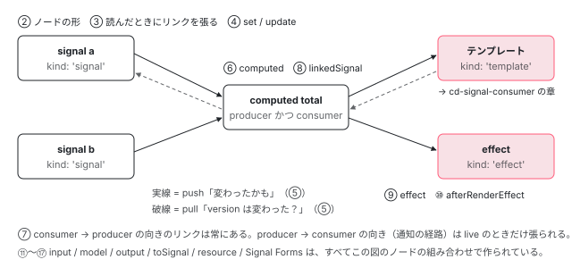

[目次](../README.md) › [Signal の内側](README.md) › 第 1 回 / 全 18 回

# Signal の概観：version と epoch、2 つのカウンタで無駄な再計算を止める

> signal() / computed() の中身を graph.ts から読む。バージョン番号とエポックという 2 つのカウンタだけで、無駄な再計算を止めている仕組みを追う。

angular/angular · 読了 約 12 分 · 中核 · [サイトで読む（デモが動きます）](https://angular-deep-dive-cyan.vercel.app/chapter/signals)

---

この章で分かること：`signal()` と `computed()` の効率は、**ノードごとの `version`** と **モジュールに 1 つだけの `epoch`**、この 2 つの整数でほぼ説明がつきます。書いたときに 2 つを 1 ずつ増やし、読むときに 2 つを比べて「再計算が要るか」を決めている行を追います。あわせて、シリーズの残り 17 回がこの仕組みのどこを扱うのかを 1 枚の図にします。

読む対象は `packages/core/primitives/signals/` の `index.ts`、`src/graph.ts`、`src/signal.ts`、`src/computed.ts` です。

1. **1. 概観**（この章）
2. [2. ReactiveNode の構造](02-signals-reactive-node.md)
3. [3. 依存の追跡](03-signals-tracking.md)
4. [4. set と update](04-signals-set.md)
5. [5. push と pull](05-signals-push-pull.md)
6. [6. computed](06-signals-computed.md)
7. [7. live と non-live](07-signals-live.md)
8. [8. linkedSignal](08-signals-linked-signal.md)
9. [9. effect のノードと寿命](09-signals-effect-node.md)
10. [10. afterRenderEffect](10-signals-after-render-effect.md)
11. [11. input と viewChild](11-authoring.md)
12. [12. input() とコンパイラ](12-signals-input-compile.md)
13. [13. model() と output()](13-signals-model-output.md)
14. [14. toSignal と toObservable](14-signals-rxjs-interop.md)
15. [15. resource](15-resource.md)
16. [16. httpResource と rxResource](16-signals-http-resource.md)
17. [17. Signal Forms](17-signal-forms.md)
18. [18. DevTools と signal グラフ](18-signals-debug.md)

## 1. primitives/signals は Angular から切り離された小さなライブラリ

Signal の本体は `packages/core/src` ではなく `packages/core/primitives/signals` にあります。公開されている関数の一覧が `index.ts` です（後半を引用します）。

📄 `angular/packages/core/primitives/signals/index.ts` L51–78 （▶ の行: 55, 58–59, 64–65, 68–69, 75, 77）

```ts
51 │ export {
52 │   SIGNAL_NODE,
53 │   SignalGetter,
54 │   SignalNode,
55 ▶   createSignal,
56 │   runPostSignalSetFn,
57 │   setPostSignalSetFn,
58 ▶   signalGetFn,
59 ▶   signalSetFn,
60 │   signalUpdateFn,
61 │ } from './src/signal';
62 │ export {Watch, WatchCleanupFn, WatchCleanupRegisterFn, createWatch} from './src/watch';
63 │ export {setAlternateWeakRefImpl} from './src/weak_ref';
64 ▶ export {untracked} from './src/untracked';
65 ▶ export {runEffect, BASE_EFFECT_NODE, BaseEffectNode} from './src/effect';
66 │ export {installDevToolsSignalFormatter} from './src/formatter';
67 │ 
68 ▶ // Required as the signals library is in a separate package, so we need to explicitly ensure the
69 ▶ // global `ngDevMode` type is defined.
70 │ declare const ngDevMode: boolean | undefined;
71 │ 
72 │ // We're using a top-level access to enable signal formatting whenever the signals package is loaded.
73 │ // ngDevMode might not have been init correctly yet, checking for `undefined` ensures that in case
74 │ // it is not defined yet, we still install the formatter.
75 ▶ if (typeof ngDevMode === 'undefined' || ngDevMode) {
76 │   // tslint:disable-next-line: no-toplevel-property-access
77 ▶   installDevToolsSignalFormatter();
78 │ }
```

55 行目の `createSignal` が `signal()` の本体、58〜59 行目の `signalGetFn` / `signalSetFn` が読み書きの本体です。64 行目の `untracked`、65 行目の `runEffect` / `BASE_EFFECT_NODE`（effect の土台）もここにあります。

68〜69 行目のコメントは「signals ライブラリは別パッケージなので、グローバルの `ngDevMode` の型をここで宣言する」と言っています。実際に `src/` 以下のファイルは `./graph` のような同じディレクトリ内の相対 import しかしておらず、`@angular/core` の何も import していません。逆に `@angular/core` 側 （`core/src/render3/reactivity/signal.ts` など）が `'../../../primitives/signals'` から import して包んでいます。包み方は [第 2 回](02-signals-reactive-node.md)で読みます。

75〜77 行目は、開発モードのときにブラウザの DevTools 用の表示整形（formatter）を入れる処理です（[第 18 回](18-signals-debug.md)）。

## 2. グラフの全体像と、この先の回の担当

用語を 2 つだけ先に決めます。**producer** は値を出す側（`signal`、`computed`）、**consumer** は値を読む側（`computed`、テンプレート、`effect`）です。`computed` は両方を兼ねます。どれも同じ形のオブジェクト `ReactiveNode` で表されます。



*producer から consumer へは「変わったかも（dirty）」が押し出される（push、実線）。consumer は読むときに producer の version を問い合わせる（pull、破線）。丸数字はその部分を扱う回。*

この章は図のうち「数字の比較」だけを扱います。リンクの張り方は [第 3 回](03-signals-tracking.md)、書き込みの手順は [第 4 回](04-signals-set.md)、push と pull の往復は [第 5 回](05-signals-push-pull.md)、通知の経路が張られる条件は [第 7 回](07-signals-live.md)で、それぞれ 1 回ずつ使って読みます。

## 3. ノードの種類は kind で区別される

📄 `angular/packages/core/primitives/signals/src/graph.ts` L98–106 （▶ の行: 99–106）

```ts
 98 │ export type ReactiveNodeKind =
 99 ▶   | 'signal'
100 ▶   | 'computed'
101 ▶   | 'effect'
102 ▶   | 'template'
103 ▶   | 'linkedSignal'
104 ▶   | 'afterRenderEffectPhase'
105 ▶   | 'childSignalProp' // Represents a signal passed as a prop to a child component in a CoW app
106 ▶   | 'unknown';
```

98〜106 行目の 8 つの文字列が、`ReactiveNode` の `kind` に入りうる値の全部です。`packages/` を `kind: '` で検索し、それぞれの文字列を実際に入れている行を集めると次の表になります。右の 2 列は、そのノードの中で signal を書いてよいか（`consumerAllowSignalWrites`、[第 4 回](04-signals-set.md)）と、通知を受ける経路を常に持つか（`consumerIsAlwaysLive`、[第 7 回](07-signals-live.md)）です。

| kind | ノードの原型（定義場所） | 作る API | consumerAllowSignalWrites | live |
| --- | --- | --- | --- | --- |
| `'signal'` | `SIGNAL_NODE`（signal.ts L111-118）。`INPUT_SIGNAL_NODE`（authoring/input/input\_signal\_node.ts L42-44）はこれを展開するので同じ kind | `signal()`、`input()`、`model()` | `false`（既定のまま。consumer にならないので判定に使われない） | consumer ではない |
| `'computed'` | `COMPUTED_NODE`（computed.ts L117-125） | `computed()` | `false` | live な consumer に読まれているときだけ |
| `'linkedSignal'` | `LINKED_SIGNAL_NODE`（linked\_signal.ts L127-137） | `linkedSignal()` | `false` | computed と同じ |
| `'effect'` | `BASE_EFFECT_NODE`（effect.ts L36-43）→ core の `EFFECT_NODE` / `ROOT_EFFECT_NODE` / `VIEW_EFFECT_NODE`（render3/reactivity/effect.ts L217, L256, L279） | `effect()` | `true` | 常に（`consumerIsAlwaysLive: true`） |
| `'template'` | `REACTIVE_LVIEW_CONSUMER_NODE` / `TEMPORARY_CONSUMER_NODE`（render3/reactive\_lview\_consumer.ts L43-46, L73-76） | 利用者は作らない。コンポーネントのテンプレートごとに 1 つ | `false` | 常に |
| `'afterRenderEffectPhase'` | `AFTER_RENDER_PHASE_EFFECT_NODE`（render3/reactivity/after\_render\_effect.ts L80-87。`SIGNAL_NODE` を展開） | `afterRenderEffect()` の各フェーズ | `true` | 常に |
| `'unknown'` | `REACTIVE_NODE` の既定値（graph.ts L75）。`createWatch` の `WATCH_NODE`（watch.ts L143-147）は kind を上書きしないのでこれ | `createWatch`（`packages/` の本番コードからは呼ばれていない） | `false`（引数で `true` にできる。watch.ts L71-73） | 常に |
| `'childSignalProp'` | 型にだけある（105 行目）。`packages/` にこの kind を入れる行は無く、`devtools/` の表示側だけが参照する | — | — | — |

> [!NOTE]
> **ポイント**
>
> `kind` は DevTools 用の名札ですが、それだけではありません。NG0600 のメッセージを選ぶとき、Angular は `kind === 'template'` かどうかで「テンプレートの中で書いた」と判定します （[第 4 回](04-signals-set.md)）。

## 4. 2 つのカウンタ：ノードの version と、全体の epoch

📄 `angular/packages/core/primitives/signals/src/graph.ts` L21–26 （▶ の行: 24, 26）

```ts
21 │ export type Version = number & {__brand: 'Version'};
22 │ 
23 │ /**
24 ▶  * Global epoch counter. Incremented whenever a source signal is set.
25 │  */
26 ▶ let epoch: Version = 1 as Version;
```

26 行目。`epoch` は graph.ts の**モジュールに 1 つだけ**ある `let` 変数です。24 行目のコメントどおり、どの source signal（`signal()` で作った、自分で値を持つ signal）が set されても増えます。

📄 `angular/packages/core/primitives/signals/src/graph.ts` L120–144 （▶ の行: 127, 135, 143）

```ts
120 │ export interface ReactiveNode {
121 │   /**
122 │    * Version of the value that this node produces.
123 │    *
124 │    * This is incremented whenever a new value is produced by this node which is not equal to the
125 │    * previous value (by whatever definition of equality is in use).
126 │    */
127 ▶   version: Version;
128 │ 
129 │   /**
130 │    * Epoch at which this node is verified to be clean.
131 │    *
132 │    * This allows skipping of some polling operations in the case where no signals have been set
133 │    * since this node was last read.
134 │    */
135 ▶   lastCleanEpoch: Version;
136 │ 
137 │   /**
138 │    * Whether this node (in its consumer capacity) is dirty.
139 │    *
140 │    * Only live consumers become dirty, when receiving a change notification from a dependency
141 │    * producer.
142 │    */
143 ▶   dirty: boolean;
144 │ 
```

ノードの側には 3 つあります。127 行目の `version`（自分の値の版。等しくない新しい値を作るたびに増える）、135 行目の `lastCleanEpoch`（「最新だ」と最後に確認できたときの `epoch`）、143 行目の `dirty`（「producer が変わったかもしれない」という印）です。このほかのフィールドは [第 2 回](02-signals-reactive-node.md)で全部読みます。

📄 `angular/packages/core/primitives/signals/src/signal.ts` L120–125 （▶ の行: 121–123）

```ts
120 │ function signalValueChanged<T>(node: SignalNode<T>): void {
121 ▶   node.version++;
122 ▶   producerIncrementEpoch();
123 ▶   producerNotifyConsumers(node);
124 │   postSignalSetFn?.(node);
125 │ }
```

`signal.set()` で値が本当に変わったときに呼ばれる関数です。**121 行目でそのノードの `version` を、122 行目で全体の `epoch` を、1 ずつ増やします。** 123 行目で consumer へ「変わったかも」を伝えます（中身は [第 5 回](05-signals-push-pull.md)）。この関数に来る前の「同じ値なら何もしない」判定は [第 4 回](04-signals-set.md)で読みます。

`epoch` を増やすのはこの 122 行目の `producerIncrementEpoch()` の呼び出しだけで、下の 6 節で見る `computed` の再計算は `version` しか増やしません。つまり `epoch` は「どこかの source signal が何回書かれたか」の通し番号です。

## 5. 読むたびに「再計算が要るか」を決める

`computed` の getter（`total()` と呼ぶ関数）はこれです。

📄 `angular/packages/core/primitives/signals/src/computed.ts` L70–82 （▶ の行: 72, 75, 81）

```ts
70 │   const computed = () => {
71 │     // Check if the value needs updating before returning it.
72 ▶     producerUpdateValueVersion(node);
73 │ 
74 │     // Record that someone looked at this signal.
75 ▶     producerAccessed(node);
76 │ 
77 │     if (node.value === ERRORED) {
78 │       throw node.error;
79 │     }
80 │ 
81 ▶     return node.value;
82 │   };
```

72 行目、**値を返す前に毎回 `producerUpdateValueVersion(node)`** を呼びます。75 行目は「誰が読んだか」の記録（[第 3 回](03-signals-tracking.md)）、81 行目で値を返します。再計算が起きる場所は 72 行目の中だけです。

📄 `angular/packages/core/primitives/signals/src/graph.ts` L309–334 （▶ の行: 310–311, 316–317, 323, 326, 330, 333）

```ts
309 │ export function producerUpdateValueVersion(node: ReactiveNode): void {
310 ▶   if (consumerIsLive(node) && !node.dirty) {
311 ▶     // A live consumer will be marked dirty by producers, so a clean state means that its version
312 │     // is guaranteed to be up-to-date.
313 │     return;
314 │   }
315 │ 
316 ▶   if (!node.dirty && node.lastCleanEpoch === epoch) {
317 ▶     // Even non-live consumers can skip polling if they previously found themselves to be clean at
318 │     // the current epoch, since their dependencies could not possibly have changed (such a change
319 │     // would've increased the epoch).
320 │     return;
321 │   }
322 │ 
323 ▶   if (!node.producerMustRecompute(node) && !consumerPollProducersForChange(node)) {
324 │     // None of our producers report a change since the last time they were read, so no
325 │     // recomputation of our value is necessary, and we can consider ourselves clean.
326 ▶     producerMarkClean(node);
327 │     return;
328 │   }
329 │ 
330 ▶   node.producerRecomputeValue(node);
331 │ 
332 │   // After recomputing the value, we're no longer dirty.
333 ▶   producerMarkClean(node);
334 │ }
```

early return が 3 段あります。上から順に、安く判定できるものから並んでいます。

| 行 | 打ち切る条件 | 使っているカウンタ | なぜそれで足りるか |
| --- | --- | --- | --- |
| 310 | live で、かつ `dirty` でない | （`dirty` の印） | live なら producer が変わったとき必ず `dirty` にされるので、印が無い = 最新（311〜312 行目のコメント） |
| 316 | `dirty` でなく、`lastCleanEpoch === epoch` | **epoch** | 前に確認してから**どの signal も set されていない**。依存が変わったなら epoch が増えている（317〜319 行目のコメント） |
| 323 | 初回でなく、producer の version がどれも前回読んだときと同じ | **version** | 依存のどれも新しい値を作っていない。326 行目で「最新だった」と記録して終わる |

3 段とも抜けたときだけ 330 行目の `producerRecomputeValue`（`computed` なら計算関数の実行）に進み、333 行目の `producerMarkClean` で `dirty = false`、`lastCleanEpoch = epoch` にします。

323 行目の `consumerPollProducersForChange` が version を比べる関数です。

📄 `angular/packages/core/primitives/signals/src/graph.ts` L472–496 （▶ の行: 476, 480, 486, 490）

```ts
472 │ export function consumerPollProducersForChange(node: ReactiveNode): boolean {
473 │   // Poll producers for change.
474 │   for (let link = node.producers; link !== undefined; link = link.nextProducer) {
475 │     const producer = link.producer;
476 ▶     const seenVersion = link.lastReadVersion;
477 │ 
478 │     // First check the versions. A mismatch means that the producer's value is known to have
479 │     // changed since the last time we read it.
480 ▶     if (seenVersion !== producer.version) {
481 │       return true;
482 │     }
483 │ 
484 │     // The producer's version is the same as the last time we read it, but it might itself be
485 │     // stale. Force the producer to recompute its version (calculating a new value if necessary).
486 ▶     producerUpdateValueVersion(producer);
487 │ 
488 │     // Now when we do this check, `producer.version` is guaranteed to be up to date, so if the
489 │     // versions still match then it has not changed since the last time we read it.
490 ▶     if (seenVersion !== producer.version) {
491 │       return true;
492 │     }
493 │   }
494 │ 
495 │   return false;
496 │ }
```

476 行目の `link.lastReadVersion` は「前回この producer を読んだときの version」で、リンク（第 3 回）に保存されています。480 行目と 490 行目で**同じ比較を 2 回**しています。間の 486 行目が理由です。1 回目で一致しても、その producer 自身（たとえば別の `computed`）がまだ古いかもしれない。だから 486 行目で producer を先に最新化させてから、もう一度比べます。この再帰で、グラフの奥の変化が手前まで正確に届きます。往復の全体は [第 5 回](05-signals-push-pull.md)です。

## 6. 計算しても version を上げない場合がある

📄 `angular/packages/core/primitives/signals/src/computed.ts` L148–172 （▶ の行: 148, 150, 155, 163, 166–167, 171）

```ts
148 ▶         // We want to mark this node as errored if calling `equal` throws; however, we don't want
149 │         // to track any reactive reads inside `equal`.
150 ▶         setActiveConsumer(null);
151 │         wasEqual =
152 │           oldValue !== UNSET &&
153 │           oldValue !== ERRORED &&
154 │           newValue !== ERRORED &&
155 ▶           node.equal(oldValue, newValue);
156 │       } catch (err) {
157 │         newValue = ERRORED;
158 │         node.error = err;
159 │       } finally {
160 │         consumerAfterComputation(node, prevConsumer);
161 │       }
162 │ 
163 ▶       if (wasEqual) {
164 │         // No change to `valueVersion` - old and new values are
165 │         // semantically equivalent.
166 ▶         node.value = oldValue;
167 ▶         return;
168 │       }
169 │ 
170 │       node.value = newValue;
171 ▶       node.version++;
172 │     },
```

`computed` の再計算（5 節の 330 行目から呼ばれる）の後半です。151〜155 行目で新しい値と古い値を `equal`（既定は `Object.is`）で比べます。150 行目で `activeConsumer` を `null` にしているのは、148〜149 行目のコメントのとおり `equal` の中で signal を読んでも依存にしないためです。

**163 行目、等しければ 166 行目で古い値に戻して 167 行目で return します。171 行目の `version++` には届きません。** すると、この `computed` を読んでいる consumer が 5 節の 480 / 490 行目で比べたとき version は前のままなので、その consumer は再計算されません。「計算はしたが、下流には何も伝わらない」が、この 1 つの `if` で実現しています。計算関数を呼ぶ前半と、循環の検出は [第 6 回](06-signals-computed.md)で読みます。

## 7. 動かして確かめる

> **🧪 DEMO — 計算回数と version は別々に増える**
>
> `subtotal = computed(() => price() * qty())`、`isBig = computed(() => subtotal() >= 3000)`。version はノード（`getter[SIGNAL]`）の `version` フィールドを学習用に覗いて表示しています。
>
> 試すこと：数量 2 → 3 で `isBig` が `false` → `true`（version が増える）。次に単価 1000 → 1500 にすると `subtotal` は 4500 に変わりますが `isBig` は `true` のまま。`isBig` の計算回数は増え、version は増えません（6 節の 163 行目）。「無関係」を押すとテンプレートは描き直されますが、どちらの計算回数も増えません（2 つの computed はテンプレートに読まれていて live、かつ dirty にされていないので、5 節の 310 行目で打ち切り）。同じボタンを 2 回押しても何も増えません（set の段階で止まる。[第 4 回](04-signals-set.md)）。
>
> ▶ [このデモはサイトで動かせます](https://angular-deep-dive-cyan.vercel.app/chapter/signals)

## ここまでの呼び出し

テンプレートが `isBig()` を読み、その前に `qty.set(3)` されていた場合です。

- 👤 `qty.set(3)` — 利用者のコード
  - `signalValueChanged(node)` — signal.ts L120 — *version++、epoch++、consumer に dirty を伝える*
- 👤 `isBig()` — テンプレート
  - `producerUpdateValueVersion(isBig)` — graph.ts L309 — *dirty なので 3 段目まで進む*
    - `consumerPollProducersForChange(isBig)` — graph.ts L472 — *subtotal の version は同じ → 486 行目へ*
      - `producerUpdateValueVersion(subtotal)` — graph.ts L309 — *qty の version が違う → 再計算 → version++*
    - *490 行目：subtotal の version が変わった → true*
  - `producerRecomputeValue(isBig)` — computed.ts L132 — *値が変われば version++、同じなら据え置き*
  - `producerMarkClean(isBig)` — graph.ts L377 — *dirty = false、lastCleanEpoch = epoch*

## 聞かれそうな質問

**Q. Signal と RxJS の BehaviorSubject は何が違うのですか？**

コードで言える違いは 2 つです。1 つ目は**値を計算するタイミング**。`BehaviorSubject.next(v)` は購読者に値を渡しますが、signal の set で走るのは signal.ts の 121〜123 行目 （version と epoch を増やし、consumer に「変わったかも」を伝える）だけで、`computed` の値はまだ計算されません。計算されるのは誰かが getter を呼んだとき、computed.ts 72 行目の `producerUpdateValueVersion` の中です。誰も読まなければ一度も計算されません。

2 つ目は**購読しない**こと。`subscribe` に当たる操作はなく、computed.ts 75 行目の `producerAccessed` が「計算中に読まれた」事実から依存を自動で記録します （[第 3 回](03-signals-tracking.md)）。解除も、次の計算で読まれなかった依存を切る形で自動です。RxJS との相互変換は [第 14 回](14-signals-rxjs-interop.md)で読みます。

**Q. primitives/signals が別パッケージ扱いなのはなぜですか？**

ソースから言えるのは「`@angular/core` に依存しない形で切り出されている」という事実までです。index.ts 68〜69 行目に「signals ライブラリは別パッケージ」と書かれ、`src/` のファイルは同じディレクトリ内の相対 import しか持ちません。配布物でも `@angular/core` の `package.json` の `exports` に `./primitives/signals` が独立した入口として載っています。

そのため Angular 固有の部分は外から差し込む形になっています。たとえば不正な書き込みのエラーは、primitives の中では 中身の無い `new Error()` で、Angular の `RuntimeError(600)` に差し替えるのは core 側です （[第 4 回](04-signals-set.md)）。

**Q. epoch がアプリ全体で 1 つだけで困らないのですか？**

1 つだからこそ役に立ちます。graph.ts 316 行目は「前回確認してから epoch が変わっていない = どの signal も書かれていない」という判定で、依存を 1 つも調べずに済ませます。どこかで 1 回でも set があれば epoch が変わり、この近道は使えなくなるだけです（その場合は 323 行目で version を 1 つずつ比べる）。正しさは version 側が保証し、epoch は「何も起きていない」ときの高速化だけを担当しています。

**Q. dirty が立った computed は、読まれたら必ず再計算されますか？**

されません。graph.ts 323 行目で `consumerPollProducersForChange` が producer の version をすべて比べ、どれも変わっていなければ 326 行目で `producerMarkClean` して終わります。dirty は「変わったかもしれない」という印で、確定ではありません。たとえば依存先の `computed` が再計算されても、computed.ts 163 行目で値が等しいと判定されれば version は増えないので、手前は再計算されません。

## 読み終えて

- Signal の本体は `@angular/core` に依存しない `packages/core/primitives/signals` にあり、core はそれを包んで公開している
- ノードの種類は `kind` の 8 つの文字列で、どれも同じ `ReactiveNode` の形をしている
- source signal を書くと、そのノードの `version` と全体の `epoch` が 1 ずつ増える（signal.ts 121〜122 行目）
- 読むときは `producerUpdateValueVersion` が dirty → epoch → version の順に安い判定から打ち切り、全部抜けたときだけ再計算する
- `computed` は再計算しても値が等しければ version を上げないので、変化はそこで止まる

---

← 前: [DevTools が注入器の木を描ける理由：injector profiler と injector\_discovery\_utils](../di/16-di-debug.md)  
次: [ReactiveNode の構造：signal の正体は「関数にぶら下がった 1 つのオブジェクト」](02-signals-reactive-node.md) →
