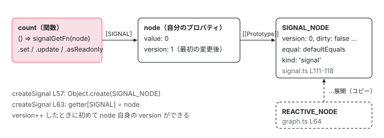

[目次](../README.md) › [Signal の内側](README.md) › 第 2 回 / 全 18 回

# ReactiveNode の構造：signal の正体は「関数にぶら下がった 1 つのオブジェクト」

> REACTIVE\_NODE プロトタイプの全フィールド（version / lastCleanEpoch / dirty / producers / consumers / kind / consumerAllowSignalWrites など）を 1 つずつ読み、createSignal が getter 関数に \[SIGNAL\] でノードを付ける行、SIGNAL\_NODE が REACTIVE\_NODE を展開したコピーで、各ノードはそれを Object.create でプロトタイプにすること（IIFE と tree-shaking）、isSignal の判定、core の signal() が primitives の createSignal を包む行を追う。

angular/angular · 読了 約 12 分 · 中核 · [サイトで読む（デモが動きます）](https://angular-deep-dive-cyan.vercel.app/chapter/signals-reactive-node)

---

この章で分かること：`const count = signal(0)` の `count` は**ただの関数**で、状態はすべて、その関数のプロパティ `count[SIGNAL]` にぶら下がった 1 つのオブジェクト（`ReactiveNode`）にあります。そのオブジェクトの全フィールドの意味と、`createSignal` が関数とオブジェクトを結びつける行、`@angular/core` の `signal()` がそこに `set` / `update` / `asReadonly` を足す行を順に読みます。

読む対象は `packages/core/primitives/signals/src/graph.ts` と `src/signal.ts`、`packages/core/src/render3/reactivity/signal.ts` と `api.ts` です。

1. [1. 概観](01-signals.md)
2. **2. ReactiveNode の構造**（この章）
3. [3. 依存の追跡](03-signals-tracking.md)
4. [4. set と update](04-signals-set.md)
5. [5. push と pull](05-signals-push-pull.md)
6. [6. computed](06-signals-computed.md)
7. [7. live と non-live](07-signals-live.md)
8. [8. linkedSignal](08-signals-linked-signal.md)
9. [9. effect のノードと寿命](09-signals-effect-node.md)
10. [10. afterRenderEffect](10-signals-after-render-effect.md)
11. [11. input と viewChild](11-authoring.md)
12. [12. input() とコンパイラ](12-signals-input-compile.md)
13. [13. model() と output()](13-signals-model-output.md)
14. [14. toSignal と toObservable](14-signals-rxjs-interop.md)
15. [15. resource](15-resource.md)
16. [16. httpResource と rxResource](16-signals-http-resource.md)
17. [17. Signal Forms](17-signal-forms.md)
18. [18. DevTools と signal グラフ](18-signals-debug.md)

## 1. 目印は 1 つの Symbol

📄 `angular/packages/core/primitives/signals/src/graph.ts` L35–40 （▶ の行: 40）

```ts
35 │ /**
36 │  * Symbol used to tell `Signal`s apart from other functions.
37 │  *
38 │  * This can be used to auto-unwrap signals in various cases, or to auto-wrap non-signal values.
39 │  */
40 ▶ export const SIGNAL: unique symbol = /* @__PURE__ */ Symbol('SIGNAL');
```

40 行目。`SIGNAL` は `Symbol('SIGNAL')` です。Symbol は「同じ名前の文字列キーと絶対に衝突しない」プロパティのキーです。`/* @__PURE__ */` は「この呼び出しには副作用が無い」というバンドラ向けの注釈で、使われなければ削除してよいという意味になります。

📄 `angular/packages/core/primitives/signals/src/graph.ts` L56–62 （▶ の行: 57, 61）

```ts
56 │ export interface Reactive {
57 ▶   [SIGNAL]: ReactiveNode;
58 │ }
59 │ 
60 │ export function isReactive(value: unknown): value is Reactive {
61 ▶   return (value as Partial<Reactive>)[SIGNAL] !== undefined;
62 │ }
```

57 行目、`Reactive` は「`[SIGNAL]` というキーに `ReactiveNode` を持つもの」という型です。61 行目の `isReactive` は、そのキーが `undefined` でないかだけを見ます。**signal であるかどうかは、クラスではなく「このキーを持っているか」で決まります。**

## 2. すべてのノードの元になる既定値 REACTIVE\_NODE

📄 `angular/packages/core/primitives/signals/src/graph.ts` L64–75 （▶ の行: 64–67, 73–75）

```ts
64 ▶ export const REACTIVE_NODE: ReactiveNode = {
65 ▶   version: 0 as Version,
66 ▶   lastCleanEpoch: 0 as Version,
67 ▶   dirty: false,
68 │   producers: undefined,
69 │   producersTail: undefined,
70 │   consumers: undefined,
71 │   consumersTail: undefined,
72 │   recomputing: false,
73 ▶   consumerAllowSignalWrites: false,
74 ▶   consumerIsAlwaysLive: false,
75 ▶   kind: 'unknown',
```

64 行目の `REACTIVE_NODE` は、全種類のノードの既定値を集めたただのオブジェクトです。65〜67 行目、`version` と `lastCleanEpoch` は 0、`dirty` は `false` から始まります。73 行目、既定では**書き込み禁止**（`consumerAllowSignalWrites: false`）。74 行目、既定では常に live ではない。75 行目、`kind` は `'unknown'`。これに続く 4 つの関数（何もしない既定の実装）は [cd-signal-consumer の章](../cd/05-cd-signal-consumer.md)の 2 節で引用しています。

## 3. ReactiveNode のフィールドを順に読む

先頭の 3 つ（`version` / `lastCleanEpoch` / `dirty`）は [第 1 回](01-signals.md)の 4 節で読みました。その続きです。

📄 `angular/packages/core/primitives/signals/src/graph.ts` L145–178 （▶ の行: 148, 153, 160, 165, 167–168, 176, 178）

```ts
145 │   /**
146 │    * Whether this node is currently rebuilding its producer list.
147 │    */
148 ▶   recomputing: boolean;
149 │ 
150 │   /**
151 │    * Producers which are dependencies of this consumer.
152 │    */
153 ▶   producers: ReactiveLink | undefined;
154 │ 
155 │   /**
156 │    * Points to the last linked list node in the `producers` linked list.
157 │    *
158 │    * When this node is recomputing, this is used to track the producers that we have accessed so far.
159 │    */
160 ▶   producersTail: ReactiveLink | undefined;
161 │ 
162 │   /**
163 │    * Linked list of consumers of this producer that are "live" (they require push notifications).
164 │    *
165 ▶    * The length of this list is effectively our reference count for this node.
166 │    */
167 ▶   consumers: ReactiveLink | undefined;
168 ▶   consumersTail: ReactiveLink | undefined;
169 │ 
170 │   /**
171 │    * Whether writes to signals are allowed when this consumer is the `activeConsumer`.
172 │    *
173 │    * This is used to enforce guardrails such as preventing writes to writable signals in the
174 │    * computation function of computed signals, which is supposed to be pure.
175 │    */
176 ▶   consumerAllowSignalWrites: boolean;
177 │ 
178 ▶   readonly consumerIsAlwaysLive: boolean;
```

📄 `angular/packages/core/primitives/signals/src/graph.ts` L179–207 （▶ の行: 184–186, 191, 196, 206）

```ts
179 │ 
180 │   /**
181 │    * Tracks whether producers need to recompute their value independently of the reactive graph (for
182 │    * example, if no initial value has been computed).
183 │    */
184 ▶   producerMustRecompute(node: unknown): boolean;
185 ▶   producerRecomputeValue(node: unknown): void;
186 ▶   consumerMarkedDirty(node: unknown): void;
187 │ 
188 │   /**
189 │    * Called when a signal is read within this consumer.
190 │    */
191 ▶   consumerOnSignalRead(node: unknown): void;
192 │ 
193 │   /**
194 │    * A debug name for the reactive node. Used in Angular DevTools to identify the node.
195 │    */
196 ▶   debugName?: string;
197 │ 
198 │   /**
199 │    * Kind of node. Example: 'signal', 'computed', 'input', 'effect'.
200 │    *
201 │    * ReactiveNode has this as 'unknown' by default, but derived node types should override this to
202 │    * make available the kind of signal that particular instance of a ReactiveNode represents.
203 │    *
204 │    * Used in Angular DevTools to identify the kind of signal.
205 │    */
206 ▶   kind: ReactiveNodeKind;
207 │ }
```

| 行 | フィールド | 意味 | 詳しく読む回 |
| --- | --- | --- | --- |
| 148 | `recomputing` | いま producer のリストを作り直している最中か | [第 3 回](03-signals-tracking.md) |
| 153 | `producers` | このノードが読んだ producer へのリンクの連結リスト（consumer としての顔） | [第 3 回](03-signals-tracking.md) |
| 160 | `producersTail` | そのリストの末尾。作り直し中は「今回ここまで読んだ」位置 | [第 3 回](03-signals-tracking.md) |
| 167〜168 | `consumers` / `consumersTail` | このノードを読んでいる **live な** consumer へのリンク（producer としての顔）。165 行目のコメントどおり、長さが参照カウントの役をする | [第 7 回](07-signals-live.md) |
| 176 | `consumerAllowSignalWrites` | このノードが `activeConsumer` のとき、signal への書き込みを許すか | [第 4 回](04-signals-set.md) |
| 178 | `consumerIsAlwaysLive` | 読まれていなくても常に live 扱いか（effect とテンプレートは `true`） | [第 7 回](07-signals-live.md) |
| 184 | `producerMustRecompute` | グラフと無関係に再計算が必要か（初回など） | [第 6 回](06-signals-computed.md) |
| 185 | `producerRecomputeValue` | 値を作り直す処理。`computed` なら計算関数を呼ぶ | [第 6 回](06-signals-computed.md) |
| 186 | `consumerMarkedDirty` | dirty にされた直後に呼ばれるフック。テンプレートはここで走査を予約する | [第 5 回](05-signals-push-pull.md) |
| 191 | `consumerOnSignalRead` | このノードの中で signal が読まれるたびに呼ばれるフック | [第 3 回](03-signals-tracking.md) |
| 196 | `debugName` | DevTools に出す名前（省略可） | [第 18 回](18-signals-debug.md) |
| 206 | `kind` | ノードの種類。値の一覧は第 1 回の表 | [第 1 回](01-signals.md) |

名前の先頭が `producer` のものは「値を出す側」としての、`consumer` のものは「読む側」としての性質です。1 つのノードが両方を持つので、`computed` は 1 つのオブジェクトで両方の役をこなせます。関数のフィールド（184〜191 行目）が「振る舞いの差し替え口」で、ノードの種類ごとの違いはほぼここに集まっています。

## 4. createSignal：関数を作り、ノードをぶら下げる

📄 `angular/packages/core/primitives/signals/src/signal.ts` L35–48 （▶ の行: 35–37, 40, 47）

```ts
35 ▶ export interface SignalNode<T> extends ReactiveNode {
36 ▶   value: T;
37 ▶   equal: ValueEqualityFn<T>;
38 │ }
39 │ 
40 ▶ export type SignalBaseGetter<T> = (() => T) & {readonly [SIGNAL]: unknown};
41 │ export type SignalSetter<T> = (newValue: T) => void;
42 │ export type SignalUpdater<T> = (updateFn: (value: T) => T) => void;
43 │ 
44 │ // Note: Closure *requires* this to be an `interface` and not a type, which is why the
45 │ // `SignalBaseGetter` type exists to provide the correct shape.
46 │ export interface SignalGetter<T> extends SignalBaseGetter<T> {
47 ▶   readonly [SIGNAL]: SignalNode<T>;
48 │ }
```

35〜37 行目、writable signal のノード `SignalNode` は、`ReactiveNode` に `value`（現在の値）と `equal`（等しさの判定関数）を足しただけです。40 行目と 47 行目、getter の型は「引数 0 個で `T` を返す関数」かつ「`[SIGNAL]` にノードを持つ」です。

📄 `angular/packages/core/primitives/signals/src/signal.ts` L50–73 （▶ の行: 57–60, 62–64, 69–72）

```ts
50 │ /**
51 │  * Creates a `Signal` getter, setter, and updater function.
52 │  */
53 │ export function createSignal<T>(
54 │   initialValue: T,
55 │   equal?: ValueEqualityFn<T>,
56 │ ): [SignalGetter<T>, SignalSetter<T>, SignalUpdater<T>] {
57 ▶   const node: SignalNode<T> = Object.create(SIGNAL_NODE);
58 ▶   node.value = initialValue;
59 ▶   if (equal !== undefined) {
60 ▶     node.equal = equal;
61 │   }
62 ▶   const getter = (() => signalGetFn(node)) as SignalGetter<T>;
63 ▶   (getter as any)[SIGNAL] = node;
64 ▶   if (typeof ngDevMode !== 'undefined' && ngDevMode) {
65 │     getter.toString = () =>
66 │       `[Signal${node.debugName ? ' (' + node.debugName + ')' : ''}: ${String(node.value)}]`;
67 │   }
68 │ 
69 ▶   runPostProducerCreatedFn(node);
70 ▶   const set = (newValue: T) => signalSetFn(node, newValue);
71 ▶   const update = (updateFn: (value: T) => T) => signalUpdateFn(node, updateFn);
72 ▶   return [getter, set, update];
73 │ }
```

1. **57 行目：ノードを `Object.create(SIGNAL_NODE)` で作る**

   `Object.create(proto)` は「`proto` をプロトタイプに持つ空のオブジェクト」を作ります。この時点のノード自身は何もプロパティを持たず、`version` も `kind` も `SIGNAL_NODE` から読まれます。
2. **58〜61 行目：初期値と、指定があれば `equal` を自分のプロパティにする**

   `equal` を渡さなければ書かないので、プロトタイプの `defaultEquals`（`Object.is`）が使われます。
3. **62 行目：getter は `() => signalGetFn(node)` というアロー関数**

   `node` はクロージャで捕まえているだけです。`count()` と呼ぶと、この関数が実行されます。
4. **63 行目：`getter[SIGNAL] = node`**

   関数もオブジェクトなので、プロパティを足せます。**これで「関数」と「ノード」が結びつきます。** 1 節の `isReactive` はこのプロパティを見ています。
5. **64〜67 行目：開発モードだけ `toString` を差し替える**

   コンソールで `String(count)` すると `[Signal: 0]` のように出ます。
6. **69 行目：作成フック**

   `runPostProducerCreatedFn` は graph.ts のモジュール変数 `postProducerCreatedFn` が設定されていれば呼びます。`packages/` の本番コードには `setPostProducerCreatedFn` を呼ぶ箇所が無く、使っているのはテストだけです。
7. **70〜72 行目：set と update も `node` を捕まえたアロー関数にし、3 つ組で返す**

   primitives の段階では、set と update は getter とは**別の関数**です。1 つにまとめるのは core 側（6 節）です。

## 5. SIGNAL\_NODE：REACTIVE\_NODE を展開したコピー

📄 `angular/packages/core/primitives/signals/src/signal.ts` L109–118 （▶ の行: 109–111, 113–116）

```ts
109 ▶ // Note: Using an IIFE here to ensure that the spread assignment is not considered
110 ▶ // a side-effect, ending up preserving `COMPUTED_NODE` and `REACTIVE_NODE`.
111 ▶ export const SIGNAL_NODE: SignalNode<unknown> = /* @__PURE__ */ (() => {
112 │   return {
113 ▶     ...REACTIVE_NODE,
114 ▶     equal: defaultEquals,
115 ▶     value: undefined,
116 ▶     kind: 'signal',
117 │   };
118 │ })();
```

113 行目の `...REACTIVE_NODE` は**展開（コピー）**です。`REACTIVE_NODE` の全フィールドを新しいオブジェクトに写し、114〜116 行目で `equal`・`value`・`kind` だけ上書きします。だから `SIGNAL_NODE` のプロトタイプは `REACTIVE_NODE` ではなく、普通のオブジェクトと同じ `Object.prototype` です。

111 行目でこれを即時実行関数（IIFE、定義してすぐ呼ぶ関数）で包み、`/* @__PURE__ */` を付けている理由は 109〜110 行目のコメントにあります。「spread の代入が副作用とみなされないようにするため。そうしないと `COMPUTED_NODE` と `REACTIVE_NODE` が（使われていなくても）残ってしまう」。つまり tree-shaking（使われていないコードをバンドルから消すこと）のための書き方です。`COMPUTED_NODE`、`BASE_EFFECT_NODE`、`LINKED_SIGNAL_NODE` も同じ形で書かれています。



*count は関数。count\[SIGNAL\] がノード。ノードは SIGNAL\_NODE をプロトタイプに持ち、SIGNAL\_NODE は REACTIVE\_NODE をコピーして作ったもの（プロトタイプのつながりは無い）。*

## 6. @angular/core の signal()：getter に set・update・asReadonly を足す

利用者が import する `signal()` は primitives の `createSignal` を包んだものです。まず戻り値の型から。

📄 `angular/packages/core/src/render3/reactivity/signal.ts` L21–41 （▶ の行: 21–22, 27, 33, 36–38, 40）

```ts
21 ▶ export interface WritableSignal<T> extends Signal<T> {
22 ▶   [ɵWRITABLE_SIGNAL]: T;
23 │ 
24 │   /**
25 │    * Directly set the signal to a new value, and notify any dependents.
26 │    */
27 ▶   set(value: T): void;
28 │ 
29 │   /**
30 │    * Update the value of the signal based on its current value, and
31 │    * notify any dependents.
32 │    */
33 ▶   update(updateFn: (value: T) => T): void;
34 │ 
35 │   /**
36 ▶    * Returns a readonly version of this signal. Readonly signals can be accessed to read their value
37 ▶    * but can't be changed using set or update methods. The readonly signals do _not_ have
38 ▶    * any built-in mechanism that would prevent deep-mutation of their value.
39 │    */
40 ▶   asReadonly(): Signal<T>;
41 │ }
```

21 行目、`WritableSignal` は `Signal` を拡張した**インターフェース**で、27・33・40 行目の 3 つのメソッドを持ちます。22 行目の `[ɵWRITABLE_SIGNAL]` は型の上だけの目印で、実行時にこのキーを書き込む行は `packages/core/src` にありません。

📄 `angular/packages/core/src/render3/reactivity/signal.ts` L72–99 （▶ の行: 73, 75–76, 78–80, 82, 84, 93–96, 98）

```ts
72 │ export function signal<T>(initialValue: T, options?: CreateSignalOptions<T>): WritableSignal<T> {
73 ▶   const [get, set, update] = createSignal(initialValue, options?.equal);
74 │ 
75 ▶   const signalFn = get as SignalGetter<T> & WritableSignal<T>;
76 ▶   const node = signalFn[SIGNAL];
77 │ 
78 ▶   signalFn.set = set;
79 ▶   signalFn.update = update;
80 ▶   signalFn.asReadonly = signalAsReadonlyFn.bind(signalFn as any) as () => Signal<T>;
81 │ 
82 ▶   if (typeof ngDevMode !== 'undefined' && ngDevMode) {
83 │     const debugName = options?.debugName;
84 ▶     node.debugName = debugName;
85 │     signalFn.toString = () => `[Signal${debugName ? ' (' + debugName + ')' : ''}: ${signalFn()}]`;
86 │   }
87 │ 
88 │   return signalFn as WritableSignal<T>;
89 │ }
90 │ 
91 │ export function signalAsReadonlyFn<T>(this: SignalGetter<T>): Signal<T> {
92 │   const node = this[SIGNAL] as SignalNode<T> & {readonlyFn?: Signal<T>};
93 ▶   if (node.readonlyFn === undefined) {
94 ▶     const readonlyFn = () => this();
95 ▶     (readonlyFn as any)[SIGNAL] = node;
96 ▶     node.readonlyFn = readonlyFn as Signal<T>;
97 │   }
98 ▶   return node.readonlyFn;
99 │ }
```

1. **73 行目：primitives の `createSignal` を呼ぶ**

   オプションのうち `equal` だけを渡します。
2. **75〜76 行目：getter をそのまま戻り値にする**

   新しいオブジェクトは作りません。`signalFn` は 4 節 62 行目のアロー関数そのものです。
3. **78〜80 行目：関数のプロパティとして set / update / asReadonly を足す**

   `count.set(1)` が書けるのは、関数 `count` に `set` というプロパティがあるからです。中身は 4 節 70 行目のアロー関数です。
4. **82〜86 行目：`debugName` は開発モードのときだけノードに書く**

   84 行目は `ngDevMode` の `if` の中です。**本番ビルドでは `debugName` を渡してもノードに残りません。**

91〜98 行目が `asReadonly()` の実装です。93 行目、初回だけ 94 行目で `() => this()`（元の getter を呼ぶだけの関数）を作り、95 行目でそこに**同じ `node`** を `[SIGNAL]` として付け、96 行目でノードに覚えさせます。2 回目以降は 98 行目で同じ関数が返ります。値もノードもコピーしていません。

## 7. isSignal と isWritableSignal

📄 `angular/packages/core/src/render3/reactivity/api.ts` L24–57 （▶ の行: 24–25, 36, 56）

```ts
24 ▶ export type Signal<T> = (() => T) & {
25 ▶   [SIGNAL]: unknown;
26 │ };
27 │ 
28 │ /**
29 │  * Checks if the given `value` is a reactive `Signal`.
30 │  *
31 │  * @see [Type checking signals](guide/signals#type-checking-signals)
32 │  *
33 │  * @publicApi 17.0
34 │  */
35 │ export function isSignal(value: unknown): value is Signal<unknown> {
36 ▶   return typeof value === 'function' && (value as Signal<unknown>)[SIGNAL] !== undefined;
37 │ }
38 │ 
39 │ /**
40 │  * A comparison function which can determine if two values are equal.
41 │  *
42 │  * @see [Signal equality functions](guide/signals#signal-equality-functions)
43 │  *
44 │  * @publicApi 17.0
45 │  */
46 │ export type ValueEqualityFn<T> = (a: T, b: T) => boolean;
47 │ 
48 │ /**
49 │  * Checks if the given `value` is a writeable signal.
50 │  *
51 │  * @see [Type checking signals](guide/signals#type-checking-signals)
52 │  *
53 │  * @publicApi 21.1
54 │  */
55 │ export function isWritableSignal(value: unknown): value is WritableSignal<unknown> {
56 ▶   return isSignal(value) && typeof (value as any).set === 'function';
57 │ }
```

24〜26 行目、公開型 `Signal<T>` も「関数 + `[SIGNAL]`」です。36 行目の `isSignal` は 1 節の `isReactive` に `typeof value === 'function'` を足しただけ。56 行目の `isWritableSignal` はさらに `set` が関数かを見ます。6 節の `asReadonly()` が返す関数には `set` を付けていないので、`isSignal` は真、`isWritableSignal` は偽になります。

> **🧪 DEMO — count\[SIGNAL\] を覗く**
>
> `count = signal(0, { debugName: 'count' })` と `ro = count.asReadonly()`。ノードのフィールドは学習用に覗いているだけで、利用者のコードで読むものではありません。
>
> 最初は `hasOwn(node, 'version')` が `false` で、version はプロトタイプの 0 が見えています。1 回 update すると `signalValueChanged` の `node.version++`（[第 1 回](01-signals.md) 4 節）で自分のプロパティができ、`true` になります。「set(同じ値)」では version は増えません（[第 4 回](04-signals-set.md)）。`debugName` は開発サーバーでは `'count'`、本番ビルド（このサイトの公開版）では `undefined` です（6 節 84 行目）。
>
> ▶ [このデモはサイトで動かせます](https://angular-deep-dive-cyan.vercel.app/chapter/signals-reactive-node)

## ここまでの呼び出し

- 👤 `signal(0, { debugName: 'count' })` — 利用者のコード
  - `createSignal(0, undefined)` — primitives/signals/src/signal.ts L53
    - `Object.create(SIGNAL_NODE)` — signal.ts L57 — *プロトタイプは REACTIVE\_NODE のコピー*
    - `getter[SIGNAL] = node` — signal.ts L63
    - `runPostProducerCreatedFn(node)` — signal.ts L69 — *本番コードでは何も設定されていない*
  - `signalFn.set = set` ほか 2 つ — core/src/render3/reactivity/signal.ts L78-80
  - `node.debugName = 'count'` — signal.ts L84 — *開発モードのみ*
- 👤 `count()` — 利用者のコード
  - `signalGetFn(node)` — signal.ts L81 — *producerAccessed → node.value（第 3 回）*

## 聞かれそうな質問

**Q. signal はクラスではないのですか？**

クラスではありません。`class` も `new` も出てきません。signal.ts 62 行目のアロー関数が本体で、状態は 57 行目の `Object.create(SIGNAL_NODE)` で作ったオブジェクトにあり、63 行目でその関数のプロパティになります。`typeof count` は `'function'` です。「signal かどうか」は api.ts 36 行目のとおり、関数であって `[SIGNAL]` を持つかどうかで決まります。

**Q. asReadonly() は値のコピーを返すのですか？**

いいえ。core の signal.ts 94〜95 行目で、元の getter を呼ぶだけの関数を作り、**同じノード**を `[SIGNAL]` に付けています。96 行目でノードに覚えさせるので、何回呼んでも同じ関数が返ります。元の signal を set すれば読み取り専用側の値も変わります。36〜38 行目のコメントのとおり、オブジェクトの中身を書き換える（深い変更）ことは防ぎません。防いでいるのは `set` / `update` が付いていないことだけです。

**Q. version はいくつから始まりますか？**

0 です。graph.ts 65 行目の `REACTIVE_NODE.version` が 0 で、signal.ts 113 行目でそれが `SIGNAL_NODE` にコピーされ、57 行目のノードはそれをプロトタイプから読みます。最初に値が変わったとき、`signalValueChanged` の `node.version++`（[第 1 回](01-signals.md) 4 節）が、読んだ 0 に 1 を足してノード自身に `version: 1` を作ります。デモの `hasOwn` の行で確かめられます。

**Q. debugName を付けたのに、本番で DevTools に名前が出ません。**

core の signal.ts 82〜86 行目で、`debugName` をノードに書く処理全体が `ngDevMode` の `if` の中にあるからです。本番ビルドではこの `if` ごと消え、ノードの `debugName` は `undefined` のままです。

**Q. 自分で作った関数に \[SIGNAL\] を付けたら signal として扱われますか？**

`isSignal` は真になります（api.ts 36 行目は関数であることとキーの有無しか見ない）。ただしグラフに参加するのは、読まれたときに `producerAccessed` を呼ぶ関数だけです（[第 3 回](03-signals-tracking.md)）。キーを付けただけの関数は判定を通るだけで、依存の記録や通知は起きません。

## 読み終えて

- signal の getter はアロー関数で、状態は `getter[SIGNAL]` に付いた 1 つのノードにある（signal.ts 62〜63 行目）
- ノードは `Object.create(SIGNAL_NODE)` で作られ、`SIGNAL_NODE` は `REACTIVE_NODE` を展開したコピー。IIFE と `@__PURE__` は tree-shaking のため
- `ReactiveNode` のフィールドは producer としての顔と consumer としての顔に分かれ、関数のフィールドが種類ごとの振る舞いの差し替え口になっている
- core の `signal()` は getter に `set` / `update` / `asReadonly` をプロパティとして足すだけ。`debugName` は開発モードだけ
- `asReadonly()` は同じノードを指す別の関数で、コピーではない

---

← 前: [Signal の概観：version と epoch、2 つのカウンタで無駄な再計算を止める](01-signals.md)  
次: [依存の追跡：activeConsumer、producerAccessed、ReactiveLink、untracked](03-signals-tracking.md) →
