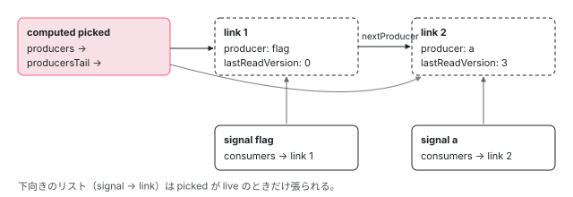

[目次](../README.md) › [Signal の内側](README.md) › 第 3 回 / 全 18 回

# 依存の追跡：activeConsumer、producerAccessed、ReactiveLink、untracked

> 「いま誰が読んでいるか」を表すグローバル変数 activeConsumer と setActiveConsumer。producerAccessed が既存のリンクを再利用するか新しい ReactiveLink を作るかを決める行、consumerBeforeComputation / finalizeConsumerAfterComputation が「前回の依存のうち今回読まなかったもの」を切る手順、untracked が activeConsumer を null にして戻すだけの実装。条件分岐で依存が変わる例をデモで見せる。

angular/angular · 読了 約 14 分 · 中核 · [サイトで読む（デモが動きます）](https://angular-deep-dive-cyan.vercel.app/chapter/signals-tracking)

---

この章で分かること：`computed(() => flag() ? a() : b())` と書くだけで依存が記録されるのは、計算の間だけ**グローバル変数 `activeConsumer`** に「いま計算しているノード」を入れておき、signal が読まれるたびに `producerAccessed` がそのノードの依存リストに 1 本ずつリンクを並べるからです。前回のリストを残したまま先頭から照合し直し、余ったリンクを最後に切る、という手順を行で追います。`untracked` がその変数を `null` にして戻すだけの関数であることも確かめます。

読む対象は `packages/core/primitives/signals/src/graph.ts`、`src/computed.ts`、`src/untracked.ts` と `packages/core/src/render3/reactivity/untracked.ts` です。

1. [1. 概観](01-signals.md)
2. [2. ReactiveNode の構造](02-signals-reactive-node.md)
3. **3. 依存の追跡**（この章）
4. [4. set と update](04-signals-set.md)
5. [5. push と pull](05-signals-push-pull.md)
6. [6. computed](06-signals-computed.md)
7. [7. live と non-live](07-signals-live.md)
8. [8. linkedSignal](08-signals-linked-signal.md)
9. [9. effect のノードと寿命](09-signals-effect-node.md)
10. [10. afterRenderEffect](10-signals-after-render-effect.md)
11. [11. input と viewChild](11-authoring.md)
12. [12. input() とコンパイラ](12-signals-input-compile.md)
13. [13. model() と output()](13-signals-model-output.md)
14. [14. toSignal と toObservable](14-signals-rxjs-interop.md)
15. [15. resource](15-resource.md)
16. [16. httpResource と rxResource](16-signals-http-resource.md)
17. [17. Signal Forms](17-signal-forms.md)
18. [18. DevTools と signal グラフ](18-signals-debug.md)

## 1. activeConsumer：モジュールに 1 つの変数

📄 `angular/packages/core/primitives/signals/src/graph.ts` L13–19 （▶ の行: 18–19）

```ts
13 │ /**
14 │  * The currently active consumer `ReactiveNode`, if running code in a reactive context.
15 │  *
16 │  * Change this via `setActiveConsumer`.
17 │  */
18 ▶ let activeConsumer: ReactiveNode | null = null;
19 ▶ let inNotificationPhase = false;
```

18 行目。「いま、誰のために signal を読んでいるか」は graph.ts のモジュール変数 1 つで表されます。`null` なら「誰のためでもない」（リアクティブな文脈の外）です。19 行目の `inNotificationPhase` は通知の最中かどうかの印です（[第 5 回](05-signals-push-pull.md)）。

📄 `angular/packages/core/primitives/signals/src/graph.ts` L42–54 （▶ の行: 42–45, 48–49）

```ts
42 ▶ export function setActiveConsumer(consumer: ReactiveNode | null): ReactiveNode | null {
43 ▶   const prev = activeConsumer;
44 ▶   activeConsumer = consumer;
45 ▶   return prev;
46 │ }
47 │ 
48 ▶ export function getActiveConsumer(): ReactiveNode | null {
49 ▶   return activeConsumer;
50 │ }
51 │ 
52 │ export function isInNotificationPhase(): boolean {
53 │   return inNotificationPhase;
54 │ }
```

42〜45 行目、`setActiveConsumer` は新しい値を入れ、**それまでの値を返します**。呼ぶ側はその戻り値を取っておき、終わったら同じ関数で戻します。この「入れて、前の値を返す → 後で戻す」の組が、この章のすべての場所で使われます。48〜49 行目の `getActiveConsumer` は読むだけです。

## 2. ReactiveLink：1 本のリンクが 2 つのリストに入る

📄 `angular/packages/core/primitives/signals/src/graph.ts` L82–96 （▶ の行: 83–84, 91–95）

```ts
82 │ interface ReactiveLink {
83 ▶   producer: ReactiveNode;
84 ▶   consumer: ReactiveNode;
85 │ 
86 │   /**
87 │    * Stores the epoch that holds when this link was observed, allowing subsequent observations of the same producer to
88 │    * realize that there's an existing link, avoiding the creation of a new, redundant link. A value of `null` indicates
89 │    * that the link cannot be assumed to be valid based on the epoch counter.
90 │    */
91 ▶   knownValidAtEpoch: Version | null;
92 ▶   lastReadVersion: number;
93 ▶   prevConsumer: ReactiveLink | undefined;
94 ▶   nextConsumer: ReactiveLink | undefined;
95 ▶   nextProducer: ReactiveLink | undefined;
96 │ }
```

83〜84 行目、1 本のリンクは「どの producer を、どの consumer が読んだか」の組です。95 行目の `nextProducer` で **consumer 側の `producers` リスト**（読んだ順、片方向）をつなぎ、93〜94 行目の `prevConsumer` / `nextConsumer` で **producer 側の `consumers` リスト**（双方向）をつなぎます。同じオブジェクトが両方のリストに入ります。ただし producer 側のリストに入るのは consumer が live のときだけです（[第 7 回](07-signals-live.md)）。

92 行目の `lastReadVersion` は読んだ時点の producer の version で、[第 1 回](01-signals.md)の 5 節で見た「version は変わった？」の比較に使われます。91 行目の `knownValidAtEpoch` は「このリンクがどの epoch で確認されたか」で、この章の 4 節で重複リンクを避けるのに使います。



*computed の producers リストと、signal 側の consumers リスト。同じ ReactiveLink が両方に入る。producersTail は「今回の計算でここまで読んだ」位置。*

## 3. 計算の前後：activeConsumer を自分にして、戻す

`computed` の再計算は、計算関数の呼び出しをこの 2 つの関数で挟んでいます （[第 1 回](01-signals.md)で後半を読んだ関数の前半です）。

📄 `angular/packages/core/primitives/signals/src/computed.ts` L140–161 （▶ の行: 143, 147, 159–160）

```ts
140 │       const oldValue = node.value;
141 │       node.value = COMPUTING;
142 │ 
143 ▶       const prevConsumer = consumerBeforeComputation(node);
144 │       let newValue: unknown;
145 │       let wasEqual = false;
146 │       try {
147 ▶         newValue = node.computation();
148 │         // We want to mark this node as errored if calling `equal` throws; however, we don't want
149 │         // to track any reactive reads inside `equal`.
150 │         setActiveConsumer(null);
151 │         wasEqual =
152 │           oldValue !== UNSET &&
153 │           oldValue !== ERRORED &&
154 │           newValue !== ERRORED &&
155 │           node.equal(oldValue, newValue);
156 │       } catch (err) {
157 │         newValue = ERRORED;
158 │         node.error = err;
159 ▶       } finally {
160 ▶         consumerAfterComputation(node, prevConsumer);
161 │       }
```

143 行目で `consumerBeforeComputation(node)`、147 行目で利用者の計算関数、159〜160 行目の `finally` で `consumerAfterComputation`。計算関数が例外を投げても、`finally` なので必ず戻ります。テンプレートの `refreshView` と effect の `runEffect` も同じ 2 つで挟んでいます （[cd-signal-consumer](../cd/05-cd-signal-consumer.md)、[第 9 回](09-signals-effect-node.md)）。

📄 `angular/packages/core/primitives/signals/src/graph.ts` L389–393 （▶ の行: 390, 392）

```ts
389 │ export function consumerBeforeComputation(node: ReactiveNode | null): ReactiveNode | null {
390 ▶   if (node) resetConsumerBeforeComputation(node);
391 │ 
392 ▶   return setActiveConsumer(node);
393 │ }
```

📄 `angular/packages/core/primitives/signals/src/graph.ts` L403–418 （▶ の行: 404, 408, 411, 416–417）

```ts
403 │ export function resetConsumerBeforeComputation(node: ReactiveNode): void {
404 ▶   // Clear link validity state before running a computation, such that links that were captured in a prior computation
405 │   // (which may have happened in the same epoch) are not mistakenly considered valid. This is only necessary if any of
406 │   // the links has `knownValidAtEpoch` equal to the current epoch, for which the producer that was accessed last is used
407 │   // as proxy: any earlier producers cannot exceed its epoch.
408 ▶   if (node.producersTail?.knownValidAtEpoch === epoch) {
409 │     let producer = node.producers;
410 │     while (producer !== undefined) {
411 ▶       producer.knownValidAtEpoch = null;
412 │       producer = producer.nextProducer;
413 │     }
414 │   }
415 │ 
416 ▶   node.producersTail = undefined;
417 ▶   node.recomputing = true;
418 │ }
```

1. **390 行目 → 416 行目：`producersTail` だけを空にする**

   **`producers`（前回のリスト）は消しません。**末尾の印だけを「まだ何も読んでいない」に戻します。これから読むものを、前回のリストと先頭から照合していくためです。
2. **417 行目：`recomputing = true`**

   「いまリストを作り直している」の印。4 節の `producerAccessed` がこれを見て照合の分岐に入ります。
3. **408〜414 行目：同じ epoch で作られたリンクの印を消す**

   前回の計算が**同じ epoch のうちに**行われていた場合だけ、全リンクの `knownValidAtEpoch` を `null` にします。404〜407 行目のコメントのとおり、前の計算で付いた印を今回のものと取り違えないためで、判定には「最後に読んだリンク（`producersTail`）」を代表として使います。
4. **392 行目：`setActiveConsumer(node)` し、前の値を返す**

   ここから `consumerAfterComputation` までの間に読まれた signal が、このノードの依存になります。

## 4. 読まれるたびに：producerAccessed の 3 つの近道

📄 `angular/packages/core/primitives/signals/src/graph.ts` L221–254 （▶ の行: 221, 223, 226, 228, 232, 237, 244–246, 249–251）

```ts
221 ▶   if (activeConsumer === null) {
222 │     // Accessed outside of a reactive context, so nothing to record.
223 ▶     return;
224 │   }
225 │ 
226 ▶   activeConsumer.consumerOnSignalRead(node);
227 │ 
228 ▶   const prevProducerLink = activeConsumer.producersTail;
229 │ 
230 │   // If the last producer we accessed is the same as the current one, we can skip adding a new
231 │   // link
232 ▶   if (prevProducerLink !== undefined && prevProducerLink.producer === node) {
233 │     return;
234 │   }
235 │ 
236 │   let nextProducerLink: ReactiveLink | undefined = undefined;
237 ▶   const isRecomputing = activeConsumer.recomputing;
238 │   if (isRecomputing) {
239 │     // If we're incrementally rebuilding the producers list, we want to check if the next producer
240 │     // in the list is the same as the one we're trying to add.
241 │ 
242 │     // If the previous producer is defined, then the next producer is just the one that follows it.
243 │     // Otherwise, we should check the head of the producers list (the first node that we accessed the last time this consumer was run).
244 ▶     nextProducerLink =
245 ▶       prevProducerLink !== undefined ? prevProducerLink.nextProducer : activeConsumer.producers;
246 ▶     if (nextProducerLink !== undefined && nextProducerLink.producer === node) {
247 │       // If the next producer is the same as the one we're trying to add, we can just update the
248 │       // last read version, update the tail of the producers list of this rerun, and return.
249 ▶       activeConsumer.producersTail = nextProducerLink;
250 ▶       nextProducerLink.lastReadVersion = node.version;
251 ▶       nextProducerLink.knownValidAtEpoch = epoch;
252 │       return;
253 │     }
254 │   }
```

1. **221〜223 行目：`activeConsumer` が `null` なら何もしない**

   リアクティブな文脈の外で読んでも、値を返すだけで何も記録されません。
2. **226 行目：`consumerOnSignalRead` フック**

   テンプレートの consumer はここで自分を LView に登録します（[cd-signal-consumer](../cd/05-cd-signal-consumer.md)）。`computed` は何もしません。
3. **近道 1（228〜234 行目）：直前に読んだのと同じ producer なら終わり**

   `a() + a()` のように続けて読んでもリンクは 1 本です。
4. **近道 2（237〜253 行目）：作り直し中で、前回の同じ位置にも同じ producer がいたら再利用**

   244〜245 行目で「前回のリストで、次の位置にあったリンク」を求めます。まだ何も読んでいなければ先頭（`producers`）、読んでいればその次（`prevProducerLink.nextProducer`）。246 行目でそれが同じ producer なら、249 行目で末尾の印を 1 つ進め、250 行目で `lastReadVersion` を今の version に、251 行目で `knownValidAtEpoch` を今の epoch に更新して終わります。**前回と同じ順に同じものを読む限り、リンクは 1 本も作られません。**

📄 `angular/packages/core/primitives/signals/src/graph.ts` L256–267 （▶ の行: 256, 258, 261–263）

```ts
256 ▶   const prevConsumerLink = node.consumersTail;
257 │ 
258 ▶   // If the producer we're accessing already has a link to this consumer, we can skip adding a new
259 │   // link. This can short circuit the creation of a new link in the case where the consumer reads alternating ReactiveNodes
260 │   if (
261 ▶     prevConsumerLink !== undefined &&
262 ▶     prevConsumerLink.consumer === activeConsumer &&
263 ▶     (!isRecomputing || prevConsumerLink.knownValidAtEpoch === epoch)
264 │   ) {
265 │     return;
266 │   }
267 │ 
```

1. **近道 3（256〜266 行目）：producer 側から見て、最後の consumer がすでに自分なら終わり**

   256 行目は producer の `consumersTail`、つまり producer 側リストの末尾です。262 行目でそれが自分へのリンクで、263 行目で「作り直し中なら、そのリンクが今の epoch で確認済み」なら、新しいリンクは作りません。258〜259 行目のコメントのとおり、`a()`、`b()`、`a()` と交互に読む場合のための近道です。producer 側リストに入るのは live な consumer だけなので、**この近道が効くのは live な consumer だけ**です。

📄 `angular/packages/core/primitives/signals/src/graph.ts` L273–290 （▶ の行: 273, 275, 281–282, 285, 287, 289）

```ts
273 ▶     // instead of eagerly destroying the previous link, we delay until we've finished recomputing
274 │     // the producers list, so that we can destroy all of the old links at once.
275 ▶     nextProducer: nextProducerLink,
276 │     // Don't set prevConsumer here — it's only meaningful when the link is part of
277 │     // the producer's consumer list. producerAddLiveConsumer sets it correctly when
278 │     // the link is actually inserted. Setting it eagerly would create a dangling
279 │     // reference into the consumer list that prevents GC of removed entries.
280 │     prevConsumer: undefined,
281 ▶     knownValidAtEpoch: epoch,
282 ▶     lastReadVersion: node.version,
283 │     nextConsumer: undefined,
284 │   };
285 ▶   activeConsumer.producersTail = newLink;
286 │   if (prevProducerLink !== undefined) {
287 ▶     prevProducerLink.nextProducer = newLink;
288 │   } else {
289 ▶     activeConsumer.producers = newLink;
290 │   }
```

1. **どの近道にも当たらなければ、新しいリンクを作る**

   275 行目が要点です。新しいリンクの `nextProducer` には、4 節の 244〜245 行目で求めた「前回のリストで次の位置にあったリンク」を入れます。つまり新しいリンクは**前回のリストの途中に割り込む**形で入り、それ以降の古いリンクは後ろにぶら下がったまま残ります。273〜274 行目のコメントどおり、古いリンクをすぐ壊さず、計算が終わってからまとめて壊すためです。

   281〜282 行目で今の epoch と version を記録し、285 行目で末尾の印をこのリンクに、287 行目（2 本目以降）か 289 行目（最初の 1 本）でリストにつなぎます。consumer が live ならこのあと producer 側のリストにも入ります（[cd-signal-consumer](../cd/05-cd-signal-consumer.md) 4 節）。

## 5. 計算の後：余ったリンクを切る

📄 `angular/packages/core/primitives/signals/src/graph.ts` L427–434 （▶ の行: 431, 433）

```ts
427 │ export function consumerAfterComputation(
428 │   node: ReactiveNode | null,
429 │   prevConsumer: ReactiveNode | null,
430 │ ): void {
431 ▶   setActiveConsumer(prevConsumer);
432 │ 
433 ▶   if (node) finalizeConsumerAfterComputation(node);
434 │ }
```

📄 `angular/packages/core/primitives/signals/src/graph.ts` L444–466 （▶ の行: 445, 449–450, 452, 455, 460–461, 463）

```ts
444 │ export function finalizeConsumerAfterComputation(node: ReactiveNode): void {
445 ▶   node.recomputing = false;
446 │ 
447 │   // We've finished incrementally rebuilding the producers list, now if there are any producers
448 │   // that are after producersTail, they are stale and should be removed.
449 ▶   const producersTail = node.producersTail as ReactiveLink | undefined;
450 ▶   let toRemove = producersTail !== undefined ? producersTail.nextProducer : node.producers;
451 │   if (toRemove !== undefined) {
452 ▶     if (consumerIsLive(node)) {
453 │       // For each stale link, we first unlink it from the producers list of consumers
454 │       do {
455 ▶         toRemove = producerRemoveLiveConsumerLink(toRemove);
456 │       } while (toRemove !== undefined);
457 │     }
458 │ 
459 │     // Now, we can truncate the producers list to remove all stale links.
460 ▶     if (producersTail !== undefined) {
461 ▶       producersTail.nextProducer = undefined;
462 │     } else {
463 ▶       node.producers = undefined;
464 │     }
465 │   }
466 │ }
```

1. **431 行目：まず `activeConsumer` を前の値に戻す**

   3 節の 392 行目で受け取った値です。入れ子の `computed` なら外側のノードに戻ります。
2. **445 行目：`recomputing = false`**
3. **449〜450 行目：`producersTail` より後ろが「今回読まなかった依存」**

   今回 1 つでも読んでいれば末尾の次から、1 つも読まなかったなら先頭から全部が対象です。4 節の 275 行目で、新しいリンクは古いリンクの前に割り込んでいるので、ここに残っているのはちょうど「前回は読んだが今回は読まなかったもの」です。
4. **452〜456 行目：live なら producer 側のリストからも外す**

   これで、その producer が set されても、このノードには通知が来なくなります。
5. **460〜464 行目：リストを末尾で切る**

### flag を true から false にしたとき

| 段階 | 読んだもの | producers リスト | 通った行 |
| --- | --- | --- | --- |
| 1 回目の計算（flag = true） | flag, a | \[flag, a\] | 2 本とも新規（275〜290 行目） |
| 2 回目の開始 | — | \[flag, a\]、tail は空 | 416〜417 行目 |
| flag を読む | flag | \[flag, a\]、tail = flag | 近道 2（246〜252 行目） |
| b を読む | b | \[flag, **b**, a\]、tail = b | 前回の次の位置は a で不一致 → 新規。275 行目で b の次に a がぶら下がる |
| 計算の後 | — | \[flag, b\] | 449〜450 行目で a が対象 → 455 行目で外す → 461 行目で切る |

## 6. untracked：null にして、戻すだけ

📄 `angular/packages/core/primitives/signals/src/untracked.ts` L9–24 （▶ の行: 16, 20, 22）

```ts
 9 │ import {setActiveConsumer} from './graph';
10 │ 
11 │ /**
12 │  * Execute an arbitrary function in a non-reactive (non-tracking) context. The executed function
13 │  * can, optionally, return a value.
14 │  */
15 │ export function untracked<T>(nonReactiveReadsFn: () => T): T {
16 ▶   const prevConsumer = setActiveConsumer(null);
17 │   // We are not trying to catch any particular errors here, just making sure that the consumers
18 │   // stack is restored in case of errors.
19 │   try {
20 ▶     return nonReactiveReadsFn();
21 │   } finally {
22 ▶     setActiveConsumer(prevConsumer);
23 │   }
24 │ }
```

📄 `angular/packages/core/src/render3/reactivity/untracked.ts` L9–18 （▶ の行: 17）

```ts
 9 │ import {untracked as untrackedPrimitive} from '../../../primitives/signals';
10 │ 
11 │ /**
12 │  * Execute an arbitrary function in a non-reactive (non-tracking) context. The executed function
13 │  * can, optionally, return a value.
14 │  * @see [Reading without tracking dependencies](guide/signals#reading-without-tracking-dependencies)
15 │  */
16 │ export function untracked<T>(nonReactiveReadsFn: () => T): T {
17 ▶   return untrackedPrimitive(nonReactiveReadsFn);
18 │ }
```

16 行目で `activeConsumer` を `null` にし、20 行目で渡された関数を呼び、22 行目の `finally` で戻します。関数の中で signal を読んでも、4 節の 221 行目で何も記録されません。`@angular/core` の `untracked` は 17 行目で primitives のものを呼ぶだけです。

> **🧪 DEMO — 依存は計算のたびに入れ替わる**
>
> `picked = computed(() => (flag() ? a() : b()) + untracked(() => c()))`。「producers リスト」は `picked[SIGNAL].producers` を `nextProducer` で辿った結果です（学習用に覗いています）。
>
> 試すこと：flag が `true` のとき「b + 1」を押しても回数は増えません（b へのリンクが無い）。flag を切り替えると producers が `[flag, a]` ↔ `[flag, b]` と入れ替わり、今度は a を押しても増えません（5 節で a のリンクが切られた）。c はいつ押しても回数が増えず、producers にも現れません。ただし次に再計算されたときには c の新しい値が足されます（読んではいるが、依存にはしていない）。
>
> ▶ [このデモはサイトで動かせます](https://angular-deep-dive-cyan.vercel.app/chapter/signals-tracking)

## ここまでの呼び出し

- 👤 `picked()` — テンプレート
  - `producerUpdateValueVersion` → `producerRecomputeValue(node)` — computed.ts L132
    - `consumerBeforeComputation(node)` — graph.ts L389 — *tail を空に、recomputing = true、activeConsumer = picked*
    - 👤 `node.computation()` — computed.ts L147 — *利用者の計算関数*
      - `flag()` → `producerAccessed(flag)` — graph.ts L212 — *近道 2 で再利用*
      - `b()` → `producerAccessed(b)` — graph.ts L212 — *新規リンクを a の前に割り込ませる*
      - `untracked(() => c())` — untracked.ts L15 — *activeConsumer = null の間に読むので記録なし*
    - `consumerAfterComputation(node, prev)` — graph.ts L427 — *activeConsumer を戻す*
      - `finalizeConsumerAfterComputation(node)` — graph.ts L444 — *tail より後ろ（a）を切る*

## 聞かれそうな質問

**Q. 同じ signal を 2 回読むと、リンクは 2 本になりますか？**

続けて読むなら 1 本です（232 行目の近道 1）。間に別の signal を挟んで `a()`、`b()`、`a()` と読んだときは、consumer によって違います。テンプレートや effect のような live な consumer なら、3 回目の `a()` で 260〜265 行目の近道 3 に当たり、2 本で済みます。live でない `computed` の初回の計算では、producer 側のリストに自分が入っていないので近道 3 が効かず、a へのリンクが 2 本できます。primitives を直接呼んで `producers` を数えると、それぞれ 2 本と 3 本でした。2 本あっても、変化を確かめるときに a の version を 2 回比べるだけで、結果は変わりません。

**Q. untracked の中で set してもよいのですか？**

エラーにはなりません。untracked.ts 16 行目で `activeConsumer` が `null` になり、書き込みの許可判定は「`activeConsumer` が無ければ許可」だからです（[第 4 回](04-signals-set.md)）。つまり `computed` の中でも `untracked(() => s.set(1))` と書けば NG0600 の検査をすり抜けます。検査が止めたいのは「計算の中で副作用を起こすこと」なので、すり抜けられるからといって書いてよいわけではありません。

**Q. activeConsumer がただのグローバル変数で、困らないのはなぜですか？**

値が意味を持つのが**同期的に実行されている間だけ**だからです。computed.ts 143 行目で入れ、147 行目の計算関数を呼び、159〜160 行目の `finally` で戻すまでの間、JavaScript は他のコードを割り込ませません。入れ子の `computed` は 42〜45 行目の「前の値を返す」と 431 行目の「戻す」で、外側の値を壊さずに済みます。

裏返すと、計算関数の中で `await` したり `setTimeout` に渡したりした後の読み取りは、戻された後（多くは `null`）の `activeConsumer` で実行されるので、221 行目で何も記録されません。非同期の値は `resource`（[第 15 回](15-resource.md)）の担当です。

**Q. 条件分岐で読まなくなった signal を set すると、どうなりますか？**

何も起きません。計算の後、449〜450 行目で「今回読まなかったリンク」として選ばれ、live なら 455 行目で producer 側のリストからも外されるので、その signal の通知はこのノードに届きません。デモの「flag = false のときの a + 1」がこの状態です。

## 読み終えて

- 依存の記録は、モジュール変数 `activeConsumer` に「いま計算しているノード」を入れておくことで成り立っている
- 計算の前に `producersTail` だけを空にし、前回のリストと先頭から照合する。同じ順に同じものを読めばリンクは作られない
- 新しいリンクは古いリストの途中に割り込み、計算の後に `producersTail` より後ろをまとめて切る
- `ReactiveLink` は consumer 側（`nextProducer`）と producer 側（`prev/nextConsumer`）の 2 つのリストに同時に入る
- `untracked` は `activeConsumer` を `null` にして戻すだけ。書き込みの検査もすり抜ける

---

← 前: [ReactiveNode の構造：signal の正体は「関数にぶら下がった 1 つのオブジェクト」](02-signals-reactive-node.md)  
次: [set と update：equal・version・epoch、そして NG0600 で書き込みを止める場所](04-signals-set.md) →
