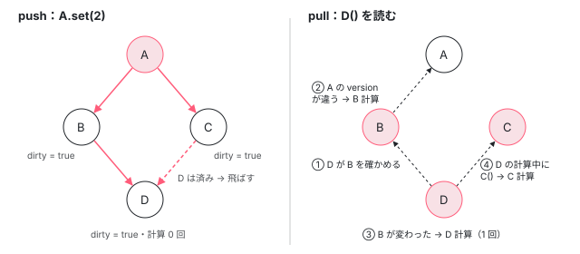

[目次](../README.md) › [Signal の内側](README.md) › 第 5 回 / 全 18 回

# push と pull：dirty を伝える producerNotifyConsumers と、version を見比べる consumerPollProducersForChange

> set は consumer に dirty を伝えるだけで値は計算しない（push）。読む側が producerUpdateValueVersion → consumerPollProducersForChange で「依存先の version が記録と違うか」を確かめてから再計算する（pull）。lastCleanEpoch で全体が変わっていなければ即答する近道、ひし形の依存（A → B, C → D）で D が 1 回しか計算されない（グリッチが出ない）理由、通知中の読み込みと effect の同期実行を禁じる inNotificationPhase。

angular/angular · 読了 約 14 分 · 発展 · [サイトで読む（デモが動きます）](https://angular-deep-dive-cyan.vercel.app/chapter/signals-push-pull)

---

`set` した瞬間に、下流の `computed` は計算し直されるのでしょうか。答えは「いいえ」です。この章では、書き込みの側が **「dirty（古くなったかもしれない）」という印だけを配る（push）**こと、読む側が **「依存先の version が、前に読んだときの記録と違うか」を確かめてから計算する（pull）**ことを、`producerNotifyConsumers`・`producerUpdateValueVersion`・`consumerPollProducersForChange` の 3 関数で 1 行ずつ追います。最後に、ひし形の依存（A → B, C → D）で D が 1 回しか計算されないことを、計算回数を数えて確かめます。

読む対象は `packages/core/primitives/signals/src/graph.ts`（グラフの本体）と `computed.ts`、`signal.ts`、それに通知中の検査を持つ `packages/core/src/render3/reactivity/effect.ts` です。

1. [1. 概観](01-signals.md)
2. [2. ReactiveNode の構造](02-signals-reactive-node.md)
3. [3. 依存の追跡](03-signals-tracking.md)
4. [4. set と update](04-signals-set.md)
5. **5. push と pull**（この章）
6. [6. computed](06-signals-computed.md)
7. [7. live と non-live](07-signals-live.md)
8. [8. linkedSignal](08-signals-linked-signal.md)
9. [9. effect のノードと寿命](09-signals-effect-node.md)
10. [10. afterRenderEffect](10-signals-after-render-effect.md)
11. [11. input と viewChild](11-authoring.md)
12. [12. input() とコンパイラ](12-signals-input-compile.md)
13. [13. model() と output()](13-signals-model-output.md)
14. [14. toSignal と toObservable](14-signals-rxjs-interop.md)
15. [15. resource](15-resource.md)
16. [16. httpResource と rxResource](16-signals-http-resource.md)
17. [17. Signal Forms](17-signal-forms.md)
18. [18. DevTools と signal グラフ](18-signals-debug.md)

## 1. 3 つのグローバル変数

📄 `angular/packages/core/primitives/signals/src/graph.ts` L13–26 （▶ の行: 18–19, 26）

```ts
13 │ /**
14 │  * The currently active consumer `ReactiveNode`, if running code in a reactive context.
15 │  *
16 │  * Change this via `setActiveConsumer`.
17 │  */
18 ▶ let activeConsumer: ReactiveNode | null = null;
19 ▶ let inNotificationPhase = false;
20 │ 
21 │ export type Version = number & {__brand: 'Version'};
22 │ 
23 │ /**
24 │  * Global epoch counter. Incremented whenever a source signal is set.
25 │  */
26 ▶ let epoch: Version = 1 as Version;
```

graph.ts の先頭にある 3 つの `let` が、この章の主役です。18 行目の `activeConsumer` は「いま計算中の consumer（依存を集めている側）」で、[第 3 回](03-signals-tracking.md)で読みました。19 行目の `inNotificationPhase` は「いま dirty の印を配っている最中か」。26 行目の `epoch` は、どれかの signal に新しい値が入るたびに 1 増える**アプリ全体で 1 つのカウンタ**です （増やすのは `signalValueChanged` が呼ぶ `producerIncrementEpoch`。[第 4 回](04-signals-set.md)）。

用語を 2 つ。**producer** は値を出す側（`signal`・`computed`）、**consumer** は値を読む側（`computed`・`effect`・テンプレート）です。`computed` は両方を兼ねます。どのノードも自分の値の **`version`**（値が変わるたびに増える番号）を持ち、consumer は「producer を最後に読んだときの version」をリンクの `lastReadVersion` に記録しています（[第 3 回](03-signals-tracking.md)）。push と pull は、この 2 つの番号を見比べる仕組みです。

## 2. push：set は dirty の印だけを配る

`set` は `signalSetFn` から始まります（詳しくは[第 4 回](04-signals-set.md)）。ここでは 1 か所だけ見ます。

📄 `angular/packages/core/primitives/signals/src/signal.ts` L86–95 （▶ の行: 91, 93）

```ts
86 │ export function signalSetFn<T>(node: SignalNode<T>, newValue: T) {
87 │   if (!producerUpdatesAllowed()) {
88 │     throwInvalidWriteToSignalError(node);
89 │   }
90 │ 
91 ▶   if (!node.equal(node.value, newValue)) {
92 │     node.value = newValue;
93 ▶     signalValueChanged(node);
94 │   }
95 │ }
```

91 行目、新しい値が今の値と `equal`（既定は `Object.is`）なら、何もせずに終わります。93 行目の `signalValueChanged` に進んだときだけ、version と epoch が増え、`producerNotifyConsumers` が呼ばれます。

📄 `angular/packages/core/primitives/signals/src/graph.ts` L339–360 （▶ の行: 340–341, 345–346, 349, 351, 354–355, 358–359）

```ts
339 │ export function producerNotifyConsumers(node: ReactiveNode): void {
340 ▶   if (node.consumers === undefined) {
341 ▶     return;
342 │   }
343 │ 
344 │   // Prevent signal reads when we're updating the graph
345 ▶   const prev = inNotificationPhase;
346 ▶   inNotificationPhase = true;
347 │   try {
348 │     for (
349 ▶       let link: ReactiveLink | undefined = node.consumers;
350 │       link !== undefined;
351 ▶       link = link.nextConsumer
352 │     ) {
353 │       const consumer = link.consumer;
354 ▶       if (!consumer.dirty) {
355 ▶         consumerMarkDirty(consumer);
356 │       }
357 │     }
358 ▶   } finally {
359 ▶     inNotificationPhase = prev;
360 │   }
```

1. **340〜341 行目：`consumers` が空なら即終了**

   `consumers` は「この producer を読んでいる **live な** consumer」のリストです（live の意味は[第 7 回](07-signals-live.md)）。effect にもテンプレートにも読まれていない signal なら、push は何もしません。
2. **345〜346 行目：`inNotificationPhase` を立てる**

   前の値を `prev` に取っておくので、入れ子で呼ばれても 359 行目で外側の値に戻せます。
3. **349〜351 行目：consumers の連結リストを先頭から順にたどる**

   リストの 1 要素は `ReactiveLink`（producer と consumer をつなぐ 1 本の辺）で、`nextConsumer` で次へ進みます。
4. **354〜355 行目：まだ dirty でない consumer だけ `consumerMarkDirty`**

   すでに dirty なら飛ばします。ひし形で D に 2 本の道から届いても、印を付けるのは 1 回です。
5. **358〜359 行目：`finally` でフラグを戻す**

📄 `angular/packages/core/primitives/signals/src/graph.ts` L371–380 （▶ の行: 372–374, 377–379）

```ts
371 │ export function consumerMarkDirty(node: ReactiveNode): void {
372 ▶   node.dirty = true;
373 ▶   producerNotifyConsumers(node);
374 ▶   node.consumerMarkedDirty?.(node);
375 │ }
376 │ 
377 ▶ export function producerMarkClean(node: ReactiveNode): void {
378 ▶   node.dirty = false;
379 ▶   node.lastCleanEpoch = epoch;
380 │ }
```

`consumerMarkDirty` がやることは 3 行です。372 行目で `dirty = true`、373 行目で**自分の consumers にも同じ通知を再帰的に送り**、374 行目でノードごとのフック `consumerMarkedDirty` を呼びます。フックの中身は種類ごとに違い、テンプレートなら `markAncestorsForTraversal`（[cd-signal-consumer](../cd/05-cd-signal-consumer.md)）、effect なら「後で実行する」予約です（[cd-effects](../cd/09-cd-effects.md)）。**どこにも `computation()` を呼ぶ行はありません。**push が配るのは `dirty` という 1 ビットだけです。

下の 377〜380 行目 `producerMarkClean` は pull の側で使います。`dirty` を下ろし、379 行目で「この epoch の時点で自分は最新だと確かめた」と `lastCleanEpoch` に書きます。

## 3. pull：読むときに確かめる

値を計算し直すのは、`computed` の getter が呼ばれたときです。

📄 `angular/packages/core/primitives/signals/src/computed.ts` L70–82 （▶ の行: 72, 75, 77–78）

```ts
70 │   const computed = () => {
71 │     // Check if the value needs updating before returning it.
72 ▶     producerUpdateValueVersion(node);
73 │ 
74 │     // Record that someone looked at this signal.
75 ▶     producerAccessed(node);
76 │ 
77 ▶     if (node.value === ERRORED) {
78 ▶       throw node.error;
79 │     }
80 │ 
81 │     return node.value;
82 │   };
```

順番に注意してください。72 行目で**まず自分を最新にし**（`producerUpdateValueVersion`）、そのあと 75 行目で「読まれた」と記録します（`producerAccessed`、[第 3 回](03-signals-tracking.md)）。77〜78 行目の `ERRORED` は[第 6 回](06-signals-computed.md)で読みます。

### (a) 計算しなくてよいと即答できる 2 つの近道

📄 `angular/packages/core/primitives/signals/src/graph.ts` L309–321 （▶ の行: 310–313, 316–320）

```ts
309 │ export function producerUpdateValueVersion(node: ReactiveNode): void {
310 ▶   if (consumerIsLive(node) && !node.dirty) {
311 ▶     // A live consumer will be marked dirty by producers, so a clean state means that its version
312 ▶     // is guaranteed to be up-to-date.
313 ▶     return;
314 │   }
315 │ 
316 ▶   if (!node.dirty && node.lastCleanEpoch === epoch) {
317 ▶     // Even non-live consumers can skip polling if they previously found themselves to be clean at
318 ▶     // the current epoch, since their dependencies could not possibly have changed (such a change
319 ▶     // would've increased the epoch).
320 ▶     return;
321 │   }
```

1. **310 行目：live で、dirty でない → 最新**

   live な consumer は、producer が変われば必ず push で dirty にされます（2 節）。dirty でないなら、何も変わっていません。311〜312 行目のコメントのとおりです。
2. **316 行目：dirty でなく、`lastCleanEpoch === epoch` → 最新**

   live でない consumer には push が届かないので、`dirty` は当てになりません。代わりに epoch を使います。前回「最新だ」と確かめた時点（379 行目で記録）から epoch が動いていなければ、アプリ中のどの signal にも書き込みが無かったということなので、依存先も変わっていません（317〜319 行目のコメント）。

### (b) 近道が使えないとき

📄 `angular/packages/core/primitives/signals/src/graph.ts` L323–334 （▶ の行: 323, 326–327, 330, 333）

```ts
323 ▶   if (!node.producerMustRecompute(node) && !consumerPollProducersForChange(node)) {
324 │     // None of our producers report a change since the last time they were read, so no
325 │     // recomputation of our value is necessary, and we can consider ourselves clean.
326 ▶     producerMarkClean(node);
327 ▶     return;
328 │   }
329 │ 
330 ▶   node.producerRecomputeValue(node);
331 │ 
332 │   // After recomputing the value, we're no longer dirty.
333 ▶   producerMarkClean(node);
334 │ }
```

323 行目に条件が 2 つあります。`producerMustRecompute(node)` は「依存とは関係なく計算が要るか」で、`computed` では「まだ一度も計算していない（`UNSET`）」ときに真です（[第 6 回](06-signals-computed.md)）。それが偽なら `consumerPollProducersForChange` で依存先を 1 つずつ確かめ、**どれも変わっていなければ 326 行目で clean にして、計算せずに帰ります**。どちらかが真なら 330 行目で `producerRecomputeValue`（computed なら `computation()` を呼ぶ）、333 行目で clean にします。

### (c) consumerPollProducersForChange：version を見比べる

📄 `angular/packages/core/primitives/signals/src/graph.ts` L474–495 （▶ の行: 474, 476, 480–481, 486, 490–491, 495）

```ts
474 ▶   for (let link = node.producers; link !== undefined; link = link.nextProducer) {
475 │     const producer = link.producer;
476 ▶     const seenVersion = link.lastReadVersion;
477 │ 
478 │     // First check the versions. A mismatch means that the producer's value is known to have
479 │     // changed since the last time we read it.
480 ▶     if (seenVersion !== producer.version) {
481 ▶       return true;
482 │     }
483 │ 
484 │     // The producer's version is the same as the last time we read it, but it might itself be
485 │     // stale. Force the producer to recompute its version (calculating a new value if necessary).
486 ▶     producerUpdateValueVersion(producer);
487 │ 
488 │     // Now when we do this check, `producer.version` is guaranteed to be up to date, so if the
489 │     // versions still match then it has not changed since the last time we read it.
490 ▶     if (seenVersion !== producer.version) {
491 ▶       return true;
492 │     }
493 │   }
494 │ 
495 ▶   return false;
```

1. **474 行目：自分の producers を、前回読んだ順にたどる**
2. **476・480 行目：記録した version と、producer の今の version を比べる**

   違えば 481 行目で即 `true`（変わった）。残りの producer は見ません。
3. **486 行目：同じでも、producer 自身が古いかもしれないので最新にさせる**

   producer が `computed` なら、その `version` はまだ前回の計算のままかもしれません。そこで producer に対して `producerUpdateValueVersion` を**再帰的に**呼びます。ここで上流から順に計算が進みます。
4. **490 行目：最新になった version でもう一度比べる**

   producer が計算し直しても、結果が前と `equal` なら version は増えません（computed.ts の再計算、[第 6 回](06-signals-computed.md)）。そのときはここも一致し、次の producer へ進みます。
5. **495 行目：全部一致すれば `false`（変わっていない）**

## 4. ひし形 A → B, C → D

B と C が A を読み、D が B と C を読む形を考えます。D を effect が読んでいる（つまり D・B・C が live）とします。



*左が push（A.set）。dirty の印が下へ配られるが、値は計算されない。D は B からの道で dirty になり、C からの道では 354 行目で飛ばされる。右が pull（D を読む）。D が B、B が A の version を見比べ、上流から順に 1 回ずつ計算する。*

push の側（左）は 2 節のとおりです。A の consumers は B と C、B と C の consumers は D。D は B からの通知で dirty になり、C からの通知は 354 行目の `!consumer.dirty` で飛ばされます。この時点で計算は 0 回です。

pull の側（右）を、呼び出しの連なりで追います。

- 👤 `d()` — 利用者のコード（テンプレートや effect の関数の中） — *computed.ts 72 行目へ*
  - `producerUpdateValueVersion(D)` — graph.ts — *D は dirty なので 310・316 行目の近道は使えない*
    - `consumerPollProducersForChange(D)` — graph.ts — *最初の producer は B。476・480 行目で version は一致（B はまだ計算していない）*
      - `producerUpdateValueVersion(B)` — graph.ts 486 行目から — *B も dirty*
        - `consumerPollProducersForChange(B)` — graph.ts — *A の version が記録と違う → 481 行目で true*
        - `producerRecomputeValue(B)` — graph.ts 330 行目 — *B の computation が 1 回走る。値が変われば B.version++*
        - `producerMarkClean(B)` — graph.ts 333 行目
    - `seenVersion !== B.version` — graph.ts 490 行目 — *true を返す。C はここでは見ない*
  - `producerRecomputeValue(D)` — graph.ts 330 行目 — *D の computation が走る*
    - `b()` — D の computation の中 — *B は live で clean → 310 行目で即 return。計算しない*
    - `c()` — D の computation の中 — *C は dirty → poll で A の変化を見つけ、C の computation が 1 回走る*
  - `producerMarkClean(D)` — graph.ts 333 行目
- `producerAccessed(D)` — computed.ts 75 行目 — *読んだことを記録して値を返す*

B・C・D はそれぞれ 1 回ずつ計算されます。そして D の computation が C を読んだとき、C の getter は 72 行目で**まず自分を最新にしてから**値を返します。だから D が「新しい B と古い C」の組み合わせで計算されることはありません。この「途中の状態が一瞬見えてしまう」現象を**グリッチ**と呼びます。値を push で配る仕組みだと、B の新しい値が D に届いた時点で C がまだ古い、ということが起きえます。Angular の signal は push で値を配らないので、構造的に起きません。

> [!NOTE]
> **ポイント**
>
> D を誰も live に読んでいない（普通のコードで `d()` と呼ぶだけ）なら、A の consumers は空なので 340 行目で push は何もしません。`dirty` も立ちません。それでも D を読むと 316 行目の近道は外れます（`set` で epoch が増えたため）。そこから先は上の trace と同じです。つまり **live なら dirty が、non-live なら epoch が「確かめる必要がある」合図**になります。

## 5. 通知中は読めない：inNotificationPhase

📄 `angular/packages/core/primitives/signals/src/graph.ts` L212–219 （▶ の行: 213–214, 216）

```ts
212 │ export function producerAccessed(node: ReactiveNode): void {
213 ▶   if (inNotificationPhase) {
214 ▶     throw new Error(
215 │       typeof ngDevMode !== 'undefined' && ngDevMode
216 ▶         ? `Assertion error: signal read during notification phase`
217 │         : '',
218 │     );
219 │   }
```

213 行目、`producerAccessed`（signal や computed を読むたびに呼ばれる）は、`inNotificationPhase` が立っていたら投げます。216 行目のメッセージは開発ビルドだけで、「signal read during notification phase」。NG コードの付かない素の `Error` です。push の最中（`consumerMarkedDirty` フックの中）で値を読もうとすると、ここで止まります。push の途中で値を計算することは、そもそもできない作りです。

📄 `angular/packages/core/primitives/signals/src/graph.ts` L48–54 （▶ の行: 52–53）

```ts
48 │ export function getActiveConsumer(): ReactiveNode | null {
49 │   return activeConsumer;
50 │ }
51 │ 
52 ▶ export function isInNotificationPhase(): boolean {
53 ▶   return inNotificationPhase;
54 │ }
```

52〜53 行目の `isInNotificationPhase` は外から状態を聞くための関数です。`packages/` を grep すると、呼んでいるのは core の effect と primitives の `watch.ts` です。

📄 `angular/packages/core/src/render3/reactivity/effect.ts` L222–227 （▶ の行: 224–225）

```ts
222 │     onDestroyFns: null,
223 │     run(this: EffectNode): void {
224 ▶       if (ngDevMode && isInNotificationPhase()) {
225 ▶         throw new Error(`Schedulers cannot synchronously execute watches while scheduling.`);
226 │       }
227 │       // We clear `setIsRefreshingViews` so that `markForCheck()` within the body of an effect will
```

224〜225 行目、effect の `run` は開発ビルドで「通知中に同期的に実行しようとした」ことを検出して投げます。`consumerMarkedDirty` のフックは「予約するだけ」にして、実行は後で、という約束をここで守らせています。

一方、**書き込み**については graph.ts は何も検査しません。`signalSetFn`（2 節の 86〜95 行目）に `inNotificationPhase` を見る行は無く、通知の中から `set` されると `producerNotifyConsumers` が入れ子で呼ばれ、345 行目で取った `prev` を 359 行目で戻すだけです。

## 6. DEMO：計算回数を数える

> **🧪 DEMO — B = A の偶奇、C = A の符号、D = B と C をつなげた文字列**
>
> A の初期値は 1。どの computed も計算するたびに回数を 1 増やします。A〜D はテンプレートからは読んでいない（non-live）ので、表は操作のたびに取ったスナップショットです。各行は「その操作の間に何回計算されたか」です。
>
> ▶ [このデモはサイトで動かせます](https://angular-deep-dive-cyan.vercel.app/chapter/signals-push-pull)

試す順番と、期待する結果です。

1. **「A を +1」→ 計算は 0・0・0**

   `set` だけでは何も計算されません（2 節）。D は誰にも live に読まれていないので、dirty の印すら配られていません（340 行目）。
2. **「D() を読む」→ 1・1・1**

   4 節の trace です。D は 1 回だけ。
3. **「A に同じ値を set」→「D() を読む」→ 0・0・0**

   signal.ts 91 行目で止まり、A の version は増えません。表を更新するために別の signal（表の行）に書いているので epoch は動き、316 行目の近道は外れますが、poll が全部一致して 326 行目で clean になり、計算は 0 回です。
4. **「A を +2」→「D() を読む」→ 1・1・0**

   A は変わったので B と C は計算し直されますが、偶奇も符号も同じなので結果は `equal`、B と C の version は増えません。D の poll は 490 行目で B も C も一致し、D の computation は呼ばれません。

## 聞かれそうな質問

**Q. なぜ set のときに値まで計算してしまわないのですか？**

理由は 2 つあります。1 つ目は、読まれない computed を計算しないためです。`set` から辿れるのは live な consumer だけ（340 行目）で、しかも `consumerMarkDirty`（372〜374 行目）は印を付けるだけです。実際に計算するのは、誰かが getter を呼んで 330 行目に来たときだけです（DEMO の「A を +1」が 0 回）。2 つ目は、計算しようとしてもできないからです。通知の間は `inNotificationPhase` が立っていて、213 行目で signal を読むこと自体が禁止されています。

**Q. グリッチとは何で、なぜ起きないのですか？**

ひし形 A → B, C → D で A が変わったとき、D が「新しい B と古い C」で一度計算されてしまう現象です。Angular では D が C を読むとき、C の getter が computed.ts 72 行目でまず `producerUpdateValueVersion(C)` を呼び、C を最新にしてから値を返します。値は pull でしか作られず、pull は必ず上流から最新にするので、D から古い C が見えることはありません。

**Q. 通知の最中に signal を set するとどうなりますか？**

graph.ts は書き込みを止めません。`signalSetFn` は `inNotificationPhase` を見ないので、そのまま `producerNotifyConsumers` が入れ子で走り、345 行目で取った前の値を 359 行目で戻します。止められるのは**読み込み**（213 行目）と、effect の同期実行（effect.ts 224 行目、開発ビルドのみ）です。Angular 自身の `consumerMarkedDirty` は印付けと予約だけをするので、通常のアプリでこの区間にユーザーのコードが走ることはありません。

**Q. lastCleanEpoch の近道は、どんなときに効きますか？**

non-live の computed を、間に一度も `set`（値が変わる書き込み）を挟まずに何度も読むときです。316 行目で `lastCleanEpoch === epoch` なら、poll せずに即 return します。epoch はアプリ全体で 1 つなので、無関係な signal への書き込みでも近道は外れます。その場合も 474〜495 行目の poll で version が一致するので、計算はされません。

**Q. poll は依存先を全部調べるのですか？**

いいえ。481 行目または 491 行目で、変わった producer が 1 つ見つかった時点で `true` を返して打ち切ります。残りの producer は、consumer の computation が読み直すときに、それぞれの getter（computed.ts 72 行目）が最新にします。trace で C が D の computation の中で計算されたのはこのためです。

## 読み終えて

- push（`producerNotifyConsumers` → `consumerMarkDirty`）は live な consumer に `dirty = true` を配るだけ。値は計算しない
- pull（`producerUpdateValueVersion`）は 2 つの近道（310 行目の live かつ clean、316 行目の `lastCleanEpoch === epoch`）を試し、だめなら `consumerPollProducersForChange`
- poll は「記録した version と今の version」を比べ、同じなら producer を再帰的に最新にしてもう一度比べる。`equal` で version が進まなければ下流は計算されない
- ひし形でも各ノードは 1 回だけ計算され、getter が先に自分を最新にするのでグリッチは出ない
- `inNotificationPhase` が禁止するのは通知中の**読み込み**（213 行目）と effect の同期実行。書き込みは禁止していない

---

← 前: [set と update：equal・version・epoch、そして NG0600 で書き込みを止める場所](04-signals-set.md)  
次: [computed の内側：UNSET・COMPUTING・ERRORED と、遅延評価とメモ化](06-signals-computed.md) →
