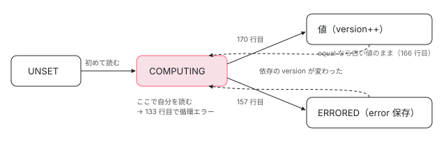

[目次](../README.md) › [Signal の内側](README.md) › 第 6 回 / 全 18 回

# computed の内側：UNSET・COMPUTING・ERRORED と、遅延評価とメモ化

> COMPUTED\_NODE の producerMustRecompute と producerRecomputeValue を 1 行ずつ読む。初回は UNSET、計算中は COMPUTING にして自分を読んだら「Detected cycle in computations.」（コード無しの Error）、例外は ERRORED としてキャッシュして次に読んだ人にも投げる、新しい値が equal なら version を進めない（下流の再計算が止まる）。読まれない computed は計算されないことをデモで確かめる。

angular/angular · 読了 約 14 分 · 中核 · [サイトで読む（デモが動きます）](https://angular-deep-dive-cyan.vercel.app/chapter/signals-computed)

---

`computed` は「読まれるまで計算しない（遅延評価）」「一度計算した値を覚えておく（メモ化）」と説明されます。この章では、それが `COMPUTED_NODE` の 2 つのメソッド `producerMustRecompute` と `producerRecomputeValue` の何行目で実現されているかを読みます。`value` に入る 3 つの目印 `UNSET`・`COMPUTING`・`ERRORED` が、初回の計算・循環の検出・例外のキャッシュをそれぞれ受け持っています。

読む対象は `packages/core/primitives/signals/src/computed.ts`（174 行で全部）、`equality.ts`、そして公開 API の `computed()` を定義する `packages/core/src/render3/reactivity/computed.ts` です。

1. [1. 概観](01-signals.md)
2. [2. ReactiveNode の構造](02-signals-reactive-node.md)
3. [3. 依存の追跡](03-signals-tracking.md)
4. [4. set と update](04-signals-set.md)
5. [5. push と pull](05-signals-push-pull.md)
6. **6. computed**（この章）
7. [7. live と non-live](07-signals-live.md)
8. [8. linkedSignal](08-signals-linked-signal.md)
9. [9. effect のノードと寿命](09-signals-effect-node.md)
10. [10. afterRenderEffect](10-signals-after-render-effect.md)
11. [11. input と viewChild](11-authoring.md)
12. [12. input() とコンパイラ](12-signals-input-compile.md)
13. [13. model() と output()](13-signals-model-output.md)
14. [14. toSignal と toObservable](14-signals-rxjs-interop.md)
15. [15. resource](15-resource.md)
16. [16. httpResource と rxResource](16-signals-http-resource.md)
17. [17. Signal Forms](17-signal-forms.md)
18. [18. DevTools と signal グラフ](18-signals-debug.md)

## 1. 公開 API の computed() は薄い包み

📄 `angular/packages/core/src/render3/reactivity/computed.ts` L28–42 （▶ の行: 33, 35, 37–38, 41）

```ts
28 │ /**
29 │  * Create a computed `Signal` which derives a reactive value from an expression.
30 │  * @see [Computed signals](guide/signals#computed-signals)
31 │  */
32 │ export function computed<T>(computation: () => T, options?: CreateComputedOptions<T>): Signal<T> {
33 ▶   const getter = createComputed(computation, options?.equal);
34 │ 
35 ▶   if (typeof ngDevMode !== 'undefined' && ngDevMode) {
36 │     const debugName = options?.debugName;
37 ▶     getter[SIGNAL].debugName = debugName;
38 ▶     getter.toString = () => `[Computed${debugName ? ' (' + debugName + ')' : ''}: ${getter()}]`;
39 │   }
40 │ 
41 ▶   return getter;
42 │ }
```

アプリが `import { computed } from '@angular/core'` で使う関数はこれだけです。33 行目で primitives の `createComputed` に計算関数と `equal` を渡し、41 行目で返ってきた getter をそのまま返します。35〜38 行目は開発ビルドだけで、37 行目で `debugName` をノードに付け、38 行目で `toString` を差し替えます。

> [!WARNING]
> **ハマりどころ**
>
> 38 行目の `toString` は `getter()` を呼びます。開発ビルドでは、`computed` を文字列に連結したりテンプレートリテラルに埋め込んだりするだけで**計算が走ります**。「読まれない computed は計算されない」を確かめるときは、ログに getter そのものを文字列として出さないようにします。

## 2. ComputedNode の形と createComputed

📄 `angular/packages/core/primitives/signals/src/computed.ts` L26–54 （▶ の行: 31, 33–34, 36, 42, 47, 49, 52–53）

```ts
26 │ /**
27 │  * A computation, which derives a value from a declarative reactive expression.
28 │  *
29 │  * `Computed`s are both producers and consumers of reactivity.
30 │  */
31 ▶ export interface ComputedNode<T> extends ReactiveNode {
32 │   /**
33 ▶    * Current value of the computation, or one of the sentinel values above (`UNSET`, `COMPUTING`,
34 ▶    * `ERROR`).
35 │    */
36 ▶   value: T;
37 │ 
38 │   /**
39 │    * If `value` is `ERRORED`, the error caught from the last computation attempt which will
40 │    * be re-thrown.
41 │    */
42 ▶   error: unknown;
43 │ 
44 │   /**
45 │    * The computation function which will produce a new value.
46 │    */
47 ▶   computation: () => T;
48 │ 
49 ▶   equal: ValueEqualityFn<T>;
50 │ }
51 │ 
52 ▶ export type ComputedGetter<T> = (() => T) & {
53 ▶   [SIGNAL]: ComputedNode<T>;
54 │ };
```

31 行目、`ComputedNode` は `ReactiveNode`（[第 2 回](02-signals-reactive-node.md)）に 4 つのフィールドを足したものです。36 行目の `value` は計算結果、または 33〜34 行目のコメントにある目印のどれか。42 行目の `error` は最後に捕まえた例外。47 行目の `computation` が利用者の関数、49 行目の `equal` が「同じ値か」を決める関数です。52〜53 行目、getter は関数に `[SIGNAL]` でノードをぶら下げた型です。

📄 `angular/packages/core/primitives/signals/src/computed.ts` L56–93 （▶ の行: 63–64, 66–68, 70, 72, 75, 77–78, 81–82, 84, 90）

```ts
56 │ /**
57 │  * Create a computed signal which derives a reactive value from an expression.
58 │  */
59 │ export function createComputed<T>(
60 │   computation: () => T,
61 │   equal?: ValueEqualityFn<T>,
62 │ ): ComputedGetter<T> {
63 ▶   const node: ComputedNode<T> = Object.create(COMPUTED_NODE);
64 ▶   node.computation = computation;
65 │ 
66 ▶   if (equal !== undefined) {
67 ▶     node.equal = equal;
68 ▶   }
69 │ 
70 ▶   const computed = () => {
71 │     // Check if the value needs updating before returning it.
72 ▶     producerUpdateValueVersion(node);
73 │ 
74 │     // Record that someone looked at this signal.
75 ▶     producerAccessed(node);
76 │ 
77 ▶     if (node.value === ERRORED) {
78 ▶       throw node.error;
79 │     }
80 │ 
81 ▶     return node.value;
82 ▶   };
83 │ 
84 ▶   (computed as ComputedGetter<T>)[SIGNAL] = node;
85 │   if (typeof ngDevMode !== 'undefined' && ngDevMode) {
86 │     computed.toString = () =>
87 │       `[Computed${node.debugName ? ' (' + node.debugName + ')' : ''}: ${String(node.value)}]`;
88 │   }
89 │ 
90 ▶   runPostProducerCreatedFn(node);
91 │ 
92 │   return computed as unknown as ComputedGetter<T>;
93 │ }
```

1. **63 行目：`Object.create(COMPUTED_NODE)`**

   `COMPUTED_NODE`（3 節）をプロトタイプにした空のオブジェクトを作ります。`value` や `dirty` の初期値はプロトタイプから読まれ、書き込んだときに初めて自分のプロパティになります。
2. **64〜68 行目：計算関数と、指定があれば `equal` を入れる**

   **ここでは `computation` を呼びません。**作っただけでは何も計算されないのは、この関数に呼ぶ行が無いからです。
3. **70〜82 行目：getter を作る**

   72 行目で自分を最新にし（`producerUpdateValueVersion`、[第 5 回](05-signals-push-pull.md)）、75 行目で読まれたことを記録し（[第 3 回](03-signals-tracking.md)）、77〜78 行目で値が `ERRORED` なら保存しておいた `error` を投げ、81 行目で値を返します。
4. **84 行目：getter に `[SIGNAL]` でノードを付ける**

   90 行目の `runPostProducerCreatedFn` は、DevTools 用のフック（[第 18 回](18-signals-debug.md)）が設定されていれば呼ばれます。

## 3. COMPUTED\_NODE：初期値と producerMustRecompute

📄 `angular/packages/core/primitives/signals/src/computed.ts` L115–131 （▶ の行: 117, 119–123, 129）

```ts
115 │ // Note: Using an IIFE here to ensure that the spread assignment is not considered
116 │ // a side-effect, ending up preserving `COMPUTED_NODE` and `REACTIVE_NODE`.
117 ▶ const COMPUTED_NODE: Omit<ComputedNode<unknown>, 'computation'> = /* @__PURE__ */ (() => {
118 │   return {
119 ▶     ...REACTIVE_NODE,
120 ▶     value: UNSET,
121 ▶     dirty: true,
122 ▶     error: null,
123 ▶     equal: defaultEquals,
124 │     kind: 'computed',
125 │ 
126 │     producerMustRecompute(node: ComputedNode<unknown>): boolean {
127 │       // Force a recomputation if there's no current value, or if the current value is in the
128 │       // process of being calculated (which should throw an error).
129 ▶       return node.value === UNSET || node.value === COMPUTING;
130 │     },
131 │ 
```

119 行目で `REACTIVE_NODE` の既定値を全部コピーし、120〜124 行目で上書きします。120 行目、`value` の初期値は `UNSET`。`UNSET`・`COMPUTING`・`ERRORED` は、同じファイルで `Symbol('UNSET')` のように作られた**番兵**（利用者の値と絶対に一致しない目印の値）です。121 行目で `dirty: true`、123 行目で `equal` の既定は `defaultEquals`（下の equality.ts）。

129 行目が `producerMustRecompute` の全部です。**値が `UNSET`（まだ一度も計算していない）か `COMPUTING`（計算中）なら、依存を見るまでもなく計算が要る**。第 5 回で読んだ `producerUpdateValueVersion` は、この関数が真なら依存の poll を飛ばして再計算へ進みます。`ERRORED` はここに含まれていません。この違いが 6 節の「例外のキャッシュ」になります。

📄 `angular/packages/core/primitives/signals/src/equality.ts` L9–19 （▶ の行: 17–18）

```ts
 9 │ /**
10 │  * A comparison function which can determine if two values are equal.
11 │  */
12 │ export type ValueEqualityFn<T> = (a: T, b: T) => boolean;
13 │ 
14 │ /**
15 │  * The default equality function used for `signal` and `computed`, which uses referential equality.
16 │  */
17 ▶ export function defaultEquals<T>(a: T, b: T) {
18 ▶   return Object.is(a, b);
19 │ }
```

17〜18 行目、既定の比較は `Object.is`。配列やオブジェクトを毎回新しく作って返す computed は、中身が同じでも「違う値」と判定されます。

## 4. producerRecomputeValue：計算の 1 回

📄 `angular/packages/core/primitives/signals/src/computed.ts` L132–142 （▶ の行: 133, 135–137, 140–141）

```ts
132 │     producerRecomputeValue(node: ComputedNode<unknown>): void {
133 ▶       if (node.value === COMPUTING) {
134 │         // Our computation somehow led to a cyclic read of itself.
135 ▶         throw new Error(
136 ▶           typeof ngDevMode !== 'undefined' && ngDevMode ? 'Detected cycle in computations.' : '',
137 ▶         );
138 │       }
139 │ 
140 ▶       const oldValue = node.value;
141 ▶       node.value = COMPUTING;
142 │ 
```

📄 `angular/packages/core/primitives/signals/src/computed.ts` L143–172 （▶ の行: 143, 147–160, 163–167, 170–171）

```ts
143 ▶       const prevConsumer = consumerBeforeComputation(node);
144 │       let newValue: unknown;
145 │       let wasEqual = false;
146 │       try {
147 ▶         newValue = node.computation();
148 ▶         // We want to mark this node as errored if calling `equal` throws; however, we don't want
149 ▶         // to track any reactive reads inside `equal`.
150 ▶         setActiveConsumer(null);
151 ▶         wasEqual =
152 ▶           oldValue !== UNSET &&
153 ▶           oldValue !== ERRORED &&
154 ▶           newValue !== ERRORED &&
155 ▶           node.equal(oldValue, newValue);
156 ▶       } catch (err) {
157 ▶         newValue = ERRORED;
158 ▶         node.error = err;
159 ▶       } finally {
160 ▶         consumerAfterComputation(node, prevConsumer);
161 │       }
162 │ 
163 ▶       if (wasEqual) {
164 ▶         // No change to `valueVersion` - old and new values are
165 ▶         // semantically equivalent.
166 ▶         node.value = oldValue;
167 ▶         return;
168 │       }
169 │ 
170 ▶       node.value = newValue;
171 ▶       node.version++;
172 │     },
```

1. **133 行目：値が `COMPUTING` なら循環**

   自分の計算の途中でもう一度ここに来た、つまり自分を（直接か間接に）読んだということです。135〜137 行目で投げます（5 節）。
2. **140〜141 行目：古い値を退避し、`COMPUTING` にする**

   141 行目が、次に 133 行目で循環を見つけるための印です。
3. **143 行目：`consumerBeforeComputation(node)`**

   自分を `activeConsumer` にします。この間に読まれた signal が依存として記録されます（[第 3 回](03-signals-tracking.md)）。
4. **147 行目：利用者の `computation()` を呼ぶ**

   computed の計算関数が実際に走るのは、ソース全体でこの 1 行だけです。
5. **150〜155 行目：依存の記録を止めてから `equal` で比べる**

   150 行目で `activeConsumer` を `null` にするので、`equal` の中で signal を読んでも依存になりません（148〜149 行目のコメント）。152〜154 行目、古い値が `UNSET` か `ERRORED`、または新しい値が `ERRORED` なら比べずに「違う」とします。`equal` も `try` の中なので、`equal` が投げた例外も次のステップで捕まります。
6. **156〜158 行目：例外なら新しい値を `ERRORED` に、`error` に例外を保存**

   例外はここで捕まえて、getter には投げ返しません。投げ返すのは getter の 77〜78 行目です。
7. **159〜160 行目：`finally` で `activeConsumer` を戻し、依存リストを確定する**

   `consumerAfterComputation` は今回読まれなかった古い依存を外します（[第 3 回](03-signals-tracking.md)）。
8. **163〜167 行目：`equal` なら古い値に戻して return。version は増やさない**

   164〜165 行目のコメントのとおり「意味として同じ値」なので、`version` はそのまま。下流の consumer の poll は version が一致して、計算し直しません（[第 5 回](05-signals-push-pull.md) 3 節）。
9. **170〜171 行目：新しい値（または `ERRORED`）を入れて `version++`**



*value の状態の移り変わり。UNSET と COMPUTING は producerMustRecompute（129 行目）で「必ず計算」、値と ERRORED は依存が変わったときだけ計算し直す。*

## 5. 循環：Detected cycle in computations.

`const self = computed(() => self() + 1)` を初めて読んだときを、1 ステップずつ追います。

1. **getter 72 行目 → 第 5 回の `producerUpdateValueVersion`**

   129 行目で `UNSET` なので、141 行目で `COMPUTING` にして 147 行目で計算関数を呼びます。
2. **計算関数の中で `self()` → また 72 行目**

   今度は値が `COMPUTING` なので、129 行目でやはり「計算が要る」となり、もう一度 `producerRecomputeValue` に入ります。
3. **133 行目で `COMPUTING` を見つけて 135 行目で投げる**

   開発ビルドでは 136 行目のメッセージ `'Detected cycle in computations.'`、本番ビルドでは空文字です。`RuntimeError` ではないので **NG コードはありません**。
4. **例外は外側の計算の 156 行目で捕まり、`ERRORED` として保存される**

   外側の `producerRecomputeValue` から見ると、自分の計算関数が投げたのと同じです。157〜158 行目、170〜171 行目と進みます。
5. **getter の 77〜78 行目で、保存した循環エラーを投げる**

   利用者が受け取るのは、この 78 行目から投げられたものです。計算関数が走ったのは 1 回だけです（2 回目の `self()` は 147 行目に届く前に 133 行目で止まるため）。

## 6. 例外のキャッシュ

計算関数が投げると、156〜158 行目で `value = ERRORED`、`error = 例外` になります。次に同じ computed を読んだときの流れはこうです。

1. **近道か poll で「変わっていない」とわかる**

   `producerMustRecompute`（129 行目）は `ERRORED` では偽です。だから第 5 回の近道（epoch が同じ）か、依存の poll（version が同じ）で「最新」と判定され、**計算関数は呼ばれません**。
2. **getter の 77〜78 行目で、前回と同じ `node.error` を投げる**

   新しい `Error` を作るのではなく、保存しておいた同じオブジェクトです。
3. **依存が変われば計算し直す**

   poll で version の違いが見つかれば 147 行目に進みます。今度は成功すれば、152 行目の `oldValue !== ERRORED` により比べずに「違う」とされ、170〜171 行目で新しい値と `version++` になります。

## 7. DEMO

> **🧪 DEMO (1) — 読まれない computed は計算されない**
>
> `lazy = computed(() => lazySrc() * 2)`。「計算回数」は computation が呼ばれた累計です。
>
> ▶ [このデモはサイトで動かせます](https://angular-deep-dive-cyan.vercel.app/chapter/signals-computed)

開いた直後は 0 回です（63〜68 行目は計算しない）。「lazy() を読む」で 1 回、もう一度押しても 1 回のまま（第 5 回の近道か poll で最新と判定）。「lazySrc を +1」しても増えず、その後に読んだときに初めて 2 回になります。

> **🧪 DEMO (2) — 例外を投げる computed を 2 回読む**
>
> `boom = computed(() => { const v = boomSrc(); if (v < 0) throw new Error(...); return v * 10; })`。boomSrc の初期値は -1。例外は `try/catch` で捕まえて表示しています。
>
> ▶ [このデモはサイトで動かせます](https://angular-deep-dive-cyan.vercel.app/chapter/signals-computed)

1 回目の「2 回読む」で計算回数は 1、2 回とも同じ Error オブジェクト（`true`）です。もう一度押しても 1 のまま。「boomSrc を 5 に」してから読むと 2 回目の計算が走って `50`。-1 に戻して読むと 3 回目の計算で、新しい Error が保存されます。

> **🧪 DEMO (3) — 自分自身を読む computed**
>
> `self = computed(() => self() + 1)`。このサイトの本番ビルドでは `ngDevMode` が偽なので、136 行目のとおりメッセージは空文字になります。
>
> ▶ [このデモはサイトで動かせます](https://angular-deep-dive-cyan.vercel.app/chapter/signals-computed)

計算回数は 1。5 節のとおり、内側の `self()` は 133 行目で止まるので計算関数は 2 回目を呼ばれず、2 回目の読み込みは 6 節のキャッシュです。

## 聞かれそうな質問

**Q. computed は値をキャッシュしますか？いつ捨てますか？**

します。キャッシュはノードの `value` フィールドそのものです（36 行目）。書き換えるのは `producerRecomputeValue` の 166 行目と 170 行目だけで、そこに来るのは依存の version が変わったとき（第 5 回の poll）か、`UNSET` のとき（129 行目）だけです。時間で消えることはありません。捨てられるのは、computed のノード自体が誰からも参照されなくなって GC されるときです。non-live の computed は producer から参照されないので、getter を手放せば回収されます（[第 7 回](07-signals-live.md)）。

**Q. computed の中で例外が出たら、次に読んだときはどうなりますか？**

156〜158 行目で `ERRORED` と例外が保存され、依存が変わるまでは計算し直さずに、getter の 78 行目で同じ例外オブジェクトを投げ続けます（DEMO (2)）。`ERRORED` は 129 行目の「必ず計算」の条件に入っていないからです。依存が変われば 147 行目からやり直します。

**Q. computed の中で signal を set できないのはなぜですか？**

143 行目で computed のノードが `activeConsumer` になり、そのノードの `consumerAllowSignalWrites` が `false` だからです。`COMPUTED_NODE` は 119 行目で `REACTIVE_NODE` の既定値（`consumerAllowSignalWrites: false`）をコピーし、上書きしていません。`set` はまず `producerUpdatesAllowed()` でこれを確かめて投げます（NG0600。[第 4 回](04-signals-set.md)）。

**Q. equal を指定すると何が変わりますか？**

151〜155 行目で古い値と新しい値を比べる関数が変わります。真を返すと 166 行目で古い値（参照も古いまま）を残し、`version` を増やしません。その computed を読む下流は、第 5 回の poll で version が一致するので計算し直しません。配列を返す computed に「中身が同じなら等しい」比較を渡すと、下流の再計算を止められます。

**Q. 循環のエラーに NG コードが無いのはなぜですか？**

135 行目が素の `new Error(...)` だからです。primitives のパッケージは Angular の `RuntimeError` に依存していません。メッセージも 136 行目で `ngDevMode` のときだけ付くので、本番ビルドでは空の `Error` です（DEMO (3)）。

## 読み終えて

- `createComputed`（63〜68 行目）は計算しない。計算関数を呼ぶのは 147 行目の 1 か所だけで、getter の 72 行目から辿り着く
- `producerMustRecompute` は `UNSET` と `COMPUTING` のときだけ真（129 行目）。それ以外は依存の version しだい
- 計算中は `COMPUTING`（141 行目）。そこで自分を読むと 133 行目で循環エラー（NG コード無し、本番はメッセージ空）
- 例外は `ERRORED` と `error` に保存され（156〜158 行目）、依存が変わるまで getter が同じ例外を投げ続ける
- `equal` が真なら古い値を残して version を進めない（163〜167 行目）。下流の再計算が止まる

---

← 前: [push と pull：dirty を伝える producerNotifyConsumers と、version を見比べる consumerPollProducersForChange](05-signals-push-pull.md)  
次: [live な consumer と non-live：リンクの張り方の違いと、メモリが解放される理由](07-signals-live.md) →
