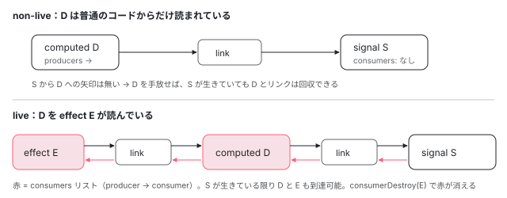

[目次](../README.md) › [Signal の内側](README.md) › 第 7 回 / 全 18 回

# live な consumer と non-live：リンクの張り方の違いと、メモリが解放される理由

> consumer には live（effect やテンプレートのように常に通知を受けたいもの）と non-live（読まれたときだけ計算する computed）がある。producerAddLiveConsumer が producer の consumers リストにリンクを足し、自分の producers にも再帰的に live を広げる行、consumerIsLive の判定、最後の live consumer が外れたとき producerRemoveLiveConsumerLink がリンクを切る行、consumerDestroy。non-live の computed は producer から参照されないので GC される。

angular/angular · 読了 約 14 分 · 発展 · [サイトで読む（デモが動きます）](https://angular-deep-dive-cyan.vercel.app/chapter/signals-live)

---

signal グラフの辺（リンク）には 2 つの張り方があります。**consumer から producer へだけ**たどれる片方向のリンク（non-live）と、**producer からも consumer へ**たどれる双方向のリンク（live）です。この章では、live なリンクを足す `producerAddLiveConsumer` と外す `producerRemoveLiveConsumerLink`、そして `consumerDestroy` を 1 行ずつ読み、「computed を作りっぱなしにしてもメモリが解放される」理由と「effect を破棄しないと残るもの」をソースで説明できるようにします。

読む対象は `packages/core/primitives/signals/src/graph.ts` と `weak_ref.ts`、effect の破棄を持つ `packages/core/src/render3/reactivity/effect.ts` と `render3/node_manipulation.ts`、それに GC を確かめるテスト `packages/core/test/signals/signal_graph_leak_spec.ts` です。

1. [1. 概観](01-signals.md)
2. [2. ReactiveNode の構造](02-signals-reactive-node.md)
3. [3. 依存の追跡](03-signals-tracking.md)
4. [4. set と update](04-signals-set.md)
5. [5. push と pull](05-signals-push-pull.md)
6. [6. computed](06-signals-computed.md)
7. **7. live と non-live**（この章）
8. [8. linkedSignal](08-signals-linked-signal.md)
9. [9. effect のノードと寿命](09-signals-effect-node.md)
10. [10. afterRenderEffect](10-signals-after-render-effect.md)
11. [11. input と viewChild](11-authoring.md)
12. [12. input() とコンパイラ](12-signals-input-compile.md)
13. [13. model() と output()](13-signals-model-output.md)
14. [14. toSignal と toObservable](14-signals-rxjs-interop.md)
15. [15. resource](15-resource.md)
16. [16. httpResource と rxResource](16-signals-http-resource.md)
17. [17. Signal Forms](17-signal-forms.md)
18. [18. DevTools と signal グラフ](18-signals-debug.md)

## 1. 1 本のリンクは 2 つのリストに属する

📄 `angular/packages/core/primitives/signals/src/graph.ts` L82–96 （▶ の行: 83–84, 93–95）

```ts
82 │ interface ReactiveLink {
83 ▶   producer: ReactiveNode;
84 ▶   consumer: ReactiveNode;
85 │ 
86 │   /**
87 │    * Stores the epoch that holds when this link was observed, allowing subsequent observations of the same producer to
88 │    * realize that there's an existing link, avoiding the creation of a new, redundant link. A value of `null` indicates
89 │    * that the link cannot be assumed to be valid based on the epoch counter.
90 │    */
91 │   knownValidAtEpoch: Version | null;
92 │   lastReadVersion: number;
93 ▶   prevConsumer: ReactiveLink | undefined;
94 ▶   nextConsumer: ReactiveLink | undefined;
95 ▶   nextProducer: ReactiveLink | undefined;
96 │ }
```

`ReactiveLink` は「consumer が producer を読んだ」という 1 本の辺です。83〜84 行目で両端を持ちます。ポインタは 3 つあり、95 行目の `nextProducer` は **consumer 側の producers リスト**の次、93〜94 行目の `prevConsumer` / `nextConsumer` は **producer 側の consumers リスト**の前と次です。同じオブジェクトが 2 つの連結リストに同時に入る作りで、片方にだけ入っている状態もあります。それが non-live です。

📄 `angular/packages/core/primitives/signals/src/graph.ts` L150–178 （▶ の行: 153, 160, 163, 165, 167–168, 178）

```ts
150 │   /**
151 │    * Producers which are dependencies of this consumer.
152 │    */
153 ▶   producers: ReactiveLink | undefined;
154 │ 
155 │   /**
156 │    * Points to the last linked list node in the `producers` linked list.
157 │    *
158 │    * When this node is recomputing, this is used to track the producers that we have accessed so far.
159 │    */
160 ▶   producersTail: ReactiveLink | undefined;
161 │ 
162 │   /**
163 ▶    * Linked list of consumers of this producer that are "live" (they require push notifications).
164 │    *
165 ▶    * The length of this list is effectively our reference count for this node.
166 │    */
167 ▶   consumers: ReactiveLink | undefined;
168 ▶   consumersTail: ReactiveLink | undefined;
169 │ 
170 │   /**
171 │    * Whether writes to signals are allowed when this consumer is the `activeConsumer`.
172 │    *
173 │    * This is used to enforce guardrails such as preventing writes to writable signals in the
174 │    * computation function of computed signals, which is supposed to be pure.
175 │    */
176 │   consumerAllowSignalWrites: boolean;
177 │ 
178 ▶   readonly consumerIsAlwaysLive: boolean;
```

153 行目の `producers` は「自分が読んだもの」のリスト。160 行目の `producersTail` はその末尾です。163 行目、`consumers` は「自分を読んでいる **live な** consumer」だけのリストです。165 行目のコメントが言うとおり、**このリストの長さが参照カウント**（何人に使われているかの数）になっています。178 行目の `consumerIsAlwaysLive` は「自分は常に live」という宣言です。

live かどうかの判定 `consumerIsLive` は、`node.consumerIsAlwaysLive || node.consumers !== undefined` の 1 行です（[cd-signal-consumer](../cd/05-cd-signal-consumer.md) で引用）。つまり **「常に live と宣言している」か「live な consumer が 1 人でもいる」**なら live です。

## 2. どのノードが live か

`packages/` を `consumerIsAlwaysLive: true` で grep した結果と、それ以外のノードです。

| ノード | 定義しているファイル | live か |
| --- | --- | --- |
| effect（`BASE_EFFECT_NODE`） | primitives/signals/src/effect.ts | 常に live（`consumerIsAlwaysLive: true`） |
| テンプレート（`REACTIVE_LVIEW_CONSUMER_NODE`、`TEMPORARY_CONSUMER_NODE`） | core/src/render3/reactive\_lview\_consumer.ts | 常に live |
| afterRenderEffect の各フェーズ | core/src/render3/reactivity/after\_render\_effect.ts | 常に live |
| `createWatch` のノード | primitives/signals/src/watch.ts | 常に live |
| DevTools の監視ノード | core/src/render3/util/signal\_debug.ts | 常に live |
| `computed`・`linkedSignal` | primitives/signals/src/computed.ts・linked\_signal.ts（`REACTIVE_NODE` の `false` を継承） | live な consumer がいるときだけ live |
| `signal` | primitives/signals/src/signal.ts | producer 専用。consumer として何も読まないので、live かどうかは意味を持たない |

「常に live」なのは、変化を**自分から知りたい**もの、つまり push の通知（[第 5 回](05-signals-push-pull.md)）を受けて動き出すものです。computed は読まれたときに pull で確かめればよいので、自分からは live になりません。

## 3. リンクを作るとき：producerAccessed の live 分岐

📄 `angular/packages/core/primitives/signals/src/graph.ts` L276–294 （▶ の行: 276–280, 285, 289, 292–293）

```ts
276 ▶     // Don't set prevConsumer here — it's only meaningful when the link is part of
277 ▶     // the producer's consumer list. producerAddLiveConsumer sets it correctly when
278 ▶     // the link is actually inserted. Setting it eagerly would create a dangling
279 ▶     // reference into the consumer list that prevents GC of removed entries.
280 ▶     prevConsumer: undefined,
281 │     knownValidAtEpoch: epoch,
282 │     lastReadVersion: node.version,
283 │     nextConsumer: undefined,
284 │   };
285 ▶   activeConsumer.producersTail = newLink;
286 │   if (prevProducerLink !== undefined) {
287 │     prevProducerLink.nextProducer = newLink;
288 │   } else {
289 ▶     activeConsumer.producers = newLink;
290 │   }
291 │ 
292 ▶   if (isLive) {
293 ▶     producerAddLiveConsumer(node, newLink);
294 │   }
```

`producerAccessed`（読まれるたびに呼ばれる。[第 3 回](03-signals-tracking.md)）の後半です。この関数は前半で `isLive = consumerIsLive(activeConsumer)` を求めています。285〜290 行目で、新しいリンクを**consumer の producers リストの末尾**につなぎます。ここまでは live でも non-live でも同じです。292〜293 行目、consumer が live のときだけ `producerAddLiveConsumer` で **producer の consumers リスト**にもつなぎます。

280 行目で `prevConsumer` を `undefined` にしている理由が 276〜279 行目にあります。「ここで先に入れると consumers リストへのぶら下がった参照ができ、外したエントリーの GC を妨げる」。live にならないリンクから consumers リストを指さないための 1 行です。

## 4. producerAddLiveConsumer：live は上流へ広がる

📄 `angular/packages/core/primitives/signals/src/graph.ts` L517–544 （▶ の行: 520–521, 525–528, 531, 533–537, 541）

```ts
517 │ /**
518 │  * Add `consumer` as a live consumer of this node.
519 │  *
520 ▶  * Note that this operation is potentially transitive. If this node becomes live, then it becomes
521 ▶  * a live consumer of all of its current producers.
522 │  */
523 │ function producerAddLiveConsumer(node: ReactiveNode, link: ReactiveLink): void {
524 │   const consumersTail = node.consumersTail;
525 ▶   const wasLive = consumerIsLive(node);
526 ▶   if (consumersTail !== undefined) {
527 ▶     link.nextConsumer = consumersTail.nextConsumer;
528 ▶     consumersTail.nextConsumer = link;
529 │   } else {
530 │     link.nextConsumer = undefined;
531 ▶     node.consumers = link;
532 │   }
533 ▶   link.prevConsumer = consumersTail;
534 ▶   node.consumersTail = link;
535 ▶   if (!wasLive) {
536 ▶     for (
537 ▶       let link: ReactiveLink | undefined = node.producers;
538 │       link !== undefined;
539 │       link = link.nextProducer
540 │     ) {
541 ▶       producerAddLiveConsumer(link.producer, link);
542 │     }
543 │   }
544 │ }
```

1. **525 行目：足す前に、自分が live だったかを覚えておく**
2. **526〜534 行目：consumers リストの末尾にリンクを足す**

   末尾があれば 527〜528 行目でその後ろに、無ければ 531 行目でリストの先頭にします。533 行目で `prevConsumer`、534 行目で末尾を更新します。
3. **535 行目：今まで live でなかったなら（この 1 本で初めて live になったなら）**

   536〜541 行目で**自分の producers を 1 本ずつ**、上流の producer の consumers リストに足します。541 行目で渡しているのは、自分の producers リストにすでに入っている同じリンクです。そのリンクが producer 側のリストにも入り、双方向になります。上流の producer もここで初めて live になれば、同じことがさらに上へ続きます（520〜521 行目のコメント「transitive」）。

effect E が computed D を読み、D が signal S を読むとき、E は常に live なので 293 行目で D に足され、D はそこで初めて live になるので 541 行目で S にも足されます。これで S → D → E と push の通知が届く道ができます。

## 5. producerRemoveLiveConsumerLink：最後の 1 人が外れたら上流も外す

📄 `angular/packages/core/primitives/signals/src/graph.ts` L546–570 （▶ の行: 548, 551–554, 556, 558–559, 561–565, 569）

```ts
546 │ function producerRemoveLiveConsumerLink(link: ReactiveLink): ReactiveLink | undefined {
547 │   const producer = link.producer;
548 ▶   const nextProducer = link.nextProducer;
549 │   const nextConsumer = link.nextConsumer;
550 │   const prevConsumer = link.prevConsumer;
551 ▶   link.nextConsumer = undefined;
552 ▶   link.prevConsumer = undefined;
553 ▶   if (nextConsumer !== undefined) {
554 ▶     nextConsumer.prevConsumer = prevConsumer;
555 │   } else {
556 ▶     producer.consumersTail = prevConsumer;
557 │   }
558 ▶   if (prevConsumer !== undefined) {
559 ▶     prevConsumer.nextConsumer = nextConsumer;
560 │   } else {
561 ▶     producer.consumers = nextConsumer;
562 ▶     if (!consumerIsLive(producer)) {
563 ▶       let producerLink = producer.producers;
564 ▶       while (producerLink !== undefined) {
565 ▶         producerLink = producerRemoveLiveConsumerLink(producerLink);
566 │       }
567 │     }
568 │   }
569 ▶   return nextProducer;
570 │ }
```

1. **551〜552 行目：リンク自身の consumers 側のポインタを消す**
2. **553〜559 行目：前後をつなぎ直す（双方向リストからの削除）**

   後ろがあれば 554 行目でその `prevConsumer` を、無ければ 556 行目で末尾を、前があれば 559 行目でその `nextConsumer` を直します。
3. **561 行目：前が無い（先頭だった）なら、先頭を次に進める**

   リストが空になれば `consumers` は `undefined`、つまり参照カウント 0 です。
4. **562〜565 行目：それで producer が live でなくなったら、その producers のリンクも外す**

   4 節の逆です。D の最後の live consumer が外れると、D が S に張っていた live リンクも外れ、S → D の道が消えます。
5. **569 行目：`nextProducer` を返す**

   呼び出し側が producers リストを 1 本ずつ外していくループに使います（563〜565 行目もその形です）。

この関数を呼ぶのは 3 か所です。562〜565 行目の再帰、計算し直したあと読まれなくなった依存を外す `finalizeConsumerAfterComputation`（[第 3 回](03-signals-tracking.md)）、そして次の `consumerDestroy` です。

## 6. consumerDestroy と effect の破棄

📄 `angular/packages/core/primitives/signals/src/graph.ts` L498–515 （▶ の行: 502, 504–506, 511–514）

```ts
498 │ /**
499 │  * Disconnect this consumer from the graph.
500 │  */
501 │ export function consumerDestroy(node: ReactiveNode): void {
502 ▶   if (consumerIsLive(node)) {
503 │     // Drop all connections from the graph to this node.
504 ▶     let link = node.producers;
505 ▶     while (link !== undefined) {
506 ▶       link = producerRemoveLiveConsumerLink(link);
507 │     }
508 │   }
509 │ 
510 │   // Truncate all the linked lists to drop all connection from this node to the graph.
511 ▶   node.producers = undefined;
512 ▶   node.producersTail = undefined;
513 ▶   node.consumers = undefined;
514 ▶   node.consumersTail = undefined;
515 │ }
```

502 行目、live なら 504〜506 行目で自分の producers を 1 本ずつ `producerRemoveLiveConsumerLink` に渡し、各 producer の consumers リストから自分を外します。511〜514 行目で自分の 4 つのリストを全部空にします。non-live の consumer は producer 側から指されていないので、511〜514 行目だけで十分です。

📄 `angular/packages/core/src/render3/reactivity/effect.ts` L49–59 （▶ の行: 56–57）

```ts
49 │ export class EffectRefImpl implements EffectRef {
50 │   [SIGNAL]: EffectNode;
51 │ 
52 │   constructor(node: EffectNode) {
53 │     this[SIGNAL] = node;
54 │   }
55 │ 
56 ▶   destroy(): void {
57 ▶     this[SIGNAL].destroy();
58 │   }
59 │ }
```

📄 `angular/packages/core/src/render3/reactivity/effect.ts` L289–300 （▶ の行: 290, 299）

```ts
289 │   destroy(this: ViewEffectNode): void {
290 ▶     consumerDestroy(this);
291 │ 
292 │     if (this.onDestroyFns !== null) {
293 │       for (const fn of this.onDestroyFns) {
294 │         fn();
295 │       }
296 │     }
297 │ 
298 │     this.cleanup();
299 ▶     this.view[EFFECTS]?.delete(this);
300 │   },
```

`effect()` が返す `EffectRef` の `destroy()` は、57 行目でノードの `destroy` を呼ぶだけです。コンポーネントの中で作った effect（view effect）のノードは 290 行目で `consumerDestroy` を呼び、299 行目でビューの effect 集合から自分を消します。ビューの外で作った root effect も同じ形で、`consumerDestroy` のあとスケジューラから自分を外します（[cd-effects](../cd/09-cd-effects.md)）。

📄 `angular/packages/core/src/render3/node_manipulation.ts` L427–434 （▶ の行: 428, 430–432）

```ts
427 │   // Destroy effects registered to the view. Many of these will have been processed above.
428 ▶   const effects = lView[EFFECTS];
429 │   if (effects !== null) {
430 ▶     lView[EFFECTS] = null;
431 ▶     for (const effect of effects) {
432 ▶       effect.destroy();
433 │     }
434 │   }
```

自分で `destroy()` を呼ばなくても、ビューが破棄されるときに 428〜432 行目でビューの effect が全部 `destroy()` されます（ビューの破棄の流れは [ivy-destroy](../ivy/17-ivy-destroy.md)）。テンプレートの consumer も、ビューの破棄で `consumerDestroy` されます（node\_manipulation.ts の `cleanUpView`）。

## 7. GC が回収できる理由



*上が non-live：computed D から signal S へ、片方向にだけ参照がある。S は D を知らない。下が live：S の consumers からリンクを通って D、D の consumers からリンクを通って effect E まで参照がつながる。*

GC（ガベージコレクション）は「どこからもたどれないオブジェクト」を回収します。non-live のリンクは consumer の `producers` リストにしか入っていないので、参照の向きは consumer → link → producer だけです。producer（たとえばサービスに置いた長生きの signal）から computed をたどる道が無いので、computed の getter を誰も持たなくなれば、computed とリンクはまとめて回収されます。

live のリンクは producer の `consumers` にも入るので、producer → link → consumer の道ができます。effect のノードは利用者の関数を持ち、その関数はコンポーネントの `this` などを閉じ込めています。**producer が生きている限り、そこまで全部が回収されません。** 6 節の `consumerDestroy` が赤い矢印を消すまでです。Angular のテストにも、このことを確かめるものがあります。

📄 `angular/packages/core/test/signals/signal_graph_leak_spec.ts` L19–48 （▶ の行: 20, 25, 27, 30–31, 34, 43, 45, 47）

```ts
19 │   function setupAndReturnRef(source: WritableSignal<number>): WeakRef<object> {
20 ▶     const watch = createWatch(
21 │       () => source(),
22 │       () => {},
23 │       true,
24 │     );
25 ▶     watch.run();
26 │ 
27 ▶     const ref = new WeakRef(watch[SIGNAL]);
28 │ 
29 │     // Non-live computed that also reads source.
30 ▶     const derived = computed(() => source() + 1);
31 ▶     derived();
32 │ 
33 │     // Clearing the graph edges.
34 ▶     watch.destroy();
35 │ 
36 │     return ref;
37 │   }
38 │ 
39 │   it('should GC a destroyed effect when a non-live computed reads the same producer', async () => {
40 │     const source = signal(0);
41 │     const ref = setupAndReturnRef(source);
42 │ 
43 ▶     (globalThis as any).gc();
44 │     await timeout();
45 ▶     (globalThis as any).gc();
46 │ 
47 ▶     expect(ref.deref()).toBeUndefined();
48 │   });
```

20〜25 行目で常に live な watch（effect と同じく `consumerIsAlwaysLive: true`）を作って走らせ、`source` と双方向につなぎます。27 行目で watch のノードを `WeakRef`（GC を妨げない弱い参照）で持ち、30〜31 行目で同じ `source` を読む non-live の computed も作ります。34 行目で destroy し、43〜45 行目で GC を強制すると、47 行目で watch のノードは回収済み（`undefined`）になっている、というテストです。`source` はテストの最後まで生きているので、destroy で `source` の consumers から外れたことが回収の条件になっています。

📄 `angular/packages/core/primitives/signals/src/weak_ref.ts` L9–11 （▶ の行: 9–10）

```ts
 9 ▶ export function setAlternateWeakRefImpl(impl: unknown) {
10 ▶   // TODO: remove this function
11 │ }
```

グラフの中に `WeakRef` は使われていません。primitives の `weak_ref.ts` にある `setAlternateWeakRefImpl` は、9〜10 行目のとおり本体が空で「TODO: remove this function」と書かれています。`packages/` を grep すると、参照しているのは primitives の `index.ts` の export と、core の `core_private_export.ts` の `ɵsetAlternateWeakRefImpl` という再 export だけで、呼び出しはありません。メモリの解放は弱参照ではなく、3〜6 節の「リンクの向き」と「外す処理」だけで成り立っています。（`WeakRef` を実際に使っているのは DevTools 用の `render3/util/signal_debug.ts` で、[第 18 回](18-signals-debug.md)で読みます。）

## 8. DEMO：consumers リストを数える

> **🧪 DEMO — src = signal(1)、derived = computed(() =&gt; src() \* 2)**
>
> 学習用に、getter の `[SIGNAL]` からノードを取り出し、`consumers` → `nextConsumer`、`producers` → `nextProducer` の連結リストを数えています（内部 API。アプリでは使わない）。プロパティ名はライブラリに書かれたままで、本番ビルドでも短縮されません。src と derived はテンプレートから読んでいません。effect は章コンポーネントの注入器で作るので、押し忘れても画面を離れるときに破棄されます。
>
> ▶ [このデモはサイトで動かせます](https://angular-deep-dive-cyan.vercel.app/chapter/signals-live)

1. **「derived() を普通に読む」→ 0・1・0**

   derived の producers に src へのリンクが 1 本できますが（285〜290 行目）、derived は live でないので src の consumers は 0 のままです（292 行目が偽）。
2. **「effect で derived() を読む」→ 直後は変わらず、effect が走った後に 1・1・1**

   effect はすぐには走りません（変更検知の中で走る。[cd-effects](../cd/09-cd-effects.md)）。走ると 293 行目で derived の consumers に effect が入り、derived は初めて live になるので 541 行目で src の consumers にも入ります。
3. **「src を +1」→ 1・1・1 のまま**

   effect が走り直しても、同じ producer を同じ順で読むのでリンクは作り直されません（[第 3 回](03-signals-tracking.md)）。
4. **「effectRef.destroy()」→ 0・1・0**

   506 行目で effect → derived のリンクが外れ、derived の consumers が空になって live でなくなるので、562〜565 行目で derived → src の live リンクも外れます。derived の producers（片方向）は残ります。derived が次に読まれたとき pull で使うためです。

## 聞かれそうな質問

**Q. computed を作りっぱなしにすると、メモリリークしますか？**

live な consumer に読まれていなければ、しません。non-live のリンクは consumer の producers リストにしか入らず（285〜290 行目）、producer からは指されないので、computed の getter を手放せば GC できます。live な consumer（effect やテンプレート）に読まれているときは、producer の consumers リストから指されているので、その consumer が `consumerDestroy` されるまで残ります。そのときも 562〜565 行目で上流のリンクまで外れるので、computed だけが取り残されることはありません。

**Q. non-live の computed は、どうやって変更を知るのですか？**

知らされません。push は producer の consumers リストを辿るので（[第 5 回](05-signals-push-pull.md)）、そこに入っていない computed には届きません。代わりに、読まれたときに epoch の比較と依存の version の poll で、自分で確かめます。live だと dirty の印で即答でき、non-live だと読むたびに確かめる、というのが live にする対価です。

**Q. effect を destroy しないと、何が残りますか？**

effect が読んだ producer の consumers リストに effect へのリンクが残り（293・541 行目で足したもの）、producer が生きている限り effect のノードと、利用者の関数が閉じ込めたもの（コンポーネントなど）が回収されません。producer が変わるたびに effect も実行されます。ただし、注入コンテキストで作った effect は、ビューの破棄（node\_manipulation.ts 428〜432 行目）か `DestroyRef` で自動的に destroy されます。残るのは `manualCleanup: true` で作って `destroy()` を呼ばなかったときです。

**Q. consumers リストの長さが参照カウントとは、どういう意味ですか？**

165 行目のコメントです。consumers が空でなければその producer は live（consumerIsLive の後半）で、空になった瞬間に 562 行目の判定で non-live に戻り、上流への live リンクを手放します。「何人の live な consumer に使われているか」で、自分も上流に通知を求め続けるかが決まる、という意味です。

**Q. signal グラフは WeakRef で解放しているのですか？**

いいえ。`setAlternateWeakRefImpl` は本体が空の TODO で（weak\_ref.ts 9〜10 行目）、グラフの中で `WeakRef` は使われていません。解放はリンクの向き（non-live は片方向）と、`producerRemoveLiveConsumerLink` / `consumerDestroy` でリンクを外すことだけで成り立っています。

## 読み終えて

- 1 本の `ReactiveLink` は consumer の producers リストと producer の consumers リストの両方に入れる。両方なら live、producers 側だけなら non-live
- live = `consumerIsAlwaysLive`（effect・テンプレート・afterRenderEffect・watch）か、consumers が空でないこと。computed は後者でだけ live
- `producerAddLiveConsumer` は初めて live になったノードの producers にも再帰的に live を広げる（535〜541 行目）。`producerRemoveLiveConsumerLink` はその逆（562〜565 行目）
- `consumerDestroy` は live なら全リンクを外し、4 つのリストを空にする。effect の destroy とビューの破棄がこれを呼ぶ
- non-live の computed は producer から指されないので GC される。WeakRef は使っていない

---

← 前: [computed の内側：UNSET・COMPUTING・ERRORED と、遅延評価とメモ化](06-signals-computed.md)  
次: [linkedSignal の内側：書ける computed、source と previous](08-signals-linked-signal.md) →
