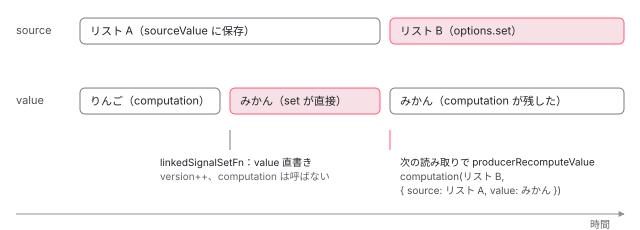

[目次](../README.md) › [Signal の内側](README.md) › 第 8 回 / 全 18 回

# linkedSignal の内側：書ける computed、source と previous

> LINKED\_SIGNAL\_NODE が COMPUTED\_NODE と同じ producerRecomputeValue の形を持ちつつ、source の値と previous（前回の source と value）を computation に渡す行、linkedSignalSetFn が自分の value を直接書き換えて version を進める行、source が変わると書いた値が捨てられる理由。core の linkedSignal() が短い形（関数 1 つ）と長い形（{source, computation}）をどう振り分けるか。

angular/angular · 読了 約 12 分 · 中核 · [サイトで読む（デモが動きます）](https://angular-deep-dive-cyan.vercel.app/chapter/signals-linked-signal)

---

`linkedSignal` は「`set` できる `computed`」と説明されます。この章では、その中身が **`computed` と同じ再計算の型に「source の値」と「previous（前回の source と value）」を足したノード**であること、`set` が自分の `value` を直接書き換えて `version` を進めること、そして source が変わると書いた値が捨てられる（でも previous には残る）理由を、行で追います。最後に `@angular/core` の `linkedSignal()` が短い形と長い形をどう振り分けるかを読みます。

読む対象は `packages/core/primitives/signals/src/linked_signal.ts`（ノードの本体）、同じフォルダの `signal.ts` と `graph.ts`（一部）、`packages/core/src/render3/reactivity/linked_signal.ts`（公開 API）です。

1. [1. 概観](01-signals.md)
2. [2. ReactiveNode の構造](02-signals-reactive-node.md)
3. [3. 依存の追跡](03-signals-tracking.md)
4. [4. set と update](04-signals-set.md)
5. [5. push と pull](05-signals-push-pull.md)
6. [6. computed](06-signals-computed.md)
7. [7. live と non-live](07-signals-live.md)
8. **8. linkedSignal**（この章）
9. [9. effect のノードと寿命](09-signals-effect-node.md)
10. [10. afterRenderEffect](10-signals-after-render-effect.md)
11. [11. input と viewChild](11-authoring.md)
12. [12. input() とコンパイラ](12-signals-input-compile.md)
13. [13. model() と output()](13-signals-model-output.md)
14. [14. toSignal と toObservable](14-signals-rxjs-interop.md)
15. [15. resource](15-resource.md)
16. [16. httpResource と rxResource](16-signals-http-resource.md)
17. [17. Signal Forms](17-signal-forms.md)
18. [18. DevTools と signal グラフ](18-signals-debug.md)

## 1. ノードが持つもの

📄 `angular/packages/core/primitives/signals/src/linked_signal.ts` L29–61 （▶ の行: 29–30, 36, 42, 53, 58, 60）

```ts
29 ▶ export type ComputationFn<S, D> = (source: S, previous?: PreviousValue<S, D>) => D;
30 ▶ export type PreviousValue<S, D> = {source: S; value: D};
31 │ 
32 │ export interface LinkedSignalNode<S, D> extends ReactiveNode {
33 │   /**
34 │    * Value of the source signal that was used to derive the computed value.
35 │    */
36 ▶   sourceValue: S;
37 │ 
38 │   /**
39 │    * Current state value, or one of the sentinel values (`UNSET`, `COMPUTING`,
40 │    * `ERROR`).
41 │    */
42 ▶   value: D;
43 │ 
44 │   /**
45 │    * If `value` is `ERRORED`, the error caught from the last computation attempt which will
46 │    * be re-thrown.
47 │    */
48 │   error: unknown;
49 │ 
50 │   /**
51 │    * The source function represents reactive dependency based on which the linked state is reset.
52 │    */
53 ▶   source: () => S;
54 │ 
55 │   /**
56 │    * The computation function which will produce a new value based on the source and, optionally - previous values.
57 │    */
58 ▶   computation: ComputationFn<S, D>;
59 │ 
60 ▶   equal: ValueEqualityFn<D>;
61 │ }
```

29 行目が computation の型です。**第 1 引数に source の値、第 2 引数に previous**を受け取ります。previous の形は 30 行目の `{source, value}`、つまり「前回 computation に渡した source の値」と「前回このノードが持っていた値」の組です。

`LinkedSignalNode` は `ReactiveNode`（[第 2 回](02-signals-reactive-node.md)）に 6 つのフィールドを足します。53 行目の `source` と 58 行目の `computation` は利用者が渡した関数、36 行目の `sourceValue` は「前回読んだ source の値」の保存場所、42 行目の `value` は今の値です。`computed` のノードとの違いは、`source` / `sourceValue` と、computation が引数を取ることだけです。

📄 `angular/packages/core/primitives/signals/src/linked_signal.ts` L125–143 （▶ の行: 132–134, 136–137, 139, 142）

```ts
125 │ // Note: Using an IIFE here to ensure that the spread assignment is not considered
126 │ // a side-effect, ending up preserving `LINKED_SIGNAL_NODE` and `REACTIVE_NODE`.
127 │ export const LINKED_SIGNAL_NODE: Omit<
128 │   LinkedSignalNode<unknown, unknown>,
129 │   'computation' | 'source' | 'sourceValue'
130 │ > = /* @__PURE__ */ (() => {
131 │   return {
132 ▶     ...REACTIVE_NODE,
133 ▶     value: UNSET,
134 ▶     dirty: true,
135 │     error: null,
136 ▶     equal: defaultEquals,
137 ▶     kind: 'linkedSignal',
138 │ 
139 ▶     producerMustRecompute(node: LinkedSignalNode<unknown, unknown>): boolean {
140 │       // Force a recomputation if there's no current value, or if the current value is in the
141 │       // process of being calculated (which should throw an error).
142 ▶       return node.value === UNSET || node.value === COMPUTING;
143 │     },
```

ノードの原型 `LINKED_SIGNAL_NODE` です。132 行目で `REACTIVE_NODE` の既定値を広げ、133〜134 行目で「値はまだ無い（`UNSET`）、dirty」から始めます。136 行目、`equal` の既定は `defaultEquals`（`Object.is`）。142 行目の `producerMustRecompute` は「値が無いか、計算中なら必ず計算し直す」。ここまでは `computed` の `COMPUTED_NODE`（[第 6 回](06-signals-computed.md)）と、`kind` 以外は同じ形です。`REACTIVE_NODE` の `consumerAllowSignalWrites` は既定の `false` のままなので、computation の中で signal を `set` すると投げます（デモの注記で使います）。

## 2. 作る：createLinkedSignal

📄 `angular/packages/core/primitives/signals/src/linked_signal.ts` L67–104 （▶ の行: 72, 74–77, 82, 85, 87–88, 91, 95）

```ts
 67 │ export function createLinkedSignal<S, D>(
 68 │   sourceFn: () => S,
 69 │   computationFn: ComputationFn<S, D>,
 70 │   equalityFn?: ValueEqualityFn<D>,
 71 │ ): LinkedSignalGetter<S, D> {
 72 ▶   const node: LinkedSignalNode<S, D> = Object.create(LINKED_SIGNAL_NODE);
 73 │ 
 74 ▶   node.source = sourceFn;
 75 ▶   node.computation = computationFn;
 76 ▶   if (equalityFn != undefined) {
 77 ▶     node.equal = equalityFn;
 78 │   }
 79 │ 
 80 │   const linkedSignalGetter = () => {
 81 │     // Check if the value needs updating before returning it.
 82 ▶     producerUpdateValueVersion(node);
 83 │ 
 84 │     // Record that someone looked at this signal.
 85 ▶     producerAccessed(node);
 86 │ 
 87 ▶     if (node.value === ERRORED) {
 88 ▶       throw node.error;
 89 │     }
 90 │ 
 91 ▶     return node.value;
 92 │   };
 93 │ 
 94 │   const getter = linkedSignalGetter as LinkedSignalGetter<S, D>;
 95 ▶   getter[SIGNAL] = node;
 96 │   if (typeof ngDevMode !== 'undefined' && ngDevMode) {
 97 │     getter.toString = () =>
 98 │       `[LinkedSignal${node.debugName ? ' (' + node.debugName + ')' : ''}: ${String(node.value)}]`;
 99 │   }
100 │ 
101 │   runPostProducerCreatedFn(node);
102 │ 
103 │   return getter;
104 │ }
```

1. **72 行目：原型を継いだノードを作る**

   `Object.create(LINKED_SIGNAL_NODE)`。既定値はすべて原型から読まれ、書いたフィールドだけがノード自身に載ります。
2. **74〜78 行目：source・computation・equal を載せる**

   equal は渡されたときだけ上書き。この時点では source も computation も**呼ばれません**。
3. **80〜92 行目：getter を作る**

   82 行目で `producerUpdateValueVersion(node)`（必要なら計算し直す）、85 行目で `producerAccessed(node)`（読んだ人の依存に自分を足す。[第 3 回](03-signals-tracking.md)）、87〜88 行目でエラー状態なら保存してあるエラーを投げ、91 行目で値を返します。`computed` の getter と同じ順番です。
4. **95 行目：`getter[SIGNAL] = node`**

   関数にノードをぶら下げます。公開 API 側（5 節）は、この `[SIGNAL]` からノードを取り出して `set` を作ります。

## 3. 読む：source を読んで computation(source, previous)

getter の 82 行目が呼ぶ `producerUpdateValueVersion` の、計算し直すかどうかを決める部分です（関数全体は [第 5 回](05-signals-push-pull.md)）。

📄 `angular/packages/core/primitives/signals/src/graph.ts` L316–333 （▶ の行: 316, 323, 326, 330, 333）

```ts
316 ▶   if (!node.dirty && node.lastCleanEpoch === epoch) {
317 │     // Even non-live consumers can skip polling if they previously found themselves to be clean at
318 │     // the current epoch, since their dependencies could not possibly have changed (such a change
319 │     // would've increased the epoch).
320 │     return;
321 │   }
322 │ 
323 ▶   if (!node.producerMustRecompute(node) && !consumerPollProducersForChange(node)) {
324 │     // None of our producers report a change since the last time they were read, so no
325 │     // recomputation of our value is necessary, and we can consider ourselves clean.
326 ▶     producerMarkClean(node);
327 │     return;
328 │   }
329 │ 
330 ▶   node.producerRecomputeValue(node);
331 │ 
332 │   // After recomputing the value, we're no longer dirty.
333 ▶   producerMarkClean(node);
```

316 行目、dirty でなく、前回きれいだと確かめた時点から epoch（どこかの signal が書かれるたびに増える世界の版番号）が進んでいなければ何もしません。323 行目、`producerMustRecompute`（142 行目）が偽で、依存先（producer）のどれも版が変わっていなければ、326 行目で「きれい」と記録して終わり。どちらかが真なら 330 行目で `producerRecomputeValue` を呼び、333 行目できれいにします。linkedSignal の `producerRecomputeValue` がこれです。

📄 `angular/packages/core/primitives/signals/src/linked_signal.ts` L145–169 （▶ の行: 146, 153–154, 156, 160–165, 167–169）

```ts
145 │     producerRecomputeValue(node: LinkedSignalNode<unknown, unknown>): void {
146 ▶       if (node.value === COMPUTING) {
147 │         // Our computation somehow led to a cyclic read of itself.
148 │         throw new Error(
149 │           typeof ngDevMode !== 'undefined' && ngDevMode ? 'Detected cycle in computations.' : '',
150 │         );
151 │       }
152 │ 
153 ▶       const oldValue = node.value;
154 ▶       node.value = COMPUTING;
155 │ 
156 ▶       const prevConsumer = consumerBeforeComputation(node);
157 │       let newValue: unknown;
158 │       let wasEqual = false;
159 │       try {
160 ▶         const newSourceValue = node.source();
161 ▶         const oldValueValid = oldValue !== UNSET && oldValue !== ERRORED;
162 ▶         const prev = oldValueValid
163 ▶           ? {
164 ▶               source: node.sourceValue,
165 ▶               value: oldValue,
166 │             }
167 ▶           : undefined;
168 ▶         newValue = node.computation(newSourceValue, prev);
169 ▶         node.sourceValue = newSourceValue;
```

📄 `angular/packages/core/primitives/signals/src/linked_signal.ts` L170–190 （▶ の行: 172–173, 175–176, 178, 181, 184–185, 188–189）

```ts
170 │         // We want to mark this node as errored if calling `equal` throws; however, we don't want
171 │         // to track any reactive reads inside `equal`.
172 ▶         setActiveConsumer(null);
173 ▶         wasEqual = oldValueValid && newValue !== ERRORED && node.equal(oldValue, newValue);
174 │       } catch (err) {
175 ▶         newValue = ERRORED;
176 ▶         node.error = err;
177 │       } finally {
178 ▶         consumerAfterComputation(node, prevConsumer);
179 │       }
180 │ 
181 ▶       if (wasEqual) {
182 │         // No change to `valueVersion` - old and new values are
183 │         // semantically equivalent.
184 ▶         node.value = oldValue;
185 ▶         return;
186 │       }
187 │ 
188 ▶       node.value = newValue;
189 ▶       node.version++;
190 │     },
```

1. **146〜154 行目：循環の検出と、古い値の退避**

   今の値を 153 行目で `oldValue` に取っておき、154 行目で `COMPUTING` にします。計算の途中で自分自身を読むと 142 行目経由でもう一度ここに来て、146 行目で `Detected cycle in computations.` を投げます（NG コードの無い素の `Error`）。
2. **156 行目：自分を「今の consumer」にする**

   `consumerBeforeComputation` で、これから読まれる signal が自分の依存として記録されるようにします（[第 3 回](03-signals-tracking.md)）。
3. **160 行目：source を読む**

   `node.source()` の中で読まれた signal が依存になります。168 行目の computation もまだ 172 行目より前なので、**computation の中で読んだ signal も依存になります**。core 側の doc（6 節の 42 行目）が「computation は reactive」と書いているのはこのことです。
4. **161〜167 行目：previous を組み立てる**

   前回の値がちゃんとある（`UNSET` でも `ERRORED` でもない）ときだけ、`{ source: node.sourceValue, value: oldValue }` を作ります。初回と、前回がエラーだったときは `undefined`。ここで使う `oldValue` は **153 行目で退避した「今の value」**です。後で見るとおり `set` は value を直接書くので、`set` した値がそのまま `previous.value` になります。
5. **168〜169 行目：computation を呼び、source の値を保存**

   169 行目で `sourceValue` を今回の値に更新します。次の再計算の 164 行目で、これが `previous.source` になります。
6. **172〜173 行目：追跡を止めてから equal**

   172 行目で consumer を外すので、equal の中で signal を読んでも依存になりません。173 行目、前回が有効な値で、今回もエラーでないときだけ `node.equal(oldValue, newValue)`。
7. **174〜178 行目：投げたらエラー状態に**

   source・computation・equal のどれかが投げると、値を `ERRORED`、`node.error` にエラーを入れます。178 行目の `finally` で依存の記録を締めます。
8. **181〜189 行目：等しければ版を進めない**

   equal が真なら 184 行目で古い値に戻して 185 行目で帰ります。`version` は変わらないので、このノードを読んでいる側は「変わっていない」と判断します。違えば 188〜189 行目で値を入れ、`version++`。

`computed` の `producerRecomputeValue` と比べると、違うのは 160〜169 行目だけです。`computed` は computation を引数なしで呼ぶ 1 行で済ませています（[第 6 回](06-signals-computed.md)）。

## 4. 書く：linkedSignalSetFn

📄 `angular/packages/core/primitives/signals/src/linked_signal.ts` L106–123 （▶ の行: 107–109, 116, 118–119, 121–122）

```ts
106 │ export function linkedSignalSetFn<S, D>(node: LinkedSignalNode<S, D>, newValue: D) {
107 ▶   producerUpdateValueVersion(node);
108 ▶   signalSetFn(node, newValue);
109 ▶   producerMarkClean(node);
110 │ }
111 │ 
112 │ export function linkedSignalUpdateFn<S, D>(
113 │   node: LinkedSignalNode<S, D>,
114 │   updater: (value: D) => D,
115 │ ): void {
116 ▶   producerUpdateValueVersion(node);
117 │   // update() on a linked signal can't work if the current state is ERRORED, as there's no value.
118 ▶   if (node.value === ERRORED) {
119 ▶     throw node.error;
120 │   }
121 ▶   signalUpdateFn(node, updater);
122 ▶   producerMarkClean(node);
123 │ }
```

`set` の本体は 3 行です（[resource](15-resource.md) の章でも、`resource` が内部の linkedSignal に書く経路として出てきます）。108 行目で呼ぶ `signalSetFn` は、普通の `signal()` の `set` と同じ関数です。

📄 `angular/packages/core/primitives/signals/src/signal.ts` L86–95 （▶ の行: 87–88, 91–93）

```ts
86 │ export function signalSetFn<T>(node: SignalNode<T>, newValue: T) {
87 ▶   if (!producerUpdatesAllowed()) {
88 ▶     throwInvalidWriteToSignalError(node);
89 │   }
90 │ 
91 ▶   if (!node.equal(node.value, newValue)) {
92 ▶     node.value = newValue;
93 ▶     signalValueChanged(node);
94 │   }
95 │ }
```

1. **107 行目：先に最新にする**

   `producerUpdateValueVersion(node)`。まだ一度も読まれていなければここで初めて computation が走り、source が変わったまま読まれていなければここで計算し直されます。これで 91 行目の比較は `UNSET` や古い値とではなく、最新の値と行われます。再計算が走れば、依存の記録（どの signal のどの版を読んだか）もここで最新になります。
2. **108 行目 → 87〜88 行目：書いてよい文脈か**

   今の consumer が `consumerAllowSignalWrites: false`（computed や linkedSignal の computation の中など）なら投げます。Angular のアプリでは NG0600 になります（[第 4 回](04-signals-set.md)）。
3. **91〜93 行目：equal が偽なら value を書き、signalValueChanged**

   使われる `equal` は **linkedSignal のノードの equal**（2 節の 76〜77 行目で載せたもの）です。`signalValueChanged` は `version++` → epoch++ → consumer へ dirty を配る、の順です（[第 4 回](04-signals-set.md)）。**computation は呼ばれません。**value は computation を経ずに直接書かれます。
4. **109 行目：自分をきれいにする**

   `producerMarkClean` で `dirty = false`、`lastCleanEpoch` を今の epoch（93 行目で 1 つ進んだ後の値）にします。依存のリストは 107 行目の時点のまま残るので、次に読まれたとき 323 行目の「依存の版が変わったか」は偽になり、書いた値がそのまま返ります。

`update`（112〜123 行目）も同じ形ですが、118〜119 行目で「エラー状態なら投げる」が入ります。前の値が無いので updater に渡せないからです（117 行目のコメント）。`set` にはこの検査が無いので、エラー状態の linkedSignal でも `set` すれば値を持った状態に戻せます。

## 5. 書いた値はいつ消えるか

「書いた値」は、どこかに別に保存されているわけではありません。`value` そのものです。だから、次に 330 行目の再計算が走った瞬間に、168 行目の戻り値で上書きされます。再計算が走る条件は 323 行目のとおり「依存の版が変わった」ときです。依存は source の中と computation の中で読んだ signal なので、**そのどれかが書かれた次の読み取り**で消えます。



*上：source と linkedSignal の値。set で value が直接変わり、source が変わった次の読み取りで computation が走って上書きされる。そのとき previous.value には set した値が入っている。*

「消える」と書きましたが、捨てられる直前の値は 165 行目の `previous.value` として computation に渡ります。computation の側で「previous.value と同じ id が新しい source にもあれば、それを返す」と書けば、利用者が選んだものを残せます。下のデモの computation がそれです。

## 6. 公開 API：短い形と長い形

📄 `angular/packages/core/src/render3/reactivity/linked_signal.ts` L22–53 （▶ の行: 22, 29–30, 34, 42, 47–49, 52）

```ts
22 ▶ const identityFn = <T>(v: T) => v;
23 │ 
24 │ /**
25 │  * Creates a writable signal whose value is initialized and reset by the linked, reactive computation.
26 │  *
27 │  * @publicApi 20.0
28 │  */
29 ▶ export function linkedSignal<D>(
30 ▶   computation: () => D,
31 │   options?: {
32 │     equal?: ValueEqualityFn<NoInfer<D>>;
33 │     debugName?: string;
34 ▶     set?: (value: NoInfer<D>, rawSet: (value: NoInfer<D>) => void) => void;
35 │   },
36 │ ): WritableSignal<D>;
37 │ 
38 │ /**
39 │  * Creates a writable signal whose value is initialized and reset by the linked, reactive computation.
40 │  * This is an advanced API form where the computation has access to the previous value of the signal and the computation result.
41 │  *
42 ▶  * Note: The computation is reactive, meaning the linked signal will automatically update whenever any of the signals used within the computation change.
43 │  *
44 │  * @publicApi 20.0
45 │  * @see [Dependent state with linkedSignal](guide/signals/linked-signal)
46 │  */
47 ▶ export function linkedSignal<S, D>(options: {
48 ▶   source: () => S;
49 ▶   computation: (source: NoInfer<S>, previous?: {source: NoInfer<S>; value: NoInfer<D>}) => D;
50 │   equal?: ValueEqualityFn<NoInfer<D>>;
51 │   debugName?: string;
52 ▶   set?: (value: NoInfer<D>, rawSet: (value: NoInfer<D>) => void) => void;
53 │ }): WritableSignal<D>;
```

オーバーロードが 2 つあります。29 行目の短い形は `linkedSignal(() => 式)`、47 行目の長い形は `linkedSignal({ source, computation })`。49 行目、長い形の computation だけが previous を受け取れます。34 行目と 52 行目の `set` オプションは、`set` / `update` を横取りする関数です（下の 105〜109 行目）。

📄 `angular/packages/core/src/render3/reactivity/linked_signal.ts` L55–90 （▶ の行: 71–74, 77, 79–81, 84）

```ts
55 │ export function linkedSignal<S, D>(
56 │   optionsOrComputation:
57 │     | {
58 │         source: () => S;
59 │         computation: ComputationFn<S, D>;
60 │         equal?: ValueEqualityFn<D>;
61 │         debugName?: string;
62 │         set?: (value: D, rawSet: (value: D) => void) => void;
63 │       }
64 │     | (() => D),
65 │   options?: {
66 │     equal?: ValueEqualityFn<D>;
67 │     debugName?: string;
68 │     set?: (value: D, rawSet: (value: D) => void) => void;
69 │   },
70 │ ): WritableSignal<D> {
71 ▶   if (typeof optionsOrComputation === 'function') {
72 ▶     const getter = createLinkedSignal<D, D>(
73 ▶       optionsOrComputation,
74 ▶       identityFn<D>,
75 │       options?.equal,
76 │     ) as LinkedSignalGetter<D, D> & WritableSignal<D>;
77 ▶     return upgradeLinkedSignalGetter(getter, options?.debugName, options?.set);
78 │   } else {
79 ▶     const getter = createLinkedSignal<S, D>(
80 ▶       optionsOrComputation.source,
81 ▶       optionsOrComputation.computation,
82 │       optionsOrComputation.equal,
83 │     );
84 ▶     return upgradeLinkedSignalGetter(
85 │       getter,
86 │       optionsOrComputation.debugName,
87 │       optionsOrComputation.set,
88 │     );
89 │   }
90 │ }
```

1. **71 行目：第 1 引数が関数かどうかで振り分ける**

   `typeof optionsOrComputation === 'function'`。オブジェクトなら長い形です。
2. **72〜74 行目：短い形は「渡された関数を source に、identityFn を computation に」**

   22 行目の `identityFn` は `v => v`。source の値をそのまま値にするので、短い形は「`set` できる `computed`」そのものです。identityFn は第 2 引数を見ないので、previous は渡されても使われません。
3. **79〜83 行目：長い形はそのまま primitives に渡す**
4. **77 行目・84 行目：どちらも upgradeLinkedSignalGetter で set / update / asReadonly を付ける**

📄 `angular/packages/core/src/render3/reactivity/linked_signal.ts` L92–117 （▶ の行: 97–98, 102, 105–109, 111–112, 114）

```ts
 92 │ function upgradeLinkedSignalGetter<S, D>(
 93 │   getter: LinkedSignalGetter<S, D>,
 94 │   debugName?: string,
 95 │   customSet?: (value: D, rawSet: (value: D) => void) => void,
 96 │ ): WritableSignal<D> {
 97 ▶   if (typeof ngDevMode !== 'undefined' && ngDevMode) {
 98 ▶     getter[SIGNAL].debugName = debugName;
 99 │     getter.toString = () => `[LinkedSignal${debugName ? ' (' + debugName + ')' : ''}: ${getter()}]`;
100 │   }
101 │ 
102 ▶   const node = getter[SIGNAL] as LinkedSignalNode<S, D>;
103 │   const upgradedGetter = getter as LinkedSignalGetter<S, D> & WritableSignal<D>;
104 │ 
105 ▶   if (customSet !== undefined) {
106 ▶     const rawSet = (newValue: D) => linkedSignalSetFn(node, newValue);
107 ▶     upgradedGetter.set = (newValue: D) => customSet(newValue, rawSet);
108 ▶     upgradedGetter.update = (updateFn: (value: D) => D) =>
109 ▶       customSet(updateFn(untracked(getter)), rawSet);
110 │   } else {
111 ▶     upgradedGetter.set = (newValue: D) => linkedSignalSetFn(node, newValue);
112 ▶     upgradedGetter.update = (updateFn: (value: D) => D) => linkedSignalUpdateFn(node, updateFn);
113 │   }
114 ▶   upgradedGetter.asReadonly = signalAsReadonlyFn.bind(getter as any) as () => Signal<D>;
115 │ 
116 │   return upgradedGetter;
117 │ }
```

102 行目で `getter[SIGNAL]` からノードを取り出し、111〜112 行目で 4 節の `linkedSignalSetFn` / `linkedSignalUpdateFn` を `set` / `update` にします。`set` オプションがあるときは 105〜109 行目、利用者の関数に「新しい値」と「本物の set（`rawSet`）」を渡します。`update` は 109 行目で `untracked(getter)` を読んで updater を通してから、同じ関数に渡します。97〜98 行目、`debugName` は開発ビルドのときだけノードに載ります。

## 7. DEMO：選んだ項目を、リストが変わっても残す

> **🧪 DEMO — source = 選択肢のリスト、linkedSignal = 選択中の項目**
>
> computation は「`previous.value` と同じ id が新しいリストにあればそれ、無ければ先頭」。ボタンを押すたびに、処理の中で `selected()` を読み、そのとき computation が呼ばれたかを記録します。computation の中では signal を書けないので（2 節）、呼ばれた記録は普通の変数に残し、ボタンの処理の中でログに移しています。version は学習用に `selected[ɵSIGNAL].version` を覗いた値です。
>
> ▶ [このデモはサイトで動かせます](https://angular-deep-dive-cyan.vercel.app/chapter/signals-linked-signal)

試す順番の例：「みかん」を押す → リスト B → リスト C。「みかん」の行は computation が**呼ばれず**、version だけ 1 つ進みます（4 節の 91〜93 行目）。リスト B の行は computation が呼ばれ、previous が `{ source: [りんご, みかん, ぶどう], value: みかん }`。B にも id 2 があるので「みかん」が残ります。B のみかんは A のみかんとは別のオブジェクトなので、173 行目の `Object.is` は偽、version は進みます。リスト C には id 2 が無いので先頭の「なし」になります。同じリストのボタンをもう一度押すと、`options` の `set` が同じ配列で equal になって通知が出ないので、computation は呼ばれず version も変わりません。

> [!TIP]
> **新卒エンジニアへ**
>
> 同じ id のときに version を進めたくなければ、`equal: (a, b) => a.id === b.id` を渡します。173 行目で真になり、184 行目で**古いオブジェクト**が残ります。新しいリストのオブジェクトではなく、前のオブジェクトが値として残る点に注意します。

## 全体の流れ

- 👤 `selected()` — 利用者のコード / テンプレート — *読む*
  - `producerUpdateValueVersion(node)` — linked\_signal.ts L82 → graph.ts L316-330 — *dirty か、依存の版が変わっていれば*
    - `producerRecomputeValue(node)` — linked\_signal.ts L145 — *oldValue を退避（L153）*
      - `node.source()` — L160 — *依存として記録*
      - `node.computation(newSource, { source: sourceValue, value: oldValue })` — L162-168 — *previous.value は set した値でもよい*
      - `node.equal(oldValue, newValue)` — L173 — *真なら version を進めない*
  - `producerAccessed(node)` — L85 — *読んだ人の依存に足す*
- 👤 `selected.set(v)` — 利用者のコード — *書く*
  - `linkedSignalSetFn(node, v)` — linked\_signal.ts L106 — *先に最新化（L107）*
    - `signalSetFn(node, v)` — signal.ts L86 — *equal が偽なら value = v、version++、通知*
    - `producerMarkClean(node)` — L109 — *次の読み取りで computation を呼ばせない*

## 聞かれそうな質問

**Q. computed + signal + effect で書くのと何が違うのですか？**

「source が変わったら signal をリセットする effect」と比べると、違いはリセットの**時刻**です。linkedSignal は getter の 82 行目で読んだ瞬間に計算し直すので、`options.set()` の次の行で `selected()` を読めばもう新しい値です（デモがそうしています）。effect は作っても変更されても予約されるだけで、走るのは変更検知の中か microtask です（[cd-effects](../cd/09-cd-effects.md)）。それまでの間に読むと古い値が見えます。もう 1 つ、previous（165 行目）を自分で保存しなくても受け取れる点も違います。

**Q. linkedSignal に set した値はいつ消えますか？**

依存（source の中と computation の中で読んだ signal）のどれかが書かれた後の、最初の読み取りです。`set` は 109 行目でノードをきれいにするだけで依存は変えないので、依存が書かれない限り 323 行目で再計算は起きません。依存が書かれると 330 行目で再計算され、168 行目の戻り値で value が上書きされます。ただし捨てられる直前の値は 165 行目で `previous.value` として渡されます。依存を書いても値が同じなら（signal.ts 91 行目の equal が真）、通知も版の更新も起きないので消えません。

**Q. equal はどこで効きますか？**

2 か所です。(1) 再計算のとき、173 行目で前回の値と比べ、真なら 184 行目で古い値を残して version を進めません。(2) `set` / `update` のとき、108 行目から呼ぶ `signalSetFn` の 91 行目で今の値と比べ、真なら何も書かず通知もしません。どちらも linkedSignal のノードに載った equal（76〜77 行目）です。172 行目で consumer を外してから呼ぶので、equal の中で signal を読んでも依存にはなりません。

**Q. 短い形 linkedSignal(() =&gt; x()) と computed(() =&gt; x()) は何が違いますか？**

読み取りの経路は同じです（6 節の 72〜74 行目で source が渡した関数、computation が `identityFn`）。違いは 111〜112 行目で `set` / `update` が付くことだけです。`x` が変わると、書いた値は 5 節のとおり x の値で上書きされます。

**Q. computation の中で別の signal を set できますか？**

できません。linkedSignal のノードは `REACTIVE_NODE` の `consumerAllowSignalWrites: false` を継いでいて（132 行目）、computation は 156 行目からその consumer の中で走ります。中で `set` すると signal.ts 87〜88 行目で投げます。Angular のアプリでは NG0600 です。

## 読み終えて

- linkedSignal のノードは `computed` と同じ再計算の型で、違いは「source を読み、`(source, previous)` を computation に渡す」160〜169 行目だけ。
- previous は `{ source: 前回の sourceValue, value: 今の value }`。今の value が `set` した値なら、それが渡る。
- `set` は computation を通らず value を直接書き、version を進め、ノードをきれいにする（106〜110 行目）。
- 書いた値は「依存が書かれた後の最初の読み取り」で上書きされる。上書きは読むときに同期的に起きる。
- 公開 API の短い形は `identityFn` を computation にした長い形。どちらも `upgradeLinkedSignalGetter` で set / update が付く。

---

← 前: [live な consumer と non-live：リンクの張り方の違いと、メモリが解放される理由](07-signals-live.md)  
次: [effect の内側：BASE\_EFFECT\_NODE・runEffect・onCleanup・破棄](09-signals-effect-node.md) →
