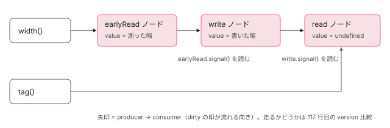

[目次](../README.md) › [Signal の内側](README.md) › 第 10 回 / 全 18 回

# afterRenderEffect：4 つのフェーズを signal でつなぐ

> afterRenderEffect({earlyRead, write, mixedReadWrite, read}) がフェーズごとに AfterRenderPhaseEffectNode を作り、前のフェーズの戻り値を次のフェーズに signal として渡す行。依存が変わったフェーズと、その値を読む後続フェーズに dirty が伝わり、実際に走るのは前のフェーズの戻り値の version が進んだときだけになる仕組み、consumerAllowSignalWrites: true の理由、AfterRenderManager に登録されて描画の後に走る順番。

angular/angular · 読了 約 13 分 · 発展 · [サイトで読む（デモが動きます）](https://angular-deep-dive-cyan.vercel.app/chapter/signals-after-render-effect)

---

`afterRenderEffect` は「描画の後に走る effect」です。ただし中身は [第 9 回](09-signals-effect-node.md)の `EFFECT_NODE` ではありません。この章では、**フェーズごとに 1 つずつ作られる `AfterRenderPhaseEffectNode`** が、前のフェーズの戻り値を **signal として**次のフェーズへ渡し、依存が変わったフェーズだけが走る仕組みを行で追います。`consumerAllowSignalWrites: true` の意味と、`AfterRenderManager` に登録されてから走る順番も読みます。

読む対象は `packages/core/src/render3/reactivity/after_render_effect.ts` と、走らせる側の `render3/after_render/manager.ts`（一部。全体は [cd-after-render](../cd/08-cd-after-render.md)）です。

1. [1. 概観](01-signals.md)
2. [2. ReactiveNode の構造](02-signals-reactive-node.md)
3. [3. 依存の追跡](03-signals-tracking.md)
4. [4. set と update](04-signals-set.md)
5. [5. push と pull](05-signals-push-pull.md)
6. [6. computed](06-signals-computed.md)
7. [7. live と non-live](07-signals-live.md)
8. [8. linkedSignal](08-signals-linked-signal.md)
9. [9. effect のノードと寿命](09-signals-effect-node.md)
10. **10. afterRenderEffect**（この章）
11. [11. input と viewChild](11-authoring.md)
12. [12. input() とコンパイラ](12-signals-input-compile.md)
13. [13. model() と output()](13-signals-model-output.md)
14. [14. toSignal と toObservable](14-signals-rxjs-interop.md)
15. [15. resource](15-resource.md)
16. [16. httpResource と rxResource](16-signals-http-resource.md)
17. [17. Signal Forms](17-signal-forms.md)
18. [18. DevTools と signal グラフ](18-signals-debug.md)

## 1. 4 つのフェーズと、何を受け取るか

📄 `angular/packages/core/src/render3/reactivity/after_render_effect.ts` L309–329 （▶ の行: 312–313, 315–319, 321–322, 326–327）

```ts
309 │ /**
310 │  * Register effects that, when triggered, are invoked when the application finishes rendering,
311 │  * during the specified phases. The available phases are:
312 ▶  * - `earlyRead`
313 ▶  *   Use this phase to **read** from the DOM before a subsequent `write` callback, for example to
314 │  *   perform custom layout that the browser doesn't natively support. Prefer the `read` phase if
315 ▶  *   reading can wait until after the write phase. **Never** write to the DOM in this phase.
316 ▶  * - `write`
317 ▶  *    Use this phase to **write** to the DOM. **Never** read from the DOM in this phase.
318 ▶  * - `mixedReadWrite`
319 ▶  *    Use this phase to read from and write to the DOM simultaneously. **Never** use this phase if
320 │  *    it is possible to divide the work among the other phases instead.
321 ▶  * - `read`
322 ▶  *    Use this phase to **read** from the DOM. **Never** write to the DOM in this phase.
323 │  *
324 │  * <div class="docs-alert docs-alert-critical">
325 │  *
326 ▶  * You should prefer using the `read` and `write` phases over the `earlyRead` and `mixedReadWrite`
327 ▶  * phases when possible, to avoid performance degradation.
328 │  *
329 │  * </div>
```

📄 `angular/packages/core/src/render3/reactivity/after_render_effect.ts` L331–350 （▶ の行: 332–336, 338–339, 341–343, 345, 348–349）

```ts
331 │  * Note that:
332 ▶  * - Effects run in the following phase order, only when dirty through signal dependencies:
333 ▶  *   1. `earlyRead`
334 ▶  *   2. `write`
335 ▶  *   3. `mixedReadWrite`
336 ▶  *   4. `read`
337 │  * - `afterRenderEffect`s in the same phase run in the order they are registered.
338 ▶  * - `afterRenderEffect`s run on browser platforms only, they will not run on the server.
339 ▶  * - `afterRenderEffect`s will run at least once.
340 │  *
341 ▶  * The first phase callback to run as part of this spec will receive no parameters. Each
342 ▶  * subsequent phase callback in this spec will receive the return value of the previously run
343 ▶  * phase callback as a `Signal`. This can be used to coordinate work across multiple phases.
344 │  *
345 ▶  * Angular is unable to verify or enforce that phases are used correctly, and instead
346 │  * relies on each developer to follow the guidelines documented for each value and
347 │  * carefully choose the appropriate one, refactoring their code if necessary. By doing
348 ▶  * so, Angular is better able to minimize the performance degradation associated with
349 ▶  * manual DOM access, ensuring the best experience for the end users of your application
350 │  * or library.
```

フェーズは 4 つ、332〜336 行目の順に走ります。312〜322 行目の doc が決めているのは「そのフェーズで DOM を読むか書くか」です。earlyRead と read は読むだけ、write は書くだけ、mixedReadWrite は両方。341〜343 行目、**最初に走るフェーズは引数なし、以降のフェーズは「直前に走ったフェーズの戻り値」を `Signal` で受け取る**。338 行目、**サーバーでは走りません**（4 節）。339 行目、少なくとも 1 回は走ります。

📄 `angular/packages/core/src/render3/reactivity/after_render_effect.ts` L369–377 （▶ の行: 371–374）

```ts
369 │ export function afterRenderEffect<E = never, W = never, M = never>(
370 │   spec: {
371 ▶     earlyRead?: (onCleanup: EffectCleanupRegisterFn) => E;
372 ▶     write?: (...args: [...ɵFirstAvailableSignal<[E]>, EffectCleanupRegisterFn]) => W;
373 ▶     mixedReadWrite?: (...args: [...ɵFirstAvailableSignal<[W, E]>, EffectCleanupRegisterFn]) => M;
374 ▶     read?: (...args: [...ɵFirstAvailableSignal<[M, W, E]>, EffectCleanupRegisterFn]) => void;
375 │   },
376 │   options?: AfterRenderOptions,
377 │ ): AfterRenderRef;
```

📄 `angular/packages/core/src/render3/reactivity/after_render_effect.ts` L266–274 （▶ の行: 270–274）

```ts
266 │ /**
267 │  * An argument list containing the first non-never type in the given type array, or an empty
268 │  * argument list if there are no non-never types in the type array.
269 │  */
270 ▶ export type ɵFirstAvailableSignal<T extends unknown[]> = T extends [infer H, ...infer R]
271 ▶   ? [H] extends [never]
272 ▶     ? ɵFirstAvailableSignal<R>
273 ▶     : [Signal<H>]
274 ▶   : [];
```

受け取る型は 270〜274 行目の `ɵFirstAvailableSignal` で決まります。型の並びを先頭から見て、`never`（そのフェーズを書いていない）を飛ばし、最初に見つかった型の `Signal` を 1 つだけ引数にします。見つからなければ引数なし。372〜374 行目に当てはめると、次の表になります。

| 順 | フェーズ | DOM | 第 1 引数（onCleanup の前） | 型の根拠 |
| --- | --- | --- | --- | --- |
| 1 | `earlyRead` | 読む | なし | 371 行目 |
| 2 | `write` | 書く | earlyRead があれば `Signal<E>`、無ければなし | 372 行目 `[E]` |
| 3 | `mixedReadWrite` | 読み書き | write の `Signal<W>`、無ければ earlyRead の `Signal<E>` | 373 行目 `[W, E]` |
| 4 | `read` | 読む | mixedReadWrite → write → earlyRead のうち最初にあるものの Signal | 374 行目 `[M, W, E]` |

型だけでなく、実行時にも本当にこう渡ることを 3 節で確かめます。

## 2. 入口：afterRenderEffect()

📄 `angular/packages/core/src/render3/reactivity/after_render_effect.ts` L394–419 （▶ の行: 395, 402–403, 406–407, 410–412, 414, 417–418）

```ts
394 │ ): AfterRenderRef {
395 ▶   ngDevMode &&
396 │     assertNotInReactiveContext(
397 │       afterRenderEffect,
398 │       'Call `afterRenderEffect` outside of a reactive context. For example, create the render ' +
399 │         'effect inside the component constructor`.',
400 │     );
401 │ 
402 ▶   if (ngDevMode && !options?.injector) {
403 ▶     assertInInjectionContext(afterRenderEffect);
404 │   }
405 │ 
406 ▶   if (typeof ngServerMode !== 'undefined' && ngServerMode) {
407 ▶     return NOOP_AFTER_RENDER_REF;
408 │   }
409 │ 
410 ▶   const injector = options?.injector ?? inject(Injector);
411 ▶   const scheduler = injector.get(ChangeDetectionScheduler);
412 ▶   const manager = injector.get(AfterRenderManager);
413 │   const tracing = injector.get(TracingService, null, {optional: true});
414 ▶   manager.impl ??= injector.get(AfterRenderImpl);
415 │ 
416 │   let spec = callbackOrSpec;
417 ▶   if (typeof spec === 'function') {
418 ▶     spec = {mixedReadWrite: callbackOrSpec as any};
419 │   }
```

1. **395〜404 行目：開発ビルドの検査**

   反応コンテキスト（computed や effect の中）で呼んでいないか、`injector` を渡さないなら注入コンテキストの中か（[di-injection-context](../di/03-di-injection-context.md)）。
2. **406〜407 行目：サーバーなら何もしない**

   `ngServerMode` が真なら `NOOP_AFTER_RENDER_REF` を返して終わり。ノードも作りません。
3. **410〜414 行目：必要なものを injector から取る**

   `ChangeDetectionScheduler`（dirty になったとき tick を頼む相手）、`AfterRenderManager`、それに 414 行目で実行役の `AfterRenderImpl` を初回だけ取って manager に持たせます。
4. **417〜418 行目：関数 1 つの形は mixedReadWrite に入れる**

   `afterRenderEffect(() => ...)` は `{ mixedReadWrite: fn }` と同じです。関数 1 つの形のオーバーロードの doc が「明示的にフェーズを指定するほうがよい。さもないと性能が大きく落ちる恐れがある」と警告しているのは、mixedReadWrite に入るからです。

📄 `angular/packages/core/src/render3/reactivity/after_render_effect.ts` L421–433 （▶ の行: 421, 423, 425–426, 431–432）

```ts
421 ▶   const viewContext = injector.get(ViewContext, null, {optional: true});
422 │ 
423 ▶   const sequence = new AfterRenderEffectSequence(
424 │     manager.impl,
425 ▶     [spec.earlyRead, spec.write, spec.mixedReadWrite, spec.read] as AfterRenderPhaseEffectHook[],
426 ▶     viewContext?.view,
427 │     scheduler,
428 │     injector,
429 │     tracing?.snapshot(null),
430 │   );
431 ▶   manager.impl.register(sequence);
432 ▶   return sequence;
433 │ }
```

425 行目でフェーズの関数を **\[earlyRead, write, mixedReadWrite, read\] の配列**に並べ直して `AfterRenderEffectSequence` を作り、431 行目で `AfterRenderImpl.register` に渡します。426 行目、`ViewContext` が取れた（コンポーネントの中で作った）なら view を持たせます。view 付きの sequence はすぐには実行の集合に入らず、そのビューが次に変更検知を通るときに加えられます（`register` の分岐は [cd-after-render](../cd/08-cd-after-render.md)）。432 行目、返す `AfterRenderRef` は sequence そのものです。

## 3. フェーズごとのノードを作る

📄 `angular/packages/core/src/render3/reactivity/after_render_effect.ts` L176–204 （▶ の行: 176, 181, 184, 196, 198, 200–201）

```ts
176 ▶   private readonly nodes: [
177 │     AfterRenderPhaseEffectNode | undefined,
178 │     AfterRenderPhaseEffectNode | undefined,
179 │     AfterRenderPhaseEffectNode | undefined,
180 │     AfterRenderPhaseEffectNode | undefined,
181 ▶   ] = [undefined, undefined, undefined, undefined];
182 │ 
183 │   /** Function to be called when the effect is destroyed. */
184 ▶   onDestroyFns: (() => void)[] | null = null;
185 │ 
186 │   constructor(
187 │     impl: AfterRenderImpl,
188 │     effectHooks: Array<AfterRenderPhaseEffectHook | undefined>,
189 │     view: LView | undefined,
190 │     readonly scheduler: ChangeDetectionScheduler,
191 │     injector: Injector,
192 │     snapshot: TracingSnapshot | null = null,
193 │   ) {
194 │     // Note that we also initialize the underlying `AfterRenderSequence` hooks to `undefined` and
195 │     // populate them as we create reactive nodes below.
196 ▶     super(
197 │       impl,
198 ▶       [undefined, undefined, undefined, undefined],
199 │       view,
200 ▶       false,
201 ▶       injector.get(DestroyRef),
202 │       snapshot,
203 │     );
204 │ 
```

`AfterRenderEffectSequence` は、`afterRender` と共通の `AfterRenderSequence` を継ぎます。196〜203 行目の `super` には、198 行目で**フックを 4 つとも `undefined`**で渡し（中身はこの後で入れる）、200 行目で `once = false`（毎回の描画後に残る）、201 行目で `DestroyRef` を渡します。176〜181 行目の `nodes` がフェーズごとのノードの置き場、184 行目の `onDestroyFns` は 5 節で触れます。

📄 `angular/packages/core/src/render3/reactivity/after_render_effect.ts` L205–234 （▶ の行: 206–208, 212–219, 221–223, 228）

```ts
205 │     // Setup a reactive node for each phase.
206 ▶     for (const phase of AFTER_RENDER_PHASES) {
207 ▶       const effectHook = effectHooks[phase];
208 ▶       if (effectHook === undefined) {
209 │         continue;
210 │       }
211 │ 
212 ▶       const node = Object.create(AFTER_RENDER_PHASE_EFFECT_NODE) as AfterRenderPhaseEffectNode;
213 ▶       node.sequence = this;
214 ▶       node.phase = phase;
215 ▶       node.userFn = effectHook;
216 ▶       node.dirty = true;
217 ▶       node.signal = (() => {
218 ▶         producerAccessed(node);
219 ▶         return node.value;
220 │       }) as Signal<unknown>;
221 ▶       node.signal[SIGNAL] = node;
222 ▶       node.registerCleanupFn = (fn: EffectCleanupFn) =>
223 ▶         (node.cleanup ??= new Set<() => void>()).add(fn);
224 │ 
225 │       this.nodes[phase] = node;
226 │ 
227 │       // Install the upstream hook which runs the `phaseFn` for this phase.
228 ▶       this.hooks[phase] = (value) => node.phaseFn(value);
229 │ 
230 │       if (ngDevMode) {
231 │         setupDebugInfo(node, injector);
232 │       }
233 │     }
234 │   }
```

1. **206〜210 行目：書かれたフェーズだけノードを作る**

   `AFTER_RENDER_PHASES`（EarlyRead から Read まで、0〜3）を順に回し、関数が無いフェーズは飛ばします。
2. **212〜216 行目：原型を継ぎ、sequence・phase・userFn を載せ、dirty で始める**

   216 行目の `dirty = true` が、339 行目「少なくとも 1 回は走る」の実体です。
3. **217〜221 行目：このノードの値を読む signal 関数を作る**

   218 行目で `producerAccessed(node)`、219 行目で `node.value` を返す。つまり**このフェーズの戻り値を読む getter**です。221 行目で `[SIGNAL]` にノードを付けるので、普通の signal と同じように扱えます。これが次のフェーズに渡される「前のフェーズの値」です。
4. **222〜223 行目：onCleanup は `Set` に足す**

   effect の cleanup は配列で後ろから呼びましたが（[第 9 回](09-signals-effect-node.md)）、ここは `Set` です。登録順に呼ばれ、同じ関数を 2 回登録しても 1 回しか呼ばれません。
5. **228 行目：manager が呼ぶフックを差し込む**

   `this.hooks[phase] = (value) => node.phaseFn(value)`。manager から見れば、普通の `afterRender` のフックと同じ形です。

📄 `angular/packages/core/src/render3/reactivity/after_render_effect.ts` L57–78 （▶ の行: 60–61, 63, 65, 67, 69, 71, 73, 75, 77）

```ts
57 │ /**
58 │  * Reactive node in the graph for this `afterRenderEffect` phase effect.
59 │  *
60 ▶  * This node type extends `SignalNode` because `afterRenderEffect` phases effects produce a value
61 ▶  * which is consumed as a `Signal` by subsequent phases.
62 │  */
63 ▶ export interface AfterRenderPhaseEffectNode extends SignalNode<unknown> {
64 │   /** The phase of the effect implemented by this node */
65 ▶   phase: AfterRenderPhase;
66 │   /** The sequence of phases to which this node belongs, used for state of the whole sequence */
67 ▶   sequence: AfterRenderEffectSequence;
68 │   /** The user's callback function */
69 ▶   userFn: AfterRenderPhaseEffectHook;
70 │   /** Signal function that retrieves the value of this node, used as the value for the next phase */
71 ▶   signal: Signal<unknown>;
72 │   /** Registered cleanup functions, or `null` if none have ever been registered */
73 ▶   cleanup: Set<() => void> | null;
74 │   /** Pre-bound helper function passed to the user's callback which writes to `this.cleanup` */
75 ▶   registerCleanupFn: EffectCleanupRegisterFn;
76 │   /** Entrypoint to running this effect that's given to the `afterRender` machinery */
77 ▶   phaseFn(previousValue?: unknown): unknown;
78 │ }
```

ノードの型です。63 行目、`AfterRenderPhaseEffectNode` は **`SignalNode` を継ぎます**。60〜61 行目の doc のとおり、後続のフェーズに signal として読まれる値を持つからです。effect（consumer）でありながら signal（producer）でもある、という 2 役のノードです。

📄 `angular/packages/core/src/render3/reactivity/after_render_effect.ts` L80–108 （▶ の行: 84, 86–88, 91–92, 96–97, 102, 107）

```ts
 80 │ const AFTER_RENDER_PHASE_EFFECT_NODE: Omit<
 81 │   AfterRenderPhaseEffectNode,
 82 │   'phase' | 'sequence' | 'userFn' | 'signal' | 'registerCleanupFn'
 83 │ > = /* @__PURE__ */ (() => ({
 84 ▶   ...SIGNAL_NODE,
 85 │   kind: 'afterRenderEffectPhase',
 86 ▶   consumerIsAlwaysLive: true,
 87 ▶   consumerAllowSignalWrites: true,
 88 ▶   value: NOT_SET,
 89 │   cleanup: null,
 90 │   /** Called when the effect becomes dirty */
 91 ▶   consumerMarkedDirty(this: AfterRenderPhaseEffectNode): void {
 92 ▶     if (this.sequence.impl.executing) {
 93 │       // If hooks are in the middle of executing, then it matters whether this node has yet been
 94 │       // executed within its sequence. If not, then we don't want to notify the scheduler since
 95 │       // this node will be reached naturally.
 96 ▶       if (this.sequence.lastPhase === null || this.sequence.lastPhase < this.phase) {
 97 ▶         return;
 98 │       }
 99 │ 
100 │       // If during the execution of a later phase an earlier phase became dirty, then we should not
101 │       // run any further phases until the earlier one reruns.
102 ▶       this.sequence.erroredOrDestroyed = true;
103 │     }
104 │ 
105 │     // Either hooks are not running, or we're marking a node dirty that has already run within its
106 │     // sequence.
107 ▶     this.sequence.scheduler.notify(NotificationSource.RenderHook);
108 │   },
```

84 行目で `SIGNAL_NODE` を広げ、86 行目で consumer として常に live、**87 行目で `consumerAllowSignalWrites: true`**。88 行目、値の初期値は `NOT_SET`（まだ一度も走っていない印）です。91〜108 行目の `consumerMarkedDirty` は 4 節で読みます。

## 4. 1 フェーズの実行：phaseFn

📄 `angular/packages/core/src/render3/after_render/manager.ts` L79–92 （▶ の行: 79–81, 86, 88–89）

```ts
79 ▶     for (const phase of AFTER_RENDER_PHASES) {
80 ▶       for (const sequence of this.sequences) {
81 ▶         if (sequence.erroredOrDestroyed || !sequence.hooks[phase]) {
82 │           continue;
83 │         }
84 │ 
85 │         try {
86 ▶           sequence.pipelinedValue = this.ngZone.runOutsideAngular(() =>
87 │             this.maybeTrace(() => {
88 ▶               const hookFn = sequence.hooks[phase]!;
89 ▶               const value = hookFn(sequence.pipelinedValue);
90 │               return value;
91 │             }, sequence.snapshot),
92 │           );
```

manager 側です（`AfterRenderImpl.execute` の中。前後は [cd-after-render](../cd/08-cd-after-render.md)）。79 行目の外側がフェーズ、80 行目の内側が sequence。**全 sequence の earlyRead → 全 sequence の write → …** の順に回ります。86〜89 行目、各フックには `sequence.pipelinedValue`（同じ sequence で直前に走ったフックの戻り値）を渡し、戻り値でまた上書きします。81 行目、フックが無いフェーズは飛ばすので、`pipelinedValue` は前の値のまま次へ持ち越されます。1 節の表で mixedReadWrite が無いとき read が write の値を受け取るのは、この 81 行目のおかげです。

📄 `angular/packages/core/src/render3/reactivity/after_render_effect.ts` L109–131 （▶ の行: 110, 112–113, 116–117, 120, 125–126, 130）

```ts
109 │   phaseFn(this: AfterRenderPhaseEffectNode, previousValue?: unknown): unknown {
110 ▶     this.sequence.lastPhase = this.phase;
111 │ 
112 ▶     if (!this.dirty) {
113 ▶       return this.signal;
114 │     }
115 │ 
116 ▶     this.dirty = false;
117 ▶     if (this.value !== NOT_SET && !consumerPollProducersForChange(this)) {
118 │       // None of our producers report a change since the last time they were read, so no
119 │       // recomputation of our value is necessary.
120 ▶       return this.signal;
121 │     }
122 │ 
123 │     // Run any needed cleanup functions.
124 │     try {
125 ▶       for (const cleanupFn of this.cleanup ?? EMPTY_CLEANUP_SET) {
126 ▶         cleanupFn();
127 │       }
128 │     } finally {
129 │       // Even if a cleanup function errors, ensure it's cleared.
130 ▶       this.cleanup?.clear();
131 │     }
```

📄 `angular/packages/core/src/render3/reactivity/after_render_effect.ts` L133–156 （▶ の行: 136–137, 139, 142, 145, 147, 150–152, 155）

```ts
133 │     // Prepare to call the user's effect callback. If there was a previous phase, then it gave us
134 │     // its value as a `Signal`, otherwise `previousValue` will be `undefined`.
135 │     const args: unknown[] = [];
136 ▶     if (previousValue !== undefined) {
137 ▶       args.push(previousValue);
138 │     }
139 ▶     args.push(this.registerCleanupFn);
140 │ 
141 │     // Call the user's callback in our reactive context.
142 ▶     const prevConsumer = consumerBeforeComputation(this);
143 │     let newValue;
144 │     try {
145 ▶       newValue = this.userFn.apply(null, args as any);
146 │     } finally {
147 ▶       consumerAfterComputation(this, prevConsumer);
148 │     }
149 │ 
150 ▶     if (this.value === NOT_SET || !this.equal(this.value, newValue)) {
151 ▶       this.value = newValue;
152 ▶       this.version++;
153 │     }
154 │ 
155 ▶     return this.signal;
156 │   },
```

1. **110 行目：「今どのフェーズまで来たか」を記録**

   この値は 91〜108 行目の `consumerMarkedDirty` が使います（下の「dirty の伝わり方」）。
2. **112〜113 行目：dirty でなければ、ユーザーの関数を呼ばずに自分の signal を返す**

   呼ばなくても**必ず `this.signal` を返す**ので、次のフェーズは毎回同じ getter を受け取ります。
3. **116〜120 行目：dirty でも、読んだ signal の版が変わっていなければ返す**

   [第 9 回](09-signals-effect-node.md)の `runEffect` が 2 回目以降に行う「本当に変わったか」の確認と同じ判断です。初回（`NOT_SET`）だけは必ず走ります。
4. **124〜131 行目：前回の cleanup を呼んで空にする**

   consumer を立てる 142 行目より前なので、cleanup の中の読み取りは依存になりません。
5. **135〜139 行目：引数を組み立てる**

   136 行目、`previousValue`（manager の `pipelinedValue`）が `undefined` でなければ第 1 引数に。sequence の最初に走るフックには、`afterRun` で空にされた `undefined` が来るので、引数は `onCleanup` だけになります。
6. **142〜147 行目：自分を consumer にしてユーザーの関数を呼ぶ**

   ここで読んだ signal が依存になります。**前のフェーズの signal を呼べば（218 行目）、前のフェーズのノードも依存になります。**
7. **150〜153 行目：戻り値が変わったときだけ version を進める**

   `equal` は `SIGNAL_NODE` の既定（`Object.is`）。同じ値を返せば version はそのままで、次のフェーズの 117 行目は「変わっていない」と判断します。
8. **155 行目：自分の signal を返す**

   これが manager の 86 行目で `pipelinedValue` になり、次のフェーズの `previousValue` になります。

### dirty の伝わり方

write が earlyRead の signal を読み、read が write の signal を読んでいるとします。どれも常に live（86 行目）なので、読んだ時点で producer → consumer の辺が張られます（[第 7 回](07-signals-live.md)）。earlyRead が読んでいる signal を書くと、earlyRead が dirty になり、`consumerMarkDirty` が earlyRead の consumer である write を、さらに read を dirty にします（[第 5 回](05-signals-push-pull.md)）。ここまでは「変わったかもしれない」の印です。実際に走るかは 117 行目が前のフェーズの version を見て決めます。earlyRead が同じ値を返せば（150 行目で version そのまま）、write と read は 120 行目で帰ります。



*3 つのフェーズのノードが signal の辺でつながる。width を書くと 3 つとも dirty になるが、実際に走るかは、各フェーズが前のフェーズの version を見て決める。*

実行中に dirty になったときは、91〜108 行目が分岐します。

1. **92 行目：manager が実行中でなければ、107 行目で tick を頼むだけ**

   `NotificationSource.RenderHook`。ビューに印は付けないので、変更検知はビューを描き直さず afterRender だけを走らせます（[zoneless-notification-source](../zoneless/02-zoneless-notification-source.md)）。
2. **96〜97 行目：実行中で、このフェーズがまだ走っていなければ何もしない**

   `lastPhase`（110 行目で記録）が自分より前なら、この後の同じ実行で自然に回ってくるからです。
3. **102 行目：実行中で、このフェーズがもう走った後なら、この sequence の残りを止める**

   `erroredOrDestroyed = true` にすると、manager の 81 行目でこの sequence の残りのフェーズが飛ばされます。100〜101 行目のコメントのとおり、「前のフェーズが走り直すまで後ろのフェーズは走らせない」ためです。そのうえで 107 行目で tick を頼み、次の周回で前のフェーズからやり直します。

## 5. 破棄

📄 `angular/packages/core/src/render3/reactivity/after_render_effect.ts` L236–264 （▶ の行: 237, 239, 243, 249, 252, 255–256, 259）

```ts
236 │   override afterRun(): void {
237 ▶     super.afterRun();
238 │     // We're done running this sequence, so reset `lastPhase`.
239 ▶     this.lastPhase = null;
240 │   }
241 │ 
242 │   override destroy(): void {
243 ▶     if (this.onDestroyFns !== null) {
244 │       for (const fn of this.onDestroyFns) {
245 │         fn();
246 │       }
247 │     }
248 │ 
249 ▶     super.destroy();
250 │ 
251 │     // Run the cleanup functions for each node.
252 ▶     for (const node of this.nodes) {
253 │       if (node) {
254 │         try {
255 ▶           for (const fn of node.cleanup ?? EMPTY_CLEANUP_SET) {
256 ▶             fn();
257 │           }
258 │         } finally {
259 ▶           consumerDestroy(node);
260 │         }
261 │       }
262 │     }
263 │   }
264 │ }
```

`afterRun`（236〜240 行目）は manager が 1 回の実行の最後に呼ぶもので、239 行目で `lastPhase` を戻します。`destroy` は、DestroyRef が破棄されたとき（3 節 201 行目で渡したもの）か、利用者が `AfterRenderRef.destroy()` を呼んだときに走ります。249 行目の `super.destroy()` が manager からの登録解除と DestroyRef の登録解除（[cd-after-render](../cd/08-cd-after-render.md)）、252〜260 行目がノードごとに cleanup を呼び、259 行目の `consumerDestroy` でグラフから外します。243〜247 行目の `onDestroyFns` は、`core/src` を `grep` すると開発用の `framework_injector_profiler.ts` だけが入れています（DevTools 向け）。

## 6. DEMO：依存しているフェーズだけが走る

> **🧪 DEMO — afterRenderEffect({ earlyRead, write, read })**
>
> earlyRead は `width()` を読んで #src の実際の幅を測り、write はその値を受け取って #dst の幅に書き、同じ値を返します。read は write の値と `tag()` を読みます。mixedReadWrite は書いていません。#src には `max-width` があるので、ある幅を超えると測った値が変わらなくなります。回数は各フェーズの中で signal に書いています（87 行目）。サーバーでは走らないので、この部品はホストに `ngSkipHydration` を付けてブラウザで描き直しています。
>
> ▶ [このデモはサイトで動かせます](https://angular-deep-dive-cyan.vercel.app/chapter/signals-after-render-effect)

| 操作 | earlyRead | write | read | 理由 |
| --- | --- | --- | --- | --- |
| 開いた直後 | 1 | 1 | 1 | 216 行目の dirty と 117 行目の `NOT_SET` |
| width +60（上限内） | +1 | +1 | +1 | 測った幅が変わり 152 行目で version++ → 後ろの 117 行目が「変わった」 |
| width +60（上限を超えた後） | +1 | 0 | 0 | 同じ幅を返したので 150 行目で version そのまま → write・read は 120 行目で帰る |
| tag だけ変える | 0 | 0 | +1 | dirty になるのは read だけ。他は 112 行目で帰る |
| どのフェーズも読まない signal | 0 | 0 | 0 | 変更検知と afterRender は走るが、どのノードも dirty でない |

「width +60（上限を超えた後）」の行は、write と read も一度 dirty になっています（4 節「dirty の伝わり方」）。それでも走らないのは、117 行目が前のフェーズの **version** を見ているからです。write が測った幅をそのまま返しているので、read も同じ理屈で止まります。

## 全体の流れ

- 👤 `afterRenderEffect({ earlyRead, write, read })` — 利用者のコード（注入コンテキスト）
  - `ngServerMode ? NOOP_AFTER_RENDER_REF` — after\_render\_effect.ts L406-407 — *サーバーではここで終わり*
  - `new AfterRenderEffectSequence(impl, [e, w, m, r], view, ...)` — L423-430
    - `Object.create(AFTER_RENDER_PHASE_EFFECT_NODE)` × フェーズ数 — L212-228 — *dirty、signal getter、hooks\[phase\]*
  - `manager.impl.register(sequence)` — L431 — *view 付きならビューの次の変更検知で加わる*
- `ApplicationRef` の描画の後 → `AfterRenderImpl.execute()` — manager.ts L79-92（cd-after-render） — *フェーズ → sequence の二重ループ*
  - `hooks[phase](pipelinedValue)` → `node.phaseFn(prev)` — L109 — *dirty でなければ signal を返すだけ*
    - `consumerPollProducersForChange(node)` — L117 — *前のフェーズの version も見る*
    - `userFn(prevSignal, onCleanup)` — L142-147 — *読んだ signal が依存に*
    - `value = 戻り値; version++` — L150-153 — *変わったときだけ*
  - `return this.signal` — L155 — *次のフェーズの pipelinedValue*

## 聞かれそうな質問

**Q. afterRender / afterNextRender（cd-after-render の章）と何が違いますか？**

走らせる仕組みは同じです。どちらも `AfterRenderSequence` として manager に登録され、79〜92 行目の同じループで呼ばれます。違いは**毎回走るか**です。`afterRender` のフックは描画のたびに呼ばれますが、afterRenderEffect は 228 行目で差し込んだフックの中で 112 行目・117 行目を通り、依存した signal が変わったフェーズしか走りません。さらに前のフェーズの値が値そのものではなく signal で渡り（155 行目）、cleanup の仕組み（222〜223 行目、124〜131 行目）があります。

**Q. write フェーズで signal を set するとどうなりますか？**

まず投げません。87 行目で `consumerAllowSignalWrites: true` だからです（computed の中なら NG0600。[第 4 回](04-signals-set.md)）。その後は、その signal を誰が読んでいるかで変わります。

- **同じ sequence の後ろのフェーズ（read など）**：そのノードが dirty になりますが、96〜97 行目で何もしません。同じ実行の中でこの後そのまま走ります。
- **同じ sequence の前のフェーズ（earlyRead）か自分自身**：102 行目で残りのフェーズを止め、107 行目で tick を頼みます。`ApplicationRef` の synchronize ループがもう一周して earlyRead からやり直します。毎回同じことが起きると、ループの上限（10 回）で開発ビルドは NG0103 を投げます（[cd-after-render](../cd/08-cd-after-render.md)）。
- **テンプレート**：ビューに印が付き、同じ tick の中でビューの変更検知がもう一度走ります。デモの回数表示がこれです。

**Q. なぜフェーズを分けるのですか？**

ソースの doc が書いている理由は性能です。326〜327 行目「性能の低下を避けるため、できるだけ read と write を使う」、345〜349 行目「各フェーズの使い方を守れば、手動の DOM アクセスに伴う性能の低下を最小にできる」。仕組みとしては、manager の 79〜80 行目が**フェーズを外側に**回すので、画面中の afterRenderEffect の write が全部終わってから read が始まります。ブラウザは DOM を書いた後にレイアウトを読むと、その場でレイアウトを計算し直します。読み書きが交互に並ぶとそれが何度も起きます（layout thrashing と呼ばれます）。フェーズを揃えると、書く処理と読む処理がそれぞれ 1 か所にまとまります。345 行目のとおり、Angular は各フェーズの中で本当に読むだけ・書くだけかを検査できないので、守るのは書く人です。

**Q. SSR（このサイトの prerender）では走りますか？**

走りません。338 行目の doc のとおりで、実体は 406〜407 行目です。angular-cli はサーバー用バンドルで `ngServerMode` を `'true'` に define する（`application-code-bundle.ts` の `getEsBuildServerCommonOptions`）ので、prerender では `NOOP_AFTER_RENDER_REF` が返り、ノードも作られません。サーバーで作った HTML には afterRenderEffect の結果が入らないので、ブラウザでの最初の実行までの見た目は初期値です。

**Q. 前のフェーズの値を、なぜ値ではなく signal で渡すのですか？**

依存にするためです。次のフェーズが受け取った signal を呼ぶと、218 行目の `producerAccessed` で前のフェーズのノードが依存になります。だから前のフェーズの戻り値が変わったとき（152 行目）だけ後ろが走り、変わらなければ 120 行目で止まります。値で渡すと、この「前が変わったか」をグラフが知る方法がありません。逆に、受け取った signal を呼ばなければ前のフェーズとはつながりません。

## 読み終えて

- afterRenderEffect はフェーズごとに 1 つ、`SignalNode` を継いだ `AfterRenderPhaseEffectNode` を作る（63 行目、212 行目）。consumer でも producer でもある。
- 各フェーズは自分の signal を返し（155 行目）、manager の `pipelinedValue` を通って次のフェーズの引数になる（86〜89 行目）。
- dirty の印は後ろのフェーズへ流れるが、走るかどうかは前のフェーズの version で決まる（117 行目、150〜153 行目）。
- `consumerAllowSignalWrites: true`（87 行目）なので中で signal を書けるが、前のフェーズが読む signal を書くと sequence はやり直しになる（102 行目）。
- サーバーではノードすら作られない（406〜407 行目）。

---

← 前: [effect の内側：BASE\_EFFECT\_NODE・runEffect・onCleanup・破棄](09-signals-effect-node.md)  
次: [input と viewChild は何でできているか](11-authoring.md) →
