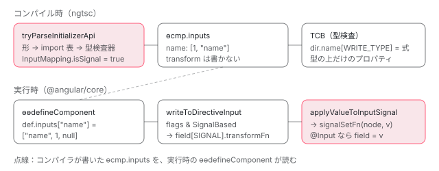

[目次](../README.md) › [Signal の内側](README.md) › 第 12 回 / 全 18 回

# input() はコンパイラにどう見えるか：初期化子 API の検出から InputFlags.SignalBased まで

> ngtsc の initializer\_functions.ts がクラスフィールドの初期化子から input / input.required / model / output / viewChild などを import 元まで確かめて見つける行、input\_function.ts が InputMapping に isSignal を立てる行、compiler が inputs を \[InputFlags.SignalBased, "name"\] の形で出す行。実行時に setInput が applyValueToInputSignal を呼ぶ経路と、型検査用の ɵINPUT\_SIGNAL\_BRAND\_WRITE\_TYPE。compliance fixture の実際の出力を読む。

angular/angular · 読了 約 14 分 · 発展 · [サイトで読む（デモが動きます）](https://angular-deep-dive-cyan.vercel.app/chapter/signals-input-compile)

---

`name = input<string>()` は、TypeScript から見ればただのクラスフィールドと関数呼び出しです。この章では、コンパイラ（ngtsc）がそれを「Angular の input」だと見抜く手順を、**構文の形を見る段階 → import 元を型検査器で確かめる段階**の 2 段で追い、見つけた結果が `InputMapping.isSignal` → `ɵcmp.inputs` の `[1, "name"]` → 実行時の `applyValueToInputSignal` まで運ばれる道を 1 本につなげます。最後に、テンプレートの型検査が `ɵINPUT_SIGNAL_BRAND_WRITE_TYPE` を使う理由を読みます。

読む対象は `compiler-cli/src/ngtsc/annotations/directive/src/` の `initializer_functions.ts`・`input_function.ts`・`initializer_function_access.ts`・`output_function.ts`・`query_functions.ts`・`shared.ts`、`ngtsc/imports/src/imported_symbols_tracker.ts`、`ngtsc/validation/src/rules/initializer_api_usage_rule.ts`、`compiler/src/render3/view/util.ts`、`compiler/src/typecheck/ops/inputs.ts`、実行時側の `core/src/render3/definition.ts`・`instructions/write_to_directive_input.ts`・`apply_value_input_field.ts`・`component_ref.ts`、そして compliance fixture の `test_cases/signal_inputs/` です。

1. [1. 概観](01-signals.md)
2. [2. ReactiveNode の構造](02-signals-reactive-node.md)
3. [3. 依存の追跡](03-signals-tracking.md)
4. [4. set と update](04-signals-set.md)
5. [5. push と pull](05-signals-push-pull.md)
6. [6. computed](06-signals-computed.md)
7. [7. live と non-live](07-signals-live.md)
8. [8. linkedSignal](08-signals-linked-signal.md)
9. [9. effect のノードと寿命](09-signals-effect-node.md)
10. [10. afterRenderEffect](10-signals-after-render-effect.md)
11. [11. input と viewChild](11-authoring.md)
12. **12. input() とコンパイラ**（この章）
13. [13. model() と output()](13-signals-model-output.md)
14. [14. toSignal と toObservable](14-signals-rxjs-interop.md)
15. [15. resource](15-resource.md)
16. [16. httpResource と rxResource](16-signals-http-resource.md)
17. [17. Signal Forms](17-signal-forms.md)
18. [18. DevTools と signal グラフ](18-signals-debug.md)

## 1. 「初期化子 API」という分類

📄 `angular/packages/compiler-cli/src/ngtsc/annotations/directive/src/initializer_functions.ts` L26–41 （▶ の行: 28, 30–31, 33, 35, 40）

```ts
26 │ export interface InitializerApiFunction {
27 │   /** Module name where the initializer function is imported from. */
28 ▶   owningModule: '@angular/core' | '@angular/core/rxjs-interop';
29 │   /** Export name of the initializer function. */
30 ▶   functionName:
31 ▶     | 'input'
32 │     | 'model'
33 ▶     | 'output'
34 │     | 'outputFromObservable'
35 ▶     | 'viewChild'
36 │     | 'viewChildren'
37 │     | 'contentChild'
38 │     | 'contentChildren';
39 │   /** Class member access levels compatible with the API. */
40 ▶   allowedAccessLevels: ClassMemberAccessLevel[];
41 │ }
```

コンパイラは `input` / `model` / `output` / `viewChild` などを、クラスフィールドの初期化子（`=` の右側）で呼ぶ関数＝**初期化子 API**としてまとめて扱います。1 つの API は 3 つの情報で表されます。28 行目の import 元モジュール（`@angular/core` か `@angular/core/rxjs-interop`）、30〜38 行目の export 名、40 行目の「どのアクセス修飾子のフィールドに書いてよいか」です。

📄 `angular/packages/compiler-cli/src/ngtsc/annotations/directive/src/input_function.ts` L20–33 （▶ の行: 21–22, 27–31）

```ts
20 │ export const INPUT_INITIALIZER_FN: InitializerApiFunction = {
21 ▶   functionName: 'input',
22 ▶   owningModule: '@angular/core',
23 │   // Inputs are accessed from parents, via the `property` instruction.
24 │   // Conceptually, the fields need to be publicly readable, but in practice,
25 │   // accessing `protected` or `private` members works at runtime, so we can allow
26 │   // cases where the input is intentionally not part of the public API, programmatically.
27 ▶   // Note: `private` is omitted intentionally as this would be a conceptual confusion point.
28 ▶   allowedAccessLevels: [
29 ▶     ClassMemberAccessLevel.PublicWritable,
30 ▶     ClassMemberAccessLevel.PublicReadonly,
31 ▶     ClassMemberAccessLevel.Protected,
32 │   ],
33 │ };
```

`input` の定義です。21〜22 行目で「`@angular/core` の `input`」、28〜32 行目で public / public readonly / protected だけを許します。27 行目のコメントのとおり、`private` は「外から値が入るのに private」という混乱を避けるために外してあります。

## 2. tryParseInitializerApi：形を見て、最後に import を確かめる

📄 `angular/packages/compiler-cli/src/ngtsc/annotations/directive/src/initializer_functions.ts` L79–100 （▶ の行: 85–86, 89–90, 94–96）

```ts
 79 │ export function tryParseInitializerApi<Functions extends InitializerApiFunction[]>(
 80 │   functions: Functions,
 81 │   expression: ts.Expression,
 82 │   reflector: ReflectionHost,
 83 │   importTracker: ImportedSymbolsTracker,
 84 │ ): (InitializerFunctionMetadata & {api: Functions[number]}) | null {
 85 ▶   if (ts.isAsExpression(expression) || ts.isParenthesizedExpression(expression)) {
 86 ▶     return tryParseInitializerApi(functions, expression.expression, reflector, importTracker);
 87 │   }
 88 │ 
 89 ▶   if (!ts.isCallExpression(expression)) {
 90 ▶     return null;
 91 │   }
 92 │ 
 93 │   const staticResult =
 94 ▶     parseTopLevelCall(expression, functions, importTracker) ||
 95 ▶     parseTopLevelRequiredCall(expression, functions, importTracker) ||
 96 ▶     parseTopLevelCallFromNamespace(expression, functions, importTracker);
 97 │ 
 98 │   if (staticResult === null) {
 99 │     return null;
100 │   }
```

1. **85〜87 行目：`as` と括弧をはがす**

   `(input(0) as X)` のような書き方でも中身の呼び出しを見ます。
2. **89〜91 行目：関数呼び出しでなければ終わり**

   初期化子が `someFactory.create()` の結果の変数などであれば、ここで `null` です。
3. **94〜96 行目：3 つの形を順に試す**

   `input()`（94 行目）、`input.required()`（95 行目）、`core.input()` / `core.input.required()`（96 行目、名前空間 import）。どれも**構文木の形と、そのファイルの import 文だけ**で判定します。

📄 `angular/packages/compiler-cli/src/ngtsc/annotations/directive/src/initializer_functions.ts` L127–146 （▶ の行: 134, 138–139, 145）

```ts
127 │ function parseTopLevelCall(
128 │   call: ts.CallExpression,
129 │   functions: InitializerApiFunction[],
130 │   importTracker: ImportedSymbolsTracker,
131 │ ): StaticInitializerData | null {
132 │   const node = call.expression;
133 │ 
134 ▶   if (!ts.isIdentifier(node)) {
135 │     return null;
136 │   }
137 │ 
138 ▶   const matchingApi = functions.find((fn) =>
139 ▶     importTracker.isPotentialReferenceToNamedImport(node, fn.functionName, fn.owningModule),
140 │   );
141 │   if (matchingApi === undefined) {
142 │     return null;
143 │   }
144 │ 
145 ▶   return {api: matchingApi, apiReference: node, isRequired: false};
146 │ }
```

📄 `angular/packages/compiler-cli/src/ngtsc/annotations/directive/src/initializer_functions.ts` L152–176 （▶ の行: 160–162, 168–169, 175）

```ts
152 │ function parseTopLevelRequiredCall(
153 │   call: ts.CallExpression,
154 │   functions: InitializerApiFunction[],
155 │   importTracker: ImportedSymbolsTracker,
156 │ ): StaticInitializerData | null {
157 │   const node = call.expression;
158 │ 
159 │   if (
160 ▶     !ts.isPropertyAccessExpression(node) ||
161 ▶     !ts.isIdentifier(node.expression) ||
162 ▶     node.name.text !== 'required'
163 │   ) {
164 │     return null;
165 │   }
166 │ 
167 │   const expression = node.expression;
168 ▶   const matchingApi = functions.find((fn) =>
169 ▶     importTracker.isPotentialReferenceToNamedImport(expression, fn.functionName, fn.owningModule),
170 │   );
171 │   if (matchingApi === undefined) {
172 │     return null;
173 │   }
174 │ 
175 ▶   return {api: matchingApi, apiReference: expression, isRequired: true};
176 │ }
```

134 行目、呼び出される側が識別子（`input` のような 1 語）であること。139 行目、その識別子が「`@angular/core` から `input` という名前で import されたローカル名」であること。`input.required()` のほうは 160〜162 行目で「識別子 `.required`」の形を確かめ、169 行目で同じ判定をし、175 行目で `isRequired: true` を返します。

📄 `angular/packages/compiler-cli/src/ngtsc/imports/src/imported_symbols_tracker.ts` L109–135 （▶ の行: 111, 116, 119–122, 134）

```ts
109 │       const moduleName = stmt.moduleSpecifier.text;
110 │ 
111 ▶       if (ts.isNamespaceImport(stmt.importClause.namedBindings)) {
112 │         // import * as foo from 'module'
113 │         if (!namespaceImports.has(moduleName)) {
114 │           namespaceImports.set(moduleName, new Set());
115 │         }
116 ▶         namespaceImports.get(moduleName)!.add(stmt.importClause.namedBindings.name.text);
117 │       } else {
118 │         // import {foo, bar as alias} from 'module'
119 ▶         for (const element of stmt.importClause.namedBindings.elements) {
120 ▶           const localName = element.name.text;
121 ▶           const exportedName =
122 ▶             element.propertyName === undefined ? localName : element.propertyName.text;
123 │ 
124 │           if (!namedImports.has(moduleName)) {
125 │             namedImports.set(moduleName, new Map());
126 │           }
127 │ 
128 │           const localNames = namedImports.get(moduleName)!;
129 │ 
130 │           if (!localNames.has(exportedName)) {
131 │             localNames.set(exportedName, new Set());
132 │           }
133 │ 
134 ▶           localNames.get(exportedName)?.add(localName);
135 │         }
```

139 行目が使う `ImportedSymbolsTracker` は、ファイルの先頭の import 文を一度だけ走査して表を作ります。120〜122 行目、`import {input as myInput}` なら export 名 `input` にローカル名 `myInput` を対応づけ、134 行目で登録します。111〜116 行目は `import * as core` の名前空間を覚えます。つまり**別名 import でも名前空間 import でも見つかります**。

📄 `angular/packages/compiler-cli/src/ngtsc/annotations/directive/src/initializer_functions.ts` L102–121 （▶ の行: 104–111, 113）

```ts
102 │   const {api, apiReference, isRequired} = staticResult;
103 │ 
104 ▶   // Once we've statically determined that the initializer is one of the APIs we're looking for, we
105 ▶   // need to verify it using the type checker which accounts for things like shadowed variables.
106 ▶   // This should be done as the absolute last step since using the type check can be expensive.
107 ▶   const resolvedImport = reflector.getImportOfIdentifier(apiReference);
108 ▶   if (
109 ▶     resolvedImport === null ||
110 ▶     api.functionName !== resolvedImport.name ||
111 ▶     api.owningModule !== resolvedImport.from
112 │   ) {
113 ▶     return null;
114 │   }
115 │ 
116 │   return {
117 │     api,
118 │     call: expression,
119 │     isRequired,
120 │   };
121 │ }
```

ここまでは「それらしい形」を見ただけです。104〜106 行目のコメントのとおり、同じ名前のローカル変数で import を隠している（シャドーイング）場合などを除くため、107 行目で型検査器に「この識別子は本当はどこから来たか」を尋ねます。109〜111 行目、元の export 名と import 元が一致しなければ `null`。型検査器は高くつくので、**安い判定で候補を絞り、最後の 1 回だけ使う**順番になっています。

## 3. InputMapping に isSignal を立てる

📄 `angular/packages/compiler-cli/src/ngtsc/annotations/directive/src/input_function.ts` L39–76 （▶ の行: 48, 58, 60–62, 64, 68, 70–71, 74）

```ts
39 │ export function tryParseSignalInputMapping(
40 │   member: Pick<ClassMember, 'name' | 'value' | 'accessLevel'>,
41 │   reflector: ReflectionHost,
42 │   importTracker: ImportedSymbolsTracker,
43 │ ): InputMapping | null {
44 │   if (member.value === null) {
45 │     return null;
46 │   }
47 │ 
48 ▶   const signalInput = tryParseInitializerApi(
49 │     [INPUT_INITIALIZER_FN],
50 │     member.value,
51 │     reflector,
52 │     importTracker,
53 │   );
54 │   if (signalInput === null) {
55 │     return null;
56 │   }
57 │ 
58 ▶   validateAccessOfInitializerApiMember(signalInput, member);
59 │ 
60 ▶   const optionsNode = (
61 ▶     signalInput.isRequired ? signalInput.call.arguments[0] : signalInput.call.arguments[1]
62 ▶   ) as ts.Expression | undefined;
63 │   const options =
64 ▶     optionsNode !== undefined ? parseAndValidateInputAndOutputOptions(optionsNode) : null;
65 │   const classPropertyName = member.name;
66 │ 
67 │   return {
68 ▶     isSignal: true,
69 │     classPropertyName,
70 ▶     bindingPropertyName: options?.alias ?? classPropertyName,
71 ▶     required: signalInput.isRequired,
72 │     // Signal inputs do not capture complex transform metadata.
73 │     // See more details in the `transform` type of `InputMapping`.
74 ▶     transform: null,
75 │   };
76 │ }
```

1. **48〜53 行目：2 節の関数で `input` だけを探す**
2. **58 行目：アクセス修飾子を検査**

   中身は次の節。
3. **60〜64 行目：オプションを静的に読む**

   `input.required(opts)` は 1 番目、`input(初期値, opts)` は 2 番目の引数がオプションです。コンパイラが読むのは `alias` だけで、オブジェクトリテラルでなければエラーにします（input\_output\_parse\_options.ts）。
4. **68〜74 行目：`InputMapping` を返す**

   68 行目 `isSignal: true`、70 行目で公開名は `alias` かフィールド名、71 行目 `required`。74 行目、**`transform` は `null`**。signal input の transform はノードの `transformFn` に入っていて（[第 11 回](11-authoring.md)）、コンパイラが ɵcmp に書き出す必要が無いからです。

📄 `angular/packages/compiler-cli/src/ngtsc/annotations/directive/src/initializer_function_access.ts` L22–45 （▶ の行: 26, 28, 31, 38）

```ts
22 │ export function validateAccessOfInitializerApiMember(
23 │   {api, call}: InitializerFunctionMetadata,
24 │   member: Pick<ClassMember, 'accessLevel'>,
25 │ ): void {
26 ▶   if (!api.allowedAccessLevels.includes(member.accessLevel)) {
27 │     throw new FatalDiagnosticError(
28 ▶       ErrorCode.INITIALIZER_API_DISALLOWED_MEMBER_VISIBILITY,
29 │       call,
30 │       makeDiagnosticChain(
31 ▶         `Cannot use "${
32 │           api.functionName
33 │         }" on a class member that is declared as ${classMemberAccessLevelToString(
34 │           member.accessLevel,
35 │         )}.`,
36 │         [
37 │           makeDiagnosticChain(
38 ▶             `Update the class field to be either: ` +
39 │               api.allowedAccessLevels.map((l) => classMemberAccessLevelToString(l)).join(', '),
40 │           ),
41 │         ],
42 │       ),
43 │     );
44 │   }
45 │ }
```

26 行目、1 節の `allowedAccessLevels` に入っていなければ、28 行目の `INITIALIZER_API_DISALLOWED_MEMBER_VISIBILITY`（NG1053）です。メッセージは「Cannot use "input" on a class member that is declared as private.」のようになります。

📄 `angular/packages/compiler-cli/src/ngtsc/annotations/directive/src/query_functions.ts` L43–57 （▶ の行: 47–48, 55）

```ts
43 │ export const QUERY_INITIALIZER_FNS: (InitializerApiFunction & {functionName: QueryFunctionName})[] =
44 │   queryFunctionNames.map((fnName) => ({
45 │     functionName: fnName,
46 │     owningModule: '@angular/core' as const,
47 ▶     // Queries are accessed from within static blocks, via the query definition functions.
48 ▶     // Conceptually, the fields could access private members— even ES private fields.
49 │     // Support for ES private fields requires special caution and complexity when partial
50 │     // output is linked— hence not supported. TS private members are allowed in static blocks.
51 │     allowedAccessLevels: [
52 │       ClassMemberAccessLevel.PublicWritable,
53 │       ClassMemberAccessLevel.PublicReadonly,
54 │       ClassMemberAccessLevel.Protected,
55 ▶       ClassMemberAccessLevel.Private,
56 │     ],
57 │   }));
```

クエリだけは 55 行目で `Private` まで許します。47〜50 行目のコメントのとおり、クエリはクラスの static な定義関数（[第 11 回](11-authoring.md)の `viewQuery`）から読まれるので、TypeScript の `private` でも届くからです。`#field`（ES の private）だけは扱いが難しいので外されています。

📄 `angular/packages/compiler-cli/src/ngtsc/annotations/directive/src/output_function.ts` L59–96 （▶ の行: 68, 70, 72, 80–81, 91）

```ts
59 │   const output = tryParseInitializerApi(
60 │     OUTPUT_INITIALIZER_FNS,
61 │     member.value,
62 │     reflector,
63 │     importTracker,
64 │   );
65 │   if (output === null) {
66 │     return null;
67 │   }
68 ▶   if (output.isRequired) {
69 │     throw new FatalDiagnosticError(
70 ▶       ErrorCode.INITIALIZER_API_NO_REQUIRED_FUNCTION,
71 │       output.call,
72 ▶       `Output does not support ".required()".`,
73 │     );
74 │   }
75 │ 
76 │   validateAccessOfInitializerApiMember(output, member);
77 │ 
78 │   // Options are the first parameter for `output()`, while for
79 │   // the interop `outputFromObservable()` they are the second argument.
80 ▶   const optionsNode = (
81 ▶     output.api.functionName === 'output' ? output.call.arguments[0] : output.call.arguments[1]
82 │   ) as ts.Expression | undefined;
83 │   const options =
84 │     optionsNode !== undefined ? parseAndValidateInputAndOutputOptions(optionsNode) : null;
85 │   const classPropertyName = member.name;
86 │ 
87 │   return {
88 │     call: output.call,
89 │     metadata: {
90 │       // Outputs are not signal-based.
91 ▶       isSignal: false,
92 │       classPropertyName,
93 │       bindingPropertyName: options?.alias ?? classPropertyName,
94 │     },
95 │   };
96 │ }
```

`output()` も同じ `tryParseInitializerApi` を通ります。違いは 3 つ。68〜73 行目で `.required()` を拒否（NG1052）、80〜82 行目でオプションの位置が `output` と `outputFromObservable` で違う、91 行目で `isSignal: false`。output は signal ではないからです（[第 13 回](13-signals-model-output.md)）。

## 4. shared.ts：@Input との併用と static を弾く

📄 `angular/packages/compiler-cli/src/ngtsc/annotations/directive/src/shared.ts` L1325–1345 （▶ の行: 1327–1329, 1331, 1335）

```ts
1325 │   const classPropertyName = member.name;
1326 │ 
1327 ▶   const decorator = tryGetDecoratorOnMember(member, 'Input', isCore);
1328 ▶   const signalInputMapping = tryParseSignalInputMapping(member, reflector, importTracker);
1329 ▶   const modelInputMapping = tryParseSignalModelMapping(member, reflector, importTracker);
1330 │ 
1331 ▶   if (decorator !== null && signalInputMapping !== null) {
1332 │     throw new FatalDiagnosticError(
1333 │       ErrorCode.INITIALIZER_API_WITH_DISALLOWED_DECORATOR,
1334 │       decorator.node,
1335 ▶       `Using @Input with a signal input is not allowed.`,
1336 │     );
1337 │   }
1338 │ 
1339 │   if (decorator !== null && modelInputMapping !== null) {
1340 │     throw new FatalDiagnosticError(
1341 │       ErrorCode.INITIALIZER_API_WITH_DISALLOWED_DECORATOR,
1342 │       decorator.node,
1343 │       `Using @Input with a model input is not allowed.`,
1344 │     );
1345 │   }
```

クラスのフィールド 1 つごとに呼ばれる関数です。1327 行目で `@Input` デコレータを、1328〜1329 行目で `input()` / `model()` を探し、1331〜1336 行目で **両方付いていたらエラー**（NG1050「Using @Input with a signal input is not allowed.」）にします。

📄 `angular/packages/compiler-cli/src/ngtsc/annotations/directive/src/shared.ts` L1471–1486 （▶ の行: 1471, 1475, 1480, 1484）

```ts
1471 ▶     if (member.isStatic) {
1472 │       throw new FatalDiagnosticError(
1473 │         ErrorCode.INCORRECTLY_DECLARED_ON_STATIC_MEMBER,
1474 │         member.node ?? clazz,
1475 ▶         `Input "${member.name}" is incorrectly declared as static member of "${clazz.name.text}".`,
1476 │       );
1477 │     }
1478 │ 
1479 │     // Validate that signal inputs are not accidentally declared in the `inputs` metadata.
1480 ▶     if (inputMapping.isSignal && Object.hasOwn(inputsFromClassDecorator, classPropertyName)) {
1481 │       throw new FatalDiagnosticError(
1482 │         ErrorCode.INITIALIZER_API_DECORATOR_METADATA_COLLISION,
1483 │         member.node ?? clazz,
1484 ▶         `Input "${member.name}" is also declared as non-signal in @${classDecorator.name}.`,
1485 │       );
1486 │     }
```

1471〜1477 行目、static フィールドの input はエラー（NG1100）。1480〜1485 行目、`@Component({ inputs: ['name'] })` と `name = input()` を両方書いてもエラー（NG1051）です。

📄 `angular/packages/compiler-cli/src/ngtsc/annotations/directive/src/shared.ts` L2260–2270 （▶ の行: 2266–2268）

```ts
2260 │ /** Converts the parsed input information into metadata. */
2261 │ function toR3InputMetadata(mapping: InputMapping): R3InputMetadata {
2262 │   return {
2263 │     classPropertyName: mapping.classPropertyName,
2264 │     bindingPropertyName: mapping.bindingPropertyName,
2265 │     required: mapping.required,
2266 ▶     transformFunction:
2267 ▶       mapping.transform !== null ? new WrappedNodeExpr(mapping.transform.node) : null,
2268 ▶     isSignal: mapping.isSignal,
2269 │   };
2270 │ }
```

解析結果はコンパイラ本体（`@angular/compiler`）に渡す形 `R3InputMetadata` に変換されます。2266〜2267 行目、`transform` が `null`（signal input はいつもそう）なら `transformFunction` も `null`。2268 行目で `isSignal` がそのまま運ばれます。

## 5. 関数で包んだ input は見つからない：NG8110

📄 `angular/packages/compiler-cli/src/ngtsc/validation/src/rules/initializer_api_usage_rule.ts` L84–117 （▶ の行: 84, 91, 97–98, 102, 105, 113–114, 116）

```ts
 84 ▶     if (ts.isPropertyDeclaration(node.parent) && node.parent.initializer === node) {
 85 │       let closestClass: ts.Node = node.parent;
 86 │ 
 87 │       while (closestClass && !ts.isClassDeclaration(closestClass)) {
 88 │         closestClass = closestClass.parent;
 89 │       }
 90 │ 
 91 ▶       if (closestClass && ts.isClassDeclaration(closestClass)) {
 92 │         const decorators = this.reflector.getDecoratorsOfDeclaration(closestClass);
 93 │         const isComponentOrDirective =
 94 │           decorators !== null &&
 95 │           decorators.some((decorator) => {
 96 │             return (
 97 ▶               decorator.import?.from === '@angular/core' &&
 98 ▶               (decorator.name === 'Component' || decorator.name === 'Directive')
 99 │             );
100 │           });
101 │ 
102 ▶         return isComponentOrDirective
103 │           ? null
104 │           : makeDiagnostic(
105 ▶               ErrorCode.UNSUPPORTED_INITIALIZER_API_USAGE,
106 │               node,
107 │               `Unsupported call to the ${functionName} function. This function can only be used as the initializer ` +
108 │                 `of a property on a @Component or @Directive class.`,
109 │             );
110 │       }
111 │     }
112 │ 
113 ▶     return makeDiagnostic(
114 ▶       ErrorCode.UNSUPPORTED_INITIALIZER_API_USAGE,
115 │       node,
116 ▶       `Unsupported call to the ${functionName} function. This function can only be called in the initializer of a class member.`,
117 │     );
```

これは解析とは別に、ファイル全体の呼び出し式を見て回る検査 `InitializerApiUsageRule` です。2 節の関数で `input()` などの呼び出しを見つけたら、場所を確かめます。

- 84 行目：プロパティ宣言の初期化子そのもので、91〜100 行目でそのクラスに `@angular/core` の `@Component` か `@Directive` が付いていれば OK（102 行目）
- そうでないクラスのフィールドなら 104〜109 行目でエラー
- それ以外（関数の中、コンストラクタの中、変数宣言など）は 113〜116 行目で「can only be called in the initializer of a class member」

どちらも `UNSUPPORTED_INITIALIZER_API_USAGE`（NG8110）です。`function myInput() { return input(); }` と包むと、包んだ関数の中の `input()` が 113 行目で止められ、フィールド側の `name = myInput()` は 2 節 139 行目で `myInput` が import 名でないので input として認識されません。

## 6. ɵcmp の inputs に \[1, "name"\] を書く

📄 `angular/packages/compiler/src/render3/view/util.ts` L94–130 （▶ の行: 98–99, 103–104, 106–107, 112–114, 116, 118–119, 121–122, 128）

```ts
 94 │         minifiedName = key;
 95 │         declaredName = value.classPropertyName;
 96 │         publicName = value.bindingPropertyName;
 97 │ 
 98 ▶         const differentDeclaringName = publicName !== declaredName;
 99 ▶         const hasDecoratorInputTransform = value.transformFunction !== null;
100 │         let flags = InputFlags.None;
101 │ 
102 │         // Build up input flags
103 ▶         if (value.isSignal) {
104 ▶           flags |= InputFlags.SignalBased;
105 │         }
106 ▶         if (hasDecoratorInputTransform) {
107 ▶           flags |= InputFlags.HasDecoratorInputTransform;
108 │         }
109 │ 
110 │         // Inputs, compared to outputs, will track their declared name (for `ngOnChanges`), support
111 │         // decorator input transform functions, or store flag information if there is any.
112 ▶         if (
113 ▶           forInputs &&
114 ▶           (differentDeclaringName || hasDecoratorInputTransform || flags !== InputFlags.None)
115 │         ) {
116 ▶           const result = [o.literal(flags), asLiteral(publicName)];
117 │ 
118 ▶           if (differentDeclaringName || hasDecoratorInputTransform) {
119 ▶             result.push(asLiteral(declaredName));
120 │ 
121 ▶             if (hasDecoratorInputTransform) {
122 ▶               result.push(value.transformFunction!);
123 │             }
124 │           }
125 │ 
126 │           expressionValue = o.literalArr(result);
127 │         } else {
128 ▶           expressionValue = asLiteral(publicName);
129 │         }
130 │       }
```

`conditionallyCreateDirectiveBindingLiteral`（compiler の `baseDirectiveFields` が `inputs` を作るときに呼ぶ）の本体です。

1. **103〜108 行目：フラグを組む**

   `isSignal` なら `InputFlags.SignalBased`（`1 << 0` = 1）、デコレータの transform があれば `HasDecoratorInputTransform`（2）。
2. **112〜116 行目：配列にするかどうか**

   公開名とフィールド名が違う（98 行目）、デコレータ transform がある（99 行目）、フラグが 0 でない、のどれかなら `[フラグ, 公開名]` の配列にします。
3. **118〜123 行目：必要なときだけ後ろを足す**

   名前が違うかデコレータ transform があれば 3 番目にフィールド名、transform があれば 4 番目に関数そのもの。
4. **128 行目：何も無ければ文字列だけ**

   従来の `@Input()` で名前も同じなら `"name"` の 1 語で済ませ、出力を小さくします。

実際の出力を compliance fixture（コンパイラのテスト用の入力と期待出力の組）で見ます。

📄 `angular/packages/compiler-cli/test/compliance/test_cases/signal_inputs/mixed_input_types.ts` L1–19 （▶ の行: 10–13, 15–17）

```ts
 1 │ import {Directive, Input, input} from '@angular/core';
 2 │ 
 3 │ function convertToBoolean(value: string|boolean) {
 4 │   return value === true || value !== '';
 5 │ }
 6 │ 
 7 │ @Directive({
 8 │ })
 9 │ export class TestDir {
10 ▶   counter = input(0);
11 ▶   signalWithTransform = input(false, {transform: convertToBoolean});
12 ▶   signalWithTransformAndAlias =
13 ▶       input(false, {alias: 'publicNameSignal', transform: convertToBoolean});
14 │ 
15 ▶   @Input() decoratorInput = true;
16 ▶   @Input('publicNameDecorator') decoratorInputWithAlias = true;
17 ▶   @Input({alias: 'publicNameDecorator2', transform: convertToBoolean})
18 │   decoratorInputWithTransformAndAlias = true;
19 │ }
```

📄 `angular/packages/compiler-cli/test/compliance/test_cases/signal_inputs/mixed_input_types.js` L1–15 （▶ の行: 6–11）

```js
 1 │ export class TestDir {
 2 │   …
 3 │   static ɵdir = /* @__PURE__ */ $r3$.ɵɵdefineDirective({
 4 │     …
 5 │     inputs: {
 6 ▶       counter: [1, "counter"],
 7 ▶       signalWithTransform: [1, "signalWithTransform"],
 8 ▶       signalWithTransformAndAlias: [1, "publicNameSignal", "signalWithTransformAndAlias"],
 9 ▶       decoratorInput: "decoratorInput",
10 ▶       decoratorInputWithAlias: [0, "publicNameDecorator", "decoratorInputWithAlias"],
11 ▶       decoratorInputWithTransformAndAlias: [2, "publicNameDecorator2", "decoratorInputWithTransformAndAlias", convertToBoolean]
12 │     }
13 │     …
14 │   });
15 │ }
```
*期待出力は部分一致で比較され、… は省略を表す*

| .ts | .js（ɵdir.inputs） | 読み方 |
| --- | --- | --- |
| 10 `counter = input(0)` | 6 `[1, "counter"]` | フラグ 1（SignalBased）だけで配列になる |
| 11 transform 付き signal | 7 `[1, "signalWithTransform"]` | **transform は出力されない**（3 節 74 行目） |
| 12〜13 alias + transform | 8 `[1, "publicNameSignal", "signalWithTransformAndAlias"]` | 名前が違うので 3 番目にフィールド名 |
| 15 `@Input() decoratorInput` | 9 `"decoratorInput"` | 128 行目の文字列だけ |
| 16 `@Input('publicNameDecorator')` | 10 `[0, "publicNameDecorator", ...]` | フラグ 0 でも名前が違えば配列 |
| 17 `@Input({transform})` | 11 `[2, ..., convertToBoolean]` | デコレータの transform は 4 番目に関数が入る |

📄 `angular/packages/compiler-cli/test/compliance/test_cases/signal_inputs/input_component_definition_isolated.golden.d.ts` L1–7 （▶ の行: 3, 6）

```ts
1 │ import * as i0 from "@angular/core";
2 │ export declare class TestComp {
3 ▶     counter: import("@angular/core").InputSignal<number>;
4 │     name: import("@angular/core").InputSignal<string>;
5 │     static ɵfac: i0.ɵɵFactoryDeclaration<TestComp, never>;
6 ▶     static ɵcmp: i0.ɵɵComponentDeclaration<TestComp, "ng-component", never, { "counter": { "alias": "counter"; "required": false; "isSignal": true; }; "name": { "alias": "name"; "required": true; "isSignal": true; }; }, {}, never, never, true, never>;
7 │ }
```
*同じ fixture の .d.ts。ライブラリとして配布するときはこの型情報で isSignal が伝わる*

3 行目、フィールドの型は `InputSignal<number>`。6 行目の `ɵɵComponentDeclaration` の 4 番目の型引数に `"isSignal": true` が入ります。ライブラリを使う側のコンパイラは、ソースではなくこの .d.ts を読んで input の種類を知ります。

## 7. 実行時：ɵɵdefineComponent が配列をほどく

📄 `angular/packages/core/src/render3/definition.ts` L510–534 （▶ の行: 518–522, 524, 526, 530–531）

```ts
510 │   for (const minifiedKey in obj) {
511 │     if (Object.hasOwn(obj, minifiedKey)) {
512 │       const value = obj[minifiedKey]!;
513 │       let publicName: string;
514 │       let declaredName: string;
515 │       let inputFlags: InputFlags;
516 │       let transform: InputTransformFunction | null;
517 │ 
518 ▶       if (Array.isArray(value)) {
519 ▶         inputFlags = value[0];
520 ▶         publicName = value[1];
521 ▶         declaredName = value[2] ?? publicName; // declared name might not be set to save bytes.
522 ▶         transform = value[3] || null;
523 │       } else {
524 ▶         publicName = value;
525 │         declaredName = value;
526 ▶         inputFlags = InputFlags.None;
527 │         transform = null;
528 │       }
529 │ 
530 ▶       newLookup[publicName] = [minifiedKey, inputFlags, transform];
531 ▶       declaredInputs[publicName] = declaredName as string;
532 │     }
533 │   }
534 │   return newLookup;
```

`parseAndConvertInputsForDefinition`（`ɵɵdefineDirective` / `ɵɵdefineComponent` の中で呼ばれる）です。518〜522 行目で配列ならフラグ・公開名・フィールド名（無ければ公開名、521 行目）・transform を取り出し、文字列なら 524〜527 行目でフラグ 0 とみなします。530 行目、**キーを公開名に付け替えて**`[フィールド名, フラグ, transform]` にします。テンプレートの `[enabled]` は公開名で探すので、この向きが引きやすいのです。

## 8. 書き込み：writeToDirectiveInput → applyValueToInputSignal

テンプレートの `[name]="x"` は `ɵɵproperty('name', ctx.x)` になり、`setPropertyAndInputs` → `setAllInputsForProperty` を経て、一致したディレクティブごとに `writeToDirectiveInput` を呼びます。そこまでは [Ivy シリーズの更新命令の章](../ivy/10-ivy-update-instructions.md)で読みました。ここでは signal input に関わる行だけを見ます。

📄 `angular/packages/core/src/render3/instructions/write_to_directive_input.ts` L43–68 （▶ の行: 43, 50–52, 57–59, 61, 64–65, 67）

```ts
43 ▶     const [privateName, flags, transform] = def.inputs[publicName];
44 │ 
45 │     // If we know we are dealing with a signal input, we cache its reference
46 │     // in a tree-shakable way. The input signal node can then be used for
47 │     // value transform execution or actual value updates without introducing
48 │     // additional megamorphic accesses for accessing the instance field.
49 │     let inputSignalNode: InputSignalNode<unknown, unknown> | null = null;
50 ▶     if ((flags & InputFlags.SignalBased) !== 0) {
51 ▶       const field = (instance as any)[privateName] as InputSignalWithTransform<unknown, unknown>;
52 ▶       inputSignalNode = field[SIGNAL];
53 │     }
54 │ 
55 │     // If there is a signal node and a transform, run it before potentially
56 │     // delegating to features like `NgOnChanges`.
57 ▶     if (inputSignalNode !== null && inputSignalNode.transformFn !== undefined) {
58 ▶       value = inputSignalNode.transformFn(value);
59 ▶     } else if (transform !== null) {
60 │       // If there is a decorator input transform, run it.
61 ▶       value = transform.call(instance, value);
62 │     }
63 │ 
64 ▶     if (def.setInput !== null) {
65 ▶       def.setInput(instance, inputSignalNode, value, publicName, privateName);
66 │     } else {
67 ▶       applyValueToInputField(instance, inputSignalNode, privateName, value);
68 │     }
```

1. **43 行目：7 節で作った `[フィールド名, フラグ, transform]` を取り出す**
2. **50〜53 行目：SignalBased ならノードを取る**

   `instance[フィールド名]` は `input()` が返した getter なので、その `[SIGNAL]` がノードです。
3. **57〜62 行目：transform はどちらか一方**

   signal input ならノードの `transformFn`（58 行目）、そうでなく ɵcmp に transform があればそれ（61 行目）。
4. **64〜68 行目：書き込む**

   `def.setInput` は `NgOnChanges` 機能が付いたときだけ入ります（features/ng\_onchanges\_feature.ts）。無ければ 67 行目の `applyValueToInputField` です。

📄 `angular/packages/core/src/render3/apply_value_input_field.ts` L11–22 （▶ の行: 17–18, 20）

```ts
11 │ export function applyValueToInputField<T>(
12 │   instance: T,
13 │   inputSignalNode: null | InputSignalNode<unknown, unknown>,
14 │   privateName: string,
15 │   value: unknown,
16 │ ) {
17 ▶   if (inputSignalNode !== null) {
18 ▶     inputSignalNode.applyValueToInputSignal(inputSignalNode, value);
19 │   } else {
20 ▶     (instance as any)[privateName] = value;
21 │   }
22 │ }
```

17〜18 行目、ノードがあれば `applyValueToInputSignal`（中身は `signalSetFn`）。無ければ 20 行目で **フィールドに代入**します。`@Input()` と `input()` の実行時の違いは、この if の 2 本の枝だけです。

📄 `angular/packages/core/src/render3/component_ref.ts` L90–103 （▶ の行: 92, 96, 98–99）

```ts
 90 │ function toInputRefArray<T>(map: DirectiveDef<T>['inputs']): ComponentFactory<T>['inputs'] {
 91 │   return Object.keys(map).map((name) => {
 92 ▶     const [propName, flags, transform] = map[name];
 93 │     const inputData: ComponentFactory<T>['inputs'][0] = {
 94 │       propName: propName,
 95 │       templateName: name,
 96 ▶       isSignal: (flags & InputFlags.SignalBased) !== 0,
 97 │     };
 98 ▶     if (transform) {
 99 ▶       inputData.transform = transform;
100 │     }
101 │     return inputData;
102 │   });
103 │ }
```

`ComponentFactory.inputs`（`reflectComponentType().inputs` もこれ）は、96 行目でフラグから `isSignal` を作って外に見せます。`ComponentRef.setInput(name, value)` は、テンプレートと同じ `setAllInputsForProperty` を呼んでから `markViewDirty` します（[変更検知シリーズの OnPush の章](../cd/04-cd-onpush-markforcheck.md)で引用済み）。

> **🧪 DEMO — signal input と @Input が混ざったコンポーネントを覗く**
>
> `SicTarget` は `counter = input(0)`、`flag = input(false, { alias: 'enabled', transform: booleanAttribute })`、`@Input() legacy`、`@Input({ transform: booleanAttribute }) legacyFlag` の 4 つを持ちます。
>
> ↑ `reflectComponentType(SicTarget).inputs`（公開 API）。↓ 学習用に覗く `SicTarget.ɵcmp.inputs`（7 節 530 行目の形）。
>
> ▶ [このデモはサイトで動かせます](https://angular-deep-dive-cyan.vercel.app/chapter/signals-input-compile)

`flag` の行は transform が「—」です。booleanAttribute を指定しているのに ɵcmp には入っていません（3 節 74 行目、6 節の表の 2 行目）。それでも `setInput('enabled', '')` で `flag()` が `true` になるのは、8 節 58 行目でノードの `transformFn` が呼ばれるからです。`legacyFlag` は ɵcmp 側に関数（`fn`）があり、8 節 61 行目の枝を通ります。

## 9. 型検査：書き込みの型を「ブランド」で表す

実行時の書き込みは `signalSetFn` でした。では、テンプレートの `[counter]="'abc'"` を型エラーにするにはどうするか。`InputSignal<number>` に文字列を「代入」する、という形の TypeScript を作れれば、TypeScript 自身に検査させられます。

📄 `angular/packages/core/src/authoring/input/input_signal.ts` L62–93 （▶ の行: 62–63, 89, 91–92）

````ts
62 ▶ export const ɵINPUT_SIGNAL_BRAND_READ_TYPE: unique symbol = /* @__PURE__ */ Symbol();
63 ▶ export const ɵINPUT_SIGNAL_BRAND_WRITE_TYPE: unique symbol = /* @__PURE__ */ Symbol();
64 │ 
65 │ /**
66 │  * `InputSignalWithTransform` represents a special `Signal` for a
67 │  * directive/component input with a `transform` function.
68 │  *
69 │  * Signal inputs with transforms capture an extra generic for their transform write
70 │  * type. Transforms can expand the accepted bound values for an input while ensuring
71 │  * value retrievals of the signal input are still matching the generic input type.
72 │  *
73 │  * ```ts
74 │  * class MyDir {
75 │  *   disabled = input(false, {
76 │  *     transform: (v: string|boolean) => convertToBoolean(v),
77 │  *   }); // InputSignalWithTransform<boolean, string|boolean>
78 │  *
79 │  *   click() {
80 │  *     this.disabled() // always returns a `boolean`.
81 │  *   }
82 │  * }
83 │  * ```
84 │  *
85 │  * @see {@link InputSignal} for additional information.
86 │  *
87 │  * @publicApi 19.0
88 │  */
89 ▶ export interface InputSignalWithTransform<T, TransformT> extends Signal<T> {
90 │   [SIGNAL]: InputSignalNode<T, TransformT>;
91 ▶   [ɵINPUT_SIGNAL_BRAND_READ_TYPE]: T;
92 ▶   [ɵINPUT_SIGNAL_BRAND_WRITE_TYPE]: TransformT;
93 │ }
````

62〜63 行目、2 つの `unique symbol`。89〜93 行目、`InputSignalWithTransform<T, TransformT>` は `[ɵINPUT_SIGNAL_BRAND_READ_TYPE]: T`（読む型）と `[ɵINPUT_SIGNAL_BRAND_WRITE_TYPE]: TransformT`（書き込める型）を**型の上だけで**持ちます。実行時にこのプロパティは存在しません（[第 11 回](11-authoring.md)の `createInputSignal` はどちらも代入しない）。transform を付けると書き込める型だけが広がり、読む型は `T` のままです。

📄 `angular/packages/compiler/src/typecheck/ops/inputs.ts` L169–193 （▶ の行: 174–175, 180, 188–189, 193）

```ts
169 │         // For signal inputs, we unwrap the target `InputSignal`. Note that
170 │         // we intentionally do the following things:
171 │         //   1. keep the direct access to `dir.[field]` so that modifiers are honored.
172 │         //   2. follow the existing pattern where multiple targets assign a single expression.
173 │         //      This is a significant requirement for language service auto-completion.
174 ▶         if (isSignal) {
175 ▶           const inputSignalBrandWriteSymbol = this.tcb.env.referenceExternalSymbol(
176 │             R3Identifiers.InputSignalBrandWriteType.moduleName,
177 │             R3Identifiers.InputSignalBrandWriteType.name,
178 │           );
179 │ 
180 ▶           target = new TcbExpr(`${target.print()}[${inputSignalBrandWriteSymbol.print()}]`);
181 │         }
182 │ 
183 │         if (attr.keySpan !== null) {
184 │           target.addParseSpanInfo(attr.keySpan);
185 │         }
186 │ 
187 │         // Two-way bindings accept `T | WritableSignal<T>` so we have to unwrap the value.
188 ▶         if (isTwoWayBinding && this.tcb.env.config.allowSignalsInTwoWayBindings) {
189 ▶           assignment = unwrapWritableSignal(assignment, this.tcb);
190 │         }
191 │ 
192 │         // Finally the assignment is extended by assigning it into the target expression.
193 ▶         assignment = new TcbExpr(`${target.print()} = ${assignment.print()}`);
```

型検査ブロック（TCB：テンプレートを型検査するためにコンパイラが生成する TypeScript）の、input への代入を作る部分です。174〜181 行目、signal input なら代入先を `dir.counter` から `dir.counter[ɵINPUT_SIGNAL_BRAND_WRITE_TYPE]` に付け替えます。193 行目で `代入先 = 式` の文になります。188〜190 行目、`[(x)]` の双方向バインディングでは右辺の `WritableSignal` をほどきます（[第 13 回](13-signals-model-output.md)）。

📄 `angular/packages/compiler-cli/src/ngtsc/typecheck/test/type_check_block_spec.ts` L2525–2547 （▶ の行: 2526, 2533, 2546）

```ts
2525 │   describe('import generation', () => {
2526 ▶     const TEMPLATE = `<div dir [test]="null"></div>`;
2527 │     const DIRECTIVE: TestDeclaration = {
2528 │       type: 'directive',
2529 │       name: 'Dir',
2530 │       selector: '[dir]',
2531 │       inputs: {
2532 │         test: {
2533 ▶           isSignal: true,
2534 │           bindingPropertyName: 'test',
2535 │           classPropertyName: 'test',
2536 │           required: true,
2537 │           transform: null,
2538 │         },
2539 │       },
2540 │     };
2541 │ 
2542 │     it('should prefer namespace imports in type check files for new imports', () => {
2543 │       const result = tcb(TEMPLATE, [DIRECTIVE]);
2544 │ 
2545 │       expect(result).toContain(`import * as i1 from '@angular/core';`);
2546 ▶       expect(result).toContain(`[i1.ɵINPUT_SIGNAL_BRAND_WRITE_TYPE]`);
2547 │     });
```
*type\_check\_block\_spec.ts（TCB の単体テスト）*

2526 行目のテンプレート `[test]="null"` と 2533 行目の `isSignal: true` から、2546 行目のとおり `[i1.ɵINPUT_SIGNAL_BRAND_WRITE_TYPE]` を含む TCB ができます。`_t1.test[ɵINPUT_SIGNAL_BRAND_WRITE_TYPE] = null` のような文を TypeScript が検査し、型が合わなければその位置のエラーとして報告されます。



*同じ name = input&lt;string&gt;() が、コンパイル時と実行時でそれぞれ何になるか*

## ここまでの呼び出し

- 👤 `name = input<string>()` — あなたのコンポーネント（.ts）
  - `extractDirectiveMetadata()` — annotations/directive/src/shared.ts L131
    - `parseInputFields()` → `tryParseInputFieldMapping(member)` — shared.ts L1426 / L1314
      - `tryParseSignalInputMapping(member)` — input\_function.ts L39
        - `tryParseInitializerApi([INPUT_INITIALIZER_FN], ...)` — initializer\_functions.ts L79 — *形 → ImportedSymbolsTracker → getImportOfIdentifier*
        - `validateAccessOfInitializerApiMember()` — initializer\_function\_access.ts L22
      - `{ isSignal: true, transform: null }` — input\_function.ts L67
    - `toR3InputMetadata(mapping)` — shared.ts L2261
  - `conditionallyCreateDirectiveBindingLiteral(meta.inputs, true)` — compiler/src/render3/view/util.ts L60 — *name: \[1, "name"\]*
  - `dir.name[ɵINPUT_SIGNAL_BRAND_WRITE_TYPE] = 式` — compiler/src/typecheck/ops/inputs.ts L180 — *型検査だけ*
- 👤 `ɵɵdefineComponent({ inputs })` — 実行時
  - `parseAndConvertInputsForDefinition()` — core/src/render3/definition.ts L501 — *"name" → \["name", 1, null\]*
- 👤 `ɵɵproperty('name', ctx.x)` / `componentRef.setInput('name', x)` — テンプレート / 動的生成
  - `setAllInputsForProperty()` — render3/instructions/shared.ts L730
    - `writeToDirectiveInput(def, instance, 'name', x)` — write\_to\_directive\_input.ts L18 — *transformFn を通す*
      - `applyValueToInputField()` — apply\_value\_input\_field.ts L11
        - `node.applyValueToInputSignal(node, x)` → `signalSetFn` — authoring/input/input\_signal\_node.ts L47

## 聞かれそうな質問

**Q. input を別名 import しても動きますか？**

動きます。`ImportedSymbolsTracker` が `import {input as myInput}` を export 名 `input` → ローカル名 `myInput` として記録し（imported\_symbols\_tracker.ts 120〜134 行目）、initializer\_functions.ts 139 行目の判定がそれを引きます。最後に 107〜113 行目で型検査器に元の export 名を確かめるので、`input` と一致して認識されます。`import * as core` からの `core.input()` も 96 行目の経路で見つかります。

**Q. input() を呼ぶ関数を自作して、フィールドでそれを呼んだら認識されますか？**

されません。2 節の判定はフィールドの初期化子が「import された `input` そのものの呼び出し」かどうかしか見ないので、`myInput()` は 139 行目で外れます。さらに、自作関数の中の `input()` は `InitializerApiUsageRule`（initializer\_api\_usage\_rule.ts 113〜116 行目）で NG8110 になります。

**Q. @Input と input() は実行時に何が違うのですか？**

ɵcmp の inputs にフラグ 1（SignalBased）があるかどうかで、書き込みの枝が変わるだけです。write\_to\_directive\_input.ts 50〜53 行目でノードを取り出し、apply\_value\_input\_field.ts 17〜18 行目で `applyValueToInputSignal`（= `signalSetFn`）。`@Input` なら 20 行目でフィールドに代入します。transform も、signal input はノードの `transformFn`（58 行目）、`@Input` は ɵcmp に書かれた関数（61 行目）と置き場所が違います。

**Q. private なフィールドに input() を書けますか？**

書けません。`INPUT_INITIALIZER_FN` の `allowedAccessLevels`（input\_function.ts 28〜32 行目）に `Private` が無く、initializer\_function\_access.ts 26〜28 行目で NG1053 になります。`protected` は書けます。クエリ（`viewChild` など）だけは query\_functions.ts 55 行目で `private` も許されます。

**Q. signal input の transform が ɵcmp に出てこないのはなぜですか？**

`tryParseSignalInputMapping` が `transform: null` を返し（input\_function.ts 74 行目）、`toR3InputMetadata` で `transformFunction: null` になる（shared.ts 2266〜2267 行目）からです。transform の関数は `input()` の実行時にノードの `transformFn` に入っていて、`writeToDirectiveInput` が 57〜58 行目でそれを呼びます。

## 読み終えて

- `input()` の検出は「構文の形 → ファイルの import 表 → 型検査器」の 3 段。別名・名前空間 import も通る
- 見つかると `InputMapping` に `isSignal: true`、`transform: null`。アクセス修飾子・@Input 併用・static はここで弾かれる
- ɵcmp の inputs には `[InputFlags.SignalBased, "公開名"]` が書かれ、signal input の transform は書かれない
- 実行時は `writeToDirectiveInput` がフラグを見てノードを取り、`transformFn` → `applyValueToInputSignal` → `signalSetFn`
- 型検査は実在しないプロパティ `[ɵINPUT_SIGNAL_BRAND_WRITE_TYPE]` への代入として書かれ、TypeScript に検査させる

---

← 前: [input と viewChild は何でできているか](11-authoring.md)  
次: [model() と output()：双方向バインディングと OutputEmitterRef](13-signals-model-output.md) →
