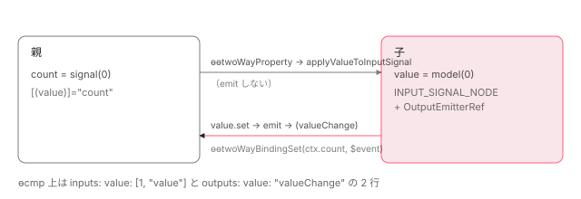

[目次](../README.md) › [Signal の内側](README.md) › 第 13 回 / 全 18 回

# model() と output()：双方向バインディングと OutputEmitterRef

> createModelSignal が input の signal に set と subscribe を足し、set で値を変えると listeners に emit する行。コンパイラが \[(value)\] を property と (valueChange) の 2 つに分ける行と ɵɵtwoWayProperty / ɵɵtwoWayListener。output() の OutputEmitterRef が listeners 配列を持ち、DestroyRef で破棄されたあとの subscribe は NG0953 を throw し、emit は NG0953 を warn に出すだけの違い、outputFromObservable / outputToObservable。

angular/angular · 読了 約 13 分 · 中核 · [サイトで読む（デモが動きます）](https://angular-deep-dive-cyan.vercel.app/chapter/signals-model-output)

---

`model()` は「親と子で同じ値を共有する」双方向バインディングのための API で、`output()` は子から親へイベントを送る API です。この章では、`createModelSignal` が**input の signal に `set` と `subscribe` を足し、子が `set` したときだけ emit する**こと、コンパイラが `[(value)]` を `[value]` と `(valueChange)` の 2 つに分けること、`output()` の正体 `OutputEmitterRef` が listeners 配列と `DestroyRef` だけでできていることを行で確かめます。

読む対象は `packages/core/src/authoring/model/` の `model.ts`・`model_signal.ts`、`authoring/output/` の `output.ts`・`output_ref.ts`・`output_emitter_ref.ts`、`render3/instructions/two_way.ts`、`render3/view/directive_outputs.ts`、`compiler/src/render3/r3_template_transform.ts`、`core/rxjs-interop/src/output_from_observable.ts`・`output_to_observable.ts`、compliance fixture の `model_inputs/`・`output_function/`・`r3_view_compiler_listener/` です。

1. [1. 概観](01-signals.md)
2. [2. ReactiveNode の構造](02-signals-reactive-node.md)
3. [3. 依存の追跡](03-signals-tracking.md)
4. [4. set と update](04-signals-set.md)
5. [5. push と pull](05-signals-push-pull.md)
6. [6. computed](06-signals-computed.md)
7. [7. live と non-live](07-signals-live.md)
8. [8. linkedSignal](08-signals-linked-signal.md)
9. [9. effect のノードと寿命](09-signals-effect-node.md)
10. [10. afterRenderEffect](10-signals-after-render-effect.md)
11. [11. input と viewChild](11-authoring.md)
12. [12. input() とコンパイラ](12-signals-input-compile.md)
13. **13. model() と output()**（この章）
14. [14. toSignal と toObservable](14-signals-rxjs-interop.md)
15. [15. resource](15-resource.md)
16. [16. httpResource と rxResource](16-signals-http-resource.md)
17. [17. Signal Forms](17-signal-forms.md)
18. [18. DevTools と signal グラフ](18-signals-debug.md)

## 1. model() の入口は input() と同じ形

📄 `angular/packages/core/src/authoring/model/model.ts` L14–27 （▶ の行: 18, 20, 26）

```ts
14 │ export function modelFunction<T>(
15 │   initialValue?: T,
16 │   opts?: ModelOptions,
17 │ ): ModelSignal<T | undefined> {
18 ▶   ngDevMode && assertInInjectionContext(model);
19 │ 
20 ▶   return createModelSignal(initialValue, opts);
21 │ }
22 │ 
23 │ export function modelRequiredFunction<T>(opts?: ModelOptions): ModelSignal<T> {
24 │   ngDevMode && assertInInjectionContext(model);
25 │ 
26 ▶   return createModelSignal(REQUIRED_UNSET_VALUE as T, opts);
27 │ }
```

20 行目、`model(初期値)` は `createModelSignal` に初期値を渡すだけ。26 行目、`model.required()` は [第 11 回](11-authoring.md)の `input.required()` と同じ番兵 `REQUIRED_UNSET_VALUE` を渡します。

## 2. createModelSignal：input のノード + OutputEmitterRef

📄 `angular/packages/core/src/authoring/model/model_signal.ts` L64–93 （▶ の行: 65–66, 71–72, 76–77, 80–83, 87–89, 92–93）

```ts
64 │ export function createModelSignal<T>(initialValue: T, opts?: ModelOptions): ModelSignal<T> {
65 ▶   const node: InputSignalNode<T, T> = Object.create(INPUT_SIGNAL_NODE);
66 ▶   const emitterRef = new OutputEmitterRef<T>();
67 │ 
68 │   node.value = initialValue;
69 │ 
70 │   function getter(): T {
71 ▶     producerAccessed(node);
72 ▶     assertModelSet(node.value);
73 │     return node.value;
74 │   }
75 │ 
76 ▶   getter[SIGNAL] = node;
77 ▶   getter.asReadonly = signalAsReadonlyFn.bind(getter as any) as () => Signal<T>;
78 │ 
79 │   // TODO: Should we throw an error when updating a destroyed model?
80 ▶   getter.set = (newValue: T) => {
81 ▶     if (!node.equal(node.value, newValue)) {
82 ▶       signalSetFn(node, newValue);
83 ▶       emitterRef.emit(newValue);
84 │     }
85 │   };
86 │ 
87 ▶   getter.update = (updateFn: (value: T) => T) => {
88 ▶     assertModelSet(node.value);
89 ▶     getter.set(updateFn(node.value));
90 │   };
91 │ 
92 ▶   getter.subscribe = emitterRef.subscribe.bind(emitterRef);
93 ▶   getter.destroyRef = emitterRef.destroyRef;
```

1. **65 行目：ノードは `INPUT_SIGNAL_NODE`**

   input と**同じ型紙**です。だから親からの値は input と同じ `applyValueToInputSignal` → `signalSetFn` で入ります（[第 12 回](12-signals-input-compile.md)）。
2. **66 行目：`new OutputEmitterRef<T>()`**

   `output()` が返すものと同じクラスを 1 つ抱えます（6 節）。
3. **70〜76 行目：読む関数**

   71 行目で依存を記録し、72 行目で番兵なら NG0952、76 行目で `[SIGNAL]` を付けます。
4. **80〜85 行目：`set`**

   81 行目、`node.equal`（既定は `Object.is`）で同じ値なら何もしません。違えば 82 行目で `signalSetFn` で値を入れ、**83 行目で `emitterRef.emit(newValue)`**。これが `(valueChange)` に流れる値です。
5. **87〜90 行目：`update` は `set` を呼ぶだけ**

   88 行目で番兵を確かめてから、89 行目で `getter.set(updateFn(node.value))`。
6. **92〜93 行目：output として振る舞うための 2 つ**

   `subscribe` は `OutputEmitterRef.subscribe` を束縛したもの、`destroyRef` はその `DestroyRef`。この 2 つがあるので、テンプレートの `(valueChange)` は model の getter を output として購読できます（7 節）。

> [!WARNING]
> **ハマりどころ**
>
> **emit するのは 80〜85 行目の `getter.set` を通ったときだけ**です。親のバインディングから値が入る経路（`applyValueToInputSignal`）は `getter.set` を通らないので emit しません。もし親からの書き込みでも emit したら、親 → 子 → `valueChange` → 親 … と同じ値が往復することになります。

📄 `angular/packages/core/src/authoring/model/model_signal.ts` L95–117 （▶ の行: 96–97, 111, 113–114）

```ts
 95 │   if (ngDevMode) {
 96 ▶     getter.toString = () => `[Model Signal: ${getter()}]`;
 97 ▶     node.debugName = opts?.debugName;
 98 │   }
 99 │ 
100 │   return getter as typeof getter &
101 │     Pick<
102 │       ModelSignal<T>,
103 │       | typeof ɵINPUT_SIGNAL_BRAND_READ_TYPE
104 │       | typeof ɵINPUT_SIGNAL_BRAND_WRITE_TYPE
105 │       | typeof ɵWRITABLE_SIGNAL
106 │     >;
107 │ }
108 │ 
109 │ /** Asserts that a model's value is set. */
110 │ function assertModelSet(value: unknown): void {
111 ▶   if (value === REQUIRED_UNSET_VALUE) {
112 │     throw new RuntimeError(
113 ▶       RuntimeErrorCode.REQUIRED_MODEL_NO_VALUE,
114 ▶       ngDevMode && 'Model is required but no value is available yet.',
115 │     );
116 │   }
117 │ }
```

96 行目、開発モードでは `String(model)` が `[Model Signal: 値]`。111〜115 行目が NG0952 です。コード 952 はマイナスが付いていないので、メッセージにエラー詳細ページへのリンクは付きません（[第 11 回](11-authoring.md) 4 節）。

## 3. コンパイラ：model は input と output の 2 つとして登録される

📄 `angular/packages/compiler-cli/src/ngtsc/annotations/directive/src/model_function.ts` L58–80 （▶ の行: 64, 68–69, 73, 75–76, 78）

```ts
58 │   const optionsNode = (model.isRequired ? model.call.arguments[0] : model.call.arguments[1]) as
59 │     | ts.Expression
60 │     | undefined;
61 │   const options =
62 │     optionsNode !== undefined ? parseAndValidateInputAndOutputOptions(optionsNode) : null;
63 │   const classPropertyName = member.name;
64 ▶   const bindingPropertyName = options?.alias ?? classPropertyName;
65 │ 
66 │   return {
67 │     call: model.call,
68 ▶     input: {
69 ▶       isSignal: true,
70 │       transform: null,
71 │       classPropertyName,
72 │       bindingPropertyName,
73 ▶       required: model.isRequired,
74 │     },
75 ▶     output: {
76 ▶       isSignal: false,
77 │       classPropertyName,
78 ▶       bindingPropertyName: bindingPropertyName + 'Change',
79 │     },
80 │   };
```

検出は第 12 回の `tryParseInitializerApi` と同じです。返すものが 2 つになります。68〜74 行目の `input` は `isSignal: true`、75〜79 行目の `output` は `isSignal: false` で、78 行目、公開名に **`'Change'` を付けたもの**です。

📄 `angular/packages/compiler-cli/test/compliance/test_cases/model_inputs/model_component_definition.ts` L1–9 （▶ の行: 7–8）

```ts
1 │ import {Component, model} from '@angular/core';
2 │ 
3 │ @Component({
4 │   template: 'Works',
5 │ })
6 │ export class TestComp {
7 ▶   counter = model(0);
8 ▶   name = model.required<string>();
9 │ }
```

📄 `angular/packages/compiler-cli/test/compliance/test_cases/model_inputs/model_component_definition.js` L1–15 （▶ の行: 6–7, 10–11）

```js
 1 │ export class TestComp {
 2 │   …
 3 │   static ɵcmp = /*@__PURE__*/ $r3$.ɵɵdefineComponent({
 4 │     …
 5 │     inputs: {
 6 ▶       counter: [1, "counter"],
 7 ▶       name: [1, "name"]
 8 │     },
 9 │     outputs: {
10 ▶       counter: "counterChange",
11 ▶       name: "nameChange"
12 │     },
13 │     …
14 │   });
15 │ }
```
*compliance fixture の期待出力（部分一致で比較され、… は省略を表す）*

6〜7 行目、inputs は signal input と同じ `[1, "counter"]`（フラグ 1 = SignalBased）。10〜11 行目、outputs は「フィールド名: 公開名」で `counter: "counterChange"`。**ɵcmp の上では、model は「signal input 1 つ + output 1 つ」で、同じフィールドを指しているだけ**です。

## 4. \[(value)\] は \[value\] と (valueChange) に分かれる

📄 `angular/packages/compiler/src/render3/r3_template_transform.ts` L871–893 （▶ の行: 871–872, 876, 884）

```ts
871 ▶       if (delims.start === BINDING_DELIMS.BANANA_BOX.start) {
872 ▶         this.bindingParser.parsePropertyBinding(
873 │           identifier,
874 │           value,
875 │           false,
876 ▶           true,
877 │           srcSpan,
878 │           absoluteOffset,
879 │           attribute.valueSpan,
880 │           matchableAttributes,
881 │           parsedProperties,
882 │           keySpan,
883 │         );
884 ▶         this.parseAssignmentEvent(
885 │           identifier,
886 │           value,
887 │           srcSpan,
888 │           attribute.valueSpan,
889 │           matchableAttributes,
890 │           boundEvents,
891 │           keySpan,
892 │           absoluteOffset,
893 │         );
```

📄 `angular/packages/compiler/src/render3/r3_template_transform.ts` L1137–1159 （▶ の行: 1149, 1151）

```ts
1137 │   private parseAssignmentEvent(
1138 │     name: string,
1139 │     expression: string,
1140 │     sourceSpan: ParseSourceSpan,
1141 │     valueSpan: ParseSourceSpan | undefined,
1142 │     targetMatchableAttrs: string[][],
1143 │     boundEvents: t.BoundEvent[],
1144 │     keySpan: ParseSourceSpan,
1145 │     absoluteOffset: number,
1146 │   ) {
1147 │     const events: ParsedEvent[] = [];
1148 │     this.bindingParser.parseEvent(
1149 ▶       `${name}Change`,
1150 │       expression,
1151 ▶       /* isAssignmentEvent */ true,
1152 │       sourceSpan,
1153 │       valueSpan || sourceSpan,
1154 │       targetMatchableAttrs,
1155 │       events,
1156 │       keySpan,
1157 │     );
1158 │     addEvents(events, boundEvents);
1159 │   }
```

テンプレートを解析する `r3_template_transform.ts` です。871 行目、属性名が `[(` … `)]`（バナナインボックス）なら、872 行目でプロパティバインディングを作り（876 行目の `true` は「代入の一部」の印）、884 行目で `parseAssignmentEvent` を呼びます。1149 行目、イベント名は **`${name}Change`**、1151 行目で「代入イベント」の印を付けます。`model()` の output 名（3 節 78 行目）と、ここで作るイベント名が同じ規則なので、つながります。

📄 `angular/packages/compiler-cli/test/compliance/test_cases/r3_view_compiler_listener/simple_two_way.ts` L3–19 （▶ の行: 5, 9）

```ts
 3 │ @Component({
 4 │     selector: 'test-cmp',
 5 ▶     template: 'Name: <input [(ngModel)]="name">',
 6 │     standalone: false
 7 │ })
 8 │ export class TestCmp {
 9 ▶   name: string = '';
10 │ }
11 │ 
12 │ @Directive({
13 │     selector: '[ngModel]',
14 │     standalone: false
15 │ })
16 │ export class NgModelDirective {
17 │   @Input() ngModel: string = '';
18 │   @Output() ngModelChange: EventEmitter<string> = new EventEmitter();
19 │ }
```

📄 `angular/packages/compiler-cli/test/compliance/test_cases/r3_view_compiler_listener/simple_two_way_template.js` L1–16 （▶ の行: 5–6, 13）

```js
 1 │ function TestCmp_Template(rf, ctx) {
 2 │   if (rf & 1) {
 3 │     $r3$.ɵɵtext(0, "Name: ");
 4 │     $r3$.ɵɵelementStart(1, "input", 0);
 5 ▶     $r3$.ɵɵtwoWayListener("ngModelChange", function TestCmp_Template_input_ngModelChange_1_listener($event) {
 6 ▶       $r3$.ɵɵtwoWayBindingSet(ctx.name, $event) || (ctx.name = $event);
 7 │       return $event;
 8 │     });
 9 │     $r3$.ɵɵelementEnd();
10 │     $r3$.ɵɵcontrolCreate();
11 │   } if (rf & 2) {
12 │     $r3$.ɵɵadvance();
13 ▶     $r3$.ɵɵtwoWayProperty("ngModel", ctx.name);
14 │     $r3$.ɵɵcontrol();
15 │   }
16 │ }
```
*r3\_view\_compiler\_listener の期待出力*

作成ブロック（`rf & 1`）の 5 行目で `ɵɵtwoWayListener("ngModelChange", ...)`、更新ブロック（`rf & 2`）の 13 行目で `ɵɵtwoWayProperty("ngModel", ctx.name)` になります。6 行目のリスナー本体が面白いところで、`ɵɵtwoWayBindingSet(ctx.name, $event) || (ctx.name = $event)`。signal なら `set`、そうでなければ代入です。10・14 行目の `ɵɵcontrolCreate` / `ɵɵcontrol` は、バインディング名が `ngModel` などのときだけ足されるフォーム用の命令で、この章では関係しません。

📄 `angular/packages/core/src/render3/instructions/two_way.ts` L33–53 （▶ の行: 39–40, 45, 48）

```ts
33 │ export function ɵɵtwoWayProperty<T>(
34 │   propName: string,
35 │   value: T | WritableSignal<T>,
36 │   sanitizer?: SanitizerFn | null,
37 │ ): typeof ɵɵtwoWayProperty {
38 │   // TODO(crisbeto): perf impact of re-evaluating this on each change detection?
39 ▶   if (isWritableSignal(value)) {
40 ▶     value = value();
41 │   }
42 │ 
43 │   const lView = getLView();
44 │   const bindingIndex = nextBindingIndex();
45 ▶   if (bindingUpdated(lView, bindingIndex, value)) {
46 │     const tView = getTView();
47 │     const tNode = getSelectedTNode();
48 ▶     setPropertyAndInputs(tNode, lView, propName, value, lView[RENDERER], sanitizer);
49 │     ngDevMode && storePropertyBindingMetadata(tView.data, tNode, propName, bindingIndex);
50 │   }
51 │ 
52 │   return ɵɵtwoWayProperty;
53 │ }
```

39〜41 行目、`[(value)]="count"` のように親が **signal そのもの**（呼ばずに）を渡したら、ここで読んで中身にします。45 行目以降は普通の `ɵɵproperty` と同じで、48 行目の `setPropertyAndInputs` から子の model に書き込まれます。

📄 `angular/packages/core/src/render3/instructions/two_way.ts` L55–86 （▶ の行: 64–66, 84）

```ts
55 │ /**
56 │  * Function used inside two-way listeners to conditionally set the value of the bound expression.
57 │  *
58 │  * @param target Field on which to set the value.
59 │  * @param value Value to be set to the field.
60 │  *
61 │  * @codeGenApi
62 │  */
63 │ export function ɵɵtwoWayBindingSet<T>(target: unknown, value: T): boolean {
64 ▶   const canWrite = isWritableSignal(target);
65 ▶   canWrite && target.set(value);
66 ▶   return canWrite;
67 │ }
68 │ 
69 │ /**
70 │  * Adds an event listener that updates a two-way binding to the current node.
71 │  *
72 │  * @param eventName Name of the event.
73 │  * @param listenerFn The function to be called when event emits.
74 │  *
75 │  * @codeGenApi
76 │  */
77 │ export function ɵɵtwoWayListener(
78 │   eventName: string,
79 │   listenerFn: EventCallback,
80 │ ): typeof ɵɵtwoWayListener {
81 │   const lView = getLView<{} | null>();
82 │   const tView = getTView();
83 │   const tNode = getCurrentTNode()!;
84 ▶   listenerInternal(tView, lView, lView[RENDERER], tNode, eventName, listenerFn);
85 │   return ɵɵtwoWayListener;
86 │ }
```

64〜66 行目、`ɵɵtwoWayBindingSet` は対象が `WritableSignal` なら `set` して `true`。`false` を返したときだけ、6 行目の `|| (ctx.name = $event)` が代入します。84 行目、`ɵɵtwoWayListener` は普通の `(event)` と同じ `listenerInternal` を呼ぶだけです。

> **🧪 DEMO 1 — \[(value)\] で model() と親の signal をつなぐ**
>
> 子は `value = model(0)` を持ち、コンストラクタで `this.value.subscribe(...)` して emit を記録します。親は `count = signal(0)` を `[(value)]="count"` で渡しています。
>
> ▶ [このデモはサイトで動かせます](https://angular-deep-dive-cyan.vercel.app/chapter/signals-model-output)

子で `update` すると、2 節 83 行目の emit → `(valueChange)` → 6 行目の `ɵɵtwoWayBindingSet` で親の `count` が変わり、emit の記録にも値が足されます。親で `set` すると子の `value()` は変わりますが、**emit の記録は増えません**。2 節の warn のとおりです。

## 5. output() は OutputEmitterRef を返すだけ

📄 `angular/packages/core/src/authoring/output/output.ts` L66–72 （▶ の行: 70–71）

```ts
66 │  * @initializerApiFunction {"showTypesInSignaturePreview": true}
67 │  * @publicApi 19.0
68 │  */
69 │ export function output<T = void>(opts?: OutputOptions): OutputEmitterRef<T> {
70 ▶   ngDevMode && assertInInjectionContext(output);
71 ▶   return new OutputEmitterRef<T>();
72 │ }
```

71 行目、`new OutputEmitterRef<T>()`。**signal でも Observable でもありません**。共通の契約は次の型だけです。

📄 `angular/packages/core/src/authoring/output/output_ref.ts` L22–52 （▶ の行: 22–23, 32, 40, 52）

```ts
22 ▶ export interface OutputRefSubscription {
23 ▶   unsubscribe(): void;
24 │ }
25 │ 
26 │ /**
27 │  * A reference to an Angular output.
28 │  *
29 │  * @publicAPI
30 │  * @see [Subscribing to outputs programmatically](guide/components/outputs#subscribing-to-outputs-programmatically)
31 │  */
32 ▶ export interface OutputRef<T> {
33 │   /**
34 │    * Registers a callback that is invoked whenever the output
35 │    * emits a new value of type `T`.
36 │    *
37 │    * Angular will automatically clean up the subscription when
38 │    * the directive/component of the output is destroyed.
39 │    */
40 ▶   subscribe(callback: (value: T) => void): OutputRefSubscription;
41 │ 
42 │   /**
43 │    * Reference to the `DestroyRef` of the directive/component declaring
44 │    * the output. The `DestroyRef` is captured so that helpers like
45 │    * the `outputToObservable` can complete the observable upon destroy.
46 │    *
47 │    * Note: May be `undefined` in cases of `EventEmitter` where
48 │    * we do not want to add a dependency on an injection context.
49 │    *
50 │    * @internal
51 │    */
52 ▶   destroyRef: DestroyRef | undefined;
```

40 行目、`OutputRef` は `subscribe(callback)` を持ち、22〜24 行目の `OutputRefSubscription`（`unsubscribe()` だけ）を返します。52 行目の `destroyRef` は内部用で、8 節の `outputToObservable` が使います。RxJS の `Observable` のような `pipe` や `error` / `complete` はありません。

### コンパイラから見た output()

📄 `angular/packages/compiler-cli/test/compliance/test_cases/output_function/output_in_component.ts` L1–13 （▶ の行: 8, 10–11）

```ts
 1 │ import {Component, EventEmitter, output} from '@angular/core';
 2 │ import {outputFromObservable} from '@angular/core/rxjs-interop';
 3 │ 
 4 │ @Component({
 5 │   template: 'Works',
 6 │ })
 7 │ export class TestComp {
 8 ▶   a = output();
 9 │   b = output<string>({});
10 ▶   c = output<void>({alias: 'cPublic'});
11 ▶   d = outputFromObservable(new EventEmitter<string>());
12 │   e = outputFromObservable(new EventEmitter<number>());
13 │ }
```

📄 `angular/packages/compiler-cli/test/compliance/test_cases/output_function/output_in_component.js` L1–14 （▶ の行: 6, 8–9）

```js
 1 │ export class TestComp {
 2 │   …
 3 │   static ɵcmp = /*@__PURE__*/ $r3$.ɵɵdefineComponent({
 4 │     …
 5 │     outputs: {
 6 ▶         a: "a",
 7 │         b: "b",
 8 ▶         c: "cPublic",
 9 ▶         d: "d",
10 │         e: "e"
11 │     },
12 │     …
13 │   });
14 │ }
```
*output\_function の期待出力*

outputs は従来の `@Output()` と同じ「フィールド名: 公開名」です（8 行目の `c: "cPublic"` は alias）。第 12 回 3 節のとおり output の `isSignal` は `false` なので、フラグも配列もありません。11 行目の `outputFromObservable` も同じ形になります。

## 6. OutputEmitterRef の中身

📄 `angular/packages/core/src/authoring/output/output_emitter_ref.ts` L33–49 （▶ の行: 34–36, 41, 45–47）

```ts
33 │ export class OutputEmitterRef<T> implements OutputRef<T> {
34 ▶   private destroyed = false;
35 ▶   private listeners: Array<((value: T) => void) | null> | null = null;
36 ▶   private errorHandler = inject(ErrorHandler, {optional: true});
37 │   private isEmitting = false;
38 │   private hasNullListeners = false;
39 │ 
40 │   /** @internal */
41 ▶   destroyRef: DestroyRef = inject(DestroyRef);
42 │ 
43 │   constructor() {
44 │     // Clean-up all listeners and mark as destroyed upon destroy.
45 ▶     this.destroyRef.onDestroy(() => {
46 ▶       this.destroyed = true;
47 ▶       this.listeners = null;
48 │     });
49 │   }
```

状態は 34 行目の `destroyed` と 35 行目の `listeners` 配列（最初は `null`）。41 行目で `inject(DestroyRef)` するので、`output()` も注入コンテキストで呼ぶ必要があります。45〜48 行目、持ち主のコンポーネントが破棄されると `destroyed = true`、`listeners = null`。**購読者を 1 つずつ外す処理はなく、配列ごと捨てます**。

📄 `angular/packages/core/src/authoring/output/output_emitter_ref.ts` L51–80 （▶ の行: 52–54, 61, 64–65, 71, 73, 75）

```ts
51 │   subscribe(callback: (value: T) => void): OutputRefSubscription {
52 ▶     if (this.destroyed) {
53 ▶       throw new RuntimeError(
54 ▶         RuntimeErrorCode.OUTPUT_REF_DESTROYED,
55 │         ngDevMode &&
56 │           'Unexpected subscription to destroyed `OutputRef`. ' +
57 │             'The owning directive/component is destroyed.',
58 │       );
59 │     }
60 │ 
61 ▶     (this.listeners ??= []).push(callback);
62 │ 
63 │     return {
64 ▶       unsubscribe: () => {
65 ▶         const index = this.listeners ? this.listeners.indexOf(callback) : -1;
66 │         if (index > -1) {
67 │           // If we try to unsubscribe while an `emit` is happening, we can throw off the loop.
68 │           // Replace the listener with null so we can clean it up later. Note that it would be
69 │           // simpler to clone the array when iterating over it, but we're trying to avoid cloning
70 │           // since unsubscribing from within the event should be fairly uncommon.
71 ▶           if (this.isEmitting) {
72 │             this.hasNullListeners = true;
73 ▶             this.listeners![index] = null;
74 │           } else {
75 ▶             this.listeners!.splice(index, 1);
76 │           }
77 │         }
78 │       },
79 │     };
80 │   }
```

1. **52〜58 行目：破棄後の subscribe は throw**

   `RuntimeError(OUTPUT_REF_DESTROYED)`、つまり NG0953 です。
2. **61 行目：配列に積む**

   最初の 1 つでだけ配列を作ります（`??=`）。
3. **63〜79 行目：unsubscribe**

   65 行目で自分の位置を探し、ふだんは 75 行目で `splice`。ただし emit の最中（71 行目）は配列を詰めるとループがずれるので、73 行目で `null` を入れて印を付け、あとで掃除します。

📄 `angular/packages/core/src/authoring/output/output_emitter_ref.ts` L82–120 （▶ の行: 84–85, 87, 93, 96, 101, 103, 106, 109, 113, 115, 117）

```ts
 82 │   /** Emits a new value to the output. */
 83 │   emit(value: T): void {
 84 ▶     if (this.destroyed) {
 85 ▶       console.warn(
 86 │         formatRuntimeError(
 87 ▶           RuntimeErrorCode.OUTPUT_REF_DESTROYED,
 88 │           ngDevMode &&
 89 │             'Unexpected emit for destroyed `OutputRef`. ' +
 90 │               'The owning directive/component is destroyed.',
 91 │         ),
 92 │       );
 93 ▶       return;
 94 │     }
 95 │ 
 96 ▶     if (this.listeners === null) {
 97 │       return;
 98 │     }
 99 │ 
100 │     this.isEmitting = true;
101 ▶     const previousConsumer = setActiveConsumer(null);
102 │     try {
103 ▶       for (const listenerFn of this.listeners) {
104 │         try {
105 │           if (listenerFn !== null) {
106 ▶             listenerFn(value);
107 │           }
108 │         } catch (err: unknown) {
109 ▶           this.errorHandler?.handleError(err);
110 │         }
111 │       }
112 │     } finally {
113 ▶       if (this.hasNullListeners) {
114 │         this.hasNullListeners = false;
115 ▶         this.listeners && removeNullValues(this.listeners);
116 │       }
117 ▶       setActiveConsumer(previousConsumer);
118 │       this.isEmitting = false;
119 │     }
120 │   }
```

1. **84〜94 行目：破棄後の emit は `console.warn` して return**

   同じ NG0953 ですが、**こちらは throw しません**。87 行目で `formatRuntimeError` を使って文字列だけ作り、85 行目で警告として出して、93 行目で何もせずに戻ります。
2. **101 行目：`setActiveConsumer(null)`**

   リスナーの中で signal を読んでも、emit を呼んだ側（たとえば computed や テンプレート）の依存にならないようにします（[第 3 回](03-signals-tracking.md)）。117 行目で元に戻します。
3. **103〜111 行目：1 つずつ同期に呼ぶ**

   `emit()` から戻る前に全リスナーが走ります。1 つが例外を投げても 109 行目で `ErrorHandler` に渡して、残りを続けます。
4. **113〜116 行目：途中で外されたぶんを掃除**

## 7. テンプレートの (ping) も subscribe しているだけ

📄 `angular/packages/core/src/render3/view/directive_outputs.ts` L106–127 （▶ の行: 118–119, 121, 125–126）

```ts
106 │ export function listenToOutput(
107 │   tNode: TNode,
108 │   lView: LView,
109 │   directiveIndex: number,
110 │   lookupName: string,
111 │   eventName: string,
112 │   listenerFn: WrappedEventCallback,
113 │ ) {
114 │   ngDevMode && assertIndexInRange(lView, directiveIndex);
115 │   const instance = lView[directiveIndex];
116 │   const tView = lView[TVIEW];
117 │   const def = tView.data[directiveIndex] as DirectiveDef<unknown>;
118 ▶   const propertyName = def.outputs[lookupName];
119 ▶   const output = instance[propertyName];
120 │ 
121 ▶   if (ngDevMode && !isOutputSubscribable(output)) {
122 │     throw new Error(`@Output ${propertyName} not initialized in '${instance.constructor.name}'.`);
123 │   }
124 │ 
125 ▶   const subscription = (output as SubscribableOutput<unknown>).subscribe(listenerFn);
126 ▶   storeListenerCleanup(tNode.index, tView, lView, eventName, listenerFn, subscription, true);
127 │ }
```

親テンプレートの `(ping)="onPing($event)"` は、`listenerInternal`（instructions/listener.ts）が要素の `tNode.outputs` にその名前の output を見つけたとき、ここに来ます。118〜119 行目で ɵcmp の outputs から フィールド名を引いてインスタンスのフィールドを取り、125 行目で **`output.subscribe(listenerFn)`**。121 行目の検査は「`subscribe` という関数を持っているか」だけなので、`OutputEmitterRef` でも `EventEmitter` でも model の getter（2 節 92 行目）でも通ります。126 行目で返り値の購読をビューの後片付けに登録するので、ビューが破棄されると unsubscribe されます。

> **🧪 DEMO 2 — output を subscribe / unsubscribe し、破棄後にもう一度 subscribe する**
>
> 子は `ping = output<number>()`。親テンプレートは `(ping)` で受けています。「subscribe」はコードから `viewChild(MoPinger)().ping.subscribe(...)` し、その `OutputEmitterRef` を取っておきます。
>
> ▶ [このデモはサイトで動かせます](https://angular-deep-dive-cyan.vercel.app/chapter/signals-model-output)

子を消してから「取っておいた ping に subscribe」を押すと、6 節 52〜58 行目の NG0953 が捕まって表示されます（`code = 953`）。消す前に押せば普通に購読できます。

## 8. RxJS との橋：outputFromObservable と outputToObservable

📄 `angular/packages/core/rxjs-interop/src/output_from_observable.ts` L86–92 （▶ の行: 90–91）

```ts
86 │ export function outputFromObservable<T>(
87 │   observable: Observable<T>,
88 │   opts?: OutputOptions,
89 │ ): OutputRef<T> {
90 ▶   ngDevMode && assertInInjectionContext(outputFromObservable);
91 ▶   return new OutputFromObservableRef<T>(observable);
92 │ }
```

📄 `angular/packages/core/rxjs-interop/src/output_from_observable.ts` L29–59 （▶ の行: 32, 35–36, 41–43, 51, 56）

```ts
29 │ class OutputFromObservableRef<T> implements OutputRef<T> {
30 │   private destroyed = false;
31 │ 
32 ▶   destroyRef = inject(DestroyRef);
33 │ 
34 │   constructor(private source: Observable<T>) {
35 ▶     this.destroyRef.onDestroy(() => {
36 ▶       this.destroyed = true;
37 │     });
38 │   }
39 │ 
40 │   subscribe(callbackFn: (value: T) => void): OutputRefSubscription {
41 ▶     if (this.destroyed) {
42 ▶       throw new ɵRuntimeError(
43 ▶         ɵRuntimeErrorCode.OUTPUT_REF_DESTROYED,
44 │         ngDevMode &&
45 │           'Unexpected subscription to destroyed `OutputRef`. ' +
46 │             'The owning directive/component is destroyed.',
47 │       );
48 │     }
49 │ 
50 │     // Stop yielding more values when the directive/component is already destroyed.
51 ▶     const subscription = this.source.pipe(takeUntilDestroyed(this.destroyRef)).subscribe({
52 │       next: (value) => callbackFn(value),
53 │     });
54 │ 
55 │     return {
56 ▶       unsubscribe: () => subscription.unsubscribe(),
57 │     };
58 │   }
59 │ }
```

`outputFromObservable(obs$)` は `OutputEmitterRef` ではなく専用の `OutputFromObservableRef` を返します（91 行目）。listeners 配列は持たず、51 行目で **購読のたびに元の Observable を subscribe** し、`takeUntilDestroyed` で持ち主の破棄と同時に止めます（`takeUntilDestroyed` の中身は [DI シリーズ第 14 回](../di/14-di-destroy.md)）。破棄後の subscribe が NG0953 になる点（41〜48 行目）は `OutputEmitterRef` と同じです。コンパイラは第 12 回の `OUTPUT_INITIALIZER_FNS` でこの関数も output として認識します。

📄 `angular/packages/core/rxjs-interop/src/output_to_observable.ts` L23–38 （▶ の行: 24, 30, 32, 34–35）

```ts
23 │ export function outputToObservable<T>(ref: OutputRef<T>): Observable<T> {
24 ▶   const destroyRef = ɵgetOutputDestroyRef(ref);
25 │ 
26 │   return new Observable<T>((observer) => {
27 │     // Complete the observable upon directive/component destroy.
28 │     // Note: May be `undefined` if an `EventEmitter` is declared outside
29 │     // of an injection context.
30 ▶     const unregisterOnDestroy = destroyRef?.onDestroy(() => observer.complete());
31 │ 
32 ▶     const subscription = ref.subscribe((v) => observer.next(v));
33 │     return () => {
34 ▶       subscription.unsubscribe();
35 ▶       unregisterOnDestroy?.();
36 │     };
37 │   });
38 │ }
```

逆向きです。24 行目で output の `destroyRef`（5 節 52 行目）を取り出し、30 行目で持ち主が破棄されたら `observer.complete()`、32 行目で `ref.subscribe(v => observer.next(v))`。Observable 側で unsubscribe されたら 34〜35 行目で両方を外します。`OutputRef` には complete が無いので、「破棄 = 完了」をここで足しているわけです。



*model() 1 つが、親子の間で input と output の 2 本の線になる*

## ここまでの呼び出し

- 👤 `<app-mo-counter [(value)]="count" />` — 親テンプレート
  - `parsePropertyBinding('value', ..., true)` + `parseAssignmentEvent('value')` — compiler/src/render3/r3\_template\_transform.ts L871 — *イベント名は valueChange*
  - `ɵɵtwoWayListener('valueChange', fn)` — core/src/render3/instructions/two\_way.ts L77
    - `listenerInternal` → `listenToOutput()` — render3/view/directive\_outputs.ts L106 — *instance.value.subscribe(listenerFn)*
  - `ɵɵtwoWayProperty('value', ctx.count)` — two\_way.ts L33 — *signal なら読んで中身に*
    - `setPropertyAndInputs` → `writeToDirectiveInput` → `applyValueToInputSignal` — 第 12 回 — *emit しない*
- 👤 `this.value.update(v => v + 1)` — 子のクリックハンドラ
  - `getter.set(newValue)` — authoring/model/model\_signal.ts L80
    - `signalSetFn(node, newValue)` — model\_signal.ts L82
    - `emitterRef.emit(newValue)` — model\_signal.ts L83 → output\_emitter\_ref.ts L83 — *setActiveConsumer(null) で同期に全リスナー*
      - `ɵɵtwoWayBindingSet(ctx.count, $event)` — two\_way.ts L63 — *親の count.set($event)*
- 👤 `ping = output<number>()` — 子
  - `new OutputEmitterRef()` — authoring/output/output.ts L71 — *inject(DestroyRef) → 破棄で listeners = null*

## 聞かれそうな質問

**Q. model() と「input() + output()」の組は何が違うのですか？**

ɵcmp 上は同じです。model は signal input（`[1, "value"]`）と output（`"valueChange"`）の 2 つとして登録されます（model\_function.ts 68〜79 行目、fixture の 6〜11 行目）。違いは実行時で、1 つの getter が両方を兼ね、`set` すると値の更新と emit を一度に行います（model\_signal.ts 80〜85 行目）。input + output の組だと、input は子から書けないので、子は別の signal を持って自分で `emit` する必要があります。

**Q. 親が値を変えたときも valueChange は発火しますか？**

しません。親からの値は `applyValueToInputSignal`（= `signalSetFn`）で入り、emit するのは model\_signal.ts 83 行目の `getter.set` の中だけだからです。また子が同じ値を `set` しても、81 行目の等価判定で emit されません。

**Q. output() は Observable ですか？**

違います。`output()` が返すのは `OutputEmitterRef`（output.ts 71 行目）で、持っているのは listeners 配列と `DestroyRef` だけです（output\_emitter\_ref.ts 34〜41 行目）。`subscribe` は `OutputRefSubscription` を返し、`pipe` も `complete` もありません。Observable が欲しければ `outputToObservable()` で変換します（output\_to\_observable.ts 23〜37 行目）。

**Q. コンポーネントが破棄されたあとに emit するとどうなりますか？**

例外にはならず、NG0953 の `console.warn` を出して何もしません（output\_emitter\_ref.ts 84〜93 行目）。一方、破棄されたあとに `subscribe` すると 52〜58 行目で NG0953 の `RuntimeError` が投げられます。破棄の時点で 45〜48 行目が listeners を捨てているので、破棄前に購読していたコールバックはもう呼ばれません。

**Q. emit はリスナーを非同期に呼びますか？**

同期です。output\_emitter\_ref.ts 103〜111 行目の for 文で順に呼び、全部終わってから `emit()` が戻ります。1 つのリスナーが投げても 109 行目で `ErrorHandler` に渡して残りを続けます。

## 読み終えて

- `model()` のノードは input と同じ `INPUT_SIGNAL_NODE`。そこに `set` / `update` / `subscribe` を足し、`set` したときだけ emit する
- コンパイラは model を「signal input + 名前に Change を付けた output」として ɵcmp に書く。`[(x)]` も `[x]` と `(xChange)` に分かれるので、両者がつながる
- `ɵɵtwoWayProperty` は親の signal を読んで渡し、`ɵɵtwoWayBindingSet` は signal なら `set`、そうでなければ代入
- `output()` は `OutputEmitterRef`。listeners 配列に同期で配り、破棄で配列ごと捨てる。破棄後の subscribe は throw、emit は warn
- テンプレートの `(event)` も `outputToObservable` も、やっていることは `subscribe` の 1 回

---

← 前: [input() はコンパイラにどう見えるか：初期化子 API の検出から InputFlags.SignalBased まで](12-signals-input-compile.md)  
次: [toSignal と toObservable：Observable と Signal の橋渡し](14-signals-rxjs-interop.md) →
