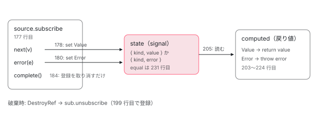
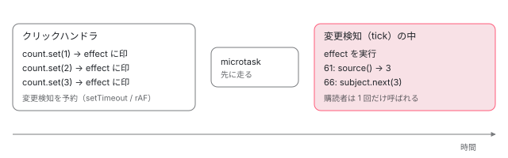

[目次](../README.md) › [Signal の内側](README.md) › 第 14 回 / 全 18 回

# toSignal と toObservable：Observable と Signal の橋渡し

> toSignal が subscribe して状態を signal に入れ（Value / Error / NoValue の 3 種類）、computed で読み出すときにエラーを投げる仕組み、requireSync の NG0601、initialValue、DestroyRef で unsubscribe する行、manualCleanup。toObservable が effect の中で source を読み ReplaySubject に next する行と、その値が届くタイミング（同期ではない）。

angular/angular · 読了 約 13 分 · 中核 · [サイトで読む（デモが動きます）](https://angular-deep-dive-cyan.vercel.app/chapter/signals-rxjs-interop)

---

`toSignal` は Observable を購読して、届いた値を signal に入れる関数です。`toObservable` はその逆で、signal の値を Observable に流します。この章では、`toSignal` が値・エラー・まだ値が無いの 3 つの状態をどう持ち、読むときにどこでエラーを投げるのか、`requireSync` の NG0601 と `DestroyRef` による購読解除がどの行にあるのかを追います。後半では `toObservable` が `effect` の中で signal を読む行を読み、**値が `set` の直後ではなく effect が走ったときに届く**ことをデモで確かめます。

読む対象は `packages/core/rxjs-interop/src/to_signal.ts`、`to_observable.ts`、`pending_until_event.ts` です。

1. [1. 概観](01-signals.md)
2. [2. ReactiveNode の構造](02-signals-reactive-node.md)
3. [3. 依存の追跡](03-signals-tracking.md)
4. [4. set と update](04-signals-set.md)
5. [5. push と pull](05-signals-push-pull.md)
6. [6. computed](06-signals-computed.md)
7. [7. live と non-live](07-signals-live.md)
8. [8. linkedSignal](08-signals-linked-signal.md)
9. [9. effect のノードと寿命](09-signals-effect-node.md)
10. [10. afterRenderEffect](10-signals-after-render-effect.md)
11. [11. input と viewChild](11-authoring.md)
12. [12. input() とコンパイラ](12-signals-input-compile.md)
13. [13. model() と output()](13-signals-model-output.md)
14. **14. toSignal と toObservable**（この章）
15. [15. resource](15-resource.md)
16. [16. httpResource と rxResource](16-signals-http-resource.md)
17. [17. Signal Forms](17-signal-forms.md)
18. [18. DevTools と signal グラフ](18-signals-debug.md)

## 1. 2 つの世界の違い

Observable は「値が**時間に沿って届く**」もので、購読（`subscribe`）しないと何も起きず、完了（complete）とエラーがあります。signal は「**いつ読んでも今の値がある**」もので、購読も完了もありません。橋渡しをするには、Observable 側の「まだ値が来ていない」「エラーで終わった」を signal 側でどう表すかを決める必要があります。`toSignal` の答えが、次の 3 つの状態です。

📄 `angular/packages/core/rxjs-interop/src/to_signal.ts` L246–266 （▶ の行: 246–249, 252, 256–258, 261–263, 266）

```ts
246 ▶ const enum StateKind {
247 ▶   NoValue,
248 ▶   Value,
249 ▶   Error,
250 │ }
251 │ 
252 ▶ interface NoValueState {
253 │   kind: StateKind.NoValue;
254 │ }
255 │ 
256 ▶ interface ValueState<T> {
257 ▶   kind: StateKind.Value;
258 ▶   value: T;
259 │ }
260 │ 
261 ▶ interface ErrorState {
262 ▶   kind: StateKind.Error;
263 ▶   error: unknown;
264 │ }
265 │ 
266 ▶ type State<T> = NoValueState | ValueState<T> | ErrorState;
```

246〜250 行目の `const enum StateKind` が 3 種類を決めます。`NoValue`（まだ何も届いていない）、`Value`（値が届いた）、`Error`（エラーが届いた）です。266 行目の `State<T>` はその 3 つの形の合併型で、`Value` だけが 258 行目の `value` を、`Error` だけが 263 行目の `error` を持ちます。`toSignal` の中にはこの `State` を入れる signal が 1 つあり、外に返すのはそれを読み替える `computed` です。`const enum` はコンパイル時に数値（0・1・2）へ置き換わるので、本番のバンドルに `StateKind` という名前は残りません。

## 2. toSignal の入口：オプションと検査

📄 `angular/packages/core/rxjs-interop/src/to_signal.ts` L38–63 （▶ の行: 41–44, 46, 54, 60–61, 63）

```ts
38 │   /**
39 │    * Whether to require that the observable emits synchronously when `toSignal` subscribes.
40 │    *
41 ▶    * If this is `true`, `toSignal` will assert that the observable produces a value immediately upon
42 ▶    * subscription. Setting this option removes the need to either deal with `undefined` in the
43 ▶    * signal type or provide an `initialValue`, at the cost of a runtime error if this requirement is
44 ▶    * not met.
45 │    */
46 ▶   requireSync?: boolean;
47 │ 
48 │   /**
49 │    * `Injector` which will provide the `DestroyRef` used to clean up the Observable subscription.
50 │    *
51 │    * If this is not provided, a `DestroyRef` will be retrieved from the current [injection
52 │    * context](guide/di/dependency-injection-context), unless manual cleanup is requested.
53 │    */
54 ▶   injector?: Injector;
55 │ 
56 │   /**
57 │    * Whether the subscription should be automatically cleaned up (via `DestroyRef`) when
58 │    * `toSignal`'s creation context is destroyed.
59 │    *
60 ▶    * If manual cleanup is enabled, then `DestroyRef` is not used, and the subscription will persist
61 ▶    * until the `Observable` itself completes.
62 │    */
63 ▶   manualCleanup?: boolean;
```

オプションのうち、この章で追うのは 3 つです。46 行目の `requireSync` は「購読した瞬間に値が出ること」を要求します（41〜44 行目）。満たせば戻り値の型から `undefined` が消え、満たさなければ実行時エラーです。54 行目の `injector` は購読解除に使う `DestroyRef` を取る注入器、63 行目の `manualCleanup` は自動解除をやめるフラグです。60〜61 行目のとおり、そのときの購読は Observable が自分で完了するまで続きます。70 行目の `equal` は 5 節で読みます。

📄 `angular/packages/core/rxjs-interop/src/to_signal.ts` L128–139 （▶ の行: 132–134, 136）

```ts
128 │ export function toSignal<T, U = undefined>(
129 │   source: Observable<T> | Subscribable<T>,
130 │   options?: ToSignalOptions<T | U> & {initialValue?: U},
131 │ ): Signal<T | U> {
132 ▶   typeof ngDevMode !== 'undefined' &&
133 ▶     ngDevMode &&
134 ▶     assertNotInReactiveContext(
135 │       toSignal,
136 ▶       'Invoking `toSignal` causes new subscriptions every time. ' +
137 │         'Consider moving `toSignal` outside of the reactive context and read the signal value where needed.',
138 │     );
139 │ 
```

関数本体の最初、132〜138 行目は開発ビルドだけの検査です。`assertNotInReactiveContext`（`render3/reactivity/asserts.ts`、NG0602）は、`computed` や `effect` の計算の最中に呼ばれていたら投げます。136 行目のメッセージのとおり、計算のたびに `toSignal` を呼ぶと**そのたびに新しい購読ができてしまう**からです。この直後で注入コンテキストを検査して `DestroyRef` を取ります。その数行は [注入コンテキスト](../di/03-di-injection-context.md)の章で引用したので、ここでは結果だけ使います。`manualCleanup` でなければ `cleanupRef` に `DestroyRef` が入り、`manualCleanup: true` なら `null` です。

## 3. 状態を入れる signal を作る

📄 `angular/packages/core/rxjs-interop/src/to_signal.ts` L150–167 （▶ の行: 150, 155, 157–158, 163–164）

```ts
150 ▶   const equal = makeToSignalEqual(options?.equal);
151 │ 
152 │   // Note: T is the Observable value type, and U is the initial value type. They don't have to be
153 │   // the same - the returned signal gives values of type `T`.
154 │   let state: WritableSignal<State<T | U>>;
155 ▶   if (options?.requireSync) {
156 │     // Initially the signal is in a `NoValue` state.
157 ▶     state = signal(
158 ▶       {kind: StateKind.NoValue},
159 │       {equal, ...(ngDevMode ? createDebugNameObject(options?.debugName, 'state') : undefined)},
160 │     );
161 │   } else {
162 │     // If an initial value was passed, use it. Otherwise, use `undefined` as the initial value.
163 ▶     state = signal<State<T | U>>(
164 ▶       {kind: StateKind.Value, value: options?.initialValue as U},
165 │       {equal, ...(ngDevMode ? createDebugNameObject(options?.debugName, 'state') : undefined)},
166 │     );
167 │   }
```

1. **150 行目：比較関数を包む**

   利用者の `equal` を、`State` 同士を比べる関数に包みます（中身は 5 節の 227〜231 行目）。この `state` signal は、値そのものではなく `{ kind, value }` の箱を持つからです。
2. **155〜160 行目：`requireSync` なら `NoValue` で始める**

   158 行目の `{kind: StateKind.NoValue}` が初期値です。この後の購読で値が届けば `Value` に変わり、届かなければ 4 節の 190 行目で投げます。
3. **163〜166 行目：それ以外は `Value` で始める**

   164 行目、初期値は `{kind: Value, value: options?.initialValue}`。`initialValue` を渡さなければ `undefined` が入ります。つまり `requireSync` でない `toSignal` は、**最初から「`undefined` または初期値という値がある」状態**です。`NoValue` になることはありません。

## 4. subscribe と、購読解除の登録

📄 `angular/packages/core/rxjs-interop/src/to_signal.ts` L169–199 （▶ の行: 177–181, 183–184, 190–192, 199）

```ts
169 │   let destroyUnregisterFn: (() => void) | undefined;
170 │ 
171 │   // Note: This code cannot run inside a reactive context (see assertion above). If we'd support
172 │   // this, we would subscribe to the observable outside of the current reactive context, avoiding
173 │   // that side-effect signal reads/writes are attribute to the current consumer. The current
174 │   // consumer only needs to be notified when the `state` signal changes through the observable
175 │   // subscription. Additional context (related to async pipe):
176 │   // https://github.com/angular/angular/pull/50522.
177 ▶   const sub = source.subscribe({
178 ▶     next: (value) => state.set({kind: StateKind.Value, value}),
179 ▶     error: (error) => {
180 ▶       state.set({kind: StateKind.Error, error});
181 ▶       destroyUnregisterFn?.();
182 │     },
183 ▶     complete: () => {
184 ▶       destroyUnregisterFn?.();
185 │     },
186 │     // Completion of the Observable is meaningless to the signal. Signals don't have a concept of
187 │     // "complete".
188 │   });
189 │ 
190 ▶   if (options?.requireSync && state().kind === StateKind.NoValue) {
191 ▶     throw new ɵRuntimeError(
192 ▶       ɵRuntimeErrorCode.REQUIRE_SYNC_WITHOUT_SYNC_EMIT,
193 │       (typeof ngDevMode === 'undefined' || ngDevMode) &&
194 │         '`toSignal()` called with `requireSync` but `Observable` did not emit synchronously.',
195 │     );
196 │   }
197 │ 
198 │   // Unsubscribe when the current context is destroyed, if requested.
199 ▶   destroyUnregisterFn = cleanupRef?.onDestroy(sub.unsubscribe.bind(sub));
```

1. **177 行目：`toSignal` を呼んだその場で購読する**

   `toSignal` は遅延しません。signal を誰も読んでいなくても、ここで `source.subscribe` が走ります。171〜176 行目のコメントは、この購読をリアクティブコンテキストの中で行わない理由（2 節の検査）を説明しています。
2. **178 行目：`next` → `Value` 状態を `set`**

   値が届くたびに `state.set({kind: Value, value})`。これは普通の `signal.set` なので、ここから先は [set と update](04-signals-set.md) の章の流れでテンプレートや `computed` に知らせが届きます。BehaviorSubject や `of()` のように購読と同時に値を出す Observable では、この行が 177 行目の `subscribe` の中で同期的に走ります。
3. **179〜182 行目：`error` → `Error` 状態を `set` し、解除の登録を取り消す**

   180 行目でエラーを状態として保存します。投げ直しはしません。181 行目の `destroyUnregisterFn` は 199 行目で `onDestroy` が返した「登録を取り消す関数」です。エラーで Observable は終わっているので、破棄時に `unsubscribe` する必要がもう無いからです。
4. **183〜185 行目：`complete` → 解除の登録を取り消すだけ**

   186〜187 行目のコメントどおり、signal に「完了」という概念は無いので、状態は最後の値のまま変えません。
5. **190〜195 行目：`requireSync` なのにまだ `NoValue` なら NG0601**

   177 行目の `subscribe` から戻った時点で値が来ていなければ、192 行目の `REQUIRE_SYNC_WITHOUT_SYNC_EMIT`（`core/src/errors.ts` で 601）を投げます。**この throw は 199 行目より前**にあるので、そのとき購読は `DestroyRef` に登録されず、177 行目の `sub` も解除されません。
6. **199 行目：`DestroyRef` に `sub.unsubscribe` を登録する**

   `cleanupRef` が `null`（`manualCleanup: true`）なら `?.` で何もしません。コンポーネントのフィールド初期化子で呼んだなら、コンポーネントが破棄されたときに `unsubscribe` されます（`DestroyRef` の仕組みは [DestroyRef と破棄](../di/14-di-destroy.md)）。179〜185 行目で使う `destroyUnregisterFn` に値が入るのもこの行なので、`subscribe` の中で同期的にエラーや完了が来たときは 181・184 行目の `?.` が空振りし、その後この行で登録だけが行われます。

## 5. 読み出し：computed が状態を値かエラーに変える

📄 `angular/packages/core/rxjs-interop/src/to_signal.ts` L201–232 （▶ の行: 203, 205, 207–213, 221, 227–228, 230–231）

```ts
201 │   // The actual returned signal is a `computed` of the `State` signal, which maps the various states
202 │   // to either values or errors.
203 ▶   return computed(
204 │     () => {
205 ▶       const current = state();
206 │       switch (current.kind) {
207 ▶         case StateKind.Value:
208 ▶           return current.value;
209 ▶         case StateKind.Error:
210 ▶           throw current.error;
211 ▶         case StateKind.NoValue:
212 ▶           // This shouldn't really happen because the error is thrown on creation.
213 ▶           throw new ɵRuntimeError(
214 │             ɵRuntimeErrorCode.REQUIRE_SYNC_WITHOUT_SYNC_EMIT,
215 │             (typeof ngDevMode === 'undefined' || ngDevMode) &&
216 │               '`toSignal()` called with `requireSync` but `Observable` did not emit synchronously.',
217 │           );
218 │       }
219 │     },
220 │     {
221 ▶       equal: options?.equal,
222 │       ...(ngDevMode ? createDebugNameObject(options?.debugName, 'source') : undefined),
223 │     },
224 │   );
225 │ }
226 │ 
227 ▶ function makeToSignalEqual<T>(
228 ▶   userEquality: ValueEqualityFn<T> = Object.is,
229 │ ): ValueEqualityFn<State<T>> {
230 ▶   return (a, b) =>
231 ▶     a.kind === StateKind.Value && b.kind === StateKind.Value && userEquality(a.value, b.value);
232 │ }
```

203 行目、`toSignal` が返すのは `state` そのものではなく `computed` です。205 行目で `state()` を読むので、`state` がこの `computed` の依存になります。

1. **207〜208 行目：`Value` なら値を返す**
2. **209〜210 行目：`Error` なら保存しておいたエラーを投げる**

   Observable のエラーは 180 行目では投げず、**読んだ人のところで投げます**。`computed` は計算中に投げた例外も結果として覚えておくので （[computed](06-signals-computed.md) の章の `ERRORED`）、`state` が変わらない限り、何度読んでも同じエラーが投げられます。テンプレートで読んでいれば、変更検知の中で投げられます。
3. **211〜217 行目：`NoValue` なら NG0601**

   212 行目のコメントのとおり、ここには来ません。`NoValue` で始まるのは `requireSync` のときだけで、そのときは 190 行目で先に投げているからです。

比較関数は 2 か所にあります。221 行目、外に返す `computed` には利用者の `equal` をそのまま渡します。3 節の `state` には 227〜231 行目の `makeToSignalEqual` で包んだものを渡していて、231 行目は**両方が `Value` で、しかも値が等しいときだけ**「等しい」と答えます。したがって、同じエラーが 2 回届いても、`NoValue` から `Value` に変わっても、`state` は必ず更新されます。228 行目、`equal` を渡さなければ `Object.is` です。



*toSignal が作るもの。Observable の 3 つの通知が state signal への set になり、外に返す computed が state を値かエラーに読み替える。*

## 6. DEMO：DestroyRef で止まる・NG0601・エラーの読み出し

> **🧪 DEMO (1) — 1 秒ごとに値を出す Observable を、子コンポーネントのフィールド初期化子で toSignal する**
>
> 子コンポーネントは `toSignal(source, { initialValue: 0 })` を持ちます。`source` は `setInterval` で値を出す Observable で、subscribe と unsubscribe のときにログを書きます。「隠す」で子が破棄されると、199 行目で登録した `sub.unsubscribe` が呼ばれて止まります。
>
> ▶ [このデモはサイトで動かせます](https://angular-deep-dive-cyan.vercel.app/chapter/signals-rxjs-interop)

> **🧪 DEMO (2) — requireSync と、エラーを出す Observable**
>
> ボタンを押すと 3 つの `toSignal` を作って結果を表に出します。(b) の NG0601 と (c) のエラーは `try/catch` で捕まえているので、コンソールには出ません。本番ビルドではメッセージの文が消え、`code` だけが残ります（193〜194 行目の `ngDevMode`）。
>
> ▶ [このデモはサイトで動かせます](https://angular-deep-dive-cyan.vercel.app/chapter/signals-rxjs-interop)

(a) の `BehaviorSubject` は 177 行目の `subscribe` の中で 178 行目が走るので、190 行目の時点で `Value` です。(b) の `of(1).pipe(delay(0))` は値を `setTimeout` の後で出すので、190 行目ではまだ `NoValue` で、`code = 601` が投げられます。(c) は `toSignal` 自体は成功し、**読んだときに** 210 行目で元の `Error` が投げられます。

## 7. toObservable：effect の中で読んで、untracked で流す

📄 `angular/packages/core/rxjs-interop/src/to_observable.ts` L35–77 （▶ の行: 39–41, 51, 54–55, 57, 61, 63, 66, 68, 71–73, 76）

```ts
35 │ /**
36 │  * Exposes the value of an Angular `Signal` as an RxJS `Observable`.
37 │  * As it reflects a state, the observable will always emit the latest value upon subscription.
38 │  *
39 ▶  * The signal's value will be propagated into the `Observable`'s subscribers using an `effect`.
40 ▶  * Because the `effect` runs asynchronously, the observable is not guaranteed to be immediately synchronized when the signal is updated.
41 ▶  * If the signal is updated multiple times before the `effect` runs, the observable will only emit the last signal value.
42 │  *
43 │  * `toObservable` must be called in an injection context unless an injector is provided via options.
44 │  *
45 │  * @see [RxJS interop with Angular signals](ecosystem/rxjs-interop)
46 │  * @see [Create an RxJS Observable from a signal with toObservable](ecosystem/rxjs-interop#create-an-rxjs-observable-from-a-signal-with-toobservable)
47 │  *
48 │  * @publicApi 20.0
49 │  */
50 │ export function toObservable<T>(source: Signal<T>, options?: ToObservableOptions): Observable<T> {
51 ▶   if (ngDevMode && !options?.injector) {
52 │     assertInInjectionContext(toObservable);
53 │   }
54 ▶   const injector = options?.injector ?? inject(Injector);
55 ▶   const subject = new ReplaySubject<T>(1);
56 │ 
57 ▶   const watcher = effect(
58 │     () => {
59 │       let value: T;
60 │       try {
61 ▶         value = source();
62 │       } catch (err) {
63 ▶         untracked(() => subject.error(err));
64 │         return;
65 │       }
66 ▶       untracked(() => subject.next(value));
67 │     },
68 ▶     {injector, manualCleanup: true},
69 │   );
70 │ 
71 ▶   injector.get(DestroyRef).onDestroy(() => {
72 ▶     watcher.destroy();
73 ▶     subject.complete();
74 │   });
75 │ 
76 ▶   return subject.asObservable();
77 │ }
```

1. **51〜54 行目：注入器を決める**

   `options.injector` が無ければ開発ビルドで注入コンテキストを検査し、`inject(Injector)` します。この注入器は次の `effect` に渡します。
2. **55 行目：`ReplaySubject(1)` を作る**

   直近の 1 個を覚えておく Subject です。後から購読した人にも最新の値が 1 つ届きます。
3. **57〜67 行目：`effect` の中で `source()` を読む**

   61 行目の `source()` が effect の依存になります。signal が変わると effect が dirty になり、**次に effect が実行されたとき**に 66 行目で `subject.next(value)` が呼ばれます。effect の実行は予約されるだけで、`set` の中では走りません（[effect のノードと寿命](09-signals-effect-node.md)、[cd-effects](../cd/09-cd-effects.md)）。
4. **66 行目：`next` を `untracked` で包む**

   `subject.next` は購読者のコールバックを同期的に呼びます。購読者がその中で別の signal を読んだら、包んでいないとそれも effect の依存になってしまいます。`untracked` は読み取りを追跡しない区間を作るので、依存は 61 行目の `source` だけに保たれます。63 行目の `subject.error` も同じ理由です。
5. **62〜64 行目：signal が投げたら Observable のエラーにする**

   `source` が `computed` で計算中に投げた場合です。`subject.error` の後、Subject はもう値を流しません。
6. **68 行目：`manualCleanup: true` にして、71〜74 行目で自分で片付ける**

   effect 自身の自動破棄を止め、代わりに 71 行目で `DestroyRef` に登録します。破棄時には 72 行目で effect を止め、73 行目で `subject.complete()` を呼びます。effect の自動破棄だけに任せると、購読者に「終わった」が届きません。**Observable 側に complete を届けるために**自分で登録しています。
7. **76 行目：`asObservable()` で返す**

   受け取った側が `next` を呼べないように、Subject ではなく Observable として返します。

40〜41 行目の doc が書いているとおり、effect は非同期に走るので、Observable は `set` の直後には更新されず、effect が走る前に何度 `set` しても届くのは最後の値だけです。これを実際に見ます。

> **🧪 DEMO (3) — toObservable の値はいつ届くか**
>
> 章コンポーネントのコンストラクタで `toObservable(this.count).subscribe(...)` しています。ボタンを押すと、クリックハンドラの中で `count.set` を 3 回続けて呼び、最後に `queueMicrotask` を 1 つ予約します。番号は実行された順です。ページを開いた直後の 1 行は、effect の最初の実行で届いた初期値です。
>
> ▶ [このデモはサイトで動かせます](https://angular-deep-dive-cyan.vercel.app/chapter/signals-rxjs-interop)

ログは「set、set、set、ハンドラの最後、microtask」の後に、**受け取りが 1 回だけ**、最後の値で並びます。3 回の `set` はどれも effect を dirty にして変更検知を予約するだけで、66 行目の `next` は変更検知の中で effect が走ったときに 1 回だけ呼ばれます。zoneless の変更検知はクリックの後 `setTimeout` と `requestAnimationFrame` の早い方で走るので（[zoneless-raf-race](../zoneless/04-zoneless-raf-race.md)）、microtask の方が先に出ます。



*toObservable の時間の流れ。set は effect に印を付けるだけで、next は変更検知の中で effect が走ったときに 1 回だけ呼ばれる。*

## 8. pendingUntilEvent：Observable をアプリの「未完了の仕事」に数える

📄 `angular/packages/core/rxjs-interop/src/pending_until_event.ts` L21–60 （▶ の行: 22–24, 26, 31, 34, 39–40, 44–46, 57–59）

```ts
21 │ export function pendingUntilEvent<T>(injector?: Injector): MonoTypeOperatorFunction<T> {
22 ▶   if (injector === undefined) {
23 ▶     ngDevMode && assertInInjectionContext(pendingUntilEvent);
24 ▶     injector = inject(Injector);
25 │   }
26 ▶   const taskService = injector.get(PendingTasks);
27 │ 
28 │   return (sourceObservable) => {
29 │     return new Observable<T>((originalSubscriber) => {
30 │       // create a new task on subscription
31 ▶       const removeTask = taskService.add();
32 │ 
33 │       let cleanedUp = false;
34 ▶       function cleanupTask() {
35 │         if (cleanedUp) {
36 │           return;
37 │         }
38 │ 
39 ▶         removeTask();
40 ▶         cleanedUp = true;
41 │       }
42 │ 
43 │       const innerSubscription = sourceObservable.subscribe({
44 ▶         next: (v) => {
45 ▶           originalSubscriber.next(v);
46 ▶           cleanupTask();
47 │         },
48 │         complete: () => {
49 │           originalSubscriber.complete();
50 │           cleanupTask();
51 │         },
52 │         error: (e) => {
53 │           originalSubscriber.error(e);
54 │           cleanupTask();
55 │         },
56 │       });
57 ▶       innerSubscription.add(() => {
58 ▶         originalSubscriber.unsubscribe();
59 ▶         cleanupTask();
60 │       });
```

もう 1 つ、rxjs-interop には Signal ではなく**アプリの安定**と Observable をつなぐ演算子があります。26 行目で `PendingTasks` を取り、購読されたとき 31 行目で `taskService.add()` します。`PendingTasks` に仕事が残っている間、アプリは「安定していない」とみなされ、SSR はシリアライズを待ちます（[zoneless-pending-tasks](../zoneless/09-zoneless-pending-tasks.md)）。44〜46 行目、**最初の値が来たら**その時点で `cleanupTask` を呼んで仕事を外します。complete・error・unsubscribe（57〜59 行目）でも外し、34〜41 行目の `cleanedUp` で 2 回目以降を無視します。`toSignal` と組み合わせて `toSignal(obs.pipe(pendingUntilEvent()))` と書くと、「最初の値が signal に入るまで SSR を待たせる」ことができます。

## 全体の流れ

- 👤 `toSignal(source, options)` — to\_signal.ts 128 — *フィールド初期化子で呼ぶ*
  - `assertNotInReactiveContext` — 132–138 — *開発ビルドのみ*
  - `inject(DestroyRef)` — 注入コンテキストの章で引用 — *manualCleanup なら null*
  - `signal({ kind: NoValue | Value })` — 155–166
  - `source.subscribe({ next, error, complete })` — 177 — *その場で購読*
  - `throw NG0601` — 190–195 — *requireSync で値が来ていない*
  - `cleanupRef.onDestroy(sub.unsubscribe)` — 199
  - `return computed(() => value | throw)` — 203–224
- 👤 `toObservable(signal)` — to\_observable.ts 50
  - `new ReplaySubject(1)` — 55
  - `effect(() => untracked(() => subject.next(source())))` — 57–69 — *変更検知の中で走る*
  - `DestroyRef.onDestroy(destroy + complete)` — 71–74

## 聞かれそうな質問

**Q. toSignal に渡した Observable がエラーを出したらどうなりますか？**

エラーはその場では投げられず、to\_signal.ts 180 行目で `{kind: Error, error}` として保存されます。signal を**読んだときに** 210 行目で投げられます（DEMO (2) の (c)）。テンプレートで読んでいれば変更検知の中で投げられ、`ErrorHandler` に届きます。Observable はエラーで終わっているので、その後に値が来て元に戻ることはありません。画面を壊したくなければ、`toSignal` に渡す前に `catchError` でエラーを値に変えておきます。

**Q. toObservable は set したら同期で値を流しますか？**

流しません。to\_observable.ts 66 行目の `subject.next` は 57 行目の `effect` の中にあり、effect は `set` では予約されるだけです。値が届くのは effect が実行されたとき（コンポーネントの中で作ったなら変更検知の中）で、それまでに何度 `set` しても届くのは最後の値 1 つです（40〜41 行目の doc、DEMO (3)）。`toObservable` を呼んだ直後に購読しても、effect が最初に走るまでは初期値すら届きません。

**Q. 注入コンテキストの外（例えばボタンのハンドラ）で使うにはどうしますか？**

どちらも `injector` オプションを渡します。`toSignal` は 54 行目の `injector` から `DestroyRef` を取ります。自動解除が要らなければ `manualCleanup: true` でも外で呼べます（63 行目。購読は Observable が完了するまで続く）。`toObservable` は 51 行目の条件が `!options?.injector` なので、渡せば検査を飛ばし、54 行目でその注入器を使います。フィールド初期化子で `inject(Injector)` して取っておくのが定番です（DEMO (2) の (a)）。

**Q. requireSync で NG0601 になったとき、購読はどうなりますか？**

残ります。191 行目の throw は 177 行目の `subscribe` の後、199 行目の `onDestroy` 登録の前にあるので、`sub` は解除されず `DestroyRef` にも登録されません。後から値が来れば 178 行目は動き続けます。NG0601 は「設計の誤り」を知らせるエラーなので、捕まえて使い続けるのではなく、同期で値を出す Observable（`BehaviorSubject`、`startWith` 付きなど）に直すか、`initialValue` を使います。

**Q. toSignal の equal は何に効きますか？**

2 か所です。中の `state` には 227〜231 行目の包んだ版が渡り、両方が `Value` で値が等しいときだけ更新を止めます。外の `computed` には 221 行目で同じ `equal` がそのまま渡ります。68 行目の doc のとおり、`initialValue` を渡したときは最初の値もその初期値と比べられます。等しければ 178 行目の `set` は何も起こしません。

**Q. computed の中で toSignal を呼んではいけないのはなぜですか？**

呼ぶたびに 177 行目で新しい購読ができるからです。`computed` は依存が変わるたびに計算し直すので、そのたびに購読が増えます。開発ビルドでは 134 行目の `assertNotInReactiveContext` が NG0602 で止めます。`toSignal` はフィールド初期化子で 1 回だけ呼び、できた signal を `computed` の中で読みます。

## 読み終えて

- `toSignal` は呼んだ瞬間に購読し（177 行目）、届いたものを `NoValue` / `Value` / `Error` の箱にして `state` signal に入れる
- エラーは保存しておき、外に返す `computed` が読まれたときに投げる（210 行目）
- `requireSync` は購読から戻った時点で `NoValue` なら NG0601（190 行目）。`DestroyRef` への解除の登録は 199 行目
- `toObservable` は effect の中で signal を読み、`untracked` で `ReplaySubject(1)` に流す。値が届くのは effect が走ったとき
- どちらも `injector` を渡せば注入コンテキストの外で使える

---

← 前: [model() と output()：双方向バインディングと OutputEmitterRef](13-signals-model-output.md)  
次: [非同期を Signal の世界に持ち込む](15-resource.md) →
