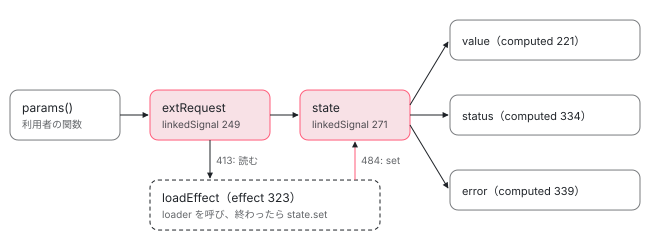
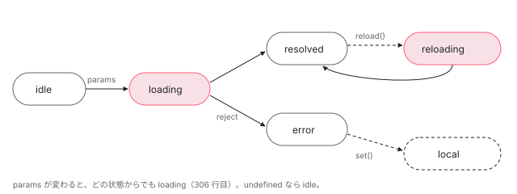

[目次](../README.md) › [Signal の内側](README.md) › 第 15 回 / 全 18 回

# 非同期を Signal の世界に持ち込む

> resource() の 6 つの状態（内部は 4 つ）を作る linkedSignal と computed、loader を呼ぶ effect、前の読み込みを AbortController で止める行、set / reload / destroy、debounced と resourceFromSnapshots を読む。

angular/angular · 読了 約 13 分 · 中核 · [サイトで読む（デモが動きます）](https://angular-deep-dive-cyan.vercel.app/chapter/resource)

---

signal の計算は同期です。`await` の後で読んだ signal は依存になりません（[依存の追跡](03-signals-tracking.md)）。では「ID が変わったら取り直す」ような非同期の読み込みはどう signal にするのか。答えが `resource()` です。この章では、`ResourceImpl` が params・状態・読み込みをどの signal と effect に分けて持ち、6 つの状態をどの行で作り、前の読み込みを `AbortController` でどの行で止めるのかを追います。

読む対象は `packages/core/src/resource/api.ts`、`resource.ts`、`debounce.ts`、`from_snapshots.ts` です。内部で使う `linkedSignal` の仕組みは [linkedSignal](08-signals-linked-signal.md) の章で読んだので、ここでは「source が変わるとリセットされ、`set` もできる signal」として使います。

1. [1. 概観](01-signals.md)
2. [2. ReactiveNode の構造](02-signals-reactive-node.md)
3. [3. 依存の追跡](03-signals-tracking.md)
4. [4. set と update](04-signals-set.md)
5. [5. push と pull](05-signals-push-pull.md)
6. [6. computed](06-signals-computed.md)
7. [7. live と non-live](07-signals-live.md)
8. [8. linkedSignal](08-signals-linked-signal.md)
9. [9. effect のノードと寿命](09-signals-effect-node.md)
10. [10. afterRenderEffect](10-signals-after-render-effect.md)
11. [11. input と viewChild](11-authoring.md)
12. [12. input() とコンパイラ](12-signals-input-compile.md)
13. [13. model() と output()](13-signals-model-output.md)
14. [14. toSignal と toObservable](14-signals-rxjs-interop.md)
15. **15. resource**（この章）
16. [16. httpResource と rxResource](16-signals-http-resource.md)
17. [17. Signal Forms](17-signal-forms.md)
18. [18. DevTools と signal グラフ](18-signals-debug.md)

## 1. 外から見た形：6 つの状態と 5 つの signal

📄 `angular/packages/core/src/resource/api.ts` L56–79 （▶ の行: 61, 64–65, 67–69, 71, 73, 75, 79）

```ts
56 │ /**
57 │  * String value capturing the status of a `Resource`.
58 │  *
59 │  * Possible statuses are:
60 │  *
61 ▶  * `idle` - The resource has no valid request and will not perform any loading. `value()` will be
62 │  * `undefined`.
63 │  *
64 ▶  * `loading` - The resource is currently loading a new value as a result of a change in its reactive
65 ▶  * dependencies. `value()` will be `undefined`.
66 │  *
67 ▶  * `reloading` - The resource is currently reloading a fresh value for the same reactive
68 ▶  * dependencies. `value()` will continue to return the previously fetched value during the reloading
69 ▶  * operation.
70 │  *
71 ▶  * `error` - Loading failed with an error. `value()` will be `undefined`.
72 │  *
73 ▶  * `resolved` - Loading has completed and the resource has the value returned from the loader.
74 │  *
75 ▶  * `local` - The resource's value was set locally via `.set()` or `.update()`.
76 │  *
77 │  * @publicApi 22.0
78 │  */
79 ▶ export type ResourceStatus = 'idle' | 'error' | 'loading' | 'reloading' | 'resolved' | 'local';
```

79 行目が公開されている状態の型です。doc コメントは、状態ごとに `value()` が何を返すかまで決めています。64〜65 行目の `loading` では `undefined`、67〜69 行目の `reloading` では**前の値を返し続ける**、71 行目の `error` では `undefined`、75 行目の `local` は `set()` / `update()` で手で入れた値です。

📄 `angular/packages/core/src/resource/api.ts` L90–125 （▶ の行: 92, 94, 100, 105, 110, 115, 122, 124）

```ts
 90 │ export interface Resource<T> {
 91 │   /**
 92 ▶    * The current value of the `Resource`, or throws an error if the resource is in an error state.
 93 │    */
 94 ▶   readonly value: Signal<T>;
 95 │ 
 96 │   /**
 97 │    * The current status of the `Resource`, which describes what the resource is currently doing and
 98 │    * what can be expected of its `value`.
 99 │    */
100 ▶   readonly status: Signal<ResourceStatus>;
101 │ 
102 │   /**
103 │    * When in the `error` state, this returns the last known error from the `Resource`.
104 │    */
105 ▶   readonly error: Signal<Error | undefined>;
106 │ 
107 │   /**
108 │    * Whether this resource is loading a new value (or reloading the existing one).
109 │    */
110 ▶   readonly isLoading: Signal<boolean>;
111 │ 
112 │   /**
113 │    * The current state of this resource, represented as a `ResourceSnapshot`.
114 │    */
115 ▶   readonly snapshot: Signal<ResourceSnapshot<T>>;
116 │ 
117 │   /**
118 │    * Whether this resource has a valid current value.
119 │    *
120 │    * This function is reactive.
121 │    */
122 ▶   hasValue(this: T extends undefined ? this : never): this is Resource<Exclude<T, undefined>>;
123 │ 
124 ▶   hasValue(): boolean;
125 │ }
```

94・100・105・110・115 行目、`value`・`status`・`error`・`isLoading`・`snapshot` はすべて `Signal` です。92 行目、**エラー状態で `value()` を読むと投げます**。だからテンプレートでは 122〜124 行目の `hasValue()` か `status()` を先に見ます。この 5 つをどう作っているかを、次の節から `ResourceImpl` の中で追います。

📄 `angular/packages/core/src/resource/api.ts` L185–207 （▶ の行: 186–189, 198, 205–207）

```ts
185 │ export interface ResourceLoaderParams<R> {
186 ▶   params: NoInfer<Exclude<R, undefined>>;
187 ▶   abortSignal: AbortSignal;
188 ▶   previous: {
189 ▶     status: ResourceStatus;
190 │   };
191 │ }
192 │ 
193 │ /**
194 │  * Loading function for a `Resource`.
195 │  *
196 │  * @publicApi 22.0
197 │  */
198 ▶ export type ResourceLoader<T, R> = (param: ResourceLoaderParams<R>) => PromiseLike<T>;
199 │ 
200 │ /**
201 │  * Streaming loader for a `Resource`.
202 │  *
203 │  * @publicApi 22.0
204 │  */
205 ▶ export type ResourceStreamingLoader<T, R> = (
206 ▶   param: ResourceLoaderParams<R>,
207 ▶ ) => Signal<ResourceStreamItem<T>> | PromiseLike<Signal<ResourceStreamItem<T>>> | undefined;
```

利用者が書く `loader` は 198 行目のとおり `PromiseLike<T>` を返す関数で、引数に 186 行目の `params`、187 行目の `abortSignal`、188〜189 行目の前回の状態を受け取ります。205〜207 行目の `ResourceStreamingLoader` は「値の signal」を返す版で、何度も値が届くもの（WebSocket など）に使います。`loader` も内部ではこちらの形に変換されます（2 節）。

## 2. resource() から ResourceImpl へ

📄 `angular/packages/core/src/resource/resource.ts` L68–86 （▶ の行: 69–70, 76–77, 79, 83）

```ts
68 │ export function resource<T, R>(options: ResourceOptions<T, R>): ResourceRef<T | undefined> {
69 ▶   if (ngDevMode && !options?.injector) {
70 ▶     assertInInjectionContext(resource);
71 │   }
72 │ 
73 │   const oldNameForParams = (
74 │     options as ResourceOptions<T, R> & {request: ResourceOptions<T, R>['params']}
75 │   ).request;
76 ▶   const params = options.params ?? oldNameForParams ?? (() => null!);
77 ▶   return new ResourceImpl<T | undefined, R>(
78 │     params,
79 ▶     getLoader(options),
80 │     options.defaultValue,
81 │     options.equal ? wrapEqualityFn(options.equal) : undefined,
82 │     options.debugName,
83 ▶     options.injector ?? inject(Injector),
84 │     options.id as StateKey<T>,
85 │   );
86 │ }
```

1. **69〜71 行目：注入コンテキストの検査**

   `injector` を渡さなければ、開発ビルドで `assertInInjectionContext` します。83 行目で `inject(Injector)` するからです。
2. **76 行目：`params` を決める**

   `params`、無ければ古い名前の `request`（73〜75 行目）、それも無ければ `() => null!`。`null` は `undefined` ではないので、`params` を省略した resource は作った直後に 1 回読み込みます。
3. **77〜85 行目：`ResourceImpl` を作る**

   79 行目の `getLoader` で `loader` を stream 形式に揃えてから渡します。

📄 `angular/packages/core/src/resource/resource.ts` L546–564 （▶ の行: 547–548, 551, 553–554, 557–559）

```ts
546 │ function getLoader<T, R>(options: ResourceOptions<T, R>): ResourceStreamingLoader<T, R> {
547 ▶   if (isStreamingResourceOptions(options)) {
548 ▶     return options.stream;
549 │   }
550 │ 
551 ▶   return async (params) => {
552 │     try {
553 ▶       return signal(
554 ▶         {value: await options.loader(params)},
555 │         ngDevMode ? createDebugNameObject(options.debugName, 'stream') : undefined,
556 │       );
557 ▶     } catch (err) {
558 ▶       return signal(
559 ▶         {error: encapsulateResourceError(err)},
560 │         ngDevMode ? createDebugNameObject(options.debugName, 'stream') : undefined,
561 │       );
562 │     }
563 │   };
564 │ }
```

547〜548 行目、`stream` を渡されたらそのまま使います。`loader` なら 551 行目で async 関数に包み、成功なら 553〜554 行目で `signal({value})`、失敗なら 557〜559 行目で `signal({error})` を返します。つまり `ResourceImpl` は常に「`{value}` か `{error}` を持つ signal（`ResourceStreamItem`）」を受け取ります。**loader が reject しても、ここで値に変わる**のが要点です。

## 3. 内部の状態は 4 つ

📄 `angular/packages/core/src/resource/resource.ts` L88–111 （▶ の行: 88, 96–98, 102–103, 106–110）

```ts
 88 ▶ type ResourceInternalStatus = 'idle' | 'loading' | 'resolved' | 'local';
 89 │ 
 90 │ /**
 91 │  * Internal state of a resource.
 92 │  */
 93 │ interface ResourceProtoState<T> {
 94 │   extRequest: WrappedRequest;
 95 │ 
 96 ▶   // For simplicity, status is internally tracked as a subset of the public status enum.
 97 ▶   // Reloading and Error statuses are projected from Loading and Resolved based on other state.
 98 ▶   status: ResourceInternalStatus;
 99 │ }
100 │ 
101 │ interface ResourceState<T> extends ResourceProtoState<T> {
102 ▶   previousStatus: ResourceStatus;
103 ▶   stream: Signal<ResourceStreamItem<T>> | undefined;
104 │ }
105 │ 
106 ▶ type WrappedRequest = {
107 ▶   request?: unknown;
108 ▶   reload: number;
109 ▶   status?: ResourceInternalStatus;
110 ▶   error?: Error;
111 │ };
```

88 行目、内部で持つ状態は `idle`・`loading`・`resolved`・`local` の 4 つだけです。96〜98 行目のコメントのとおり、`reloading` と `error` は他の情報から「投影」して作ります。状態の箱（`ResourceState`）は、どの要求に対する状態か（94 行目の `extRequest`）、102 行目の 1 つ前の状態、103 行目の値の stream を持ちます。106〜111 行目の `WrappedRequest` は、params の値に 108 行目の `reload` 回数を足したものです。

📄 `angular/packages/core/src/resource/resource.ts` L575–588 （▶ の行: 578, 580, 582, 586–587）

```ts
575 │ function projectStatusOfState(state: ResourceState<unknown>): ResourceStatus {
576 │   switch (state.status) {
577 │     case 'loading':
578 ▶       return state.extRequest.reload === 0 ? 'loading' : 'reloading';
579 │     case 'resolved':
580 ▶       return isResolved(state.stream!()) ? 'resolved' : 'error';
581 │     default:
582 ▶       return state.status;
583 │   }
584 │ }
585 │ 
586 ▶ function isResolved<T>(state: ResourceStreamItem<T>): state is {value: T} {
587 ▶   return (state as {error: unknown}).error === undefined;
588 │ }
```

- 578 行目：**`reloading` は「`loading` かつ `reload` 回数が 0 でない」**
- 580 行目：**`error` は「`resolved` だが stream の中身が `{error}`」**。586〜587 行目の `isResolved` は `error` が無いことを見ているだけです
- 582 行目：`idle` と `local` はそのまま

状態を増やさずに区別だけを増やしているので、「reloading 中にエラーになったら」のような組み合わせを別に考える必要がありません。`loading` と `reloading` の区別は実務で効きます。初回は出せる値が無いのでスピナーを出し、再取得なら古い値を出したまま裏で更新できます。

## 4. ResourceImpl を作る：3 つの signal と 1 つの effect

### (a) extRequest：params を読む linkedSignal

📄 `angular/packages/core/src/resource/resource.ts` L249–267 （▶ の行: 249, 252–253, 256–259, 261, 263）

```ts
249 ▶     this.extRequest = linkedSignal<WrappedRequest>(
250 │       () => {
251 │         try {
252 ▶           setInParamsFunction(true);
253 ▶           return {request: request(paramsContext), reload: 0};
254 │         } catch (error) {
255 │           rethrowFatalErrors(error);
256 ▶           if (error === ResourceParamsStatus.IDLE) {
257 ▶             return {status: 'idle', reload: 0};
258 ▶           } else if (error === ResourceParamsStatus.LOADING) {
259 ▶             return {status: 'loading', reload: 0};
260 │           }
261 ▶           return {error: error as Error, reload: 0};
262 │         } finally {
263 ▶           setInParamsFunction(false);
264 │         }
265 │       },
266 │       ngDevMode ? createDebugNameObject(debugName, 'extRequest') : undefined,
267 │     );
```

249 行目、利用者の `params` 関数は `linkedSignal` の計算として呼ばれます（253 行目）。だから `params` の中で読んだ signal がこのノードの依存になり、変わると再計算されます。253 行目は結果を `{request, reload: 0}` に包むので、**params が変わるたびに reload 回数は 0 に戻ります**。`linkedSignal` にしてあるのは、6 節の `reload()` が `update` で reload 回数だけを足せるようにするためです。256〜260 行目、`params` が特別な値 `ResourceParamsStatus.IDLE` / `LOADING` を投げたら、その状態にします（別の resource の状態を引き継ぐ `chain` が使います）。それ以外の例外は 261 行目でエラーとして持ちます。252・263 行目の `setInParamsFunction` は、params の中で別の resource を作ることを禁止するための印です（`ResourceImpl` のコンストラクタの先頭で `isInParamsFunction()` を見て NG0992 を投げる）。

### (b) state：extRequest から状態を作る linkedSignal

📄 `angular/packages/core/src/resource/resource.ts` L269–286 （▶ の行: 271, 273, 275, 279–282, 285–286）

```ts
269 │     // The main resource state is managed in a `linkedSignal`, which allows the resource to change
270 │     // state instantaneously when the request signal changes.
271 ▶     this.state = linkedSignal<WrappedRequest, ResourceState<T>>({
272 │       // Whenever the request changes,
273 ▶       source: this.extRequest,
274 │       // Compute the state of the resource given a change in status.
275 ▶       computation: (extRequest, previous) => {
276 │         let {request, status, error} = extRequest;
277 │         let stream: Signal<ResourceStreamItem<T>> | undefined;
278 │ 
279 ▶         if (error) {
280 ▶           status = 'resolved';
281 ▶           stream = signal(
282 ▶             {error: encapsulateResourceError(error)},
283 │             ngDevMode ? createDebugNameObject(this.debugName, 'stream') : undefined,
284 │           );
285 ▶         } else if (!status) {
286 ▶           if (!previous) {
```

📄 `angular/packages/core/src/resource/resource.ts` L299–321 （▶ の行: 304–308, 313–317）

```ts
299 │             if (!stream) {
300 │               stream = getInitialStream?.(extRequest.request as R);
301 │             }
302 │             // Clear getInitialStream so it doesn't hold onto memory
303 │             getInitialStream = undefined;
304 ▶             status = request === undefined ? 'idle' : stream ? 'resolved' : 'loading';
305 ▶           } else {
306 ▶             status = request === undefined ? 'idle' : 'loading';
307 ▶             if (previous.value.extRequest.request === request) {
308 ▶               stream = previous.value.stream;
309 │             }
310 │           }
311 │         }
312 │ 
313 ▶         return {
314 ▶           extRequest,
315 ▶           status,
316 ▶           previousStatus: previous ? projectStatusOfState(previous.value) : 'idle',
317 ▶           stream,
318 │         };
319 │       },
320 │       ...(ngDevMode ? createDebugNameObject(debugName, 'state') : undefined),
321 │     });
```

1. **273 行目：source は `extRequest`**

   params が変わる → `extRequest` が変わる → この `linkedSignal` が 275 行目の `computation` で状態を作り直す、という連鎖です。270 行目のコメントの「瞬時に状態を変えられる」は、effect を待たずに読んだ瞬間に状態が変わるという意味です。
2. **279〜284 行目：params がエラーなら、すぐ `resolved` + エラーの stream**

   loader は呼ばれません。3 節の 580 行目の投影で、外からは `error` に見えます。
3. **304 行目：初回（`previous` が無い）**

   request が `undefined` なら `idle`。SSR から引き継いだ値（間の数行の `TransferState` の処理、または 300 行目の `getInitialStream`）があれば `resolved`、無ければ `loading`。
4. **305〜309 行目：2 回目以降**

   306 行目、request が `undefined` なら `idle`、それ以外は必ず `loading` です。307〜308 行目、**request が前と同じ（=== で比べる）なら前の stream を引き継ぎます**。reload で `reload` 回数だけが変わったときがこれで、だから `reloading` 中も前の値が読めます（67〜69 行目の doc の実装）。request が変わったときは `stream` が `undefined` のままなので、値は次の (c) で `defaultValue` になります。
5. **313〜318 行目：新しい状態の箱を返す**

   316 行目で、1 つ前の状態を投影した名前（`resolved` や `error`）を `previousStatus` に取っておきます。loader の `previous.status` に渡るのはこれです。

### (c) value：state の stream を読む computed

📄 `angular/packages/core/src/resource/resource.ts` L218–243 （▶ の行: 221, 223, 225–226, 230–231, 234–235, 238, 240）

```ts
218 │     super(
219 │       // Feed a computed signal for the value to `BaseWritableResource`, which will upgrade it to a
220 │       // `WritableSignal` that delegates to `ResourceImpl.set`.
221 ▶       computed(
222 │         () => {
223 ▶           const streamValue = this.state().stream?.();
224 │ 
225 ▶           if (!streamValue) {
226 ▶             return defaultValue;
227 │           }
228 │ 
229 │           // Prevents `hasValue()` from throwing an error when a reload happened in the error state
230 ▶           if (this.state().status === 'loading' && this.error()) {
231 ▶             return defaultValue;
232 │           }
233 │ 
234 ▶           if (!isResolved(streamValue)) {
235 ▶             throw new ResourceValueError(this.error()!);
236 │           }
237 │ 
238 ▶           return streamValue.value;
239 │         },
240 ▶         {equal, ...(ngDevMode ? createDebugNameObject(debugName, 'value') : undefined)},
241 │       ),
242 │       debugName,
243 │     );
```

221 行目、`value` の正体は `computed` です。223 行目で `state().stream?.()` と 2 段に読むので、`state` が変わっても、stream の中身が変わっても再計算されます。225〜226 行目、stream が無ければ（`idle` や params が変わった直後の `loading`）`defaultValue`。234〜235 行目、stream の中身が `{error}` なら `ResourceValueError` を投げます。1 節の 92 行目の「エラー状態で読むと投げる」はこの行です。230〜231 行目は例外で、エラー状態から再読み込み中のときだけは投げずに `defaultValue` を返します。240 行目の `equal` は利用者が渡した比較関数で、同じ値が届いても `value` の読み手に知らせを出さないために使います。この `computed` は 218〜220 行目のコメントのとおり `BaseWritableResource` に渡され、そこで `set` / `update` を付けて `WritableSignal` に見せかけます。

### (d) loadEffect と、status・error

📄 `angular/packages/core/src/resource/resource.ts` L323–346 （▶ の行: 323, 325, 329, 332, 334–335, 339, 341–342）

```ts
323 ▶     this.effectRef = effect(this.loadEffect.bind(this), {
324 │       injector,
325 ▶       manualCleanup: true,
326 │       ...(ngDevMode ? createDebugNameObject(debugName, 'loadEffect') : undefined),
327 │     });
328 │ 
329 ▶     this.pendingTasks = injector.get(PendingTasks);
330 │ 
331 │     // Cancel any pending request when the resource itself is destroyed.
332 ▶     this.unregisterOnDestroy = injector.get(DestroyRef).onDestroy(() => this.destroy());
333 │ 
334 ▶     this.status = computed(
335 ▶       () => projectStatusOfState(this.state()),
336 │       ngDevMode ? createDebugNameObject(debugName, 'status') : undefined,
337 │     );
338 │ 
339 ▶     this.error = computed(
340 │       () => {
341 ▶         const stream = this.state().stream?.();
342 ▶         return stream && !isResolved(stream) ? stream.error : undefined;
343 │       },
344 │       ngDevMode ? createDebugNameObject(debugName, 'error') : undefined,
345 │     );
346 │   }
```

323 行目、読み込みを始めるのは `effect` です。325 行目の `manualCleanup: true` で effect 自身の自動破棄は止め、332 行目で `DestroyRef` に `this.destroy()` を登録します（6 節）。effect なので、params が変わったその場では loader は呼ばれません。**状態は (b) の linkedSignal ですぐ `loading` になり、loader は effect が走ったときに呼ばれます**（effect がいつ走るかは [cd-effects](../cd/09-cd-effects.md)）。334〜337 行目の `status` は 3 節の `projectStatusOfState` を `computed` にしたもの、339〜345 行目の `error` は stream の中身が `{error}` のときだけその `error` を返す `computed` です。329 行目の `PendingTasks` は 5 節で使います。



*ResourceImpl の中の signal グラフ。params の変化は linkedSignal を伝って同期的に status を loading にし、loader の呼び出しだけが effect に回る。*

## 5. loadEffect：前を止めて、新しく読み込む

📄 `angular/packages/core/src/resource/resource.ts` L412–443 （▶ の行: 413, 417, 419, 422, 428, 439–440, 442）

```ts
412 │   private async loadEffect(): Promise<void> {
413 ▶     const extRequest = this.extRequest();
414 │ 
415 │     // Capture the previous status before any state transitions. Note that this is `untracked` since
416 │     // we do not want the effect to depend on the state of the resource, only on the request.
417 ▶     const {status: currentStatus, previousStatus} = untracked(this.state);
418 │ 
419 ▶     if (extRequest.request === undefined) {
420 │       // Nothing to load (and we should already be in a non-loading state).
421 │       return;
422 ▶     } else if (currentStatus !== 'loading') {
423 │       // We're not in a loading or reloading state, so this loading request is stale.
424 │       return;
425 │     }
426 │ 
427 │     // Cancel any previous loading attempts.
428 ▶     this.abortInProgressLoad();
429 │ 
430 │     // Capturing _this_ load's pending task in a local variable is important here. We may attempt to
431 │     // resolve it twice:
432 │     //
433 │     //  1. when the loading function promise resolves/rejects
434 │     //  2. when cancelling the loading operation
435 │     //
436 │     // After the loading operation is cancelled, `this.resolvePendingTask` no longer represents this
437 │     // particular task, but this `await` may eventually resolve/reject. Thus, when we cancel in
438 │     // response to (1) below, we need to cancel the locally saved task.
439 ▶     let resolvePendingTask: (() => void) | undefined = (this.resolvePendingTask =
440 ▶       this.pendingTasks.add());
441 │ 
442 ▶     const {signal: abortSignal} = (this.pendingController = new AbortController());
443 │ 
```

1. **413 行目：`extRequest()` を読む＝この effect の唯一の依存**

   417 行目の `state` は `untracked` で読むので依存になりません。415〜416 行目のコメントのとおり、effect は request の変化でだけ走ります。
2. **419〜425 行目：読み込む必要が無ければ帰る**

   request が `undefined`（`idle`）か、状態が `loading` でない（params エラーで `resolved` になった、`set` で `local` になった）ときです。
3. **428 行目：前の読み込みを止める**

   中身は次の引用です。
4. **439〜440 行目：`PendingTasks` に仕事を 1 つ足す**

   読み込みが終わるまでアプリは「安定していない」とみなされ、SSR はこの読み込みを待ってから HTML を作ります（[zoneless-pending-tasks](../zoneless/09-zoneless-pending-tasks.md)）。430〜438 行目のコメントは、外す処理を 2 か所から呼ぶのでローカル変数に取っておく理由です。
5. **442 行目：今回用の `AbortController` を作り、`this.pendingController` に覚える**

📄 `angular/packages/core/src/resource/resource.ts` L519–526 （▶ の行: 520–521, 524–525）

```ts
519 │   private abortInProgressLoad(): void {
520 ▶     untracked(() => this.pendingController?.abort());
521 ▶     this.pendingController = undefined;
522 │ 
523 │     // Once the load is aborted, we no longer want to block stability on its resolution.
524 ▶     this.resolvePendingTask?.();
525 ▶     this.resolvePendingTask = undefined;
526 │   }
```

520 行目、前回の `AbortController` の `abort()` を呼びます。これで前回の loader に渡した `abortSignal` に `abort` イベントが飛びます。524 行目、前回の `PendingTasks` の仕事も外します。止めた読み込みのために SSR を待たせ続けないためです。`abortSignal` を `fetch(url, { signal: abortSignal })` に渡しておけば、**不要になった通信がブラウザの中で実際に中断されます**。

📄 `angular/packages/core/src/resource/resource.ts` L444–460 （▶ の行: 448–453, 460）

```ts
444 │     try {
445 │       // The actual loading is run through `untracked` - only the request side of `resource` is
446 │       // reactive. This avoids any confusion with signals tracking or not tracking depending on
447 │       // which side of the `await` they are.
448 ▶       const stream = untracked(() => {
449 ▶         return this.loaderFn({
450 ▶           params: extRequest.request as Exclude<R, undefined>,
451 ▶           abortSignal,
452 ▶           previous: {
453 ▶             status: previousStatus,
454 │           },
455 │         });
456 │       });
457 │ 
458 │       // If this request has been aborted, or the current request no longer
459 │       // matches this load, then we should ignore this resolution.
460 ▶       const shouldDiscard = () => abortSignal.aborted || untracked(this.extRequest) !== extRequest;
```

448 行目、loader の呼び出しは `untracked` の中です。445〜447 行目のコメントのとおり、loader の中で読んだ signal は（`await` の前でも後でも）依存になりません。**リアクティブなのは params の側だけ**です。460 行目の `shouldDiscard` は「中断された、または今の request がもう別物」かを確かめる関数で、結果を書き込む直前に毎回呼びます。

📄 `angular/packages/core/src/resource/resource.ts` L478–517 （▶ の行: 479–481, 484–488, 497, 499, 503, 506–508, 512, 514）

```ts
478 │       } else {
479 ▶         const resolvedStream = await stream;
480 ▶         if (shouldDiscard()) {
481 ▶           return;
482 │         }
483 │ 
484 ▶         this.state.set({
485 ▶           extRequest,
486 ▶           status: 'resolved',
487 ▶           previousStatus: 'resolved',
488 ▶           stream: resolvedStream,
489 │         });
490 │ 
491 │         // Use a local variable for the result so TypeScript can narrow `resolvedStream` correctly.
492 │         const result = resolvedStream ? untracked(resolvedStream) : undefined;
493 │         if (typeof ngServerMode !== 'undefined' && ngServerMode) {
494 │           saveToTransferState(result, this.transferCacheKey, this.transferState);
495 │         }
496 │       }
497 ▶     } catch (err) {
498 │       rethrowFatalErrors(err);
499 ▶       if (abortSignal.aborted || untracked(this.extRequest) !== extRequest) {
500 │         return;
501 │       }
502 │ 
503 ▶       this.state.set({
504 │         extRequest,
505 │         status: 'resolved',
506 ▶         previousStatus: 'error',
507 ▶         stream: signal(
508 ▶           {error: encapsulateResourceError(err)},
509 │           ngDevMode ? createDebugNameObject(this.debugName, 'stream') : undefined,
510 │         ),
511 │       });
512 ▶     } finally {
513 │       // Resolve the pending task now that the resource has a value.
514 ▶       resolvePendingTask?.();
515 │       resolvePendingTask = undefined;
516 │     }
517 │   }
```

1. **479 行目：`await stream`**

   ここで effect の関数は中断します。effect は async 関数を待たないので、次の変更検知で別の effect が走ってもかまいません。
2. **480〜482 行目：古い結果なら捨てる**

   待っている間に params が変わっていれば、次の loadEffect が 428 行目で今回の `AbortController` を止めているか、`extRequest` が別の値になっています。**abort を無視して最後まで走った loader の結果も、ここで捨てられます**。
3. **484〜489 行目：`resolved` にして stream を入れる**

   stream の中身が `{error}` なら、580 行目の投影で外からは `error` です。
4. **497〜511 行目：stream loader 自身が投げたとき**

   2 節の `getLoader` が reject を値に変えるので、`loader` を使う限りここには来ません。`stream` を直接渡した場合のためです。506 行目で `previousStatus` を `error` にします。
5. **512〜516 行目：`finally` で `PendingTasks` の仕事を外す**

   捨てた場合も含め、必ず外れます。

## 6. set・reload・destroy

📄 `angular/packages/core/src/resource/resource.ts` L351–383 （▶ の行: 352, 359, 362–363, 370, 372, 374–375, 382）

```ts
351 │   override set(value: T): void {
352 ▶     if (this.destroyed) {
353 │       return;
354 │     }
355 │ 
356 │     const error = untracked(this.error);
357 │     const state = untracked(this.state);
358 │ 
359 ▶     if (!error) {
360 │       const current = untracked(this.value);
361 │       if (
362 ▶         state.status === 'local' &&
363 ▶         (this.equal ? this.equal(current, value) : current === value)
364 │       ) {
365 │         return;
366 │       }
367 │     }
368 │ 
369 │     // Enter Local state with the user-defined value.
370 ▶     this.state.set({
371 │       extRequest: state.extRequest,
372 ▶       status: 'local',
373 │       previousStatus: 'local',
374 ▶       stream: signal(
375 ▶         {value},
376 │         ngDevMode ? createDebugNameObject(this.debugName, 'stream') : undefined,
377 │       ),
378 │     });
379 │ 
380 │     // We're departing from whatever state the resource was in previously, so cancel any in-progress
381 │     // loading operations.
382 ▶     this.abortInProgressLoad();
383 │   }
```

`res.set(v)` も `res.value.set(v)` もここに来ます。359〜366 行目、すでに `local` で同じ値なら何もしません。370〜378 行目で状態を `local` にし、374〜375 行目で `signal({value})` を stream として入れます。**382 行目で読み込み中の loader を止めます**。手で値を入れた後に古い読み込みの結果で上書きされないためです。`extRequest` は変えないので（371 行目）、params が次に変わるまで `local` のままです。

📄 `angular/packages/core/src/resource/resource.ts` L385–410 （▶ の行: 387–389, 393, 398–401, 404–406）

```ts
385 │   override reload(): boolean {
386 │     // We don't want to restart in-progress loads.
387 ▶     const {status} = untracked(this.state);
388 ▶     if (status === 'idle' || status === 'loading') {
389 ▶       return false;
390 │     }
391 │ 
392 │     // Increment the request reload to trigger the `state` linked signal to switch us to `Reload`
393 ▶     this.extRequest.update(({request, reload}) => ({request, reload: reload + 1}));
394 │     return true;
395 │   }
396 │ 
397 │   destroy(): void {
398 ▶     this.destroyed = true;
399 ▶     this.unregisterOnDestroy();
400 ▶     this.effectRef.destroy();
401 ▶     this.abortInProgressLoad();
402 │ 
403 │     // Destroyed resources enter Idle state.
404 ▶     this.state.set({
405 ▶       extRequest: {request: undefined, reload: 0},
406 ▶       status: 'idle',
407 │       previousStatus: 'idle',
408 │       stream: undefined,
409 │     });
410 │   }
```

`reload()` は 388〜389 行目、`idle` か `loading` なら何もせず `false` を返します。読み込み中の読み込みはやり直しません。393 行目で `extRequest` の `reload` 回数だけを 1 増やします。request は同じなので 4 節 (b) の 307〜308 行目で前の stream が引き継がれ、578 行目で `reloading` になります。`destroy()` は 400 行目で effect を止め、401 行目で読み込みを中断し、404〜409 行目で `idle` に戻します。コンポーネントが破棄されると 332 行目の登録からこれが呼ばれます。



*状態遷移。実線は params の変化と loader の結果、点線は利用者の操作。reloading と error は内部では loading と resolved。*

## 7. DEMO：状態の遷移と abort

> **🧪 DEMO — loader は 1.5 秒後に resolve する Promise。abortSignal で止まる**
>
> `resource({ params: () => query(), loader })` を章コンポーネントのフィールド初期化子で作っています。`query` の初期値は `undefined` なので、最初は `idle` です。'a' を押してから 1.5 秒以内に 'b' を押すと、'a' の abort が記録されます。params を `'error'` にすると loader が reject します。status のログは `effect` で取っているので、1 回の変更検知の間に起きた変化は最後の値しか見えません。
>
> ▶ [このデモはサイトで動かせます](https://angular-deep-dive-cyan.vercel.app/chapter/resource)

'a' → すぐ 'b' と押すと、「set('b')」の後に「abort イベント（'a'）」と「loader 開始 'b'」が出ます。abort は `set` の中ではなく、5 節の loadEffect が 428 行目を通ったときに起きます。'b' の結果が出た後に reload を押すと、`previous.status=resolved` で loader が呼ばれ、status は `reloading`、value は前の結果のままです（307〜308 行目）。読み込み中に set を押すと、382 行目で読み込みが止まり、`local` になります。

もう 1 つ、ログを見ると気づくことがあります。'b' が `resolved` になった**後**に reload を押しても、「abort イベント（'b'）」が出ます。512〜516 行目の `finally` が外すのは `PendingTasks` の仕事だけで、`this.pendingController` は次の読み込みまで残っているからです。次の loadEffect の 428 行目が、終わった読み込みの `AbortController` にも `abort()` を呼びます。終わった `fetch` に abort が届いても何も起きないので実害はありませんが、loader の中で abort イベントにログや後片付けを書くときは、「終わった後にも呼ばれることがある」と考えておきます。

## 8. snapshot・resourceFromSnapshots・debounced

📄 `angular/packages/core/src/resource/resource.ts` L145–166 （▶ の行: 147, 149, 153, 157–158, 160–161, 163）

```ts
145 │   // Use a computed here to avoid triggering reactive consumers if the value changes while staying
146 │   // either defined or undefined.
147 ▶   private readonly isValueDefined = computed(() => {
148 │     // Check if it's in an error state first to prevent the error from bubbling up.
149 ▶     if (this.isError()) {
150 │       return false;
151 │     }
152 │ 
153 ▶     return this.value() !== undefined;
154 │   });
155 │ 
156 │   private _snapshot: Signal<ResourceSnapshot<T>> | undefined;
157 ▶   get snapshot(): Signal<ResourceSnapshot<T>> {
158 ▶     return (this._snapshot ??= computed(() => {
159 │       const status = this.status();
160 ▶       if (status === 'error') {
161 ▶         return {status: 'error', error: this.error()!};
162 │       } else {
163 ▶         return {status, value: this.value()};
164 │       }
165 │     }));
166 │   }
```

157〜165 行目の `snapshot` は、状態と値（またはエラー）を 1 つのオブジェクトにまとめた `computed` です。`error` のときは 161 行目で `value` を読まずに `error` だけを入れるので、読んでも投げません。147〜154 行目の `hasValue()` の中身も、149 行目でエラーかを先に見てから 153 行目で `value()` を読みます。snapshot があると、逆に「snapshot の signal から resource を作る」ことができます。

📄 `angular/packages/core/src/resource/from_snapshots.ts` L21–46 （▶ の行: 21–22, 32–34, 36, 38）

```ts
21 ▶ export function resourceFromSnapshots<T>(source: () => ResourceSnapshot<T>): Resource<T> {
22 ▶   return new SnapshotResource(isSignal(source) ? source : computed(source));
23 │ }
24 │ 
25 │ class SnapshotResource<T> implements Resource<T> {
26 │   constructor(readonly snapshot: Signal<ResourceSnapshot<T>>) {}
27 │ 
28 │   private get state(): ResourceSnapshot<T> {
29 │     return this.snapshot();
30 │   }
31 │ 
32 ▶   readonly value = computed(() => {
33 ▶     if (this.state.status === 'error') {
34 ▶       throw new ResourceValueError(this.state.error);
35 │     }
36 ▶     return this.state.value;
37 │   });
38 ▶   readonly status = computed(() => this.state.status);
39 │   readonly error = computed(() => (this.state.status === 'error' ? this.state.error : undefined));
40 │   readonly isLoading = computed(
41 │     () => this.state.status === 'loading' || this.state.status === 'reloading',
42 │   );
43 │ 
44 │   private isValueDefined = computed(
45 │     () => this.state.status !== 'error' && this.state.value !== undefined,
46 │   );
```

`resourceFromSnapshots` は、snapshot を返す関数を受け取り（22 行目で `computed` に包む）、32〜38 行目でそこから `value`・`status` を作るだけの `Resource` です。読み込みの effect はありません。この部品で作られているのが `debounced` です。

📄 `angular/packages/core/src/resource/debounce.ts` L122–162 （▶ の行: 123, 125–126, 129, 136, 138, 140, 146–147, 153–155）

```ts
122 │       // The value has changed, so any pending timer from a previous wait is now obsolete.
123 ▶       cancelTimer();
124 │ 
125 ▶       const waitFn =
126 ▶         typeof wait === 'number'
127 │           ? () =>
128 │               new Promise<void>((resolve) => {
129 ▶                 activeTimer = setTimeout(() => {
130 │                   activeTimer = undefined;
131 │                   resolve();
132 │                 }, wait);
133 │               })
134 │           : wait;
135 │ 
136 ▶       const result = waitFn(value, currentState);
137 │ 
138 ▶       if (result === undefined) {
139 │         // Synchronous case, go straight to resolved.
140 ▶         state.set({status: 'resolved', value});
141 │         active = pendingValue = undefined;
142 │       } else {
143 │         // Asynchronous case:
144 │         // If we're in error state or loading state, remain in that state.
145 │         // Otherwise, change to loading state but keep the current value until the new one loads.
146 ▶         if (currentState.status !== 'loading' && currentState.status !== 'error') {
147 ▶           state.set({status: 'loading', value: currentState.value});
148 │         }
149 │         active = result;
150 │         pendingValue = value;
151 │ 
152 │         // Once the promise resolves, update the state to resolved.
153 ▶         result.then(() => {
154 ▶           if (active === result) {
155 ▶             state.set({status: 'resolved', value});
156 │             active = pendingValue = undefined;
157 │           }
158 │         });
159 │       }
160 │     },
161 │     {injector},
162 │   );
```

`debounced(source, wait)` は「source が落ち着いてから値を出す」resource です。引用は `debounced` の中で作る effect の後半で、source が変わったときに走る部分です。123 行目で前のタイマーを止め、125〜134 行目で待つ関数を作ります。`wait` が数値なら `setTimeout` を包んだ Promise です。146〜147 行目、待ち始めたら `loading` にしますが、**value は前の値のまま**にします。153〜155 行目、Promise が解決したとき、それが最新の待ち（`active === result`）なら `resolved` にします。138〜140 行目、`wait` 関数が Promise を返さなければ、待たずにすぐ `resolved` です。この `debounced` は [Signal Forms](17-signal-forms.md) の非同期バリデーションの `debounce` オプションでも使われています。

## 全体の流れ

- 👤 `resource({ params, loader })` — resource.ts 68 — *フィールド初期化子*
  - `getLoader(options)` — 79 → 546 — *loader を stream 形式に*
  - `new ResourceImpl(...)` — 77
    - `value = computed(state().stream?.())` — 221
    - `extRequest = linkedSignal(params)` — 249
    - `state = linkedSignal({ source: extRequest })` — 271
    - `effect(loadEffect)` — 323
- 👤 `query.set('b')` — *params の元を変える*
  - `status()` → `'loading'` — 306 / 578 — *読んだ瞬間に変わる*
  - `loadEffect()` — 412 — *変更検知の中*
    - `abortInProgressLoad()` — 428 → 520 — *前の abortSignal に abort*
    - `pendingTasks.add()` / `new AbortController()` — 439–442
    - `untracked(() => loaderFn({ params, abortSignal, previous }))` — 448
    - `await stream` → `shouldDiscard()` → `state.set(resolved)` — 479–489
    - `resolvePendingTask()` — 514

## 聞かれそうな質問

**Q. params を変えたとき、前の読み込みはどこで止まりますか？**

次の loadEffect の 428 行目、`abortInProgressLoad` の 520 行目で前の `AbortController` の `abort()` が呼ばれます。loader に渡した `abortSignal` を `fetch` に渡していれば通信も止まります。渡していなくても、結果は 480 行目の `shouldDiscard` で捨てられるので、古い結果で上書きされることはありません。止まるのは `set` の中ではなく effect が走ったときです（DEMO のログの順番）。

**Q. loader の中で読んだ signal は依存になりますか？**

なりません。448 行目で loader を `untracked` の中で呼ぶからです。依存になるのは `params` 関数の中で読んだ signal だけで、それは 253 行目で `extRequest` の linkedSignal の計算として呼ばれます。読み込みに使う値は全部 `params` で読み、loader には引数の `params` で渡します。

**Q. reload() と params の変更は何が違いますか？**

reload は 393 行目で `reload` 回数だけを増やし、request は同じです。だから 307〜308 行目で前の stream が引き継がれ、状態は `reloading`、`value` は前の値のままです。params が変わると 253 行目で `reload: 0` の新しい箱になり、307 行目の比較が偽になるので stream は無く、状態は `loading`、`value` は `defaultValue` です。また reload は `idle` と `loading` では何もしません（388〜389 行目）。

**Q. エラーのとき value() を読むとどうなりますか？**

234〜235 行目で `ResourceValueError` を投げます（元のエラーは `cause`）。テンプレートで直接読むと変更検知の中で投げるので、`hasValue()`（149 行目で先にエラーを見る）か `status()` を先に確かめます。`snapshot()` は 161 行目でエラーのとき `value` を読まないので、投げずに状態を取り出せます。

**Q. resource を POST や削除に使ってよいですか？**

想定されていません。params が変わったり resource が破棄されたりすると、読み込み中の処理は 520 行目で中断されます。書き込みの途中で止まると困る操作には向きません。doc コメントにもこの注意があります（[httpResource](16-signals-http-resource.md) の章で引用）。

## 読み終えて

- 外から見える状態は 6 つ、内部は 4 つ。`reloading` と `error` は 578・580 行目の投影
- params は `extRequest` の linkedSignal（249 行目）、状態は `state` の linkedSignal（271 行目）。params が変わると読んだ瞬間に `loading` になる
- loader を呼ぶのは effect（323 行目）。呼ぶ前に前回の `AbortController` を止め（520 行目）、結果は `shouldDiscard` で古ければ捨てる
- loader は `untracked` の中。依存は params だけ
- `set` は `local` にして読み込みを止め、`reload` は request を変えずに回数だけ増やす

---

← 前: [toSignal と toObservable：Observable と Signal の橋渡し](14-signals-rxjs-interop.md)  
次: [httpResource と rxResource：resource の上に HttpClient と Observable を載せる](16-signals-http-resource.md) →
