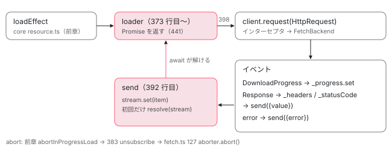

[目次](../README.md) › [Signal の内側](README.md) › 第 16 回 / 全 18 回

# httpResource と rxResource：resource の上に HttpClient と Observable を載せる

> httpResource が request を params 関数として HttpRequest に変え、loader の中で HttpClient の Observable を購読して ResourceStreamItem を流す行、progress / headers / statusCode が signal になる理由、text / blob / arrayBuffer の版、parse と equal。rxResource が stream の Observable を同じ形に変換する行。resource() 本体の状態遷移は「非同期を Signal の世界に持ち込む」の章に任せる。

angular/angular · 読了 約 13 分 · 発展 · [サイトで読む（デモが動きます）](https://angular-deep-dive-cyan.vercel.app/chapter/signals-http-resource)

---

`httpResource` は「URL を signal から作り、`HttpClient` で取ってくる resource」です。`rxResource` は「Observable を返す関数で読み込む resource」です。どちらも新しい状態機械を持っていません。前の章の `ResourceImpl` に、**loader を 1 つ差し込んでいるだけ**です。この章では、URL や request オブジェクトが `HttpRequest` になる行、loader の中で `HttpClient` の Observable を購読して stream の signal に流す行、`headers`・`statusCode`・`progress` が signal になっている理由を追い、最後に `rxResource` が同じ形をどう作るかを比べます。

読む対象は `packages/common/http/src/resource.ts`、`resource_api.ts`、`packages/core/rxjs-interop/src/rx_resource.ts`、それに `HttpClient` 側の `client.ts` と `fetch.ts` の数行です。resource 本体の状態遷移・abort・reload は [非同期を Signal の世界に持ち込む](15-resource.md)の章で読んだので、ここでは繰り返しません。

1. [1. 概観](01-signals.md)
2. [2. ReactiveNode の構造](02-signals-reactive-node.md)
3. [3. 依存の追跡](03-signals-tracking.md)
4. [4. set と update](04-signals-set.md)
5. [5. push と pull](05-signals-push-pull.md)
6. [6. computed](06-signals-computed.md)
7. [7. live と non-live](07-signals-live.md)
8. [8. linkedSignal](08-signals-linked-signal.md)
9. [9. effect のノードと寿命](09-signals-effect-node.md)
10. [10. afterRenderEffect](10-signals-after-render-effect.md)
11. [11. input と viewChild](11-authoring.md)
12. [12. input() とコンパイラ](12-signals-input-compile.md)
13. [13. model() と output()](13-signals-model-output.md)
14. [14. toSignal と toObservable](14-signals-rxjs-interop.md)
15. [15. resource](15-resource.md)
16. **16. httpResource と rxResource**（この章）
17. [17. Signal Forms](17-signal-forms.md)
18. [18. DevTools と signal グラフ](18-signals-debug.md)

## 1. httpResource は関数オブジェクト

📄 `angular/packages/common/http/src/resource.ts` L209–224 （▶ の行: 210–213, 216, 218–223）

```ts
209 │ /**
210 ▶  * `httpResource` makes a reactive HTTP request and exposes the request status and response value as
211 ▶  * a `WritableResource`. By default, it assumes that the backend will return JSON data. To make a
212 ▶  * request that expects a different kind of data, you can use a sub-constructor of `httpResource`,
213 ▶  * such as `httpResource.text`.
214 │  *
215 │  * @publicApi 22.0
216 ▶  * @initializerApiFunction
217 │  */
218 ▶ export const httpResource: HttpResourceFn = (() => {
219 ▶   const jsonFn = makeHttpResourceFn<unknown>('json') as HttpResourceFn;
220 ▶   jsonFn.arrayBuffer = makeHttpResourceFn<ArrayBuffer>('arraybuffer');
221 ▶   jsonFn.blob = makeHttpResourceFn('blob');
222 ▶   jsonFn.text = makeHttpResourceFn('text');
223 ▶   return jsonFn;
224 │ })();
```

218 行目、`httpResource` は関数ではなく、即時実行した関数が返す**関数オブジェクト**です。219 行目で JSON 用の関数を作り、220〜222 行目でそれに `arrayBuffer`・`blob`・`text` というプロパティとして別の関数をぶら下げます。4 つの違いは `makeHttpResourceFn` に渡す 1 つの文字列（レスポンスの型）だけです。`httpResource.text(...)` と書けるのはこのためです。216 行目の `@initializerApiFunction` は、API ドキュメントの抽出器（`compiler-cli/src/ngtsc/docs/src/initializer_api_function_extractor.ts`）が「フィールド初期化子で呼ぶ API」として扱うための印で、`input()` や `model()` にも付いています。

📄 `angular/packages/common/http/src/resource.ts` L237–250 （▶ の行: 237–238, 242–243, 245, 247–249）

```ts
237 ▶ function makeHttpResourceFn<TRaw>(responseType: ResponseType) {
238 ▶   return function httpResource<TResult = TRaw>(
239 │     request: RawRequestType,
240 │     options?: HttpResourceOptions<TResult, TRaw>,
241 │   ): HttpResourceRef<TResult> {
242 ▶     if (ngDevMode && !options?.injector) {
243 ▶       assertInInjectionContext(httpResource);
244 │     }
245 ▶     const injector = options?.injector ?? inject(Injector);
246 │ 
247 ▶     const cacheOptions = injector.get(CACHE_OPTIONS, null, {optional: true});
248 ▶     const transferState = injector.get(TransferState, null, {optional: true});
249 ▶     const originMap = injector.get(HTTP_TRANSFER_CACHE_ORIGIN_MAP, null, {optional: true});
250 │ 
```

238 行目、返す関数にも `httpResource` という名前を付けています。243 行目の `assertInInjectionContext(httpResource)` がエラーメッセージに関数名を使うからです。245 行目で注入器を決め、247〜249 行目で SSR のキャッシュに関わる 3 つを任意で取ります。

📄 `angular/packages/common/http/src/resource.ts` L251–271 （▶ の行: 251–253, 257–258, 270）

```ts
251 ▶     const getInitialStream = (req: HttpRequest<unknown> | undefined) => {
252 ▶       if (cacheOptions && transferState && req) {
253 ▶         const cachedResponse = retrieveStateFromCache(req, cacheOptions, transferState, originMap);
254 │         if (cachedResponse) {
255 │           try {
256 │             const body = cachedResponse.body as TRaw;
257 ▶             const parsed = options?.parse ? options.parse(body) : (body as unknown as TResult);
258 ▶             return signal({value: parsed});
259 │           } catch (e) {
260 │             if (typeof ngDevMode === 'undefined' || ngDevMode) {
261 │               console.warn(
262 │                 `Angular detected an error while parsing the cached response for the httpResource at \`${req.url}\`. ` +
263 │                   `The resource will fall back to its default value and try again asynchronously.`,
264 │                 e,
265 │               );
266 │             }
267 │           }
268 │         }
269 │       }
270 ▶       return undefined;
271 │     };
```

`getInitialStream` は、SSR がサーバーで取った応答を `TransferState` に入れてくれていれば、それを最初の値にする関数です（253 行目）。見つかれば 257 行目で `parse` を通し、258 行目で `signal({value})` を返します。これが前章 4 節 (b) の `getInitialStream?.(...)` の行で呼ばれ、ハイドレーション直後から `resolved` で始まります。見つからなければ 270 行目の `undefined` で、普通に `loading` から始まります。

📄 `angular/packages/common/http/src/resource.ts` L272–283 （▶ の行: 273–276, 278–280）

```ts
272 │ 
273 ▶     return new HttpResourceImpl(
274 ▶       injector,
275 ▶       (ctx: ResourceParamsContext) => normalizeRequest(ctx, request, responseType),
276 ▶       options?.defaultValue,
277 │       options?.debugName,
278 ▶       options?.parse as (value: unknown) => TResult,
279 ▶       options?.equal as ValueEqualityFn<unknown>,
280 ▶       getInitialStream,
281 │     ) as HttpResourceRef<TResult>;
282 │   };
283 │ }
```

273 行目で `HttpResourceImpl` を作ります。275 行目が要点で、**ResourceImpl の params 関数として「利用者の関数を呼んで `HttpRequest` に変える関数」を渡します**。前章で読んだとおり params 関数は `extRequest` の linkedSignal の計算として呼ばれるので、利用者の関数の中で読んだ signal（ページ番号など）が依存になります。

## 2. URL や request オブジェクトを HttpRequest にする

📄 `angular/packages/common/http/src/resource.ts` L285–310 （▶ の行: 290–294, 297–298, 300, 306–307, 309）

```ts
285 │ function normalizeRequest(
286 │   ctx: ResourceParamsContext,
287 │   request: RawRequestType,
288 │   responseType: ResponseType,
289 │ ): HttpRequest<unknown> | undefined {
290 ▶   let unwrappedRequest = typeof request === 'function' ? request(ctx) : request;
291 ▶   if (unwrappedRequest === undefined) {
292 ▶     return undefined;
293 ▶   } else if (typeof unwrappedRequest === 'string') {
294 ▶     unwrappedRequest = {url: unwrappedRequest};
295 │   }
296 │ 
297 ▶   const headers =
298 ▶     unwrappedRequest.headers instanceof HttpHeaders
299 │       ? unwrappedRequest.headers
300 ▶       : new HttpHeaders(
301 │           unwrappedRequest.headers as
302 │             | Record<string, string | number | Array<string | number>>
303 │             | undefined,
304 │         );
305 │ 
306 ▶   const params =
307 ▶     unwrappedRequest.params instanceof HttpParams
308 │       ? unwrappedRequest.params
309 ▶       : new HttpParams({fromObject: unwrappedRequest.params});
310 │ 
```

1. **290 行目：利用者の関数を呼ぶ**

   この呼び出しが linkedSignal の計算の中で起きるので、ここで読んだ signal が依存になります。
2. **291〜292 行目：`undefined` なら `undefined` を返す**

   前章 4 節 (b) で `idle` になります。「条件がそろうまで通信しない」はこの戻り値で書きます。
3. **293〜294 行目：文字列なら `{url}` に包む**

   `httpResource(() => '/api/x')` と `httpResource(() => ({url: '/api/x'}))` はここで同じになります。
4. **297〜309 行目：headers と params を `HttpHeaders` / `HttpParams` にする**

   すでにそのクラスならそのまま、ただのオブジェクトなら作り直します。

📄 `angular/packages/common/http/src/resource.ts` L311–335 （▶ の行: 311–312, 314, 318, 325）

```ts
311 ▶   return new HttpRequest(
312 ▶     unwrappedRequest.method ?? 'GET',
313 │     unwrappedRequest.url,
314 ▶     unwrappedRequest.body ?? null,
315 │     {
316 │       headers,
317 │       params,
318 ▶       reportProgress: unwrappedRequest.reportProgress,
319 │       withCredentials: unwrappedRequest.withCredentials,
320 │       keepalive: unwrappedRequest.keepalive,
321 │       cache: unwrappedRequest.cache as RequestCache,
322 │       priority: unwrappedRequest.priority as RequestPriority,
323 │       mode: unwrappedRequest.mode as RequestMode,
324 │       redirect: unwrappedRequest.redirect as RequestRedirect,
325 ▶       responseType,
326 │       context: unwrappedRequest.context,
327 │       transferCache: unwrappedRequest.transferCache,
328 │       credentials: unwrappedRequest.credentials as RequestCredentials,
329 │       referrer: unwrappedRequest.referrer,
330 │       referrerPolicy: unwrappedRequest.referrerPolicy as ReferrerPolicy,
331 │       integrity: unwrappedRequest.integrity,
332 │       timeout: unwrappedRequest.timeout,
333 │     },
334 │   );
335 │ }
```

311 行目で `new HttpRequest`。312 行目、`method` の既定は `'GET'` です。325 行目の `responseType` が 1 節で選んだ 4 種類のどれかで、これが `HttpClient` に「本文を何として解析するか」を伝えます。318 行目の `reportProgress` を `true` にすると、5 節の `progress` に途中経過が入ります。**params 関数が再計算されるたびに新しい `HttpRequest` オブジェクトが作られる**ので、前章 4 節 (b) の「request が前と同じなら stream を引き継ぐ」`===` 比較では、再計算は常に「別の request」です。reload のときだけ同じ request が引き継がれます。

📄 `angular/packages/common/http/src/resource_api.ts` L20–63 （▶ の行: 27, 32, 40, 45, 52, 57, 63）

```ts
20 │ export interface HttpResourceRequest {
21 │   /**
22 │    * URL of the request.
23 │    *
24 │    * This URL should not include query parameters. Instead, specify query parameters through the
25 │    * `params` field.
26 │    */
27 ▶   url: string;
28 │ 
29 │   /**
30 │    * HTTP method of the request, which defaults to GET if not specified.
31 │    */
32 ▶   method?: string;
33 │ 
34 │   /**
35 │    * Body to send with the request, if there is one.
36 │    *
37 │    * If no Content-Type header is specified by the user, Angular will attempt to set one based on
38 │    * the type of `body`.
39 │    */
40 ▶   body?: unknown;
41 │ 
42 │   /**
43 │    * Dictionary of query parameters which will be appeneded to the request URL.
44 │    */
45 ▶   params?:
46 │     | HttpParams
47 │     | Record<string, string | number | boolean | ReadonlyArray<string | number | boolean>>;
48 │ 
49 │   /**
50 │    * Dictionary of headers to include with the outgoing request.
51 │    */
52 ▶   headers?: HttpHeaders | Record<string, string | ReadonlyArray<string>>;
53 │ 
54 │   /**
55 │    * Context of the request stored in a dictionary of key-value pairs.
56 │    */
57 ▶   context?: HttpContext;
58 │ 
59 │   /**
60 │    * If `true`, progress events will be enabled for the request and delivered through the
61 │    * `HttpResource.progress` signal.
62 │    */
63 ▶   reportProgress?: boolean;
```

利用者が返せる request オブジェクトの型です。27 行目の `url` 以外はすべて省略できます。32 行目の `method`、40 行目の `body` もあります（POST に使ってよいかは最後の質問で）。

📄 `angular/packages/common/http/src/resource_api.ts` L144–179 （▶ の行: 153, 160, 168, 173）

```ts
144 │ export interface HttpResourceOptions<TResult, TRaw> {
145 │   /**
146 │    * Transform the result of the HTTP request before it's delivered to the resource.
147 │    *
148 │    * `parse` receives the value from the HTTP layer as its raw type (e.g. as `unknown` for JSON data).
149 │    * It can be used to validate or transform the type of the resource, and return a more specific
150 │    * type. This is also useful for validating backend responses using a runtime schema validation
151 │    * library such as Zod.
152 │    */
153 ▶   parse?: (value: TRaw) => TResult;
154 │ 
155 │   /**
156 │    * Value that the resource will take when in Idle or Loading states.
157 │    *
158 │    * If not set, the resource will use `undefined` as its default value.
159 │    */
160 ▶   defaultValue?: NoInfer<TResult>;
161 │ 
162 │   /**
163 │    * The `Injector` in which to create the `httpResource`.
164 │    *
165 │    * If this is not provided, the current [injection context](guide/di/dependency-injection-context)
166 │    * will be used instead (via `inject`).
167 │    */
168 ▶   injector?: Injector;
169 │ 
170 │   /**
171 │    * A comparison function which defines equality for the response value.
172 │    */
173 ▶   equal?: ValueEqualityFn<NoInfer<TResult>>;
174 │ 
175 │   /**
176 │    * A debug name for the reactive node. Used in Angular DevTools to identify the node.
177 │    */
178 │   debugName?: string;
179 │ }
```

2 つ目の引数のオプションです。153 行目の `parse` は応答の本文を受け取って型を変える関数で、148〜151 行目のとおり実行時の形の検査にも使えます。160 行目の `defaultValue` は `idle` / `loading` のときの値、168 行目の `injector` は 245 行目で使う注入器、173 行目の `equal` は応答の値の比較関数です。

## 3. HttpResourceImpl：ResourceImpl を継承し、3 つの signal を足す

📄 `angular/packages/common/http/src/resource.ts` L336–358 （▶ の行: 337, 341–343, 345, 349, 354–355, 357–358）

```ts
336 │ class HttpResourceImpl<T>
337 ▶   extends ResourceImpl<T, HttpRequest<unknown> | undefined>
338 │   implements HttpResourceRef<T>
339 │ {
340 │   private client!: HttpClient;
341 ▶   private _headers = linkedSignal({
342 ▶     source: this.extRequest,
343 ▶     computation: () => undefined as HttpHeaders | undefined,
344 │   });
345 ▶   private _progress = linkedSignal({
346 │     source: this.extRequest,
347 │     computation: () => undefined as HttpProgressEvent | undefined,
348 │   });
349 ▶   private _statusCode = linkedSignal({
350 │     source: this.extRequest,
351 │     computation: () => undefined as number | undefined,
352 │   });
353 │ 
354 ▶   readonly headers = computed(() =>
355 ▶     this.status() === 'resolved' || this.status() === 'error' ? this._headers() : undefined,
356 │   );
357 ▶   readonly progress = this._progress.asReadonly();
358 ▶   readonly statusCode = this._statusCode.asReadonly();
```

337 行目、`ResourceImpl` を継承します（`@angular/core` から `ɵResourceImpl` として export されているもの）。341〜352 行目の 3 つは、どれも **`source: this.extRequest` の linkedSignal で、計算は常に `undefined`** です。つまり「request が変わったら `undefined` に戻り、それまでの間は `set` した値を持つ」入れ物です。応答の headers やステータスコードは request ごとの情報なので、request が変わった瞬間に前の値を消す必要があります。それを linkedSignal のリセットにやらせています。354〜356 行目、外に見せる `headers` は、状態が `resolved` か `error` のときだけ値を返す `computed` です。`reloading` 中は前の headers を見せません。357〜358 行目の `progress` と `statusCode` は読み取り専用にして公開するだけです。

📄 `angular/packages/common/http/src/resource_api.ts` L189–212 （▶ の行: 189, 193, 198, 203）

```ts
189 ▶ export interface HttpResourceRef<T> extends WritableResource<T>, ResourceRef<T> {
190 │   /**
191 │    * Signal of the response headers, when available.
192 │    */
193 ▶   readonly headers: Signal<HttpHeaders | undefined>;
194 │ 
195 │   /**
196 │    * Signal of the response status code, when available.
197 │    */
198 ▶   readonly statusCode: Signal<number | undefined>;
199 │ 
200 │   /**
201 │    * Signal of the latest progress update, if the request was made with `reportProgress: true`.
202 │    */
203 ▶   readonly progress: Signal<HttpProgressEvent | undefined>;
204 │ 
205 │   hasValue(
206 │     this: T extends undefined ? this : never,
207 │   ): this is HttpResourceRef<Exclude<T, undefined>>;
208 │ 
209 │   hasValue(): boolean;
210 │ 
211 │   destroy(): void;
212 │ }
```

公開型の `HttpResourceRef` は、resource の型（189 行目）に 193・198・203 行目の 3 つの signal を足したものです。

## 4. loader：HttpClient の Observable を購読して stream に流す

📄 `angular/packages/common/http/src/resource.ts` L360–397 （▶ の行: 371–373, 381–383, 385, 388–390, 392–395）

```ts
360 │   constructor(
361 │     injector: Injector,
362 │     request: (ctx: ResourceParamsContext) => HttpRequest<T> | undefined,
363 │     defaultValue: T,
364 │     debugName?: string,
365 │     parse?: (value: unknown) => T,
366 │     equal?: ValueEqualityFn<unknown>,
367 │     getInitialStream?: (
368 │       request: HttpRequest<unknown> | undefined,
369 │     ) => Signal<ResourceStreamItem<T>> | undefined,
370 │   ) {
371 ▶     super(
372 ▶       request,
373 ▶       ({params: request, abortSignal}) => {
374 │         let sub: Subscription | undefined;
375 │         // In the unlikely case the request returns synchronously we want to make sure the observable
376 │         // is subscribe even if it isn't initialized yet.
377 │         let aborted = false;
378 │ 
379 │         // Track the abort listener so it can be removed if the Observable completes (as a memory
380 │         // optimization).
381 ▶         const onAbort = () => {
382 ▶           aborted = true;
383 ▶           sub?.unsubscribe();
384 │         };
385 ▶         abortSignal.addEventListener('abort', onAbort);
386 │ 
387 │         // Start off stream as undefined.
388 ▶         const stream = signal<ResourceStreamItem<T>>({value: undefined as T});
389 ▶         let resolve: ((value: Signal<ResourceStreamItem<T>>) => void) | undefined;
390 ▶         const promise = new Promise<Signal<ResourceStreamItem<T>>>((r) => (resolve = r));
391 │ 
392 ▶         const send = (value: ResourceStreamItem<T>): void => {
393 ▶           stream.set(value);
394 ▶           resolve?.(stream);
395 ▶           resolve = undefined;
396 │         };
397 │ 
```

1. **371〜373 行目：`super` に渡す 2 つ目の引数が loader（stream 形式）**

   前章の `ResourceImpl` のコンストラクタの `loaderFn` です。引数の `params` は 2 節で作った `HttpRequest` で、ここでは `request` という名前で受けます。
2. **381〜385 行目：abort されたら購読を解除する**

   前章 5 節の `abortInProgressLoad` で `abort()` が呼ばれると、383 行目で `sub.unsubscribe()`。`HttpClient` の Observable は購読解除で通信を止めます（後の `fetch.ts` の引用）。
3. **388 行目：値を入れる stream の signal を作る**

   初期値は `{value: undefined}`。
4. **389〜390 行目：最初の結果で解決する Promise を作る**

   loader はこの Promise を返します（441 行目）。前章 5 節の `await stream` が待つのはこれです。
5. **392〜396 行目：`send` で stream に値を入れ、初回だけ Promise を解決する**

   395 行目で `resolve` を消すので、2 回目以降の `send` は stream を更新するだけです。

📄 `angular/packages/common/http/src/resource.ts` L398–436 （▶ の行: 398, 401–403, 405, 407, 410–411, 415–418, 421, 424–428）

```ts
398 ▶         sub = this.client.request(request!).subscribe({
399 │           next: (event) => {
400 │             switch (event.type) {
401 ▶               case HttpEventType.Response:
402 ▶                 this._headers.set(event.headers);
403 ▶                 this._statusCode.set(event.status);
404 │                 try {
405 ▶                   send({value: parse ? parse(event.body) : (event.body as T)});
406 │                 } catch (error) {
407 ▶                   send({error: encapsulateResourceError(error)});
408 │                 }
409 │                 break;
410 ▶               case HttpEventType.DownloadProgress:
411 ▶                 this._progress.set(event);
412 │                 break;
413 │             }
414 │           },
415 ▶           error: (error) => {
416 ▶             if (error instanceof HttpErrorResponse) {
417 ▶               this._headers.set(error.headers);
418 ▶               this._statusCode.set(error.status);
419 │             }
420 │ 
421 ▶             send({error});
422 │             abortSignal.removeEventListener('abort', onAbort);
423 │           },
424 ▶           complete: () => {
425 ▶             if (resolve) {
426 ▶               send({
427 ▶                 error: new ɵRuntimeError(
428 ▶                   ɵRuntimeErrorCode.RESOURCE_COMPLETED_BEFORE_PRODUCING_VALUE,
429 │                   ngDevMode && 'Resource completed before producing a value',
430 │                 ),
431 │               });
432 │             }
433 │             abortSignal.removeEventListener('abort', onAbort);
434 │           },
435 │         });
436 │ 
```

1. **398 行目：`this.client.request(request!)` を購読する**

   `HttpRequest` を渡す形の `request` は、レスポンス本文ではなく **HTTP イベントの列**を返します（次の `client.ts` の引用の 529〜530 行目）。だから 400 行目で `event.type` を見て振り分けます。
2. **401〜409 行目：`Response` イベント**

   402 行目で headers、403 行目でステータスコードを 3 節の linkedSignal に `set` し、405 行目で `parse`（あれば）を通して `send({value})`。**`parse` が投げたら 407 行目で `send({error})`**。応答は 200 でも、resource の状態は `error` になります。
3. **410〜411 行目：`DownloadProgress` イベント**

   `progress` の linkedSignal に `set` するだけです。`send` はしないので、値は変わりません。
4. **415〜423 行目：`error`**

   `HttpErrorResponse` なら、416〜418 行目でエラー時の headers とステータスコードも入れます。404 や 500 でも `statusCode()` が読めるのはこの行です。421 行目で `send({error})`。
5. **424〜434 行目：値が 1 つも来ないまま `complete`**

   428 行目の `RESOURCE_COMPLETED_BEFORE_PRODUCING_VALUE`（NG0991）をエラーとして入れます。resource は値かエラーのどちらかが無いと状態を決められないからです。

📄 `angular/packages/common/http/src/resource.ts` L437–463 （▶ の行: 437–438, 441, 444, 450, 453–454, 456–458）

```ts
437 ▶         if (aborted) {
438 ▶           sub.unsubscribe();
439 │         }
440 │ 
441 ▶         return promise;
442 │       },
443 │       defaultValue,
444 ▶       equal,
445 │       debugName,
446 │       injector,
447 │       undefined,
448 │       getInitialStream,
449 │     );
450 ▶     this.client = injector.get(HttpClient);
451 │   }
452 │ 
453 ▶   override set(value: T): void {
454 ▶     super.set(value);
455 │ 
456 ▶     this._headers.set(undefined);
457 ▶     this._progress.set(undefined);
458 ▶     this._statusCode.set(undefined);
459 │   }
460 │ 
461 │   // This is a type only override of the method
462 │   declare hasValue: () => this is HttpResourceRef<Exclude<T, undefined>>;
463 │ }
```

437〜439 行目、`subscribe` の中で同期的に abort が起きた（`sub` にまだ値が入る前に 383 行目が走った）場合のために、ここで解除し直します。441 行目で Promise を返します。444 行目の `equal` は前章の `value` の `computed` に渡ります。450 行目、`HttpClient` は渡された注入器から取ります。**アプリで設定したインターセプタやバックエンドがそのまま使われる**のはこのためです。453〜459 行目、手で `set` したら（`local` 状態）、3 つの signal を `undefined` に戻します。手で入れた値には応答の headers が無いからです。

📄 `angular/packages/common/http/src/client.ts` L518–531 （▶ の行: 522–523, 529–530）

```ts
518 │     // Start with an Observable.of() the initial request, and run the handler (which
519 │     // includes all interceptors) inside a concatMap(). This way, the handler runs
520 │     // inside an Observable chain, which causes interceptors to be re-run on every
521 │     // subscription (this also makes retries re-run the handler, including interceptors).
522 ▶     const events$: Observable<HttpEvent<any>> = of(req).pipe(
523 ▶       concatMap((req: HttpRequest<any>) => this.handler.handle(req)),
524 │     );
525 │ 
526 │     // If coming via the API signature which accepts a previously constructed HttpRequest,
527 │     // the only option is to get the event stream. Otherwise, return the event stream if
528 │     // that is what was requested.
529 ▶     if (first instanceof HttpRequest || options.observe === 'events') {
530 ▶       return events$;
531 │     }
```

`HttpClient.request` の最後です。522〜523 行目、`of(req)` を `concatMap` で `this.handler.handle(req)` につなぎます。`handler` はインターセプタの連鎖の入口なので（[http](../http/05-http.md) の章）、購読のたびにインターセプタが走ります。529〜530 行目、`HttpRequest` を渡されたときはイベントの列 `events$` をそのまま返します。

📄 `angular/packages/common/http/src/fetch.ts` L122–130 （▶ の行: 122, 126–127）

```ts
122 ▶       return () => {
123 │         if (timeoutId !== undefined) {
124 │           clearTimeout(timeoutId);
125 │         }
126 ▶         if (!done && !aborter.signal.aborted) {
127 ▶           aborter.abort();
128 │         }
129 │       };
130 │     });
```

既定のバックエンド `FetchBackend` の Observable の後片付け（122 行目の関数）です。126〜127 行目、まだ終わっていなければ `aborter.abort()` で `fetch` を止めます。これで「params が変わる → 前章の `abortInProgressLoad` の `abort()` → 383 行目の `unsubscribe()` → ここで `fetch` の中断」がつながります。



*httpResource の 1 回の読み込み。ResourceImpl の loadEffect が loader を呼び、loader は HttpClient のイベント列を購読して、Response で stream と Promise を解決する。*

## 5. DEMO：このサイトの favicon.ico を取る

> **🧪 DEMO — httpResource.blob と httpResource（JSON）で同じファイルを取る**
>
> このサイトの `app.config.ts` には `provideHttpClient` がありません。`provideHttpClient` はコンポーネントの `providers` に置けない `EnvironmentProviders` を返すので、章の中で `createEnvironmentInjector([provideHttpClient(withInterceptors([log]))], ...)` を作り、`httpResource` の `injector` オプションに渡しています（245・450 行目）。URL 関数は最初 `undefined` を返すので、どちらも `idle` から始まり、プリレンダーでは通信しません。
>
> ▶ [このデモはサイトで動かせます](https://angular-deep-dive-cyan.vercel.app/chapter/signals-http-resource)

blob 版は `resolved`、`statusCode` 200、value は `parse` で作った文字列です。`reportProgress: true` なので `progress` にも最後の途中経過が残ります。JSON 版は**同じ 200 の応答なのに `error`** です。ICO の本文は JSON として解析できず、`FetchBackend` が次の行で `HttpErrorResponse` を出すからです。

📄 `angular/packages/common/http/src/fetch.ts` L274–288 （▶ の行: 275, 278–279, 281–282）

```ts
274 │       try {
275 ▶         body = this.parseBody(request, chunksAll, contentType, status);
276 │       } catch (error) {
277 │         // Body loading or parsing failed
278 ▶         observer.error(
279 ▶           new HttpErrorResponse({
280 │             error,
281 ▶             headers: new HttpHeaders(response.headers),
282 ▶             status: response.status,
283 │             statusText: response.statusText,
284 │             url: response.url || request.urlWithParams,
285 │           }),
286 │         );
287 │         return;
288 │       }
```

275 行目の `parseBody` が投げると、278〜285 行目で `status: response.status`（200）を持った `HttpErrorResponse` がエラーとして流れます。それを 4 節の 416〜418 行目が受けて `statusCode` に 200 を入れ、421 行目で `{error}` を送ります。JSON 版を押した後、blob 版の `statusCode` と `progress` が `undefined` に戻るのも見てください。URL 関数が `undefined` を返して `extRequest` が変わったので、341〜352 行目の linkedSignal がリセットされたのです。どちらのボタンでも、インターセプタのログが 1 行出ます。`responseType` が `blob` と `json` で違うのは 325 行目です。

## 6. rxResource：stream の Observable を同じ形に変える

📄 `angular/packages/core/rxjs-interop/src/rx_resource.ts` L62–87 （▶ の行: 63–64, 66–69, 77–79, 81–84）

```ts
62 │ export function rxResource<T, R>(opts: RxResourceOptions<T, R>): ResourceRef<T | undefined> {
63 ▶   if (ngDevMode && !opts?.injector) {
64 ▶     assertInInjectionContext(rxResource);
65 │   }
66 ▶   return resource<T, R>({
67 ▶     ...opts,
68 ▶     loader: undefined,
69 ▶     stream: (params) => {
70 │       let sub: Subscription | undefined;
71 │ 
72 │       // `abort` can fire synchronously while the subscription is not initialized yet.
73 │       // Use this flag to unsubscribe immediately once `sub` exists.
74 │       let aborted = false;
75 │ 
76 │       // Start off stream as undefined.
77 ▶       const stream = signal<ResourceStreamItem<T>>({value: undefined as T});
78 ▶       const {resolve, promise} = promiseWithResolvers<Signal<ResourceStreamItem<T>>>();
79 ▶       let hasResolved = false;
80 │ 
81 ▶       function resolveOnce(): void {
82 ▶         if (!hasResolved) {
83 ▶           hasResolved = true;
84 ▶           resolve(stream);
85 │         }
86 │       }
87 │ 
```

`rxResource` は `ResourceImpl` を継承せず、66 行目で普通の `resource()` を呼びます。67〜68 行目、利用者のオプションを広げ、`loader` を消して、69 行目から自前の `stream` を渡します。77 行目の stream の signal、78 行目の Promise は `httpResource` と同じ形です。81〜86 行目の `resolveOnce` は「初回だけ解決」を `hasResolved` フラグで書いています。

📄 `angular/packages/core/rxjs-interop/src/rx_resource.ts` L88–113 （▶ の行: 90–92, 95, 98, 102–104, 107–109）

```ts
 88 │       // Track the abort listener so it can be removed if the Observable completes (as a memory
 89 │       // optimization).
 90 ▶       const onAbort = () => {
 91 ▶         aborted = true;
 92 ▶         sub?.unsubscribe();
 93 │         // Remove the listener immediately since unsubscribe won't trigger the subscription's
 94 │         // error/complete handlers. This ensures the promise resolves and PendingTask is released.
 95 ▶         params.abortSignal.removeEventListener('abort', onAbort);
 96 │         // Resolve the promise with the current stream state if it hasn't been resolved yet.
 97 │         // This ensures the PendingTask created for this request is released.
 98 ▶         resolveOnce();
 99 │       };
100 │       params.abortSignal.addEventListener('abort', onAbort);
101 │ 
102 ▶       function send(value: ResourceStreamItem<T>): void {
103 ▶         stream.set(value);
104 ▶         resolveOnce();
105 │       }
106 │ 
107 ▶       const streamFn = opts.stream;
108 ▶       if (streamFn === undefined) {
109 ▶         throw new ɵRuntimeError(
110 │           ɵRuntimeErrorCode.MUST_PROVIDE_STREAM_OPTION,
111 │           ngDevMode && `Must provide \`stream\` option.`,
112 │         );
113 │       }
```

abort の扱いが `httpResource` より 1 歩多いです。92 行目で解除するだけでなく、**98 行目で Promise を解決します**。93〜97 行目のコメントのとおり、`unsubscribe` では `error` も `complete` も呼ばれないので、ここで解決しないと前章 5 節の `await` が終わらず、`PendingTasks` の仕事が残り続けるからです。108〜113 行目、`stream` を渡し忘れたら NG0990 です。

📄 `angular/packages/core/rxjs-interop/src/rx_resource.ts` L114–145 （▶ の行: 115–118, 121–125, 138–139, 142）

```ts
114 │ 
115 ▶       sub = streamFn(params).subscribe({
116 ▶         next: (value) => send({value}),
117 ▶         error: (error: unknown) => {
118 ▶           send({error: encapsulateResourceError(error)});
119 │           params.abortSignal.removeEventListener('abort', onAbort);
120 │         },
121 ▶         complete: () => {
122 ▶           if (!hasResolved) {
123 ▶             send({
124 ▶               error: new ɵRuntimeError(
125 ▶                 ɵRuntimeErrorCode.RESOURCE_COMPLETED_BEFORE_PRODUCING_VALUE,
126 │                 ngDevMode && 'Resource completed before producing a value',
127 │               ),
128 │             });
129 │           }
130 │           params.abortSignal.removeEventListener('abort', onAbort);
131 │         },
132 │       });
133 │ 
134 │       if (aborted) {
135 │         sub.unsubscribe();
136 │       }
137 │ 
138 ▶       if (hasResolved) {
139 ▶         return stream;
140 │       }
141 │ 
142 ▶       return promise;
143 │     },
144 │   });
145 │ }
```

1. **115〜116 行目：`next` のたびに `send({value})`**

   `httpResource` は `Response` イベントの 1 回だけが値でしたが、`rxResource` は Observable が出す**すべての値**で stream を更新します。WebSocket のように値が続けて来るものをそのまま resource にできます。
2. **117〜120 行目：`error` → `send({error})`**
3. **121〜131 行目：値が無いまま `complete` → NG0991**

   `RxResourceOptions.stream` の doc が例に挙げているのが `catchError(() => EMPTY)` です。エラーを握りつぶして空で完了させると、この行に来ます。
4. **138〜140 行目：`subscribe` の中で同期的に値が来ていたら、Promise ではなく stream そのものを返す**

   前章 5 節の loadEffect の `isSignal(stream)` の分岐に入り、`await` を挟まずに `resolved` になります。`of(x)` を返す `rxResource` は、loadEffect の中で同期的に値が入ります。

|   | httpResource | rxResource |
| --- | --- | --- |
| 作り方 | `ResourceImpl` を継承（337 行目） | `resource({ stream })` を呼ぶ（66 行目） |
| 利用者が渡すもの | URL か request オブジェクトを返す関数 | params と、Observable を返す `stream` 関数 |
| 値になるもの | `Response` イベントの本文 1 回（405 行目） | `next` のすべて（116 行目） |
| 追加の signal | `headers` / `statusCode` / `progress` | 無し |
| 同期の値 | 常に Promise を返す（441 行目） | 来ていれば stream を直接返す（138〜140 行目） |

## 全体の流れ

- 👤 `httpResource.blob(() => ({ url, reportProgress }), { parse })` — common/http resource.ts 221
  - `makeHttpResourceFn('blob')` の中の関数 — 238
  - `new HttpResourceImpl(injector, ctx => normalizeRequest(...))` — 273–281
    - `super(request, loader, ...)` = `ResourceImpl` — 371 — *前章の状態機械*
    - `_headers / _progress / _statusCode = linkedSignal(extRequest)` — 341–352
- 👤 `target.set('blob')` — *URL 関数の依存が変わる*
  - `normalizeRequest` → `new HttpRequest('GET', url, ..., { responseType: 'blob' })` — 285–335
  - `loadEffect` → loader — 373
    - `this.client.request(request).subscribe(...)` — 398
      - `of(req).pipe(concatMap(handler.handle))` — client.ts 522 — *インターセプタ*
    - `DownloadProgress` → `_progress.set` — 410–411
    - `Response` → `_headers.set` / `_statusCode.set` / `send({value: parse(body)})` — 401–405
    - `resolve(stream)` → 前章の `await` が解けて `resolved` — 394

## 聞かれそうな質問

**Q. httpResource を POST に使ってよいですか？**

型の上では書けます（312 行目の `method`、314 行目の `body`）。しかし resource の doc コメントが注意しています。

📄 `angular/packages/core/src/resource/resource.ts` L40–51 （▶ の行: 44–46）

```ts
40 │ /**
41 │  * Constructs a `Resource` that projects a reactive request to an asynchronous operation defined by
42 │  * a loader function, which exposes the result of the loading operation via signals.
43 │  *
44 ▶  * Note that `resource` is intended for _read_ operations, not operations which perform mutations.
45 ▶  * `resource` will cancel in-progress loads via the `AbortSignal` when destroyed or when a new
46 ▶  * request object becomes available, which could prematurely abort mutations.
47 │  *
48 │  * @see [Async reactivity with resources](guide/signals/resource)
49 │  *
50 │  * @publicApi 22.0
51 │  */
```

44〜46 行目、`resource` は**読み取りのためのもの**で、破棄されたときや新しい request が来たときに読み込み中の処理を `AbortSignal` で取り消すので、書き込みが途中で止まるおそれがあります。`httpResource` はこの `ResourceImpl` の上にあるので同じです（383 行目の `unsubscribe` → `fetch` の中断）。さらに params 関数が再計算されるたびに送信されるので、意図しない二重送信も起きます。送信は `HttpClient.post` をボタンのハンドラから直接呼びます。検索 API のように「POST だが読み取り」のものは使えます。

**Q. HttpClient のインターセプタは効きますか？**

効きます。450 行目で注入器から `HttpClient` を取り、398 行目でその `request` を呼ぶので、client.ts 522〜523 行目のインターセプタの連鎖を通ります（DEMO のログ）。認証ヘッダーを足すインターセプタも、テスト用の `HttpTestingController` もそのまま使えます。

**Q. rxResource と httpResource はどう使い分けますか？**

HTTP で 1 回取るだけなら `httpResource` です。`headers`・`statusCode`・`progress` が付き、URL を返す関数を書くだけで済みます。既にある Observable（サービスのメソッド、WebSocket、複数の HTTP を `switchMap` でつないだもの）を resource にしたいときは `rxResource` です。`next` のたびに値が更新されます（116 行目）。中身はどちらも同じ `ResourceImpl` なので、状態・abort・reload の振る舞いは同じです。

**Q. headers や statusCode はなぜ普通のプロパティではなく signal なのですか？**

request ごとに変わり、しかも応答が来るまで分からない値だからです。341〜352 行目の linkedSignal は request（`extRequest`）が変わった瞬間に `undefined` に戻り、402〜403 行目の `set` で応答の値が入ります。signal なのでテンプレートで読めば応答が来たときに再描画されます。`headers` は 354〜356 行目で `resolved` / `error` のときだけ見せるので、再読み込み中に古い headers が見えることもありません。

**Q. parse の中で投げるとどうなりますか？**

407 行目で `send({error})` になり、resource は `error` 状態です。`statusCode` は 403 行目で入った 200 のままです。Zod などで応答の形を検査して、合わなければ投げる、という使い方がこれで成り立ちます（153 行目の doc）。

## 読み終えて

- `httpResource` は `ResourceImpl` を継承し、params 関数を「利用者の関数 → `HttpRequest`」に置き換えたもの（275・311 行目）
- loader は `HttpClient.request` のイベント列を購読し、`Response` で `send({value})`、初回だけ Promise を解決する（392〜405 行目）
- `headers` / `statusCode` / `progress` は `extRequest` を source にした linkedSignal。request が変わると消える
- abort は `unsubscribe` → `FetchBackend` の `aborter.abort()` で本当に通信を止める
- `rxResource` は `resource({ stream })` に Observable を変換する stream を渡すだけ。値は `next` のたび、同期なら Promise を挟まない

httpResource の下で動いている HttpClient そのもの（インターセプタの連鎖、FetchBackend、エラーの作られ方）は [HttpClient の内側](../http/README.md)のシリーズで読みます。

---

← 前: [非同期を Signal の世界に持ち込む](15-resource.md)  
次: [Signal Forms — 値のコピーを持たないフォーム](17-signal-forms.md) →
