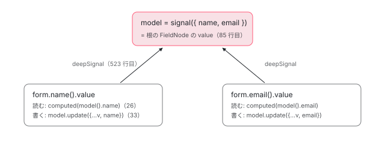

[目次](../README.md) › [Signal の内側](README.md) › 第 17 回 / 全 18 回

# Signal Forms — 値のコピーを持たないフォーム

> v22 で入った 3 つ目のフォーム API。渡した signal を根の value にし、子は deepSignal で覗くので値のコピーを持たない。検証は computed の中で走り、\[formField\] は ɵɵcontrol で入力欄とつながる。

angular/angular · 読了 約 12 分 · 中核 · [サイトで読む（デモが動きます）](https://angular-deep-dive-cyan.vercel.app/chapter/signal-forms)

---

Signal Forms は、テンプレート駆動フォーム・リアクティブフォームに続く 3 つ目のフォーム API です（`@angular/forms/signals`）。一番の特徴は**フォームが値のコピーを持たない**ことです。`form(model)` に渡した signal を直接読み書きするので、「フォームの値」と「アプリの状態」を同期させるコードが要りません。この章では、それがソースのどの行で実現されているか（子フィールドの値は親の signal から作る `deepSignal`）、検証の結果がなぜ全部 signal なのか、`[formField]` が入力欄とつながる道筋、`controlValue` と `value` が分かれている理由を、行で追います。

読む対象は `packages/forms/signals/src/` の `api/structure.ts`、`field/node.ts`・`structure.ts`・`proxy.ts`・`validation.ts`、`util/deep_signal.ts`・`parser.ts`、`api/rules/validation/` の `required.ts`・`validate.ts`・`validate_async.ts`、`directive/form_field.ts`・`control_native.ts`、それに core 側の `render3/features/control_feature.ts` と `render3/instructions/control.ts` です。

1. [1. 概観](01-signals.md)
2. [2. ReactiveNode の構造](02-signals-reactive-node.md)
3. [3. 依存の追跡](03-signals-tracking.md)
4. [4. set と update](04-signals-set.md)
5. [5. push と pull](05-signals-push-pull.md)
6. [6. computed](06-signals-computed.md)
7. [7. live と non-live](07-signals-live.md)
8. [8. linkedSignal](08-signals-linked-signal.md)
9. [9. effect のノードと寿命](09-signals-effect-node.md)
10. [10. afterRenderEffect](10-signals-after-render-effect.md)
11. [11. input と viewChild](11-authoring.md)
12. [12. input() とコンパイラ](12-signals-input-compile.md)
13. [13. model() と output()](13-signals-model-output.md)
14. [14. toSignal と toObservable](14-signals-rxjs-interop.md)
15. [15. resource](15-resource.md)
16. [16. httpResource と rxResource](16-signals-http-resource.md)
17. **17. Signal Forms**（この章）
18. [18. DevTools と signal グラフ](18-signals-debug.md)

## 1. form() の約束：渡した signal が唯一の情報源

📄 `angular/packages/forms/signals/src/api/structure.ts` L78–106 （▶ の行: 82–84, 88–92, 106）

````ts
 78 │ /**
 79 │  * Creates a form wrapped around the given model data. A form is represented as simply a `FieldTree`
 80 │  * of the model data.
 81 │  *
 82 ▶  * `form` uses the given model as the source of truth and *does not* maintain its own copy of the
 83 ▶  * data. This means that updating the value on a `FieldState` updates the originally passed in model
 84 ▶  * as well.
 85 │  *
 86 │  * @example
 87 │  * ```ts
 88 ▶  * const nameModel = signal({first: '', last: ''});
 89 ▶  * const nameForm = form(nameModel);
 90 ▶  * nameForm.first().value.set('John');
 91 ▶  * nameForm().value(); // {first: 'John', last: ''}
 92 ▶  * nameModel(); // {first: 'John', last: ''}
 93 │  * ```
 94 │  *
 95 │  * @param model A writable signal that contains the model data for the form. The resulting field
 96 │  * structure will match the shape of the model and any changes to the form data will be written to
 97 │  * the model.
 98 │  * @return A `FieldTree` representing a form around the data model.
 99 │  * @template TModel The type of the data model.
100 │  *
101 │  * @see [Creating models](guide/forms/signals/models#creating-models)
102 │  *
103 │  * @category structure
104 │  * @publicApi 22.0
105 │  */
106 ▶ export function form<TModel>(model: WritableSignal<TModel>): FieldTree<TModel>;
````

82〜84 行目が設計の中心です。「渡されたモデルを情報源として使い、自分のコピーを**持たない**。`FieldState` の値を更新すると、渡したモデルも更新される」。88〜92 行目の例では、90 行目でフォームの `first` に `set('John')` すると、92 行目の `nameModel()` も変わっています。106 行目、`form` が受け取るのは `WritableSignal` です。読み取り専用の signal は渡せません。書き込み先が要るからです。リアクティブフォームの `FormGroup` は値を自分の中に持つので、アプリの状態と `patchValue` / `valueChanges` で同期させる必要がありました。この約束を実装している行を、次の節から探します。

## 2. form() の中：model をそのまま根のノードに渡す

📄 `angular/packages/forms/signals/src/api/structure.ts` L211–222 （▶ の行: 212–215, 220–222）

```ts
211 │ export function form<TModel>(...args: any[]): FieldTree<TModel> {
212 ▶   const [model, schema, options] = normalizeFormArgs<TModel>(args);
213 ▶   const injector = options?.injector ?? inject(Injector);
214 ▶   const pathNode = runInInjectionContext(injector, () => SchemaImpl.rootCompile(schema));
215 ▶   const fieldManager = new FormFieldManager(
216 │     injector,
217 │     options?.name,
218 │     options?.submission as FormSubmitOptions<unknown, unknown> | undefined,
219 │   );
220 ▶   const adapter = options?.adapter ?? new BasicFieldAdapter();
221 ▶   const fieldRoot = FieldNode.newRoot(fieldManager, model, pathNode, adapter);
222 ▶   fieldManager.createFieldManagementEffect(fieldRoot.structure);
```

1. **213 行目：注入器を決める**

   `options.injector` か `inject(Injector)`。だから `form()` もフィールド初期化子で呼びます。
2. **214 行目：schema 関数を注入コンテキストの中でコンパイルする**

   `form(model, (p) => { required(p.name) })` の第 2 引数です。`SchemaImpl.rootCompile` がこの関数を 1 回呼び、`required` などが登録した規則を「パスごとの規則の木」（`FieldPathNode`）にまとめます。`runInInjectionContext` で包むので、schema 関数の中でも `inject()` が使えます。
3. **215〜220 行目：フィールドを管理する `FormFieldManager` と adapter を作る**

   adapter は互換レイヤー（`@angular/forms/signals/compat`）が差し替えるための口で、通常は `BasicFieldAdapter` です。
4. **221 行目：`FieldNode.newRoot(fieldManager, model, pathNode, adapter)`**

   2 つ目の引数が利用者の `model` そのものです。コピーも包み直しもしていません。

📄 `angular/packages/forms/signals/src/field/field_adapter.ts` L76–90 （▶ の行: 82–83, 85–87）

```ts
76 │   newRoot<TValue>(
77 │     fieldManager: FormFieldManager,
78 │     value: WritableSignal<TValue>,
79 │     pathNode: FieldPathNode,
80 │     adapter: FieldAdapter,
81 │   ): FieldNode {
82 ▶     return new FieldNode({
83 ▶       kind: 'root',
84 │       fieldManager,
85 ▶       value,
86 ▶       pathNode,
87 ▶       logic: pathNode.builder.build(),
88 │       fieldAdapter: adapter,
89 │     });
90 │   }
```

85 行目、根の `FieldNode` の `value` に model をそのまま入れます。87 行目は schema の規則の木から、このノードに効く規則（`LogicNode`）を作る行です。根のノードの構造（`RootFieldNodeStructure`）はこの `value` を `override readonly value` としてそのまま持ちます。**根のフィールドの `value` は、利用者が渡した signal と同じオブジェクト**です。

## 3. FieldNode：1 つのフィールドを担当する部品の集まり

📄 `angular/packages/forms/signals/src/field/node.ts` L73–105 （▶ の行: 73–75, 77, 80, 90, 96–98, 101）

```ts
 73 ▶ export class FieldNode implements FieldState<unknown> {
 74 ▶   readonly structure: FieldNodeStructure;
 75 ▶   readonly validationState: ValidationState;
 76 │   readonly metadataState: FieldMetadataState;
 77 ▶   readonly nodeState: FieldNodeState;
 78 │   readonly submitState: FieldSubmitState;
 79 │   readonly fieldAdapter: FieldAdapter;
 80 ▶   readonly controlValue: ControlValueSignal<unknown>;
 81 │ 
 82 │   private _context: FieldContext<unknown> | undefined = undefined;
 83 │   get context(): FieldContext<unknown> {
 84 │     return (this._context ??= new FieldNodeContext(this));
 85 │   }
 86 │ 
 87 │   /**
 88 │    * Proxy to this node which allows navigation of the form graph below it.
 89 │    */
 90 ▶   readonly fieldProxy = new Proxy(() => this, FIELD_PROXY_HANDLER) as unknown as FieldTree<any>;
 91 │   private readonly pathNode: FieldPathNode;
 92 │ 
 93 │   constructor(options: FieldNodeOptions) {
 94 │     this.pathNode = options.pathNode;
 95 │     this.fieldAdapter = options.fieldAdapter;
 96 ▶     this.structure = this.fieldAdapter.createStructure(this, options);
 97 ▶     this.validationState = this.fieldAdapter.createValidationState(this, options);
 98 ▶     this.nodeState = this.fieldAdapter.createNodeState(this, options);
 99 │     this.metadataState = new FieldMetadataState(this);
100 │     this.submitState = new FieldSubmitState(this);
101 ▶     this.controlValue = this.controlValueSignal();
102 │     // We eagerly create metadata at the end of construction so that the node is fully constructed
103 │     // before metadata creation logic runs (which may access other states on the node).
104 │     this.metadataState.runMetadataCreateLifecycle();
105 │   }
```

クラスの doc コメントが役割を並べています。`FieldNode` は**小さな部品の集まり**で、96〜101 行目でそれぞれを作ります。96 行目の `structure`（値と子の管理）、97 行目の `validationState`（検証）、98 行目の `nodeState`（touched・dirty・disabled など）、101 行目の `controlValue`（7 節）。90 行目の `fieldProxy` は、`form.name` のような書き方を実現する `Proxy` です（4 節）。

📄 `angular/packages/forms/signals/src/field/node.ts` L163–189 （▶ の行: 163–164, 171–172, 187–188）

```ts
163 ▶   get value(): WritableSignal<unknown> {
164 ▶     return this.structure.value;
165 │   }
166 │ 
167 │   get keyInParent(): Signal<string | number> {
168 │     return this.structure.keyInParent;
169 │   }
170 │ 
171 ▶   get errors(): Signal<ValidationError.WithFieldTree[]> {
172 ▶     return this.validationState.errors;
173 │   }
174 │ 
175 │   get parseErrors(): Signal<ValidationError.WithFormField[]> {
176 │     return this.validationState.parseErrors;
177 │   }
178 │ 
179 │   get errorSummary(): Signal<ValidationError.WithFieldTree[]> {
180 │     return this.validationState.errorSummary;
181 │   }
182 │ 
183 │   get pending(): Signal<boolean> {
184 │     return this.validationState.pending;
185 │   }
186 │ 
187 ▶   get valid(): Signal<boolean> {
188 ▶     return this.validationState.valid;
189 │   }
```

利用者が `form.name().value` や `.errors` や `.valid` で触るのは、この getter です。164 行目、`value` は `structure.value` を返すだけ、172・188 行目、`errors` と `valid` は `validationState` の signal を返すだけです。根のノードなら、164 行目が返すのは 2 節の 85 行目で入れた利用者の model そのものです。

## 4. 子フィールドの値：親の signal から作る deepSignal

📄 `angular/packages/forms/signals/src/field/structure.ts` L504–526 （▶ の行: 514, 516, 519, 523）

```ts
504 │   constructor(
505 │     node: FieldNode,
506 │     override readonly logic: LogicNode,
507 │     override readonly parent: ParentFieldNode,
508 │     identityInParent: TrackingKey | undefined,
509 │     initialKeyInParent: string,
510 │     createChildNode: ChildNodeCtor,
511 │   ) {
512 │     super(logic, node, createChildNode);
513 │ 
514 ▶     this.root = this.parent.structure.root;
515 │ 
516 ▶     const signals = this.createKeyOrOrphanSignals('child', identityInParent, initialKeyInParent);
517 │ 
518 │     this.isOrphaned = signals.isOrphaned;
519 ▶     this.keyInParent = signals.keyInParent;
520 │ 
521 │     this.pathKeys = computed(() => [...parent.structure.pathKeys(), this.keyInParent()]);
522 │ 
523 ▶     this.value = deepSignal(this.parent.structure.value, this.keyInParent);
524 │     this.childrenMap = this.createChildrenMap();
525 │     this.fieldManager.structures.add(this);
526 │   }
```

子フィールド（`form.name`）の構造です。516・519 行目で「親の中での自分のキー」を signal として持ち、**523 行目で親の `value` とそのキーから `deepSignal` を作ります**。子は自分の値を持たず、親の signal を覗き込む窓になっています。

📄 `angular/packages/forms/signals/src/util/deep_signal.ts` L21–59 （▶ の行: 26, 29–31, 33, 36–37, 51–53, 57）

```ts
21 │ export function deepSignal<S, K extends keyof S>(
22 │   source: WritableSignal<S>,
23 │   prop: Signal<K>,
24 │ ): WritableSignal<S[K]> {
25 │   // Memoize the property.
26 ▶   const read = computed(() => source()[prop()]) as WritableSignal<S[K]>;
27 │ 
28 │   read[SIGNAL] = source[SIGNAL];
29 ▶   read.set = (value: S[K]) => {
30 ▶     if (Object.is(untracked(read), value)) {
31 ▶       return;
32 │     }
33 ▶     source.update((current) => valueForWrite(current, value, prop()) as S);
34 │   };
35 │ 
36 ▶   read.update = (fn: (current: S[K]) => S[K]) => {
37 ▶     read.set(fn(untracked(read)));
38 │   };
39 │   read.asReadonly = () => read;
40 │ 
41 │   return read;
42 │ }
43 │ 
44 │ /**
45 │  * Gets an updated root value to use when setting a value on a deepSignal with the given path.
46 │  * @param sourceValue The current value of the deepSignal's source.
47 │  * @param newPropValue The value being written to the deepSignal's property
48 │  * @param prop The deepSignal's property key
49 │  * @returns An updated value for the deepSignal's source
50 │  */
51 ▶ function valueForWrite(sourceValue: unknown, newPropValue: unknown, prop: PropertyKey): unknown {
52 ▶   if (isArray(sourceValue)) {
53 ▶     const newValue = [...sourceValue];
54 │     newValue[prop as number] = newPropValue;
55 │     return newValue;
56 │   } else {
57 ▶     return {...(sourceValue as object), [prop]: newPropValue};
58 │   }
59 │ }
```

1. **26 行目：読むときは `computed(() => source()[prop()])`**

   親の値からキーの値を取り出すだけの `computed` です。親が `{name, email}` 全体で更新されても、`name` の値が同じなら `computed` は「変わっていない」と答えるので（[computed](06-signals-computed.md) の章）、`name` を読んでいるテンプレートは再描画されません。
2. **29〜34 行目：書くときは `source.update`**

   30 行目、同じ値なら何もしません。33 行目、親の signal を `update` して、`valueForWrite` で作った**新しいオブジェクト**に差し替えます。
3. **51〜58 行目：`valueForWrite` は浅いコピーを作る**

   配列なら 53 行目で `[...sourceValue]`、オブジェクトなら 57 行目で `{...sourceValue, [prop]: newPropValue}`。元のオブジェクトは書き換えません。

これで 1 節の約束がつながります。`form.name().value.set('x')` は、子の `deepSignal` の 33 行目で親の `value.update` を呼びます。親が根なら、その `value` は利用者の model なので、**model が `{...前の値, name: 'x'}` に置き換わります**。逆に model を外から `set` すると、26 行目の `computed` が新しい値を読みます。どちら向きも 1 つの signal を通るだけなので、同期のコードが要りません。



*form(model) の値の持ち方。値を持つ signal は model の 1 つだけで、子フィールドの value はその上の computed（読む）と update（書く）。*

## 5. form.name と form.name()：Proxy と「呼ぶと状態」

📄 `angular/packages/forms/signals/src/api/types.ts` L206–226 （▶ の行: 206, 214–216）

```ts
206 ▶ export type Field<TValue, TKey extends string | number = string | number> = () => FieldState<
207 │   TValue,
208 │   TKey
209 │ >;
210 │ 
211 │ /**
212 │  * An object that represents a tree of fields in a form. This includes both primitive value fields
213 │  * (e.g. fields that contain a `string` or `number`), as well as "grouping fields" that contain
214 ▶  * sub-fields. `FieldTree` objects are arranged in a tree whose structure mimics the structure of
215 ▶  * the underlying data. For example a `FieldTree<{x: number}>` has a property `x` which contains a
216 ▶  * `FieldTree<number>`. To access the state associated with a field, call it as a function.
217 │  *
218 │  * @template TValue The type of the data which the field is wrapped around.
219 │  * @template TKey The type of the property key which this field resides under in its parent.
220 │  * @template TMode Determines whether the field state is readonly or writable. Defaults to writable.
221 │  *   For readonly, use {@link ReadonlyFieldTree}.
222 │  *
223 │  * @category types
224 │  * @publicApi 22.0
225 │  */
226 │ export type FieldTree<
```

214〜216 行目、`FieldTree<{x: number}>` には `x` というプロパティがあり、それも `FieldTree<number>` です。状態は**関数として呼ぶ**と取れます。206 行目の `Field` 型が「呼ぶと `FieldState` を返す関数」です。プロパティをたどってフィールドを選び、呼んで状態を取る、の 2 段です。データの型がそのままフィールドの型になるので、`form.get('nmae')` のような文字列の打ち間違いはコンパイルエラーになります。

📄 `angular/packages/forms/signals/src/field/proxy.ts` L17–31 （▶ の行: 17–18, 23, 26–27, 30）

```ts
17 ▶ export const FIELD_PROXY_HANDLER: ProxyHandler<() => FieldNode> = {
18 ▶   get(getTgt: () => FieldNode, property: string | symbol, receiver: Record<string, unknown>) {
19 │     if (property === FIELD_TREE) {
20 │       return true;
21 │     }
22 │ 
23 ▶     const tgt = getTgt();
24 │ 
25 │     // First, check whether the requested property is a defined child node of this node.
26 ▶     const child = tgt.structure.getChild(property);
27 ▶     if (child !== undefined) {
28 │       // If so, return the child node's `FieldTree` proxy, allowing the developer to continue
29 │       // navigating the form structure.
30 ▶       return child.fieldTree;
31 │     }
```

3 節 90 行目の `new Proxy(() => this, FIELD_PROXY_HANDLER)` の中身です。Proxy の対象が **`() => this` という関数**なので、`form()` と呼ぶとその関数が走って `FieldNode` 自身（= `FieldState` を実装したもの）が返ります。プロパティを読むと 18 行目の `get` が呼ばれ、26 行目で子のノードを探し、30 行目で子の Proxy を返します。`form.name` はこうして子の `FieldTree` になります。

## 6. 検証：規則は computed の中で走る

📄 `angular/packages/forms/signals/src/api/rules/validation/required.ts` L33–53 （▶ の行: 39–40, 42–44, 48, 51）

```ts
33 │ export function required<TValue, TPathKind extends PathKind = PathKind.Root>(
34 │   path: SchemaPath<TValue, SchemaPathRules.Supported, TPathKind>,
35 │   config?: BaseValidatorConfig<TValue, TPathKind> & {
36 │     when?: NoInfer<LogicFn<TValue, boolean, TPathKind>>;
37 │   },
38 │ ): void {
39 ▶   const REQUIRED_MEMO = metadata(path, createMetadataKey<boolean>(), (ctx) =>
40 ▶     config?.when ? config.when(ctx) : true,
41 │   );
42 ▶   metadata(path, REQUIRED, ({state}) => state.metadata(REQUIRED_MEMO)!()!);
43 ▶   validate(path, (ctx) => {
44 ▶     if (ctx.state.metadata(REQUIRED_MEMO)!() && isEmpty(ctx.value())) {
45 │       if (config?.error) {
46 │         return getOption(config.error, ctx);
47 │       } else {
48 ▶         return requiredError({message: getOption(config?.message, ctx)});
49 │       }
50 │     }
51 ▶     return undefined;
52 │   });
53 │ }
```

`required(p.name)` の中身です。39〜41 行目と 42 行目で「必須かどうか」を `metadata` として登録し（`[formField]` がこれを読んで `required` 属性を付けます。8 節）、43 行目で `validate` に検証関数を登録します。44 行目、必須で値が空なら 48 行目で `requiredError` を返し、そうでなければ 51 行目で `undefined`（エラー無し）です。この時点では何も検証していません。規則を登録しているだけです。

📄 `angular/packages/forms/signals/src/api/rules/validation/validate.ts` L33–43 （▶ の行: 39–41）

```ts
33 │ export function validate<TValue, TPathKind extends PathKind = PathKind.Root>(
34 │   path: SchemaPath<TValue, SchemaPathRules.Supported, TPathKind>,
35 │   logic: NoInfer<FieldValidator<TValue, TPathKind>>,
36 │ ): void {
37 │   assertPathIsCurrent(path);
38 │ 
39 ▶   const pathNode = FieldPathNode.unwrapFieldPath(path);
40 ▶   pathNode.builder.addSyncErrorRule((ctx) => {
41 ▶     return addDefaultField(logic(ctx as FieldContext<TValue, TPathKind>), ctx.fieldTree);
42 │   });
43 │ }
```

40 行目、`validate` も規則の木（`pathNode.builder`）に「同期エラーの規則」として足すだけです。

📄 `angular/packages/forms/signals/src/field/validation.ts` L177–208 （▶ の行: 177, 180, 185–187, 190, 197, 203–205）

```ts
177 ▶   readonly syncErrors: Signal<ValidationError.WithFieldTree[]> = computed(
178 │     () => {
179 │       // Short-circuit running validators if validation doesn't apply to this field.
180 ▶       if (this.shouldSkipValidation()) {
181 │         return [];
182 │       }
183 │ 
184 │       return [
185 ▶         ...this.node.logicNode.logic.syncErrors.compute(this.node.context),
186 ▶         ...this.syncTreeErrors(),
187 ▶         ...normalizeErrors(this.node.submitState.submissionErrors()),
188 │       ];
189 │     },
190 ▶     {equal: shallowArrayEquals},
191 │   );
192 │ 
193 │   /**
194 │    * Whether the field is considered valid according solely to its synchronous validators.
195 │    * Errors resulting from a previous submit attempt are also considered for this state.
196 │    */
197 ▶   readonly syncValid: Signal<boolean> = computed(() => {
198 │     // Short-circuit checking children if validation doesn't apply to this field.
199 │     if (this.shouldSkipValidation()) {
200 │       return true;
201 │     }
202 │ 
203 ▶     return this.node.structure.reduceChildren(
204 ▶       this.syncErrors().length === 0,
205 ▶       (child, value) => value && child.validationState.syncValid(),
206 │       shortCircuitFalse,
207 │     );
208 │   });
```

登録した規則が実行されるのは、177 行目の `syncErrors` の `computed` の中、185 行目です。**規則関数は `computed` の計算として呼ばれる**ので、規則の中で読んだ `ctx.value()`（= 4 節の `deepSignal`）が依存になり、値が変わると自動で再検証されます。検証を呼ぶコードも、`updateValueAndValidity()` のような関数も要らないのはこのためです。180 行目、非表示（`hidden`）・無効（`disabled`）・読み取り専用（`readonly`）のフィールドは検証しません（同じファイルの `shouldSkipValidation`）。190 行目の `shallowArrayEquals` は、エラーの配列の中身が同じなら新しい配列でも「変わっていない」と扱う比較です。197〜208 行目の `syncValid` は、自分のエラーが無く（204 行目）、子もすべて `syncValid`（205 行目）なら真です。

📄 `angular/packages/forms/signals/src/field/validation.ts` L338–360 （▶ の行: 345–346, 348, 357–358, 360）

```ts
338 │   /**
339 │    * Whether the field is considered valid.
340 │    *
341 │    * A field is considered valid if *all* of the following are true:
342 │    *  - It has no errors or pending validators
343 │    *  - All of its children are considered valid
344 │    *
345 ▶    * Note: `!valid()` is *not* the same as `invalid()`. Both `valid()` and `invalid()` can be false
346 ▶    * if there are currently no errors, but validators are still pending.
347 │    */
348 ▶   readonly valid = computed(() => this.status() === 'valid');
349 │ 
350 │   /**
351 │    * Whether the field is considered invalid.
352 │    *
353 │    * A field is considered invalid if *any* of the following are true:
354 │    *  - It has an error
355 │    *  - Any of its children is considered invalid
356 │    *
357 ▶    * Note: `!invalid()` is *not* the same as `valid()`. Both `valid()` and `invalid()` can be false
358 ▶    * if there are currently no errors, but validators are still pending.
359 │    */
360 ▶   readonly invalid = computed(() => this.status() === 'invalid');
```

348・360 行目、`valid` と `invalid` も `status` を読む `computed` です。345〜346 行目の注意のとおり、**`!valid()` と `invalid()` は同じではありません**。非同期の検証が実行中でエラーがまだ無いときは、`status` が `'unknown'` になり、両方とも偽です。送信ボタンを無効にする条件に `invalid()` を使うと、検証中でも押せてしまいます。

## 7. value と controlValue：入力欄の値と確定した値

📄 `angular/packages/forms/signals/src/api/types.ts` L331–348 （▶ の行: 334, 336–337, 344–346）

```ts
331 │   /**
332 │    * A writable signal containing the value for this field.
333 │    *
334 ▶    * Updating this signal will update the data model that the field is bound to.
335 │    *
336 ▶    * While updates from the UI control are eventually reflected here, they may be delayed if
337 ▶    * debounced.
338 │    */
339 │   readonly value: Signal<TValue>;
340 │ 
341 │   /**
342 │    * A signal containing the value of the control to which this field is bound.
343 │    *
344 ▶    * This differs from {@link value} in that it's not subject to debouncing, and thus is used to
345 ▶    * buffer debounced updates from the control to the field. This will also not take into account
346 ▶    * the {@link controlValue} of children.
347 │    */
348 │   readonly controlValue: Signal<TValue>;
```

`value` は 334 行目のとおりモデルにつながった値です。336〜337 行目、UI からの更新は `debounce` されていると遅れて反映されます。344〜346 行目の `controlValue` は「入力欄にいま入っている値」で、debounce の影響を受けません。間引いている間の値をここに溜めておく、とあります。

📄 `angular/packages/forms/signals/src/field/node.ts` L378–402 （▶ の行: 382, 384–385, 388–390）

```ts
378 │   /**
379 │    * Creates a linked signal that initiates a {@link debounceSync} when set.
380 │    */
381 │   private controlValueSignal(): ControlValueSignal<unknown> {
382 ▶     const controlValue = linkedSignal(this.value) as ControlValueSignal<unknown>;
383 │ 
384 ▶     controlValue.rawSet = controlValue.set;
385 ▶     controlValue.set = (newValue) => {
386 │       // We intentionally allow same-value updates here to ensure that setting the control value
387 │       // (even to the same value) still marks the control as dirty.
388 ▶       controlValue.rawSet(newValue);
389 ▶       this.markAsDirty();
390 ▶       this.debounceSync();
391 │     };
392 │     const rawUpdate = controlValue.update;
393 │     controlValue.update = (updateFn) => {
394 │       // We intentionally allow same-value updates here to ensure that updating the control value
395 │       // (even to the same value) still marks the control as dirty.
396 │       rawUpdate(updateFn);
397 │       this.markAsDirty();
398 │       this.debounceSync();
399 │     };
400 │ 
401 │     return controlValue;
402 │   }
```

1. **382 行目：`controlValue` は `value` を source にした linkedSignal**

   モデル側の `value` が変わると、`controlValue` はその値にリセットされます（[linkedSignal](08-signals-linked-signal.md)）。外から model を `set` すると入力欄も変わるのはこの行です。
2. **384 行目：元の `set` を `rawSet` として取っておく**
3. **385〜391 行目：`set` を差し替える**

   388 行目で値を入れ、389 行目で dirty にし、390 行目で `debounceSync` を始めます。入力欄からの書き込みは、まずこの `controlValue` に入ります（8 節）。

📄 `angular/packages/forms/signals/src/field/node.ts` L422–453 （▶ の行: 431–433, 436–438, 440–443, 452）

```ts
422 │   /**
423 │    * Initiates a debounced {@link sync}.
424 │    *
425 │    * If a debouncer is configured, the synchronization will occur after the debouncer resolves. If
426 │    * no debouncer is configured, the synchronization happens immediately. If {@link controlValue} is
427 │    * updated again while a debounce is pending, the previous debounce operation is aborted in favor
428 │    * of the new one.
429 │    */
430 │   private async debounceSync() {
431 ▶     const debouncer = untracked(() => {
432 ▶       this.pendingSync()?.abort();
433 ▶       return this.nodeState.debouncer();
434 │     });
435 │ 
436 ▶     if (debouncer) {
437 ▶       const controller = new AbortController();
438 ▶       const promise = debouncer(controller.signal);
439 │       if (promise) {
440 ▶         this.pendingSync.set(controller);
441 ▶         await promise;
442 ▶         if (controller.signal.aborted) {
443 ▶           return; // Do not sync if the debounce was aborted.
444 │         }
445 │       }
446 │     }
447 │ 
448 │     if (this.structure.isOrphaned()) {
449 │       return;
450 │     }
451 │ 
452 ▶     this.sync();
453 │   }
```

1. **431〜434 行目：前の待ちを止め、debouncer を取る**

   debouncer は `debounce(p.email, 800)` のような規則が metadata として登録したものです。無ければ `undefined`。
2. **436〜446 行目：debouncer があれば待つ**

   437 行目の `AbortController` を 440 行目で `pendingSync` に覚え、441 行目で待ちます。待っている間に次の入力が来ると 432 行目で止められ、442〜443 行目で同期せずに帰ります。
3. **452 行目：`sync()`**

   debouncer が無ければ待たずにここへ来ます。つまり既定では、入力は同じ呼び出しの中でモデルに届きます。

📄 `angular/packages/forms/signals/src/field/node.ts` L404–420 （▶ の行: 407–408, 414–418）

```ts
404 │   /**
405 │    * Synchronizes the {@link controlValue} with the {@link value} signal immediately.
406 │    */
407 ▶   private sync() {
408 ▶     this.value.set(this.controlValue());
409 │   }
410 │ 
411 │   /**
412 │    * If there is a pending sync, abort it and sync immediately.
413 │    */
414 ▶   private flushSync() {
415 ▶     const pending = this.pendingSync();
416 ▶     if (pending && !pending.signal.aborted) {
417 ▶       pending.abort();
418 ▶       this.sync();
419 │     }
420 │   }
```

408 行目の `sync` が、**`controlValue` の値を `value`（= `deepSignal` → model）に書く**ただ 1 つの場所です。414〜420 行目の `flushSync` は、待っている同期があれば止めてすぐ同期します。

📄 `angular/packages/forms/signals/src/field/node.ts` L273–281 （▶ の行: 273, 278–279）

```ts
273 ▶   markAsTouched(options?: MarkAsTouchedOptions): void {
274 │     if (this.structure.isOrphaned()) {
275 │       return;
276 │     }
277 │     untracked(() => {
278 ▶       this.markAsTouchedInternal(options);
279 ▶       this.flushSync();
280 │     });
281 │   }
```

`flushSync` を呼ぶのは `markAsTouched` です（279 行目）。入力欄からフォーカスが外れると touched になり、そのとき debounce の残りを待たずにモデルへ書きます。`debounce(path, 'blur')` が「フォーカスが外れたときだけ同期」になるのは、決して解決しない debouncer とこの `flushSync` の組み合わせです。

## 8. \[formField\]：入力欄とフィールドをつなぐ

📄 `angular/packages/forms/signals/src/directive/form_field.ts` L105–126 （▶ の行: 106, 110, 121, 126）

```ts
105 │ @Directive({
106 ▶   selector: '[formField]',
107 │   exportAs: 'formField',
108 │   providers: [
109 │     {provide: FORM_FIELD, useExisting: FormField},
110 ▶     {provide: NgControl, useFactory: () => inject(FormField).interopNgControl},
111 │     {
112 │       provide: FORM_CONTROL_INTEGRATION,
113 │       useFactory: () => inject(FORM_FIELD, {self: true}),
114 │     },
115 │   ],
116 │ })
117 │ export class FormField<T> {
118 │   /**
119 │    * The field to bind to the underlying form control.
120 │    */
121 ▶   readonly field = input.required<Field<T>>({alias: 'formField'});
122 │ 
123 │   /**
124 │    * `FieldState` for the currently bound field.
125 │    */
126 ▶   readonly state = computed<FieldState<T>>(() => this.field()());
```

106 行目、セレクタは `[formField]` です。121 行目、`input.required` で `FieldTree`（呼ぶと状態を返す関数）を受け取り、126 行目で `this.field()()` と 2 回呼んで今の `FieldState` を `computed` にします。110 行目で `NgControl` も provide しているので、`NgControl` を inject する既存の部品からも見えます。

📄 `angular/packages/forms/signals/src/directive/form_field.ts` L374–411 （▶ の行: 377–379, 382, 387–392, 399–400）

```ts
374 │   /**
375 │    * Internal control directive creation lifecycle hook.
376 │    *
377 ▶    * The presence of this method tells the compiler to install `ɵɵControlFeature`, which will
378 ▶    * cause this directive to be recognized as a control directive by the `ɵcontrolCreate` and
379 ▶    * `ɵcontrol` instructions.
380 │    *
381 │    * @internal */
382 ▶   ɵngControlCreate(host: ControlDirectiveHost<'formField'>): void {
383 │     if (host.hasPassThrough) {
384 │       return;
385 │     }
386 │ 
387 ▶     if (this.controlValueAccessor) {
388 ▶       this.ɵngControlUpdate = cvaControlCreate(host, this as FormField<unknown>);
389 ▶     } else if (host.customControl) {
390 ▶       this.ɵngControlUpdate = customControlCreate(host, this as FormField<unknown>);
391 ▶     } else if (this.elementIsNativeFormElement) {
392 ▶       this.ɵngControlUpdate = nativeControlCreate(
393 │         host,
394 │         this as FormField<unknown>,
395 │         this.parseErrorsSource,
396 │         this.validityMonitor,
397 │       );
398 │     } else {
399 ▶       throw new RuntimeError(
400 ▶         RuntimeErrorCode.INVALID_FIELD_DIRECTIVE_HOST,
401 │         typeof ngDevMode !== 'undefined' &&
402 │           ngDevMode &&
403 │           `${host.descriptor} is an invalid [formField] directive host. The host must be a native form control ` +
404 │             `(such as <input>', '<select>', or '<textarea>') or a custom form control with a 'value' or ` +
405 │             `'checked' model.`,
406 │       );
407 │     }
408 │   }
409 │ 
410 │   /** @internal */
411 │   ɵngControlUpdate: (() => void) | undefined;
```

377〜379 行目のコメントが、つなぎ方の入口です。`ɵngControlCreate` というメソッドを持つディレクティブには、コンパイラが `ɵɵControlFeature` を付けます。中身は、相手が何かで 3 通りに分かれます。387〜388 行目は `ControlValueAccessor` を実装した既存の部品、389〜390 行目は `value` / `checked` の `model()` を持つ自作の部品、391〜397 行目は `<input>` などのネイティブ要素です。どれにも当たらなければ 399〜400 行目でエラーです。どの関数も「更新するときの関数」を返し、411 行目の `ɵngControlUpdate` に入れます。

📄 `angular/packages/core/src/render3/features/control_feature.ts` L12–24 （▶ の行: 14–16, 18–19）

```ts
12 │ export function ɵɵControlFeature(passThroughInput: string | null) {
13 │   return (definition: DirectiveDef<unknown>) => {
14 ▶     definition.controlDef = {
15 ▶       create: (inst: unknown, host: ControlDirectiveHost): void => {
16 ▶         (inst as any)?.ɵngControlCreate(host);
17 │       },
18 ▶       update: (inst: unknown, host: ControlDirectiveHost): void => {
19 ▶         (inst as any)?.ɵngControlUpdate?.(host);
20 │       },
21 │       passThroughInput,
22 │     };
23 │   };
24 │ }
```

📄 `angular/packages/core/src/render3/instructions/control.ts` L69–89 （▶ の行: 69, 74–75, 86, 88）

```ts
69 ▶ export function ɵɵcontrol(): void {
70 │   controlUpdateInternal();
71 │ }
72 │ 
73 │ export function controlUpdateInternal(): void {
74 ▶   if (ngDevMode && isInCheckNoChangesMode()) {
75 ▶     return;
76 │   }
77 │ 
78 │   const lView = getLView();
79 │   const tView = getTView();
80 │   const tNode = getSelectedTNode();
81 │ 
82 │   if (tNode.controlDirectiveIndex === -1) {
83 │     return;
84 │   }
85 │ 
86 ▶   const controlDef = (tView.data[tNode.controlDirectiveIndex] as DirectiveDef<unknown>).controlDef!;
87 │   const instance = lView[tNode.controlDirectiveIndex];
88 ▶   controlDef.update(instance, new ControlDirectiveHostImpl(lView, tView, tNode));
89 │ }
```

core 側です。`ɵɵControlFeature` はディレクティブ定義の `controlDef` に、16 行目で `ɵngControlCreate`、19 行目で `ɵngControlUpdate` を呼ぶ関数を入れます。69 行目の `ɵɵcontrol` は、コンパイラがテンプレートの更新処理に出力する命令で、88 行目でその `update` を呼びます。つまり **`ɵngControlUpdate` はテンプレート関数の更新パスの中で走る**ので、そこで読んだ signal（フィールドの状態）はテンプレートの `ReactiveLViewConsumer` の依存になります（[cd-signal-consumer](../cd/05-cd-signal-consumer.md)）。74〜75 行目、開発ビルドの 2 回目の検査（checkNoChanges）では何もしません。

📄 `angular/packages/forms/signals/src/directive/control_native.ts` L42–65 （▶ の行: 46, 48, 50, 53, 64–65）

```ts
42 │   let updateMode = false;
43 │   const input = parent.nativeFormElement;
44 │ 
45 │   // TODO: (perf) ok to always create this?
46 ▶   const parser = createParser(
47 │     // Read from the model value
48 ▶     () => parent.state().value(),
49 │     // Write to the buffered "control value"
50 ▶     (rawValue: unknown) => parent.state().controlValue.set(rawValue),
51 │     // Our parse function doesn't care about the raw value that gets passed in,
52 │     // It just reads the newly parsed value directly off the input element.
53 ▶     (_rawValue: unknown) => getNativeControlValue(input, parent.state().value, validityMonitor),
54 │   );
55 │ 
56 │   parseErrorsSource.set(parser.errors);
57 │   parent.onReset = () => {
58 │     parser.reset();
59 │     const value = parent.state().value();
60 │     bindings['controlValue'] = value;
61 │     setNativeControlValue(input, value);
62 │   };
63 │   // Pass undefined as the raw value since the parse function doesn't care about it.
64 ▶   host.listenToDom('input', () => parser.setRawValue(undefined));
65 ▶   host.listenToDom('blur', () => parent.state().markAsTouched());
```

ネイティブ要素の場合です。46〜54 行目で parser を作ります。48 行目は「モデルの値を読む関数」、**50 行目は「`controlValue.set` に書く関数」**、53 行目は「入力欄の値を読んで解析する関数」です。64 行目、`input` イベントで parser の `setRawValue` を呼びます。65 行目、`blur` で `markAsTouched`（7 節の `flushSync`）です。

📄 `angular/packages/forms/signals/src/util/parser.ts` L41–61 （▶ の行: 52–56, 60）

```ts
41 │ export function createParser<TValue, TRaw>(
42 │   getValue: () => TValue,
43 │   setValue: (value: TValue) => void,
44 │   parse: (raw: TRaw) => ParseResult<TValue>,
45 │ ): Parser<TRaw> {
46 │   const errors = linkedSignal({
47 │     source: getValue,
48 │     computation: () => [] as readonly ValidationError.WithoutFieldTree[],
49 │     equal: shallowArrayEquals,
50 │   });
51 │ 
52 ▶   const setRawValue = (rawValue: TRaw) => {
53 ▶     const result = parse(rawValue);
54 ▶     errors.set(normalizeErrors(result.error));
55 ▶     if (result.value !== undefined) {
56 ▶       setValue(result.value);
57 │     }
58 │     // `errors` is a linked signal sourced from the model value; write parse errors after
59 │     // model updates so `{value, errors}` results do not get reset by the recomputation.
60 ▶     errors.set(normalizeErrors(result.error));
61 │   };
```

53 行目で入力欄の値を解析し、解析できたら 56 行目で `setValue`（= 50 行目の `controlValue.set`）を呼びます。数値の欄に数字でない文字が入ったときなどは値が無く、54・60 行目でエラーだけを入れます。モデルは書き換わりません。

📄 `angular/packages/forms/signals/src/directive/control_native.ts` L99–129 （▶ の行: 100, 102–104, 106, 108, 119–120, 124–125）

```ts
 99 │   return () => {
100 ▶     const state = parent.state();
101 │ 
102 ▶     for (const name of CONTROL_BINDING_NAMES) {
103 ▶       const value = readFieldStateBindingValue(state, name);
104 ▶       if (bindingUpdated(bindings, name, value)) {
105 │         host.setInputOnDirectives(name, value);
106 ▶         if (parent.elementAcceptsNativeProperty(name)) {
107 │           const domValue = formatDateForMinMax(name, value, input.type);
108 ▶           setNativeDomProperty(
109 │             parent.renderer,
110 │             input,
111 │             name,
112 │             domValue as string | number | boolean | undefined,
113 │           );
114 │         }
115 │       }
116 │     }
117 │ 
118 │     // We need to update the value after setting the attributes as some attributes like min/max might prevent from setting the value
119 ▶     const controlValue = state.controlValue();
120 ▶     const controlValueChanged = bindingUpdated(bindings, 'controlValue', controlValue);
121 │     const radioValueChanged =
122 │       input.type === 'radio' && bindingUpdated(bindings, 'radioValue', input.value);
123 │ 
124 ▶     if (controlValueChanged || radioValueChanged) {
125 ▶       setNativeControlValue(input, controlValue);
126 │     }
127 │ 
128 │     updateMode = true;
129 │   };
```

これが `ɵngControlUpdate` に入る関数です。100 行目で状態を読み、102〜116 行目で `required`・`disabled`・`readonly` などの状態を、変わったものだけ要素のプロパティに書きます（6 節の `required` の metadata が `required` 属性になるのはここ）。119 行目で `controlValue` を読み、変わっていれば 125 行目で要素の `value` に書きます。モデルを外から `set` すると、7 節の 382 行目で `controlValue` がリセットされ、ここで入力欄が書き換わります。

- 👤 `<input [formField]="f.email">` に 1 文字打つ
  - `listenToDom('input')` → `parser.setRawValue` — control\_native.ts 64
    - `getNativeControlValue(input)` → `controlValue.set(v)` — parser.ts 53–56 → control\_native.ts 50
      - `rawSet(v)` / `markAsDirty()` / `debounceSync()` — node.ts 388–390
        - `await debouncer(signal)` — 436–446 — *debounce があるときだけ*
        - `sync()` → `value.set(controlValue())` — 408
          - `deepSignal.set` → `model.update({...v, email})` — deep\_signal.ts 33 — *利用者の signal が変わる*
  - `syncErrors` の computed が規則を再実行 — validation.ts 185 — *読まれたとき*
  - `ɵɵcontrol` → `ɵngControlUpdate` — control.ts 88 → control\_native.ts 99 — *変更検知の中*

## 9. DEMO：model と form は同じものを見ている

> **🧪 DEMO — form(model) と \[formField\]**
>
> `model = signal({ name: '', email: '' })`、`f = form(model, (p) => { required(p.name); email(p.email); debounce(p.email, 800); })` です。email の欄に打つと `controlValue` はすぐ変わり、`value` と model は打ち終わってから 800 ms 後に変わります。打っている途中で欄の外をクリックすると、その場で同期します（279 行目）。
>
> ▶ [このデモはサイトで動かせます](https://angular-deep-dive-cyan.vercel.app/chapter/signal-forms)

「model.set を外から呼ぶ」と、フォームを一切通していないのに 2 つの入力欄が書き換わり、エラーも消えます。4 節の 26 行目の `computed`、7 節の 382 行目の linkedSignal、8 節の 125 行目がつながっているからです。email に `abc` と打った直後は、`controlValue` だけが `abc` で、`errors()` はまだ空です。検証規則が読むのは `ctx.value()`（= `value`）なので、**debounce の間は検証も走りません**。800 ms 後に 408 行目の `sync` が `value` に書いた時点で `email` エラーが出ます。「f.name().value.set」は逆向きで、model の JSON が新しいオブジェクトに変わります（4 節の 33・57 行目）。`f.name().required()` が `true` なのは 6 節の 42 行目の metadata で、name の入力欄には `required` 属性も付いています（開発者ツールで確かめられます）。

## 10. まだできないこと（と、ドキュメントのずれ）

📄 `angular/packages/forms/signals/PACKAGE.md` L1–11 （▶ の行: 5, 9–11）

```md
 1 │ # Signal-based forms API
 2 │ 
 3 │ This directory contains the signal-based Angular forms API, built on top of
 4 │ [signals](https://angular.dev/guide/signals). It is an alternative to template-driven and reactive
 5 ▶ forms that keeps signals at its core, and interoperates with the existing `@angular/forms` APIs.
 6 │ 
 7 │ ## Not yet supported
 8 │ 
 9 ▶ - Debouncing validation
10 ▶ - Dynamic objects
11 ▶ - Tuples
```

パッケージの説明は、9〜11 行目で「検証の debounce」「動的なオブジェクト」「タプル」を未対応としています。ところが非同期検証のコードには `debounce` があります。

📄 `angular/packages/forms/signals/src/api/rules/validation/validate_async.ts` L135–145 （▶ の行: 137–140）

```ts
135 │   const RESOURCE = createManagedMetadataKey<ReturnType<typeof opts.factory>, TParams | undefined>(
136 │     (_state, params) => {
137 ▶       if (opts.debounce !== undefined) {
138 ▶         const debouncedResource = debounced(() => params(), opts.debounce);
139 ▶         const wrappedParams = computed(() => ɵchain(debouncedResource));
140 ▶         return opts.factory(wrappedParams);
141 │       }
142 │       return opts.factory(params);
143 │     },
144 │   );
145 │   RESOURCE[IS_ASYNC_VALIDATION_RESOURCE] = true;
```

`validateAsync` の 137〜140 行目、`debounce` オプションがあれば、[resource](15-resource.md) の章で読んだ `debounced` で params を間引き、`ɵchain` でその状態を引き継いでから検証の resource を作ります。9 行目の記述は実装より古くなっています。ドキュメントとコードがずれたら、コードが正です。5 行目のとおり、既存の `@angular/forms` とは相互に使え、8 節の 387〜388 行目のとおり `ControlValueAccessor` を実装した部品もそのまま `[formField]` で使えます。

## 聞かれそうな質問

**Q. 「フォームが値のコピーを持たない」とは、コードのどこのことですか？**

2 か所です。根のフィールドの `value` は利用者の model そのもの（api/structure.ts 221 行目 → field\_adapter.ts 85 行目）。子フィールドの `value` は値を持たず、親の signal を `computed` で読み、`update` で書く `deepSignal`（field/structure.ts 523 行目、deep\_signal.ts 26・33 行目）。値を持つ signal はアプリ全体で model の 1 つだけなので、リアクティブフォームの `patchValue` や `valueChanges` の購読に当たるコードが要りません。

**Q. 入力欄に打った値は、いつ model に入りますか？**

debounce が無ければ、`input` イベントの中で同期的に入ります。control\_native.ts 64 行目 → parser.ts 56 行目 → node.ts 390 行目の `debounceSync` が 452 行目の `sync` まで待たずに進み、408 行目で `value.set` します。debounce があると、441 行目で待ってから入ります。待っている間に欄から離れると、`markAsTouched` の 279 行目の `flushSync` ですぐ入ります。

**Q. 検証はいつ実行されますか？手で呼ぶ必要はありますか？**

手で呼ぶ必要はありません。`required` や `validate` は規則を登録するだけで（validate.ts 40 行目）、実行は validation.ts 185 行目の `syncErrors` の `computed` の中です。`computed` は読まれたときに、依存（規則の中で読んだ値）が変わっていれば計算し直します。テンプレートで `errors()` や `valid()` を読んでいれば、値が変わった後の変更検知で再検証されます。

**Q. !valid() と invalid() は同じですか？**

同じではありません。validation.ts 345〜346 行目のとおり、非同期の検証が実行中でエラーがまだ無いときは `status` が `'unknown'` で、`valid()` も `invalid()` も偽です（348・360 行目）。「送信してよいか」は `valid()` で判定します。

**Q. 既存の ControlValueAccessor の部品は使えますか？**

使えます。form\_field.ts 387〜388 行目で、要素に `NG_VALUE_ACCESSOR` があれば `cvaControlCreate` の経路に入ります。新しく作る部品なら、`value` を `model()` で持つ自作コンポーネント（389〜390 行目の `customControl`）にすると、`ControlValueAccessor` の実装が要りません。

## 読み終えて

- `form(model)` は model を根のフィールドの `value` にそのまま入れる。子の `value` は親を覗く `deepSignal`（読む＝`computed`、書く＝浅いコピーで `update`）
- `form.name` は Proxy の `get` で子のフィールドを返し、`form.name()` は Proxy の対象 `() => this` を呼んで `FieldNode`（状態）を返す
- 検証規則は登録されるだけで、`syncErrors` の `computed` の中で走る。だから値が変われば自動で再検証される
- 入力欄の値はまず `controlValue`（`value` を source にした linkedSignal）に入り、debounce の後で `sync` が `value` に書く
- `[formField]` は `ɵngControlCreate` / `ɵngControlUpdate` で core の `ɵɵcontrol` 命令につながり、テンプレートの更新パスの中で状態を要素に書く

---

← 前: [httpResource と rxResource：resource の上に HttpClient と Observable を載せる](16-signals-http-resource.md)  
次: [DevTools が signal のグラフを描ける理由：getSignalGraph と formatter](18-signals-debug.md) →
