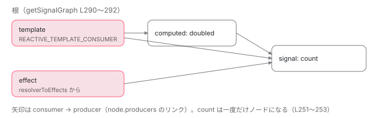

[目次](../README.md) › [Signal の内側](README.md) › 第 18 回 / 全 18 回

# DevTools が signal のグラフを描ける理由：getSignalGraph と formatter

> signal\_debug.ts の getSignalGraph が注入器からテンプレートの consumer と effect を集め、producers のリンクを辿ってノードと辺を作る手順、kind で種類を見分ける行、debugName をコンパイラが開発ビルドだけに足す変換、toggleWatchSignal。primitives の formatter.ts が Chrome DevTools のカスタムフォーマッタで Signal(1) と表示する仕組み（\[Signal: 値\] は開発モードの toString）と、ngDevMode で外れる理由。

angular/angular · 読了 約 12 分 · 発展 · [サイトで読む（デモが動きます）](https://angular-deep-dive-cyan.vercel.app/chapter/signals-debug)

---

Angular DevTools はコンポーネントを選ぶと、そのテンプレートが読んでいる signal・computed・effect をグラフで描きます。この章では、その元データを作る `getSignalGraph` が**注入器からテンプレートの consumer と effect を集め、`producers` のリンクを辿ってノードと辺を作る**手順を行で追います。ノードの名前 `debugName` がコンパイラの変換で付くこと、Chrome のコンソールで signal がきれいに表示されるカスタムフォーマッタの仕組み、そしてそのどれもが本番ビルドでは消える理由も確かめます。

読む対象は `packages/core/src/render3/util/signal_debug.ts`・`global_utils.ts`、`render3/debug/framework_injector_profiler.ts`、`render3/reactivity/effect.ts`・`signal.ts`、`core/primitives/signals/src/formatter.ts`・`graph.ts`・`index.ts`、`compiler-cli/src/ngtsc/transform/src/implicit_signal_debug_name_transform.ts` です。`window.ng` に関数が載る仕組みそのものは [DI シリーズ第 16 回](../di/16-di-debug.md)で読んでいます。

1. [1. 概観](01-signals.md)
2. [2. ReactiveNode の構造](02-signals-reactive-node.md)
3. [3. 依存の追跡](03-signals-tracking.md)
4. [4. set と update](04-signals-set.md)
5. [5. push と pull](05-signals-push-pull.md)
6. [6. computed](06-signals-computed.md)
7. [7. live と non-live](07-signals-live.md)
8. [8. linkedSignal](08-signals-linked-signal.md)
9. [9. effect のノードと寿命](09-signals-effect-node.md)
10. [10. afterRenderEffect](10-signals-after-render-effect.md)
11. [11. input と viewChild](11-authoring.md)
12. [12. input() とコンパイラ](12-signals-input-compile.md)
13. [13. model() と output()](13-signals-model-output.md)
14. [14. toSignal と toObservable](14-signals-rxjs-interop.md)
15. [15. resource](15-resource.md)
16. [16. httpResource と rxResource](16-signals-http-resource.md)
17. [17. Signal Forms](17-signal-forms.md)
18. **18. DevTools と signal グラフ**（この章）

## 1. ノードの種類は kind という文字列

📄 `angular/packages/core/primitives/signals/src/graph.ts` L98–106 （▶ の行: 99–104）

```ts
 98 │ export type ReactiveNodeKind =
 99 ▶   | 'signal'
100 ▶   | 'computed'
101 ▶   | 'effect'
102 ▶   | 'template'
103 ▶   | 'linkedSignal'
104 ▶   | 'afterRenderEffectPhase'
105 │   | 'childSignalProp' // Represents a signal passed as a prop to a child component in a CoW app
106 │   | 'unknown';
```

すべての `ReactiveNode` は `kind` を持ち、型紙ごとに決まった文字列が入っています （`SIGNAL_NODE` は `'signal'`、`COMPUTED_NODE` は `'computed'`、テンプレートの `ReactiveLViewConsumer` は `'template'`）。[第 11 回](11-authoring.md)の input のノードは `...SIGNAL_NODE` を展開しているので `'signal'`、viewChild は computed なので `'computed'` に見えます。

📄 `angular/packages/core/src/render3/util/signal_debug.ts` L40–62 （▶ の行: 41, 45, 49, 53, 57, 61）

```ts
40 │ function isComputedNode(node: ReactiveNode): node is ComputedNode<unknown> {
41 ▶   return node.kind === 'computed';
42 │ }
43 │ 
44 │ function isTemplateEffectNode(node: ReactiveNode): node is ReactiveLViewConsumer {
45 ▶   return node.kind === 'template';
46 │ }
47 │ 
48 │ function isEffectNode(node: ReactiveNode): node is EffectNode {
49 ▶   return node.kind === 'effect';
50 │ }
51 │ 
52 │ function isSignalNode(node: ReactiveNode): node is SignalNode<unknown> {
53 ▶   return node.kind === 'signal';
54 │ }
55 │ 
56 │ function isLinkedSignalNode(node: ReactiveNode): node is LinkedSignalNode<unknown, unknown> {
57 ▶   return node.kind === 'linkedSignal';
58 │ }
59 │ 
60 │ function isAfterRenderEffectPhaseNode(node: ReactiveNode): node is AfterRenderPhaseEffectNode {
61 ▶   return node.kind === 'afterRenderEffectPhase';
62 │ }
```

signal\_debug.ts の判定関数は 6 つとも `node.kind === '…'` の 1 行です。`instanceof` を使わないのは、ノードがクラスのインスタンスではなく `Object.create(型紙)` で作った素のオブジェクトだからです（[第 2 回](02-signals-reactive-node.md)）。

## 2. getSignalGraph：入口は注入器

📄 `angular/packages/core/src/render3/util/signal_debug.ts` L277–297 （▶ の行: 280, 284–285, 288, 290–291, 294, 296）

```ts
277 │ export function getSignalGraph(injector: Injector): DebugSignalGraph {
278 │   let templateConsumer: ReactiveLViewConsumer | null = null;
279 │ 
280 ▶   if (!(injector instanceof NodeInjector) && !(injector instanceof R3Injector)) {
281 │     return throwError('getSignalGraph must be called with a NodeInjector or R3Injector');
282 │   }
283 │ 
284 ▶   if (injector instanceof NodeInjector) {
285 ▶     templateConsumer = getTemplateConsumer(injector as NodeInjector);
286 │   }
287 │ 
288 ▶   const nonTemplateEffectNodes = extractEffectsFromInjector(injector);
289 │ 
290 ▶   const signalNodes = templateConsumer
291 ▶     ? [templateConsumer, ...nonTemplateEffectNodes]
292 │     : nonTemplateEffectNodes;
293 │ 
294 ▶   const signalDependenciesMap = extractSignalNodesAndEdgesFromRoots(signalNodes);
295 │ 
296 ▶   return getNodesAndEdgesFromSignalMap(signalDependenciesMap);
297 │ }
```

1. **280〜282 行目：NodeInjector か R3Injector だけ**

   要素の注入器（NodeInjector）か、環境の注入器（R3Injector）以外は受け付けません。
2. **284〜286 行目：要素の注入器ならテンプレートの consumer を取る**

   3 節の `getTemplateConsumer`。
3. **288 行目：その注入器で作られた effect を集める**

   4 節の `extractEffectsFromInjector`。
4. **290〜294 行目：それらを「根」にして producers を辿る**

   5 節の `extractSignalNodesAndEdgesFromRoots`。
5. **296 行目：DevTools 向けの形に直す**

   6 節の `getNodesAndEdgesFromSignalMap`。

つまりグラフは**「この要素のテンプレートと effect が、何を読んでいるか」を出発点に、上流へ辿ったもの**です。誰にも読まれていない signal は、根から辿れないので出てきません。

## 3. テンプレートの consumer は LView に入っている

📄 `angular/packages/core/src/render3/util/signal_debug.ts` L69–79 （▶ の行: 70, 72, 74–76）

```ts
69 │ function getTemplateConsumer(injector: NodeInjector): ReactiveLViewConsumer | null {
70 ▶   const tNode = getNodeInjectorTNode(injector)!;
71 │   assertTNode(tNode);
72 ▶   const lView = getNodeInjectorLView(injector)!;
73 │   assertLView(lView);
74 ▶   const templateLView = lView[tNode.index]!;
75 ▶   if (isLView(templateLView)) {
76 ▶     return templateLView[REACTIVE_TEMPLATE_CONSUMER] ?? null;
77 │   }
78 │   return null;
79 │ }
```

70 行目で注入器の TNode（コンポーネントのホスト要素）、72 行目でその要素がいる LView を取り、74 行目 `lView[tNode.index]` でホスト要素の位置に入っている**コンポーネント自身の LView** を取ります。76 行目、その LView の `REACTIVE_TEMPLATE_CONSUMER` 枠が、テンプレートが読んだ signal を記録している consumer です （作られ方は [変更検知シリーズの consumer の章](../cd/05-cd-signal-consumer.md)）。

## 4. effect は開発モードだけ記録されている

📄 `angular/packages/core/src/render3/util/signal_debug.ts` L226–244 （▶ の行: 228–230, 233–234, 237–238, 241）

```ts
226 │ function extractEffectsFromInjector(injector: Injector): ReactiveNode[] {
227 │   let diResolver: Injector | LView<unknown> = injector;
228 ▶   if (injector instanceof NodeInjector) {
229 ▶     const lView = getNodeInjectorLView(injector)!;
230 ▶     diResolver = lView;
231 │   }
232 │ 
233 ▶   const resolverToEffects = getFrameworkDIDebugData().resolverToEffects;
234 ▶   const effects = resolverToEffects.get(diResolver) ?? [];
235 │ 
236 │   return effects.map((effect) => {
237 ▶     if (effect instanceof EffectRefImpl) {
238 ▶       return effect[SIGNAL] as ReactiveNode;
239 │     } else {
240 │       // Narrowing down afterRenderEffect phases
241 ▶       return effect.signal[SIGNAL] as ReactiveNode;
242 │     }
243 │   });
244 │ }
```

228〜231 行目、NodeInjector なら LView を鍵にします。233〜234 行目、`getFrameworkDIDebugData().resolverToEffects` という表から、その鍵で作られた effect を引きます。237〜241 行目で `effect()` の戻り値（`EffectRefImpl`）か afterRenderEffect の段から、`[SIGNAL]` でノードを取り出します。この表に誰が書くのかを見ます。

📄 `angular/packages/core/src/render3/reactivity/effect.ts` L186–194 （▶ の行: 186–188, 190）

```ts
186 ▶   if (ngDevMode) {
187 ▶     node.debugName = options?.debugName ?? '';
188 ▶     const prevInjectorProfilerContext = setInjectorProfilerContext({injector, token: null});
189 │     try {
190 ▶       emitEffectCreatedEvent(effectRef);
191 │     } finally {
192 │       setInjectorProfilerContext(prevInjectorProfilerContext);
193 │     }
194 │   }
```

📄 `angular/packages/core/src/render3/debug/framework_injector_profiler.ts` L128–146 （▶ の行: 132, 137, 139, 143, 146）

```ts
128 │ function handleEffectCreatedEvent(
129 │   context: InjectorProfilerContext,
130 │   effect: EffectRefImpl | AfterRenderPhaseEffectNode,
131 │ ): void {
132 ▶   const diResolver = getDIResolver(context.injector);
133 │   if (diResolver === null) {
134 │     throwError('An EffectCreated event must be run within an injection context.');
135 │   }
136 │ 
137 ▶   const {resolverToEffects} = frameworkDIDebugData;
138 │   const cleanupContainer = effect instanceof EffectRefImpl ? effect[SIGNAL] : effect.sequence;
139 ▶   let trackedEffects = resolverToEffects.get(diResolver);
140 │ 
141 │   if (!trackedEffects) {
142 │     trackedEffects = [];
143 ▶     resolverToEffects.set(diResolver, trackedEffects);
144 │   }
145 │ 
146 ▶   trackedEffects.push(effect);
```

`effect()` の最後、186 行目の `if (ngDevMode)` の中で 190 行目の `emitEffectCreatedEvent` を呼びます。188 行目でその effect を作った注入器を「プロファイラの文脈」に置いておくので、受け取り側の 132 行目はその注入器から鍵を作り、139〜146 行目で `resolverToEffects` に積みます。注入器プロファイラ（`injectorProfiler`）の仕組みと、このハンドラが登録される経路は [DI シリーズ第 16 回](../di/16-di-debug.md)のとおりで、どちらも開発モードだけです。187 行目、effect の `debugName` もここで入ります。

## 5. producers のリンクを再帰で辿る

📄 `angular/packages/core/src/render3/util/signal_debug.ts` L246–265 （▶ の行: 251–252, 256–258, 260–261）

```ts
246 │ function extractSignalNodesAndEdgesFromRoots(
247 │   nodes: ReactiveNode[],
248 │   signalDependenciesMap: Map<ReactiveNode, ReactiveNode[]> = new Map(),
249 │ ): Map<ReactiveNode, ReactiveNode[]> {
250 │   for (const node of nodes) {
251 ▶     if (signalDependenciesMap.has(node)) {
252 ▶       continue;
253 │     }
254 │ 
255 │     const producerNodes = [];
256 ▶     for (let link = node.producers; link !== undefined; link = link.nextProducer) {
257 ▶       const producer = link.producer;
258 ▶       producerNodes.push(producer);
259 │     }
260 ▶     signalDependenciesMap.set(node, producerNodes);
261 ▶     extractSignalNodesAndEdgesFromRoots(producerNodes, signalDependenciesMap);
262 │   }
263 │ 
264 │   return signalDependenciesMap;
265 │ }
```

1. **251〜253 行目：一度見たノードは飛ばす**

   同じ signal を複数の computed が読んでいても、1 回だけ数えます。
2. **256〜259 行目：producers の連結リストを歩く**

   `node.producers` から `link.nextProducer` を辿り、`link.producer` を集めます。このリストは計算のたびに `producerAccessed` が作り直すもので（[第 3 回](03-signals-tracking.md)）、**直前の実行で実際に読んだもの**だけが入っています。
3. **260〜261 行目：表に入れて、集めた producer についても同じことをする**

   結果は「consumer → その producers の配列」の `Map` です。



*このページのデモで getSignalGraph が辿る形（ほかの signal は省略）。根（template と effect）から producers へ向かって辿る*

## 6. DevTools 向けのノードと辺

📄 `angular/packages/core/src/render3/util/signal_debug.ts` L121–152 （▶ の行: 125, 130, 132–136, 139, 141, 145–150）

```ts
121 │ function getNodesAndEdgesFromSignalMap(signalMap: ReadonlyMap<ReactiveNode, ReactiveNode[]>): {
122 │   nodes: DebugSignalGraphNode[];
123 │   edges: DebugSignalGraphEdge[];
124 │ } {
125 ▶   const nodes = Array.from(signalMap.keys());
126 │   const debugSignalGraphNodes: DebugSignalGraphNode[] = [];
127 │   const edges: DebugSignalGraphEdge[] = [];
128 │ 
129 │   for (const [consumer, producers] of signalMap.entries()) {
130 ▶     const consumerIndex = nodes.indexOf(consumer);
131 │ 
132 ▶     let id = signalDebugMap.get(consumer);
133 ▶     if (!id) {
134 ▶       counter++;
135 ▶       id = counter.toString();
136 ▶       signalDebugMap.set(consumer, id);
137 │     }
138 │ 
139 ▶     if (isComputedNode(consumer)) {
140 │       if (!signalDebugNodeMap.has(id)) {
141 ▶         signalDebugNodeMap.set(id, {node: new WeakRef(consumer)});
142 │         watchCleanupRegistry.register(consumer, {id});
143 │       }
144 │       debugSignalGraphNodes.push({
145 ▶         label: consumer.debugName,
146 ▶         value: consumer.value,
147 ▶         kind: consumer.kind,
148 ▶         epoch: consumer.version,
149 ▶         debuggableFn: consumer.computation,
150 ▶         watched: isWatched(id),
151 │         id,
152 │       });
```

125 行目、Map のキーの並び順がそのままノードの番号になります。132〜137 行目、ノードごとに文字列の ID を振り、`WeakMap` に覚えるので、同じノードは何度呼んでも同じ ID です。computed なら 141 行目で ID → `WeakRef(ノード)` を登録し（9 節の watch で使う）、145〜150 行目で `label`（= `debugName`）、`value`、`kind`、`epoch`（= `version`）、`debuggableFn`（computed の計算関数。DevTools から関数の定義へ飛べる）を詰めます。

📄 `angular/packages/core/src/render3/util/signal_debug.ts` L166–176 （▶ の行: 168, 173）

```ts
166 │     } else if (isTemplateEffectNode(consumer)) {
167 │       debugSignalGraphNodes.push({
168 ▶         label: consumer.debugName ?? consumer.lView?.[HOST]?.tagName?.toLowerCase?.(),
169 │         kind: consumer.kind,
170 │         epoch: consumer.version,
171 │         // The `lView[CONTEXT]` is a reference to an instance of the component's class.
172 │         // We get the constructor so that `inspect(.constructor)` shows the component class.
173 ▶         debuggableFn: consumer.lView?.[CONTEXT]?.constructor as (() => unknown) | undefined,
174 │         watched: false,
175 │         id,
176 │       });
```

テンプレートのノードには値がありません。168 行目、名前は `debugName` か、無ければホスト要素のタグ名（`app-chapter-signals-debug` など）。173 行目、`debuggableFn` にはコンポーネントのクラス（`lView[CONTEXT].constructor`）を入れます。

📄 `angular/packages/core/src/render3/util/signal_debug.ts` L207–224 （▶ の行: 207–208, 218–219, 223）

```ts
207 ▶     } else {
208 ▶       debugSignalGraphNodes.push({
209 │         label: consumer.debugName,
210 │         kind: consumer.kind,
211 │         epoch: consumer.version,
212 │         watched: false,
213 │         id,
214 │       });
215 │     }
216 │ 
217 │     // collect edges for node
218 ▶     for (const producer of producers) {
219 ▶       edges.push({consumer: consumerIndex, producer: nodes.indexOf(producer)});
220 │     }
221 │   }
222 │ 
223 ▶   return {nodes: debugSignalGraphNodes, edges};
224 │ }
```

207〜215 行目、どれにも当たらない種類は名前と kind だけのノードになります。218〜220 行目、辺は `{ consumer: 自分の番号, producer: 相手の番号 }`。番号は 125 行目の並びの位置です。

## 7. window.ng に載るのは開発モードだけ

📄 `angular/packages/core/src/render3/util/global_utils.ts` L117–140 （▶ の行: 120, 138–139）

```ts
117 │     | {type: 'null'; source: null}
118 │     | null;
119 │   ɵsetProfiler(profiler: Profiler | null): () => void;
120 ▶   ɵgetSignalGraph(injector: Injector): DebugSignalGraph;
121 │   ɵgetControlFlowBlocks(node: Node): ControlFlowBlock[];
122 │   ɵgetTransferState(injector: Injector): Record<string, unknown>;
123 │   ɵgetComponentInstanceDeepLinkId(instance: unknown): number | undefined;
124 │   getDirectiveMetadata(directiveOrComponentInstance: any): DirectiveDebugMetadata | null;
125 │   getComponent<T>(element: Element): T | null;
126 │   getContext<T extends {}>(element: Element): T | null;
127 │   getListeners(element: Element): Listener[];
128 │   getOwningComponent<T>(elementOrDir: Element | {}): T | null;
129 │   getHostElement(componentOrDirective: {}): Element;
130 │   getInjector(elementOrDir: Element | {}): Injector;
131 │   getRootComponents(elementOrDir: Element | {}): {}[];
132 │   getDirectives(node: Node): {}[];
133 │   applyChanges(component: {}): void;
134 │   isSignal(value: unknown): value is Signal<unknown>;
135 │   enableProfiling(): void;
136 │ }
137 │ 
138 ▶ const internalCoreGlobalUtils: InternalCoreGlobalUtils = {
139 ▶   toggleWatchSignal,
140 │ };
```

120 行目、`getSignalGraph` は `ng.ɵgetSignalGraph` という名前で公開されます（`ɵ` は「内部 API、互換性の約束なし」の印）。138〜140 行目、9 節の `toggleWatchSignal` は `ng.toggleWatchSignal` です。これらを `window.ng` に書く `publishDefaultGlobalUtils` は、`application_ref.ts` の `ngDevMode && _publishDefaultGlobalUtils()` から呼ばれます （[DI シリーズ第 16 回](../di/16-di-debug.md)で引用済み）。本番ビルドでは CLI が `ngDevMode` を `false` に置き換えるので（[起動シリーズのブラウザ読み込みの章](../boot/06-boot-browser-load.md)）、**`window.ng` そのものが作られません**。4 節の effect の記録も同じ理由で行われません。

> **🧪 DEMO — この章コンポーネントの注入器で ng.ɵgetSignalGraph を呼ぶ**
>
> 章コンポーネントは `count = signal(0)`、`doubled = computed(() => count() * 2)`、`count` を読む `effect` を持ち、テンプレートで `count()` と `doubled()` などを読んでいます。ボタンは `inject(Injector)`（この要素の NodeInjector）を渡して呼びます。
>
> ▶ [このデモはサイトで動かせます](https://angular-deep-dive-cyan.vercel.app/chapter/signals-debug)

開発ビルドでは、#0 が `template`（テンプレートの consumer、3 節）で、その producers の先頭にこの章のクラスの `count` / `doubled` などが並び、最後に `effect` が来ます。`count` を増やしてからもう一度呼ぶと `count` と `doubled` の `epoch`（version）が上がります。表に出していないノードを見ると、`RouterLink` の `reactiveHref`（linkedSignal）や `_urlTree`（computed）が、この章にある `routerLink`（上の map と本文中のリンク）の数だけあります。`Callout` の `tone` も同じ理由で入っています。リンクの `href` はディレクティブのホストバインディングで、この章のビューの更新中に同じ template consumer の下で評価されるので、**この章のテンプレートの依存**として記録されているのです。effect の label が `''` なのは、コンストラクタの中の `effect(() => …)` が 8 節の変換の 3 つの形（変数宣言・`this.x = …`・クラスフィールド）のどれでもなく、effect.ts 187 行目の `?? ''` が入るからです。本番ビルドでは「ありません」と表示されます。

## 8. debugName はコンパイラが付ける

デモの `label` 列には `count` や `doubled` が出ています。ソースには `debugName` を書いていません。

📄 `angular/packages/core/src/render3/reactivity/signal.ts` L72–89 （▶ の行: 82–85）

```ts
72 │ export function signal<T>(initialValue: T, options?: CreateSignalOptions<T>): WritableSignal<T> {
73 │   const [get, set, update] = createSignal(initialValue, options?.equal);
74 │ 
75 │   const signalFn = get as SignalGetter<T> & WritableSignal<T>;
76 │   const node = signalFn[SIGNAL];
77 │ 
78 │   signalFn.set = set;
79 │   signalFn.update = update;
80 │   signalFn.asReadonly = signalAsReadonlyFn.bind(signalFn as any) as () => Signal<T>;
81 │ 
82 ▶   if (typeof ngDevMode !== 'undefined' && ngDevMode) {
83 ▶     const debugName = options?.debugName;
84 ▶     node.debugName = debugName;
85 ▶     signalFn.toString = () => `[Signal${debugName ? ' (' + debugName + ')' : ''}: ${signalFn()}]`;
86 │   }
87 │ 
88 │   return signalFn as WritableSignal<T>;
89 │ }
```

実行時の `signal()` は、82〜86 行目の開発モードの枝で `options?.debugName` をノードに入れ、`toString` を `[Signal (名前): 値]` にします。名前を `options` に入れているのはコンパイラです。

📄 `angular/packages/compiler-cli/src/ngtsc/core/src/compiler.ts` L885–889 （▶ の行: 887–888）

```ts
885 │     }
886 │ 
887 ▶     // Typescript transformer to add debugName metadata to signal functions.
888 ▶     before.push(signalMetadataTransform(this.inputProgram));
889 │ 
```

📄 `angular/packages/compiler-cli/src/ngtsc/transform/src/implicit_signal_debug_name_transform.ts` L224–237 （▶ の行: 225, 228, 230, 234, 236）

```ts
224 │ const signalFunctions: ReadonlyMap<string, PackageName> = new Map([
225 ▶   ['signal', 'core'],
226 │   ['computed', 'core'],
227 │   ['linkedSignal', 'core'],
228 ▶   ['input', 'core'],
229 │   ['model', 'core'],
230 ▶   ['viewChild', 'core'],
231 │   ['viewChildren', 'core'],
232 │   ['contentChild', 'core'],
233 │   ['contentChildren', 'core'],
234 ▶   ['effect', 'core'],
235 │   ['resource', 'core'],
236 ▶   ['httpResource', 'common'],
237 │ ]);
```

📄 `angular/packages/compiler-cli/src/ngtsc/transform/src/implicit_signal_debug_name_transform.ts` L15–34 （▶ の行: 17–18, 22–25, 30, 33）

```ts
15 │   const isRequiredInput = isRequiredInputFunction(node.expression);
16 │   const hasNoArgs = node.arguments.length === 0;
17 ▶   const configPosition =
18 ▶     hasNoArgs || isSignalWithObjectOnlyDefinition(node) || isRequiredInput ? 0 : 1;
19 │   const existingArg =
20 │     configPosition >= node.arguments.length ? null : node.arguments[configPosition];
21 │ 
22 ▶   // Do nothing if the existing parameter isn't statically analyzable or already has a `debugName`.
23 ▶   if (
24 ▶     existingArg !== null &&
25 ▶     (!ts.isObjectLiteralExpression(existingArg) ||
26 │       existingArg.properties.some(
27 │         (prop) =>
28 │           ts.isPropertyAssignment(prop) &&
29 │           ts.isIdentifier(prop.name) &&
30 ▶           prop.name.text === 'debugName',
31 │       ))
32 │   ) {
33 ▶     return node;
34 │   }
```

書き換えの前に、オプションの位置を決めます。17〜18 行目、引数が無い・`input.required()`・オブジェクト 1 つで定義する `linkedSignal` / `resource` なら 1 番目、それ以外は 2 番目。22〜33 行目、そこにあるのがオブジェクトリテラルでない（変数など、静的に読めない）か、すでに `debugName` を持っていれば、何もしません。

📄 `angular/packages/compiler-cli/src/ngtsc/transform/src/implicit_signal_debug_name_transform.ts` L58–92 （▶ の行: 60–61, 66–67, 70, 72–75, 89）

```ts
58 │   } else {
59 │     // If there's no existing argument, we transform it as follows:
60 ▶     // `input(0)` becomes `input(0, ...(ngDevMode ? [{debugName: "n"}] : []))`
61 ▶     // Spreading into an empty literal allows for the array to be dropped during minification.
62 │     const spreadArgs: ts.Expression[] = [];
63 │ 
64 │     // If we're adding an argument, but the function requires a first argument (e.g. `input()`),
65 │     // we have to add `undefined` before the debug literal.
66 ▶     if (hasNoArgs && !isRequiredInput) {
67 ▶       spreadArgs.push(ts.factory.createIdentifier('undefined'));
68 │     }
69 │ 
70 ▶     spreadArgs.push(ts.factory.createObjectLiteralExpression([debugNameProperty]));
71 │ 
72 ▶     const spread = ts.factory.createSpreadElement(
73 ▶       createNgDevModeConditional(
74 ▶         ts.factory.createArrayLiteralExpression(spreadArgs),
75 ▶         ts.factory.createArrayLiteralExpression(),
76 │       ),
77 │     );
78 │ 
79 │     // Add a `ts-ignore` on the spread, because it may raise an error that we don't
80 │     // have a spread argument in the signature for the specific signal. We don't update
81 │     // the source to add the signature to avoid making it harder to read.
82 │     ts.addSyntheticLeadingComment(
83 │       spread,
84 │       ts.SyntaxKind.MultiLineCommentTrivia,
85 │       ' @ts-ignore ',
86 │       true,
87 │     );
88 │ 
89 ▶     newArgs = [...node.arguments, spread];
90 │   }
91 │ 
92 │   return ts.factory.updateCallExpression(node, node.expression, node.typeArguments, newArgs);
```

ngtsc は 888 行目で、TypeScript の出力前の変換（`before`）に `signalMetadataTransform` を**条件なしで**足します。対象は 224〜237 行目の関数で、`signal` / `computed` / `input` / `model` / `viewChild` 系 / `effect` / `resource` / `httpResource` などです。変数宣言・`this.x = …`・クラスフィールドの 3 つの形で見つけると、左辺の名前を使って引数を書き換えます。

60 行目のコメントの形がすべてです。`input(0)` は `input(0, ...(ngDevMode ? [{debugName: "n"}] : []))` になります。72〜77 行目の `ngDevMode ? 配列 : []` を展開するので、本番で `ngDevMode` が `false` に置き換わると空配列の展開になります。61 行目のコメントのとおり、空配列の展開は縮小（minify）の段階で取り除かれます。66〜67 行目、引数が無い `input()` では先頭に `undefined` を足して、オプションが 2 番目に来るようにします。[第 11 回](11-authoring.md)の NG0950 のメッセージに `"label"` が出たのはこの変換のおかげです。

## 9. toggleWatchSignal：DevTools から 1 つの signal を見張る

📄 `angular/packages/core/src/render3/util/signal_debug.ts` L311–340 （▶ の行: 312, 321, 324, 330, 337–339）

```ts
311 │ export function toggleWatchSignal(id: string): void {
312 ▶   const entry = signalDebugNodeMap.get(id);
313 │   if (!entry) {
314 │     console.warn(
315 │       `Could not find signal with ID "${id}". The ID may be wrong, or it could have been garbage collected.`,
316 │     );
317 │     return;
318 │   }
319 │ 
320 │   // If already watching this signal, dispose the watcher and stop watching.
321 ▶   if (entry.watch) {
322 │     const activeWatch = entry.watch.deref();
323 │     if (activeWatch && !activeWatch.destroyed) {
324 ▶       unwatchSignal(id);
325 │       return;
326 │     }
327 │   }
328 │ 
329 │   // Retrieve the target ReactiveNode from weak reference mapping.
330 ▶   const node = entry.node.deref();
331 │   if (!node) {
332 │     unwatchSignal(id);
333 │     signalDebugNodeMap.delete(id);
334 │     return;
335 │   }
336 │ 
337 ▶   const watchNode = createDebugWatchNode(node);
338 ▶   entry.watch = new WeakRef(watchNode);
339 ▶   runDebugWatch(watchNode);
340 │ }
```

6 節で振った ID を受け取ります（312 行目）。見張り中なら 321〜326 行目で外し、そうでなければ 330 行目で `WeakRef` からノードを取り出し、337 行目で見張り用のノードを作って 339 行目で 1 回走らせます。

> [!NOTE]
> **ポイント**
>
> この節の `toggleWatchSignal` と `WeakRef` / `FinalizationRegistry` による ID 管理は、このシリーズが読んでいるソース（v22.2.0-next.7）の実装です。このサイト自身が依存している `@angular/core` 22.1 系には、まだ入っていません（6 節までの `getSignalGraph` は入っているので、上のデモは動きます）。

📄 `angular/packages/core/src/render3/util/signal_debug.ts` L342–360 （▶ の行: 344–346, 348, 351, 356）

```ts
342 │ function createDebugWatchNode(targetNode: ReactiveNode): DebugWatchNode {
343 │   const node: DebugWatchNode = {
344 ▶     ...REACTIVE_NODE,
345 ▶     consumerIsAlwaysLive: true,
346 ▶     consumerAllowSignalWrites: true,
347 │     dirty: true,
348 ▶     kind: 'effect',
349 │     targetNode: new WeakRef(targetNode),
350 │     destroyed: false,
351 ▶     consumerMarkedDirty: () => {
352 │       if (node.destroyed) return;
353 │       // Schedule watch re-execution asynchronously in the next microtask after
354 │       // the signal update cycle completes, ceding the main thread back to the
355 │       // framework and avoiding synchronous re-entrancy during value computation.
356 ▶       queueMicrotask(() => runDebugWatch(node));
357 │     },
358 │   };
359 │   return node;
360 │ }
```

見張り役は `...REACTIVE_NODE` から作る小さな consumer です。345 行目 `consumerIsAlwaysLive: true` で、根から live な consumer がつながっていなくても producer から通知を受け取れるようにします（[第 7 回](07-signals-live.md)）。351〜357 行目、dirty の通知を受けたら `queueMicrotask` で次のマイクロタスクに再実行を回します。

📄 `angular/packages/core/src/render3/util/signal_debug.ts` L362–400 （▶ の行: 373, 378, 380–382, 388, 396, 398）

```ts
362 │ function runDebugWatch(node: DebugWatchNode): void {
363 │   if (node.destroyed) return;
364 │ 
365 │   const targetNode = node.targetNode.deref();
366 │   if (!targetNode) {
367 │     node.destroyed = true;
368 │     consumerDestroy(node);
369 │     return;
370 │   }
371 │ 
372 │   node.dirty = false;
373 ▶   if (node.version > 0 && !consumerPollProducersForChange(node)) {
374 │     return;
375 │   }
376 │   node.version++;
377 │ 
378 ▶   const prevConsumer = consumerBeforeComputation(node);
379 │   try {
380 ▶     producerUpdateValueVersion(targetNode);
381 ▶     producerAccessed(targetNode);
382 ▶     const name = targetNode.debugName ? targetNode.debugName : 'DevTools signal watch';
383 │     if (
384 │       (isComputedNode(targetNode) || isLinkedSignalNode(targetNode)) &&
385 │       targetNode.value === ERRORED
386 │     ) {
387 │       // tslint:disable-next-line:no-console
388 ▶       console.error(`[${name} (error)]:`, targetNode.error);
389 │       return;
390 │     }
391 │     const value =
392 │       isSignalNode(targetNode) || isComputedNode(targetNode) || isLinkedSignalNode(targetNode)
393 │         ? targetNode.value
394 │         : undefined;
395 │     // tslint:disable-next-line:no-console
396 ▶     console.log(`[${name}]:`, value);
397 │   } finally {
398 ▶     consumerAfterComputation(node, prevConsumer);
399 │   }
400 │ }
```

373 行目、producer が本当に変わったときだけ続けます（`consumerPollProducersForChange`、[第 5 回](05-signals-push-pull.md)）。378 行目で自分を active consumer にして、380 行目で対象の値を最新にし、381 行目でそれを読む（＝依存として登録する）。396 行目で `console.log('[名前]:', 値)`、computed がエラー状態なら 388 行目で `console.error`。名前は 382 行目、`debugName` が無ければ `'DevTools signal watch'` です。

## 10. コンソールの「Signal(1)」はカスタムフォーマッタ

📄 `angular/packages/core/primitives/signals/src/formatter.ts` L39–61 （▶ の行: 43–44, 48, 51, 54, 61）

```ts
39 │ const formatter = {
40 │   /**
41 │    *  If the function returns `null`, the formatter is not used for this reference
42 │    */
43 ▶   header: (sig: any, config: FormatterConfig): JsonML | null => {
44 ▶     if (!isSignal(sig) || config?.ngSkipFormatting) return null;
45 │ 
46 │     let value: unknown;
47 │     try {
48 ▶       value = sig();
49 │     } catch (e: any) {
50 │       // In case the signal throws, we don't want to break the formatting.
51 ▶       return ['span', `Signal(⚠️ Error)${e.message ? `: ${e.message}` : ''}`];
52 │     }
53 │ 
54 ▶     const kind = 'computation' in (sig[SIGNAL] as any) ? 'Computed' : 'Signal';
55 │ 
56 │     const isPrimitive = value === null || (!Array.isArray(value) && typeof value !== 'object');
57 │ 
58 │     return [
59 │       'span',
60 │       {},
61 ▶       ['span', {}, `${kind}(`],
```

Chrome と Firefox の DevTools には、`globalThis.devtoolsFormatters` に置いたオブジェクトの `header` / `body` で コンソールの表示を差し替える仕組み（カスタムフォーマッタ）があります。44 行目、`[SIGNAL]` を持つ値だけを対象にし、48 行目で signal を呼んで値を取り、54 行目でノードに `computation` があれば `'Computed'`、無ければ `'Signal'`。61 行目の `` `${kind}(` `` と値で **`Signal(1)`** のような表示を組み立てます。51 行目、呼んで例外が出たら `Signal(⚠️ Error): …` です。

📄 `angular/packages/core/primitives/signals/src/formatter.ts` L145–161 （▶ の行: 146, 157–159）

```ts
145 │ function isSignal(value: any): boolean {
146 ▶   return value[SIGNAL] !== undefined;
147 │ }
148 │ 
149 │ /**
150 │  * Installs the custom formatter into custom formatting on Signals in the devtools.
151 │  *
152 │  * Supported by both Chrome and Firefox.
153 │  *
154 │  * @see https://firefox-source-docs.mozilla.org/devtools-user/custom_formatters/index.html
155 │  */
156 │ export function installDevToolsSignalFormatter() {
157 ▶   globalThis.devtoolsFormatters ??= [];
158 ▶   if (!globalThis.devtoolsFormatters.some((f: any) => f === formatter)) {
159 ▶     globalThis.devtoolsFormatters.push(formatter);
160 │   }
161 │ }
```

📄 `angular/packages/core/primitives/signals/index.ts` L66–78 （▶ の行: 72, 75, 77）

```ts
66 │ export {installDevToolsSignalFormatter} from './src/formatter';
67 │ 
68 │ // Required as the signals library is in a separate package, so we need to explicitly ensure the
69 │ // global `ngDevMode` type is defined.
70 │ declare const ngDevMode: boolean | undefined;
71 │ 
72 ▶ // We're using a top-level access to enable signal formatting whenever the signals package is loaded.
73 │ // ngDevMode might not have been init correctly yet, checking for `undefined` ensures that in case
74 │ // it is not defined yet, we still install the formatter.
75 ▶ if (typeof ngDevMode === 'undefined' || ngDevMode) {
76 │   // tslint:disable-next-line: no-toplevel-property-access
77 ▶   installDevToolsSignalFormatter();
78 │ }
```

157〜159 行目で配列を用意して 1 回だけ登録します。呼ぶのは primitives の `index.ts` の 75〜77 行目で、72 行目のコメントのとおり**パッケージを読み込んだ瞬間**に実行されます。条件は `typeof ngDevMode === 'undefined' || ngDevMode`。まだ `ngDevMode` が定義されていない時点でも登録するための書き方で、本番ビルドでは `ngDevMode` が `false` に置き換わるので登録されません。

> [!WARNING]
> **ハマりどころ**
>
> Chrome では、DevTools の設定（Preferences → Console）で **「Enable custom formatters」** を有効にしないとフォーマッタは使われません。無効のままだと `console.log(sig)` は普通の関数として表示されます。一方 `String(sig)` や `` `${sig}` `` の `[Signal (count): 0]` は、8 節の `toString` の結果で、フォーマッタとは別物です。

> **🧪 DEMO — String(signal) と devtoolsFormatters**
>
> 開発ビルドでは `[Signal (count): 値]` と「1 個登録されている」。本番ビルドでは `toString` が差し替えられないので getter 関数のソース文字列が、フォーマッタは「登録されていない」と出ます。
>
> ▶ [このデモはサイトで動かせます](https://angular-deep-dive-cyan.vercel.app/chapter/signals-debug)

## ここまでの呼び出し

- 👤 `ng.ɵgetSignalGraph(injector)` — DevTools / コンソール
  - `getSignalGraph(injector)` — render3/util/signal\_debug.ts L277
    - `getTemplateConsumer(injector)` — signal\_debug.ts L69 — *lView\[tNode.index\]\[REACTIVE\_TEMPLATE\_CONSUMER\]*
    - `extractEffectsFromInjector(injector)` — signal\_debug.ts L226 — *resolverToEffects（effect() が開発モードで記録）*
    - `extractSignalNodesAndEdgesFromRoots(roots)` — signal\_debug.ts L246 — *node.producers → link.nextProducer を再帰*
    - `getNodesAndEdgesFromSignalMap(map)` — signal\_debug.ts L121 — *kind で分岐、label = debugName*
- 👤 `ng.toggleWatchSignal(id)` — DevTools
  - `createDebugWatchNode(node)` → `runDebugWatch()` — signal\_debug.ts L342 / L362 — *consumerIsAlwaysLive、変化ごとに console.log*
- 👤 `count = signal(0)` — あなたのコード
  - `signalMetadataTransform` — ngtsc/transform/src/implicit\_signal\_debug\_name\_transform.ts L491 — *signal(0, ...(ngDevMode ? \[{debugName: "count"}\] : \[\]))*
- 👤 `import '@angular/core'` — パッケージ読み込み
  - `installDevToolsSignalFormatter()` — primitives/signals/src/formatter.ts L156 — *ngDevMode のときだけ devtoolsFormatters に push*

## 聞かれそうな質問

**Q. Chrome で signal が \[Signal: 1\] や Signal(1) と表示されるのはなぜですか？**

2 つの別の仕組みです。`[Signal (名前): 1]` は開発モードで差し替えられた `toString` の結果で（reactivity/signal.ts 82〜86 行目）、文字列にしたときに出ます。`console.log(sig)` で `Signal(1)` と出るのはカスタムフォーマッタで（formatter.ts 43〜61 行目）、パッケージ読み込み時に `devtoolsFormatters` に登録されます（index.ts 75〜77 行目）。後者は Chrome の「Enable custom formatters」が必要です。

**Q. 本番環境で getSignalGraph は使えますか？**

使えません。`window.ng` は `ngDevMode` のときだけ作られ、本番ビルドでは CLI が `ngDevMode` を `false` に置き換えます（7 節）。さらに effect の一覧は effect.ts 186〜194 行目の開発モードの枝でしか記録されず、`debugName` もコンパイラが `ngDevMode ? … : []` で包んでいるので（transform 72〜77 行目）、本番では label も付きません。

**Q. debugName はどこで付くのですか？自分で書く必要がありますか？**

書かなくても付きます。ngtsc が compiler.ts 888 行目で `signalMetadataTransform` を必ず足し、`signal` / `computed` / `input` などの呼び出し（transform 224〜237 行目）に、代入先の名前を `debugName` として足します。すでに `debugName` を書いていれば、transform 22〜33 行目の判定でそのまま残します。

**Q. グラフに出てこない signal があるのはなぜですか？**

グラフは「テンプレートの consumer と、その注入器で作られた effect」を根にして、`producers` を辿ったものだからです（signal\_debug.ts 288〜294 行目、256〜261 行目）。クラスに宣言していても、直前の計算で誰も読んでいない signal はリンクが無いので出てきません。

**Q. DevTools で signal を「watch」すると、アプリの動きに影響しますか？**

見張り役は対象の値を読む consumer を 1 つ足すだけで、値は変えません（signal\_debug.ts 378〜399 行目）。ただし `consumerIsAlwaysLive: true`（345 行目）なので、見張っている間は対象が live になり、computed なら変化のたびに次のマイクロタスクで再計算されてログが出ます（356 行目）。

## 読み終えて

- `getSignalGraph` は注入器から「テンプレートの consumer」と「その注入器で作られた effect」を取り、`producers` の連結リストを再帰で辿る
- ノードの種類は `kind` の文字列。input は `'signal'`、viewChild は `'computed'` に見える
- `debugName` は ngtsc の `signalMetadataTransform` が `ngDevMode ? [{debugName}] : []` の形で足す
- コンソールの `Signal(1)` はカスタムフォーマッタ、`[Signal (x): 1]` は `toString`。どちらも開発モードだけ
- 本番では `ngDevMode` が `false` になり、`window.ng`・effect の記録・debugName・フォーマッタがすべて無くなる

---

← 前: [Signal Forms — 値のコピーを持たないフォーム](17-signal-forms.md)  
次: [テンプレートが JS になるまで：パーサ・R3 AST・IR・74 個のフェーズの全体図](../compiler/01-compiler.md) →
