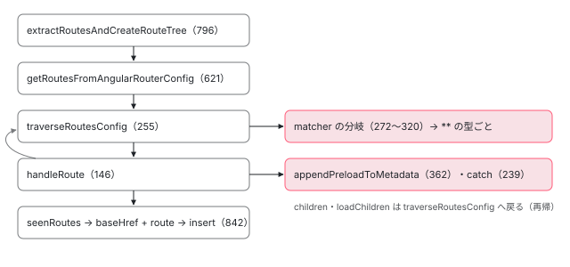

[目次](../README.md) › [SSR のサーバールートの内側：ルートを取り出し、木で照合し、応答を組み立てる](README.md) › 第 1 回 / 全 5 回

# ルートを取り出す：サーバーで Router を起動して設定をたどる

> routes/ng-routes.ts の getRoutesFromAngularRouterConfig が、ルートコンポーネントを作らず IS\_DISCOVERING\_ROUTES を真にしてアプリを起動し、traverseRoutesConfig と handleRoute が children・loadChildren・matcher・redirectTo を 1 つずつたどって、ルートの一覧と errors を作り、baseHref を付けて RouteTree に入れる手順。0f41585a7c（発見中の印）・4a1833d842（blocking の初回ナビゲーション）・appendPreloadToMetadata と、22.2.7 に入った 0b9a52cc95（'' の子と preload）。

angular/angular-cli · 読了 約 13 分 · 中核 · [サイトで読む（デモが動きます）](https://angular-deep-dive-cyan.vercel.app/chapter/srt-extract)

---

この章で分かること: `@angular/ssr` がサーバールートの表を作るとき、Angular の Router の設定（`provideRouter(routes)` の配列）を どの関数が、どの順で、1 つずつ読んでいくかです。アプリを「ルートを調べる用」に起動する行、`children`・`loadChildren`・`matcher`・`redirectTo` を辿る行、チャンクの先読み（preload）の情報を足す行、結果を一覧と `errors` にまとめて木に入れる行を、44129f66a3 の行番号で追います。最後に、本物の `getRoutesFromAngularRouterConfig` と `extractRoutesAndCreateRouteTree` を 10 通りのアプリで呼んだ記録を、44129f66a3 と npm の 22.2.7 で並べます。

読む対象は `packages/angular/ssr/src/routes/ng-routes.ts`（angular-cli リポジトリ）と、それを呼ぶ `routes/router.ts` です。取り出しの大筋（`platformServer` に渡す 4 つのプロバイダ、`seenRoutes`、サーバールートとの照合、`handleSSGRoute`）は [ssr-server-routes の章](../platform/05-ssr-server-routes.md)で一度読んでいます。この章はその続きで、同じ行の説明は繰り返さず、そこで飛ばした行と、その行を入れた・直したコミット、記録で見える細部を読みます。

1. **1. ルートを取り出す**（この章）
2. [2. プリレンダーのパラメータとリダイレクト](02-srt-prerender-params.md)
3. [3. ルートの木](03-srt-route-tree.md)
4. [4. manifest と renderAngular](04-srt-manifest-render.md)
5. [5. spec と issue](05-srt-tests-issues.md)

> [!TIP]
> **新卒エンジニアへ**
>
> **ルートを取り出す**とは、Router の設定の木（入れ子の配列）を平らな URL の型の一覧（`/`・`/docs/intro`・`/user/:id`・`/**` など）にして、それぞれに描き方（`RenderMode`）・リダイレクト先・状態コード・先読みするチャンクを付けることです。**async generator**（`async function*`）は、`yield` で値を 1 つずつ返し、`for await` で受け取る関数です。この章の関数は、結果もエラーもこの形で 1 件ずつ流します。

## 1. 誰が呼ぶか：ServerRouter.from とビルドの worker

📄 `angular-cli/packages/angular/ssr/src/routes/router.ts` L27–54 （▶ の行: 27, 32, 48–50, 52）

```ts
27 ▶   private constructor(private readonly routeTree: RouteTree) {}
28 │ 
29 │   /**
30 │    * Static property to track the ongoing build promise.
31 │    */
32 ▶   static #extractionPromise: Promise<ServerRouter> | undefined;
33 │ 
34 │   /**
35 │    * Creates or retrieves a `ServerRouter` instance based on the provided manifest and URL.
36 │    *
37 │    * If the manifest contains pre-built routes, a new `ServerRouter` is immediately created.
38 │    * Otherwise, it builds the router by extracting routes from the Angular configuration
39 │    * asynchronously. This method ensures that concurrent builds are prevented by re-using
40 │    * the same promise.
41 │    *
42 │    * @param manifest - An instance of `AngularAppManifest` that contains the route information.
43 │    * @param url - The URL for server-side rendering. The URL is needed to configure `ServerPlatformLocation`.
44 │    * This is necessary to ensure that API requests for relative paths succeed, which is crucial for correct route extraction.
45 │    * [Reference](https://github.com/angular/angular/blob/d608b857c689d17a7ffa33bbb510301014d24a17/packages/platform-server/src/location.ts#L51)
46 │    * @returns A promise resolving to a `ServerRouter` instance.
47 │    */
48 ▶   static from(manifest: AngularAppManifest, url: URL): Promise<ServerRouter> {
49 ▶     if (manifest.routes) {
50 ▶       const routeTree = RouteTree.fromObject(manifest.routes);
51 │ 
52 ▶       return Promise.resolve(new ServerRouter(routeTree));
53 │     }
54 │ 
```

呼び手は 2 つです。1 つはこの `ServerRouter.from` で、49〜52 行目のとおり manifest に `routes`（ビルドが取り出して書いた木）があれば取り出しはせず、無いときだけ、この引用の下の行で `extractRoutesAndCreateRouteTree` を呼びます（その行は [ssr-server-routes](../platform/05-ssr-server-routes.md) の 3 節）。32 行目の `#extractionPromise` は class の static な private のフィールドで、同時に来たリクエストが 1 つの取り出しを待つための置き場です。27 行目の constructor は private なので、`ServerRouter` は `from` からしか作れません。

もう 1 つはビルドです。`@angular/build` の routes-extractor-worker.ts が、ビルドした `main.server.mjs` を読み込んで同じ関数を呼びます（[ssr-prerender の章](../platform/06-ssr-prerender.md)の引用）。そのとき `invokeGetPrerenderParams` は `outputMode` があれば真、`includePrerenderFallbackRoutes` は `outputMode: "server"` のときだけ真、`signal` は 30 秒の `AbortSignal.timeout(30_000)` です。

📄 `angular-cli/packages/angular/ssr/src/routes/ng-routes.ts` L796–822 （▶ の行: 796, 805–808, 811, 816–819）

```ts
796 ▶ export function extractRoutesAndCreateRouteTree(options: {
797 │   url: URL;
798 │   manifest?: AngularAppManifest;
799 │   invokeGetPrerenderParams?: boolean;
800 │   includePrerenderFallbackRoutes?: boolean;
801 │   signal?: AbortSignal;
802 │ }): Promise<{ routeTree: RouteTree; appShellRoute?: string; errors: string[] }> {
803 │   const {
804 │     url,
805 ▶     manifest = getAngularAppManifest(),
806 ▶     invokeGetPrerenderParams = false,
807 ▶     includePrerenderFallbackRoutes = true,
808 ▶     signal,
809 │   } = options;
810 │ 
811 ▶   async function extract(): Promise<{
812 │     appShellRoute: string | undefined;
813 │     routeTree: RouteTree<{}>;
814 │     errors: string[];
815 │   }> {
816 ▶     const routeTree = new RouteTree();
817 ▶     const document = await new ServerAssets(manifest).getIndexServerHtml().text();
818 ▶     const bootstrap = await manifest.bootstrap();
819 ▶     const { baseHref, appShellRoute, routes, errors } = await getRoutesFromAngularRouterConfig(
820 │       bootstrap,
821 │       document,
822 │       url,
```

📄 `angular-cli/packages/angular/ssr/src/routes/ng-routes.ts` L838–854 （▶ の行: 842–843, 846, 853）

```ts
838 │           delete (metadata as any)[key];
839 │         }
840 │       }
841 │ 
842 ▶       const fullRoute = joinUrlParts(baseHref, route);
843 ▶       routeTree.insert(fullRoute, metadata);
844 │     }
845 │ 
846 ▶     return {
847 │       appShellRoute,
848 │       routeTree,
849 │       errors,
850 │     };
851 │   }
852 │ 
853 ▶   return signal ? promiseWithAbort(extract(), signal, 'Routes extraction') : extract();
854 │ }
```

1. **805〜807 行目：引数の既定値**

   manifest を渡さなければ `getAngularAppManifest()`（`ɵsetAngularAppManifest` で置いた大域の値。[第 4 回](04-srt-manifest-render.md)）。`invokeGetPrerenderParams` は偽、`includePrerenderFallbackRoutes` は真です。リクエストのときの取り出し（`ServerRouter.from`）はこの既定値のままなので、`getPrerenderParams` は呼ばれません（[第 2 回](02-srt-prerender-params.md)）。
2. **811〜819 行目：中身は内側の関数 extract**

   816 行目で空の `RouteTree` を作り、817 行目で `index.server.html` の本文を、818 行目で manifest の `bootstrap()` を待ってから、819 行目で次の節の `getRoutesFromAngularRouterConfig` を呼びます。
3. **842・843 行目：baseHref を前に付けて木に入れる**

   一覧の `route` は baseHref を含みません。ここで `joinUrlParts(baseHref, route)` にしてから `insert` します。同じ区切りの並びになる経路（`/docs` と `/docs/`）は木の同じ節点になり、後から入れた方の値が残ります（[第 3 回](03-srt-route-tree.md)）。
4. **853 行目：signal があれば取り消せるようにする**

   `promiseWithAbort`（utils/promise.ts）は、`signal` が abort されたら `Routes extraction was aborted.` の `AbortError`（`DOMException`）で reject する Promise で包みます。ビルドの 30 秒はここで効きます。包むだけなので、走っている `extract()` そのものは止まりません。

## 2. getRoutesFromAngularRouterConfig の引数と戻り値

📄 `angular-cli/packages/angular/ssr/src/routes/ng-routes.ts` L621–635 （▶ の行: 621, 625–627, 629, 632, 635）

```ts
621 ▶ export async function getRoutesFromAngularRouterConfig(
622 │   bootstrap: AngularBootstrap,
623 │   document: string,
624 │   url: URL,
625 ▶   invokeGetPrerenderParams = false,
626 ▶   includePrerenderFallbackRoutes = true,
627 ▶   entryPointToBrowserMapping: EntryPointToBrowserMapping | undefined = undefined,
628 │ ): Promise<AngularRouterConfigResult> {
629 ▶   const { protocol, host } = url;
630 │ 
631 │   // Create and initialize the Angular platform for server-side rendering.
632 ▶   const platformRef = platformServer([
633 │     {
634 │       provide: INITIAL_CONFIG,
635 ▶       useValue: { document, url: `${protocol}//${host}/` },
```

621 行目、この関数は `ɵgetRoutesFromAngularRouterConfig` の名前でも export されています（private\_export.ts の注釈は「Webpack の server builder だけが使う」）。625〜627 行目の既定値は 1 節と同じで、627 行目の `entryPointToBrowserMapping` は「ビルドの入口の名前 → ブラウザ用のチャンクのファイル名」の表です（4 節で使う）。629 行目で URL から `protocol` と `host` だけを取り、635 行目で `http://localhost/` のようなオリジンの `/` にします。パスは捨てます。

📄 `angular-cli/packages/angular/ssr/src/routes/ng-routes.ts` L100–138 （▶ の行: 103, 108, 117, 125, 130, 135, 138）

```ts
100 │ /**
101 │  * Result of extracting routes from an Angular application.
102 │  */
103 ▶ interface AngularRouterConfigResult {
104 │   /**
105 │    * The base URL for the application.
106 │    * This is the base href that is used for resolving relative paths within the application.
107 │    */
108 ▶   baseHref: string;
109 │ 
110 │   /**
111 │    * An array of `RouteTreeNodeMetadata` objects representing the application's routes.
112 │    *
113 │    * Each `RouteTreeNodeMetadata` contains details about a specific route, such as its path and any
114 │    * associated redirection targets. This array is asynchronously generated and
115 │    * provides information on how routes are structured and resolved.
116 │    */
117 ▶   routes: RouteTreeNodeMetadata[];
118 │ 
119 │   /**
120 │    * Optional configuration for server routes.
121 │    *
122 │    * This property allows you to specify an array of server routes for configuration.
123 │    * If not provided, the default configuration or behavior will be used.
124 │    */
125 ▶   serverRoutesConfig?: ServerRoute[] | null;
126 │ 
127 │   /**
128 │    * A list of errors encountered during the route extraction process.
129 │    */
130 ▶   errors: string[];
131 │ 
132 │   /**
133 │    * The specified route for the app-shell, if configured.
134 │    */
135 ▶   appShellRoute?: string;
136 │ }
137 │ 
138 ▶ type EntryPointToBrowserMapping = AngularAppManifest['entryPointToBrowserMapping'];
```

戻り値の型です。108 行目の `baseHref`、117 行目の `routes`（ルートごとの値の配列）、130 行目の `errors`、135 行目の `appShellRoute`。125 行目の `serverRoutesConfig` は型にはありますが、この関数の 2 つの `return`（[ssr-server-routes](../platform/05-ssr-server-routes.md) の 4 節の引用の、エラーで早く返す方と最後の方）はどちらもこのキーを入れません。記録でも `getRoutes` の戻り値のキーは `baseHref`・`routes`・`errors`（と、あれば `appShellRoute`）だけでした。138 行目の `EntryPointToBrowserMapping` は manifest の型から取った別名です。

## 3. 起動：コンポーネントを作らず、IS\_DISCOVERING\_ROUTES を真にする

📄 `angular-cli/packages/angular/ssr/src/routes/ng-routes.ts` L9–27 （▶ の行: 18–19, 21, 25）

```ts
 9 │ import { APP_BASE_HREF, PlatformLocation } from '@angular/common';
10 │ import {
11 │   ApplicationRef,
12 │   Compiler,
13 │   EnvironmentInjector,
14 │   InjectionToken,
15 │   Injector,
16 │   createEnvironmentInjector,
17 │   runInInjectionContext,
18 ▶   ɵConsole,
19 ▶   ɵENABLE_ROOT_COMPONENT_BOOTSTRAP,
20 │ } from '@angular/core';
21 ▶ import { INITIAL_CONFIG, platformServer } from '@angular/platform-server';
22 │ import {
23 │   Route as AngularRoute,
24 │   Router,
25 ▶   ɵloadChildren as loadChildrenHelper,
26 │ } from '@angular/router';
27 │ 
```

取り出しのために `@angular/core` から借りている内部の名前は 2 つ、`@angular/router` からは 1 つです。18 行目の `ɵConsole` は Angular が開発モードの案内を出す先で、ssr の `Console`（決まった文を出さない版）に差し替えます。19 行目の `ɵENABLE_ROOT_COMPONENT_BOOTSTRAP` を偽にすると、`bootstrapApplication` はルートコンポーネントを作らずに `ApplicationRef` を返します。21 行目の `platformServer` は SSR と同じプラットフォーム（[platformServer と domino](../platform/03-ssr-platform-server.md)）、25 行目の `ɵloadChildren` は Router 自身が遅延ルートを読み込む関数です（[遅延読み込みの章](../router/11-router-lazy-loading.md)）。

4 つのプロバイダを `platformServer` に渡す行と、起動して `whenStable()` を待つ行は [ssr-server-routes](../platform/05-ssr-server-routes.md) の 4 節にあります。ここでは、その中の 2 か所を入れたコミットを読みます。

📄 `git show 0f41585a7c -- packages/angular/ssr/src/routes/ng-routes.ts`

```ts
0f41585a7c 2026-03-03 fix(@angular/ssr): introduce DI token to signal route discovery process

diff --git a/packages/angular/ssr/src/routes/ng-routes.ts b/packages/angular/ssr/src/routes/ng-routes.ts
index b60e704371..438e8450d3 100644
--- a/packages/angular/ssr/src/routes/ng-routes.ts
+++ b/packages/angular/ssr/src/routes/ng-routes.ts
@@ -11,6 +11,7 @@ import {
   ApplicationRef,
   Compiler,
   EnvironmentInjector,
+  InjectionToken,
   Injector,
   createEnvironmentInjector,
   runInInjectionContext,
@@ -23,6 +24,7 @@ import {
   Router,
   ɵloadChildren as loadChildrenHelper,
 } from '@angular/router';
+
 import { ServerAssets } from '../assets';
 import { Console } from '../console';
 import { AngularAppManifest, getAngularAppManifest } from '../manifest';
@@ -39,6 +41,22 @@ import {
 } from './route-config';
 import { RouteTree, RouteTreeNodeMetadata } from './route-tree';
 
+/**
+ * A DI token that indicates whether the application is in the process of discovering routes.
+ *
+ * This token is provided with the value `true` when route discovery is active, allowing other
+ * parts of the application to conditionally execute logic. For example, it can be used to
+ * disable features or behaviors that are not necessary or might interfere with the route
+ * discovery process.
+ */
+export const IS_DISCOVERING_ROUTES = new InjectionToken<boolean>(
+  typeof ngDevMode === 'undefined' || ngDevMode ? 'IS_DISCOVERING_ROUTES' : '',
+  {
+    providedIn: 'platform',
+    factory: () => false,
+  },
+);
+
 interface Route extends AngularRoute {
   ɵentryName?: string;
 }
@@ -623,6 +641,10 @@ export async function getRoutesFromAngularRouterConfig(
       provide: ɵENABLE_ROOT_COMPONENT_BOOTSTRAP,
       useValue: false,
     },
+    {
+      provide: IS_DISCOVERING_ROUTES,
+      useValue: true,
+    },
   ]);
 
   try {

```
*2026-03-03。#32474 を閉じたコミット。トークンを作り（providedIn: 'platform'、既定は false）、取り出しのプラットフォームでだけ true を provide する。*

差分は 2 か所です。`InjectionToken` を作る 16 行と、`platformServer([...])` に `{ provide: IS_DISCOVERING_ROUTES, useValue: true }` を足す 4 行。`providedIn: 'platform'` なので、プラットフォームの注入器で解決されます。取り出しのときだけ値を持つプラットフォームを作り、そうでないプラットフォーム（リクエストごとの描画）では既定の `false` です。@angular/ssr の中にこのトークンを読む行はありません。`public_api.ts` から export し、利用者の `APP_INITIALIZER` や `loadChildren` の中で `inject(IS_DISCOVERING_ROUTES)` と読む前提です。記録のどの場合でも、`APP_INITIALIZER` で読んだ値は `true` でした（DEMO の 2 段目）。

📄 `git show 4a1833d842 -- packages/angular/ssr/src/routes/ng-routes.ts`

```ts
4a1833d842 2025-01-20 fix(@angular/ssr): unblock route extraction with `withEnabledBlockingInitialNavigation`

diff --git a/packages/angular/ssr/src/routes/ng-routes.ts b/packages/angular/ssr/src/routes/ng-routes.ts
index b0b8848569..770cb3d6c7 100644
--- a/packages/angular/ssr/src/routes/ng-routes.ts
+++ b/packages/angular/ssr/src/routes/ng-routes.ts
@@ -523,11 +523,17 @@ export async function getRoutesFromAngularRouterConfig(
       applicationRef = await bootstrap();
     }
 
+    const injector = applicationRef.injector;
+    const router = injector.get(Router);
+
+    // Workaround to unblock navigation when `withEnabledBlockingInitialNavigation()` is used.
+    // This is necessary because route extraction disables component bootstrapping.
+    // eslint-disable-next-line @typescript-eslint/no-explicit-any
+    (router as any).navigationTransitions.afterPreactivation()?.next?.();
+
     // Wait until the application is stable.
     await applicationRef.whenStable();
 
-    const injector = applicationRef.injector;
-    const router = injector.get(Router);
     const routesResults: RouteTreeNodeMetadata[] = [];
     const errors: string[] = [];
 

```
*2025-01-20。#29400。withEnabledBlockingInitialNavigation を使うアプリで取り出しが止まる問題の回避。*

1. **なぜ止まるのか**

   Router の初回のナビゲーション（[初回ナビゲーションの章](../router/06-router-initial-navigation.md)）は、既定（enabledNonBlocking）ではルートコンポーネントが作られたときの bootstrap listener が始めます。取り出しではコンポーネントを作らないので、ナビゲーションそのものが始まりません。`withEnabledBlockingInitialNavigation()` では、`APP_INITIALIZER` の中で `router.initialNavigation()` を呼び、`NavigationTransitions.afterPreactivation` を「ブートストラップが終わるまで待つ Subject を返す関数」に差し替えます。その Subject はルートコンポーネントの bootstrap listener でしか `next` されないので、取り出しではナビゲーションが途中で止まったままになり、`whenStable()` が来ません。
2. **差分の 1 行で外す**

   `afterPreactivation()?.next?.()` は、差し替えられていればその Subject の `next` を自分で呼び、待ちを外します。差し替えていなければ既定の `afterPreactivation` が返すのは `of(void 0)`（`next` を持たない Observable）なので、`?.next?.()` は何もしません。`router as any` は、`navigationTransitions` が Router の公開の型に無いからです。
3. **記録**

   DEMO の「blocking と base href」では、両方の版で取り出しが終わり、`APP_INITIALIZER` は動き、ルートコンポーネントの constructor は 1 度も呼ばれていません。

## 4. handleRoute：1 つのルートで何をするか

📄 `angular-cli/packages/angular/ssr/src/routes/ng-routes.ts` L59–69 （▶ の行: 60–61, 68）

```ts
59 │ 
60 ▶ interface Route extends AngularRoute {
61 ▶   ɵentryName?: string;
62 │ }
63 │ 
64 │ /**
65 │  * The maximum number of module preload link elements that should be added for
66 │  * initial scripts.
67 │  */
68 ▶ const MODULE_PRELOAD_MAX = 10;
69 │ 
```

60・61 行目、Router の `Route` の型に `ɵentryName` を足した型をこのファイルの中で使います。`ɵentryName` は利用者が書くものではなく、ビルド（application builder）が `loadComponent`・`loadChildren` の `import()` に「その入口の名前」を書き足したものです。68 行目の `MODULE_PRELOAD_MAX` は 1 つのルートに付ける先読みの上限 10 個です。

📄 `angular-cli/packages/angular/ssr/src/routes/ng-routes.ts` L140–176 （▶ の行: 146–148, 156–157, 170–172, 175–176）

```ts
140 │ /**
141 │  * Handles a single route within the route tree and yields metadata or errors.
142 │  *
143 │  * @param options - Configuration options for handling the route.
144 │  * @returns An async iterable iterator yielding `RouteTreeNodeMetadata` or an error object.
145 │  */
146 ▶ async function* handleRoute(options: {
147 ▶   metadata: ServerConfigRouteTreeNodeMetadata;
148 ▶   currentRoutePath: string;
149 │   route: Route;
150 │   compiler: Compiler;
151 │   parentInjector: Injector;
152 │   serverConfigRouteTree?: RouteTree<ServerConfigRouteTreeAdditionalMetadata>;
153 │   invokeGetPrerenderParams: boolean;
154 │   includePrerenderFallbackRoutes: boolean;
155 │   entryPointToBrowserMapping?: EntryPointToBrowserMapping;
156 ▶ }): AsyncIterableIterator<RouteTreeNodeMetadata | { error: string }> {
157 ▶   try {
158 │     const {
159 │       metadata,
160 │       currentRoutePath,
161 │       route,
162 │       compiler,
163 │       parentInjector,
164 │       serverConfigRouteTree,
165 │       entryPointToBrowserMapping,
166 │       invokeGetPrerenderParams,
167 │       includePrerenderFallbackRoutes,
168 │     } = options;
169 │ 
170 ▶     const { redirectTo, loadChildren, loadComponent, children, ɵentryName } = route;
171 ▶     if (ɵentryName && loadComponent) {
172 ▶       appendPreloadToMetadata(ɵentryName, entryPointToBrowserMapping, metadata);
173 │     }
174 │ 
175 ▶     if (metadata.renderMode === RenderMode.Prerender) {
176 ▶       yield* handleSSGRoute(
```

146 行目の `handleRoute` は Router のルート 1 つを受け持ちます。147 行目の `metadata` は前の段（6 節の `traverseRoutesConfig`）で作った値（`route` と、当たったサーバールートの `renderMode` など）、148 行目の `currentRoutePath` は親とつないだ経路です。156 行目、戻り値は「ルートの値」か「`{ error }`」の 2 種類を流す async iterator です。投げずに値として流すので、呼び手は 1 回の取り出しで全部のエラーを集められます。170 行目で Router のルートから 5 つを取り出し、171・172 行目で `loadComponent` のルートなら先読みを足します（次の関数）。175・176 行目から先の分かれ道（Prerender・リダイレクト・ふつう）と、children・loadChildren の再帰は [ssr-server-routes](../platform/05-ssr-server-routes.md) の 6 節で読んだ行です。

📄 `angular-cli/packages/angular/ssr/src/routes/ng-routes.ts` L355–387 （▶ の行: 362, 367–368, 372–373, 378, 381–382, 386）

```ts
355 │ /**
356 │  * Appends preload information to the metadata object based on the specified entry-point and chunk mappings.
357 │  *
358 │  * This function extracts preload data for a given entry-point from the provided chunk mappings. It adds the
359 │  * corresponding browser bundles to the metadata's preload list, ensuring no duplicates and limiting the total
360 │  * preloads to a predefined maximum.
361 │  */
362 ▶ function appendPreloadToMetadata(
363 │   entryName: string,
364 │   entryPointToBrowserMapping: EntryPointToBrowserMapping,
365 │   metadata: ServerConfigRouteTreeNodeMetadata,
366 │ ): void {
367 ▶   const existingPreloads = metadata.preload ?? [];
368 ▶   if (!entryPointToBrowserMapping || existingPreloads.length >= MODULE_PRELOAD_MAX) {
369 │     return;
370 │   }
371 │ 
372 ▶   const preload = entryPointToBrowserMapping[entryName];
373 ▶   if (!preload?.length) {
374 │     return;
375 │   }
376 │ 
377 │   // Merge existing preloads with new ones, ensuring uniqueness and limiting the total to the maximum allowed.
378 ▶   const combinedPreloads: Set<string> = new Set(existingPreloads);
379 │   for (const href of preload) {
380 │     combinedPreloads.add(href);
381 ▶     if (combinedPreloads.size === MODULE_PRELOAD_MAX) {
382 ▶       break;
383 │     }
384 │   }
385 │ 
386 ▶   metadata.preload = Array.from(combinedPreloads);
387 │ }
```

1. **367・368 行目：表が無いか、もう 10 個あれば何もしない**

   `entryPointToBrowserMapping` は manifest にある表です。開発サーバーなど表の無い場合は、ここで帰ります。
2. **372・373 行目：その入口のチャンクを引く**

   表に無い名前なら帰ります。
3. **378〜384 行目：今の preload と足して、重ならず 10 個まで**

   Set に入れるので同じファイルは 1 つ。381・382 行目、10 個になったところで打ち切ります。
4. **386 行目：metadata.preload を新しい配列で置き換える**

   戻り値ではなく、受け取った `metadata` そのものを書き換えます。この「書き換え」が、次の観察の理由です。

> [!NOTE]
> **さらに深く**
>
> loadChildren の先読みは、handleRoute の loadChildren の分岐（[ssr-server-routes](../platform/05-ssr-server-routes.md) の 6 節の引用）の頭で足します。そのルート自身の値は、それより前の「ふつうのルート」の分岐で `yield metadata` してあります。Server・Client のルートでは `yield` したのが同じオブジェクトなので、後から 386 行目で書き換えた preload も一覧に出ます。Prerender のルートでは、176 行目の `handleSSGRoute` が `{ ...meta, route }` の写しを返すので、後の書き換えは一覧に出ません。記録の「入れ子と loadChildren」（全部 Prerender）では 44129f66a3 の `/admin` に preload が無く、「同じ設定 + withRoutes」（admin は Client）では `/admin` に `chunk-ADMIN.js` があります。後者は、キーの順が `renderMode, route, preload` と `route` の後ろに付いていて、`yield` の後に足されたことが分かります。22.2.7 では次の 0b9a52cc95 で 171 行目の条件が `loadComponent || loadChildren` になり、`yield` の前に足すので、どちらの場合も `/admin` に付きます。

📄 `angular-cli/packages/angular/ssr/src/routes/ng-routes.ts` L232–254 （▶ の行: 232–233, 239–241）

```ts
232 ▶           routes: childRoutes,
233 ▶           parentInjector: injector,
234 │           parentRoute: currentRoutePath,
235 │           parentPreloads: metadata.preload,
236 │         });
237 │       }
238 │     }
239 ▶   } catch (error) {
240 ▶     yield {
241 ▶       error: `Error in handleRoute for '${options.currentRoutePath}': ${(error as Error).message}`,
242 │     };
243 │   }
244 │ }
245 │ 
246 │ /**
247 │  * Traverses an array of route configurations to generate route tree node metadata.
248 │  *
249 │  * This function processes each route and its children, handling redirects, SSG (Static Site Generation) settings,
250 │  * and lazy-loaded routes. It yields route metadata for each route and its potential variants.
251 │  *
252 │  * @param options - The configuration options for traversing routes.
253 │  * @returns An async iterable iterator yielding either route tree node metadata or an error object with an error message.
254 │  */
```

232〜236 行目は loadChildren で読み込んだ子を、読み込みが返した注入器（無ければ、ルートの `providers` から作った環境注入器）で辿る行です。239〜242 行目、handleRoute の中で投げられたものは全部ここで受け、`Error in handleRoute for '<経路>': <メッセージ>` の 1 件のエラーにします。`loadChildren` の `import()` の失敗や、`getPrerenderParams` が投げた例外（[第 2 回](02-srt-prerender-params.md)の記録）がこの形になります。そのルートの子は辿られません。

## 5. matcher のルート

📄 `angular-cli/packages/angular/ssr/src/routes/ng-routes.ts` L265–293 （▶ の行: 266, 269–270, 272, 274–275, 280–281, 288–290）

```ts
265 │ }): AsyncIterableIterator<RouteTreeNodeMetadata | { error: string }> {
266 ▶   const { routes: routeConfigs, parentPreloads, parentRoute, serverConfigRouteTree } = options;
267 │ 
268 │   for (const route of routeConfigs) {
269 ▶     const { matcher, path = matcher ? '**' : '' } = route;
270 ▶     const currentRoutePath = joinUrlParts(parentRoute, path);
271 │ 
272 ▶     if (matcher && serverConfigRouteTree) {
273 │       const matches: (RouteTreeNodeMetadata & ServerConfigRouteTreeAdditionalMetadata)[] = [];
274 ▶       for (const matchedMetaData of serverConfigRouteTree.traverse()) {
275 ▶         if (matchedMetaData.route.startsWith(currentRoutePath)) {
276 │           matches.push(matchedMetaData);
277 │         }
278 │       }
279 │ 
280 ▶       if (!matches.length) {
281 ▶         const matchedMetaData = serverConfigRouteTree.match(currentRoutePath);
282 │         if (matchedMetaData) {
283 │           matches.push(matchedMetaData);
284 │         }
285 │       }
286 │ 
287 │       for (const matchedMetaData of matches) {
288 ▶         matchedMetaData.presentInClientRouter = true;
289 ▶         if (matchedMetaData.renderMode === RenderMode.Prerender) {
290 ▶           yield {
291 │             error:
292 │               `The route '${stripLeadingSlash(currentRoutePath)}' is set for prerendering but has a defined matcher. ` +
293 │               `Routes with matchers cannot use prerendering. Please specify a different 'renderMode'.`,
```

📄 `angular-cli/packages/angular/ssr/src/routes/ng-routes.ts` L294–328 （▶ の行: 298, 305–306, 311–313, 319, 322, 324–325）

```ts
294 │           };
295 │           continue;
296 │         }
297 │ 
298 ▶         yield* handleRoute({
299 │           ...options,
300 │           currentRoutePath,
301 │           route,
302 │           metadata: {
303 │             ...matchedMetaData,
304 │             preload: parentPreloads,
305 ▶             route: matchedMetaData.route,
306 ▶             presentInClientRouter: undefined,
307 │           },
308 │         });
309 │       }
310 │ 
311 ▶       if (!matches.length) {
312 ▶         yield {
313 ▶           error:
314 │             `The route '${stripLeadingSlash(currentRoutePath)}' has a defined matcher but does not ` +
315 │             'match any route in the server routing configuration. Please ensure this route is added to the server routing configuration.',
316 │         };
317 │       }
318 │ 
319 ▶       continue;
320 │     }
321 │ 
322 ▶     let matchedMetaData: ServerConfigRouteTreeNodeMetadata | undefined;
323 │     if (serverConfigRouteTree) {
324 ▶       matchedMetaData = serverConfigRouteTree.match(currentRoutePath);
325 ▶       if (!matchedMetaData) {
326 │         yield {
327 │           error:
328 │             `The '${stripLeadingSlash(currentRoutePath)}' route does not match any route defined in the server routing configuration. ` +
```

`matcher` は、path の文字列ではなく関数で URL の区切りを照合するルートです。サーバーは関数を走らせずに URL の一覧を作るので、どの URL に当たるかが分かりません。そこで 269 行目で path を `'**'` とみなします。

1. **272 行目：サーバールートがあるときだけ、この分岐**

   withRoutes が無ければ、ふつうのルートと同じく、関数の最後の handleRoute の呼び出しに進み、`/**` の Prerender の 1 件になります（記録の「matcher（withRoutes なし）」）。
2. **274・275 行目：親の経路 + /\*\* で始まるサーバールートを全部集める**

   木の全部の値を `traverse()` で回し、`route` が `currentRoutePath`（たとえば `/shop/**`）で**文字どおり始まる**ものを集めます。`shop/**/sale` や `shop/**/sale/flash` のように、利用者が `**` の後ろに続きを書いたサーバールートは、ここで matcher のルートの「中身」として扱われます。
3. **280〜285 行目：1 つも無ければ、ふつうの照合を 1 回**

   `serverConfigRouteTree.match('/shop/**')` です。木に `**` や `*` の節点があればそれが当たります。
4. **288〜296 行目：当たったものに印を付け、Prerender ならエラー**

   matcher のルートは URL を作れないので Prerender にできません。エラーを流して次へ（295 行目の `continue`）。
5. **298〜308 行目：当たったものごとに handleRoute**

   305 行目、経路はサーバールートの `route`（`/shop/**/sale` など）をそのまま使います。306 行目の `presentInClientRouter: undefined` は、印を結果に持ち込まないためです。
6. **311〜317 行目：どれにも当たらなければエラー**

   メッセージの経路は `'**'` や `'shop/**'` です。一番上の matcher は親の経路が空なので、`'**'` と書かれます（記録の「matcher（サーバールートあり）」）。

この分岐は 9726cd084b（2025-01-29、matcher を Server・Client に限って使えるようにした機能）で入りました。その 3 週間前の 6edb908837（2025-01-08）は、「SSR では matcher に未対応」として matcher を見つけるとエラーにしていました。matcher のない普通のルートは 322 行目から先に進みます。324 行目でサーバールートの木を照合し、当たらなければ 325 行目からのエラーです。

## 6. path が '' のルートと、0b9a52cc95

[ssr-server-routes](../platform/05-ssr-server-routes.md) の 6 節で読んだとおり、44129f66a3 の `traverseRoutesConfig` は、最後に handleRoute を呼ぶところで、path が `''` のルートの経路の末尾に `/` を付けます。`docs` の子の `''` は `/docs/` になり、親の `/docs` とは別の文字列なので、`seenRoutes`（同じ経路の 2 件目を捨てる Set）をすり抜けて一覧に 2 件並びます。木では 1 節で見たとおり同じ節点になり、子の値が残ります。ところが `''` の中の `''` は、親も子も `/` です。`seenRoutes` は最初の 1 件（親）を残すので、子が持っていた先読みが消えます。

📄 `git show 0b9a52cc95 -- packages/angular/ssr/src/routes/ng-routes.ts`

```ts
0b9a52cc95 2026-10-13 fix(@angular/ssr): preserve preload metadata for nested empty-path routes

diff --git a/packages/angular/ssr/src/routes/ng-routes.ts b/packages/angular/ssr/src/routes/ng-routes.ts
index 915d7c2b9a..816155c4df 100644
--- a/packages/angular/ssr/src/routes/ng-routes.ts
+++ b/packages/angular/ssr/src/routes/ng-routes.ts
@@ -31,7 +31,7 @@ import { AngularAppManifest, getAngularAppManifest } from '../manifest';
 import { AngularBootstrap, isNgModule } from '../utils/ng';
 import { promiseWithAbort } from '../utils/promise';
 import { VALID_REDIRECT_RESPONSE_CODES, isValidRedirectResponseCode } from '../utils/redirect';
-import { addTrailingSlash, joinUrlParts, stripLeadingSlash } from '../utils/url';
+import { joinUrlParts, stripLeadingSlash } from '../utils/url';
 import {
   PrerenderFallback,
   RenderMode,
@@ -170,12 +170,14 @@ async function* handleRoute(options: {
     } = options;
 
     const { redirectTo, loadChildren, loadComponent, children, ɵentryName } = route;
-    if (ɵentryName && loadComponent) {
+    if (ɵentryName && (loadComponent || loadChildren)) {
       appendPreloadToMetadata(ɵentryName, entryPointToBrowserMapping, metadata);
     }
 
+    const parentRoutes = new Map<string, RouteTreeNodeMetadata>();
+
     if (metadata.renderMode === RenderMode.Prerender) {
-      yield* handleSSGRoute(
+      for await (const result of handleSSGRoute(
         serverConfigRouteTree,
         typeof redirectTo === 'string' ? redirectTo : undefined,
         parentRoute,
@@ -183,7 +185,13 @@ async function* handleRoute(options: {
         parentInjector,
         invokeGetPrerenderParams,
         includePrerenderFallbackRoutes,
-      );
+      )) {
+        if ('error' in result) {
+          yield result;
+        } else {
+          parentRoutes.set(result.route, result);
+        }
+      }
     } else if (redirectTo !== undefined) {
       if (metadata.status && !isValidRedirectResponseCode(metadata.status)) {
         yield {
@@ -192,34 +200,23 @@ async function* handleRoute(options: {
             `Please use one of the following redirect response codes: ${[...VALID_REDIRECT_RESPONSE_CODES.values()].join(', ')}.`,
         };
       } else if (typeof redirectTo === 'string') {
-        yield {
+        parentRoutes.set(metadata.route, {
           ...metadata,
           redirectTo: resolveRedirectTo(parentRoute, redirectTo),
           relativeRedirect: redirectTo[0] !== '/' ? true : undefined,
-        };
+        });
       } else {
-        yield metadata;
+        parentRoutes.set(metadata.route, metadata);
       }
     } else {
-      yield metadata;
+      parentRoutes.set(metadata.route, metadata);
     }
 
-    // Recursively process child routes
-    if (children?.length) {
-      yield* traverseRoutesConfig({
-        ...options,
-        routes: children,
-        parentRoute: currentRoutePath,
-        parentPreloads: metadata.preload,
-      });
-    }
-
-    // Load and process lazy-loaded child routes
-    if (loadChildren) {
-      if (ɵentryName) {
-        appendPreloadToMetadata(ɵentryName, entryPointToBrowserMapping, metadata);
-      }
+    // Recursively process child and lazy-loaded routes
+    let childRoutes: Route[] | undefined = children;
+    let childInjector = parentInjector;
 
+    if (!childRoutes?.length && loadChildren) {
       const routeInjector = route.providers
         ? createEnvironmentInjector(
             route.providers,
@@ -230,16 +227,48 @@ async function* handleRoute(options: {
 
       const loadedChildRoutes = await loadChildrenHelper(route, compiler, routeInjector);
       if (loadedChildRoutes) {
-        const { routes: childRoutes, injector = routeInjector } = loadedChildRoutes;
-        yield* traverseRoutesConfig({
-          ...options,
-          routes: childRoutes,
-          parentInjector: injector,
-          parentRoute: currentRoutePath,
-          parentPreloads: metadata.preload,
-        });
+        childRoutes = loadedChildRoutes.routes;
+        childInjector = loadedChildRoutes.injector ?? routeInjector;
       }
     }
+
+    if (!childRoutes?.length) {
+      yield* parentRoutes.values();
+
+      return;
+    }
+
+    const childResults: (RouteTreeNodeMetadata | { error: string })[] = [];
+    const overriddenParentRoutes = new Set<string>();
+    const traverseChildRoutes = traverseRoutesConfig({
+      ...options,
+      routes: childRoutes,
+      parentInjector: childInjector,
+      parentRoute: currentRoutePath,
+      parentPreloads: metadata.preload,
+    });
+
+    for await (const result of traverseChildRoutes) {
+      if ('error' in result) {
+        childResults.push(result);
+        continue;
+      }
+
+      // If a child route resolves to the exact same path as the parent (i.e., an empty-path child),
+      // let the first matching child override the parent's metadata so accumulated preloads and
+      // redirects from the activated descendant chain are preserved.
+      if (parentRoutes.has(result.route)) {
+        if (!overriddenParentRoutes.has(result.route)) {
+          overriddenParentRoutes.add(result.route);
+          parentRoutes.set(result.route, result);
+        }
+      } else {
+        childResults.push(result);
+      }
+    }
+
+    yield* parentRoutes.values();
+    yield* childResults;
   } catch (error) {
     yield {
       error: `Error in handleRoute for '${options.currentRoutePath}': ${(error as Error).message}`,
@@ -344,10 +373,7 @@ async function* traverseRoutesConfig(options: {
         renderMode: RenderMode.Prerender,
         ...matchedMetaData,
         preload: parentPreloads,
-        // Match Angular router behavior
-        // ['one', 'two', ''] -> 'one/two/'
-        // ['one', 'two', 'three'] -> 'one/two/three'
-        route: path === '' ? addTrailingSlash(currentRoutePath) : currentRoutePath,
+        route: currentRoutePath,
         presentInClientRouter: undefined,
       },
       currentRoutePath,

```
*2026-10-13（44129f66a3 より後、22.2.7 に入っている）。#34320（入れ子の path: '' の下のページに modulepreload が付かない。19.1.6 からの退行として報告された）。*

1. **先読みを先に足す**

   171 行目の条件を `loadComponent || loadChildren` にし、`yield` の前に足します（4 節の観察もこれで消える）。
2. **自分の値をすぐ流さず、parentRoutes に貯める**

   子を辿ったあとで、子の経路が自分と同じ（`''` の子）なら、最初の 1 件で自分の値を置き換えます。そのあとで自分、子の順に流します。
3. **末尾の / を付けない**

   `addTrailingSlash` の行を消し、経路は `currentRoutePath` のまま。`/docs/` の 2 件目は出なくなります。

記録の「`''` の中の `''`」（このコミットの spec と同じ形）では、44129f66a3 は `/` の preload が空で、22.2.7 は `home-routes.js, home-page.js` です。`/pricing` も、44129f66a3 では一覧に `/pricing` と `/pricing/` の 2 件が出て、木で 1 つになっています。



*44129f66a3 の取り出しの流れ。四角が関数、左の列が 1 件ずつ流れる値。赤はこの章で新しく読んだ行。*

## 7. DEMO：10 通りのアプリから取り出した記録

> **🧪 DEMO — getRoutesFromAngularRouterConfig と extractRoutesAndCreateRouteTree の記録（再生）**
>
> `<work>/srt-demo/a/record-extract.mjs` を Node v24.22.1 で走らせた記録です。アプリは JIT（`@angular/compiler` を先に読み込む）・zoneless で、@angular/core と router は 22.2.6。同じアプリを 2 つの版で取り出しました。「44129f66a3 の src」はこの章で行番号を読んでいる `packages/angular/ssr/src` を esbuild で束ねたもの、「npm の 22.2.7」はこのサイトが依存している @angular/ssr 22.2.7 です（44129f66a3 より後の 0b9a52cc95・b3bbada1ef などが入っている）。`getRoutes` は `invokeGetPrerenderParams = false`・`includePrerenderFallbackRoutes = true`・先読みの表ありで呼び、`extract` は manifest を渡して呼びました。URL は `http://localhost/` だけで、外への通信はありません。赤い行は、もう一方の版に同じ値の行が無いものです。
>
> withRoutes なし。children・loadChildren（providers つき）・loadComponent・redirectTo・\*\* を持つ Router の設定（base href: `/`）
>
> ▶ [このデモはサイトで動かせます](https://angular-deep-dive-cyan.vercel.app/chapter/srt-extract)

記録から読み取れることを、行と結び付けておきます。

- **loadChildren は呼ばれ、loadComponent は呼ばれない。**「入れ子と loadChildren」で、admin の `loadChildren` の中の `inject(ADMIN_LABEL)` がルートの `providers` の値を読めています（ルートの環境注入器の中で読み込む。21b5852f12）。users の `loadComponent` の印は出ません（171・172 行目は名前で先読みを引くだけ）。
- **先読みは親から子へ積まれる。**`/admin/users` の preload は `chunk-ADMIN.js`（親の loadChildren）の後ろに `chunk-USERS.js, chunk-SHARED.js`（自分の loadComponent）です。親の `metadata.preload` が、子を辿る呼び出しに `parentPreloads` として渡り、子の `metadata.preload` の初めの値になるからです。
- **サーバールートの値がそのまま付く。**「同じ設定 + withRoutes」で、`docs/**` の `headers` が `/docs`・`/docs/intro` に、`**` の `status: 404` が `/**` に付きます（当たったサーバールートの値を `...matchedMetaData` で広げて作る）。
- **関数の redirectTo。**「redirectTo と status」の `fn-ok` は `redirectTo` の無い値になります（リダイレクトの分岐で、文字列でない `redirectTo` は解かずにそのまま流す）。同じ関数のリダイレクトに `status: 200` を書いた `legacy` は、同じ分岐の状態コードの検査でエラーになり、一覧から消えます。
- **相対の redirectTo の解き方が版で違う。**`user/:id/old` の `redirectTo: 'new'` は、44129f66a3 では `/user/*/new`、22.2.7 では `/new` です。22.2.7 には b3bbada1ef（親のルートに対して解く）が入っていて、22.2.7 の値には `relativeRedirect: true` も付きます。中身は[第 2 回](02-srt-prerender-params.md)で読みます。
- **エラーで早く返る場合がある。**「/ で始まるサーバールート」は、木を作る段のエラーなので、Router を辿る前に `routes: []` で返ります（ssr-server-routes の 4 節の、errors があれば早く返す行）。「片方にしか無いルート」は両向きの検査の 2 件で、一覧には残りの `/` だけが入ります。2 件目の「server route does not match any routes defined in the Angular routing configuration」は、Router のルートが `**` だけのアプリで `some-concrete-page` を Prerender にしたい、という #32490（2026-02-13、開いたまま）が当たっているエラーと同じ文です。

## 呼び出しの連なり

- `ServerRouter.from(manifest, url)` — routes/router.ts L48 — *manifest.routes があれば取り出さない（49〜52）*
  - `extractRoutesAndCreateRouteTree({ url, manifest })` — ng-routes.ts L796 — *既定は invoke=false・fallback=true（806・807）*
    - `getRoutesFromAngularRouterConfig(bootstrap, document, url, …, mapping)` — L621 — *オリジンの / だけの URL（635）*
      - `platformServer([…, ENABLE_ROOT_COMPONENT_BOOTSTRAP=false, IS_DISCOVERING_ROUTES=true])` — L632 — *0f41585a7c*
      - `afterPreactivation()?.next?.()` — L671 — *4a1833d842。blocking の待ちを外す*
      - `traverseRoutesConfig({ routes: router.config, … })` — L255 — *matcher は 272〜320*
        - `handleRoute({ metadata, currentRoutePath, route, … })` — L146 — *catch で 1 件のエラーに（239）*
          - `appendPreloadToMetadata(ɵentryName, mapping, metadata)` — L362 — *metadata を書き換える（386）*
          - `loadChildrenHelper(route, compiler, routeInjector)` — L227 — *子を traverseRoutesConfig へ（230）*
    - `routeTree.insert(joinUrlParts(baseHref, route), metadata)` — L842・843 — *同じ節点は後の値が残る*

## テストと直し方

### spec と it

| describe / it | test/routes/ng-routes\_spec.ts の行 | この章のどこ |
| --- | --- | --- |
| describe `extractRoutesAndCreateRouteTree`（it は全部で 28） | 25 | 全体 |
| `should extract routes and create a route tree` | 34 | 1・6 節 |
| describe `route configuration validation`（7 つの it） | 59 | 記録の「/ で始まる」「片方にしか無い」 |
| `should error when a route with a matcher when render mode is Prerender.` | 165 | 5 節の 289〜296 行目 |
| `should extract routes with a route level matcher`・`… captured by "**"` | 383・431 | 5 節の 274〜285 行目 |
| `should use wildcard configuration when no Angular routes are defined` | 645 | 記録の「Router のルート 0 個」 |
| `handles a baseHref starting with a "./" path`・`… with a protocol` | 660・679 | 1 節の 842 行目 |
| `should not bootstrap the root component`・`… when using withEnabledBlockingInitialNavigation` | 698・726 | 3 節（4a1833d842） |
| `should give precedence to the first matching route over subsequent ones` | 757 | 6 節の seenRoutes |
| `should create and run route level injector when 'loadChildren' is used` | 791 | 4 節の 232〜236 行目 |
| `should provide IS_DISCOVERING_ROUTES as true during route discovery` | 823 | 3 節（0f41585a7c） |

`appendPreloadToMetadata` を直接呼ぶ it はありません。preload は app\_spec.ts など、描画した HTML の `<link rel="modulepreload">` を見る側で確かめています（[第 5 回](05-srt-tests-issues.md)）。0b9a52cc95 の it（`should preserve preload metadata for routes under nested empty-path routes`）は 44129f66a3 の spec にはまだありません。

### 手元で走らせた結果

📄 `走らせたコマンド`

```
cd ~/angular-research/angular-cli-fix   # 44129f66a3（../angular-cli と同じ版）
pnpm bazel test //packages/angular/ssr/test:test --nocache_test_results --test_output=all
pnpm bazel test //packages/angular/ssr/test:test --nocache_test_results --test_output=all \
  '--test_arg=--filter=extractRoutesAndCreateRouteTree'
```

📄 `結果（a-bazel-all.log・a-bazel-filter.log から）`

```
（絞り込みなし）249 specs, 0 failures
//packages/angular/ssr/test:test                                         PASSED in 0.8s
（--filter=extractRoutesAndCreateRouteTree）Ran 28 of 249 specs
28 specs, 0 failures
//packages/angular/ssr/test:test                                         PASSED in 0.5s
```

`--filter` は効き、絞った数（28）は上の describe の it の数と同じでした。作業用の複製の上で行を外して全体を走らせ、どの it が見張っているかも確かめました（作業用の複製は終わったあとに消しています）。

- 0f41585a7c が足した `{ provide: IS_DISCOVERING_ROUTES, useValue: true }` の 4 行を消す → 「249 specs, 1 failure」で、落ちたのは ng-routes\_spec.ts の 823 行目の ``should provide `IS_DISCOVERING_ROUTES` as `true` during route discovery`` だけ（3 回の試行とも同じ。a-revert-discovering.log）。
- 4a1833d842 が足した `afterPreactivation()?.next?.()` の 1 行を消す → 「249 specs, 1 failure」で、ng-routes\_spec.ts の 726 行目の `` should not bootstrap the root component when using `withEnabledBlockingInitialNavigation` `` が「Timeout - Async function did not complete within 5000ms」で落ちる（a-revert-unblock.log）。3 節の「whenStable() が来ない」が、jasmine の時間切れとして見えます。

### 直すとしたら

- 2 節の 125 行目の `serverRoutesConfig` は、戻り値に入れる行が無い型の項目です。消すなら ng-routes.ts の `AngularRouterConfigResult` だけで、`grep -rn serverRoutesConfig packages/angular/ssr/src/routes/ng-routes.ts` で出るほかの行は、`getRoutesFromAngularRouterConfig` の中の同じ名前のローカルの変数だけです。
- 4 節の「Prerender かどうかで loadChildren の先読みが一覧に出たり出なかったりする」形は、0b9a52cc95 が handleRoute の 171 行目と loadChildren の分岐を書き換えて解いています。44129f66a3 の上で同じことを確かめるなら、ng-routes\_spec.ts の 823 行目の it の後ろに、そのコミットの it を足して落ちることを見てから差分を当てます。
- matcher の 274・275 行目は、サーバールートの `route` を**文字列の前方一致**で選びます。`/shop/**` で始まる文字列だけが拾われるので、`shop/*/sale` のように `**` を使わずに書いたサーバールートは、この matcher の中身として集められません（集められなければ 281 行目の 1 回の照合に進む）。spec は ng-routes\_spec.ts の 383 行目の it がこの形を固めています。

## 聞かれそうな質問

**Q. ルートを取り出すとき、ルートのコンポーネントや遅延のコンポーネントは動きますか？**

動きません。ルートコンポーネントは 19 行目の `ɵENABLE_ROOT_COMPONENT_BOOTSTRAP` を偽にして作らせず、`loadComponent` は 171・172 行目で名前から先読みを引くだけで呼びません。動くのは `APP_INITIALIZER`・環境注入器の初期化と、`loadChildren`（Router の `ɵloadChildren` で実際に読み込む）です。記録の 2 段目で、どの場合もルートコンポーネントの印が無く、`loadChildren` の印だけが出ています。

**Q. 取り出し中かどうかを、アプリの側で知る方法はありますか？**

`inject(IS_DISCOVERING_ROUTES)` です。0f41585a7c で入ったトークンで、`providedIn: 'platform'` の既定は `false`、取り出しのプラットフォームでだけ `true` が provide されます。記録では `APP_INITIALIZER` の中で 10 通りとも `true` でした。spec は ng-routes\_spec.ts の 823 行目の it が `loadChildren` の中で読んで確かめています。

**Q. matcher のルートはサーバーでどう扱われますか？**

path を `**` とみなし（269 行目）、サーバールートがあれば `親の経路/**` で文字どおり始まるサーバールートを全部集めて（274・275 行目）、1 つずつ handleRoute に渡します（298 行目）。Prerender のものはエラー（289〜296 行目）、1 つも当たらなければエラー（311〜317 行目）です。一番上の matcher は `'**'` と報告されるので、サーバールートに `**` を書いておくのが分かりやすい形です。

**Q. /docs と /docs/ のように、同じ URL が一覧に 2 件出るのはなぜですか？**

44129f66a3 は path が `''` の子の経路の末尾に `/` を付けるので、`seenRoutes` では別の文字列になるからです。木（843 行目の insert）では同じ節点に入り、後から入った子の値が残ります。22.2.7 では 0b9a52cc95 で末尾の `/` を付けなくなり、同じ経路の子が親の値を置き換えるので 1 件です（記録の「入れ子と loadChildren」）。

**Q. handleRoute の中で例外が投げられると、取り出し全体が止まりますか？**

止まりません。239〜242 行目で `Error in handleRoute for '…'` の 1 件のエラーに変えて流し、そのルートの子だけが辿られずに終わります。呼び手は errors に集め、`ServerRouter.from` ならまとめて 1 つの例外に、ビルドならビルドのエラーにします。

## 読み終えて

- 呼び手は `ServerRouter.from`（manifest に木が無いとき、invoke=false）とビルドの worker（outputMode があれば invoke=true）の 2 つ。取り出しの結果は baseHref を付けて RouteTree に入る。
- 起動はコンポーネントを作らない特別なプラットフォーム。`IS_DISCOVERING_ROUTES` が真になり、blocking の初回ナビゲーションの待ちは 4a1833d842 の 1 行が外す。
- handleRoute は値もエラーも 1 件ずつ流す。`loadChildren` は読み込み、`loadComponent` は名前から先読みを引くだけ。先読みは `metadata` の書き換えで、親から子へ積まれる。
- matcher は `**` とみなし、`親/**` で始まるサーバールートを中身として集める。Prerender にはできない。
- 44129f66a3 と 22.2.7 の違いは、0b9a52cc95（`''` の子と先読み）と b3bbada1ef（相対のリダイレクト）として記録に出る。

---

← 前: [spec と issue を読む：oxc の変換と transformer を固めているテスト](../oxc/05-oxc-tests-issues.md)  
次: [プリレンダーのパラメータとリダイレクト：:id を値で埋める](02-srt-prerender-params.md) →
