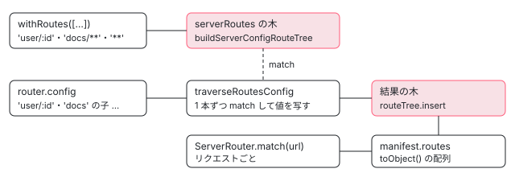

[目次](../README.md) › [SSR のサーバールートの内側：ルートを取り出し、木で照合し、応答を組み立てる](README.md) › 第 3 回 / 全 5 回

# ルートの木：RouteTree の insert と match、serverRoutes の木

> routes/route-tree.ts の RouteTree が、経路を / で分けて 1 段ずつ decode し（53b9623b7b）、:param を \* にして木に入れ、段ごとに完全一致 → \* → \*\* の順で後戻りしながら照合する仕組み（4df97d1923 で insertionIndex の順をやめた）と、manifest に入れる toObject / fromObject。buildServerConfigRouteTree が serverRoutes を木にするときの検査と、route-config.ts の withRoutes・provideServerRendering の残りの行。

angular/angular-cli · 読了 約 13 分 · 発展 · [サイトで読む（デモが動きます）](https://angular-deep-dive-cyan.vercel.app/chapter/srt-route-tree)

---

この章で分かること: @angular/ssr の `RouteTree` が、1 本の経路をどの単位（段）に分け、どう正規化して木に入れ、URL をどの順で照合するのか。照合の優先順が「書いた順」から「段ごとに完全一致 → `*` → `**`」に変わった経緯（4df97d1923）と、段を decode するようにした 53b9623b7b。木を manifest に入れるための `toObject` / `fromObject` と、`serverRoutes` を木にするときの検査、それを渡す `withRoutes`・`provideServerRendering` の残りの行です。

読む対象は angular-cli（44129f66a3）の `packages/angular/ssr/src/routes/route-tree.ts`・`route-config.ts`・`ng-routes.ts` の `buildServerConfigRouteTree` と、`test/routes/route-tree_spec.ts` です。`insert` と `traverseBySegments` の本体、`buildServerConfigRouteTree` の全体、`withRoutes`・`withAppShell` は[サーバールートの章](../platform/05-ssr-server-routes.md)の 2・5・8 節で引用しているので、ここでは繰り返さず、そこで書かなかった行と、本物を動かした結果を読みます。木の値（`renderMode` など）を作る側は[第 1 回](01-srt-extract.md)と[第 2 回](02-srt-prerender-params.md)、木を使う側（`ServerRouter.match` の前処理）は[リダイレクトと URL の照合の章](../ssrx/06-ssrx-redirects.md)です。

1. [1. ルートを取り出す](01-srt-extract.md)
2. [2. プリレンダーのパラメータとリダイレクト](02-srt-prerender-params.md)
3. **3. ルートの木**（この章）
4. [4. manifest と renderAngular](04-srt-manifest-render.md)
5. [5. spec と issue](05-srt-tests-issues.md)

## 0. 木は 2 本ある

`RouteTree` のインスタンスは、ルートを取り出す 1 回のあいだに 2 本作られます。

1. **serverRoutes の木（型の木）**

   `withRoutes([...])` に書いた `ServerRoute` を `buildServerConfigRouteTree` が入れます。`user/:id` や `docs/**` のような「型」の木で、値は `renderMode`・`headers`・`status`・`getPrerenderParams` などです。Router のルート 1 本ずつを、この木の `match` で引きます（[サーバールートの章](../platform/05-ssr-server-routes.md)の 6 節）。
2. **結果の木（URL の木）**

   Router の設定をたどって作った 1 件ずつを `extractRoutesAndCreateRouteTree` が入れます。リクエストのたびに `ServerRouter.match` が引くのはこちらで、ビルド時に作ったなら `toObject()` の配列として manifest の `routes` に入ります（5 節と[第 4 回](04-srt-manifest-render.md)）。

どちらも同じクラスなので、段の分け方・正規化・照合の順は同じです。違うのは入れるもの（`ServerConfigRouteTreeAdditionalMetadata` を足すかどうか）だけです。



*同じ RouteTree を 2 回使う。上の木で Router のルートの値を決め、下の木でリクエストを引く*

## 1. 節点の形

📄 `angular-cli/packages/angular/ssr/src/routes/route-tree.ts` L52–73 （▶ の行: 52, 57, 62, 67, 72）

```ts
52 ▶   route: string;
53 │ 
54 │   /**
55 │    * Optional status code to return for this route.
56 │    */
57 ▶   status?: number;
58 │ 
59 │   /**
60 │    * Optional additional headers to include in the response for this route.
61 │    */
62 ▶   headers?: Record<string, string>;
63 │ 
64 │   /**
65 │    * Specifies the rendering mode used for this route.
66 │    */
67 ▶   renderMode: RenderMode;
68 │ 
69 │   /**
70 │    * A list of resource that should be preloaded by the browser.
71 │    */
72 ▶   preload?: readonly string[];
73 │ }
```

木に入る値（`RouteTreeNodeMetadata`）です。52 行目の `route` は「どの経路の値か」で、57 行目の `status`・62 行目の `headers`・67 行目の `renderMode` が応答の作り方、72 行目の `preload` が `<link rel="modulepreload">` にするチャンクの一覧です。引用の上には `redirectTo` もあり、22.2.7 にはさらに `relativeRedirect`（origin/main の f2cd8c8cf7 で足されたもの）が入っています（下のデモの場面 main の `/old-user` の値）。

📄 `angular-cli/packages/angular/ssr/src/routes/route-tree.ts` L75–105 （▶ の行: 80, 84, 89, 99, 104）

```ts
 75 │ /**
 76 │  * Represents a node within the route tree structure.
 77 │  * Each node corresponds to a route segment and may have associated metadata and child nodes.
 78 │  * The `AdditionalMetadata` type parameter allows for extending the node metadata with custom data.
 79 │  */
 80 ▶ interface RouteTreeNode<AdditionalMetadata extends Record<string, unknown>> {
 81 │   /**
 82 │    * A map of child nodes, keyed by their corresponding route segment or wildcard.
 83 │    */
 84 ▶   children: Map<string, RouteTreeNode<AdditionalMetadata>>;
 85 │ 
 86 │   /**
 87 │    * Optional metadata associated with this node, providing additional information such as redirects.
 88 │    */
 89 ▶   metadata?: RouteTreeNodeMetadata & AdditionalMetadata;
 90 │ }
 91 │ 
 92 │ /**
 93 │  * A route tree implementation that supports efficient route matching, including support for wildcard routes.
 94 │  * This structure is useful for organizing and retrieving routes in a hierarchical manner,
 95 │  * enabling complex routing scenarios with nested paths.
 96 │  *
 97 │  * @typeParam AdditionalMetadata - Type of additional metadata that can be associated with route nodes.
 98 │  */
 99 ▶ export class RouteTree<AdditionalMetadata extends Record<string, unknown> = {}> {
100 │   /**
101 │    * The root node of the route tree.
102 │    * All routes are stored and accessed relative to this root node.
103 │    */
104 ▶   private readonly root = this.createEmptyRouteTreeNode();
105 │ 
```

📄 `angular-cli/packages/angular/ssr/src/routes/route-tree.ts` L264–275 （▶ の行: 270, 272）

```ts
264 │   /**
265 │    * Creates an empty route tree node.
266 │    * This helper function is used during the tree construction.
267 │    *
268 │    * @returns A new, empty route tree node.
269 │    */
270 ▶   private createEmptyRouteTreeNode(): RouteTreeNode<AdditionalMetadata> {
271 │     return {
272 ▶       children: new Map(),
273 │     };
274 │   }
275 │ }
```

節点（80 行目の `RouteTreeNode`）が持つのは 2 つだけです。84 行目の `children` は「段の文字列 → 子の節点」の `Map` で、キーは実際の段の文字（`user`）か、`*` か、`**` です。89 行目の `metadata` は、その節点で終わる経路があるときだけ入ります。途中の段の節点（`/user/*/posts/*` の `posts`）は値を持ちません。

99 行目の型引数 `AdditionalMetadata` は、0 節の 1 本目の木が `getPrerenderParams` などを足すための口です。104 行目の根も 270〜274 行目の空の節点で、`Map` は挿入の順を覚えるので、5 節の `toObject` の順は「どの経路を先に入れたか」で決まります。

## 2. 段に分ける：split・filter・decode の順

📄 `angular-cli/packages/angular/ssr/src/routes/route-tree.ts` L205–211 （▶ の行: 209–210）

```ts
205 │    *
206 │    * @param route - The route string from which to extract segments.
207 │    * @returns An array of path segments.
208 │    */
209 ▶   private getPathSegments(route: string): string[] {
210 ▶     return route.split('/').filter(Boolean).map(decodeURIComponent);
211 │   }
```

📄 `angular-cli/packages/angular/ssr/src/routes/route-tree.ts` L119–125 （▶ の行: 119, 121–122, 125）

```ts
119 ▶     for (const segment of segments) {
120 │       // Replace parameterized segments (e.g., :id) with a wildcard (*) for matching
121 ▶       const normalizedSegment = segment[0] === ':' ? '*' : segment;
122 ▶       let childNode = node.children.get(normalizedSegment);
123 │       if (!childNode) {
124 │         childNode = this.createEmptyRouteTreeNode();
125 ▶         node.children.set(normalizedSegment, childNode);
```

1. **210 行目の split('/') と filter(Boolean)**

   空の段を捨てるので、`/foo/` と `/foo`、`//home` と `/home` は同じ段の並びになります（route-tree\_spec.ts 257 行目の it が `/foo/` で確かめています）。
2. **210 行目の map(decodeURIComponent)**

   分けたあとに 1 段ずつ decode します。だから `%2F` は decode されて `/` になっても段の区切りにはならず、`/user/Bob%20%2F%20Roberts` は `['user', 'Bob / Roberts']` の 2 段です。decode は `insert` でも `match` でも同じこの関数を通ります。
3. **121 行目の :x → \***

   decode のあとに 1 文字目を見るので、`%3Aid` と書いた段も `:id` になってから `*` になります（記録：`/tag/%3Aid` を入れると `toObject` は `/tag/*`）。`**` は置き換えず、そのままの文字列がキーです。
4. **122〜125 行目、無ければ子を作る**

   同じ段の並びを 2 回入れると、2 回目の値が最後の節点の `metadata` を上書きします（同じ URL が 2 回出たときに最初の 1 件を残すのは、木ではなく取り出す側の `getRoutesFromAngularRouterConfig` で、[サーバールートの章](../platform/05-ssr-server-routes.md)の 4 節）。

📄 `git show 53b9623b7b`

```
$ git show 53b9623b7b   # 2026-04-27「decode route segments when building and matching route tree」Fixes #33044（抜粋）
--- a/packages/angular/ssr/src/routes/route-tree.ts
   private getPathSegments(route: string): string[] {
-    return route.split('/').filter(Boolean);
+    return route.split('/').filter(Boolean).map(decodeURIComponent);
   }
--- a/packages/angular/ssr/src/routes/router.ts
     let { pathname } = stripIndexHtmlFromURL(url);
     pathname = stripMatrixParams(pathname);
-    pathname = decodeURIComponent(pathname);

     return this.routeTree.match(pathname);
+++ b/packages/angular/ssr/test/routes/router_spec.ts
+    it('should handle encoded params', () => {
+      const encodedUserMetadata = router.match(
+        new URL('http://localhost/user/Bob%20%2F%20Roberts'),
+      );
+      expect(encodedUserMetadata).toEqual({ route: '/user/*', renderMode: RenderMode.Server });
```

53b9623b7b の前は、`router.ts` が pathname をまるごと decode してから木を引いていました。`%2F` が先に `/` になるので `Bob%20%2F%20Roberts` は 3 段に割れ、`/user/*` に当たらず 404 でした（#33044）。直したあとは、分けてから decode するので段の数が変わりません。ただし[第 5 回](05-srt-tests-issues.md)の表のとおり、このコミットが足した it は、decode を外しても通ります（decode しない `Bob%20%2F%20Roberts` も 1 段のまま `*` に当たるため）。decode が要るのは、木の側の段が decode された文字（非 ASCII や空白）で、URL の側が % で書かれているときです。

> [!WARNING]
> **ハマりどころ**
>
> decode は失敗すると投げます。リクエストの側では、`/user/%E0%A4%A` の照合が `URIError: URI malformed` になることが[SSR の守りのシリーズの最終回](../ssrx/10-ssrx-tests-issues.md)で見つかっています（下の記録の最後の URL）。木を作る側でも同じで、Router の path に `50%-off` のような % をそのまま書くと、`insert` が `URIError: URI malformed` を投げます（記録）。

## 3. 照合の順：完全一致 → \* → \*\*、そして後戻り

照合の本体 `traverseBySegments`（227〜262 行目）の 1 行ずつは[サーバールートの章](../platform/05-ssr-server-routes.md)の 8 節にあります。ここでは、その上に残っている 2 つのコメントを並べます。

📄 `angular-cli/packages/angular/ssr/src/routes/route-tree.ts` L139–145 （▶ の行: 141–143）

```ts
139 │   /**
140 │    * Matches a given route against the route tree and returns the best matching route's metadata.
141 ▶    * The best match is determined by the lowest insertion index, meaning the earliest defined route
142 ▶    * takes precedence.
143 ▶    *
144 │    * @param route - The route path to match against the route tree.
145 │    * @returns The metadata of the best matching route or `undefined` if no match is found.
```

📄 `angular-cli/packages/angular/ssr/src/routes/route-tree.ts` L213–226 （▶ の行: 217–218）

```ts
213 │   /**
214 │    * Recursively traverses the route tree from a given node, attempting to match the remaining route segments.
215 │    * If the node is a leaf node (no more segments to match) and contains metadata, the node is yielded.
216 │    *
217 ▶    * This function prioritizes exact segment matches first, followed by wildcard matches (`*`),
218 ▶    * and finally deep wildcard matches (`**`) that consume all segments.
219 │    *
220 │    * @param segments - The array of route path segments to match against the route tree.
221 │    * @param node - The current node in the route tree to start traversal from. Defaults to the root node.
222 │    * @param currentIndex - The index of the segment in `remainingSegments` currently being matched.
223 │    * Defaults to `0` (the first segment).
224 │    *
225 │    * @returns The node that best matches the remaining segments or `undefined` if no match is found.
226 │    */
```

141〜143 行目の `match` のコメントは「挿入の番号がいちばん小さいもの（先に書いたもの）が勝つ」と言い、217〜218 行目の `traverseBySegments` のコメントは「完全一致、次に `*`、最後に `**`」と言います。今のコードは後者です。前者は、次の 4df97d1923 で消えた `insertionIndex` の説明が残ったものです。

📄 `git show 4df97d1923`

```
$ git show 4df97d1923 -- …/routes/route-tree.ts   # 2025-01-24「enhance dynamic route matching」Closes #29452（抜粋）
 interface RouteTreeNode<AdditionalMetadata extends Record<string, unknown>> {
-  insertionIndex: number;
 ...
-  private insertionIndexCounter = 0;
 ...
-    node.insertionIndex = this.insertionIndexCounter++;
 ...
-    // 1. Exact segment match
-    const exactMatchNode = node.children.get(segment);
-    currentBestMatchNode = this.getHigherPriorityNode(
-      currentBestMatchNode,
-      this.traverseBySegments(restSegments, exactMatchNode),
-    );
-    // 2. Wildcard segment match (`*`)
-    ...（* と ** も同じく候補にして）
-    return currentBestMatchNode;      // insertionIndex が小さいほうを返す
+    // 1. Attempt exact match with the current segment.
+    const exactMatch = node.children.get(segment);
+    if (exactMatch) {
+      const match = this.traverseBySegments(segments, exactMatch, currentIndex + 1);
+      if (match) {
+        return match;
+      }
+    }
+    ...（* が続き、最後に ** を返す）
```

4df97d1923 の前は、各段で完全一致・`*`・`**` の 3 つを全部たどり、当たった候補のうち `insertionIndex` の小さいほうを選んでいました。#29452（`:seoAlias/:category/:offerId` のように先頭が `:param` の経路があると、ほかのルートが壊れる）を受けて、「各段で近いものを先に試し、当たったら返す」に変えました。全部の枝をたどらないので速く、`/blog/article` は `/blog/*` を先に書いても `/blog/article` に当たります（route-tree\_spec.ts 209 行目の it）。

1. **後戻りがある**

   完全一致の枝を最後までたどって外れたら、同じ段に戻って `*` を試し、それも外れたら `**` です。`/user/*/posts/*` と `/**` がある木で `/user/42/posts` を引くと、`posts` の節点には値が無いので外れ、根まで戻って `/**` に当たります（デモの 5 つめの URL）。
2. **Router の「上から順」とは違う**

   Angular の Router は、設定の配列を上から順に当てて最初に当たったものを使います。木は段ごとに完全一致を先に試すので、Router に `user/:id` を `user/new` より先に書くと、2 つの答えが分かれます。

下の記録は、`user/:id` を先に書いた Router の設定（デモと同じ）に、次の `serverRoutes` を付けて、本物の `ɵgetOrCreateAngularServerApp().handle` で描画したものです。

📄 `serverRoutes（記録 order）`

```
[
  { path: 'user/new', renderMode: RenderMode.Server, headers: { 'X-Server-Route': 'user/new' } },
  { path: 'user/:id', renderMode: RenderMode.Server, headers: { 'X-Server-Route': 'user/:id' } },
  { path: '**', renderMode: RenderMode.Server, headers: { 'X-Server-Route': '**' } },
]
```

| URL | status | 応答の X-Server-Route（木が選んだ serverRoute） | 本文で描かれた部品（Router が選んだルート） |
| --- | --- | --- | --- |
| /user/new | 200 | user/new | &lt;x-userdetail&gt;UserDetail&lt;/x-userdetail&gt; |
| /user/42 | 200 | user/:id | &lt;x-userdetail&gt;UserDetail&lt;/x-userdetail&gt; |

`/user/new` の応答は、ヘッダー（と `renderMode`・`status`）を `user/new` の serverRoute から取り、本文は Router が選んだ `UserDetail` です。取り出しの段階では、Router の `user/new` のルートも 1 件として木に入るのでエラーにはなりません（`user/new` の部品はどの URL でも描かれません）。「ヘッダーなどの値と、描かれるルートが別になる」という同じ種類の食い違いは、URL の文字の読み方の違い（`;`・`(`・`//`）について #33555 が開いていて、PR #34091 も開いています。並びの順による食い違いは、その issue には書かれていません。

> **🧪 DEMO — 本物の 22.2.7 の木と、ページの上の写しで、同じ URL を照合する**
>
> 記録：`<work>/srt-demo/b/tree/record.mjs` が、@angular/ssr 22.2.7（@angular/core・router 22.2.6、Node v24.22.1）の `ɵextractRoutesAndCreateRouteTree` を呼んで作った木の `toObject()` と、URL ごとの `routeTree.match(pathname)` の答えです。写し：`srt-route-tree.demo-tree.ts` は route-tree.ts の 114〜137・147〜151・161〜201・209〜211・227〜262 行目を写したもので、各段で何を試したかを書き足しただけです。記録の `toObject()` をそのまま `fromObject` で入れています。行番号は元の route-tree.ts のもので、その行は[サーバールートの章](../platform/05-ssr-server-routes.md)の 8 節の引用にあります。
>
> Router の設定（どの場面も、star 以外はこれ）
>
> 取り出しの errors：  なし
>
> 結果の木（記録の toObject を写しの fromObject で入れ直した形。赤が値のある節点）
>
> この場面の URL 全部：10 件中 10 件が一致
>
> ▶ [このデモはサイトで動かせます](https://angular-deep-dive-cyan.vercel.app/chapter/srt-route-tree)

記録から読めることです。`/user/new` は `Client`（`user/new` の完全一致）、`/user/42` は `Server`（`*`）、`/docs` は `docs/**` の serverRoute が Router の `docs` の子 `''` に当たった結果の `/docs`（Prerender）です。`/docs/intro/deep` は、結果の木に `docs/**` が無い（Router に `**` の子が無いので、結果の木は `/docs` と `/docs/intro` だけ）ので、根の `/**`（Server、404）に戻ります。serverRoutes の木では当たる型でも、結果の木には Router にある経路しか入りません。

## 4. 照合の前と後ろ

リクエストの URL は、木に届く前に `ServerRouter.match` が `/index.html` を外し、`;a=1` のような行列パラメータを消します（[リダイレクトと URL の照合の章](../ssrx/06-ssrx-redirects.md)）。その後ろで `redirectTo` の `*` を実際の段で埋めるのも、木ではなく `app.ts` の側です。木が答えるのは「どの節点の値か」だけで、`*` に当たった値が何だったか（`42`）は返しません。1 節の値の型にも、段の値を入れる場所はありません。

## 5. toObject と fromObject：manifest に入れる形

📄 `angular-cli/packages/angular/ssr/src/routes/route-tree.ts` L153–183 （▶ の行: 161–162, 175, 178–179）

```ts
153 │   /**
154 │    * Converts the route tree into a serialized format representation.
155 │    * This method converts the route tree into an array of metadata objects that describe the structure of the tree.
156 │    * The array represents the routes in a nested manner where each entry includes the route and its associated metadata.
157 │    *
158 │    * @returns An array of `RouteTreeNodeMetadata` objects representing the route tree structure.
159 │    *          Each object includes the `route` and associated metadata of a route.
160 │    */
161 ▶   toObject(): SerializableRouteTreeNode {
162 ▶     return Array.from(this.traverse());
163 │   }
164 │ 
165 │   /**
166 │    * Constructs a `RouteTree` from an object representation.
167 │    * This method is used to recreate a `RouteTree` instance from an array of metadata objects.
168 │    * The array should be in the format produced by `toObject`, allowing for the reconstruction of the route tree
169 │    * with the same routes and metadata.
170 │    *
171 │    * @param value - An array of `RouteTreeNodeMetadata` objects that represent the serialized format of the route tree.
172 │    *                Each object should include a `route` and its associated metadata.
173 │    * @returns A new `RouteTree` instance constructed from the provided metadata objects.
174 │    */
175 ▶   static fromObject(value: SerializableRouteTreeNode): RouteTree {
176 │     const tree = new RouteTree();
177 │ 
178 ▶     for (const { route, ...metadata } of value) {
179 ▶       tree.insert(route, metadata);
180 │     }
181 │ 
182 │     return tree;
183 │   }
```

📄 `angular-cli/packages/angular/ssr/src/routes/route-tree.ts` L185–201 （▶ の行: 194–195, 198–199）

```ts
185 │   /**
186 │    * A generator function that recursively traverses the route tree and yields the metadata of each node.
187 │    * This allows for easy and efficient iteration over all nodes in the tree.
188 │    *
189 │    * @param node - The current node to start the traversal from. Defaults to the root node of the tree.
190 │    */
191 │   *traverse(
192 │     node: RouteTreeNode<AdditionalMetadata> = this.root,
193 │   ): Generator<RouteTreeNodeMetadata & AdditionalMetadata> {
194 ▶     if (node.metadata) {
195 ▶       yield node.metadata;
196 │     }
197 │ 
198 ▶     for (const childNode of node.children.values()) {
199 ▶       yield* this.traverse(childNode);
200 │     }
201 │   }
```

162 行目の `toObject` は、191 行目の generator が出す値を配列にするだけです。194〜195 行目で自分の値を先に、198〜199 行目で子を `Map` の順に、という前順（親が先）です。木の形（どの段の下にどの子がいるか）は書き出さず、各値の `route` に正規化した経路が入っているので、175〜181 行目の `fromObject` は 1 件ずつ `insert` し直すだけで同じ形に戻せます。

1. **順は Map の挿入の順**

   デモの main の `toObject` は `/`・`/user/*`・`/user/*/posts/*`・`/user/new`・`/docs`… の順です。`/user/new` が `/user/*/posts/*` のあとなのは、`user` の節点の子として `*` が先に作られ、その下を全部出してから `new` に移るからです。この順を逆にすると、ng-routes\_spec.ts の `toObject()` の配列と比べる 8 件が落ちます（[第 5 回](05-srt-tests-issues.md)）。
2. **書くのはビルド**

   `@angular/build` の `utils/server-rendering/routes-extractor-worker.ts` 52 行目が `routeTree.toObject()` を返し、`outputMode: "server"` のときに manifest の `routes` に JSON として書かれます（[第 4 回](04-srt-manifest-render.md)）。読むのは `ServerRouter.from` の `RouteTree.fromObject` です。

ただし、`insert` し直すたびに 2 節の decode がもう 1 回かかります。`%25`（`%` そのもの）を含む経路を入れて、`toObject` → `fromObject` を 1 往復させた記録です。

| insert した経路 | /sale/50%2525-off |
| --- | --- |
| 1 本目の toObject | /sale/50%25-off |
| fromObject で作り直した木の toObject | /sale/50%-off |
| 1 本目で match('/sale/50%2525-off') | route: /sale/50%25-off、renderMode: Server |
| 作り直した木で同じ match | undefined（当たらない） |

1 本目の木（取り出した直後の、メモリの上の木）では当たる URL が、manifest から作り直した木では当たりません。`route` に decode 済みの文字を入れ、`fromObject` がそれをまた decode するからです。Router の path に `%` を書くことはまれで、`%` が 1 つだけなら 2 節のとおり取り出しの時点で投げるので、ここまで来るのは `%25` のように decode できる並びを書いたときだけです。

## 6. serverRoutes を木にするときの検査

`buildServerConfigRouteTree` の全体（App Shell を先頭に足す・先頭の `/` を弾く・`insert`）は[サーバールートの章](../platform/05-ssr-server-routes.md)の 5 節です。ここでは 2 つめの検査だけを見ます。

📄 `angular-cli/packages/angular/ssr/src/routes/ng-routes.ts` L587–593 （▶ の行: 589, 591）

```ts
587 │     }
588 │ 
589 ▶     if ('getPrerenderParams' in metadata && (path.includes('/*/') || path.endsWith('/*'))) {
590 │       errors.push(
591 ▶         `Invalid '${path}' route configuration: 'getPrerenderParams' cannot be used with a '*' route.`,
592 │       );
593 │       continue;
```

📄 `git show 8bfcae4c1b`

```
$ git show 8bfcae4c1b -- …/routes/ng-routes.ts   # 2025-04-23「support getPrerenderParams for wildcard routes」Closes #30035（抜粋）
-    if (path.includes('*') && 'getPrerenderParams' in metadata) {
+    if ('getPrerenderParams' in metadata && (path.includes('/*/') || path.endsWith('/*'))) {
       errors.push(
-        `Invalid '${path}' route configuration: 'getPrerenderParams' cannot be used with a '*' or '**' route.`,
+        `Invalid '${path}' route configuration: 'getPrerenderParams' cannot be used with a '*' route.`,
       );
```

589 行目は「`getPrerenderParams` を持つ serverRoute の path に、1 段の `*` があればエラー」のつもりの条件です。`*` の段はどの値で埋めるかの名前を持たないからです。8bfcae4c1b の前は `path.includes('*')` で、`**` も弾いていました。`**` を許すために「`/*/` を含むか、`/*` で終わるか」にしたので、先頭の段の `*`（`'*'` だけの path や `'*/posts'`）がこの検査を通ります。

| 場面（デモと同じ記録） | serverRoutes | errors | 結果の木 |
| --- | --- | --- | --- |
| 木を作る前のエラー（先頭の /、\* と getPrerenderParams） | `[ { path: '/user/:id', renderMode: RenderMode.Server }, { path: 'user/*', renderMode: RenderMode.Prerender, getPrerenderParams: async () => [] }, { path: '**', renderMode: RenderMode.Server },]` | Invalid '/user/:id' route configuration: the path cannot start with a slash.<br>Invalid 'user/\*' route configuration: 'getPrerenderParams' cannot be used with a '\*' route. | （空） |
| 照合のあとのエラー（使われない・リダイレクトに 404） | `[ { path: 'admin', renderMode: RenderMode.Server }, { path: 'post/:slug', renderMode: RenderMode.Server }, { path: 'user/:id', renderMode: RenderMode.Server }, { path: '**', renderMode: RenderMode.Server, status: 404 },]` | The '404' status code is not a valid redirect response code. Please use one of the following redirect response codes: 301, 302, 303, 307, 308.<br>The 'admin' server route does not match any routes defined in the Angular routing configuration (typically provided as a part of the 'provideRouter' call). Please make sure that the mentioned server route is present in the Angular routing configuration.<br>The 'post/\*' server route does not match any routes defined in the Angular routing configuration (typically provided as a part of the 'provideRouter' call). Please make sure that the mentioned server route is present in the Angular routing configuration. | /（Server）<br>/user/\*（Server）<br>/user/\*/posts/\*（Server）<br>/user/new（Server）<br>/docs（Server）<br>/docs/intro（Server）<br>/\*\*（Server） |
| 先頭の '\*' と getPrerenderParams（invokeGetPrerenderParams: true） | `[ { path: '*', renderMode: RenderMode.Prerender, getPrerenderParams: async () => [{ slug: 'ann' }, { slug: 'bob' }] }, { path: '**', renderMode: RenderMode.Server },]` | なし | /ann（Prerender）<br>/bob（Prerender）<br>/\*（Server）<br>/\*\*（Server） |

1. **bad**

   `user/*` は 589 行目で弾かれます。木を作る前のエラーがあると、Router をたどらずに空の結果で返ります（[サーバールートの章](../platform/05-ssr-server-routes.md)の `getRoutesFromAngularRouterConfig` の続きの行。errors が 1 つでもあれば `routes: []`）。
2. **unused**

   使われない `admin` と `post/:slug` は、Router をたどったあとの逆向きの検査で見つかります。この検査は serverRoutes の木を 5 節の `traverse()` で回して値の `route` を読むので、メッセージには書いた `post/:slug` ではなく、121 行目で正規化した `post/*` が出ます。`old-user` の `redirectTo` が `**` の `status: 404` を受け継いで「リダイレクトの status ではない」と言われるのも、照合で値を写したあとの検査です（同じ形の #29961 は「エラーは正しい。そのルートを serverRoutes に書く」という回答で閉じています）。どちらも木は作られますが、`ServerRouter.from` は errors があれば例外にします。
3. **star**

   `'*'` と `getPrerenderParams` の組は通り、`:slug` を `ann`・`bob` で埋めた 2 件と、作らなかった値のための `/*`（Server）ができました。同じことを `p/*` と書くと bad と同じエラーです。段の位置で結果が変わるのは、589 行目の文字列の比べ方のためです。

## 7. withRoutes と provideServerRendering の残り

📄 `angular-cli/packages/angular/ssr/src/routes/route-config.ts` L21–43 （▶ の行: 25, 31–33, 41–42）

```ts
21 │ /**
22 │  * The internal path used for the app shell route.
23 │  * @internal
24 │  */
25 ▶ const APP_SHELL_ROUTE = 'ng-app-shell';
26 │ 
27 │ /**
28 │  * Identifies a particular kind of `ServerRenderingFeatureKind`.
29 │  * @see {@link ServerRenderingFeature}
30 │  */
31 ▶ enum ServerRenderingFeatureKind {
32 ▶   AppShell,
33 ▶   ServerRoutes,
34 │ }
35 │ 
36 │ /**
37 │  * Helper type to represent a server routes feature.
38 │  * @see {@link ServerRenderingFeatureKind}
39 │  */
40 │ interface ServerRenderingFeature<FeatureKind extends ServerRenderingFeatureKind> {
41 ▶   ɵkind: FeatureKind;
42 ▶   ɵproviders: (Provider | EnvironmentProviders)[];
43 │ }
```

📄 `angular-cli/packages/angular/ssr/src/routes/route-config.ts` L474–486 （▶ の行: 478, 483, 485）

```ts
474 │ 
475 │ /**
476 │  * Checks if the first element of args is a `ServerRenderingOptions` object.
477 │  */
478 ▶ function hasOptions(
479 │   args:
480 │     | ServerRenderingFeature<ServerRenderingFeatureKind>[]
481 │     | [ServerRenderingOptions, ...ServerRenderingFeature<ServerRenderingFeatureKind>[]],
482 │ ): args is [ServerRenderingOptions, ...ServerRenderingFeature<ServerRenderingFeatureKind>[]] {
483 ▶   const value = args[0];
484 │ 
485 ▶   return !!value && typeof value === 'object' && !('ɵkind' in value);
486 │ }
```

`withRoutes` と `withAppShell` が返すのは、41 行目の `ɵkind`（31〜34 行目の enum の数値）と 42 行目の `ɵproviders` だけのオブジェクトです。25 行目の `ng-app-shell` が App Shell の Router のルートの path になります（足す行は[サーバールートの章](../platform/05-ssr-server-routes.md)の 2 節）。`provideServerRendering` は、最初の引数が「オブジェクトで `ɵkind` を持たない」なら 485 行目でそれを `ServerRenderingOptions`（`maxResponseBodySize`）とみなし、残りを features として積みます。積む行とエラーの行は[platformServer の章](../platform/03-ssr-platform-server.md)にあります。

📄 `angular-cli/packages/angular/ssr/src/routes/route-config.ts` L141–177 （▶ の行: 145, 156, 166）

````ts
141 │   /**
142 │    * A function that returns a Promise resolving to an array of objects, each representing a route path with URL parameters.
143 │    * This function runs in the injector context, allowing access to Angular services and dependencies.
144 │    *
145 ▶    * It also works for catch-all routes (e.g., `/**`), where the parameter name will be `**` and the return value will be
146 │    * the segments of the path, such as `/foo/bar`. These routes can also be combined, e.g., `/product/:id/**`,
147 │    * where both a parameterized segment (`:id`) and a catch-all segment (`**`) can be used together to handle more complex paths.
148 │    *
149 │    * @returns A Promise resolving to an array where each element is an object with string keys (representing URL parameter names)
150 │    * and string values (representing the corresponding values for those parameters in the route path).
151 │    *
152 │    * @example
153 │    * ```typescript
154 │    * export const serverRouteConfig: ServerRoutes[] = [
155 │    *   {
156 ▶    *     path: '/product/:id',
157 │    *     renderMode: RenderMode.Prerender,
158 │    *     async getPrerenderParams() {
159 │    *       const productService = inject(ProductService);
160 │    *       const ids = await productService.getIds(); // Assuming this returns ['1', '2', '3']
161 │    *
162 │    *       return ids.map(id => ({ id })); // Generates paths like: ['product/1', 'product/2', 'product/3']
163 │    *     },
164 │    *   },
165 │    *   {
166 ▶    *     path: '/product/:id/**',
167 │    *     renderMode: RenderMode.Prerender,
168 │    *     async getPrerenderParams() {
169 │    *       return [
170 │    *         { id: '1', '**': 'laptop/3' },
171 │    *         { id: '2', '**': 'laptop/4' }
172 │    *       ]; // Generates paths like: ['product/1/laptop/3', 'product/2/laptop/4']
173 │    *     },
174 │    *   },
175 │    * ];
176 │    * ```
177 │    */
````

`getPrerenderParams` の JSDoc です。145 行目のとおり `**` の値は `'**'` という名前で返します。ただし 156・166 行目の例は path が `/` で始まっていて、そのまま書くと `buildServerConfigRouteTree` の先頭の `/` の検査（[サーバールートの章](../platform/05-ssr-server-routes.md)の 5 節）で弾かれます（記録の bad の 1 つめのエラーと同じ）。

## 呼び出しの連なり

- 👤 `provideServerRendering(withRoutes(serverRoutes))` — route-config.ts L437 — *485 行目で options かを見分ける*
  - `getRoutesFromAngularRouterConfig(...)` — ng-routes.ts L621 — *アプリを起動して SERVER\_ROUTES\_CONFIG を取る*
    - `buildServerConfigRouteTree({ routes, appShellRoute })` — ng-routes.ts L567 — *589 行目の \* の検査*
      - `serverConfigRouteTree.insert(path, metadata)` — route-tree.ts L114 — *210 行目で分けて decode、121 行目で :x → \**
    - `traverseRoutesConfig → serverConfigRouteTree.match(currentRoutePath)` — ng-routes.ts L324 — *Router のルート 1 本ずつ*
  - `routeTree.insert(baseHref + route, metadata)` — ng-routes.ts L843 — *結果の木*
  - `routeTree.toObject()` — route-tree.ts L161 — *ビルドが manifest.routes に書く*
- `ServerRouter.from → RouteTree.fromObject(manifest.routes)` — route-tree.ts L175 — *insert をやり直す（decode がもう 1 回）*
  - `ServerRouter.match(url) → routeTree.match(pathname)` — route-tree.ts L147 — *完全一致 → \* → \*\*、後戻りあり*

## テストと直し方

木の spec は `test/routes/route-tree_spec.ts` の 18 件で、`describe('RouteTree')`（12 行目）の中に `toObject and fromObject`（19 行目、4 件）と `match`（123 行目、14 件）があります。完全一致が勝つことは 209 行目の it、`**` の扱いは 157・180・281 行目の it、末尾の / は 257 行目の it が固めています。decode は `router_spec.ts` の 123・131 行目の it、serverRoutes の検査は `ng-routes_spec.ts` の 70・85 行目の it です。

📄 `走らせ方`

```
# ../angular-cli-fix（44129f66a3）。test/ の下の spec を 1 つに束ねた jasmine_test（flaky = True）
pnpm bazel test //packages/angular/ssr/test:test --nocache_test_results --test_output=all
# 名前で絞る（0 件でも PASSED になるので「Ran N of 249 specs」を見る）
pnpm bazel test //packages/angular/ssr/test:test --nocache_test_results --test_output=all '--test_arg=--filter=^RouteTree '
# 作業木（44129f66a3）で 1 か所ずつ書き換えて走らせ、git checkout で戻す
python3 <work>/srt-demo/b/mut/mutate.py <work>/srt-wt-b
```

📄 `自分で走らせた結果（2026-11-18）`

```
249 specs, 0 failures          # 絞らない。Finished in 0.337 seconds
Ran 18 of 249 specs            # --filter=^RouteTree （route-tree_spec.ts の 18 件）
//packages/angular/ssr/test:test   PASSED
```

作業木で 1 か所ずつ書き換えて全部（249 件）を走らせた結果です。どれも走らせたあと `git checkout` で戻し、`git status --short` が空であることを確かめました。

| どこ | 変えたこと | 結果 |
| --- | --- | --- |
| route-tree.ts 210 | map(decodeURIComponent) を外す（53b9623b7b の前） | 6 failures。非 ASCII のプリレンダーの 5 件と router\_spec の「should handle encoded URLs」。53b9623b7b が足した「should handle encoded params」は通る |
| route-tree.ts 121 | :x を \* にしない | 18 failures（route-tree\_spec の toObject・match、router\_spec の from など） |
| route-tree.ts 233 | 区切りを使い切ったとき \*\* の子を見ない | 24 failures（app-engine\_spec のロケールの 14 件、route-tree\_spec 281 行目の /de/\*\*、ng-routes\_spec の 9 件。どれも「\*\* で終わる型が、その手前の経路自体にも当たる」ことに頼っている） |
| route-tree.ts 245〜248 | 完全一致の枝が外れても \* と \*\* に戻らない | 0 failures |
| route-tree.ts 254〜257 | \* の枝が外れても \*\* に戻らない | 3 failures（route-tree\_spec 157・180 行目の it、ng-routes\_spec 331 行目の it） |
| route-tree.ts 236〜238 | 子が無いときの早い return を消す | 0 failures（答えは変わらない） |
| route-tree.ts 194〜200 | traverse を「子が先、自分があと」にする | 8 failures（ng-routes\_spec で routeTree.toObject() の配列を順まで比べる it） |
| ng-routes.ts 589 | \* と getPrerenderParams の検査を消す | 1 failure（ng-routes\_spec 85 行目の it） |
| ng-routes.ts 589 | 検査を path.split('/').includes('\*') にする | 0 failures |
| route-config.ts 485 | hasOptions をいつも false | 0 failures |

- **後戻り**：完全一致の枝から戻らなくしても、どの spec も落ちません。直すなら `route-tree_spec.ts` の `describe('match')` に「`/a/b` と `/*/c` を入れて `/a/c` が `/*/c` に当たる」it を足すと、245〜248 行目の `if (match)` を固められます。
- **decode**：53b9623b7b の it は decode が無くても通ります。木に `/a b` を入れて `/a%20b` を引く it なら、210 行目の `map(decodeURIComponent)` を外したときに落ちます。
- **\* の検査**：`ng-routes.ts` の `buildServerConfigRouteTree`、589 行目の条件を「段に分けて `*` を含むか」にすると、先頭の `*` も弾けて、今の 249 件はそのまま通りました。`ng-routes_spec.ts` の 85 行目の it の隣に、path が `'*'` の場合の it を足します。
- **コメント**：141〜143 行目の `match` の JSDoc は、4df97d1923 のあとの動きと違います。

## 聞かれそうな質問

**Q. `product/:id` と `product/new` は、どちらを先に書けばいいですか？**

serverRoutes の木では順は関係なく、段ごとに完全一致が先です（217〜218 行目のコメントどおり。4df97d1923 で変わった）。ただし Router は上から順なので、Router の配列では `product/new` を先に書かないと、3 節の記録のように「ヘッダーは new、本文は :id」になります。

**Q. `:id` と `:slug` を同じ段に書くとどうなりますか？**

121 行目でどちらも `*` になるので、同じ節点です。あとから入れたほうの値が残ります。名前は木に残らず、値の `route` も `/product/*` です。

**Q. URL の `%2F` は区切りになりますか？**

なりません。210 行目は `/` で分けてから 1 段ずつ decode します（53b9623b7b）。`%2F` を含む値は `*` の 1 段で受けます。壊れた `%` の並びは decode が投げます。

**Q. manifest の `routes` には木の形が入っているのですか？**

入っていません。162 行目の `toObject` は値の配列（前順、194〜199 行目）で、各値の `route` が正規化した経路です。`fromObject` は 179 行目で 1 件ずつ `insert` し直して木を作ります。そのため decode がもう 1 回かかります（5 節）。

**Q. `getPrerenderParams` は `*` の serverRoute に書けますか？**

書けない、が 589 行目の意図です（`user/*` はエラー）。ただし先頭の段の `*` はこの条件を通り、6 節の記録のとおり値で埋めた経路ができます。`**` は 8bfcae4c1b から書けます（値の名前は `'**'`、145 行目）。

## 読み終えて

- RouteTree の節点は「段 → 子」の Map と、そこで終わる経路の値だけ。`:x` は `*`、`**` はそのままのキー。
- 段は `/` で分け、空の段を捨て、1 段ずつ decode する（53b9623b7b）。decode は insert でも match でも、fromObject のやり直しでもかかる。
- 照合は段ごとに完全一致 → `*` → `**`、外れたら戻る。書いた順で選ぶ `insertionIndex` は 4df97d1923 で消え、コメントだけ残っている。Router の「上から順」とは違う。
- `toObject` は前順の値の配列、`fromObject` は insert のやり直し。これが manifest の `routes`。
- serverRoutes の検査は文字列の比べ方なので、先頭の段の `*` と `getPrerenderParams` の組は通る。後戻りと decode には、外しても落ちない spec の穴がある。

---

← 前: [プリレンダーのパラメータとリダイレクト：:id を値で埋める](02-srt-prerender-params.md)  
次: [manifest と renderAngular：ビルドの出力とサーバーの起動をつなぐ](04-srt-manifest-render.md) →
