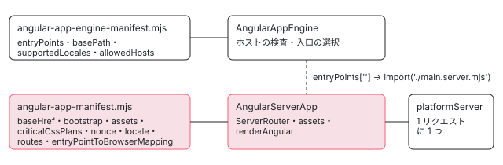

[目次](../README.md) › [SSR のサーバールートの内側：ルートを取り出し、木で照合し、応答を組み立てる](README.md) › 第 4 回 / 全 5 回

# manifest と renderAngular：ビルドの出力とサーバーの起動をつなぐ

> manifest.ts の AngularAppManifest と AngularAppEngineManifest に何が入り、ビルドがどう書き、サーバーがいつ読むか。utils/ng.ts の renderAngular が 1 リクエストに 1 つのプラットフォームを作り、失敗・リダイレクト・ストリームの取り消し・接続の切断のどこからでも 1 回だけ壊す行と、それを直した fd1a2091d2・6a3446770a・origin/main の 47bc9c3969（22.2.7 と 22.1.7 で比べた記録）。

angular/angular-cli · 読了 約 13 分 · 発展 · [サイトで読む（デモが動きます）](https://angular-deep-dive-cyan.vercel.app/chapter/srt-manifest-render)

---

この章で分かること: ビルドが書く 2 つの manifest（`AngularAppManifest` と `AngularAppEngineManifest`）に何が入り、どの行がそれを置き（`ɵsetAngularAppManifest`）、誰がいつ読むのか。`renderAngular` が 1 リクエストのために作ったプラットフォームを、どの場合にどの行で壊すのかと、そこを直した 3 本のコミット（fd1a2091d2・6a3446770a・origin/main の 47bc9c3969）です。本物の `ɵsetAngularAppManifest` と `ɵgetOrCreateAngularServerApp` で小さなアプリを動かし、RenderMode ごとの応答と、描画中に接続が切れたときの後片付けを 22.2.7 と 22.1.7 で比べた記録を再生します。

読む対象は angular-cli（44129f66a3）の `packages/angular/ssr/src/manifest.ts`・`app.ts`・`utils/ng.ts`・`utils/promise.ts` です。`AngularServerApp.handle` から `renderAngular` までの 1 行ずつ（RenderMode ごとの分岐・`handleServe`・ストリーム・重要 CSS・`appendPreloadHintsToHtml`）は[AngularAppEngine の章](../platform/04-ssr-app-engine.md)で引用しているので、ここでは繰り返しません。manifest の `assets` と `criticalCssPlans` は[アセットと重要 CSS の章](../ssrx/09-ssrx-assets-css.md)、`routes` に入る木は[第 3 回](03-srt-route-tree.md)です。

1. [1. ルートを取り出す](01-srt-extract.md)
2. [2. プリレンダーのパラメータとリダイレクト](02-srt-prerender-params.md)
3. [3. ルートの木](03-srt-route-tree.md)
4. **4. manifest と renderAngular**（この章）
5. [5. spec と issue](05-srt-tests-issues.md)

## 0. manifest はどこから来るか

manifest は「ビルドの出力とサーバーのコードをつなぐ表」です。`ng build` が 2 つの .mjs を書き、サーバーのバンドルの頭でそれを読み込んで、@angular/ssr のモジュールの変数に置きます。@angular/build の中でそれをしている行です（読むだけ。引用はしていません）。

📄 `@angular/build/src（grep -n）`

```
# @angular/build（44129f66a3）の中で manifest を書く行（grep -n の結果、引用ではない）
utils/server-rendering/manifest.ts:24   SERVER_APP_MANIFEST_FILENAME = 'angular-app-manifest.mjs'
utils/server-rendering/manifest.ts:25   SERVER_APP_ENGINE_MANIFEST_FILENAME = 'angular-app-engine-manifest.mjs'
utils/server-rendering/manifest.ts:76   generateAngularServerAppEngineManifest(i18nOptions, allowedHosts, baseHref)
utils/server-rendering/manifest.ts:146  generateAngularServerAppManifest(…, inlineCriticalCss, routes, locale, baseHref, …)
utils/server-rendering/manifest.ts:213  export default {
                                          bootstrap: () => import('./main.server.mjs').then(m => m.default),
                                          baseHref: '…', criticalCssPlans: […], nonce: …, locale: …,
                                          routes: [...], entryPointToBrowserMapping: …, assets: { … } }
builders/application/execute-post-bundle.ts:126  1 回目：routes は undefined
builders/application/execute-post-bundle.ts:212  outputMode が server のとき、取り出した木（toObject）を入れて書き直す
tools/esbuild/application-code-bundle.ts:331  import manifest from './angular-app-manifest.mjs';
tools/esbuild/application-code-bundle.ts:333  ɵsetAngularAppManifest(manifest);      # main.server に差し込む仮のモジュール
tools/esbuild/application-code-bundle.ts:476  ɵsetAngularAppEngineManifest(manifest); # server.mjs に差し込む仮のモジュール
```

1. **2 回書く**

   `execute-post-bundle.ts` は、まず 126 行目で `routes` を空のまま manifest を作ります。ルートを取り出すにはそのサーバーのバンドルを動かす必要があるからです。`outputMode: "server"` なら、取り出した木の `toObject()` を入れて 212 行目でもう一度書きます。`static`（このサイト）では書き直さないので、`routes` は入りません。
2. **読み込んだ瞬間に置く**

   `application-code-bundle.ts` の仮のモジュールが `import manifest from './angular-app-manifest.mjs'` と `ɵsetAngularAppManifest(manifest)` の 2 行を main.server の頭に入れます。エンジンの側は server.mjs の頭で `ɵsetAngularAppEngineManifest` です。

44129f66a3 のビルドの manifest.ts は、値を文字列のテンプレートにそのまま差し込んで .mjs を書き（`baseHref: '…'`、assets のキー）、作り置きの HTML を `assets-chunks/` の下に「パスの `.` と `/` を `_` にした名前」の 1 ファイルずつで書きます。origin/main では、dd095343a5（10-26、#34474）が埋め込む値を `JSON.stringify` で書くようにし、be9e3a01f3（11-16、#34722）が `blog/archive` と `blog_archive` が同じ chunk になる名前の付け方を、ページのパスをそのまま写す形に変えました。どちらも @angular/build の側の直しで、@angular/ssr の読む側は変わっていません。



*2 つの manifest と読む側。エンジンは入口を選ぶだけで、アプリの manifest はロケールごとのバンドルの中にある*

## 1. AngularAppManifest の項目

📄 `angular-cli/packages/angular/ssr/src/manifest.ts` L84–93 （▶ の行: 87, 92）

```ts
84 │ /**
85 │  * Manifest for a specific Angular server application, defining assets and bootstrap logic.
86 │  */
87 ▶ export interface AngularAppManifest {
88 │   /**
89 │    * The base href for the application.
90 │    * This is used to determine the root path of the application.
91 │    */
92 ▶   readonly baseHref: string;
93 │ 
```

📄 `angular-cli/packages/angular/ssr/src/manifest.ts` L118–146 （▶ の行: 124, 130, 145）

````ts
118 │ 
119 │   /**
120 │    * The route tree representation for the routing configuration of the application.
121 │    * This represents the routing information of the application, mapping route paths to their corresponding metadata.
122 │    * It is used for route matching and navigation within the server application.
123 │    */
124 ▶   readonly routes?: SerializableRouteTreeNode;
125 │ 
126 │   /**
127 │    * An optional string representing the locale or language code to be used for
128 │    * the application, aiding with localization and rendering content specific to the locale.
129 │    */
130 ▶   readonly locale?: string;
131 │ 
132 │   /**
133 │    * Maps entry-point names to their corresponding browser bundles and loading strategies.
134 │    *
135 │    * - **Key**: The entry-point name, typically the value of `ɵentryName`.
136 │    * - **Value**: A readonly array of JavaScript bundle paths or `undefined` if no bundles are associated.
137 │    *
138 │    * ### Example
139 │    * ```ts
140 │    * {
141 │    *   'src/app/lazy/lazy.ts': ['src/app/lazy/lazy.js']
142 │    * }
143 │    * ```
144 │    */
145 ▶   readonly entryPointToBrowserMapping?: Readonly<Record<string, readonly string[] | undefined>>;
146 │ }
````

87 行目からがアプリの manifest です。92 行目の `baseHref` と、引用の間にある `assets`・`bootstrap`・`criticalCssPlans`・`nonce`（[アセットと重要 CSS の章](../ssrx/09-ssrx-assets-css.md)で引用）、124 行目の `routes`、130 行目の `locale`、145 行目の `entryPointToBrowserMapping` です。ビルドの側の名前の `inlineCriticalCss`（真偽値）は manifest には入りません。ビルドが真のとき CSS を `compileSheet` → `encodePlan` で計画にして `criticalCssPlans` に入れます（ビルドの manifest.ts の 195〜199 行目）。

| 項目 | ビルドが書く値 | 読む行 |
| --- | --- | --- |
| `baseHref` | angular.json の baseHref | app.ts の `buildServerAssetPathFromRequest`（作り置きのファイル名から外す） |
| `assets` | 出力の .html ごとに `{ size, hash, text: () => import(…) }` | app.ts 119 行目の `ServerAssets` |
| `bootstrap` | `() => import('./main.server.mjs').then(m => m.default)` | 取り出し（ng-routes.ts）と app.ts の `handleRendering`（最初の 1 回だけ呼ぶ） |
| `criticalCssPlans`・`nonce` | CSS の計画・index.server.html の nonce | app.ts の `inlineCriticalCss` |
| `routes` | server のときだけ、木の `toObject()` | `ServerRouter.from` の `RouteTree.fromObject`（無ければその場で取り出す） |
| `locale` | ロケールごとのバンドルのロケール | app.ts の `Content-Language` と `LOCALE_ID` |
| `entryPointToBrowserMapping` | `routes` があれば undefined（ビルドの manifest.ts 209 行目） | 取り出しの `preload` の計算 |

`routes` と `entryPointToBrowserMapping` は片方だけです。木があれば各ルートの値にもう `preload` が入っているので、遅延チャンクの表は要りません。木が無いときは、その場で取り出すときにこの表から `preload` を作ります（[第 1 回](01-srt-extract.md)）。

📄 `angular-cli/packages/angular/ssr/src/manifest.ts` L35–50 （▶ の行: 38, 44, 49）

```ts
35 │ /**
36 │  * Represents the exports of an Angular server application entry point.
37 │  */
38 ▶ export interface EntryPointExports {
39 │   /**
40 │    * A reference to the function that creates an Angular server application instance.
41 │    *
42 │    * @remarks The return type is `unknown` to prevent circular dependency issues.
43 │    */
44 ▶   ɵgetOrCreateAngularServerApp: () => unknown;
45 │ 
46 │   /**
47 │    * A reference to the function that destroys the `AngularServerApp` instance.
48 │    */
49 ▶   ɵdestroyAngularServerApp: () => void;
50 │ }
```

エンジンの manifest の `entryPoints` の値（入口の関数）が返すのが、38 行目の `EntryPointExports` です。44 行目の `ɵgetOrCreateAngularServerApp` の戻り値が `unknown` なのは、42 行目のコメントのとおり型の循環を避けるためで、呼ぶ側（app-engine.ts）が `AngularServerApp` とみなします。エンジンの manifest の 4 項目と入口の選び方は[AngularAppEngine の章](../platform/04-ssr-app-engine.md)の 3 節です。ビルドは `basePath` の末尾の `/` を落として書きます（ビルドの manifest.ts 97〜100 行目）。

## 2. 置く・読む：モジュールの変数が 1 つ

📄 `angular-cli/packages/angular/ssr/src/manifest.ts` L148–178 （▶ の行: 152, 159–160, 170–171）

```ts
148 │ /**
149 │  * The Angular app manifest object.
150 │  * This is used internally to store the current Angular app manifest.
151 │  */
152 ▶ let angularAppManifest: AngularAppManifest | undefined;
153 │ 
154 │ /**
155 │  * Sets the Angular app manifest.
156 │  *
157 │  * @param manifest - The manifest object to set for the Angular application.
158 │  */
159 ▶ export function setAngularAppManifest(manifest: AngularAppManifest): void {
160 ▶   angularAppManifest = manifest;
161 │ }
162 │ 
163 │ /**
164 │  * Gets the Angular app manifest.
165 │  *
166 │  * @returns The Angular app manifest.
167 │  * @throws Will throw an error if the Angular app manifest is not set.
168 │  */
169 │ export function getAngularAppManifest(): AngularAppManifest {
170 ▶   if (!angularAppManifest) {
171 ▶     throw new Error(
172 │       'Angular app manifest is not set. ' +
173 │         `Please ensure you are using the '@angular/build:application' builder to build your server application.`,
174 │     );
175 │   }
176 │ 
177 │   return angularAppManifest;
178 │ }
```

📄 `angular-cli/packages/angular/ssr/src/app.ts` L101–134 （▶ の行: 106, 114, 119, 124, 129, 134）

```ts
101 │   /**
102 │    * Constructs an instance of `AngularServerApp`.
103 │    *
104 │    * @param options Optional configuration options for the server application.
105 │    */
106 ▶   constructor(private readonly options: Readonly<AngularServerAppOptions> = {}) {
107 │     this.allowStaticRouteRender = this.options.allowStaticRouteRender ?? false;
108 │     this.hooks = options.hooks ?? new Hooks();
109 │   }
110 │ 
111 │   /**
112 │    * The manifest associated with this server application.
113 │    */
114 ▶   private readonly manifest = getAngularAppManifest();
115 │ 
116 │   /**
117 │    * An instance of ServerAsset that handles server-side asset.
118 │    */
119 ▶   private readonly assets = new ServerAssets(this.manifest);
120 │ 
121 │   /**
122 │    * The router instance used for route matching and handling.
123 │    */
124 ▶   private router: ServerRouter | undefined;
125 │ 
126 │   /**
127 │    * The `inlineCriticalCssProcessor` is responsible for handling critical CSS inlining.
128 │    */
129 ▶   private inlineCriticalCssProcessor?: (html: string) => string;
130 │ 
131 │   /**
132 │    * The bootstrap mechanism for the server application.
133 │    */
134 ▶   private boostrap: AngularBootstrap | undefined;
```

1. **160 行目は代入だけ**

   152 行目のモジュールの変数を差し替えるだけで、検査も複製もしません。2 回呼べば後の値が勝ちます。
2. **読むのは AngularServerApp を作った瞬間**

   114 行目はクラスのフィールドの初期化子なので、`new AngularServerApp()`（106 行目のコンストラクタ）のときに `getAngularAppManifest()` が呼ばれます。置く前に作ると 170〜175 行目のエラーです。119 行目の `ServerAssets` も同じときに作られます。
3. **あとで差し替えても、作ったアプリは前の manifest のまま**

   `getOrCreateAngularServerApp` はモジュールの変数で 1 つだけ作るので（[AngularAppEngine の章](../platform/04-ssr-app-engine.md)の 3 節）、manifest を変えたら `ɵdestroyAngularServerApp` で捨ててから作り直します（開発サーバーの作り直しは[HMR と SSR の章](../vds/04-vds-hmr-ssr.md)）。下のデモの最後の場面がこれです。
4. **あとから決まるもの**

   124 行目の `router` は最初のリクエストで作り、134 行目の `boostrap`（綴りはこのまま）は最初の描画で `manifest.bootstrap()` の答えを覚えます。129 行目の重要 CSS の処理関数も最初の 1 回だけ作ります。

📄 `angular-cli/packages/angular/ssr/src/app.ts` L57–79 （▶ の行: 69, 78）

```ts
57 │ /**
58 │  * Options for configuring an `AngularServerApp`.
59 │  */
60 │ interface AngularServerAppOptions {
61 │   /**
62 │    * Whether to allow rendering of prerendered routes.
63 │    *
64 │    * When enabled, prerendered routes will be served directly. When disabled, they will be
65 │    * rendered on demand.
66 │    *
67 │    * Defaults to `false`.
68 │    */
69 ▶   allowStaticRouteRender?: boolean;
70 │ 
71 │   /**
72 │    *  Hooks for extending or modifying server behavior.
73 │    *
74 │    * This allows customization of the server's rendering process and other lifecycle events.
75 │    *
76 │    * If not provided, a new `Hooks` instance is created.
77 │    */
78 ▶   hooks?: Hooks;
79 │ }
```

コンストラクタの options は 2 つです。69 行目の `allowStaticRouteRender` は「作り置きが無い Prerender のルートをその場で描くか」で、既定は false。デモの `/about` が `null` になるのはこのためです。78 行目の `hooks` は開発サーバーが HTML を加工するためのものです（[アセットと重要 CSS の章](../ssrx/09-ssrx-assets-css.md)）。

## 3. renderAngular の入口と出口

📄 `angular-cli/packages/angular/ssr/src/utils/ng.ts` L29–37 （▶ の行: 36–37）

```ts
29 │ /**
30 │  * Represents the bootstrap mechanism for an Angular application.
31 │  *
32 │  * This type can either be:
33 │  * - A reference to an Angular component or module (`Type<unknown>`) that serves as the root of the application.
34 │  * - A function that returns a `Promise<ApplicationRef>`, which resolves with the root application reference.
35 │  */
36 ▶ export type AngularBootstrap =
37 ▶   Type<unknown> | ((context: BootstrapContext) => Promise<ApplicationRef>);
```

📄 `angular-cli/packages/angular/ssr/src/utils/ng.ts` L54–68 （▶ の行: 54, 59, 61, 63, 65–66）

```ts
54 ▶ export async function renderAngular(
55 │   html: string,
56 │   bootstrap: AngularBootstrap,
57 │   url: URL,
58 │   platformProviders: StaticProvider[],
59 ▶   serverContext: string,
60 │ ): Promise<
61 ▶   | { hasNavigationError: true }
62 │   | {
63 ▶       hasNavigationError: boolean;
64 │       redirectTo?: string;
65 ▶       content: () => Promise<string>;
66 ▶       destroy: () => void;
67 │     }
68 │ > {
```

manifest の `bootstrap()` が返すのが 36〜37 行目の `AngularBootstrap` で、NgModule の型か、`(context) => bootstrapApplication(App, config, context)` の関数です。`renderAngular` の本体の 1 行ずつは[AngularAppEngine の章](../platform/04-ssr-app-engine.md)の 7 節にあります。ここでは戻り値の型を読みます。

1. **61 行目：失敗なら値は 1 つだけ**

   `{ hasNavigationError: true }` には `content` も `destroy` もありません。呼ぶ側（app.ts の `handleRendering`。[AngularAppEngine の章](../platform/04-ssr-app-engine.md)の 6 節）は `null` を返すだけで、プラットフォームの片付けは `renderAngular` の中の `finally` が済ませています。この形は fd1a2091d2 で足されました（5 節）。
2. **65 行目の content と 66 行目の destroy**

   成功なら HTML はまだ作られていません。`content()` を呼んだときに作り、作り終えたら壊します。`content()` を呼ばずに捨てる側のために `destroy` があります（6a3446770a）。
3. **59 行目の serverContext**

   app.ts の `SERVER_CONTEXT_VALUE` の `'ssr'`・`'ssg'` で、`<app-root ng-server-context="ssr">` になります（デモの応答の本文の頭）。

📄 `angular-cli/packages/angular/ssr/src/utils/ng.ts` L166–198 （▶ の行: 175, 184–186, 190–192）

```ts
166 │ /**
167 │  * Type guard to determine if a given value is an Angular module.
168 │  * Angular modules are identified by the presence of the `ɵmod` static property.
169 │  * This function helps distinguish between Angular modules and bootstrap functions.
170 │  *
171 │  * @param value - The value to be checked.
172 │  * @returns True if the value is an Angular module (i.e., it has the `ɵmod` property), false otherwise.
173 │  */
174 │ export function isNgModule(value: AngularBootstrap): value is Type<unknown> {
175 ▶   return 'ɵmod' in value;
176 │ }
177 │ 
178 │ /**
179 │  * Gracefully destroys the application in a macrotask, allowing pending promises to resolve
180 │  * and surfacing any potential errors to the user.
181 │  *
182 │  * @param platformRef - The platform reference to be destroyed.
183 │  */
184 ▶ function asyncDestroyPlatform(platformRef: PlatformRef): Promise<void> {
185 ▶   if (platformRef.destroyed) {
186 ▶     return Promise.resolve();
187 │   }
188 │ 
189 │   return new Promise((resolve) => {
190 ▶     setTimeout(() => {
191 ▶       if (!platformRef.destroyed) {
192 ▶         platformRef.destroy();
193 │       }
194 │ 
195 │       resolve();
196 │     }, 0);
197 │   });
198 │ }
```

175 行目、NgModule かどうかは `ɵmod` の有無で見分けます。184 行目の `asyncDestroyPlatform` は、すぐには壊さず 190 行目の `setTimeout(…, 0)` で次のマクロタスクに回します（コメントのとおり、残りの Promise を先に終わらせ、エラーを利用者に見せるため）。185〜187 行目（6a3446770a）と 191 行目の 2 つの確かめで、何回呼ばれても `destroy()` は 1 回です。`content()` の後・`finally`・ストリームの `cancel` の 3 か所から呼ばれうるからです。

## 4. 取り消し：promiseWithAbort は待つのをやめるだけ

📄 `angular-cli/packages/angular/ssr/src/utils/promise.ts` L22–50 （▶ の行: 28, 30, 35–36, 41, 43, 47）

```ts
22 │ export function promiseWithAbort<T>(
23 │   promise: Promise<T>,
24 │   signal: AbortSignal,
25 │   errorMessagePrefix: string,
26 │ ): Promise<T> {
27 │   return new Promise<T>((resolve, reject) => {
28 ▶     const abortHandler = () => {
29 │       reject(
30 ▶         new DOMException(`${errorMessagePrefix} was aborted.\n${signal.reason}`, 'AbortError'),
31 │       );
32 │     };
33 │ 
34 │     // Check for abort signal
35 ▶     if (signal.aborted) {
36 ▶       abortHandler();
37 │ 
38 │       return;
39 │     }
40 │ 
41 ▶     signal.addEventListener('abort', abortHandler, { once: true });
42 │ 
43 ▶     promise
44 │       .then(resolve)
45 │       .catch(reject)
46 │       .finally(() => {
47 ▶         signal.removeEventListener('abort', abortHandler);
48 │       });
49 │   });
50 │ }
```

app.ts の `handle` は描画を `promiseWithAbort(this.handleRendering(...), request.signal, …)` で包みます（[AngularAppEngine の章](../platform/04-ssr-app-engine.md)の 4 節）。41 行目で abort の聞き手を付け、abort が来たら 30 行目の `AbortError` で reject します。35〜39 行目はすでに abort 済みのとき、47 行目は終わったら聞き手を外す行です。

> [!WARNING]
> **ハマりどころ**
>
> この関数は、包んだ `promise` を止めません。43 行目で結果を待つのをやめるだけです。44129f66a3 の `renderAngular` は `signal` を受け取らないので（54〜59 行目の引数）、接続が切れても `whenStable()` を待ち続け、描き終えてから壊します。保留中のタスクが終わらないアプリでは、壊す行に届きません。

📄 `git show 47bc9c3969`

```
$ git show 47bc9c3969 -- …/utils/ng.ts   # origin/main 2026-10-28「destroy platform when request is aborted during rendering」（抜粋）
   serverContext: string,
+  signal?: AbortSignal,
 ...
+  if (signal?.aborted) {
+    return { hasNavigationError: true };
+  }
 ...
+  const destroy = (): Promise<void> => {
+    rejectContent?.(new DOMException(`Request for: ${url} was aborted.…`, 'AbortError'));
+    rejectContent = undefined;
+    if (!destroyPromise) {
+      clearTimeout(renderTimeoutId);
+      signal?.removeEventListener('abort', abortHandler);
+      destroyPromise = asyncDestroyPlatform(platformRef);
+    }
+    return destroyPromise;
+  };
+  const abortHandler = () => void destroy();
   try {
+    signal?.addEventListener('abort', abortHandler, { once: true });
 ...
       applicationRef = await bootstrap({ platformRef });
+      if (platformRef.destroyed || signal?.aborted) {
+        return { hasNavigationError: true };
+      }
 ...
-    if (applicationRef.destroyed) {
+    if (applicationRef.destroyed || signal?.aborted) {
 ...
-          setTimeout(() => {
+          renderTimeoutId = setTimeout(() => {
+            if (platformRef.destroyed || applicationRef.destroyed || signal?.aborted) {
+              void destroy();
+              return;
+            }
 ...
-  } catch (error) {
-    await asyncDestroyPlatform(platformRef);
-    throw error;
   } finally {
# app.ts は renderAngular(…, SERVER_CONTEXT_VALUE[renderMode], request.signal) と渡し、cancel: () => result.destroy() にする。
# 22.2.x には f8f9f48bfa として入り、このサイトの 22.2.7 の ssr.mjs にもある（rejectContent を含む行が 5 行）。
```

origin/main の 47bc9c3969 が、`renderAngular` に `signal` を渡し、abort が来たら `destroy()` を呼んで、待っている `content()` も `AbortError` で reject するようにしました。壊すのは 1 回だけになるよう `destroyPromise` を覚えます。同時に、`promise.ts` の 35〜39 行目の `return` を外して「abort 済みでも聞き手を付けずに `promise` の後始末だけは付ける」形に変わり、`catch` の節は消えました（起動で投げたときも `finally` の `destroy()` が壊す）。このサイトの 22.2.7 にはこれが入っています。22.1.7 の `renderAngular` は 44129f66a3 の ng.ts と同じ手順（`signal` を受け取らない）なので、下のデモでは同じスクリプトを 2 つの版で走らせて比べます。

## 5. 片付けを直した 3 本

| コミット | 日付 | 何が残っていたか | 直した行 | 足した spec |
| --- | --- | --- | --- | --- |
| fd1a2091d2 | 2026-01-10 | 起動中にアプリが自分を壊すと、そのあとの `applicationRef.injector` で NG0205 | ng.ts 112〜114 行目、戻り値の型（61 行目） | app\_spec.ts 265 行目の it |
| 6a3446770a | 2026-08-07 | ストリームが途中で取り消されると、`content()` の後の破棄に届かない | app.ts の `cancel`・`catch`、ng.ts の `destroy` と 185〜187 行目 | app\_spec.ts 464 行目の it |
| 47bc9c3969 | 2026-10-28（origin/main） | リクエストが abort されても描画を続け、終わらなければ壊さない | ng.ts の `signal`・`destroy`、promise.ts | app\_spec.ts と promise\_spec.ts に足した it（origin/main） |

📄 `git show fd1a2091d2`

```
$ git show fd1a2091d2 -- …/utils/ng.ts   # 2026-01-10「handle platform destruction during rendering」（抜粋）
-): Promise<{ hasNavigationError: boolean; redirectTo?: string; content: () => Promise<string> }> {
+): Promise<
+  | { hasNavigationError: true }
+  | { hasNavigationError: boolean; redirectTo?: string; content: () => Promise<string> }
+> {
 ...
     await applicationRef.whenStable();
+    if (applicationRef.destroyed) {
+      return { hasNavigationError: true };
+    }
```

📄 `git show 6a3446770a`

```
$ git show 6a3446770a   # 2026-08-07「destroy platform when response stream is cancelled」（抜粋）
--- a/packages/angular/ssr/src/app.ts
       start: async (controller) => {
-        const renderedHtml = await result.content();
-        …
-        controller.close();
+        try {
+          …
+          controller.close();
+        } catch (error) {
+          result.destroy();
+          controller.error(error);
+        }
+      },
+      cancel: () => {
+        result.destroy();
       },
--- a/packages/angular/ssr/src/utils/ng.ts
+      destroy: () => void;
 ...
+      destroy: () => void asyncDestroyPlatform(platformRef),
 ...
 function asyncDestroyPlatform(platformRef: PlatformRef): Promise<void> {
+  if (platformRef.destroyed) {
+    return Promise.resolve();
+  }
```

3 本とも「1 リクエストに 1 つのプラットフォーム」を、どの道を通っても 1 回壊す、という同じ約束の穴を順に塞いだものです。どれも @angular/ssr の外の振る舞い（Angular の破棄・Web のストリームの `cancel`・`AbortSignal`）の上に乗っています。同じ年の 37f1a74913 は `CommonEngine`（Node 用の古い入口）のキャッシュの直しで、作り置きでないページの結果を `pageIsSSG` の Map に入れないようにしました。ページを引くたびに Map が育たないための直しです（行は[アセットと重要 CSS の章](../ssrx/09-ssrx-assets-css.md)の `CommonEngine` の引用）。

📄 `git show 37f1a74913`

```
$ git show 37f1a74913   # 2026-06-16「avoid caching non-SSG page lookups」node/src/common-engine/common-engine.ts（抜粋）
     if (pagePath === resolve(documentFilePath) || !(await exists(pagePath))) {
       // View matches with prerender path or file does not exist.
-      this.pageIsSSG.set(pagePath, false);
-
       return undefined;
     }
 ...
     const isSSG = SSG_MARKER_REGEXP.test(content);
-    this.pageIsSSG.set(pagePath, isSSG);
+    if (isSSG) {
+      this.pageIsSSG.set(pagePath, true);
+
+      return content;
+    }

-    return isSSG ? content : undefined;
+    return undefined;
```

> **🧪 DEMO — 手書きの manifest で AngularServerApp を動かす（記録の再生）**
>
> `<work>/srt-demo/b/render/record.mjs` が、Node v24.22.1 で `ɵsetAngularAppManifest(manifest)` を呼び、`ɵgetOrCreateAngularServerApp().handle(new Request('http://localhost…'))` に下の 11 通りを送った記録です。manifest は手で書いたもの（`index.server.html`・`index.csr.html`・`ssg/index.html` の 3 つの assets、`routes` なし）で、アプリは zoneless・JIT です。`provideEnvironmentInitializer` で `IS_DISCOVERING_ROUTES` と `PlatformRef.onDestroy` を見て、起動と破棄の時刻（リクエストを送ってからのミリ秒）を書き出しています。同じスクリプトを、このサイトの @angular/ssr 22.2.7 と、node\_modules の外に展開した 22.1.7（@angular/core などはこのサイトの 22.2.6 を共有）で走らせました。
>
> `/slow` は部品のコンストラクタで `PendingTasks` を 300 ms 持ち、`/hang` は持ったまま放しません。どちらも 50 ms で `AbortController.abort('client went away')` を呼びました。「次の時刻へ」で、2 つの版の出来事を同じ時刻の物差しで 1 つずつ出します。
>
> 22.2.7 の記録の最後で、`ɵextractRoutesAndCreateRouteTree` の木の `toObject()` を `routes` に入れた manifest を置き直し、`ɵdestroyAngularServerApp()` のあとに作ったアプリで `GET /` を送りました。
>
> ▶ [このデモはサイトで動かせます](https://angular-deep-dive-cyan.vercel.app/chapter/srt-manifest-render)

記録から読めることです。

- 最初の `GET /` だけ、アプリを 2 回起動しています。1 回目は `IS_DISCOVERING_ROUTES` が true のルートの取り出し（manifest に `routes` が無いので `ServerRouter.from` がその場で取り出す）、2 回目が描画です。2 回目の `GET /` は描画の 1 回だけで、`manifest.bootstrap()` は呼ばれません（134 行目に覚えている）。`routes` を入れた manifest では、最初から描画の 1 回だけでした。
- Client・Prerender・リダイレクト・`/favicon.ico` はアプリを起動しません。起動するのは Server と、`**` の 404 と、ガードで着地先が変わる `/guarded` です。`/guarded` は描画してから 302 を返し、プラットフォームはその場で壊しています（`renderAngular` の `finally`。[AngularAppEngine の章](../platform/04-ssr-app-engine.md)の 7 節）。
- abort：22.2.7 では abort の 1〜2 ms 後に壊れ、`Slow` のタイマーは壊れたあとに来ます。22.1.7 では `handle` は同じく reject しますが、`/slow` はタイマーが終わって描き終えてから壊れ、`/hang` は記録を閉じるまで壊れませんでした。

## 呼び出しの連なり

- 👤 `import manifest from './angular-app-manifest.mjs'; ɵsetAngularAppManifest(manifest)` — ビルドが main.server に差し込む — *manifest.ts L159*
- `ɵgetOrCreateAngularServerApp(options)` — app.ts L465 — *エンジンが入口ごとに呼ぶ*
  - `new AngularServerApp() → getAngularAppManifest()` — app.ts L114 / manifest.ts L169 — *フィールドの初期化子*
- `handle(request) → ServerRouter.from(manifest, url)` — app.ts L158 — *routes があれば fromObject、無ければ取り出す*
  - `promiseWithAbort(handleRendering(...), request.signal)` — promise.ts L22 — *待つのをやめるだけ*
    - `this.boostrap ??= await manifest.bootstrap()` — app.ts L312 — *最初の描画だけ*
    - `renderAngular(html, bootstrap, url, providers, serverContext)` — ng.ts L54 — *22.2.7 は signal も渡す*
      - `platformServer([...]) → bootstrap({ platformRef }) → whenStable()` — ng.ts L71〜107
      - `content() → renderInternal → asyncDestroyPlatform` — ng.ts L144〜151 / L184 — *setTimeout(0) で 1 回だけ壊す*

## テストと直し方

片付けの spec は `test/app_spec.ts` の `describe('AngularServerApp')`（22 行目）→ `describe('handle')`（181 行目）の中にあります。

📄 `angular-cli/packages/angular/ssr/test/app_spec.ts` L225–240 （▶ の行: 225, 229–230, 238）

```ts
225 ▶       it('should handle request abortion gracefully', async () => {
226 │         const controller = new AbortController();
227 │         const request = new Request('http://localhost/home', { signal: controller.signal });
228 │ 
229 ▶         // Schedule the abortion of the request in the next microtask
230 ▶         queueMicrotask(() => {
231 │           controller.abort();
232 │         });
233 │ 
234 │         try {
235 │           await app.handle(request);
236 │           throw new Error('Should not be called.');
237 │         } catch (e) {
238 ▶           expect(e).toBeInstanceOf(DOMException);
239 │         }
240 │       });
```

📄 `angular-cli/packages/angular/ssr/test/app_spec.ts` L265–270 （▶ の行: 265–266, 269）

```ts
265 ▶       it('should not throw an error when app destroys itself', async () => {
266 ▶         const response = await app.handle(new Request('http://localhost/page-destroy-app'));
267 │         // The test expects response to be null, which is reasonable - if the app destroys
268 │         // itself, there's nothing to render.
269 ▶         expect(response).toBeNull();
270 │       });
```

225 行目の it は、229〜231 行目で次のマイクロタスクに abort を入れ、238 行目で `DOMException` を確かめるだけです。プラットフォームが壊れたかどうかは見ていません。265 行目の it（fd1a2091d2）は、部品のコンストラクタで `PlatformRef.destroy()` を呼ぶルートで、269 行目の `null` を確かめます。ストリームの `cancel` は 464 行目の it で、これは[Node のリクエストとレスポンスの章](../ssrx/08-ssrx-node-streams.md)で引用しています。`promiseWithAbort` 単体は `test/utils/promise_spec.ts` の 2 件です。

📄 `走らせ方`

```
# ../angular-cli-fix（44129f66a3）
pnpm bazel test //packages/angular/ssr/test:test --nocache_test_results --test_output=all '--test_arg=--filter=^AngularServerApp '
pnpm bazel test //packages/angular/ssr/test:test --nocache_test_results --test_output=all '--test_arg=--filter=^promiseWithAbort '
# 記録（このページのデモ）
node --import ./loader.mjs record.mjs 22.2.7 r-22.2.7.json
node --import ./loader.mjs record.mjs 22.1.7 r-22.1.7.json
```

📄 `自分で走らせた結果（2026-11-18）`

```
Ran 36 of 249 specs   36 specs, 0 failures   # ^AngularServerApp （app_spec.ts）
Ran 2 of 249 specs    2 specs, 0 failures    # ^promiseWithAbort （utils/promise_spec.ts）
249 specs, 0 failures                         # 絞らない
```

作業木（44129f66a3）で 1 か所ずつ書き換えて 249 件を走らせた結果です（戻したあと `git status --short` は空）。

| どこ | 変えたこと | 結果 |
| --- | --- | --- |
| ng.ts 112〜114 | whenStable のあとの destroyed の確かめを外す（fd1a2091d2 の前） | 1 failure（app\_spec 265 行目の it） |
| ng.ts 185〜187 | asyncDestroyPlatform の先の destroyed の確かめを外す | 0 failures |
| ng.ts 151 | content() のあとにプラットフォームを壊さない | 0 failures |
| ng.ts 160〜162 | 失敗とリダイレクトのときに壊さない | 0 failures |
| promise.ts 47 | abort の聞き手を外さない | 0 failures |
| promise.ts 35〜39 | すでに abort 済みかの確かめを外す | 0 failures |

壊す行（表の ng.ts の 3 か所。151・160〜162 行目は[AngularAppEngine の章](../platform/04-ssr-app-engine.md)の 7 節の引用、185〜187 行目は 3 節の引用）を消しても、どの spec も落ちません。spec はどれも「応答が正しいか」を見ていて、「プラットフォームが残っていないか」を見ていないからです。直すなら `app_spec.ts` の 225 行目の it の隣に、6a3446770a の it（464 行目）と同じく `spyOn(PlatformRef.prototype, 'destroy')` を付けた it を足し、`PendingTasks` を放さない部品のルートを abort して、`destroy` が呼ばれたことを確かめます。上の記録の `/hang` の場面で、22.1.7 の形だと落ち、22.2.7 の形だと通る it になります。

## 聞かれそうな質問

**Q. manifest の `routes` が空だと何が起きますか？**

最初のリクエストで `ServerRouter.from` がアプリを 1 回余分に起動してルートを取り出します（デモの最初の `GET /` で起動が 2 回）。ビルドが `routes` を入れるのは `outputMode: "server"` のときだけで、0 節の 212 行目の書き直しです。

**Q. テストで manifest を差し替えるには？**

`setAngularAppManifest` は 160 行目の代入だけですが、`AngularServerApp` は 114 行目で作ったときの manifest を持ち続けます。`ɵdestroyAngularServerApp()` で捨ててから置き直します。spec の `setAngularAppTestingManifest` も最初にそれを呼びます（[第 5 回](05-srt-tests-issues.md)）。

**Q. クライアントが接続を切ると、描画は止まりますか？**

22.2.7（47bc9c3969）では止まり、abort の直後に `destroy()` がプラットフォームを壊します。44129f66a3 と 22.1.7 では、`promiseWithAbort` が 43 行目で待つのをやめるだけで、描画は最後まで走ってから壊れ、終わらない描画では壊れません（デモの `/hang`）。

**Q. `renderAngular` がすぐにプラットフォームを壊さないのはなぜですか？**

190 行目の `setTimeout(…, 0)` で次のマクロタスクに回すからです。コメント（179〜180 行目）のとおり、残っている Promise を先に終わらせ、エラーを利用者に見せるためです。何回呼んでも 185 行目と 191 行目の確かめで 1 回です。

**Q. manifest に `inlineCriticalCss` はありますか？**

ありません。ビルドの設定の名前で、ビルドが真のときに CSS を計画にした `criticalCssPlans` と `nonce` を書きます。サーバーは `criticalCssPlans` があればインライン化します（[アセットと重要 CSS の章](../ssrx/09-ssrx-assets-css.md)）。

## 読み終えて

- manifest はビルドが書く 2 つの .mjs で、サーバーのバンドルの頭の仮のモジュールが `ɵsetAngularAppManifest` でモジュールの変数に置く。
- `AngularServerApp` は作った瞬間（114 行目）に manifest を読む。`routes` があれば木を作り直すだけ、無ければ最初のリクエストでアプリを起動して取り出す。
- `renderAngular` は 1 リクエストに 1 つのプラットフォームを作り、失敗・リダイレクト・`content()` の後・`cancel` のどこからでも、`asyncDestroyPlatform` で 1 回だけ壊す。
- `promiseWithAbort` は待つのをやめるだけ。描画を止めて壊すのは 47bc9c3969（22.2.7 に入っている）から。
- 壊す行を消しても落ちる spec はほとんど無い。spec は応答を見て、プラットフォームの残りを見ていない。

---

← 前: [ルートの木：RouteTree の insert と match、serverRoutes の木](03-srt-route-tree.md)  
次: [spec と issue を読む：サーバールートを固めているテスト](05-srt-tests-issues.md) →
