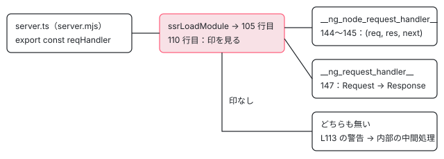

[目次](../README.md) › [@angular/ssr の読み残し：provideServerRendering・リクエストハンドラ・CommonEngine・ビルド側のワーカーを行で埋める](README.md) › 第 2 回 / 全 6 回

# server.ts の入口：createRequestHandler・createNodeRequestHandler と、ビルドが見分ける印

> src/handler.ts と node/src/handler.ts が関数に付ける印、ビルド側の isSsrRequestHandler / isSsrNodeRequestHandler がそれを in で見て dev-server の中間処理の道を決める行（読むのは名前つきの reqHandler で、doc の例の export default は読まれない）、AngularNodeAppEngine の残りの行、Node の request から Web の Request を作る関数の doc の残り、attachNodeGlobalErrorHandlers がいつ何を process に付けるか。

angular/angular-cli · 読了 約 12 分 · 中核 · [サイトで読む（デモが動きます）](https://angular-deep-dive-cyan.vercel.app/chapter/ssrl-handlers)

---

この章で分かること: `server.ts` の最後の 1 行 `export const reqHandler = createNodeRequestHandler(app)` が関数に何を付け、`ng serve` とプリレンダーがそれをどの行で見分けて、どちらの呼び方（Node の `(req, res, next)` か、Web の `Request → Response`）を選ぶのか。あわせて、`AngularNodeAppEngine` を作ると `process` に何が付くのか（`attachNodeGlobalErrorHandlers`）と、Node の request から Web の `Request` を作る関数の doc の残りを読みます。本物の `createRequestHandler`・`createNodeRequestHandler` と、@angular/build の `isSsr*RequestHandler`・dev-server の中間処理を Node で動かした記録を再生します。

読む対象は angular-cli（44129f66a3）の `packages/angular/ssr/src/handler.ts`・`node/src/handler.ts`・`node/src/errors.ts`・`node/src/app-engine.ts`・`node/src/request.ts` と、`packages/angular/build/src/utils/server-rendering/utils.ts`・`tools/vite/middlewares/ssr-middleware.ts` です。dev-server の中間処理の本体（`reqHandler` を取り出して分ける行の全体）は[dev-server の HMR と SSR の章](../vds/04-vds-hmr-ssr.md)の 4 節、`createWebRequestFromNodeRequest` の本体は[AngularAppEngine の章](../platform/04-ssr-app-engine.md)、`createNodeRequestHandler` の doc の後半と応答の書き戻しは[Node のストリームの章](../ssrx/08-ssrx-node-streams.md)で引用しています。

1. [1. provideServerRendering の中身](01-ssrl-provide.md)
2. **2. server.ts の入口**（この章）
3. [3. CommonEngine の残りと性能の記録](03-ssrl-common-engine.md)
4. [4. i18n と URL の小道具](04-ssrl-i18n-url.md)
5. [5. ビルド側のワーカー](05-ssrl-build-workers.md)
6. [6. spec と issue](06-ssrl-tests-issues.md)



*server.ts の reqHandler が、印によって 3 つの道に分かれる（ssr-middleware.ts の行）*

## 1. 2 つの形

📄 `angular-cli/packages/angular/ssr/src/handler.ts` L9–18 （▶ の行: 16–18）

```ts
 9 │ /**
10 │  * Function for handling HTTP requests in a web environment.
11 │  *
12 │  * @param request - The incoming HTTP request object.
13 │  * @returns A Promise resolving to a `Response` object, `null`, or directly a `Response`,
14 │  * supporting both synchronous and asynchronous handling.
15 │  */
16 ▶ export type RequestHandlerFunction = (
17 ▶   request: Request,
18 ▶ ) => Promise<Response | null> | null | Response;
```

📄 `angular-cli/packages/angular/ssr/node/src/handler.ts` L9–39 （▶ の行: 20–24, 36–37）

````ts
 9 │ import type { IncomingMessage, ServerResponse } from 'node:http';
10 │ 
11 │ /**
12 │  * Represents a middleware function for handling HTTP requests in a Node.js environment.
13 │  *
14 │  * @param req - The incoming HTTP request object.
15 │  * @param res - The outgoing HTTP response object.
16 │  * @param next - A callback function that signals the completion of the middleware or forwards the error if provided.
17 │  *
18 │  * @returns A Promise that resolves to void or simply void. The handler can be asynchronous.
19 │  */
20 ▶ export type NodeRequestHandlerFunction = (
21 ▶   req: IncomingMessage,
22 ▶   res: ServerResponse,
23 ▶   next: (err?: unknown) => void,
24 ▶ ) => Promise<void> | void;
25 │ 
26 │ /**
27 │  * Attaches metadata to the handler function to mark it as a special handler for Node.js environments.
28 │  *
29 │  * @typeParam T - The type of the handler function.
30 │  * @param handler - The handler function to be defined and annotated.
31 │  * @returns The same handler function passed as an argument, with metadata attached.
32 │  *
33 │  * @example
34 │  * Usage in an Express application:
35 │  * ```ts
36 ▶  * const app = express();
37 ▶  * export default createNodeRequestHandler(app);
38 │  * ```
39 │  *
````

Web の形（16〜18 行目の `RequestHandlerFunction`）は、Web 標準の `Request` を受け、`Response` か `null` を返します（同期でも Promise でもよい）。`null` は「自分は扱わない」の意味で、2 節の中間処理は次へ進みます。Node の形（20〜24 行目の `NodeRequestHandlerFunction`）は、Express などの中間処理と同じ `(req, res, next)` で、応答は `res` に自分で書きます。前者は `@angular/ssr`、後者は `@angular/ssr/node` の入口から出ています（Node の型を import するのは後者だけ。9 行目）。

## 2. 印を付けるだけの関数

📄 `angular-cli/packages/angular/ssr/src/handler.ts` L20–48 （▶ の行: 31, 39, 42–45, 47）

````ts
20 │ /**
21 │  * Annotates a request handler function with metadata, marking it as a special
22 │  * handler.
23 │  *
24 │  * @param handler - The request handler function to be annotated.
25 │  * @returns The same handler function passed in, with metadata attached.
26 │  *
27 │  * @example
28 │  * Example usage in a Hono application:
29 │  * ```ts
30 │  * const app = new Hono();
31 ▶  * export default createRequestHandler(app.fetch);
32 │  * ```
33 │  *
34 │  * @example
35 │  * Example usage in a H3 application:
36 │  * ```ts
37 │  * const app = createApp();
38 │  * const handler = toWebHandler(app);
39 ▶  * export default createRequestHandler(handler);
40 │  * ```
41 │  */
42 ▶ export function createRequestHandler(handler: RequestHandlerFunction): RequestHandlerFunction {
43 ▶   (handler as RequestHandlerFunction & { __ng_request_handler__?: boolean })[
44 ▶     '__ng_request_handler__'
45 ▶   ] = true;
46 │ 
47 ▶   return handler;
48 │ }
````

📄 `angular-cli/packages/angular/ssr/node/src/handler.ts` L66–72 （▶ の行: 68–69, 71）

````ts
66 │  * ```
67 │  */
68 ▶ export function createNodeRequestHandler<T extends NodeRequestHandlerFunction>(handler: T): T {
69 ▶   (handler as T & { __ng_node_request_handler__?: boolean })['__ng_node_request_handler__'] = true;
70 │ 
71 ▶   return handler;
72 │ }
````

どちらも、渡された関数に 43〜45 行目・69 行目で `true` のプロパティを 1 つ書き、47 行目・71 行目で **同じ関数**を返します。包まないので、Express の `app` を渡せば、`app.use` も `app.listen` もそのまま使えます。68 行目の型引数 `T` で、戻り値の型も渡した型のままです（Web の方は 42 行目で `RequestHandlerFunction` に広がります）。この 2 つは 92209dd2e9（2024-09-23）で、「Vite で使うために `server.ts` から中間処理の関数を出す」ために足されました。

> [!WARNING]
> **ハマりどころ**
>
> doc の例は 31 行目・39 行目・37 行目（前の引用）とも `export default createRequestHandler(…)` の形ですが、2 か所の読む側（3 節）はどちらも **名前つきの `reqHandler`** を読みます。`ng add @angular/ssr` が作る `server.ts`（schematics の `server.ts.template` L68）と angular.dev の SSR のガイド（adev の `guide/ssr.md` L637・L652）は `export const reqHandler = …` です。doc の例どおり `export default` だけにすると、DEMO の「export default だけ」のとおり、`ng serve` は警告を出して自分の中間処理を使います。

## 3. ビルドが見分ける：isSsr\*RequestHandler

📄 `angular-cli/packages/angular/build/src/utils/server-rendering/utils.ts` L9–23 （▶ の行: 9–10, 14, 17, 19, 22）

```ts
 9 ▶ import type { createRequestHandler } from '@angular/ssr';
10 ▶ import type { createNodeRequestHandler } from '@angular/ssr/node' with {
11 │   'resolution-mode': 'import',
12 │ };
13 │ 
14 ▶ export function isSsrNodeRequestHandler(
15 │   value: unknown,
16 │ ): value is ReturnType<typeof createNodeRequestHandler> {
17 ▶   return typeof value === 'function' && '__ng_node_request_handler__' in value;
18 │ }
19 ▶ export function isSsrRequestHandler(
20 │   value: unknown,
21 │ ): value is ReturnType<typeof createRequestHandler> {
22 ▶   return typeof value === 'function' && '__ng_request_handler__' in value;
23 │ }
```

17 行目と 22 行目の判定は「関数であること」と「その名前のプロパティが `in` で見つかること」です。値は見ません。9〜12 行目は `import type` なので、@angular/build は @angular/ssr を実行時に読まずに、型だけを借りて `value is ReturnType<…>` の絞り込みをしています。この 2 つを呼ぶのは次の 4 行です（どれも読むだけ）。

📄 `44129f66a3 で grep`

```
$ grep -rn "isSsrRequestHandler\|isSsrNodeRequestHandler" packages/angular/build/src
tools/vite/middlewares/ssr-middleware.ts:110   dev-server（ng serve）の中間処理
tools/vite/middlewares/ssr-middleware.ts:144
utils/server-rendering/launch-server.ts:27      プリレンダーのときに server.ts を起動する（第 5 回）
utils/server-rendering/launch-server.ts:34
$ grep -n "reqHandler" packages/schematics/angular/ssr/files/application-builder/server.ts.template
68:export const reqHandler = createNodeRequestHandler(app);
```

📄 `angular-cli/packages/angular/build/src/tools/vite/middlewares/ssr-middleware.ts` L9–20 （▶ の行: 9, 17–20）

```ts
 9 ▶ import type {
10 │   AngularAppEngine as SSRAngularAppEngine,
11 │   ɵgetOrCreateAngularServerApp as getOrCreateAngularServerApp,
12 │ } from '@angular/ssr';
13 │ import type { ServerResponse } from 'node:http';
14 │ import type { Connect, ViteDevServer } from 'vite' with {
15 │   'resolution-mode': 'import',
16 │ };
17 ▶ import {
18 ▶   isSsrNodeRequestHandler,
19 ▶   isSsrRequestHandler,
20 ▶ } from '../../../utils/server-rendering/utils';
```

📄 `angular-cli/packages/angular/build/src/tools/vite/middlewares/ssr-middleware.ts` L104–110 （▶ の行: 105–106, 110）

```ts
104 │     (async () => {
105 ▶       const { reqHandler, AngularAppEngine } = (await server.ssrLoadModule('./server.mjs')) as {
106 ▶         reqHandler?: unknown;
107 │         AngularAppEngine: typeof SSRAngularAppEngine;
108 │       };
109 │ 
110 ▶       if (!isSsrNodeRequestHandler(reqHandler) && !isSsrRequestHandler(reqHandler)) {
```

📄 `angular-cli/packages/angular/build/src/tools/vite/middlewares/ssr-middleware.ts` L143–149 （▶ の行: 144–145, 147–149）

```ts
143 │       // Forward the request to the middleware in server.ts
144 ▶       if (isSsrNodeRequestHandler(reqHandler)) {
145 ▶         await reqHandler(req, res, next);
146 │       } else {
147 ▶         const webRes = await reqHandler(createWebRequestFromNodeRequest(req));
148 ▶         if (!webRes) {
149 ▶           next();
```

1. **どちらの中間処理を置くか（dev-server の起動時）**

   `outputMode` があり `ssr.entry`（`server.ts`）を書いたときだけ `ExternalSsrMiddleware`、`ssr` だけなら `InternalSsrMiddleware` です（dev-server vite/index.ts L384〜393、[dev-server の設定の章](../vds/01-vds-config.md)）。ここから先は外側の方の話です。
2. **リクエストごとに server.mjs を読む**

   105 行目の `server.ssrLoadModule('./server.mjs')` は、Vite が変換した `server.ts` のモジュールを読み込み、export を取り出します。106 行目のとおり、読むのは `reqHandler` という名前の export です。
3. **印を見る**

   110 行目、どちらの印も無ければ、1 回だけ警告して内部の中間処理に任せます（[dev-server の HMR と SSR の章](../vds/04-vds-hmr-ssr.md)の 4 節）。
4. **Node を先に見る**

   144 行目は `isSsrNodeRequestHandler` を先に見るので、両方の印がある関数は Node の形で呼ばれます。147 行目の Web の形では、Node の `req` から `createWebRequestFromNodeRequest` で `Request` を作って渡し、148〜149 行目で `null` なら `next()` です。

プリレンダーのときに `server.ts` を起動する `launch-server.ts`（L22・L27・L34）も、同じ `reqHandler` を読み、同じ 2 つの判定で分けます。中身は[第 5 回](05-ssrl-build-workers.md)です。

## 4. DEMO：印と、中間処理の 3 つの道

> **🧪 DEMO — 本物の印・判定・dev-server の中間処理（記録の再生）**
>
> `<work>/ssrl-demo/a/handlers/record.mjs` が、Node v24.22.1 で @angular/ssr 22.2.7 の 2 つの関数と、@angular/build 22.2.7 の `isSsr*RequestHandler`（`src/utils/server-rendering/utils.js`）を呼んだ記録です。
>
> 下は、本物の `createAngularSsrExternalMiddleware`（`ssr-middleware.js`）に、`ssrLoadModule` だけを持つ偽の ViteDevServer を渡し、`node:http` のサーバーに挟んで `fetch` で 1 回ずつリクエストした記録です。`'./server.mjs'` には場合ごとの `reqHandler` を、`'/main.server.mjs'` には呼ばれたことを記録するだけの偽の `ɵgetOrCreateAngularServerApp` を返しています。`AngularAppEngine` は本物のクラスです。
>
> 通った道：110 行目を通り抜け、144〜145 行目で reqHandler(req, res, next)。Node の IncomingMessage のまま渡る
>
> 全部のリクエストのあと、`AngularAppEngine` の静的な欄は `ɵallowStaticRouteRender = true`・`ɵdisableAllowedHostsCheck = false`（偽の設定の `allowedHosts` が配列なので）・`ɵhooks.has('html:transform:pre') = true` でした（L131〜141、[アセットと CSS の章](../ssrx/09-ssrx-assets-css.md)）。
>
> ▶ [このデモはサイトで動かせます](https://angular-deep-dive-cyan.vercel.app/chapter/ssrl-handlers)

> [!NOTE]
> **ポイント**
>
> 表の「手で同じ名前を書いた関数」は、`__ng_request_handler__: false` でも `isSsrRequestHandler` が `true` です（17・22 行目の `in`）。「fetch を持つオブジェクト」は印が付いても `typeof` が `object` なので偽です。Cloudflare Workers のような `export default { fetch }` の形は、関数を取り出して渡します。凍結した関数は、ESM の strict モードで 43 行目の代入が `TypeError` になります。

## 5. AngularNodeAppEngine の残りの行

📄 `angular-cli/packages/angular/ssr/node/src/app-engine.ts` L9–29 （▶ の行: 9, 12–15, 20, 27–28）

```ts
 9 ▶ import { AngularAppEngine } from '@angular/ssr';
10 │ import type { IncomingMessage } from 'node:http';
11 │ import type { Http2ServerRequest } from 'node:http2';
12 ▶ import { AngularAppEngineOptions } from '../../src/app-engine';
13 ▶ import { getAllowedHostsFromEnv, getTrustProxyHeadersFromEnv } from './environment-options';
14 ▶ import { attachNodeGlobalErrorHandlers } from './errors';
15 ▶ import { createWebRequestFromNodeRequest } from './request';
16 │ 
17 │ /**
18 │  * Options for the Angular Node.js server application engine.
19 │  */
20 ▶ export interface AngularNodeAppEngineOptions extends AngularAppEngineOptions {}
21 │ 
22 │ /**
23 │  * Angular server application engine.
24 │  * Manages Angular server applications (including localized ones), handles rendering requests,
25 │  * and optionally transforms index HTML before rendering.
26 │  *
27 ▶  * @remarks This class should be instantiated once and used as a singleton across the server-side
28 ▶  * application to ensure consistent handling of rendering requests and resource management.
29 │  */
```

📄 `angular-cli/packages/angular/ssr/node/src/app-engine.ts` L43–49 （▶ の行: 45–46, 48）

```ts
43 │     };
44 │ 
45 ▶     this.angularAppEngine = new AngularAppEngine(appEngineOptions);
46 ▶     this.trustProxyHeaders = appEngineOptions.trustProxyHeaders;
47 │ 
48 ▶     attachNodeGlobalErrorHandlers();
49 │   }
```

9 行目、Node 版は `@angular/ssr` の `AngularAppEngine` を **パッケージ名で** import します（相対パスではないので、Node 版の入口と Web 版の入口は同じ `AngularAppEngine` のクラスを共有します）。20 行目の `AngularNodeAppEngineOptions` は、`AngularAppEngineOptions` に何も足していません。27〜28 行目の doc のとおり、1 つだけ作って使い回す前提です。45 行目で中の `AngularAppEngine` を作り、**そのあと** 48 行目で `attachNodeGlobalErrorHandlers()` を呼びます。45 行目が投げると 48 行目には来ません（6 節の DEMO の「manifest なし」）。コンストラクタの前半（環境変数との合わせ方）は[Host 検証の章](../ssrx/04-ssrx-host-validation.md)と[プロキシのヘッダーの章](../ssrx/05-ssrx-proxy-headers.md)です。

📄 `angular-cli/packages/angular/ssr/node/src/app-engine.ts` L50–77 （▶ の行: 55, 58, 60, 62, 66, 68, 71–73）

```ts
50 │ 
51 │   /**
52 │    * Handles an incoming HTTP request by serving prerendered content, performing server-side rendering,
53 │    * or delivering a static file for client-side rendered routes based on the `RenderMode` setting.
54 │    *
55 ▶    * This method adapts Node.js's `IncomingMessage`, `Http2ServerRequest` or `Request`
56 │    * to a format compatible with the `AngularAppEngine` and delegates the handling logic to it.
57 │    *
58 ▶    * @param request - The incoming HTTP request (`IncomingMessage`, `Http2ServerRequest` or `Request`).
59 │    * @param requestContext - Optional context for rendering, such as metadata associated with the request.
60 ▶    * @returns A promise that resolves to the resulting HTTP response object, or `null` if no matching Angular route is found.
61 │    *
62 ▶    * @remarks A request to `https://www.example.com/page/index.html` will serve or render the Angular route
63 │    * corresponding to `https://www.example.com/page`.
64 │    *
65 │    * @remarks
66 ▶    * To prevent potential Server-Side Request Forgery (SSRF), this function verifies the hostname
67 │    * of the `request.url` against a list of authorized hosts.
68 ▶    * If the hostname is not recognized a 400 Bad Request is returned.
69 │    *
70 │    * Resolution:
71 ▶    * Authorize your hostname by configuring `allowedHosts` in `angular.json` in:
72 ▶    * `projects.[project-name].architect.build.options.security.allowedHosts`.
73 ▶    * Alternatively, you can define the allowed hostname via the environment variable `process.env['NG_ALLOWED_HOSTS']`
74 │    * or pass it directly through the configuration options of `AngularNodeAppEngine`.
75 │    *
76 │    * For more information see: https://angular.dev/best-practices/security#preventing-server-side-request-forgery-ssrf
77 │    */
```

`handle` の doc です。55 行目と 58 行目のとおり、`IncomingMessage`・`Http2ServerRequest`・`Request` のどれでも受け取れ、本体（L82〜87、[AngularAppEngine の章](../platform/04-ssr-app-engine.md)）は `Request` ならそのまま、それ以外は `createWebRequestFromNodeRequest` で作り直してから中の `handle` に渡します。62〜63 行目の「`/page/index.html` は `/page` と同じ」と、66〜68 行目の「許可していないホストは 400」は、中の `AngularAppEngine` の振る舞いの説明です。71〜74 行目は直し方として、`angular.json` の `security.allowedHosts`・環境変数 `NG_ALLOWED_HOSTS`・このコンストラクタの options の 3 つを挙げています。origin/main では、この doc に「描画が終わる前に request が abort されると `AbortError` の `DOMException` で reject し、プラットフォームも壊す」という `@throws` が 3 行足されています（47bc9c3969 の振る舞いの説明。[manifest と renderAngular の章](../srt/04-srt-manifest-render.md)）。

## 6. attachNodeGlobalErrorHandlers：いつ、何を付けるか

📄 `angular-cli/packages/angular/ssr/node/src/errors.ts` L9–40 （▶ の行: 12, 15, 19, 21–22, 28–29, 33, 37, 39）

```ts
 9 │ /**
10 │  * Attaches listeners to the Node.js process to capture and handle unhandled rejections and uncaught exceptions.
11 │  * Captured errors are logged to the console. This function logs errors to the console, preventing unhandled errors
12 ▶  * from crashing the server. It is particularly useful for Zoneless apps, ensuring error handling without relying on Zone.js.
13 │  *
14 │  * @remarks
15 ▶  * This function is a no-op if zone.js is available.
16 │  * For Zone-based apps, similar functionality is provided by Zone.js itself. See the Zone.js implementation here:
17 │  * https://github.com/angular/angular/blob/4a8d0b79001ec09bcd6f2d6b15117aa6aac1932c/packages/zone.js/lib/node/node.ts#L94%7C
18 │  *
19 ▶  * @internal
20 │  */
21 ▶ export function attachNodeGlobalErrorHandlers(): void {
22 ▶   if (typeof Zone !== 'undefined') {
23 │     return;
24 │   }
25 │ 
26 │   // Ensure that the listeners are registered only once.
27 │   // Otherwise, multiple instances may be registered during edit/refresh.
28 ▶   const gThis: typeof globalThis & { ngAttachNodeGlobalErrorHandlersCalled?: boolean } = globalThis;
29 ▶   if (gThis.ngAttachNodeGlobalErrorHandlersCalled) {
30 │     return;
31 │   }
32 │ 
33 ▶   gThis.ngAttachNodeGlobalErrorHandlersCalled = true;
34 │ 
35 │   process
36 │     // eslint-disable-next-line no-console
37 ▶     .on('unhandledRejection', (error) => console.error('unhandledRejection', error))
38 │     // eslint-disable-next-line no-console
39 ▶     .on('uncaughtException', (error) => console.error('uncaughtException', error));
40 │ }
```

1. **呼ぶのは 2 つのコンストラクタだけ**

   `AngularNodeAppEngine` の 48 行目と、`CommonEngine` のコンストラクタ（common-engine.ts L87、[第 3 回](03-ssrl-common-engine.md)）です。`createNodeRequestHandler` も、Web 版の `AngularAppEngine` も呼びません。19 行目の `@internal` のとおり、利用者が直接呼ぶ関数ではありません。
2. **Zone があれば何もしない**

   22 行目、グローバルに `Zone` があれば戻ります。15〜17 行目の doc は、Zone を使うアプリでは zone.js の Node 向けの処理が同じことをする、と書いています。
3. **2 回目からは何もしない**

   28〜33 行目、`globalThis.ngAttachNodeGlobalErrorHandlersCalled` で 1 回だけにします。26〜27 行目のコメントのとおり、dev-server が `server.ts` を読み直すたびにリスナーが増えないようにするためです。モジュールの変数ではなく `globalThis` なのは、読み直しで新しいモジュールの実体ができても旗が残るからです。
4. **process に 2 つ付ける**

   37 行目の `unhandledRejection` と 39 行目の `uncaughtException` に、`console.error` で出すだけのリスナーを付けます。リスナーがあると、Node は投げっぱなしの例外でプロセスを終わらせません（12 行目「サーバーが落ちるのを防ぐ」）。

319b8e0c2a（2025-04-05、#28405）が、この関数と 2 つの呼び出しを足しました。閉じた issue は angular/angular の #58123「`HttpClient` が 200 以外を受けると Vite の dev server が落ちる」です。コミットの本文は「処理されないエラーでサーバーが落ちるのを防ぐ。Zone に頼らないので zoneless のアプリで特に役立つ」と書いています。

> **🧪 DEMO — process のリスナー数と、投げっぱなしの例外（記録の再生）**
>
> `<work>/ssrl-demo/a/handlers/errors.mjs` が、場合ごとに別の子プロセスを起こして記録しました。`AngularNodeAppEngine` の前には、`ɵsetAngularAppEngineManifest` で最小の manifest を置いています（「manifest なし」を除く）。「Zone が先にある」は、zone.js ではなく `globalThis.Zone = {}` を置いただけです。
>
> 終了コード：`0`
>
> ▶ [このデモはサイトで動かせます](https://angular-deep-dive-cyan.vercel.app/chapter/ssrl-handlers)

> [!WARNING]
> **ハマりどころ**
>
> 「new CommonEngine() のあとで投げっぱなし」では、`setTimeout` の中で投げた例外も `console.error` に 1 行出るだけで、プロセスは 200 ms 後の行まで動き続け、終了コードは 0 でした。リスナーは Angular と関係の無い例外にも効きます。Node の文書は `'uncaughtException'` について「そのあとで通常の処理を続けるのは安全ではない」と書いており、ここでは「サーバーを落とさない」を選んでいる、ということです。

## 7. request.ts の残り：doc が書いていること

📄 `angular-cli/packages/angular/ssr/node/src/request.ts` L9–17 （▶ の行: 12–16）

```ts
 9 │ import type { IncomingHttpHeaders, IncomingMessage } from 'node:http';
10 │ import type { Http2ServerRequest } from 'node:http2';
11 │ import {
12 ▶   getFirstHeaderValue,
13 ▶   isProxyHeaderAllowed,
14 ▶   normalizeTrustProxyHeaders,
15 ▶   parseForwardedHeader,
16 ▶ } from '../../src/utils/validation';
17 │ 
```

📄 `angular-cli/packages/angular/ssr/node/src/request.ts` L33–56 （▶ の行: 41, 43–46, 52, 54, 56）

```ts
33 │ /**
34 │  * Converts a Node.js `IncomingMessage` or `Http2ServerRequest` into a
35 │  * Web Standard `Request` object.
36 │  *
37 │  * This function adapts the Node.js request objects to a format that can
38 │  * be used by web platform APIs.
39 │  *
40 │  * @param nodeRequest - The Node.js request object (`IncomingMessage` or `Http2ServerRequest`) to convert.
41 ▶  * @param trustProxyHeaders - A boolean or an array of proxy headers to trust when constructing the request URL.
42 │  *
43 ▶  * @remarks
44 ▶  * When `trustProxyHeaders` is enabled, headers such as `Forwarded`, `X-Forwarded-Host`, and
45 ▶  * `X-Forwarded-Prefix` should ideally be strictly validated at a higher infrastructure
46 ▶  * level (e.g., at the reverse proxy or API gateway) before reaching the application.
47 │  *
48 │  * @returns A Web Standard `Request` object.
49 │  */
50 │ export function createWebRequestFromNodeRequest(
51 │   nodeRequest: IncomingMessage | Http2ServerRequest,
52 ▶   trustProxyHeaders?: boolean | readonly string[],
53 │ ): Request {
54 ▶   const trustProxyHeadersNormalized = normalizeTrustProxyHeaders(trustProxyHeaders);
55 │   const { headers, method = 'GET' } = nodeRequest;
56 ▶   const withBody = method !== 'GET' && method !== 'HEAD';
```

📄 `angular-cli/packages/angular/ssr/node/src/request.ts` L102–121 （▶ の行: 104, 109–111, 116, 118）

```ts
102 │ 
103 │ /**
104 ▶  * Creates a `URL` object from a Node.js `IncomingMessage`, taking into account the protocol, host, and port.
105 │  *
106 │  * @param nodeRequest - The Node.js `IncomingMessage` or `Http2ServerRequest` object to extract URL information from.
107 │  * @param trustProxyHeaders - A set of allowed proxy headers.
108 │  *
109 ▶  * @remarks
110 ▶  * When `trustProxyHeaders` is enabled, headers such as `Forwarded`, `X-Forwarded-Host`, and
111 ▶  * `X-Forwarded-Prefix` should ideally be strictly validated at a higher infrastructure
112 │  * level (e.g., at the reverse proxy or API gateway) before reaching the application.
113 │  *
114 │  * @returns A `URL` object representing the request URL.
115 │  */
116 ▶ export function createRequestUrl(
117 │   nodeRequest: IncomingMessage | Http2ServerRequest,
118 ▶   trustProxyHeaders: ReadonlySet<string>,
119 │ ): URL {
120 │   const {
121 │     headers,
```

12〜15 行目の 4 つ（`getFirstHeaderValue`・`isProxyHeaderAllowed`・`normalizeTrustProxyHeaders`・`parseForwardedHeader`）は、Web 版と共通の `src/utils/validation.ts` から借りています。52 行目の `trustProxyHeaders` は `boolean` かヘッダー名の配列で、54 行目で `Set` にしてから 116 行目の `createRequestUrl` に渡します（118 行目の型が `ReadonlySet<string>`）。43〜46 行目と 109〜112 行目は同じ注意で、「`Forwarded`・`X-Forwarded-Host`・`X-Forwarded-Prefix` を信じるなら、手前のリバースプロキシで検査しておくこと」です。どのヘッダーをどう読むかは[プロキシのヘッダーの章](../ssrx/05-ssrx-proxy-headers.md)、56 行目から先（`AbortController` と `duplex: 'half'`）は[Node のストリームの章](../ssrx/08-ssrx-node-streams.md)です。

## 8. 呼び出しの連なり

- 👤 `export const reqHandler = createNodeRequestHandler(app)` — server.ts — *69 行目で印、71 行目で同じ app を返す*
- 👤 `const angularApp = new AngularNodeAppEngine()` — server.ts — *48 行目で process にリスナー*
  - `attachNodeGlobalErrorHandlers()` — node/src/errors.ts L21 — *Zone か旗があれば戻る*
- `angularSsrExternalMiddleware(req, res, next)` — ssr-middleware.ts L99 — *ng serve のリクエストごと*
  - `server.ssrLoadModule('./server.mjs')` — ssr-middleware.ts L105 — *reqHandler を取り出す*
  - `isSsrNodeRequestHandler(reqHandler)` — build utils.ts L14 — *17 行目の in*
  - `reqHandler(req, res, next)` — ssr-middleware.ts L145 — *Express の中で angularApp.handle(req)*
    - `createWebRequestFromNodeRequest(req, trustProxyHeaders)` — node/src/request.ts L50 — *Node の req から Request*
    - `AngularAppEngine.handle(request)` — src/app-engine.ts — *AngularAppEngine の章*

## テストと直し方

### 今の spec

`node/test/` の spec は `request_spec.ts`・`request_http1_spec.ts`・`request_http2_spec.ts`・`response_http1_spec.ts`・`response_http2_spec.ts` の 5 つで、`createNodeRequestHandler`・`attachNodeGlobalErrorHandlers`・`AngularNodeAppEngine` を呼ぶ it はありません。`test/` にも `createRequestHandler` の it はありません。@angular/build の `utils/server-rendering/` の spec は `manifest_spec.ts` と `esm-in-memory-loader/` の 2 つ（loader-hooks\_spec・utils\_spec）だけで、`isSsr*RequestHandler` の it もありません。印から中間処理までを通しで確かめているのは e2e の `tests/e2e/tests/vite/ssr-entry-express.ts`・`ssr-entry-fastify.ts` などです。

### spec を足すとしたら（作業木で書いて走らせた）

📄 `<work>/ssrl-wt-a/packages/angular/ssr/test/handler_spec.ts`

```ts
// test/handler_spec.ts（作業木で新しく書いたもの）
describe('createRequestHandler', () => {
  it('should return the same function marked with __ng_request_handler__', () => {
    const handler = (request: Request) => new Response(request.url);
    const result = createRequestHandler(handler);

    expect(result).toBe(handler);
    expect('__ng_request_handler__' in result).toBeTrue();
  });
});
// node/test/handler_spec.ts も同じ形で createNodeRequestHandler と __ng_node_request_handler__
```

- 印を付ける 2 つは、`test/handler_spec.ts` と `node/test/handler_spec.ts` に 1 本ずつで固められます。どちらの BUILD.bazel も glob で拾うので、BUILD は変えません。
- `attachNodeGlobalErrorHandlers` は 19 行目の `@internal` のため、`node/test` から import すると型検査で落ちました（下の記録）。確かめるなら、公開の `AngularNodeAppEngine` か `CommonEngine` を作って `process.listenerCount` を見る形になり、そのとき `globalThis` の旗とリスナーを it のあとで戻す必要があります（6 節の DEMO の 3 行目のとおり、2 回目からは増えないため）。
- 2 節の doc の例（`export default`）と読む側（`reqHandler`）の食い違いを直すなら、`src/handler.ts` の 31・39 行目と `node/src/handler.ts` の 37 行目ほかの例を `export const reqHandler = …` に揃える形です。doc だけなので spec は要りません。

### 手元で走らせた結果

📄 `走らせたコマンド（2026-11-19）`

```
# ../angular-cli-fix（44129f66a3）で、変えずに
pnpm bazel test //packages/angular/ssr/node/test:test --nocache_test_results --test_output=all
# 作業木 <work>/ssrl-wt-a に handler_spec.ts を 2 つ足して
pnpm bazel test //packages/angular/ssr/test:test //packages/angular/ssr/node/test:test --nocache_test_results --test_output=all
```

📄 `結果`

```
42 specs, 0 failures    //packages/angular/ssr/node/test:test PASSED   # 変えずに（request と response の 5 ファイル）
255 specs, 0 failures   //packages/angular/ssr/test:test PASSED        # handler_spec.ts の 1 本を足して（第 1 回の 5 本も含む）
45 specs, 1 failure     //packages/angular/ssr/node/test:test FAILED   # node/test/handler_spec.ts の 1 本と、第 3 回の性能の 2 本を足して
                                                                        # 落ちたのは第 3 回の 1 本。handler の it は通る
# node/test では attachNodeGlobalErrorHandlers の it も書いたが、型検査で落ちた:
# error TS2305: Module '"../src/errors"' has no exported member 'attachNodeGlobalErrorHandlers'.
# （errors.ts 19 行目の @internal で、spec が見る宣言から外れている。it を外して node/test は handler の 1 本だけ）
```

## 聞かれそうな質問

**Q. createNodeRequestHandler で包むと、app は別の関数になりますか？**

なりません。69 行目でプロパティを 1 つ書き、71 行目で同じ関数を返します。DEMO の表の「同じ関数」が「はい」で、Express の `use` や `listen` も残っています。

**Q. ng serve は server.ts の何を読んでいますか？**

105〜106 行目で `server.mjs` の名前つき export `reqHandler` を読み、110 行目と 144 行目で印を見ます。`export default` は読みません。

**Q. 印を付け忘れるとどうなりますか？**

`ng serve` は 1 回だけ警告を出し、`server.ts` の Express などを通さずに、内部の中間処理で `AngularServerApp` を直接呼びます。`server.ts` に書いた API のルートや中間処理は、dev-server では動きません（DEMO の「印なしの関数」で、`reqHandler` は 1 度も呼ばれていません）。

**Q. zoneless の SSR サーバーで、投げっぱなしの例外はどう扱われますか？**

`AngularNodeAppEngine` か `CommonEngine` を作った時点で、37・39 行目のリスナーが付き、`console.error` に出るだけでプロセスは続きます。Zone がある、または 2 回目なら、22 行目か 29 行目で何もしません。

**Q. Web の形の reqHandler が null を返すと？**

dev-server では 148〜149 行目で `next()` に進み、後ろの中間処理（静的ファイルなど）が応えます。DEMO の「null を返す」では、後ろに置いた仮の中間処理の 404 が返りました。

## 読み終えて

- `createRequestHandler` と `createNodeRequestHandler` は、同じ関数に `__ng_request_handler__` か `__ng_node_request_handler__` を書いて返すだけ。
- @angular/build は `typeof === 'function'` と `in` で見分け、Node の形を先に見る。読むのは名前つきの `reqHandler`。
- 印が無ければ dev-server は内部の中間処理に替え、警告は 1 回だけ。
- `AngularNodeAppEngine` と `CommonEngine` のコンストラクタが、Zone の無いプロセスに 1 回だけ `unhandledRejection` と `uncaughtException` のリスナーを付ける。

---

← 前: [provideServerRendering の中身：withRoutes と withAppShell が積む provider](01-ssrl-provide.md)  
次: [CommonEngine の残りと性能の記録：enablePerformanceProfiler が測るもの](03-ssrl-common-engine.md) →
