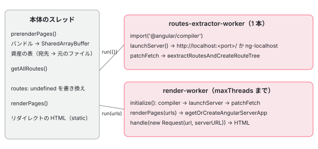

[目次](../README.md) › [@angular/ssr の読み残し：provideServerRendering・リクエストハンドラ・CommonEngine・ビルド側のワーカーを行で埋める](README.md) › 第 5 回 / 全 6 回

# ビルド側のワーカー：ルートの取り出し・prerender の描画・サーバーの起動・fetch の差し替え

> packages/angular/build の utils/server-rendering の未読の行：routes-extractor-worker と render-worker が workerData で何を受け取り何を返すか（models.ts の型と RouteRenderMode）、launch-server が server.ts をワーカーの中で localhost の空いたポートで起動し、無ければ http://ng-localhost/ を土台にする理由、fetch-patch が資産をネットワークに出さずに返す行、ESM ローダーのフック、generateRedirectStaticPage、prerender.ts と manifest.ts の残り。本物の ng build を 6 通り走らせた記録つき。

angular/angular-cli · 読了 約 13 分 · 発展 · [サイトで読む（デモが動きます）](https://angular-deep-dive-cyan.vercel.app/chapter/ssrl-build-workers)

---

ng build の prerender（SSG）は、ビルドの本体のスレッドではなく、Piscina のワーカー（worker\_threads のスレッド）の中でアプリを動かします。この章では、そのワーカーに**何が渡り、何が返るか**を型の行（models.ts・render-worker.ts・routes-extractor-worker.ts の頭）で読み、ワーカーの中で server.ts を起動する launch-server.ts を全部読みます。そのうえで fetch の差し替え・ESM ローダーのフック・prerender.ts と manifest.ts の残りの行を、小さなアプリを本物の ng build で 6 通りにビルドした記録と照らします。

読む対象は ../angular-cli（44129f66a3）の `packages/angular/build/src/utils/server-rendering/` です。prerender の大きな流れ（outputMode と prerender が走る条件、ルートの選び方、バッチの計算、書き出し）は[プリレンダー](../platform/06-ssr-prerender.md)の章にあるので、ここでは繰り返しません。ルートを取り出す関数の中身は[ルートの取り出し](../srt/01-srt-extract.md)、マニフェストの HTML とアセットの行は[マニフェストと描画](../srt/04-srt-manifest-render.md)と[アセットと重要 CSS](../ssrx/09-ssrx-assets-css.md)の章です。

1. [1. provideServerRendering の中身](01-ssrl-provide.md)
2. [2. server.ts の入口](02-ssrl-handlers.md)
3. [3. CommonEngine の残りと性能の記録](03-ssrl-common-engine.md)
4. [4. i18n と URL の小道具](04-ssrl-i18n-url.md)
5. **5. ビルド側のワーカー**（この章）
6. [6. spec と issue](06-ssrl-tests-issues.md)

> [!NOTE]
> **ポイント**
>
> 記録はこのサイトの依存の @angular/build 22.2.7（v22.2.7、72f44d79cb）で取りました。本文が読む 44129f66a3 との違いは 3 つあり、そのつど書きます。generateRedirectStaticPage が URL を HTML 用に符号化するようになったこと（4 節）、ESM ローダーのフックの登録が `module.registerHooks()` になったこと（6 節）、マニフェストの値を `JSON.stringify` で埋めるようになったこと（8 節）です。

## 1. 3 つのスレッドと、それぞれが持つもの



*prerenderPages（本体）が 2 種類の WorkerPool を作る。どちらのワーカーも同じ workerData（共有メモリのバンドル・資産の表・outputMode・hasSsrEntry）を受け取り、server.ts があれば自分の中で起動する*

本体のスレッドは 2 回 WorkerPool を作ります。1 回目はルートを取り出す 1 本、2 回目は HTML を描く数本です。どちらにも同じ workerData（Piscina がワーカーに 1 回だけ渡す起動時の値）を渡し、どちらのワーカーも、server.ts があれば**自分の中で** HTTP サーバーを起動します。記録では、ルートを取り出すワーカーと描くワーカーが別々のポート（58402 と 58403 のように）で listen していました（下の 3 節のデモ）。

## 2. ワーカーに渡る値と返る値の型

📄 `angular-cli/packages/angular/build/src/utils/server-rendering/models.ts` L9–40 （▶ の行: 9, 12, 14–15, 18–19, 24–27, 32, 36–39）

```ts
 9 ▶ import type { RenderMode, ɵextractRoutesAndCreateRouteTree } from '@angular/ssr';
10 │ import { ESMInMemoryFileLoaderWorkerData } from './esm-in-memory-loader/loader-hooks';
11 │ 
12 ▶ type Writeable<T extends readonly unknown[]> = T extends readonly (infer U)[] ? U[] : never;
13 │ 
14 ▶ export interface RoutesExtractorWorkerData extends ESMInMemoryFileLoaderWorkerData {
15 ▶   assetFiles: Record</** Destination */ string, /** Source */ string>;
16 │ }
17 │ 
18 ▶ export type SerializableRouteTreeNode = ReturnType<
19 ▶   Awaited<ReturnType<typeof ɵextractRoutesAndCreateRouteTree>>['routeTree']['toObject']
20 │ >;
21 │ 
22 │ export type WritableSerializableRouteTreeNode = Writeable<SerializableRouteTreeNode>;
23 │ 
24 ▶ export interface RoutersExtractorWorkerResult {
25 ▶   serializedRouteTree: SerializableRouteTreeNode;
26 ▶   appShellRoute?: string;
27 ▶   errors: string[];
28 │ }
29 │ 
30 │ /**
31 │  * Local copy of `RenderMode` exported from `@angular/ssr`.
32 ▶  * This constant is needed to handle interop between CommonJS (CJS) and ES Modules (ESM) formats.
33 │  *
34 │  * It maps `RenderMode` enum values to their corresponding numeric identifiers.
35 │  */
36 ▶ export const RouteRenderMode: Record<keyof typeof RenderMode, RenderMode> = {
37 ▶   Server: 0,
38 ▶   Client: 1,
39 ▶   Prerender: 2,
40 │ };
```

14・15 行目、ルートを取り出すワーカーの workerData は、6 節の ESM ローダー用の値（`outputFiles`・`workspaceRoot`）に、資産の表 `assetFiles` を足したものです。表の向きはコメントのとおり「宛先 → 元のファイル」です。18・19 行目の `SerializableRouteTreeNode` は、@angular/ssr の `routeTree.toObject()` の戻り値の型をそのまま借ります。12 行目の `Writeable` は、その readonly な配列を書ける配列に直す型で、prerender.ts がルートを足すのに使います。24〜27 行目がワーカーの返す値で、3 節の記録の「結果」の行がこの形です。

32・36〜39 行目の `RouteRenderMode` は、@angular/ssr の `RenderMode` の写しです。32 行目の理由は「CommonJS と ES モジュールのやり取りのため」で、実際に @angular/build の配布物は package.json に `"type"` を持たない CommonJS、@angular/ssr は `"type": "module"` の ESM です。CommonJS の側から ESM の値を同期に `require` できないので、9 行目は `import type`（型だけ）にして、値は手で写しています。

記録では、@angular/ssr の RenderMode は `{"0":"Server","1":"Client","2":"Prerender","Server":0,"Client":1,"Prerender":2}`（TypeScript の数の enum なので、数から名前への逆向きの組も入る）、写しは `{"Server":0,"Client":1,"Prerender":2}` で、名前と数は一致していました。36 行目の型 `Record<keyof typeof RenderMode, RenderMode>` が確かめるのは「名前がそろっていること」だけで、数を入れ違えても型は通ります。実際に RenderMode.AppShell を消した b2e2be052f（2024-11-08）は、この写しの 4 つの数を手で 3 つに振り直しています。2 つが同じかを比べる spec はありません（`RouteRenderMode` を使う spec は 0 件）。

📄 `angular-cli/packages/angular/build/src/utils/server-rendering/render-worker.ts` L9–45 （▶ の行: 18–21, 24, 26–27, 30–31, 39, 44）

```ts
 9 │ import { workerData } from 'node:worker_threads';
10 │ import type { OutputMode } from '../../builders/application/schema';
11 │ import { assertIsError } from '../error';
12 │ import type { ESMInMemoryFileLoaderWorkerData } from './esm-in-memory-loader/loader-hooks';
13 │ import { patchFetchToLoadInMemoryAssets } from './fetch-patch';
14 │ import { DEFAULT_URL, launchServer } from './launch-server';
15 │ import { loadEsmModuleFromMemory } from './load-esm-from-memory';
16 │ import { generateRedirectStaticPage } from './utils';
17 │ 
18 ▶ export interface RenderWorkerData extends ESMInMemoryFileLoaderWorkerData {
19 ▶   assetFiles: Record</** Destination */ string, /** Source */ string>;
20 ▶   outputMode: OutputMode | undefined;
21 ▶   hasSsrEntry: boolean;
22 │ }
23 │ 
24 ▶ export type RenderResultItem =
25 │   | {
26 ▶       url: string;
27 ▶       content: string;
28 │     }
29 │   | {
30 ▶       url: string;
31 ▶       error: string;
32 │     };
33 │ 
34 │ export type RenderResult = RenderResultItem[];
35 │ 
36 │ /**
37 │  * This is passed as workerData when setting up the worker via the `piscina` package.
38 │  */
39 ▶ const { outputMode, hasSsrEntry } = workerData as {
40 │   outputMode: OutputMode | undefined;
41 │   hasSsrEntry: boolean;
42 │ };
43 │ 
44 ▶ let serverURL = DEFAULT_URL;
45 │ 
```

📄 `angular-cli/packages/angular/build/src/utils/server-rendering/routes-extractor-worker.ts` L9–28 （▶ の行: 17–18, 24–26）

```ts
 9 │ import { workerData } from 'node:worker_threads';
10 │ import { OutputMode } from '../../builders/application/schema';
11 │ import { ESMInMemoryFileLoaderWorkerData } from './esm-in-memory-loader/loader-hooks';
12 │ import { patchFetchToLoadInMemoryAssets } from './fetch-patch';
13 │ import { DEFAULT_URL, launchServer } from './launch-server';
14 │ import { loadEsmModuleFromMemory } from './load-esm-from-memory';
15 │ import { RoutersExtractorWorkerResult } from './models';
16 │ 
17 ▶ export interface ExtractRoutesWorkerData extends ESMInMemoryFileLoaderWorkerData {
18 ▶   outputMode: OutputMode | undefined;
19 │ }
20 │ 
21 │ /**
22 │  * This is passed as workerData when setting up the worker via the `piscina` package.
23 │  */
24 ▶ const { outputMode, hasSsrEntry } = workerData as {
25 ▶   outputMode: OutputMode | undefined;
26 ▶   hasSsrEntry: boolean;
27 │ };
28 │ 
```

描くワーカーの workerData（18〜21 行目）は、取り出すワーカーの型に `outputMode` と `hasSsrEntry` を足した形です。返す値は 24〜32 行目のとおり、URL ごとに `content` か `error` のどちらかを持つ配列です。39 行目と、取り出すワーカーの 24〜26 行目は、モジュールが読まれた瞬間に workerData を分解します。ワーカーの中でしか読めない値なので、この 2 つのファイルは本体のスレッドで import すると壊れます（fetch-patch.ts も同じで、7 節の記録をワーカーの中で取ったのはこのためです）。

取り出すワーカーの 17・18 行目の `ExtractRoutesWorkerData` は `hasSsrEntry` を持たず、24〜26 行目の分解では読んでいます。実際に渡しているのは models.ts の `RoutesExtractorWorkerData`（`outputMode` も `hasSsrEntry` も持たない）で、prerender.ts は型を合わせるために `as RoutesExtractorWorkerData` と書いています（[プリレンダー](../platform/06-ssr-prerender.md)の 3 節が読む WorkerPool の行）。つまり `ExtractRoutesWorkerData` はどこからも使われていません（../angular-cli を grep すると、定義の 1 か所だけ）。44 行目の `serverURL` は、5 節の DEFAULT\_URL で始まり、initialize で書き換わります。

## 3. launch-server.ts：ワーカーの中で server.ts を起動する

📄 `angular-cli/packages/angular/build/src/utils/server-rendering/launch-server.ts` L9–30 （▶ の行: 14, 21–25, 27–28）

```ts
 9 │ import assert from 'node:assert';
10 │ import { createServer } from 'node:http';
11 │ import { loadEsmModuleFromMemory } from './load-esm-from-memory';
12 │ import { isSsrNodeRequestHandler, isSsrRequestHandler } from './utils';
13 │ 
14 ▶ export const DEFAULT_URL = new URL('http://ng-localhost/');
15 │ 
16 │ /**
17 │  * Launches a server that handles local requests.
18 │  *
19 │  * @returns A promise that resolves to the URL of the running server.
20 │  */
21 ▶ export async function launchServer(): Promise<URL> {
22 ▶   const { reqHandler } = await loadEsmModuleFromMemory('./server.mjs');
23 ▶   const { createWebRequestFromNodeRequest, writeResponseToNodeResponse } = (await import(
24 ▶     '@angular/ssr/node' as string
25 ▶   )) as typeof import('@angular/ssr/node', { with: { 'resolution-mode': 'import' } });
26 │ 
27 ▶   if (!isSsrNodeRequestHandler(reqHandler) && !isSsrRequestHandler(reqHandler)) {
28 ▶     return DEFAULT_URL;
29 │   }
30 │ 
```

1. **22 行目：メモリ上の server.mjs から reqHandler を取る**

   6 節の memory:// の仕組みで、ビルドしたばかりの server.mjs を import し、named export の `reqHandler` を取り出します。bfa8fec9b1（2024-10-10）までは default export でした。
2. **23〜25 行目：@angular/ssr/node の 2 つの関数を取る**

   Node の req を Web の Request にする関数と、Web の Response を Node の res に書く関数です（中身は[Node のリクエストとレスポンス](../ssrx/08-ssrx-node-streams.md)）。
3. **27・28 行目：印の無い関数なら起動しない**

   `createNodeRequestHandler` か `createRequestHandler` で包んだ関数だけが印を持ちます（印と判定は[server.ts の入口](02-ssrl-handlers.md)の章）。どちらでもなければ、サーバーを起動せずに 14 行目の DEFAULT\_URL を返します。

📄 `angular-cli/packages/angular/build/src/utils/server-rendering/launch-server.ts` L31–64 （▶ の行: 34–36, 39, 41, 43–44, 48–49, 51, 55, 57, 63）

```ts
31 │   const server = createServer((req, res) => {
32 │     (async () => {
33 │       // handle request
34 ▶       if (isSsrNodeRequestHandler(reqHandler)) {
35 ▶         await reqHandler(req, res, (e) => {
36 ▶           throw e ?? new Error(`Unable to handle request: '${req.url}'.`);
37 │         });
38 │       } else {
39 ▶         const webRes = await reqHandler(createWebRequestFromNodeRequest(req));
40 │         if (webRes) {
41 ▶           await writeResponseToNodeResponse(webRes, res);
42 │         } else {
43 ▶           res.statusCode = 501;
44 ▶           res.end('Not Implemented.');
45 │         }
46 │       }
47 │     })().catch((e) => {
48 ▶       res.statusCode = 500;
49 ▶       res.end('Internal Server Error.');
50 │       // eslint-disable-next-line no-console
51 ▶       console.error(e);
52 │     });
53 │   });
54 │ 
55 ▶   server.unref();
56 │ 
57 ▶   await new Promise<void>((resolve) => server.listen(0, 'localhost', resolve));
58 │ 
59 │   const serverAddress = server.address();
60 │   assert(serverAddress, 'Server address should be defined.');
61 │   assert(typeof serverAddress !== 'string', 'Server address should not be a string.');
62 │ 
63 ▶   return new URL(`http://localhost:${serverAddress.port}/`);
64 │ }
```

1. **34〜37 行目：Node 向けの handler はそのまま呼ぶ**

   Express のアプリを包んだものなら、Node の req と res を渡します。3 つめの引数は Express の `next` にあたり、36 行目で「最後まで誰も答えなかった」を例外にします。
2. **39〜45 行目：Web 向けの handler は Request にしてから**

   Response が返れば 41 行目で res に書き、`null` なら 43・44 行目で 501 を返します。
3. **47〜52 行目：どちらの例外も 500 にして続ける**

   ワーカーを落とさず、48・49 行目で 500 を返して 51 行目でログに出します。36 行目の `e ?? new Error(…)` は 156a14e387（2025-03-20）で足されたもので、それまでは `next()` を引数なしで呼ばれると `undefined` を投げていました。
4. **55・57 行目：ポート 0 で listen し、unref する**

   ポート 0 は「空いているポートを OS に選ばせる」です。55 行目の `unref()` で、このサーバーだけが残ってもワーカーの終了を止めません。
5. **63 行目：http://localhost:&lt;port&gt;/ を返す**

   ワーカーはこの URL を土台にして、ページの Request を作り（render-worker.ts の renderPage、[プリレンダー](../platform/06-ssr-prerender.md)の 6 節）、fetch の相対 URL を解決します。

### なぜ DEFAULT\_URL は http://ng-localhost/ なのか

server.ts が無いとき（static で ssr の入口なし、または outputMode なし）の土台が 14 行目の `http://ng-localhost/` です。この名前は DNS で引けない、存在しないホストです。使い道は 2 つあります。1 つは fetch-patch.ts の「自分あての URL か」の判定で、この判定は**ホスト名だけ**を土台と比べます（7 節の記録）。もう 1 つは、資産でない相対の fetch を外へ出さないことで、記録では static のビルドの `HttpClient.get('/api/hello')` が `getaddrinfo ENOTFOUND ng-localhost` ですぐに失敗しました。

この定数を入れたのは f63072668e（2024-10-01、「prerender で ssr.entry を使い、ローカルの API ルートに届くようにする」）です。それまでの土台は `http://local-angular-prerender` で、fetch-patch はその名前を直書きして比べていました（差分の `hostname !== 'local-angular-prerender'`）。このコミットで土台を引数（`baseURL`）にし、server.ts があるときは本物の localhost のサーバーに切り替えられるようにしました。e2e の `tests/e2e/tests/build/server-rendering/server-routes-output-mode-static-http-calls.ts` は同じコミットで足され、prerender 中に server.ts の `/api` を呼ぶアプリを組み立てて確かめます。

> **🧪 DEMO — 本物の ng build を 6 通り走らせた記録**
>
> 小さなアプリ（ルートは `/`・`/about`・`/extra`・`/live`・リダイレクト 2 つと withAppShell）を、@angular/build 22.2.7 で 6 通りにビルドしました。記録用の前読み（`--require`）が、WorkerPool に渡った値、`run` の引数と結果、ワーカーの中の listen と fetch を書き出しています。時刻は最初の記録からのミリ秒です。
>
> ▶ [このデモはサイトで動かせます](https://angular-deep-dive-cyan.vercel.app/chapter/ssrl-build-workers)

記録から読めることを書きます。

- **server.ts があるとワーカーごとにサーバーが立つ。**outputMode: server では、取り出すワーカーと描くワーカーがそれぞれ `listen(0, "localhost")` し、/about の `location.href` は `http://localhost:<port>/about` でした。HttpClient の `/api/hello` はその URL に解決されて元の fetch へ回り、起動したサーバー（Express の `/api/hello`）が `Host: localhost:<port>` で答えました。
- **server.ts が無いと ng-localhost。**static と outputMode なしでは listen が無く、`location.href` は `http://ng-localhost/about`、`/api/hello` は ENOTFOUND でした。どちらでも `/data.json` は 7 節の差し替えが資産の表から（元のファイル public/data.json を読んで）返し、元の fetch へは回りませんでした。
- **prerender の描画では REQUEST が無い。**/about の `inject(REQUEST)` は全部の設定で `null` でした。REQUEST を provide するのは RenderMode.Server の描画だけです（[AngularAppEngine](../platform/04-ssr-app-engine.md)の章が読む app.ts の行）。
- **ワーカーに渡るマニフェストは 2 通り。**取り出すワーカーには `routes: undefined,` のまま、描くワーカーには取り出したルートの JSON に書き換えたものが渡りました（[プリレンダー](../platform/06-ssr-prerender.md)の 4 節の置き換え）。
- **static に Server のルートを書くと、描くワーカーは作られない。**「static に Server のルート」では、取り出すワーカーのあとにエラーが 1 つたまり、render-worker の WorkerPool は 1 度も作られませんでした。

## 4. generateRedirectStaticPage：リダイレクトを静的な HTML にする

📄 `angular-cli/packages/angular/build/src/utils/server-rendering/utils.ts` L24–40 （▶ の行: 26, 28–29, 31, 34, 39）

```ts
24 │ 
25 │ /**
26 ▶  * Generates a static HTML page with a meta refresh tag to redirect the user to a specified URL.
27 │  *
28 ▶  * This function creates a simple HTML page that performs a redirect using a meta tag.
29 ▶  * It includes a fallback link in case the meta-refresh doesn't work.
30 │  *
31 ▶  * @param url - The URL to which the page should redirect.
32 │  * @returns The HTML content of the static redirect page.
33 │  */
34 ▶ export function generateRedirectStaticPage(url: string): string {
35 │   return `
36 │ <!DOCTYPE html>
37 │ <html>
38 │   <head>
39 ▶     <meta charset="utf-8">
40 │     <title>Redirecting</title>
```

静的なファイルは 3xx を返せないので、26・28 行目のとおり meta refresh（0 秒で移動させる `<meta>`）の HTML を作ります。29 行目のとおり、meta refresh が効かないときのためのリンクも置きます。呼ぶ場所は 2 つで、static のビルドで `redirectTo` のあるルートを本体のスレッドで書くときと、描いた応答に Location があったときの render-worker.ts（[プリレンダー](../platform/06-ssr-prerender.md)の 6 節）です。記録の static では、本体が `/old` と `/q` の 2 回呼びました。

44129f66a3 の本体（34 行目から）は、31 行目の url を属性にもテキストにも、そのまま埋めます。main の 537a47a482（2026-10-26、22.2.x の枝では 6d45d1007f）で、`& < > " '` を文字参照にしてから埋めるようになり、22.2.7 はその形です。同じコミットで、この関数の spec（`utils_spec.ts`）が初めて足されました。44129f66a3 には server-rendering/utils.ts の spec はありません。

> **🧪 DEMO — 同じ URL を 2 つの版に渡す**
>
> 44129f66a3 の utils.ts を esbuild で JS にしたものと、22.2.7 の配布物の utils.js に同じ URL を渡しました。
>
> ▶ [このデモはサイトで動かせます](https://angular-deep-dive-cyan.vercel.app/chapter/ssrl-build-workers)

`/about?x="1"&y=<b>` は、44129f66a3 では `content="0; url=/about?x="1"&y=<b>"` となり、`"` で属性が途中で閉じます。`redirectTo` は開発者が書く値ですが、この形はリダイレクト先に引用符を含むルートで HTML を壊します。22.2.7 では `&quot;` などに置き換わりました。空白を含む URL は、どちらの版もそのまま埋めます（空白は文字参照の対象ではありません）。

## 5. render-worker と routes-extractor-worker が URL を決める行

2 節の 44 行目の `let serverURL = DEFAULT_URL` は、initialize で `outputMode !== undefined && hasSsrEntry` のときだけ launchServer の URL に変わります（[プリレンダー](../platform/06-ssr-prerender.md)の 6 節）。hasSsrEntry は prerender.ts が `!!outputFilesForWorker['server.mjs']` で決めるので、server.mjs が出力に無ければ（static で ssr を書かない、outputMode なし）起動しません。記録の 6 通りのうち、listen したのは outputMode: server の 1 通りだけで、そのときは 2 種類のワーカーが 1 回ずつ起動していました。

> [!WARNING]
> **ハマりどころ**
>
> server.ts は、prerender のワーカーの中でも import されます。記録のワーカーの `process.argv[1]` は空で、`isMainModule(import.meta.url)` は偽になり、`app.listen(4000)` は 1 度も呼ばれませんでした（listen は 57 行目のポート 0 だけ）。ワーカーが使うのは 22 行目の `reqHandler` だけです。その代わり、server.ts のモジュールの頭に書いた処理（データベースへの接続など）は、server.ts を読むワーカーの数だけ、ビルドのたびに走ります。

## 6. ESM をメモリから読む：load-esm-from-memory と loader のフック

📄 `angular-cli/packages/angular/build/src/utils/server-rendering/load-esm-from-memory.ts` L9–30 （▶ の行: 18–21, 27–28）

```ts
 9 │ import type { ApplicationRef, Type } from '@angular/core';
10 │ import type { BootstrapContext } from '@angular/platform-browser';
11 │ import type { ɵextractRoutesAndCreateRouteTree, ɵgetOrCreateAngularServerApp } from '@angular/ssr';
12 │ import { assertIsError } from '../error';
13 │ import { loadEsmModule } from '../load-esm';
14 │ 
15 │ /**
16 │  * Represents the exports available from the main server bundle.
17 │  */
18 ▶ interface MainServerBundleExports {
19 ▶   default: ((context: BootstrapContext) => Promise<ApplicationRef>) | Type<unknown>;
20 ▶   ɵextractRoutesAndCreateRouteTree: typeof ɵextractRoutesAndCreateRouteTree;
21 ▶   ɵgetOrCreateAngularServerApp: typeof ɵgetOrCreateAngularServerApp;
22 │ }
23 │ 
24 │ /**
25 │  * Represents the exports available from the server bundle.
26 │  */
27 ▶ interface ServerBundleExports {
28 ▶   reqHandler?: unknown;
29 │ }
30 │ 
```

18〜21 行目は main.server.mjs の export の形です。`default` が bootstrap（[provideServerRendering の中身](01-ssrl-provide.md)の章のアプリの入口）、ほかに 2 つの ɵ の関数を出します。描くワーカーは `ɵgetOrCreateAngularServerApp`、取り出すワーカーは `ɵextractRoutesAndCreateRouteTree` を使います。27・28 行目の server.mjs の形は `reqHandler?: unknown` で、型では何も約束せず、3 節の 27 行目の印の判定に任せます。このすぐ下は、引数の文字列（`'./main.server.mjs'` か `'./server.mjs'`）で戻り値の型を分ける 2 つのオーバーロードです。

📄 `angular-cli/packages/angular/build/src/utils/server-rendering/esm-in-memory-loader/loader-hooks.ts` L9–46 （▶ の行: 16, 18, 26, 29–30, 36, 39–43）

```ts
 9 │ import assert from 'node:assert';
10 │ import { randomUUID } from 'node:crypto';
11 │ import { readFile } from 'node:fs/promises';
12 │ import { join } from 'node:path';
13 │ import { fileURLToPath, pathToFileURL } from 'node:url';
14 │ 
15 │ /**
16 ▶  * @note For some unknown reason, setting `globalThis.ngServerMode = true` does not work when using ESM loader hooks.
17 │  */
18 ▶ const NG_SERVER_MODE_INIT_BYTES = new TextEncoder().encode('var ngServerMode=true;');
19 │ const UTF8_DECODER = new TextDecoder();
20 │ 
21 │ /**
22 │  * Node.js ESM loader to redirect imports to in memory files.
23 │  * @see: https://nodejs.org/api/esm.html#loaders for more information about loaders.
24 │  */
25 │ 
26 ▶ const MEMORY_URL_SCHEME = 'memory://';
27 │ 
28 │ export interface ESMInMemoryFileLoaderWorkerData {
29 ▶   outputFiles: Record<string, string | Uint8Array>;
30 ▶   workspaceRoot: string;
31 │ }
32 │ 
33 │ let memoryVirtualRootUrl: string;
34 │ let outputFiles: Record<string, string | Uint8Array>;
35 │ 
36 ▶ export function initialize(data: ESMInMemoryFileLoaderWorkerData) {
37 │   // This path does not actually exist but is used to overlay the in memory files with the
38 │   // actual filesystem for resolution purposes.
39 ▶   // A custom URL schema (such as `memory://`) cannot be used for the resolve output because
40 ▶   // the in-memory files may use `import.meta.url` in ways that assume a file URL.
41 ▶   // `createRequire` is one example of this usage.
42 ▶   memoryVirtualRootUrl = pathToFileURL(
43 ▶     join(data.workspaceRoot, `.angular/prerender-root/${randomUUID()}/`),
44 │   ).href;
45 │   outputFiles = data.outputFiles;
46 │ }
```

16・18 行目は、`@angular/` のファイルの先頭に足す 1 行（[プリレンダー](../platform/06-ssr-prerender.md)の 2 節）の理由を「なぜか `globalThis.ngServerMode = true` がフックの下では効かない」と書いています。36〜46 行目の initialize は、仮想の根の URL を `<workspaceRoot>/.angular/prerender-root/<UUID>/` の file:// にします。39〜41 行目の理由は「`memory://` のままだと、`import.meta.url` を file の URL だと思って使うコード（`createRequire` など）が壊れる」です。実在しないフォルダですが、ワークスペースの中にあるので、その下からの `node_modules` の解決はワークスペースの package.json と node\_modules に届きます。

📄 `angular-cli/packages/angular/build/src/utils/server-rendering/esm-in-memory-loader/loader-hooks.ts` L48–80 （▶ の行: 54, 57, 59, 63–66, 71–72, 76–78）

```ts
48 │ export function resolve(
49 │   specifier: string,
50 │   context: { parentURL: undefined | string },
51 │   nextResolve: Function,
52 │ ) {
53 │   // In-memory files loaded from external code will contain a memory scheme
54 ▶   if (specifier.startsWith(MEMORY_URL_SCHEME)) {
55 │     let memoryUrl;
56 │     try {
57 ▶       memoryUrl = new URL(specifier);
58 │     } catch {
59 ▶       assert.fail('External code attempted to use malformed memory scheme: ' + specifier);
60 │     }
61 │ 
62 │     // Resolve with a URL based from the virtual filesystem root
63 ▶     return {
64 ▶       format: 'module',
65 ▶       shortCircuit: true,
66 ▶       url: new URL(memoryUrl.pathname.slice(1), memoryVirtualRootUrl).href,
67 │     };
68 │   }
69 │ 
70 │   // Use next/default resolve if the parent is not from the virtual root
71 ▶   if (!context.parentURL?.startsWith(memoryVirtualRootUrl)) {
72 ▶     return nextResolve(specifier, context);
73 │   }
74 │ 
75 │   // Check for `./` and `../` relative specifiers
76 ▶   const isRelative =
77 ▶     specifier[0] === '.' &&
78 ▶     (specifier[1] === '/' || (specifier[1] === '.' && specifier[2] === '/'));
79 │ 
80 │   // Relative specifiers from memory file should be based from the parent memory location
```

📄 `angular-cli/packages/angular/build/src/utils/server-rendering/esm-in-memory-loader/loader-hooks.ts` L81–112 （▶ の行: 81, 84, 87–89, 91, 98–99, 107–109）

```ts
 81 ▶   if (isRelative) {
 82 │     let specifierUrl;
 83 │     try {
 84 ▶       specifierUrl = new URL(specifier, context.parentURL);
 85 │     } catch {}
 86 │ 
 87 ▶     if (
 88 ▶       specifierUrl?.href.startsWith(memoryVirtualRootUrl) &&
 89 ▶       Object.hasOwn(outputFiles, specifierUrl.href.slice(memoryVirtualRootUrl.length))
 90 │     ) {
 91 ▶       return {
 92 │         format: 'module',
 93 │         shortCircuit: true,
 94 │         url: specifierUrl.href,
 95 │       };
 96 │     }
 97 │ 
 98 ▶     assert.fail(
 99 ▶       `In-memory ESM relative file should always exist: '${context.parentURL}' --> '${specifier}'`,
100 │     );
101 │   }
102 │ 
103 │   // Update the parent URL to allow for module resolution for the workspace.
104 │   // This handles bare specifiers (npm packages) and absolute paths.
105 │   // Defer to the next hook in the chain, which would be the
106 │   // Node.js default resolve if this is the last user-specified loader.
107 ▶   return nextResolve(specifier, {
108 ▶     ...context,
109 ▶     parentURL: new URL('index.js', memoryVirtualRootUrl).href,
110 │   });
111 │ }
112 │ 
```

1. **54〜67 行目：memory:// は仮想の根の file:// に**

   66 行目で pathname の先頭の `/` を落とし、仮想の根につなぎます。URL として読めなければ 59 行目で assert が投げます。
2. **71・72 行目：親が仮想の根の外なら、何もしない**

   ディスク上のファイル（node\_modules の中など）からの import は、Node の既定の解決に任せます。
3. **76〜78 行目：`./` か `../` で始まるものだけが相対**

   `.hidden` のように `.` で始まるだけのものは相対として扱いません。
4. **84〜96 行目：相対なら、メモリの表にあるときだけ**

   89 行目の `Object.hasOwn` で表を引き、あれば 91〜95 行目で返します。無ければ 98・99 行目で assert が投げます（バンドラーが作った相対 import は必ずあるはず、という前提）。
5. **107〜110 行目：名前だけの import は、親を仮想の根の index.js にして次へ**

   ワークスペースの node\_modules から探させるためです。

> **🧪 DEMO — 22.2.7 の loader-hooks.js の resolve と load を直接呼んだ記録**
>
> initialize に `workspaceRoot: '/ws/app'` と 3 つのメモリ上のファイル（`main.server.mjs`・`chunk-A.mjs`・`server.mjs`）を渡し、nextResolve と nextLoad は「呼ばれたら引数を返す」偽物にしました。UUID は `<uuid>` に置き換えています。
>
> ▶ [このデモはサイトで動かせます](https://angular-deep-dive-cyan.vercel.app/chapter/ssrl-build-workers)

`@angular/core` の load の答えは `var ngServerMode=true;` で始まり、型は Buffer でした。`rxjs` のような `/@angular/` を含まない ESM と、`node:fs` は nextLoad に回りました。`node:fs` の行は context を渡さずに nextLoad を呼んでいます。次の引用の 151 行目の `nextLoad(url)` が 2 つめの引数を持たないからで、`/@angular/` を含まない ESM のときの `nextLoad(url, context)` とは呼び方が違います。

📄 `angular-cli/packages/angular/build/src/utils/server-rendering/esm-in-memory-loader/loader-hooks.ts` L149–156 （▶ の行: 149–151, 154–155）

```ts
149 ▶ 
150 ▶   // Let Node.js handle all other URLs.
151 ▶   return nextLoad(url);
152 │ }
153 │ 
154 ▶ function isFileProtocol(url: string): boolean {
155 ▶   return url.startsWith('file://');
156 │ }
```

📄 `angular-cli/packages/angular/build/src/utils/server-rendering/esm-in-memory-loader/register-hooks.ts` L1–13 （▶ の行: 9, 13）

```ts
 1 │ /**
 2 │  * @license
 3 │  * Copyright Google LLC All Rights Reserved.
 4 │  *
 5 │  * Use of this source code is governed by an MIT-style license that can be
 6 │  * found in the LICENSE file at https://angular.dev/license
 7 │  */
 8 │ 
 9 ▶ import { register } from 'node:module';
10 │ import { pathToFileURL } from 'node:url';
11 │ import { workerData } from 'node:worker_threads';
12 │ 
13 ▶ register('./loader-hooks.js', { parentURL: pathToFileURL(__filename), data: workerData });
```

📄 `angular-cli/packages/angular/build/src/utils/server-rendering/esm-in-memory-loader/utils.ts` L1–18 （▶ の行: 12–13）

```ts
 1 │ /**
 2 │  * @license
 3 │  * Copyright Google LLC All Rights Reserved.
 4 │  *
 5 │  * Use of this source code is governed by an MIT-style license that can be
 6 │  * found in the LICENSE file at https://angular.dev/license
 7 │  */
 8 │ 
 9 │ import { join } from 'node:path';
10 │ import { pathToFileURL } from 'node:url';
11 │ 
12 ▶ export const IMPORT_EXEC_ARGV =
13 ▶   '--import=' + pathToFileURL(join(__dirname, 'register-hooks.js')).href;
14 │ 
15 │ /**
16 │  * Creates a shared zero-copy `Uint8Array` backed by a `SharedArrayBuffer` for the given file content.
17 │  */
18 │ export function createSharedFile(content: string | Uint8Array): Uint8Array {
```

44129f66a3 の register-hooks.ts は、13 行目で `module.register()` に loader-hooks.js を渡し、フックを別のスレッド（ローダーのスレッド）で動かします。ワーカーは esm-in-memory-loader/utils.ts の 12・13 行目の `--import=…/register-hooks.js` を起動引数に持つので、自分のコードより先にこれが走ります。main の b640b32e14（2026-10-15、22.2.x の枝では e84db4af70）で、Node 26 が `module.register()` を非推奨（DEP0205）にしたことを受け、同じスレッドで同期に動く `module.registerHooks({ resolve, load })` に変わりました。22.2.7 の記録はその形で、load は async ではなくなっています（ファイルの読み込みも `readFileSync`）。この変更は issue #34358 を閉じています。

📄 `angular-cli/packages/angular/build/src/utils/server-rendering/esm-in-memory-loader/utils.ts` L37–51 （▶ の行: 41–43, 46–47, 50）

```ts
37 │ 
38 │ /**
39 │  * Creates shared zero-copy `Uint8Array` views backed by `SharedArrayBuffer` for all output files.
40 │  */
41 ▶ export function createSharedServerFiles(
42 ▶   outputFiles: Record<string, string | Uint8Array>,
43 ▶ ): Record<string, Uint8Array> {
44 │   const sharedFiles: Record<string, Uint8Array> = {};
45 │ 
46 ▶   for (const [key, value] of Object.entries(outputFiles)) {
47 ▶     sharedFiles[key] = createSharedFile(value);
48 │   }
49 │ 
50 ▶   return sharedFiles;
51 │ }
```

41〜50 行目は、出力のファイルの表を丸ごと SharedArrayBuffer の Uint8Array に変えます（1 つずつの変換はすぐ上の createSharedFile、[プリレンダー](../platform/06-ssr-prerender.md)の 2 節）。記録の workerData でも、outputFiles は 11 個とも共有メモリでした。

## 7. fetch-patch.ts の残り：資産をネットワークに出さずに返す

📄 `angular-cli/packages/angular/build/src/utils/server-rendering/fetch-patch.ts` L9–30 （▶ の行: 9, 17–18, 21–22, 24–25, 28, 30）

```ts
 9 ▶ import { lookup as lookupMimeType } from 'mrmime';
10 │ import { readFile } from 'node:fs/promises';
11 │ import { extname } from 'node:path';
12 │ import { workerData } from 'node:worker_threads';
13 │ 
14 │ /**
15 │  * This is passed as workerData when setting up the worker via the `piscina` package.
16 │  */
17 ▶ const { assetFiles } = workerData as {
18 ▶   assetFiles: Record</** Destination */ string, /** Source */ string>;
19 │ };
20 │ 
21 ▶ const assetsCache: Map<string, { headers: undefined | Record<string, string>; content: Buffer }> =
22 ▶   new Map();
23 │ 
24 ▶ export function patchFetchToLoadInMemoryAssets(baseURL: URL): void {
25 ▶   const originalFetch = globalThis.fetch;
26 │   const patchedFetch: typeof fetch = async (input, init) => {
27 │     let url: URL;
28 ▶     if (input instanceof URL) {
29 │       url = input;
30 ▶     } else if (typeof input === 'string') {
```

17・18 行目、資産の表もモジュールの頭で workerData から取ります。21・22 行目の `assetsCache` はワーカーの中で 1 つの Map で、同じパスを 2 回目からはディスクを読まずに返します。25 行目で差し替える前の fetch を覚え、資産でなければそれに回します（本体の残りは[プリレンダー](../platform/06-ssr-prerender.md)の質問の節）。

📄 `angular-cli/packages/angular/build/src/utils/server-rendering/fetch-patch.ts` L54–72 （▶ の行: 55–59, 62, 64, 66, 71）

```ts
54 │ 
55 ▶     const extension = extname(pathname);
56 ▶     const mimeType = lookupMimeType(extension);
57 ▶     const content = await readFile(assetFiles[pathname]);
58 ▶     const headers = mimeType
59 ▶       ? {
60 │           'Content-Type': mimeType,
61 │         }
62 ▶       : undefined;
63 │ 
64 ▶     assetsCache.set(pathname, { headers, content });
65 │ 
66 ▶     return new Response(content, {
67 │       headers,
68 │     });
69 │   };
70 │ 
71 ▶   globalThis.fetch = patchedFetch;
72 │ }
```

55・56 行目で拡張子から MIME 型（`application/json` など）を mrmime で引き、57 行目で元のファイルを読みます。58〜62 行目、型が分からなければヘッダーを付けません。64 行目でキャッシュに入れ、66 行目で Response にします。status は既定の 200 です。71 行目は `globalThis.fetch` の置き換えで、ワーカーの中のコード（Angular の HttpClient の `withFetch` も、利用者が直接書いた `fetch` も）全部に効きます。

> **🧪 DEMO — 22.2.7 の fetch-patch.js をワーカーの中で呼んだ記録（13 件）**
>
> `workerData.assetFiles` に 3 つ（{"/data.json":"&lt;scratchpad&gt;/fx/data.json","/日本語.txt":"&lt;scratchpad&gt;/fx/jp.txt","/base/style.css":"&lt;scratchpad&gt;/fx/style.css"}）を入れたワーカーで、元の fetch を「呼ばれたら覚えて 599 を返す」偽物にしてから、`patchFetchToLoadInMemoryAssets(new URL('http://localhost:4321/'))` を呼びました。
>
> ▶ [このデモはサイトで動かせます](https://angular-deep-dive-cyan.vercel.app/chapter/ssrl-build-workers)

記録から読めることを 3 つ書きます。

- **ポートは比べない。**`http://localhost:9999/data.json` も、土台（4321 番）と同じホスト名なので資産の表から返りました。比べるのはホスト名と、decode した pathname が表にあるかだけです。クエリとハッシュも見ません。
- **元の fetch には、受け取った引数がそのまま渡る。**`/missing.json` と `/api/hello` は、相対の文字列のまま元の fetch へ回りました。Node の本物の fetch に相対の文字列を渡すと `TypeError: Failed to parse URL from /api/hello / cause: Invalid URL` で失敗します。HttpClient は相対 URL を先に絶対にしてから fetch を呼ぶので（3 節の記録）、この形で失敗するのは、利用者が `fetch('/…')` を直接書き、それが資産でない場合です。
- **壊れた % は投げる。**`/%E0%A4%A` は decodeURIComponent が URIError を投げ、fetch の Promise が reject されました。decode は 5f1478786e（2024-05-03、#27590「空白を含む資産の名前が見つからない」）で入った行です。

## 8. prerender.ts と manifest.ts の残り

📄 `angular-cli/packages/angular/build/src/utils/server-rendering/prerender.ts` L9–40 （▶ の行: 20, 22–25, 27, 29, 35–36, 38–39）

```ts
 9 │ import { readFile } from 'node:fs/promises';
10 │ import { extname, posix } from 'node:path';
11 │ import { NormalizedApplicationBuildOptions } from '../../builders/application/options';
12 │ import { OutputMode } from '../../builders/application/schema';
13 │ import {
14 │   BuildOutputAsset,
15 │   PrerenderedRoutesRecord,
16 │ } from '../../tools/esbuild/bundler-execution-result';
17 │ import { BuildOutputFile, BuildOutputFileType } from '../../tools/esbuild/bundler-files';
18 │ import { assertIsError } from '../error';
19 │ import { toPosixPath } from '../path';
20 ▶ import { addLeadingSlash, addTrailingSlash, joinUrlParts, stripLeadingSlash } from '../url';
21 │ import { WorkerPool } from '../worker-pool';
22 ▶ import {
23 ▶   IMPORT_EXEC_ARGV,
24 ▶   createSharedFile,
25 ▶   createSharedServerFiles,
26 │ } from './esm-in-memory-loader/utils';
27 ▶ import { SERVER_APP_MANIFEST_FILENAME } from './manifest';
28 │ import {
29 ▶   RouteRenderMode,
30 │   RoutersExtractorWorkerResult,
31 │   RoutesExtractorWorkerData,
32 │   SerializableRouteTreeNode,
33 │   WritableSerializableRouteTreeNode,
34 │ } from './models';
35 ▶ import type { RenderResult, RenderWorkerData } from './render-worker';
36 ▶ import { generateRedirectStaticPage } from './utils';
37 │ 
38 ▶ type PrerenderOptions = NormalizedApplicationBuildOptions['prerenderOptions'];
39 ▶ type AppShellOptions = NormalizedApplicationBuildOptions['appShellOptions'];
40 │ 
```

📄 `angular-cli/packages/angular/build/src/utils/server-rendering/prerender.ts` L41–73 （▶ の行: 47, 51–52, 55, 64, 66, 68, 71–72）

```ts
41 │ /**
42 │  * Represents the output of a prerendering process.
43 │  *
44 │  * The key is the file path, and the value is an object containing the following properties:
45 │  *
46 │  * - `content`: The HTML content or output generated for the corresponding file path.
47 ▶  * - `appShellRoute`: A boolean flag indicating whether the content is an app shell.
48 │  *
49 │  * @example
50 │  * {
51 ▶  *   '/index.html': { content: '<html>...</html>', appShell: false },
52 ▶  *   '/shell/index.html': { content: '<html>...</html>', appShellRoute: true }
53 │  * }
54 │  */
55 ▶ type PrerenderOutput = Record<string, { content: string; appShellRoute: boolean }>;
56 │ 
57 │ export async function prerenderPages(
58 │   workspaceRoot: string,
59 │   baseHref: string,
60 │   appShellOptions: AppShellOptions | undefined,
61 │   prerenderOptions: PrerenderOptions | undefined,
62 │   outputFiles: Readonly<BuildOutputFile[]>,
63 │   assets: Readonly<BuildOutputAsset[]>,
64 ▶   outputMode: OutputMode | undefined,
65 │   sourcemap = false,
66 ▶   maxThreads = 1,
67 │ ): Promise<{
68 ▶   output: PrerenderOutput;
69 │   warnings: string[];
70 │   errors: string[];
71 ▶   prerenderedRoutes: PrerenderedRoutesRecord;
72 ▶   serializableRouteTreeNode: SerializableRouteTreeNode;
73 │ }> {
```

35 行目、render-worker からは `import type` だけで、値は 36 行目の generateRedirectStaticPage の 1 つです（render-worker.ts を本体で読むと、2 節の workerData の分解で壊れるため）。55 行目の `PrerenderOutput` の値は `{ content, appShellRoute }` ですが、47 行目の説明と 51 行目の例は 1 つめの項目を `appShell: false` と書いていて、名前がそろっていません（52 行目は `appShellRoute`）。64 行目の outputMode は省略できる型で、`undefined` が「outputMode を書かない古い設定」を表します。66 行目の maxThreads の既定は 1、68〜72 行目が戻り値です。

📄 `angular-cli/packages/angular/build/src/utils/server-rendering/prerender.ts` L104–113 （▶ の行: 107–111）

```ts
104 │ 
105 │   const outputFilesForWorker = createSharedServerFiles(rawOutputFiles);
106 │ 
107 ▶   const assetsReversed: Record</** Destination */ string, /** Source */ string> = {};
108 ▶   for (const { source, destination } of assets) {
109 ▶     // Assets are not stored with baseHref when using i18n,
110 ▶     // we append the base href so that requests are resolved correctly.
111 ▶     assetsReversed[joinUrlParts(baseHref, toPosixPath(destination))] = source;
112 │   }
113 │ 
```

107〜111 行目が workerData の `assetFiles` を作る行です。キーは baseHref をつないだ宛先のパス（`/data.json`）、値は元のファイルです。記録の `assetFiles` は `{"/data.json": "public/data.json"}` でした。109・110 行目のとおり i18n では資産が baseHref なしで保存されるので、ここで baseHref を足して、7 節の表の引き方（decode した URL の pathname そのまま）に合わせます。

📄 `angular-cli/packages/angular/build/src/utils/server-rendering/prerender.ts` L218–249 （▶ の行: 219, 222–224, 237, 245–247）

```ts
218 │ 
219 ▶   return {
220 │     errors,
221 │     warnings,
222 ▶     output,
223 ▶     prerenderedRoutes,
224 ▶     serializableRouteTreeNode,
225 │   };
226 │ }
227 │ 
228 │ async function renderPages(
229 │   baseHref: string,
230 │   sourcemap: boolean,
231 │   serializableRouteTreeNode: SerializableRouteTreeNode,
232 │   maxThreads: number,
233 │   workspaceRoot: string,
234 │   outputFilesForWorker: Record<string, Uint8Array>,
235 │   assetFilesForWorker: Record<string, string>,
236 │   outputMode: OutputMode | undefined,
237 ▶   appShellRoute: string | undefined,
238 │ ): Promise<{
239 │   output: PrerenderOutput;
240 │   errors: string[];
241 │ }> {
242 │   const output: PrerenderOutput = {};
243 │   const errors: string[] = [];
244 │ 
245 ▶   const baseHrefPathnameWithLeadingSlash = new URL(baseHref, 'http://localhost').pathname;
246 ▶   const appShellRouteWithoutBaseHref = appShellRoute
247 ▶     ? addLeadingSlash(getRouteWithoutBaseHref(appShellRoute, baseHrefPathnameWithLeadingSlash))
248 │     : undefined;
249 │ 
```

📄 `angular-cli/packages/angular/build/src/utils/server-rendering/prerender.ts` L300–311 （▶ の行: 300, 304–307）

```ts
300 ▶       'NG_ALLOWED_HOSTS': 'localhost',
301 │     },
302 │   });
303 │ 
304 ▶   try {
305 ▶     const routeOutPathMap = new Map<string, { outPath: string; isAppShell: boolean }>();
306 ▶     for (const item of routesToRender) {
307 ▶       routeOutPathMap.set(item.route, item);
308 │     }
309 │ 
310 │     const renderingPromises: Promise<void>[] = [];
311 │ 
```

📄 `angular-cli/packages/angular/build/src/utils/server-rendering/prerender.ts` L348–371 （▶ の行: 348–349, 358, 363, 365, 369）

```ts
348 ▶   } finally {
349 ▶     void renderWorker.destroy();
350 │   }
351 │ 
352 │   return {
353 │     errors,
354 │     output,
355 │   };
356 │ }
357 │ 
358 ▶ async function getAllRoutes(
359 │   workspaceRoot: string,
360 │   baseHref: string,
361 │   outputFilesForWorker: Record<string, Uint8Array>,
362 │   assetFilesForWorker: Record<string, string>,
363 ▶   appShellOptions: AppShellOptions | undefined,
364 │   prerenderOptions: PrerenderOptions | undefined,
365 ▶   sourcemap: boolean,
366 │   outputMode: OutputMode | undefined,
367 │ ): Promise<{
368 │   serializedRouteTree: SerializableRouteTreeNode;
369 ▶   appShellRoute?: string;
370 │   errors: string[];
371 │ }> {
```

219〜225 行目は prerenderPages の戻り値で、`serializableRouteTreeNode`（224 行目）は描く対象に絞る前の木全体です。呼び出し元は、server のときにこの木をマニフェストに入れ直します（[プリレンダー](../platform/06-ssr-prerender.md)の 7 節）。237 行目の appShellRoute を、245〜247 行目で baseHref を外した形にして、各ルートと比べます。305〜308 行目は、ワーカーから戻った URL から書き出し先を引くための Map です。348・349 行目の finally で、プールを `destroy()` します。`void` は終わりを待たないという印で、ワーカーの終了を待たずに書き出しへ進みます。

📄 `angular-cli/packages/angular/build/src/utils/server-rendering/prerender.ts` L396–406 （▶ の行: 396, 399, 401–402, 405–406）

```ts
396 ▶     return { errors: [], appShellRoute, serializedRouteTree: routes };
397 │   }
398 │ 
399 ▶   const workerExecArgv = [IMPORT_EXEC_ARGV];
400 │ 
401 ▶   if (sourcemap) {
402 ▶     workerExecArgv.push('--enable-source-maps');
403 │   }
404 │ 
405 ▶   const renderWorker = new WorkerPool({
406 ▶     filename: require.resolve('./routes-extractor-worker'),
```

📄 `angular-cli/packages/angular/build/src/utils/server-rendering/prerender.ts` L439–452 （▶ の行: 439–440, 442–444, 446, 449）

```ts
439 ▶   } catch (err) {
440 ▶     assertIsError(err);
441 │ 
442 ▶     return {
443 ▶       errors: [
444 ▶         `An error occurred while extracting routes.\n\n${err.stack ?? err.message ?? err.code ?? err}`,
445 │       ],
446 ▶       serializedRouteTree: [],
447 │     };
448 │   } finally {
449 ▶     void renderWorker.destroy();
450 │   }
451 │ }
452 │ 
```

396 行目は discoverRoutes が偽のとき（手で書いたルートだけ）に、appShellRoute を付けて返す行です。399〜403 行目でワーカーの起動引数を作り、ソースマップがあれば `--enable-source-maps` を足します。439〜447 行目、取り出すワーカーが投げたら、エラーの文を 1 つにして空の木を返します（ビルドは失敗し、描くワーカーは作られません）。449 行目でここもプールを壊します。

### 手で書いたルートと、取り出したルートを合わせるとき

getAllRoutes の終わり（[プリレンダー](../platform/06-ssr-prerender.md)の 3 節が読む行）は、手で書いたルートが無ければ取り出したルートと `appShellRoute` をそのまま返し、あれば重複を除いて合わせた木を返します。合わせたほうの return は `{ errors, serializedRouteTree }` だけで、ワーカーが返した `appShellRoute`（withAppShell で決まる `ng-app-shell`）を返しません。git log -L で見ると、b2e2be052f（RenderMode.AppShell を withAppShell に置き換えたコミット）は、手で書いたルートが無いほうの return にだけ `appShellRoute` を足しています。

手で書いたルートが入るのは、outputMode を書かない古い設定で、angular.json の `appShell` か `prerender.routesFile` を使うときです（outputMode を書くと、この 2 つは無視されます）。angular.json の `appShell` なら、描く側に渡すところの `appShellRoute ?? appShellOptions?.route` で取り戻せます。`routesFile` と withAppShell の組み合わせは取り戻せません。上のデモの「outputMode なし ＋ routesFile」がその記録です。

| 設定（どちらも outputMode なし、withAppShell、`''` は RenderMode.Client） | output の ng-app-shell/index.html | browser/ に出た HTML |
| --- | --- | --- |
| prerender: true | appShellRoute: **true** | index.html が app shell。ng-app-shell/index.html は出ない |
| prerender.routesFile（`/extra` の 1 行） | appShellRoute: **false** | index.html が無い。ng-app-shell/index.html が別のファイルとして出る |

もう 1 つ、routesFile の行の読み方にも記録があります。`split(/\r?\n/)` で分けた行を空かどうか見ずに `joinUrlParts(baseHref, route.trim())` に渡すので（[プリレンダー](../platform/06-ssr-prerender.md)の 3 節が読む routesFile の行）、ファイルの末尾に改行があると空の行が `/` のルートになります。「同じ ＋ routes.txt の末尾に改行」では、RenderMode.Client にした `/` が prerender され、index.html が app shell ではなく `/` の HTML になりました。

### manifest.ts の残り

📄 `angular-cli/packages/angular/build/src/utils/server-rendering/manifest.ts` L9–39 （▶ の行: 24–25, 35–38）

```ts
 9 │ import type { Metafile } from 'esbuild';
10 │ import { Buffer } from 'node:buffer';
11 │ import { extname } from 'node:path';
12 │ import {
13 │   INDEX_HTML_SERVER,
14 │   NormalizedApplicationBuildOptions,
15 │ } from '../../builders/application/options';
16 │ import {
17 │   type BuildOutputFile,
18 │   BuildOutputFileType,
19 │   createOutputFile,
20 │ } from '../../tools/esbuild/bundler-files';
21 │ import { findNonce } from '../index-file/nonce';
22 │ import { joinUrlParts } from '../url';
23 │ 
24 ▶ export const SERVER_APP_MANIFEST_FILENAME = 'angular-app-manifest.mjs';
25 ▶ export const SERVER_APP_ENGINE_MANIFEST_FILENAME = 'angular-app-engine-manifest.mjs';
26 │ 
27 │ /**
28 │  * A set of server-generated dependencies that are treated as external.
29 │  *
30 │  * These dependencies are marked as external because they are produced by a
31 │  * separate bundling process and are not included in the primary bundle. This
32 │  * ensures that these generated files are resolved from an external source rather
33 │  * than being part of the main bundle.
34 │  */
35 ▶ export const SERVER_GENERATED_EXTERNALS = new Set([
36 ▶   './polyfills.server.mjs',
37 ▶   './' + SERVER_APP_MANIFEST_FILENAME,
38 ▶   './' + SERVER_APP_ENGINE_MANIFEST_FILENAME,
39 │ ]);
```

📄 `angular-cli/packages/angular/build/src/utils/server-rendering/manifest.ts` L40–75 （▶ の行: 41, 46–49, 54, 59–60, 66–67）

```ts
40 │ 
41 ▶ const MAIN_SERVER_OUTPUT_FILENAME = 'main.server.mjs';
42 │ 
43 │ /**
44 │  * A mapping of unsafe characters to their escaped Unicode equivalents.
45 │  */
46 ▶ const UNSAFE_CHAR_MAP: Record<string, string> = {
47 ▶   '`': '\\`',
48 ▶   '$': '\\$',
49 ▶   '\\': '\\\\',
50 │ };
51 │ 
52 │ /**
53 │  * Escapes unsafe characters in a given string by replacing them with
54 ▶  * their Unicode escape sequences.
55 │  *
56 │  * @param str - The string to be escaped.
57 │  * @returns The escaped string where unsafe characters are replaced.
58 │  */
59 ▶ function escapeUnsafeChars(str: string): string {
60 ▶   return str.replace(/[$`\\]/g, (c) => UNSAFE_CHAR_MAP[c]);
61 │ }
62 │ 
63 │ /**
64 │  * Generates the server manifest for the App Engine environment.
65 │  *
66 ▶  * This manifest is used to configure the server-side rendering (SSR) setup for the
67 ▶  * Angular application when deployed to Google App Engine. It includes the entry points
68 │  * for different locales and the base HREF for the application.
69 │  *
70 │  * @param i18nOptions - The internationalization options for the application build. This
71 │  * includes settings for inlining locales and determining the output structure.
72 │  * @param allowedHosts - A list of hosts that are allowed to access the server-side application.
73 │  * @param baseHref - The base HREF for the application. This is used to set the base URL
74 │  * for all relative URLs in the application.
75 │  */
```

24・25 行目が 2 つのマニフェストのファイル名、35〜39 行目はバンドラーが外に置く（バンドルに含めない）3 つのファイルです。マニフェストはバンドルのあとに作るので、バンドルの時点では import だけを残しておきます（[前の章](04-ssrl-i18n-url.md)の 5 節の server.mjs の塊）。46〜50 行目と 59・60 行目の escapeUnsafeChars は、HTML を `` export default `…` `` のテンプレート文字列に埋めるときに、`` ` ``・`$`・`\` を逃がします。54 行目は「Unicode のエスケープに置き換える」と書きますが、実際はバックスラッシュを前に付けるだけです。66・67 行目の JSDoc は「Google App Engine に配るときの」と書きますが、この関数が作るのは @angular/ssr の `AngularAppEngine` 用のマニフェストで、Google のサービスとは関係ありません。

📄 `angular-cli/packages/angular/build/src/utils/server-rendering/manifest.ts` L101–116 （▶ の行: 104, 108–110）

```ts
101 │ 
102 │   const manifestContent = `
103 │ export default {
104 ▶   basePath: '${basePath}',
105 │   allowedHosts: ${JSON.stringify(allowedHosts, undefined, 2)},
106 │   supportedLocales: ${JSON.stringify(supportedLocales, undefined, 2)},
107 │   entryPoints: {
108 ▶     ${Object.entries(entryPoints)
109 ▶       .map(([key, value]) => `'${key}': ${value}`)
110 ▶       .join(',\n    ')}
111 │   },
112 │ };
113 │ `;
114 │ 
115 │   return manifestContent;
116 │ }
```

104 行目の basePath と 109 行目のキーは `'…'` の中にそのまま埋めます。main の dd095343a5（2026-10-26、22.2.x の枝では db45eed631）で、ここと 8 節のアセットの行が `JSON.stringify` になりました。コミットの本文の例は `ssg/customer's-choice` のような `'` を含む prerender のルートで、マニフェストが JS として壊れる、というものです。22.2.7 の記録のマニフェストは `basePath: "/"` と、`"` で書かれていました。

📄 `angular-cli/packages/angular/build/src/utils/server-rendering/manifest.ts` L117–145 （▶ の行: 132–133, 138–140）

```ts
117 │ 
118 │ /**
119 │  * Generates the server manifest for the standard Node.js environment.
120 │  *
121 │  * This manifest is used to configure the server-side rendering (SSR) setup for the
122 │  * Angular application when running in a standard Node.js environment. It includes
123 │  * information about the bootstrap module, whether to inline critical CSS, and any
124 │  * additional HTML and CSS output files.
125 │  *
126 │  * @param additionalHtmlOutputFiles - A map of additional HTML output files generated
127 │  * during the build process, keyed by their file paths.
128 │  * @param outputFiles - An array of all output files from the build process, including
129 │  * JavaScript and CSS files.
130 │  * @param inlineCriticalCss - A boolean indicating whether critical CSS should be inlined
131 │  * in the server-side rendered pages.
132 ▶  * @param routes - An optional array of route definitions for the application, used for
133 ▶  * server-side rendering and routing.
134 │  * @param locale - An optional string representing the locale or language code to be used for
135 │  * the application, helping with localization and rendering content specific to the locale.
136 │  * @param baseHref - The base HREF for the application. This is used to set the base URL
137 │  * for all relative URLs in the application.
138 ▶  * @param initialFiles - A list of initial files that preload tags have already been added for.
139 ▶  * @param metafile - An esbuild metafile object.
140 ▶  * @param publicPath - The configured public path.
141 │  *
142 │  * @returns An object containing:
143 │  * - `manifestContent`: A string of the SSR manifest content.
144 │  * - `serverAssetsChunks`: An array of build output files containing the generated assets for the server.
145 │  */
```

📄 `angular-cli/packages/angular/build/src/utils/server-rendering/manifest.ts` L146–166 （▶ の行: 150, 153–155, 160–161）

```ts
146 │ export async function generateAngularServerAppManifest(
147 │   additionalHtmlOutputFiles: Map<string, BuildOutputFile>,
148 │   outputFiles: BuildOutputFile[],
149 │   inlineCriticalCss: boolean,
150 ▶   routes: readonly unknown[] | undefined,
151 │   locale: string | undefined,
152 │   baseHref: string,
153 ▶   initialFiles: Set<string>,
154 ▶   metafile: Metafile,
155 ▶   publicPath: string | undefined,
156 │ ): Promise<{
157 │   manifestContent: string;
158 │   serverAssetsChunks: BuildOutputFile[];
159 │ }> {
160 ▶   const serverAssetsChunks: BuildOutputFile[] = [];
161 ▶   const serverAssets: Record<string, string> = {};
162 │   const criticalCssPlans: unknown[] = [];
163 │   let nonce: string | undefined;
164 │ 
165 │   // TODO(alanagius): This is done here as we do not use module resolution bundler/node16
166 │   const { compileSheet, encodePlan } = (await import(
```

📄 `angular-cli/packages/angular/build/src/utils/server-rendering/manifest.ts` L203–212 （▶ の行: 203, 205, 208–211）

```ts
203 ▶   const indexHtml = additionalHtmlOutputFiles.get(INDEX_HTML_SERVER)?.text;
204 │   if (indexHtml) {
205 ▶     nonce = (await findNonce(indexHtml)) ?? undefined;
206 │   }
207 │ 
208 ▶   // When routes have been extracted, mappings are no longer needed, as preloads will be included in the metadata.
209 ▶   const entryPointToBrowserMapping = routes?.length
210 ▶     ? undefined
211 ▶     : generateLazyLoadedFilesMappings(metafile, initialFiles, publicPath);
212 │ 
```

📄 `angular-cli/packages/angular/build/src/utils/server-rendering/manifest.ts` L229–266 （▶ の行: 240, 248, 252, 255, 259, 262）

```ts
229 │ 
230 │   return { manifestContent, serverAssetsChunks };
231 │ }
232 │ 
233 │ /**
234 │  * Maps entry points to their corresponding browser bundles for lazy loading.
235 │  *
236 │  * This function processes a metafile's outputs to generate a mapping between browser-side entry points
237 │  * and the associated JavaScript files that should be loaded in the browser. It includes the entry-point's
238 │  * own path and any valid imports while excluding initial files or external resources.
239 │  */
240 ▶ function generateLazyLoadedFilesMappings(
241 │   metafile: Metafile,
242 │   initialFiles: Set<string>,
243 │   publicPath = '',
244 │ ): Record<string, string[]> {
245 │   const entryPointToBundles: Record<string, string[]> = {};
246 │   for (const [fileName, { entryPoint, exports, imports }] of Object.entries(metafile.outputs)) {
247 │     // Skip files that don't have an entryPoint, no exports, or are not .js
248 ▶     if (!entryPoint || exports?.length < 1 || !fileName.endsWith('.js')) {
249 │       continue;
250 │     }
251 │ 
252 ▶     const importedPaths: string[] = [`${publicPath}${fileName}`];
253 │ 
254 │     for (const { kind, external, path } of imports) {
255 ▶       if (external || initialFiles.has(path) || kind !== 'import-statement') {
256 │         continue;
257 │       }
258 │ 
259 ▶       importedPaths.push(`${publicPath}${path}`);
260 │     }
261 │ 
262 ▶     entryPointToBundles[entryPoint] = importedPaths;
263 │   }
264 │ 
265 │   return entryPointToBundles;
266 │ }
```

150 行目の routes は、1 回目（バンドルの直後）は `undefined`、server のときの 2 回目は取り出したルートの木です。208〜211 行目、ルートがあれば `entryPointToBrowserMapping`（遅延で読む JS の対応表）を作りません。ルートの木の各節点に、preload する JS がもう入っているからです（コメントのとおり）。ルートが無いときの表を作るのが 240〜266 行目で、esbuild の metafile の出力ごとに、248 行目で「entryPoint があり、export があり、.js」のものだけを選び、255 行目で外部・初期ファイル・`import` 文以外の依存を除いて、252・259 行目で publicPath をつないだパスを並べます。203・205 行目は index.server.html から nonce（CSP の値）を探す行です。

同じ関数のアセットの行（[アセットと重要 CSS](../ssrx/09-ssrx-assets-css.md)の章が読む）は、HTML のパスの `.` と `/` を `_` にしたものを chunk のファイル名にしていました。記録の `assets-chunks/index_csr_html.mjs` がその形です。main の be9e3a01f3（2026-11-16）は、`blog/archive` と `blog_archive` の 2 つのページが同じ chunk になり、片方がもう片方の HTML を返す不具合（#34722）を、パスをそのまま写す名前にして直しました。22.2.7 には入っていません（v22.2.7 のタグより後）。

## 9. ここまでの呼び出し

- 👤 `ng build` — angular.json の outputMode・ssr.entry・prerender
  - `prerenderPages(workspaceRoot, baseHref, appShellOptions, prerenderOptions, …, outputMode)` — prerender.ts 57
    - `assetsReversed[joinUrlParts(baseHref, destination)] = source` — prerender.ts 111
    - `new WorkerPool({ filename: routes-extractor-worker, workerData }).run({})` — prerender.ts 405・424
      - `launchServer()` — launch-server.ts 21 — *outputMode があり server.mjs があるとき*
        - `loadEsmModuleFromMemory('./server.mjs')` → `resolve('memory:///server.mjs')` — load-esm-from-memory.ts・loader-hooks.ts 54
        - `createServer(…).listen(0, 'localhost')` — launch-server.ts 31・57 — *http://localhost:&lt;port&gt;/*
      - `patchFetchToLoadInMemoryAssets(serverURL)` — fetch-patch.ts 24
    - `return { errors, serializedRouteTree }` — prerender.ts 438 — *手で書いたルートがあると appShellRoute が落ちる*
    - `new WorkerPool({ filename: render-worker }).run(urls)` — prerender.ts 287・315
      - `angularServerApp.handle(new Request(new URL(url, serverURL)))` — render-worker.ts 53
        - `fetch('/data.json')` → `assetFiles['/data.json']` — fetch-patch.ts 39・41・57 — *元のファイルを読み、Map にキャッシュ*
      - `generateRedirectStaticPage(location)` — utils.ts 34 — *22.2.7 は符号化してから埋める*
    - `void renderWorker.destroy()` — prerender.ts 349

## 10. 記録の取り方

小さなアプリは `<scratchpad>/ssrl-demo/b/app` に置き、node\_modules はこのサイトのものを symlink で借りました（npm install はしていません）。`NODE_OPTIONS="--require=…/rec.cjs" NG_BUILD_MAX_WORKERS=1 npx ng build -c <設定>` で 6 通りにビルドしています。rec.cjs は本体のスレッドで `@angular/build` の `worker-pool.js` の `WorkerPool` を包んだクラスに差し替え、server-rendering の 2 つのワーカーの execArgv に自分自身の `--require` を足して、ワーカーの中でも `http.createServer` と元の fetch を包みます。@angular/build のファイルは書き換えていません（exports の関数を包むだけです）。2026-11-19、Node v24.22.1 です。

📄 `記録用の前読み（rec.cjs）`

```
// 記録用の前読み（--require）。ng build の本体のスレッドと、prerender のワーカーの中で動く。
// 本物の @angular/build を書き換えず、exports の関数を包んで、渡った値と返った値を JSON の行で書き出す。
const fs = require('node:fs');
const path = require('node:path');
const { isMainThread, workerData, threadId } = require('node:worker_threads');
const OUT = process.env.SSRL_REC_OUT;
const log = (o) => fs.appendFileSync(OUT, JSON.stringify({ t: Date.now(), thread: threadId, ...o }) + '\n');
const short = (s, n = 400) => (typeof s === 'string' && s.length > n ? s.slice(0, n) + `…(${s.length} 文字)` : s);
const BUILD = path.dirname(require.resolve('@angular/build/package.json', { paths: [process.cwd()] }));

if (isMainThread) {
  const wp = require(path.join(BUILD, 'src/utils/worker-pool.js'));
  const Orig = wp.WorkerPool;
  wp.WorkerPool = class extends Orig {
    constructor(options) {
      const name = path.basename(String(options.filename));
      const isSsr = /render-worker|routes-extractor-worker/.test(name);
      if (isSsr) {
        options = { ...options, execArgv: [...(options.execArgv ?? []), '--require=' + __filename] };
        const wd = options.workerData;
        log({
          kind: 'pool', worker: name, maxThreads: options.maxThreads,
          execArgv: options.execArgv.map((a) => a.replace(/file:\/\/.*node_modules\//, 'file://…/node_modules/').replace(/=.*rec\.cjs/, '=<記録用>')),
          NG_ALLOWED_HOSTS: options.env?.NG_ALLOWED_HOSTS,
          workerData: {
            workspaceRoot: '<app>',
            outputFiles: Object.fromEntries(Object.entries(wd.outputFiles).map(([k, v]) => [k, { bytes: v.byteLength, shared: v.buffer instanceof SharedArrayBuffer }])),
            assetFiles: Object.fromEntries(Object.entries(wd.assetFiles).map(([k, v]) => [k, path.relative(process.cwd(), v)])),
            outputMode: wd.outputMode, hasSsrEntry: wd.hasSsrEntry,
          },
          manifests: Object.fromEntries(['angular-app-manifest.mjs', 'angular-app-engine-manifest.mjs'].filter((k) => wd.outputFiles[k]).map((k) => [k, new TextDecoder().decode(wd.outputFiles[k])])),
        });
      }
      super(options);
      if (isSsr) {
        const run = this.run.bind(this);
        this.run = async (task) => {
          log({ kind: 'run', worker: name, task });
          const res = await run(task);
          if (Array.isArray(res)) log({ kind: 'result', worker: name, result: res.map((r) => ({ url: r.url, content: short(r.content, 4000), error: short(r.error) })) });
          else log({ kind: 'result', worker: name, result: { ...res, serializedRouteTree: res.serializedRouteTree } });
          return res;
        };
      }
    }
  };
  const pr = require(path.join(BUILD, 'src/utils/server-rendering/prerender.js'));
  const pp = pr.prerenderPages;
  pr.prerenderPages = async (workspaceRoot, baseHref, appShellOptions, prerenderOptions, outputFiles, assets, outputMode, sourcemap, maxThreads) => {
    log({ kind: 'prerenderPages-args', baseHref, appShellOptions, prerenderOptions: prerenderOptions && { ...prerenderOptions, routesFile: prerenderOptions.routesFile && path.basename(prerenderOptions.routesFile) }, outputMode, sourcemap, maxThreads, outputFiles: outputFiles.length, assets: assets.length });
    const r = await pp(workspaceRoot, baseHref, appShellOptions, prerenderOptions, outputFiles, assets, outputMode, sourcemap, maxThreads);
    log({ kind: 'prerenderPages-return', output: Object.fromEntries(Object.entries(r.output).map(([k, v]) => [k, { appShellRoute: v.appShellRoute, bytes: v.content.length }])), errors: r.errors, warnings: r.warnings, prerenderedRoutes: r.prerenderedRoutes });
    return r;
  };
  const u = require(path.join(BUILD, 'src/utils/server-rendering/utils.js'));
  const g = u.generateRedirectStaticPage;
  u.generateRedirectStaticPage = (url) => { const out = g(url); log({ kind: 'redirectPage', where: 'main', url, out }); return out; };
} else if (workerData && workerData.outputFiles && 'hasSsrEntry' in workerData) {
  log({ kind: 'worker-start', argv1: path.basename(process.argv[1] ?? ''), outputMode: workerData.outputMode, hasSsrEntry: workerData.hasSsrEntry });
  // fetch：fetch-patch.ts が包む前の「元の fetch」をここで包んでおく。ここに来た呼び出しは、メモリ上の資産では返らなかったもの。
  const realFetch = globalThis.fetch;
  globalThis.fetch = async (input, init) => {
    const url = input instanceof URL ? input.href : typeof input === 'string' ? input : input.url;
    log({ kind: 'fetch-fallthrough', url });
    return realFetch(input, init);
  };
  // launch-server.ts の createServer と listen
  const http = require('node:http');
  const oc = http.createServer;
  http.createServer = function (...args) {
    const handler = args.at(-1);
    const srv = oc.call(this, (req, res) => { log({ kind: 'server-request', url: req.url, host: req.headers.host }); handler(req, res); });
    const ol = srv.listen;
    srv.listen = function (...a) { log({ kind: 'listen', args: a.filter((x) => typeof x !== 'function') }); return ol.apply(this, a); };
    srv.on('listening', () => log({ kind: 'listening', address: srv.address() }));
    return srv;
  };
  // Response を見る：worker 側の generateRedirectStaticPage
  const u = require(path.join(BUILD, 'src/utils/server-rendering/utils.js'));
  const g = u.generateRedirectStaticPage;
  u.generateRedirectStaticPage = (url) => { const out = g(url); log({ kind: 'redirectPage', where: 'worker', url, out }); return out; };
  process.on('exit', () => log({ kind: 'worker-exit' }));
}

```

📄 `アプリのページ（src/app/pages.ts）`

```
import { Component, REQUEST, inject, resource } from '@angular/core';
import { DOCUMENT } from '@angular/common';
import { HttpClient } from '@angular/common/http';
import { toSignal } from '@angular/core/rxjs-interop';

@Component({ selector: 'app-home', template: '<p id="home">home</p>' })
export class Home {}

@Component({ selector: 'app-shell', template: '<p id="shell">app shell</p>' })
export class Shell {}

@Component({ selector: 'app-live', template: '<p id="live">live</p>' })
export class Live {}

@Component({
  selector: 'app-about',
  template: `<p id="loc">{{ href }}</p><p id="req">{{ requestUrl }}</p><p id="api">{{ api() }}</p><p id="asset">{{ asset.value() }}</p>`,
})
export class About {
  protected readonly href = inject(DOCUMENT).location.href;
  protected readonly requestUrl = inject(REQUEST)?.url ?? '(no REQUEST)';
  // 相対 URL の HttpClient（withFetch）。サーバーでは fetch に渡る。
  protected readonly api = toSignal(inject(HttpClient).get('/api/hello', { responseType: 'text' }), { initialValue: '' });
  // public/ の資産を fetch で読む（fetch-patch がメモリ上の資産を返すか見る）
  protected readonly asset = resource({ loader: () => fetch('/data.json').then((r) => r.text()) });
}

```

📄 `アプリの server.ts`

```ts
import { AngularNodeAppEngine, createNodeRequestHandler, isMainModule, writeResponseToNodeResponse } from '@angular/ssr/node';
import express from 'express';

const app = express();
const angularApp = new AngularNodeAppEngine();

app.get('/api/hello', (req, res) => {
  res.type('text/plain').send(`api host=${req.headers.host}`);
});

app.use((req, res, next) => {
  angularApp.handle(req).then((response) => (response ? writeResponseToNodeResponse(response, res) : next())).catch(next);
});

if (isMainModule(import.meta.url)) {
  app.listen(4000);
}

export const reqHandler = createNodeRequestHandler(app);

```

📄 `ローダーのフックと fetch-patch の記録（rec-loader-fetch.mjs）`

```
// esm-in-memory-loader/loader-hooks.js と fetch-patch.js（@angular/build 22.2.7 の配布物）を Node で直接呼んだ記録。
import { createRequire } from 'node:module';
import { Worker } from 'node:worker_threads';
import { readFileSync, writeFileSync } from 'node:fs';
import { fileURLToPath } from 'node:url';
import path from 'node:path';

const SITE = '~/angular-research/angular-deep-dive';
const require = createRequire(SITE + '/package.json');
const BUILD = path.dirname(require.resolve('@angular/build/package.json'));
const hooks = require(path.join(BUILD, 'src/utils/server-rendering/esm-in-memory-loader/loader-hooks.js'));
const out = { loader: { resolve: [], load: [] }, fetch: [], renderMode: null };

const WS = '/ws/app';
hooks.initialize({ workspaceRoot: WS, outputFiles: { 'main.server.mjs': 'export default 1;', 'chunk-A.mjs': new TextEncoder().encode('export const a = 1;'), 'server.mjs': '' } });
const hide = (s) => (typeof s === 'string' ? s.replace(/prerender-root\/[0-9a-f-]{36}\//, 'prerender-root/<uuid>/').replace(SITE, '~/angular-research/angular-deep-dive') : s);
const ROOT_SAMPLE = 'file:///ws/app/.angular/prerender-root/';
// 仮想の根の実物の URL を 1 回の resolve で知る
const root = hooks.resolve('memory:///main.server.mjs', { parentURL: undefined }, () => {}).url.replace(/main\.server\.mjs$/, '');
const next = (specifier, context) => ({ via: 'nextResolve', specifier, parentURL: hide(context.parentURL) });
const cases = [
  ['memory:///main.server.mjs', undefined, 'load-esm-from-memory.ts が渡す形'],
  ['memory:///server.mjs', undefined, '同じく server.mjs'],
  ['./chunk-A.mjs', root + 'main.server.mjs', 'メモリ上のファイルからの相対 import'],
  ['./chunk-B.mjs', root + 'main.server.mjs', 'メモリに無い相対 import'],
  ['@angular/core', root + 'main.server.mjs', 'メモリ上のファイルからの名前だけの import'],
  ['node:fs', root + 'main.server.mjs', 'Node の組み込み'],
  ['@angular/core', 'file:///ws/app/node_modules/@angular/ssr/fesm2022/ssr.mjs', 'ディスク上のファイルからの import'],
  ['.hidden', root + 'main.server.mjs', '「.」で始まるが ./ でも ../ でもない'],
];
for (const [specifier, parentURL, note] of cases) {
  let r;
  try { r = hooks.resolve(specifier, { parentURL }, next); r = { ...r, url: hide(r.url), parentURL: hide(r.parentURL) }; }
  catch (e) { r = { threw: e.message.replace(root, ROOT_SAMPLE + '<uuid>/') }; }
  out.loader.resolve.push({ specifier, parentURL: parentURL ? hide(parentURL) : '(undefined)', note, result: r });
}
const coreFile = require.resolve('@angular/core');
const nextLoad = (url, context) => ({ via: 'nextLoad', url: hide(url), context: context ? Object.keys(context) : '(なし)' });
const loads = [
  [root + 'chunk-A.mjs', { format: 'module' }, 'メモリ上（Uint8Array）'],
  [root + 'main.server.mjs', { format: undefined }, 'メモリ上（文字列）、format なし'],
  ['file://' + coreFile, { format: 'module' }, '/@angular/ を含むディスク上の ESM'],
  ['file://' + path.join(BUILD, '../../rxjs/dist/esm/index.js'), { format: 'module' }, '/@angular/ を含まない ESM'],
  ['node:fs', { format: 'builtin' }, 'Node の組み込み'],
];
for (const [url, context, note] of loads) {
  let r = hooks.load(url, context, nextLoad);
  if (r && typeof r.then === 'function') r = await r;
  const src = r.source === undefined ? undefined : typeof r.source === 'string' ? r.source : Buffer.from(r.source).toString('utf8');
  out.loader.load.push({ url: hide(url), format: String(context.format), note, result: { ...r, source: src === undefined ? undefined : src.slice(0, 60) + (src.length > 60 ? '…' : ''), sourceType: r.source === undefined ? undefined : typeof r.source === 'string' ? 'string' : r.source.constructor.name } });
}
out.loader.loadIsAsync = hooks.load.constructor.name === 'AsyncFunction';
out.loader.registerHooks = readFileSync(path.join(BUILD, 'src/utils/server-rendering/esm-in-memory-loader/register-hooks.js'), 'utf8').match(/\(0, node_module_1\.(\w+)\)/)[1];

// fetch-patch：ワーカーの中で（workerData.assetFiles をモジュールの頭で読むため）
const FX = path.join(path.dirname(fileURLToPath(import.meta.url)), 'fx');
const assetFiles = { '/data.json': path.join(FX, 'data.json'), '/日本語.txt': path.join(FX, 'jp.txt'), '/base/style.css': path.join(FX, 'style.css') };
const workerSrc = `
const { parentPort } = require('node:worker_threads');
const calls = [];
globalThis.fetch = async (input) => { calls.push(input instanceof URL ? input.href : typeof input === 'string' ? input : input.url); return new Response('(元の fetch が返した)', { status: 599 }); };
const { patchFetchToLoadInMemoryAssets } = require(${JSON.stringify(path.join(BUILD, 'src/utils/server-rendering/fetch-patch.js'))});
patchFetchToLoadInMemoryAssets(new URL('http://localhost:4321/'));
const inputs = [
  ['/data.json', '相対の文字列'],
  ['data.json', '先頭の / なし'],
  ['/data.json?v=2#x', 'クエリとハッシュつき'],
  [new URL('http://localhost:4321/data.json'), 'URL オブジェクト'],
  [new Request('http://localhost:4321/data.json'), 'Request オブジェクト'],
  ['http://localhost:9999/data.json', 'ポートだけ違う'],
  ['http://ng-localhost/data.json', 'ホスト名が違う'],
  ['/%E6%97%A5%E6%9C%AC%E8%AA%9E.txt', '% で書いた日本語の名前'],
  ['/base/style.css', '拡張子 .css'],
  ['/missing.json', '資産に無い'],
  ['/api/hello', 'API'],
  ['/data.json', '2 回目（キャッシュ）'],
  ['/%E0%A4%A', '壊れた % の並び'],
];
(async () => {
  const rows = [];
  for (const [input, note] of inputs) {
    const before = calls.length;
    let res;
    try { res = await fetch(input); } catch (e) { rows.push({ input: JSON.stringify(input), note, servedBy: 'threw', error: e.name + ': ' + e.message }); continue; }
    rows.push({ input: input instanceof URL ? 'new URL(' + JSON.stringify(input.href) + ')' : input instanceof Request ? 'new Request(' + JSON.stringify(input.url) + ')' : JSON.stringify(input), note,
      servedBy: calls.length > before ? 'original' : 'memory', forwarded: calls.length > before ? calls[calls.length - 1] : undefined,
      status: res.status, contentType: res.headers.get('content-type'), body: (await res.text()).trim() });
  }
  parentPort.postMessage(rows);
})();
`;
out.fetch = await new Promise((resolve, reject) => {
  const w = new Worker(workerSrc, { eval: true, workerData: { assetFiles } });
  w.once('message', (m) => { resolve(m); w.terminate(); });
  w.once('error', reject);
});
out.assetFiles = Object.fromEntries(Object.entries(assetFiles).map(([k, v]) => [k, '<scratchpad>/fx/' + path.basename(v)]));

// RenderMode（@angular/ssr）と RouteRenderMode（@angular/build の models.js）
// render-worker.ts の initialize と同じく、先に @angular/compiler を読まないとどうなるか（別のプロセスで）
const { spawnSync } = await import('node:child_process');
const probe = (pre) => spawnSync(process.execPath, ['--input-type=module', '-e', `${pre}await import(${JSON.stringify(require.resolve('@angular/ssr'))}); console.log('ok');`], { encoding: 'utf8' });
const without = probe('');
const withC = probe(`await import(${JSON.stringify(require.resolve('@angular/compiler'))});`);
out.compilerProbe = { without: (without.stdout.trim() || without.stderr.split('\n').find((l) => l.startsWith('Error:')) || '').replace(SITE, '~'), with: withC.stdout.trim() || withC.stderr.split('\n')[0] };
await import(require.resolve('@angular/compiler'));
const ssr = await import(require.resolve('@angular/ssr'));
const models = require(path.join(BUILD, 'src/utils/server-rendering/models.js'));
out.renderMode = { ssr: Object.fromEntries(Object.entries(ssr.RenderMode)), build: models.RouteRenderMode };
out.node = process.version;
// 元の fetch（Node の本物）に相対の文字列を渡すと
out.relativeFetch = await fetch('/api/hello').then(() => 'ok', (e) => e.name + ': ' + e.message + (e.cause ? ' / cause: ' + e.cause.message : ''));
writeFileSync(path.join(path.dirname(fileURLToPath(import.meta.url)), 'rec-loader-fetch.json'), JSON.stringify(out, null, 2));
console.log(JSON.stringify(out, null, 1).slice(0, 6000));

```

📄 `generateRedirectStaticPage の 2 つの版（rec-redirect.mjs）`

```
// generateRedirectStaticPage を 2 つの版で：44129f66a3 の utils.ts（esbuild で JS に）と、配布物 22.2.7 の utils.js
import { createRequire } from 'node:module';
import { readFileSync, writeFileSync, mkdirSync } from 'node:fs';
import { fileURLToPath, pathToFileURL } from 'node:url';
import path from 'node:path';
const HERE = path.dirname(fileURLToPath(import.meta.url));
const SITE = '~/angular-research/angular-deep-dive';
const require = createRequire(SITE + '/package.json');
const esbuild = require('esbuild');
const BUILD = path.dirname(require.resolve('@angular/build/package.json'));
const src = readFileSync('~/angular-research/angular-cli/packages/angular/build/src/utils/server-rendering/utils.ts', 'utf8');
const { code } = await esbuild.transform(src, { loader: 'ts', format: 'esm' });
mkdirSync(path.join(HERE, 'gen'), { recursive: true });
writeFileSync(path.join(HERE, 'gen/utils-old.mjs'), code);
const old = await import(pathToFileURL(path.join(HERE, 'gen/utils-old.mjs')).href);
const v22 = require(path.join(BUILD, 'src/utils/server-rendering/utils.js'));
const urls = ['/about', '/about?x="1"&y=<b>', '/search?q=a&b', 'https://example.com/a b'];
const rows = urls.map((u) => ({ url: u, old: old.generateRedirectStaticPage(u), v22: v22.generateRedirectStaticPage(u) }));
writeFileSync(path.join(HERE, 'rec-redirect.json'), JSON.stringify(rows, null, 2));
for (const r of rows) console.log(r.url, '\n', r.old.split('\n')[5], '\n', r.v22.split('\n')[5]);

```

## テストと直し方

| spec | describe / it と行 | この章のどこ |
| --- | --- | --- |
| esm-in-memory-loader/loader-hooks\_spec.ts | describe esm-in-memory-loader loader-hooks（12 行目）の resolve（29 行目、7 件）と load（126 行目、8 件） | 6 節。`@angular/` のファイルに 1 行足す行の it はありません |
| esm-in-memory-loader/utils\_spec.ts | describe server-rendering shared file utilities（11 行目、10 件） | 6 節の 41〜50 行目 |
| manifest\_spec.ts | describe generateAngularServerAppManifest（14 行目、4 件：重要 CSS 2・nonce 1・CSS を chunk にしない 1） | 8 節の manifest.ts。escapeUnsafeChars とエンジン用のマニフェストの it はありません |
| （無い） | launch-server.ts・fetch-patch.ts・render-worker.ts・routes-extractor-worker.ts・prerender.ts・models.ts・server-rendering/utils.ts の unit の spec | e2e の `tests/e2e/tests/build/server-rendering/` と `prerender/` が組み立てたアプリで確かめます（routesFile を使う e2e は 0 件） |

練習用の作業木（44129f66a3）で `pnpm bazel test //packages/angular/build:test --nocache_test_results --test_output=all` を走らせると、4 つの shard（`shard_count = 4`）で 154・153・154・154 件、合わせて 615 specs, 0 failures でした。`"--test_arg=--filter=^(generateAngularServerAppManifest|esm-in-memory-loader loader-hooks|server-rendering shared file utilities) "` で 3 つの spec に絞ると、shard ごとに 7・7・7・8 件、合わせて 29 件で、上の表の数（4 + 15 + 10）と同じでした。

| 作業木で変えた行 | 落ちた it |
| --- | --- |
| loader-hooks.ts 141 行目：`var ngServerMode=true;` を足さない | **0 件**（29 件とも通る） |
| manifest.ts 60 行目：escapeUnsafeChars を素通しにする | **0 件** |
| prerender.ts 438 行目：合わせた木でも `appShellRoute` を返す（8 節の直した形） | 0 件（615 件とも通る。直す前も直したあとも、この行を通る spec がありません） |

8 節の app shell の行を直すなら、prerender.ts の getAllRoutes の 438 行目の return に `appShellRoute` を足すのが一番小さい形です（上の 3 行目の形）。固める spec は unit には置き場が無く、e2e の `tests/e2e/tests/build/app-shell/` に「outputMode なし、`prerender.routesFile` と withAppShell」を組み立てて、index.html が app shell になることを見る形になります。fetch-patch や launch-server を unit で固めるなら、workerData をモジュールの頭で読むので、7 節の記録のようにワーカーの中で読み込む spec にする必要があります。

## 聞かれそうな質問

**Q. prerender のときにも server.ts の Express は動きますか？**

outputMode があり、出力に server.mjs があれば動きます。2 種類のワーカーがそれぞれ launch-server.ts の 57 行目で空いたポートに listen し、HttpClient の相対 URL はその localhost に届きます。記録の outputMode: server では、`/api/hello` を Express が `Host: localhost:<port>` で受けました。

**Q. ng-localhost はどこかに通信しますか？**

しません。DNS で引けない名前なので、資産でない URL は `getaddrinfo ENOTFOUND ng-localhost` ですぐ失敗します（static の記録）。資産は fetch-patch.ts がホスト名を比べ、資産の表にあれば元のファイルを読んで返します（7 節の記録）。

**Q. RouteRenderMode と RenderMode の数がずれたら気づけますか？**

型では気づけません。models.ts の 36 行目の型は名前だけを確かめ、数を比べる spec もありません。記録では今は同じ数（Server 0・Client 1・Prerender 2）でした。

**Q. prerender のコンポーネントで `inject(REQUEST)` は何を返しますか？**

`null` です。記録の 6 通りすべてでそうでした。URL が要るなら `DOCUMENT` の `location.href` が `http://localhost:<port>/about` か `http://ng-localhost/about` を持っています（render-worker.ts が `new URL(url, serverURL)` で作る URL）。

**Q. prerender.routesFile と withAppShell を一緒に使うとどうなりますか？**

outputMode を書かない設定でしか routesFile は効かず、その組み合わせでは app shell の印が落ちます（8 節）。記録では index.html が出力されず、ng-app-shell/index.html が別のファイルとして出ました。prerender: true だけなら index.html が app shell になります。

## 読み終えて

- 2 種類のワーカーは同じ workerData（共有メモリのバンドル・資産の表・outputMode・hasSsrEntry）を受け取り、server.ts があればそれぞれが自分の中で localhost のサーバーを起動する。
- server.ts が無ければ土台は DNS で引けない http://ng-localhost/ で、fetch-patch はホスト名だけを比べ、資産なら元のファイルを読んで返す（関数の名前は InMemoryAssets だが、読むのはディスクの元のファイルで、メモリにあるのは 2 回目からのキャッシュ）。
- ESM はフックで `.angular/prerender-root/<UUID>/` の仮想の file:// として読まれ、22.2.7 ではフックの登録が registerHooks になった。
- generateRedirectStaticPage は 22.2.7 で URL を符号化するようになった。44129f66a3 では `"` を含むリダイレクト先が属性を壊す。
- 手で書いたルートと取り出したルートを合わせると appShellRoute が落ち、routesFile と withAppShell の組み合わせで app shell が index.html にならない。これを固める spec は無い。

---

← 前: [i18n と URL の小道具：JSDoc の約束と本物の答え、ng.ts とマニフェストの残り](04-ssrl-i18n-url.md)  
次: [spec と issue を読む：@angular/ssr の残りを固めているテスト](06-ssrl-tests-issues.md) →
