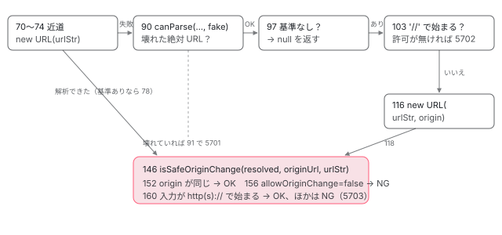

[目次](../README.md) › [SSR の守りと細部](README.md) › 第 1 回 / 全 10 回

# resolveUrl：サーバーで URL を解決する 1 つの関数と、SSRF の修正

> platform-server の url.ts の resolveUrl が、相対の URL・プロトコル相対（//example.com）・バックスラッシュ・権限部の無い http: を、どの行でどう扱うか。allowProtocolRelative と allowOriginChange、怪しい URL で投げる RuntimeError。プロトコル相対とバックスラッシュの修正（ede7c58a2aa・0b19c92d44f）、Unicode の空白（3e924cc8dbb）、権限部の無い URL（b3bb36ad873）を git show で読む。

angular/angular · 読了 約 13 分 · 発展 · [サイトで読む（デモが動きます）](https://angular-deep-dive-cyan.vercel.app/chapter/ssrx-resolve-url)

---

サーバーで描画するとき、Angular は「いま描いているページの URL」と「`HttpClient` に渡された URL」を、どちらも文字列から `URL` オブジェクトに直します。その変換は platform-server の中で **1 つの関数 `resolveUrl` に集められています**。この章では、その関数を 1 行ずつ読み、相対の URL・`//example.com` の形・バックスラッシュ・`http:foo` のような権限部（`//ホスト名` の部分）の無い URL を、どの行でどう扱うかを確かめます。2026 年の 4 月から 9 月に入った守りの修正を `git show` で順に読み、修正の前と後の `url.ts` に同じ入力を渡した記録を見ます。

読む対象は `packages/platform-server/src/url.ts`（163 行）と `errors.ts`、spec の `test/url_spec.ts` です。platform-server がサーバーでどんな注入器と DOM を用意するかという大きな流れは [platform-server の章](../platform/03-ssr-platform-server.md)に、`renderApplication` の流れは [renderApplication の章](../platform/02-ssr-render-application.md)にあります。ここではその章が「URL を解析する関数」と 1 文で通り過ぎた中身だけを書きます。

1. **1. resolveUrl**（この章）
2. [2. location と allowedHosts](02-ssrx-location-allowed-hosts.md)
3. [3. サーバーの HttpClient](03-ssrx-server-http.md)
4. [4. ホストとヘッダーの検査](04-ssrx-host-validation.md)
5. [5. プロキシのヘッダー](05-ssrx-proxy-headers.md)
6. [6. リダイレクトと URL の照合](06-ssrx-redirects.md)
7. [7. ロケールの選び方](07-ssrx-i18n-locale.md)
8. [8. Node のリクエストとレスポンス](08-ssrx-node-streams.md)
9. [9. アセットと重要 CSS](09-ssrx-assets-css.md)
10. [10. spec と issue](10-ssrx-tests-issues.md)

> [!TIP]
> **新卒エンジニアへ**
>
> SSRF（Server-Side Request Forgery）は、外から来た入力のせいで**サーバー自身が意図しない相手に HTTP を送ってしまう**問題です。SSR のサーバーは、リクエストの URL をもとに「自分の API」へ HTTP を送るので、URL の解決を 1 文字まちがえると、送り先のホストが入れ替わります。この章の修正は、どれも「送り先（origin）が勝手に変わらないようにする」ためのものです。

## 1. 3 つの決まりごと：正規表現 2 つとオプション 2 つ

📄 `angular/packages/platform-server/src/url.ts` L13–39 （▶ の行: 16, 23, 33, 38）

```ts
13 │ /**
14 │  * Matches http: or https:
15 │  */
16 ▶ const HTTP_OR_HTTPS_PROTOCOL_REGEXP = /^https?:/i;
17 │ 
18 │ /**
19 │  * Matches an HTTP or HTTPS URL that does not have an authority (i.e. missing `//` or `\\`).
20 │  * In the WHATWG standard, when resolved against a base of the same scheme, these URLs are relative.
21 │  * @internal
22 │  */
23 ▶ export const HTTP_OR_HTTPS_NO_AUTHORITY_REGEXP = /^https?:(?![/\\]{2})/i;
24 │ 
25 │ /**
26 │  * Options for {@link resolveUrl}.
27 │  */
28 │ export interface ResolveUrlOptions {
29 │   /**
30 │    * Allow protocol-relative URLs (e.g. `//example.com`).
31 │    * @default false
32 │    */
33 ▶   allowProtocolRelative?: boolean;
34 │   /**
35 │    * Allow origin changes.
36 │    * @default true
37 │    */
38 ▶   allowOriginChange?: boolean;
39 │ }
```

1. **16 行目：`HTTP_OR_HTTPS_PROTOCOL_REGEXP` は「`http:` か `https:` で始まる」**

   大文字と小文字を区別しません（`i`）。「利用者が自分で `http://…` と書いたか」を見分けるのに使います（3 節の 160 行目）。
2. **23 行目：`HTTP_OR_HTTPS_NO_AUTHORITY_REGEXP` は「`http:` のあとに `//` も `\\` も続かない」**

   `(?![/\\]{2})` は「直後に `/` か `\` が 2 つ並んでいない」という先読みです。`http:/foo`・`http:foo`・`http:\foo` に当たり、`http://foo` と `http:\\foo` には当たりません。19〜20 行目のコメントのとおり、WHATWG の URL の決まり（ブラウザと Node が使う URL の解析の標準）では、こうした URL は**同じスキームの基準 URL に対しては相対**として解決されます。この正規表現は b3bb36ad873（4 節）で足され、`export` されて http.ts からも使われます。
3. **33 行目：`allowProtocolRelative`（既定 `false`）**

   `//example.com/x` のように、スキームを書かずに `//` で始まる URL（プロトコル相対 URL）を受け付けるか。受け付けないときは 5702 を投げます（3 節の 103〜111 行目）。
4. **38 行目：`allowOriginChange`（既定 `true`）**

   解決した結果の origin（スキーム・ホスト・ポートの組）が、基準 URL と違ってよいか。`false` なら、絶対 URL で別のホストを書いても 5703 です（3 節の 156 行目）。

📄 `angular/packages/platform-server/src/errors.ts` L9–21 （▶ の行: 15–17, 20）

```ts
 9 │ /**
10 │  * The list of error codes used in runtime code of the `platform-server` package.
11 │  * Reserved error code range: 5700-5800.
12 │  */
13 │ export const enum RuntimeErrorCode {
14 │   GET_COOKIE_NOT_IMPLEMENTED = 5700,
15 ▶   INVALID_URL = 5701,
16 ▶   PROTOCOL_RELATIVE_URL_NOT_ALLOWED = 5702,
17 ▶   SUSPICIOUS_URL_CHANGE_ORIGIN = -5703,
18 │   DISABLED_DOM_EMULATION_IN_NON_BROWSER = 5704,
19 │   XHR_NOT_LOADED = 5705,
20 ▶   HOST_NOT_ALLOWED = 5706,
21 │ }
```
*platform-server のエラーコード（5700〜5800 を予約）*

url.ts が投げるのは 15〜17 行目の 3 つです。画面には `NG05701`・`NG05702`・`NG05703` と出ます。17 行目だけ **負の数**（`-5703`）です。`RuntimeError` は負のコードを「説明のページがある」印として扱い、本番のビルドでもメッセージの後ろに `Find more at https://…/errors/NG05703` を付けます（13b6bbd6a02、4 節）。20 行目の 5706 は `allowedHosts` の検査（[第 2 回](02-ssrx-location-allowed-hosts.md)）で使います。

## 2. resolveUrl を呼んでいる 5 か所

`grep -n "resolveUrl" packages/platform-server/src/*.ts` で、url.ts のほかに 4 つのファイル・5 か所が見つかります（8576f161ae4）。

| ファイルと行 | 呼び方 | 何の URL か | 詳しく |
| --- | --- | --- | --- |
| utils.ts 384（`validateAllowedHosts`） | `resolveUrl(url)`（基準なし） | `renderApplication` に渡された `url`。絶対 URL ならホスト名を `allowedHosts` と照合 | [第 2 回](02-ssrx-location-allowed-hosts.md) |
| server.ts 107（`_document`） | `resolveUrl(config.url, 'http://localhost')` | domino の文書の `location` にする URL | [第 2 回](02-ssrx-location-allowed-hosts.md) |
| location.ts 45（`ServerPlatformLocation` の constructor） | `resolveUrl(config.url, this.origin)` | `PlatformLocation` の `pathname` などに分ける URL | [第 2 回](02-ssrx-location-allowed-hosts.md) |
| location.ts 98（`replaceState`） | `resolveUrl(newUrl, this.origin, {allowOriginChange: false})` | Router がナビゲーションのたびに書き込む URL | [第 2 回](02-ssrx-location-allowed-hosts.md) |
| http.ts 96（`relativeUrlsTransformerInterceptorFn`） | `resolveUrl(request.url, baseUrl, {allowProtocolRelative: true})` | `HttpClient` に渡された URL | [第 3 回](03-ssrx-server-http.md) |

呼び方は 4 種類です。**基準なし**（検査のためだけに絶対 URL を読む）、**基準あり**（相対を解決する）、**プロトコル相対を許す**（`HttpClient` は CDN への `//cdn.example.com/…` を許したい）、**origin の変更を許さない**（ページの URL はほかのホストに移れない）。5 節の記録も、この 4 種類で取っています。

## 3. resolveUrl を上から読む

### オーバーロードと近道（50〜83 行目）

📄 `angular/packages/platform-server/src/url.ts` L50–83 （▶ の行: 50–51, 53, 55, 61, 63–64, 70, 72–73, 75, 78–79, 82）

```ts
50 ▶ export function resolveUrl(urlStr: string | undefined): URL | null;
51 ▶ export function resolveUrl(
52 │   urlStr: string | undefined,
53 ▶   origin: string | URL,
54 │   options?: ResolveUrlOptions,
55 ▶ ): URL;
56 │ export function resolveUrl(
57 │   urlStr: string | undefined,
58 │   origin?: string | URL,
59 │   options: ResolveUrlOptions = {},
60 │ ): URL | null {
61 ▶   const originUrl = typeof origin === 'string' ? new URL('/', origin) : origin;
62 │ 
63 ▶   if (!urlStr) {
64 ▶     return originUrl || null;
65 │   }
66 │ 
67 │   // Fast-path: if the URL is a valid, standard absolute URL, parse and return it immediately.
68 │   // URLs with no authority (e.g. `http:/path` or `http:path`) must be resolved against the origin when one is provided.
69 │   let resolved: URL | undefined;
70 ▶   if (!originUrl || !HTTP_OR_HTTPS_NO_AUTHORITY_REGEXP.test(urlStr)) {
71 │     try {
72 ▶       resolved = new URL(urlStr);
73 ▶     } catch {}
74 │   }
75 ▶   const {allowProtocolRelative = false, allowOriginChange = true} = options;
76 │ 
77 │   if (resolved) {
78 ▶     if (originUrl && !isSafeOriginChange(resolved, originUrl, urlStr, allowOriginChange)) {
79 ▶       throwSuspiciousUrlError(urlStr);
80 │     }
81 │ 
82 ▶     return resolved;
83 │   }
```

1. **50〜55 行目：型で「基準なしなら null があり得る」を表す**

   オーバーロード（同じ名前の関数に、引数の形ごとに別の型を付ける書き方）が 2 つあります。50 行目の基準なしの形は `URL | null` を返し、51〜55 行目の基準ありの形は `URL` を返します。基準があれば必ず解決できる（できなければ投げる）からです。56〜60 行目が実装です。
2. **61 行目：基準が文字列なら `new URL('/', origin)` にする**

   `'http://test.com/deep/path'` を渡しても、基準は `http://test.com/` になります。`URL` オブジェクトで渡されたときはそのままです（http.ts は `<base href>` を含む URL を渡すので、パスが残ります。[第 3 回](03-ssrx-server-http.md)）。
3. **63〜65 行目：空の URL は基準そのもの**

   `undefined` と `''` は、基準があれば基準の URL、無ければ `null`。
4. **70〜74 行目：近道。まず基準なしで `new URL(urlStr)` を試す**

   `https://api.example.com/x` のような絶対 URL は、ここで解析できます。`try` / `catch` で包んでいるので、相対 URL で例外が出ても次へ進みます。ただし 70 行目、**基準があるときに `http:foo` の形（23 行目の正規表現に当たる）なら近道をしません**。基準なしで解析すると、`http:/attacker.example/steal` は `http://attacker.example/steal` になってしまう（5 節の記録の「基準なし」の列）からです。これが b3bb36ad873 の修正です。
5. **77〜83 行目：近道で解析できたら、origin の変わり方を検査して返す**

   78 行目で基準があれば `isSafeOriginChange`（下の 146 行目）にかけ、だめなら 79 行目で 5703。基準なし（`validateAllowedHosts` の呼び方）なら検査せずに 82 行目で返します。



*resolveUrl の分かれ道。左から右へ進み、どこかで返すか投げる。行番号は url.ts（8576f161ae4）。*

### 相対 URL の解決（85〜123 行目）

📄 `angular/packages/platform-server/src/url.ts` L85–123 （▶ の行: 90–92, 97–98, 103–104, 106, 113, 116, 118–119, 122）

```ts
 85 │   // We identify and throw on malformed absolute URLs (like double port).
 86 │   // Per the WHATWG URL standard, parsing an input starting with a scheme (like 'http:') against
 87 │   // a standard base (like 'http://fake') ignores the base argument and parses strictly as an
 88 │   // absolute URL. Since it is malformed, the native URL constructor will throw a validation
 89 │   // error. Standard relative/protocol-relative paths parse successfully, allowing the flow to continue.
 90 ▶   if (!URL.canParse(urlStr, 'http://fake')) {
 91 ▶     throw new RuntimeError(
 92 ▶       RuntimeErrorCode.INVALID_URL,
 93 │       typeof ngDevMode === 'undefined' || ngDevMode ? `Invalid URL: ${urlStr}` : urlStr,
 94 │     );
 95 │   }
 96 │ 
 97 ▶   if (!originUrl) {
 98 ▶     return null;
 99 │   }
100 │ 
101 │   // Check if we have a legitimate protocol-relative URL (starts with '//' and not a duplicate/backslash bypass)
102 │   // and we are configured to allow and preserve standard cross-origin protocol-relative requests.
103 ▶   if (urlStr.startsWith('//')) {
104 ▶     if (!allowProtocolRelative) {
105 │       throw new RuntimeError(
106 ▶         RuntimeErrorCode.PROTOCOL_RELATIVE_URL_NOT_ALLOWED,
107 │         typeof ngDevMode === 'undefined' || ngDevMode
108 │           ? `Protocol relative URLs are not allowed in this context. URL: ${urlStr}`
109 │           : urlStr,
110 │       );
111 │     }
112 │ 
113 ▶     return new URL(urlStr, origin);
114 │   }
115 │ 
116 ▶   resolved = new URL(urlStr, origin);
117 │ 
118 ▶   if (!isSafeOriginChange(resolved, originUrl, urlStr, allowOriginChange)) {
119 ▶     throwSuspiciousUrlError(urlStr);
120 │   }
121 │ 
122 ▶   return resolved;
123 │ }
```

1. **90〜95 行目：壊れた絶対 URL は 5701**

   86〜89 行目のコメントのとおり、`http:` で始まる文字列は、基準（`http://fake`）を渡しても基準を無視して絶対 URL として解析されます。そこで `URL.canParse(urlStr, 'http://fake')` が `false` なら、`http://evil.com:80:80/path`（ポートが 2 つ）のような「壊れた絶対 URL」だと分かります。ここで投げておかないと、98 行目の `null`（相対なので検査しない）にすり抜けます。
2. **97〜99 行目：基準なしなら、相対 URL は `null`**

   `validateAllowedHosts` は `null` を見て「ホスト名が無いので検査しない」にします（[第 2 回](02-ssrx-location-allowed-hosts.md)）。
3. **103〜114 行目：`//` で始まるなら、許可が無ければ 5702**

   104 行目、`allowProtocolRelative` が `false` なら 106 行目の `PROTOCOL_RELATIVE_URL_NOT_ALLOWED`。許されていれば 113 行目で解決してそのまま返します。このとき origin は変わりますが（`//cdn.example.com` は別のホスト）、検査はしません。許したのは呼び出し側だからです。
4. **116〜122 行目：ふつうの相対 URL を解決し、origin の変わり方を検査**

   `/\attacker.com/x` と `\\attacker.com/x` はここに来ます。WHATWG の URL は `http` の URL の `\` を `/` と同じに扱うので、116 行目の結果のホストは `attacker.com` です。118 行目の `isSafeOriginChange` が `false` を返し、119 行目で 5703 になります。

### origin の変わり方の検査（125〜163 行目）

📄 `angular/packages/platform-server/src/url.ts` L125–163 （▶ の行: 130–131, 133, 152–153, 156–157, 160–161）

```ts
125 │ /**
126 │  * Throws a suspicious URL error indicating a security bypass attempt.
127 │  */
128 │ function throwSuspiciousUrlError(urlStr: string): never {
129 │   throw new RuntimeError(
130 ▶     RuntimeErrorCode.SUSPICIOUS_URL_CHANGE_ORIGIN,
131 ▶     typeof ngDevMode === 'undefined' || ngDevMode
132 │       ? `URL ${urlStr} changed origin unexpectedly. This is suspicious and may indicate a security bypass attempt.`
133 ▶       : urlStr,
134 │   );
135 │ }
136 │ 
137 │ /**
138 │  * Checks if the origin has changed in a safe way.
139 │  *
140 │  * @param resolved The resolved URL.
141 │  * @param origin The origin URL.
142 │  * @param urlStr The URL string.
143 │  * @param allowOriginChange Whether to allow origin changes.
144 │  * @returns True if the origin has changed in a safe way, false otherwise.
145 │  */
146 │ function isSafeOriginChange(
147 │   resolved: URL,
148 │   origin: URL,
149 │   urlStr: string,
150 │   allowOriginChange: boolean,
151 │ ): boolean {
152 ▶   if (origin.origin === resolved.origin) {
153 ▶     return true;
154 │   }
155 │ 
156 ▶   if (!allowOriginChange) {
157 ▶     return false;
158 │   }
159 │ 
160 ▶   return (
161 ▶     HTTP_OR_HTTPS_PROTOCOL_REGEXP.test(urlStr) && !HTTP_OR_HTTPS_NO_AUTHORITY_REGEXP.test(urlStr)
162 │   );
163 │ }
```

1. **152〜154 行目：origin が同じなら安全**

   `origin` は `URL` の読み取り専用のプロパティで、`http://test.com` のようにスキーム・ホスト・ポートだけの文字列です。パスは比べません。
2. **156〜158 行目：`allowOriginChange: false` なら、違えば必ずだめ**

   cf9d7fa0f80 が足した分岐です（[第 2 回](02-ssrx-location-allowed-hosts.md)）。
3. **160〜162 行目：違ってよいのは「入力そのものが `http(s)://` で始まる」ときだけ**

   解決した**結果**ではなく、**入力の文字列**を見ます。`ht\ntp://evil.com/path` は、WHATWG の URL が改行とタブを取り除くので `http://evil.com/path` として解析されますが、入力は `ht` の次が改行なので 16 行目の正規表現に当たらず、5703 です。`http:/evil.com` の形（23 行目に当たる）も、ここで「自分で絶対 URL を書いた」とはみなしません。
4. **130〜133 行目：本番ではメッセージが URL だけ**

   `ngDevMode`（開発モードの印）が `false` だと、文章を省いて URL だけをメッセージにします。コードが負なので、それでもドキュメントへのリンクは付きます（1 節）。

### WHATWG の URL が文字をどう扱うか（Node で確かめた）

resolveUrl の守りは「WHATWG の URL がどう解析するか」に正確に合わせてあります。Node（v24.22.1）の `new URL(input, 'http://test.com/')` で確かめた事実です。

- **バックスラッシュ**：`http`・`https` などの特別なスキームでは `\` は `/` と同じ。`/\attacker.com` は `//attacker.com` と同じく、ホストの指定になります。
- **タブと改行**：文字列のどこにあっても取り除かれます（`ht\ttp://` → `http://`）。
- **前後の空白**：取り除かれるのは U+0000〜U+0020（C0 制御文字と半角の空白）だけです。下の表のとおり、`String.prototype.trim()` が取り除く文字とは**ずれています**。
- **権限部の無い `http:foo`**：基準が同じスキームなら相対（`http://test.com/foo`）、基準が無いか違うスキームなら `http://foo/` です。

| 先頭の 1 文字 | `trim()` が取り除くか | `new URL(文字 + '//attacker.example/x', 'http://test.com/')` |
| --- | --- | --- |
| `U+0020` | 取り除く | http://attacker.example/x |
| `U+0009` | 取り除く | http://attacker.example/x |
| `U+000A` | 取り除く | http://attacker.example/x |
| `U+000D` | 取り除く | http://attacker.example/x |
| `U+0000` | 残す | http://attacker.example/x |
| `U+001F` | 残す | http://attacker.example/x |
| `U+00A0` | 取り除く | http://test.com/%C2%A0//attacker.example/x |
| `U+FEFF` | 取り除く | http://test.com/%EF%BB%BF//attacker.example/x |
| `U+3000` | 取り除く | http://test.com/%E3%80%80//attacker.example/x |
| `U+2028` | 取り除く | http://test.com/%E2%80%A8//attacker.example/x |

U+00A0（改行しない空白）と U+FEFF（BOM）は、`trim()` では消えるのに、WHATWG の URL では消えずにパスの文字（`%C2%A0`）になります。つまり `" //attacker.example/collect"` は、URL としては「同じ origin の、変な名前のパス」です。ところが 3e924cc8dbb の前の resolveUrl は、先に `trim()` してから 103 行目の `startsWith('//')` を見ていたので、これを「プロトコル相対 URL」と取りちがえ、`allowProtocolRelative` の呼び方では `http://attacker.example/collect` に解決していました（5 節の記録の「3e924cc8dbb の前」の列）。逆に U+0000 と U+001F は `trim()` では消えず、WHATWG では消えます。今の resolveUrl は `trim()` をしないので、この行に来た入力は 116 行目で WHATWG のとおりに解決され、origin が変われば 118 行目で止まります。

## 4. 修正を git show で読む

url.ts の歴史は短く、すべて 2026 年です。`git log -- packages/platform-server/src/url.ts` の古い順に読みます（日付は author の日付）。

1. **ede7c58a2aa（04-14）：location.ts の `parseUrl` が `new URL(urlStr, origin)` をやめる**

   url.ts ができる前です。本文の例は Express の `req.url` をそのまま `renderApplication` の `url` に渡すサーバーで、`http://localhost:4000//evil.com` へのリクエストの `req.url` は `//evil.com` になる、と書いています。`new URL('//evil.com', origin)` はホストを `evil.com` に置き換えます。直し方は「`/` で始まるなら `origin + urlStr` を基準なしで解析する」でした（文字列をつなぐので、`http://localhost//evil.com` となりパスに残る）。spec は `neutralizes hostname hijack attempts` で、`/\attacker.com/deep/path` と `//attacker.com/deep/path` の `hostname` が空で `pathname` がそのままになることを確かめました。
2. **1307ff355c9（05-27）：url.ts が生まれる**

   location.ts・server.ts・utils.ts の 3 か所の URL の解析を 1 つの `parseUrl` に集めました。中身は「先頭の `/` と `\` の並びを 1 つの `/` にまとめる」正規表現 `/^[/\\]+/` と、「スキームのあとに `//` か `\\` があるのに解析できない URL は投げる」の 2 つです。本文の 3 つ目の箇条は、domino（サーバーの DOM）は壊れた絶対 URL を受け入れるが WHATWG は受け入れない、そのずれで `allowedHosts` の検査をすり抜けさせない、です。
3. **e14d34e9eec（05-29）：`resolveUrl` に改名し、オプションと `trim()` を入れる**

   本文は 1 行（「前後の空白を取り除いて入力をそろえる」）です。`allowProtocolRelative` ができ、http.ts の手書きの検査（140c4d04cb3、[第 3 回](03-ssrx-server-http.md)）もこの関数に置き換わりました。

   📄 `git show e14d34e9eec -- packages/platform-server/src/url.ts`

   ```ts
   commit e14d34e9eec
   Date:   2026-05-29

       refactor(platform-server): clean up and simplify url resolution utility

   diff --git a/packages/platform-server/src/url.ts b/packages/platform-server/src/url.ts
   index 6eaa1ebd2ec..ad828ffeb76 100644
   --- a/packages/platform-server/src/url.ts
   +++ b/packages/platform-server/src/url.ts
   @@ -6,26 +6,53 @@
     * found in the LICENSE file at https://angular.dev/license
     */
    
   -const LEADING_SLASHES_REGEX = /^[/\\]+/;
   +/**
   + * Options for {@link resolveUrl}.
   + */
   +export interface ResolveUrlOptions {
   +  /**
   +   * Allow protocol-relative URLs (e.g. `//example.com`).
   +   */
   +  allowProtocolRelative?: boolean;
   +}
    
    /**
   - * Parses a URL string and returns a resolved WHATWG URL object.
   - * If no origin is provided, it parses and returns the URL only if it is a valid absolute URL;
   - * otherwise it returns `null` (or throws if the URL is a malformed absolute URL).
   - * If an origin is provided, relative URLs and protocol-relative URLs are normalized and resolved against it.
   + * Resolves a URL string.
   + *
   + * If an origin is provided, the URL is resolved against it. Otherwise, the URL is parsed as-is.
   + * @param urlStr The URL to resolve.
   + * @param origin The origin to resolve the URL against.
   + * @param options Options for resolving the URL.
   + * @returns A resolved URL object.
     */
   -export function parseUrl(urlStr: string | undefined): URL | null;
   -export function parseUrl(urlStr: string | undefined, origin: string): URL;
   -export function parseUrl(urlStr: string | undefined, origin?: string): URL | null {
   +export function resolveUrl(urlStr: string | undefined): URL | null;
   +export function resolveUrl(
   +  urlStr: string | undefined,
   +  origin: string | URL,
   +  options?: ResolveUrlOptions,
   +): URL;
   +export function resolveUrl(
   +  urlStr: string | undefined,
   +  origin?: string | URL,
   +  options: ResolveUrlOptions = {},
   +): URL | null {
      if (!urlStr) {
        return origin !== undefined ? new URL('/', origin) : null;
      }
    
   -  if (URL.canParse(urlStr)) {
   +  urlStr = urlStr.trim();
   +
   +  // Fast-path: if the URL is a valid, standard absolute URL, parse and return it immediately.
   +  try {
        return new URL(urlStr);
   -  }
   +  } catch {}
    
   -  if (/^[a-zA-Z][a-zA-Z0-9+.-]*:(\/\/|\\\\)/.test(urlStr)) {
   +  // We identify and throw on malformed absolute URLs (like double port).
   +  // Per the WHATWG URL standard, parsing an input starting with a scheme (like 'http:') against
   +  // a standard base (like 'http://fake') ignores the base argument and parses strictly as an
   +  // absolute URL. Since it is malformed, the native URL constructor will throw a validation
   +  // error. Standard relative/protocol-relative paths parse successfully, allowing the flow to continue.
   +  if (!URL.canParse(urlStr, 'http://fake')) {
        throw new Error(`Invalid URL: ${urlStr}`);
      }
    
   @@ -33,10 +60,39 @@ export function parseUrl(urlStr: string | undefined, origin?: string): URL | nul
        return null;
      }
    
   -  let normalizedPath = urlStr.replace(LEADING_SLASHES_REGEX, '/');
   -  if (normalizedPath[0] !== '/') {
   -    normalizedPath = `/${normalizedPath}`;
   +  const {allowProtocolRelative = false} = options;
   +
   +  // Check if we have a legitimate protocol-relative URL (starts with '//' and not a duplicate/backslash bypass)
   +  // and we are configured to allow and preserve standard cross-origin protocol-relative requests.
   +  const isProtocolRelative =
   +    allowProtocolRelative &&
   +    urlStr[0] === '/' &&
   +    urlStr[1] === '/' &&
   +    urlStr.length > 2 &&
   +    urlStr[2] !== '/' &&
   +    urlStr[2] !== '\\';
   +
   +  if (isProtocolRelative) {
   +    return new URL(urlStr, origin);
   +  }
   +
   +  // Safe relative path preservation: if a relative path has no leading forward or backward slashes,
   +  // we do not prepend any slash so the native URL constructor can resolve it correctly relative
   +  // to trailing-slash sub-paths (e.g., 'testing' against 'http://localhost/foo/' -> 'http://localhost/foo/testing').
   +  const startsWithSlash = urlStr[0] === '/' || urlStr[0] === '\\';
   +  if (!startsWithSlash) {
   +    return new URL(urlStr, origin);
   +  }
   +
   +  // For other relative inputs starting with slashes, we collapse all consecutive leading forward/backward
   +  // slashes to a single forward slash. This guarantees consistent same-origin path representation and
   +  // blocks any hostname hijack or takeover attempts.
   +  let startIdx = 0;
   +  while (startIdx < urlStr.length && (urlStr[startIdx] === '/' || urlStr[startIdx] === '\\')) {
   +    startIdx++;
      }
   +  const pathWithoutLeadingSlashes = urlStr.slice(startIdx);
   +  const normalizedPath = '/' + pathWithoutLeadingSlashes;
    
      return new URL(normalizedPath, origin);
    }
   ```
   *+ の行が足された行、- の行が消えた行*
4. **0b19c92d44f（05-29）：「まとめて直す」から「投げる」へ**

   本文は「先頭のスラッシュをまとめるやり方では、改行で崩したスキームや、相対に見えるバックスラッシュのパスで、まだ origin が乗っ取られうる」と書き、3 つの方針を挙げています。許可の無いプロトコル相対 URL は投げる（今の 103〜111 行目）、解決した URL の origin が変わったら投げる（`isSafeOriginChange`）、origin を変えてよいのは入力に `http(s):` を書いたときだけ（今の 160 行目の前半）。spec では、`/\attacker.com` を「`/attacker.com` というパスにする」と確かめていた it が、「5703 で投げる」に書き換わりました。**入力をこっそり直して通すのをやめ、怪しい入力は止める**方針への転換です。
5. **abfb04a3421・cf9d7fa0f80（06-05）・13b6bbd6a02（07-08）：エラーの形と `allowOriginChange`**

   abfb04a3421 で `Error` が `RuntimeError` とコードになり、本番では URL だけをメッセージにしました。cf9d7fa0f80 で `allowOriginChange` が足されました（[第 2 回](02-ssrx-location-allowed-hosts.md)）。13b6bbd6a02 は、本番で `NG05703: https://…/` とだけ出て原因が分からないという #69667 を受けて、5703 を負の数にし、エラーのページ（adev の `NG05703.md`）を足しました。
6. **3e924cc8dbb（08-25）：`trim()` をやめる**

   本文は「`String.prototype.trim()` で削るのをやめ、URL の解析と解決を WHATWG の標準に合わせる」の 1 文です。差分は 2 行の削除だけで、spec に「Unicode の空白をプロトコル相対 URL に変えない」it が足されました（6 節）。

   📄 `git show 3e924cc8dbb -- packages/platform-server/src/url.ts`

   ```ts
   commit 3e924cc8dbb
   Date:   2026-08-25

       fix(platform-server): avoid stripping unicode whitespace during url resolution

   diff --git a/packages/platform-server/src/url.ts b/packages/platform-server/src/url.ts
   index 8dad4ac18c8..d0639980db8 100644
   --- a/packages/platform-server/src/url.ts
   +++ b/packages/platform-server/src/url.ts
   @@ -57,8 +57,6 @@ export function resolveUrl(
        return originUrl || null;
      }
    
   -  urlStr = urlStr.trim();
   -
      // Fast-path: if the URL is a valid, standard absolute URL, parse and return it immediately.
      let resolved: URL | undefined;
      try {
   ```
7. **b3bb36ad873（08-28）：権限部の無い `http:` を相対として扱う（#70447）**

   本文は「WHATWG では `http:/path` や `http:path` は同じスキームの origin に対して相対になる。ところが http.ts のインターセプタはスキームのある URL をすべて絶対とみなして素通しし、Node の `fetch` がパスをホストとして解析していた」と書いています。url.ts では 23 行目の正規表現を足し、70 行目で近道を止め、160〜162 行目の条件を締めました。spec は 88〜126 行目の 2 つの it です。
8. **d7d81e189d2（09-30、../angular-main だけ）：正規化のあとのパスも見る（#71076）**

   本文は「生の文字列が `//` で始まるかしか見ていなかった。`/.//evil.test` のような入力は、WHATWG のドット区切りの正規化（`/.` や `/..` を取り除く処理）で先頭の `/.` が消え、`//` で始まるパスが残る。これが `ServerPlatformLocation` を壊し、プロトコル相対のオープンリダイレクトになった」と書いています。直し方は、解決した **結果の `pathname`** が `//` で始まるかも見ることです。ブラウザはパスが `//` で始まる URL をリダイレクト先に使うと、別のホストとして読むからです。../angular（8576f161ae4）とこのサイトの依存 22.1.6 には入っていません。`git tag --contains` で調べると、22.2 系への取り込み（928dcfd2582）は v22.2.1 から入っています。

   📄 `git show d7d81e189d2 -- packages/platform-server/src/url.ts（../angular-main）`

   ```
   commit d7d81e189d2
   Date:   2026-09-30

       fix(platform-server): reject protocol-relative paths in resolveUrl

   diff --git a/packages/platform-server/src/url.ts b/packages/platform-server/src/url.ts
   index 2aea97d340f..0f3cd3335df 100644
   --- a/packages/platform-server/src/url.ts
   +++ b/packages/platform-server/src/url.ts
   @@ -75,6 +75,10 @@ export function resolveUrl(
      const {allowProtocolRelative = false, allowOriginChange = true} = options;
    
      if (resolved) {
   +    if (isDisallowedProtocolRelative(resolved, allowProtocolRelative)) {
   +      throwProtocolRelativeUrlError(urlStr);
   +    }
   +
        if (originUrl && !isSafeOriginChange(resolved, originUrl, urlStr, allowOriginChange)) {
          throwSuspiciousUrlError(urlStr);
        }
   @@ -102,12 +106,7 @@ export function resolveUrl(
      // and we are configured to allow and preserve standard cross-origin protocol-relative requests.
      if (urlStr.startsWith('//')) {
        if (!allowProtocolRelative) {
   -      throw new RuntimeError(
   -        RuntimeErrorCode.PROTOCOL_RELATIVE_URL_NOT_ALLOWED,
   -        typeof ngDevMode === 'undefined' || ngDevMode
   -          ? `Protocol relative URLs are not allowed in this context. URL: ${urlStr}`
   -          : urlStr,
   -      );
   +      throwProtocolRelativeUrlError(urlStr);
        }
    
        return new URL(urlStr, origin);
   @@ -115,6 +114,10 @@ export function resolveUrl(
    
      resolved = new URL(urlStr, origin);
    
   +  if (isDisallowedProtocolRelative(resolved, allowProtocolRelative)) {
   +    throwProtocolRelativeUrlError(urlStr);
   +  }
   +
      if (!isSafeOriginChange(resolved, originUrl, urlStr, allowOriginChange)) {
        throwSuspiciousUrlError(urlStr);
      }
   @@ -122,6 +125,29 @@ export function resolveUrl(
      return resolved;
    }
    
   +/**
   + * Checks if the resolved URL has a disallowed protocol-relative path.
   + *
   + * @param resolved The resolved URL.
   + * @param allowProtocolRelative Whether protocol-relative URLs are allowed.
   + * @returns True if the URL has a disallowed protocol-relative path, false otherwise.
   + */
   +function isDisallowedProtocolRelative(resolved: URL, allowProtocolRelative: boolean): boolean {
   +  return !allowProtocolRelative && resolved.pathname.startsWith('//');
   +}
   +
   +/**
   + * Throws a protocol-relative URL error indicating that protocol-relative URLs are not allowed.
   + */
   +function throwProtocolRelativeUrlError(urlStr: string): never {
   +  throw new RuntimeError(
   +    RuntimeErrorCode.PROTOCOL_RELATIVE_URL_NOT_ALLOWED,
   +    typeof ngDevMode === 'undefined' || ngDevMode
   +      ? `Protocol relative URLs are not allowed in this context. URL: ${urlStr}`
   +      : urlStr,
   +  );
   +}
   +
    /**
     * Throws a suspicious URL error indicating a security bypass attempt.
     */
   ```

   足された `isDisallowedProtocolRelative` は、近道（77 行目のあと）にも入っています。そのため ../angular-main では、**基準なしの呼び方でも**`http://test.com/.//x` のような「パスが `//` で始まる絶対 URL」は 5702 になります（5 節の記録で `abs-dot-proto` を選ぶと分かります）。`validateAllowedHosts` は基準なしで呼ぶので、`renderApplication` の `url` にそういう URL を渡したときも、22.1.6 と ../angular-main で結果が変わります。

## 5. DEMO：同じ入力を 4 つの版の resolveUrl に渡した記録

> **🧪 DEMO — 入力を選ぶと、4 つの呼び方 × 4 つの版の結果が出ます（記録の再生）**
>
> これは Node で動かした記録です。ページの上では resolveUrl は動きません。基準は `http://test.com`。「3e924cc8dbb の前」「b3bb36ad873 の前」は `git show <sha>^:packages/platform-server/src/url.ts` で取り出した、その修正の直前の url.ts です。
>
> 入力 `"/deep/path?query#hash"` WHATWG（基準なし）：TypeError（解析できない）WHATWG（基準あり）：http://test.com/deep/path?query#hash
>
> ▶ [このデモはサイトで動かせます](https://angular-deep-dive-cyan.vercel.app/chapter/ssrx-resolve-url)

見どころです。

- `"/\\attacker.com/deep/path"` と `"\\\\attacker.com/deep/path"`：WHATWG では `attacker.com` がホストになりますが、基準ありのどの呼び方でも 5703（118 行目）。基準なしは `null` です。
- `"http:/attacker.example/steal"`：「b3bb36ad873 の前」は基準ありでも `http://attacker.example/steal`。今は `http://test.com/attacker.example/steal`（70 行目）。
- `" //attacker.example/collect"`：「3e924cc8dbb の前」の `allowProtocolRelative` の行だけ `http://attacker.example/collect`。今は同じ origin のパスです。
- `"ht\ntp://evil.com/path"`：基準なしでは `http://evil.com/path`（`allowedHosts` の検査にはこのホスト名が渡る）、基準ありでは 5703（160 行目）。
- `"/.//attacker.example/collect"`：../angular-main だけ 5702。8576f161ae4 ではパスが `//attacker.example/collect` の URL になります。

📄 `scratchpad/ssrx-demo/ssrx-resolve-url/record.ts`

```ts
// ../angular（8576f161ae4）と ../angular-main（74961c66242）の url.ts の resolveUrl、
// それに 2 つの修正の直前の url.ts（git show 3e924cc8dbb^:… と git show b3bb36ad873^:… で取り出したもの）に、
// 同じ入力を同じ呼び方で渡し、返った URL の href か、投げられた RuntimeError のコードを書き留める。
// あわせて、resolveUrl を通さない WHATWG の URL（new URL(input, base)）の結果も書く。
import { resolveUrl as resolveSrc } from 'ng-src/packages/platform-server/src/url';
import { resolveUrl as resolveMain } from 'ng-main/packages/platform-server/src/url';
import { resolveUrl as resolveBeforeTrimFix } from './before-3e924cc8dbb/url';
import { resolveUrl as resolveBeforeNoAuthFix } from './before-b3bb36ad873/url';

const ORIGIN = 'http://test.com';

// 入力。どれも url_spec.ts・integration_spec.ts・修正のコミットにある形か、ふつうの相対 URL。
const INPUTS: Array<[id: string, input: string]> = [
  ['abs-path', '/deep/path?query#hash'],
  ['rel-path', 'deep/path'],
  ['abs-same', 'http://test.com/other-path'],
  ['abs-other', 'http://other.com/deep/path'],
  ['proto-rel', '//attacker.example/collect'],
  ['slash-bs', '/\\attacker.com/deep/path'],
  ['bs-bs', '\\\\attacker.com/deep/path'],
  ['bs-path', '\\testing'],
  ['no-auth-1', 'http:/attacker.example/steal'],
  ['no-auth-2', 'http:attacker.example/steal'],
  ['no-auth-bs', 'http:\\attacker.example/steal'],
  ['nl-scheme', 'ht\ntp://evil.com/path'],
  ['tab-scheme', 'ht\ttp://evil.com/deep/path'],
  ['space', '  /deep/path  '],
  ['space-proto', ' //attacker.example/collect'],
  ['nbsp', ' //attacker.example/collect'],
  ['bom', '//attacker.example/collect'],
  ['double-port', 'http://evil.com:80:80/path'],
  ['dot-proto', '/.//attacker.example/collect'],
  ['dotdot-proto', '/..//attacker.example/collect'],
  ['abs-dot-proto', 'http://test.com/.//attacker.example/collect'],
];

// 呼び方。resolveUrl を呼んでいる 4 か所が使う形と同じ。
const CALLS: Array<[id: string, call: (f: typeof resolveSrc, s: string) => URL | null]> = [
  ['noOrigin', (f, s) => f(s)], // utils.ts の validateAllowedHosts
  ['origin', (f, s) => f(s, ORIGIN)], // location.ts の constructor・server.ts の _document
  ['protoRel', (f, s) => f(s, ORIGIN, { allowProtocolRelative: true })], // http.ts のインターセプタ
  ['sameOrigin', (f, s) => f(s, ORIGIN, { allowOriginChange: false })], // location.ts の replaceState
];

function run(f: typeof resolveSrc, call: (typeof CALLS)[number][1], s: string): string {
  try {
    const u = call(f, s);
    return u === null ? 'null' : u.href;
  } catch (e: any) {
    const m = /^(NG0\d+)/.exec(e.message);
    return m ? m[1] : `${e.name}: ${e.message}`;
  }
}

function whatwg(s: string, base?: string): string {
  try {
    return new URL(s, base).href;
  } catch (e: any) {
    return 'TypeError（解析できない）';
  }
}

const rows = INPUTS.map(([id, input]) => ({
  id,
  input: JSON.stringify(input),
  whatwgNoBase: whatwg(input),
  whatwgBase: whatwg(input, ORIGIN + '/'),
  src: Object.fromEntries(CALLS.map(([c, call]) => [c, run(resolveSrc, call, input)])),
  main: Object.fromEntries(CALLS.map(([c, call]) => [c, run(resolveMain, call, input)])),
  beforeTrimFix: Object.fromEntries(CALLS.map(([c, call]) => [c, run(resolveBeforeTrimFix, call, input)])),
  beforeNoAuthFix: Object.fromEntries(CALLS.map(([c, call]) => [c, run(resolveBeforeNoAuthFix, call, input)])),
}));

// WHATWG の URL が文字列の前後から取り除く文字（C0 制御文字と空白 U+0000〜U+0020）と、
// String.prototype.trim() が取り除く文字の違いを、1 文字ずつ確かめる。
const ws = [' ', '\t', '\n', '\r', '\u0000', '\u001F', ' ', '', '　', '
'];
const whitespace = ws.map((c) => {
  const s = c + '//attacker.example/x';
  return {
    char: 'U+' + c.codePointAt(0)!.toString(16).toUpperCase().padStart(4, '0'),
    trimRemoves: s.trim() !== s,
    whatwg: new URL(s, ORIGIN + '/').href,
  };
});

console.log(JSON.stringify({ node: process.version, origin: ORIGIN, rows, whitespace }, null, 1));

```
*記録を取ったスクリプトの全文*

📄 `scratchpad/ssrx-demo/_shared-a/build.mjs`

```js
// 使い方: RESEARCH_ROOT=<angular-research の場所> node build.mjs <記録のスクリプト.ts> <出力.mjs>
// 記録のスクリプトと、そこから import した ../angular（8576f161ae4）・../angular-main（74961c66242）の
// ソースを 1 つの ESM に束ねる。ソースのファイルは読むだけ（書き換えない）。
// '@angular/*' と 'rxjs' は、どのファイルから import されても angular-deep-dive/node_modules（22.1.6）から読む。
import { createRequire } from 'node:module';
const ROOT = process.env.RESEARCH_ROOT;
const SITE = `${ROOT}/angular-deep-dive`;
const { build } = createRequire(`${SITE}/package.json`)('esbuild');
const [entry, out] = process.argv.slice(2);
const sitePackages = {
  name: 'site-packages',
  setup(b) {
    // 'ng-src/…' → ../angular/…、'ng-main/…' → ../angular-main/…
    b.onResolve({ filter: /^ng-(src|main)\// }, (args) => {
      const [head, ...rest] = args.path.split('/');
      const repo = head === 'ng-src' ? 'angular' : 'angular-main';
      return { path: `${ROOT}/${repo}/${rest.join('/')}.ts` };
    });
    b.onResolve({ filter: /^(@angular\/|rxjs)/ }, async (args) => {
      if (args.pluginData === 'site') return undefined;
      const r = await b.resolve(args.path, { kind: args.kind, resolveDir: SITE, pluginData: 'site' });
      return r.errors.length ? undefined : r;
    });
  },
};
await build({
  entryPoints: [entry], outfile: out, bundle: true, platform: 'node', format: 'esm', target: 'es2022',
  plugins: [sitePackages], logLevel: 'warning',
  tsconfigRaw: { compilerOptions: { experimentalDecorators: true, useDefineForClassFields: false } },
  banner: { js: "import { createRequire as __cr } from 'module'; const require = __cr(import.meta.url);" },
});

```
*ソースを esbuild で束ねるスクリプトの全文（@angular/core はこのサイトの 22.1.6）*

## ここまでの呼び出し

- 👤 `renderApplication(bootstrap, { url, allowedHosts })` / `http.get(url)` — あなたのサーバーとアプリ
  - `resolveUrl(urlStr, origin?, options?)` — url.ts 56
    - `new URL('/', origin)` — url.ts 61 — *基準を origin の根に*
    - `new URL(urlStr)` — url.ts 72 — *近道。基準ありで http:foo の形なら飛ばす（70）*
    - `URL.canParse(urlStr, 'http://fake')` — url.ts 90 — *壊れた絶対 URL は NG05701*
    - `urlStr.startsWith('//')` — url.ts 103 — *許可が無ければ NG05702*
    - `new URL(urlStr, origin)` — url.ts 116
    - `isSafeOriginChange(resolved, originUrl, urlStr, allowOriginChange)` — url.ts 146 — *だめなら throwSuspiciousUrlError → NG05703*

## テストと直し方

### spec と it

| it（packages/platform-server/test/url\_spec.ts） | 行 | この章のどこ |
| --- | --- | --- |
| `should throw on backslash-prefixed hijack attempts` | 20 | 116〜120 行目 |
| `should throw when allowOriginChange is false and origin changes` | 33 | 156 行目 |
| `should throw an error for malformed absolute URLs`（基準あり・なし） | 51・145 | 90〜95 行目 |
| `should throw on obfuscated protocols attempting to change origin` | 67 | 160 行目 |
| `should not trim unicode whitespace into protocol-relative URLs` | 72 | 3e924cc8dbb |
| `should resolve scheme URLs without authority against origin of the same scheme`・`… when origin scheme differs` | 88・110 | b3bb36ad873（70・160〜162 行目） |
| `should return null for relative paths` | 130 | 97〜99 行目 |

📄 `angular/packages/platform-server/test/url_spec.ts` L11–49 （▶ の行: 12, 20–21, 23, 33, 35–36）

```ts
11 │ describe('resolveUrl', () => {
12 ▶   describe('with origin', () => {
13 │     it('should resolve relative paths against origin', () => {
14 │       const url = resolveUrl('/deep/path?query#hash', 'http://test.com');
15 │       expect(url.href).toBe('http://test.com/deep/path?query#hash');
16 │       expect(url.search).toBe('?query');
17 │       expect(url.hash).toBe('#hash');
18 │     });
19 │ 
20 ▶     it('should throw on backslash-prefixed hijack attempts', () => {
21 ▶       const urls = ['/\\attacker.com/deep/path', '\\\\attacker.com/deep/path'];
22 │       for (const url of urls) {
23 ▶         expect(() => resolveUrl(url, 'http://test.com')).toThrowError(/NG05703/);
24 │       }
25 │     });
26 │ 
27 │     it('should resolve absolute URLs ignoring origin', () => {
28 │       const url = resolveUrl('http://other.com/deep/path', 'http://test.com');
29 │       expect(url.href).toBe('http://other.com/deep/path');
30 │       expect(url.origin).toBe('http://other.com');
31 │     });
32 │ 
33 ▶     it('should throw when allowOriginChange is false and origin changes', () => {
34 │       expect(() =>
35 ▶         resolveUrl('http://other.com/deep/path', 'http://test.com', {allowOriginChange: false}),
36 ▶       ).toThrowError(/NG05703/);
37 │     });
38 │ 
39 │     it('should resolve same origin when allowOriginChange is false', () => {
40 │       const url = resolveUrl('http://test.com/other-path', 'http://test.com', {
41 │         allowOriginChange: false,
42 │       });
43 │       expect(url.href).toBe('http://test.com/other-path');
44 │     });
45 │ 
46 │     it('should resolve relative paths when allowOriginChange is false', () => {
47 │       const url = resolveUrl('/other-path', 'http://test.com', {allowOriginChange: false});
48 │       expect(url.href).toBe('http://test.com/other-path');
49 │     });
```

📄 `angular/packages/platform-server/test/url_spec.ts` L51–86 （▶ の行: 53, 61–62, 68–69, 73, 76–77, 79–80, 82–84）

```ts
51 │     it('should throw an error for malformed absolute URLs', () => {
52 │       const malformedUrls = [
53 ▶         'http://evil.com:80:80/path',
54 │         'https://evil.com:80:80/path',
55 │         'http://[google.com]/path',
56 │         'http://google.com:port/path',
57 │         'http://google.com:80a/path',
58 │       ];
59 │ 
60 │       for (const url of malformedUrls) {
61 ▶         expect(() => resolveUrl(url, 'http://test.com')).toThrowError(
62 ▶           new RegExp(`Invalid URL: ${url.replace(/[.*+?^${}()|[\]\\]/g, '\\$&')}`),
63 │         );
64 │       }
65 │     });
66 │ 
67 │     it('should throw on obfuscated protocols attempting to change origin', () => {
68 ▶       const url = 'ht\ntp://evil.com/path';
69 ▶       expect(() => resolveUrl(url, 'http://test.com')).toThrowError(/NG05703/);
70 │     });
71 │ 
72 │     it('should not trim unicode whitespace into protocol-relative URLs', () => {
73 ▶       const urls = ['\u00A0//attacker.example/collect', '\uFEFF//attacker.example/collect'];
74 │ 
75 │       for (const urlStr of urls) {
76 ▶         const urlWithProtocolRelative = resolveUrl(urlStr, 'http://test.com', {
77 ▶           allowProtocolRelative: true,
78 │         });
79 ▶         expect(urlWithProtocolRelative.origin).toBe('http://test.com');
80 ▶         expect(urlWithProtocolRelative.pathname).toContain('//attacker.example/collect');
81 │ 
82 ▶         const urlWithoutProtocolRelative = resolveUrl(urlStr, 'http://test.com');
83 ▶         expect(urlWithoutProtocolRelative.origin).toBe('http://test.com');
84 ▶         expect(urlWithoutProtocolRelative.pathname).toContain('//attacker.example/collect');
85 │       }
86 │     });
```

72〜86 行目は、同じ入力を `allowProtocolRelative: true`（76〜77 行目）とオプションなし（82 行目）の 2 通りで呼び、どちらも origin が `http://test.com` のまま（79・83 行目）であることを確かめます。5 節の記録の「3e924cc8dbb の前」の列が示すとおり、修正の前の url.ts では 76 行目の呼び方で origin が変わるので、79 行目が落ちます。

📄 `angular/packages/platform-server/test/url_spec.ts` L88–126 （▶ の行: 89–91, 105–106, 111, 123）

```ts
 88 │     it('should resolve scheme URLs without authority against origin of the same scheme', () => {
 89 ▶       const urlA = resolveUrl('http:/attacker.example/steal', 'http://test.com');
 90 ▶       expect(urlA.origin).toBe('http://test.com');
 91 ▶       expect(urlA.pathname).toBe('/attacker.example/steal');
 92 │ 
 93 │       const urlB = resolveUrl('http:attacker.example/steal', 'http://test.com');
 94 │       expect(urlB.origin).toBe('http://test.com');
 95 │       expect(urlB.pathname).toBe('/attacker.example/steal');
 96 │ 
 97 │       const urlHttpsA = resolveUrl('https:/attacker.example/steal', 'https://test.com');
 98 │       expect(urlHttpsA.origin).toBe('https://test.com');
 99 │       expect(urlHttpsA.pathname).toBe('/attacker.example/steal');
100 │ 
101 │       const urlHttpsB = resolveUrl('https:attacker.example/steal', 'https://test.com');
102 │       expect(urlHttpsB.origin).toBe('https://test.com');
103 │       expect(urlHttpsB.pathname).toBe('/attacker.example/steal');
104 │ 
105 ▶       const urlBackslash = resolveUrl('http:\\attacker.example/steal', 'http://test.com');
106 ▶       expect(urlBackslash.origin).toBe('http://test.com');
107 │       expect(urlBackslash.pathname).toBe('/attacker.example/steal');
108 │     });
109 │ 
110 │     it('should throw on scheme URLs without authority when origin scheme differs', () => {
111 ▶       expect(() => resolveUrl('http:/attacker.example/steal', 'https://test.com')).toThrowError(
112 │         /NG05703/,
113 │       );
114 │       expect(() => resolveUrl('http:attacker.example/steal', 'https://test.com')).toThrowError(
115 │         /NG05703/,
116 │       );
117 │       expect(() => resolveUrl('https:/attacker.example/steal', 'http://test.com')).toThrowError(
118 │         /NG05703/,
119 │       );
120 │       expect(() => resolveUrl('https:attacker.example/steal', 'http://test.com')).toThrowError(
121 │         /NG05703/,
122 │       );
123 ▶       expect(() => resolveUrl('http:\\attacker.example/steal', 'https://test.com')).toThrowError(
124 │         /NG05703/,
125 │       );
126 │     });
```

📄 `angular/packages/platform-server/test/url_spec.ts` L129–143 （▶ の行: 133–135, 139, 141）

```ts
129 │   describe('without origin', () => {
130 │     it('should return null for relative paths', () => {
131 │       expect(resolveUrl('/deep/path?query#hash')).toBeNull();
132 │       expect(resolveUrl('deep/path')).toBeNull();
133 ▶       expect(resolveUrl('/\\attacker.com/deep/path')).toBeNull();
134 ▶       expect(resolveUrl('\\\\attacker.com/deep/path')).toBeNull();
135 ▶       expect(resolveUrl('\u00A0//attacker.com/deep/path')).toBeNull();
136 │     });
137 │ 
138 │     it('should parse valid absolute URLs', () => {
139 ▶       const url = resolveUrl('http://other.com/deep/path');
140 │       expect(url).not.toBeNull();
141 ▶       expect(url!.href).toBe('http://other.com/deep/path');
142 │       expect(url!.origin).toBe('http://other.com');
143 │     });
```

133〜135 行目は、基準なしの呼び方ではバックスラッシュや U+00A0 の入力も `null`（相対）になる、つまり **`allowedHosts` の検査は相対 URL を検査しない**ことを固定しています。相対 URL の守りは、基準ありで呼ぶ location.ts と server.ts の側にあります（[第 2 回](02-ssrx-location-allowed-hosts.md)）。

### 手元で走らせた結果

../angular で `pnpm bazel test //packages/platform-server/test:test --nocache_test_results --test_output=all` は「399 specs, 0 failures」（7.9 秒、2026-11-06）。`"--test_arg=--filter=^resolveUrl"` で url\_spec.ts だけに絞ると「Ran 14 of 399 specs / 14 specs, 0 failures」でした（url\_spec.ts の it は 14 個なので全部です。ログは scratchpad/ssrx-logs/a-filter-\_resolveUrl\_.log）。このターゲットは zone.js ありで走ります（BUILD.bazel のコメント「Zone と Zoneless で共有するテストがあるため」）。

### 直すとしたら

- 解決の規則を変えるなら `resolveUrl`（url.ts 56〜123 行目）、origin の判定なら `isSafeOriginChange`（146〜163 行目）。spec は url\_spec.ts の `with origin`（12 行目）か `without origin`（129 行目）の describe に it を足します。呼び出し側をまたぐ確かめは platform\_location\_spec.ts（[第 2 回](02-ssrx-location-allowed-hosts.md)）と integration\_spec.ts の HttpClient の describe（[第 3 回](03-ssrx-server-http.md)）です。
- d7d81e189d2 の 2 つの it（`/.//`・`/..//`・`/.\/` の 6 つの入力）は ../angular-main の url\_spec.ts にあり、../angular にはまだありません。
- このシリーズの issue の一覧（#68436・#69667・#70447・#71076 ほか）は[第 10 回](10-ssrx-tests-issues.md)にあります。

## 聞かれそうな質問

**Q. なぜ new URL(input, base) をそのまま使わないのですか？**

WHATWG の URL は、`//host` も `/\host` も `\\host` も「ホストの指定」として読み、基準のホストを置き換えるからです。resolveUrl は 116 行目で同じ `new URL(urlStr, origin)` を呼びますが、その前の 103 行目でプロトコル相対を止め、後の 118 行目で origin が変わっていないかを確かめます。解決そのものは標準に任せ、結果を検査する作りです。

**Q. http://other.com/x を渡すと通るのに、/\\other.com/x は止まるのはなぜですか？**

160〜162 行目が見るのが**入力の文字列**だからです。`http://` と自分で書いた URL は「別のホストへ行くつもり」とみなし、相対に見える入力が結果として別のホストになったときだけ止めます。ページの URL のように別のホストを許したくない場所は、`allowOriginChange: false` で呼びます（156 行目。呼んでいるのは location.ts の `replaceState`）。

**Q. 前後の空白を trim() すれば安全なのでは？**

逆です。`trim()` と WHATWG の URL では取り除く文字が違います（3 節の表）。U+00A0 は URL ではパスの文字なのに、`trim()` すると消えて、残りの `//attacker.example` がプロトコル相対に見えてしまいました。3e924cc8dbb で `trim()` をやめ、判定と解決を同じ規則（WHATWG）にそろえています。

**Q. NG05701・NG05702・NG05703 は、それぞれどこで出ますか？**

5701 は 91 行目（壊れた絶対 URL）、5702 は 105 行目（許可の無いプロトコル相対）、5703 は 129 行目の `throwSuspiciousUrlError`（79 行目と 119 行目から）です。5703 だけ負のコード（errors.ts 17 行目）で、本番でもエラーのページへのリンクが付きます。

**Q. 基準なしで呼ぶと、相対 URL はどうなりますか？**

98 行目で `null` です。呼ぶのは `validateAllowedHosts` だけで、`null` なら検査しません。spec の 130〜136 行目が、バックスラッシュや U+00A0 で始まる入力も `null` になることを確かめています。

## 読み終えて

- platform-server の URL の解決は、url.ts の `resolveUrl` 1 つに集まっていて、呼び方は 4 種類（基準なし・基準あり・プロトコル相対を許す・origin の変更を許さない）
- 解決は WHATWG の `new URL` に任せ、その前に `//` を止め（103 行目）、その後に origin の変わり方を入力の文字列で検査する（146〜163 行目）
- 修正の流れは「入力を直して通す」（1307ff355c9）から「怪しい入力は投げる」（0b19c92d44f）へ。そのあと `trim()` のずれ（3e924cc8dbb）と `http:foo`（b3bb36ad873）を埋めた
- ../angular-main の d7d81e189d2 は、正規化のあとの `pathname` が `//` で始まる場合も 5702 にする。22.1.6 には入っていない

---

← 前: [spec と issue を読む：packages/common/http の今](../httpx/06-httpx-tests-issues.md)  
次: [document と location の初期化：allowedHosts と origin の検査](02-ssrx-location-allowed-hosts.md) →
